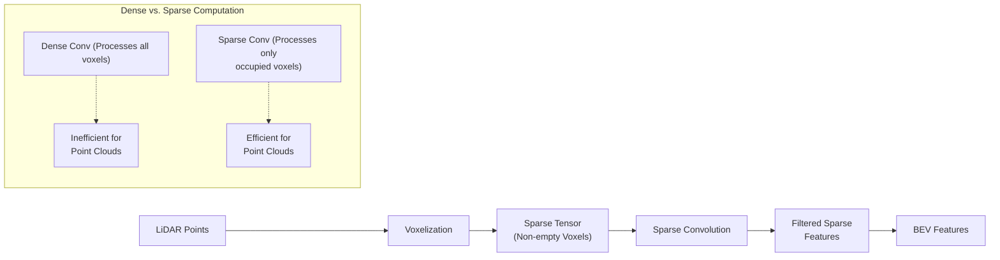
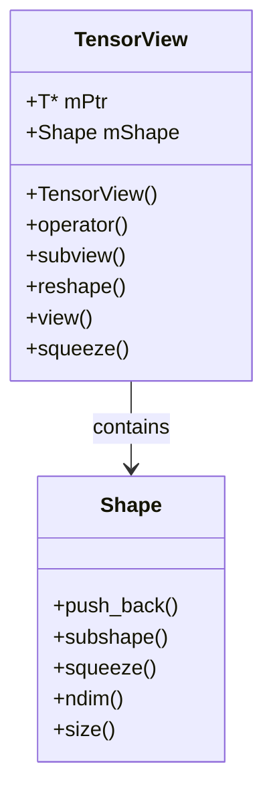
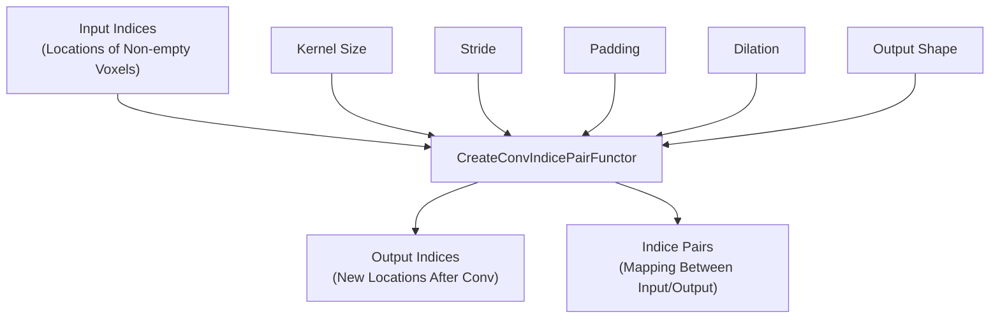
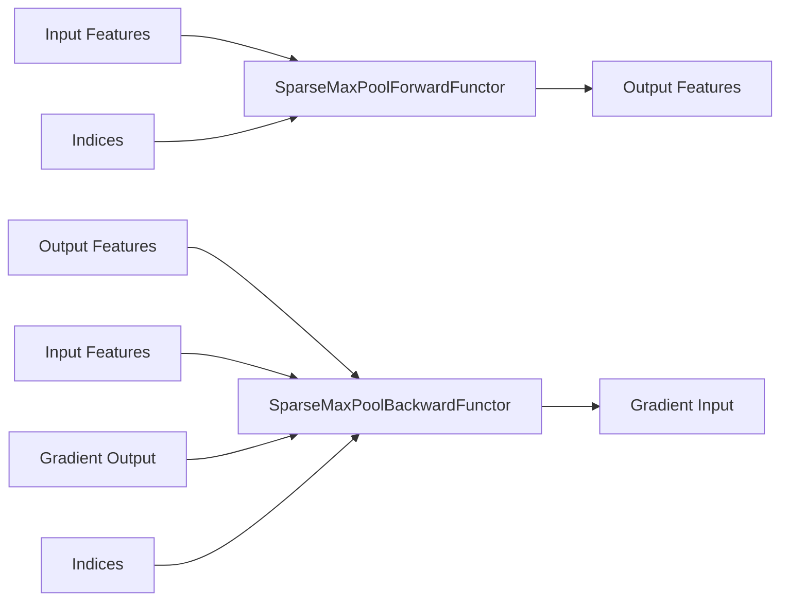
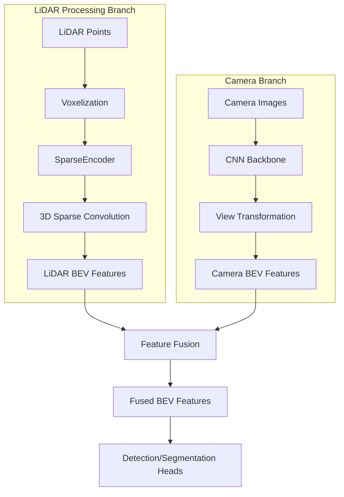
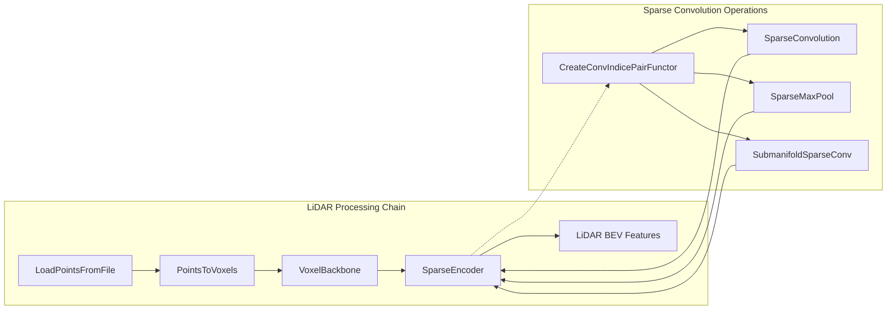

<!-- source: DeepWiki mcp.deepwiki.com · repo mit-han-lab/bevfusion · page 5.2 Sparse Convolution Operations · fetched 2026-10-30 -->

# Sparse Convolution Operations

<details>
<summary>Relevant source files</summary>

The following files were used as context for generating this wiki page:

- [mmdet3d/ops/spconv/include/tensorview/tensorview.h](mmdet3d/ops/spconv/include/tensorview/tensorview.h)
- [mmdet3d/ops/spconv/src/indice_cpu.cc](mmdet3d/ops/spconv/src/indice_cpu.cc)
- [mmdet3d/ops/spconv/src/maxpool_cpu.cc](mmdet3d/ops/spconv/src/maxpool_cpu.cc)

</details>


## Purpose and Overview

This document explains the sparse convolution operations used in BEVFusion for efficient processing of sparse point cloud data from LiDAR sensors. Sparse convolution is a key optimization that significantly improves computational efficiency by only processing non-zero elements in the input data, which is particularly important for LiDAR data where most of the 3D space is empty.

For information about general point cloud processing operations, see [Point Cloud Processing Operations](#5.1).

## Understanding Sparse Convolution

Traditional (dense) convolution operations process every element in an input tensor, which is inefficient for sparse data like point clouds. Sparse convolution addresses this by:

1. Only processing occupied voxels (non-zero elements)
2. Tracking the spatial relationships between these occupied voxels
3. Applying convolution operations only where data exists



Sources: [mmdet3d/ops/spconv/src/indice_cpu.cc:1-85]()

## Core Components of Sparse Convolution System

The sparse convolution system in BEVFusion consists of several key components:

### 1. Tensor Representation (TensorView)

`TensorView` is the fundamental data structure that handles tensor operations for sparse convolution:



Sources: [mmdet3d/ops/spconv/include/tensorview/tensorview.h:525-1061]()

### 2. Indice Generation

The indice generation system creates mappings between input and output sparse tensors for convolution operations:



Sources: [mmdet3d/ops/spconv/src/indice_cpu.cc:21-65]()

### 3. Sparse Operations

BEVFusion implements several sparse operations, including convolution and max pooling:

#### Sparse Max Pooling



Sources: [mmdet3d/ops/spconv/src/maxpool_cpu.cc:20-64]()

## Integration with BEVFusion Pipeline

Sparse convolution operations are a critical part of the LiDAR processing branch in BEVFusion:



## Technical Implementation Details

### Sparse Convolution Indexing

The core of sparse convolution is the creation of indice pairs that map between input and output locations:

1. For each occupied voxel in the input:
   - Calculate potential output locations based on kernel, stride, and dilation
   - Create mappings between input and output indices
   - Store only the non-empty relationships

2. Supported convolution types:
   - Regular sparse convolution (`getIndicePairsConv`)
   - Submanifold sparse convolution (`getIndicePairsSubM`)
   - Transposed sparse convolution (`getIndicePairsDeConv`)

```
For a 3x3 kernel in 2D sparse convolution:
- Each occupied input location potentially affects 9 output locations
- Only locations that interact with other occupied voxels are processed
```

Sources: [mmdet3d/ops/spconv/src/indice_cpu.cc:35-45]()

### CPU Implementation

The BEVFusion framework provides CPU implementations for sparse operations, making it possible to run on systems without GPU acceleration:

```cpp
// Example of sparse max pooling forward pass (simplified)
for (int row = 0; row < size; row++) {
  idxi = indicesIn[row] * stride;  // Input feature index
  idxo = indicesOut[row] * stride; // Output feature index
  for (int plane = 0; plane < stride; ++plane)
    if (outFeaturesData[idxo + plane] < inFeaturesData[idxi + plane])
      outFeaturesData[idxo + plane] = inFeaturesData[idxi + plane];
}
```

The implementation supports:
- Multiple dimensions (1D to 4D)
- Different index types (int, long)
- Various data types (float, double, half-precision)

Sources: [mmdet3d/ops/spconv/src/maxpool_cpu.cc:22-39](), [mmdet3d/ops/spconv/src/maxpool_cpu.cc:72-77]()

### Performance Considerations

Sparse convolution provides significant performance benefits over dense convolution for LiDAR data:

| Aspect | Dense Convolution | Sparse Convolution |
|--------|------------------|-------------------|
| Memory Usage | Proportional to volume (x×y×z) | Proportional to number of points |
| Computation | Processes all voxels | Processes only non-empty voxels |
| Scaling with Resolution | Poor (cubic growth) | Good (near-linear with points) |
| Implementation Complexity | Lower | Higher |

For typical autonomous driving LiDAR data with millions of points but billions of potential voxels, sparse convolution can be orders of magnitude more efficient.

## Relationship to Other Components

The sparse convolution operations sit within the LiDAR branch of BEVFusion's architecture:



Sources: [mmdet3d/ops/spconv/src/indice_cpu.cc:20-46](), [mmdet3d/ops/spconv/src/maxpool_cpu.cc:20-40]()

## Conclusion

Sparse convolution operations are a critical optimization in BEVFusion that enable efficient processing of LiDAR point cloud data. By focusing computation only on non-empty voxels, these operations dramatically reduce memory usage and computational requirements while preserving geometric information needed for accurate 3D object detection.

---

