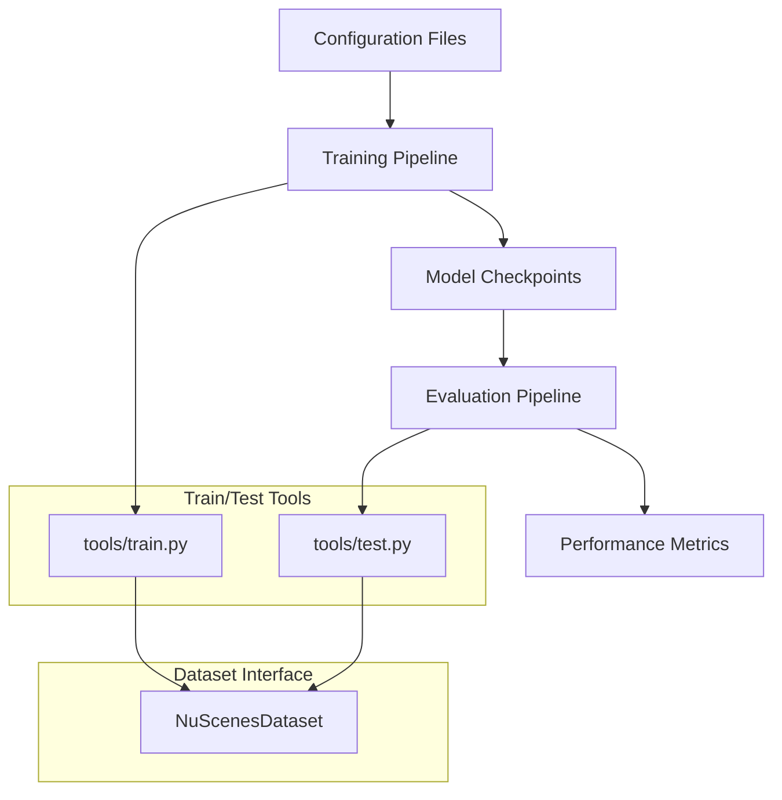
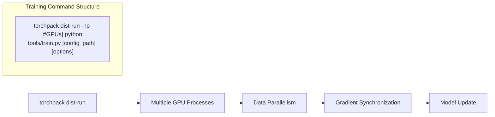
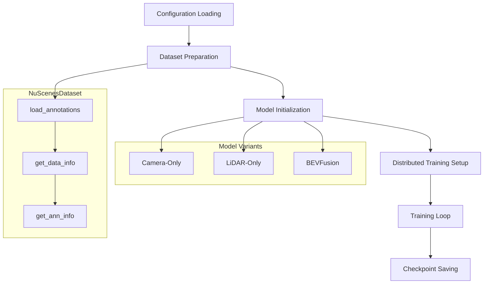
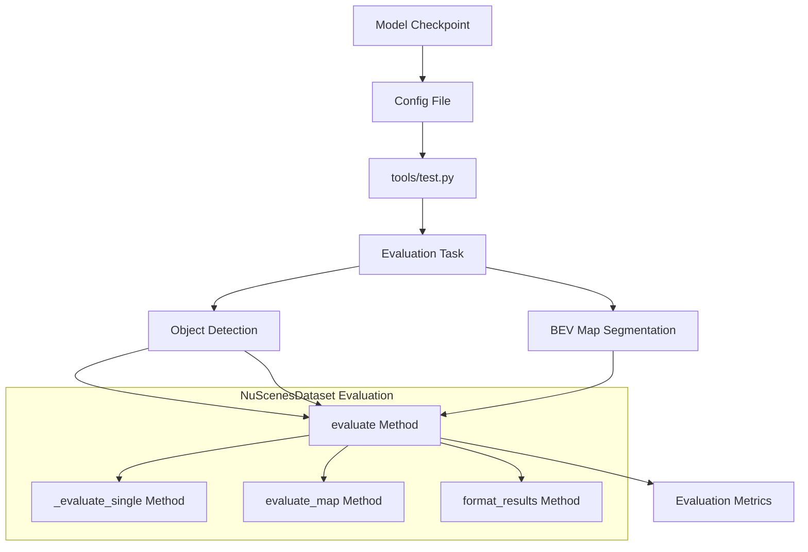
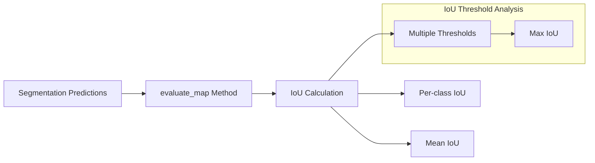

<!-- source: DeepWiki mcp.deepwiki.com · repo mit-han-lab/bevfusion · page 6 Training and Evaluation · fetched 2026-10-30 -->

# Training and Evaluation

<details>
<summary>Relevant source files</summary>

The following files were used as context for generating this wiki page:

- [README.md](README.md)
- [assets/demo.gif](assets/demo.gif)
- [docker/Dockerfile](docker/Dockerfile)
- [mmdet3d/datasets/nuscenes_dataset.py](mmdet3d/datasets/nuscenes_dataset.py)
- [mmdet3d/datasets/pipelines/utils.py](mmdet3d/datasets/pipelines/utils.py)

</details>


This document details the training and evaluation processes for the BEVFusion framework, a multi-sensor fusion system for 3D object detection and BEV map segmentation. It covers how to train different model variants (camera-only, LiDAR-only, and multi-modal fusion) and how to evaluate their performance using standard benchmarks.

## Overview

BEVFusion uses a distributed training framework based on torchpack and supports comprehensive evaluation on nuScenes and Waymo datasets. The system provides dedicated tools for both training new models and evaluating pre-trained checkpoints.



Sources: [README.md:156-193]()

## Training Pipeline

The training process in BEVFusion allows for training different model variants including camera-only, LiDAR-only, and multi-modal fusion models. The system uses PyTorch with distributed training support through torchpack.

### Distributed Training Framework

BEVFusion uses torchpack's `dist-run` command to facilitate distributed training across multiple GPUs, enabling efficient utilization of computational resources. The framework is built with OpenMPI integration for inter-process communication.



Sources: [README.md:156-193](), [docker/Dockerfile:3-23]()

### Model Initialization

BEVFusion supports initializing models from pre-trained checkpoints, which is particularly important for components like the Swin Transformer backbone. This transfer learning approach helps accelerate training and improve performance.

For example, when training a camera-only detector, the Swin Transformer backbone is initialized from a checkpoint pre-trained on nuImages:

```
--model.encoders.camera.backbone.init_cfg.checkpoint pretrained/swint-nuimages-pretrained.pth
```

When training fusion models, you can initialize from modality-specific pre-trained models:

```
--load_from pretrained/lidar-only-det.pth
```

Sources: [README.md:156-193]()

### Training Process Workflow



Sources: [README.md:156-193](), [mmdet3d/datasets/nuscenes_dataset.py:193-336]()

### Example Training Commands

BEVFusion provides dedicated training commands for different model variants:

1. **Camera-Only Detection**:
   ```bash
   torchpack dist-run -np 8 python tools/train.py configs/nuscenes/det/centerhead/lssfpn/camera/256x704/swint/default.yaml --model.encoders.camera.backbone.init_cfg.checkpoint pretrained/swint-nuimages-pretrained.pth
   ```

2. **Camera-Only BEV Segmentation**:
   ```bash
   torchpack dist-run -np 8 python tools/train.py configs/nuscenes/seg/camera-bev256d2.yaml --model.encoders.camera.backbone.init_cfg.checkpoint pretrained/swint-nuimages-pretrained.pth
   ```

3. **LiDAR-Only Detection**:
   ```bash
   torchpack dist-run -np 8 python tools/train.py configs/nuscenes/det/transfusion/secfpn/lidar/voxelnet_0p075.yaml
   ```

4. **LiDAR-Only BEV Segmentation**:
   ```bash
   torchpack dist-run -np 8 python tools/train.py configs/nuscenes/seg/lidar-centerpoint-bev128.yaml
   ```

5. **BEVFusion Detection**:
   ```bash
   torchpack dist-run -np 8 python tools/train.py configs/nuscenes/det/transfusion/secfpn/camera+lidar/swint_v0p075/convfuser.yaml --model.encoders.camera.backbone.init_cfg.checkpoint pretrained/swint-nuimages-pretrained.pth --load_from pretrained/lidar-only-det.pth
   ```

6. **BEVFusion Segmentation**:
   ```bash
   torchpack dist-run -np 8 python tools/train.py configs/nuscenes/seg/fusion-bev256d2-lss.yaml --model.encoders.camera.backbone.init_cfg.checkpoint pretrained/swint-nuimages-pretrained.pth
   ```

Sources: [README.md:156-193]()

## Evaluation Pipeline

The evaluation pipeline in BEVFusion provides a comprehensive framework for assessing model performance on various tasks, including 3D object detection and BEV map segmentation.

### Evaluation Process



Sources: [README.md:130-155](), [mmdet3d/datasets/nuscenes_dataset.py:410-572]()

### Object Detection Evaluation

For 3D object detection, BEVFusion uses the nuScenes evaluation protocols. The evaluation pipeline supports measuring metrics like mean Average Precision (mAP) and nuScenes Detection Score (NDS).

The object detection evaluation process involves:

1. Converting model outputs to nuScenes box format
2. Transforming predictions to global coordinate system
3. Calculating detection metrics including precision, recall, and error analysis

The evaluation metrics for object detection include:

| Metric | Description |
|--------|-------------|
| mAP | Mean Average Precision across classes |
| NDS | nuScenes Detection Score (composite metric) |
| mATE | Mean Average Translation Error |
| mASE | Mean Average Scale Error |
| mAOE | Mean Average Orientation Error |
| mAVE | Mean Average Velocity Error |
| mAAE | Mean Average Attribute Error |

Sources: [mmdet3d/datasets/nuscenes_dataset.py:410-465](), [README.md:22-41]()

### BEV Map Segmentation Evaluation

For BEV map segmentation, the evaluation focuses on the IoU (Intersection over Union) metric across different classes and thresholds.

The `evaluate_map` method calculates IoU metrics by:
1. Processing model predictions and ground truth masks
2. Computing true positives, false positives, and false negatives
3. Calculating IoU scores across different thresholds
4. Reporting per-class and mean IoU scores



Sources: [mmdet3d/datasets/nuscenes_dataset.py:498-530](), [README.md:52-59]()

### Example Evaluation Commands

BEVFusion provides the following commands for evaluating pre-trained models:

1. **Downloading Pre-trained Models**:
   ```bash
   ./tools/download_pretrained.sh
   ```

2. **Evaluating Detection Models**:
   ```bash
   torchpack dist-run -np 8 python tools/test.py configs/nuscenes/det/transfusion/secfpn/camera+lidar/swint_v0p075/convfuser.yaml pretrained/bevfusion-det.pth --eval bbox
   ```

3. **Evaluating Segmentation Models**:
   ```bash
   torchpack dist-run -np 8 python tools/test.py configs/nuscenes/seg/fusion-bev256d2-lss.yaml pretrained/bevfusion-seg.pth --eval map
   ```

The `--eval` flag specifies the evaluation metric, where `bbox` is used for object detection evaluation and `map` for BEV map segmentation evaluation.

Sources: [README.md:130-155]()

## Results and Benchmarks

BEVFusion reports state-of-the-art results on multiple benchmarks:

### 3D Object Detection (Waymo test)

| Model | mAP-L1 | mAPH-L1 | mAP-L2 | mAPH-L2 |
|-------|--------|---------|--------|---------|
| BEVFusion | 82.72 | 81.35 | 77.65 | 76.33 |
| BEVFusion-TTA | 86.04 | 84.76 | 81.22 | 79.97 |

### 3D Object Detection (nuScenes test)

| Model | Modality | mAP | NDS |
|-------|----------|-----|-----|
| BEVFusion-e | C+L | 74.99 | 76.09 |
| BEVFusion | C+L | 70.23 | 72.88 |
| BEVFusion-base* | C+L | 71.72 | 73.83 |

### 3D Object Detection (nuScenes validation)

| Model | Modality | mAP | NDS |
|-------|----------|-----|-----|
| BEVFusion | C+L | 68.52 | 71.38 |
| Camera-Only Baseline | C | 35.56 | 41.21 |
| LiDAR-Only Baseline | L | 64.68 | 69.28 |

### BEV Map Segmentation (nuScenes validation)

| Model | Modality | mIoU |
|-------|----------|------|
| BEVFusion | C+L | 62.95 |
| Camera-Only Baseline | C | 57.09 |
| LiDAR-Only Baseline | L | 48.56 |

Sources: [README.md:22-59]()

## Best Practices and Tips

1. **Training Order**: Start by training modality-specific models (camera-only and LiDAR-only) before training fusion models. This allows for better initialization of the fusion model.

2. **Evaluation Metrics**: Use the appropriate evaluation metric for each task:
   - `--eval bbox` for object detection
   - `--eval map` for BEV map segmentation

3. **Model Selection**: For best performance:
   - Use fusion models for both detection and segmentation tasks
   - Choose camera-only models when LiDAR is unavailable or for lower computational requirements
   - Use LiDAR-only models when camera data is unavailable or in low light conditions

4. **Final Evaluation**: Always run the test script separately after training to get the final evaluation metrics:
   ```bash
   torchpack dist-run -np 8 python tools/test.py [config_file] [checkpoint] --eval [metric]
   ```

Sources: [README.md:156-193]()

## Summary

The BEVFusion training and evaluation framework provides a comprehensive pipeline for developing multi-modal 3D perception models. The system supports training various model configurations, from single-modality to fusion models, and offers robust evaluation protocols for measuring performance on standard benchmarks.

By following the provided commands and guidelines, researchers and practitioners can train their own BEVFusion models and evaluate their performance on 3D object detection and BEV map segmentation tasks.

---

