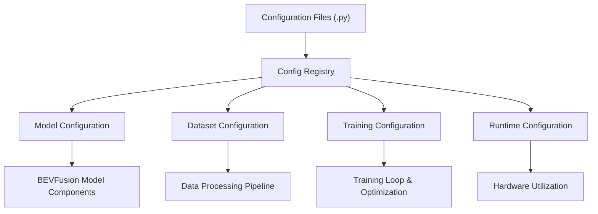
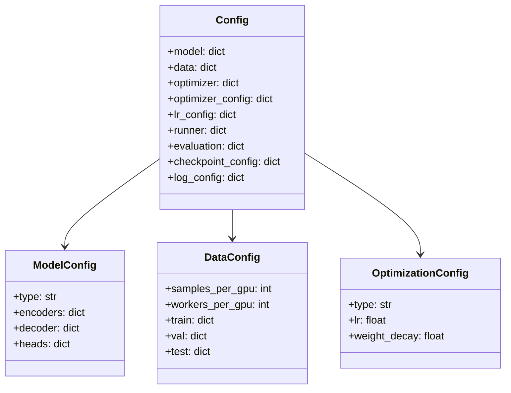
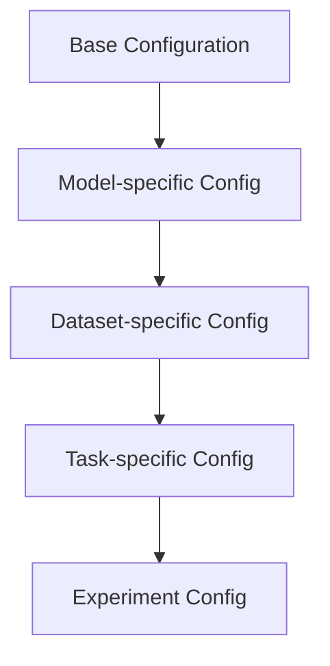
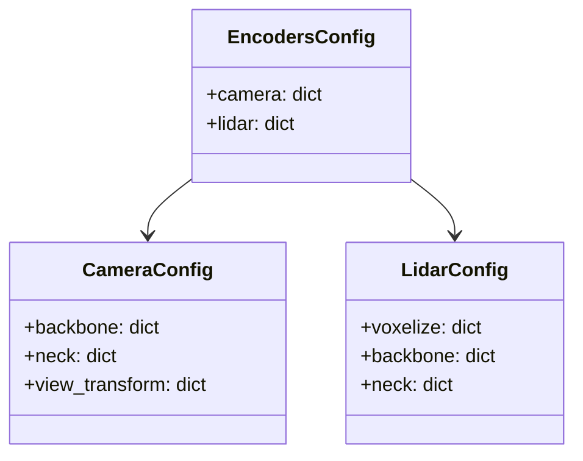
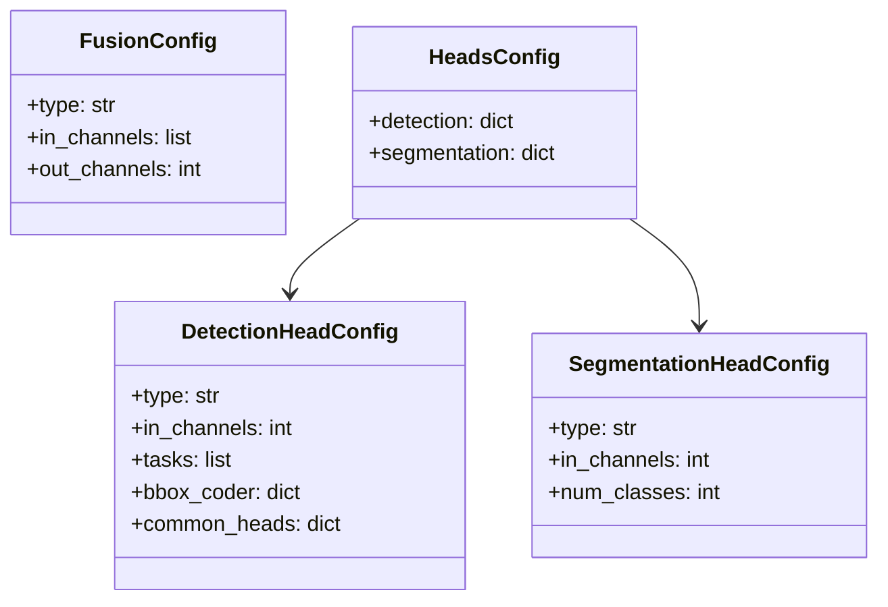
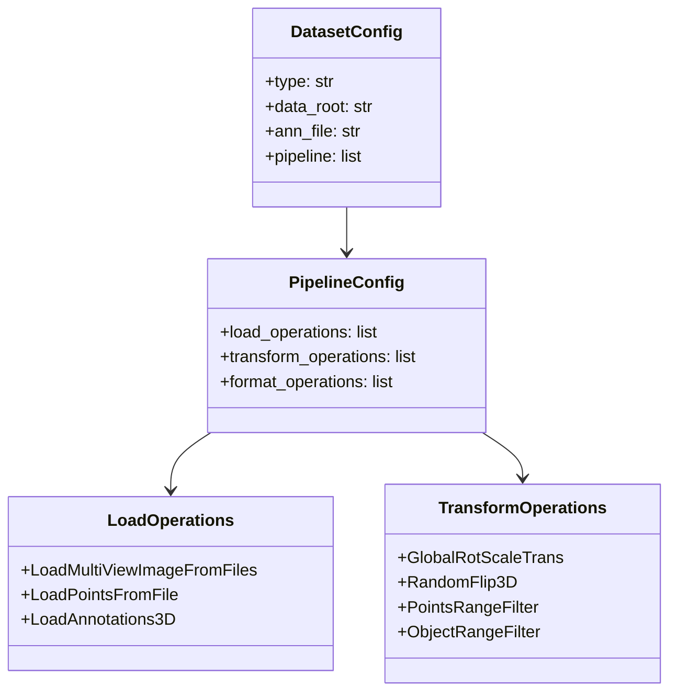

<!-- source: DeepWiki mcp.deepwiki.com · repo mit-han-lab/bevfusion · page 7 Configuration System · fetched 2026-10-30 -->

# Configuration System

<details>
<summary>Relevant source files</summary>

The following files were used as context for generating this wiki page:

- [.gitignore](.gitignore)

</details>


## Purpose and Scope

The Configuration System in BEVFusion provides a structured way to customize and control all aspects of the framework, from model architecture and data processing pipelines to training parameters and runtime settings. This document explains how the configuration system works, its components, and how to use it for different tasks, datasets, and hardware environments.

For information about deploying configured models, see [Deployment](#8).

## Configuration Overview

BEVFusion uses a configuration-based approach that separates model definition from execution code, allowing researchers and engineers to experiment with different architectures and parameters without modifying core code.



**Title: Configuration System Flow**

Sources: mmcv/mmcv/utils/config.py, tools/train.py

## Configuration File Structure

The configuration system uses Python files for defining configuration parameters. Each configuration file typically includes:



**Title: Configuration Component Relationships**

Sources: configs/nuscenes, configs/nuscenes/det

## Configuration Registry and Inheritance

BEVFusion's configuration system supports inheritance, allowing users to build configurations hierarchically:



**Title: Configuration Inheritance Structure**

Sources: configs/nuscenes/det/transfusion/secfpn, configs/nuscenes/det/centerhead

## Model Configuration Components

### Encoders Configuration



**Title: Encoder Configuration Structure**

Sources: mmdet3d/models/detectors/bevfusion.py

### Fusion and Decoder Configuration



**Title: Head Configuration Structure**

Sources: mmdet3d/models/fusion_layers, mmdet3d/models/heads

## Data Processing Configuration

The data configuration defines dataset specifics, preprocessing steps, and data loaders:



**Title: Data Pipeline Configuration**

Sources: mmdet3d/datasets/pipelines, configs/nuscenes

## Configuration Usage

### Basic Configuration Loading

The configuration system loads Python files using a utility from MMCV:

```python
from mmcv import Config
cfg = Config.fromfile('configs/nuscenes/det/transfusion/secfpn/camera+lidar/resnet50/convfuser.py')
```

### Command-line Modification

Configuration can be modified via command-line arguments using the `--cfg-options` flag:

```
python tools/train.py configs/nuscenes/det/transfusion/secfpn/camera+lidar/resnet50/convfuser.py \
    --cfg-options model.encoders.camera.backbone.type=ResNet101 \
    data.samples_per_gpu=2 \
    runner.max_epochs=24
```

Sources: tools/train.py

## Configuring Different Components

### LiDAR Encoder Configuration

The LiDAR encoder typically requires configuration for voxelization and point cloud processing:

```python
# Example LiDAR encoder configuration
lidar_encoder = dict(
    voxelize=dict(
        max_num_points=10,
        point_cloud_range=-54, -54, -5.0, 54, 54, 3.0],
        voxel_size=[0.075, 0.075, 0.2],
        max_voxels=(120000, 160000)
    ),
    backbone=dict(
        type='SparseEncoder',
        in_channels=5,
        sparse_shape=[41, 1440, 1440],
        output_channels=128,
        order=('conv', 'norm', 'act')
    )
)
```

Sources: mmdet3d/models/voxel_encoders, mmdet3d/models/middle_encoders

### Camera Encoder Configuration

Camera encoder configuration defines the image backbone and transformation to BEV space:

```python
# Example Camera encoder configuration
camera_encoder = dict(
    backbone=dict(
        type='ResNet',
        depth=50,
        num_stages=4,
        out_indices=(0, 1, 2, 3),
        frozen_stages=1,
        norm_cfg=dict(type='BN', requires_grad=False),
        norm_eval=True,
        style='caffe',
    ),
    neck=dict(
        type='FPN',
        in_channels=[256, 512, 1024, 2048],
        out_channels=256,
        num_outs=5
    ),
    view_transform=dict(
        type='LSSTransform',
        input_size=(256, 704),
        in_channels=256,
        out_channels=80
    )
)
```

Sources: mmdet3d/models/backbones, mmdet3d/models/view_transforms

### Fusion Configuration

Fusion configuration specifies how camera and LiDAR features are combined:

```python
# Example fusion configuration
fusion_layer = dict(
    type='ConvFuser',
    in_channels=[80, 256],  # camera, lidar channels
    out_channels=256
)
```

Sources: mmdet3d/models/fusion_layers

## Training Configuration

Training configuration includes optimizer settings, learning rate schedules, and other training parameters:

| Parameter | Description | Example Values |
|-----------|-------------|---------------|
| optimizer | Optimizer type and parameters | `dict(type='AdamW', lr=0.0001, weight_decay=0.01)` |
| lr_config | Learning rate schedule | `dict(policy='cyclic', target_ratio=(10, 0.0001), cyclic_times=1, step_ratio_up=0.4)` |
| runner | Training iterations | `dict(type='EpochBasedRunner', max_epochs=20)` |
| checkpoint_config | Checkpoint saving | `dict(interval=1)` |
| evaluation | Evaluation settings | `dict(interval=1, pipeline=test_pipeline)` |

Sources: configs/nuscenes/det/transfusion/secfpn

## Example Configuration

A complete BEVFusion configuration typically includes model definition, dataset configuration, and training parameters:

```python
# Model configuration
model = dict(
    type='BEVFusion',
    encoders=dict(
        camera=camera_encoder,  # As defined above
        lidar=lidar_encoder,    # As defined above
    ),
    fusion_layer=fusion_layer,  # As defined above
    decoder=dict(
        type='TransFusionDecoder',
        in_channels=256,
        out_channels=256
    ),
    heads=dict(
        detection=dict(
            type='CenterHead',
            in_channels=256,
            tasks=[
                dict(num_class=10, class_names=[...]),  # Classes list
            ],
            common_heads=dict(
                reg=(2, 2), height=(1, 2), dim=(3, 2), rot=(2, 2)
            ),
            bbox_coder=dict(
                type='CenterPointBBoxCoder',
                post_center_range=[-61.2, -61.2, -10.0, 61.2, 61.2, 10.0],
                max_num=500,
                score_threshold=0.1,
                pc_range=[-51.2, -51.2],
                out_size_factor=8,
                voxel_size=[0.1, 0.1]
            ),
            separate_head=dict(
                type='SeparateHead', init_bias=-2.19, final_kernel=3
            ),
            loss_cls=dict(type='GaussianFocalLoss', reduction='mean'),
            loss_bbox=dict(type='L1Loss', reduction='mean', loss_weight=0.25),
            norm_bbox=True
        ),
        segmentation=dict(
            type='MapHead',
            in_channels=256,
            num_classes=5,  # Map elements to segment
            loss_weight=10.0
        )
    )
)

# Dataset configuration
dataset_type = 'NuScenesDataset'
data_root = 'data/nuscenes/'
class_names = [...]  # List of class names

# Data processing pipelines
train_pipeline = [...]  # List of data processing operations
test_pipeline = [...]  # List of evaluation processing operations

data = dict(
    samples_per_gpu=2,
    workers_per_gpu=4,
    train=dict(
        type=dataset_type,
        data_root=data_root,
        ann_file=data_root + 'nuscenes_infos_train.pkl',
        pipeline=train_pipeline,
        classes=class_names,
    ),
    val=dict(
        type=dataset_type,
        data_root=data_root,
        ann_file=data_root + 'nuscenes_infos_val.pkl',
        pipeline=test_pipeline,
        classes=class_names,
    ),
    test=dict(
        type=dataset_type,
        data_root=data_root,
        ann_file=data_root + 'nuscenes_infos_val.pkl',
        pipeline=test_pipeline,
        classes=class_names,
    )
)

# Training configuration
optimizer = dict(
    type='AdamW',
    lr=0.0001,
    weight_decay=0.01,
    paramwise_cfg=dict(
        custom_keys=dict(
            backbone=dict(lr_mult=0.1),
        )
    )
)
optimizer_config = dict(grad_clip=dict(max_norm=35, norm_type=2))
lr_config = dict(
    policy='cyclic',
    target_ratio=(10, 0.0001),
    cyclic_times=1,
    step_ratio_up=0.4,
)
momentum_config = dict(
    policy='cyclic',
    target_ratio=(0.8947368421052632, 1),
    cyclic_times=1,
    step_ratio_up=0.4,
)
runner = dict(type='EpochBasedRunner', max_epochs=20)
```

Sources: configs/nuscenes/det/transfusion/secfpn

## Best Practices

### Configuration for Different Hardware

When configuring BEVFusion for different hardware environments:

| Parameter | Low-end Hardware | High-end Hardware |
|-----------|------------------|-------------------|
| samples_per_gpu | 1-2 | 4-8 |
| voxel_size | Larger (e.g., 0.1) | Smaller (e.g., 0.075) |
| max_voxels | Lower (e.g., 80000) | Higher (e.g., 160000) |
| backbone depth | Lighter (e.g., ResNet18) | Heavier (e.g., ResNet101) |
| fp16 | Enabled | Optional |

Sources: tools/train.py, configs/nuscenes

### Configuration for Different Tasks

1. **Detection-only**: Focus on CenterHead configuration, remove segmentation head
2. **Segmentation-only**: Focus on MapHead configuration, remove detection head
3. **Camera-only**: Configure only camera encoder, remove LiDAR components
4. **LiDAR-only**: Configure only LiDAR encoder, remove camera components
5. **Multi-modal fusion**: Configure both encoders and fusion layer

Sources: mmdet3d/models/detectors/bevfusion.py

## Troubleshooting Common Configuration Issues

| Issue | Possible Cause | Solution |
|-------|---------------|----------|
| Out of memory | Batch size too large | Reduce `samples_per_gpu` |
| Training instability | Learning rate too high | Adjust `lr_config` parameters |
| Slow training | Too many dataloader workers | Optimize `workers_per_gpu` |
| Poor performance | Incorrect point cloud range | Verify `point_cloud_range` matches dataset |
| Model loading error | Configuration mismatch | Ensure config matches saved checkpoint |

Sources: tools/train.py, mmdet3d/datasets

## Conclusion

The BEVFusion configuration system provides a flexible framework for customizing all aspects of the perception pipeline. Understanding how to properly configure each component allows researchers and engineers to adapt BEVFusion to different tasks, datasets, and hardware environments, enabling state-of-the-art 3D perception for autonomous driving applications.

---

