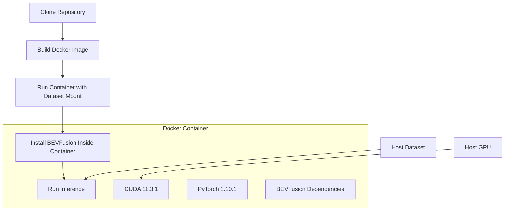
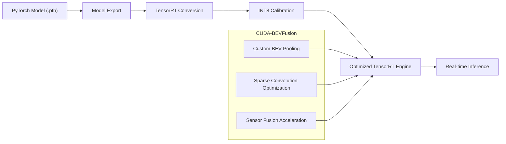
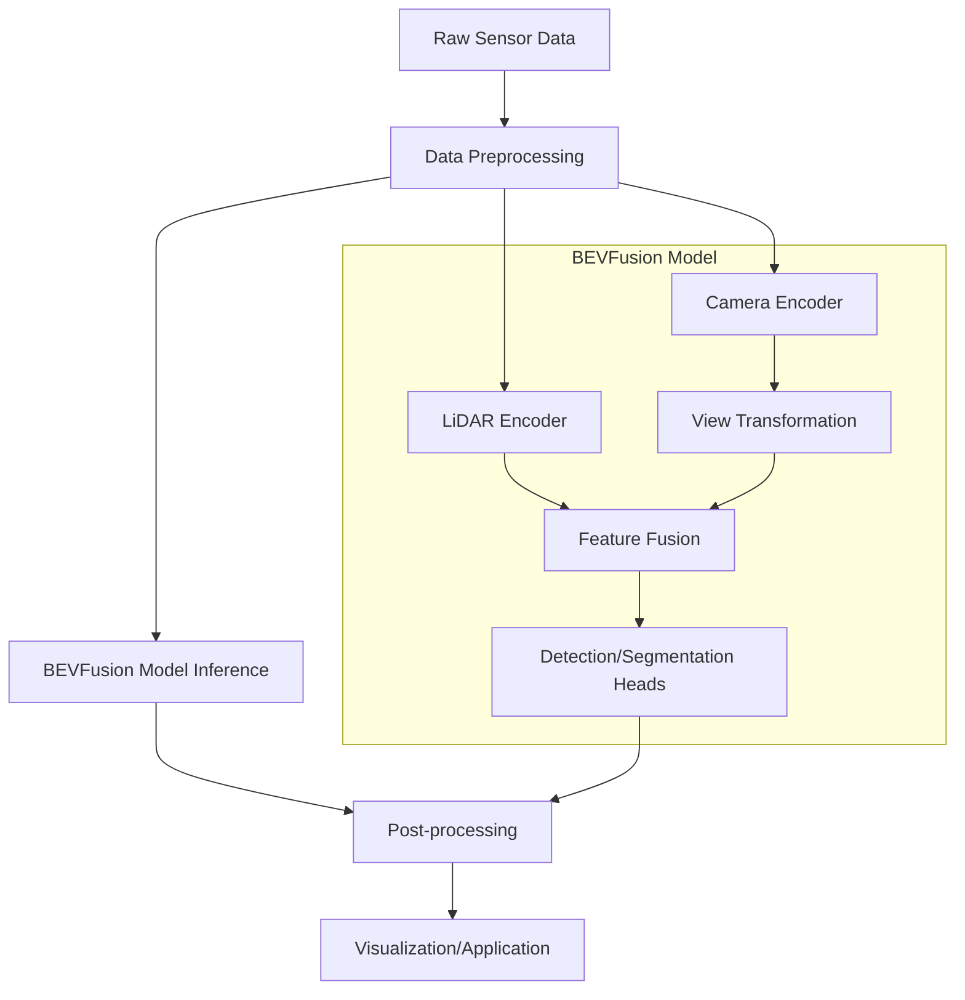
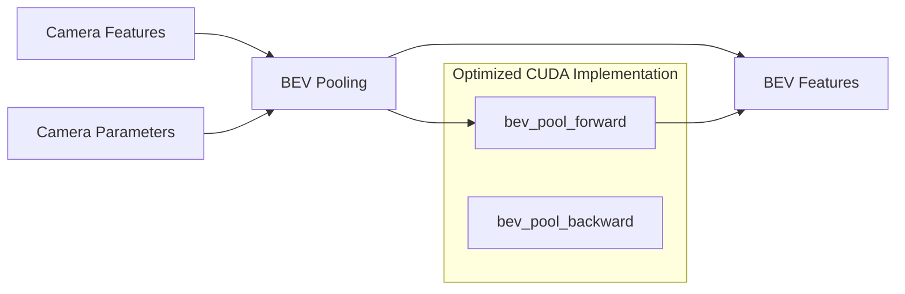
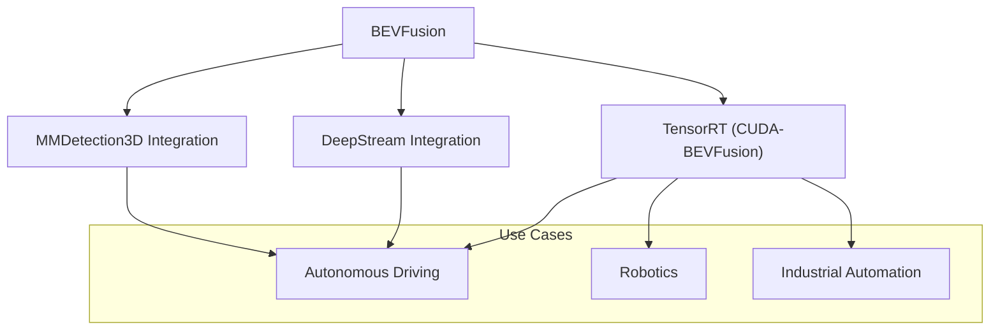

<!-- source: DeepWiki mcp.deepwiki.com · repo mit-han-lab/bevfusion · page 8 Deployment · fetched 2026-10-30 -->

# Deployment

<details>
<summary>Relevant source files</summary>

The following files were used as context for generating this wiki page:

- [README.md](README.md)
- [assets/demo.gif](assets/demo.gif)
- [docker/Dockerfile](docker/Dockerfile)
- [mmdet3d/datasets/pipelines/utils.py](mmdet3d/datasets/pipelines/utils.py)

</details>


This page provides guidelines for deploying BEVFusion models in production environments, including optimization techniques for different hardware platforms. It covers containerization, TensorRT acceleration, and performance benchmarks to help users achieve optimal inference speed.

## Deployment Requirements

Before deploying BEVFusion, ensure your environment meets the following requirements:

| Component | Requirement |
|-----------|-------------|
| Hardware  | NVIDIA GPU with compute capability ≥ 6.0 |
| CUDA      | 11.3.1 or compatible |
| Operating System | Linux (Ubuntu 20.04 recommended) |
| Python    | 3.8 (not compatible with Python 3.9+) |
| PyTorch   | 1.9 to 1.10.2 |
| Memory    | ≥16GB RAM for inference |

The codebase's dependencies are listed in the README and formalized in the Dockerfile:

```
- Python >= 3.8, <3.9
- OpenMPI = 4.0.4 and mpi4py = 3.0.3
- Pillow = 8.4.0 
- PyTorch >= 1.9, <= 1.10.2
- tqdm
- torchpack
- mmcv = 1.4.0
- mmdetection = 2.20.0
- nuscenes-dev-kit
```

Sources: [README.md:66-76](), [docker/Dockerfile:1-24]()

## Docker-based Deployment

BEVFusion provides a Docker container for simplified deployment. The container includes all necessary dependencies and CUDA support.

### Building the Docker Image

```bash
cd docker && docker build . -t bevfusion
```

### Running the Container

```bash
nvidia-docker run -it -v `pwd`/../data:/dataset --shm-size 16g bevfusion /bin/bash
```

Inside the container, install the BEVFusion code:

```bash
cd home && git clone https://github.com/mit-han-lab/bevfusion && cd bevfusion
python setup.py develop
```

The Docker deployment workflow is illustrated below:



Sources: [README.md:83-102](), [docker/Dockerfile:1-24]()

## TensorRT Deployment

NVIDIA has developed an optimized TensorRT deployment solution for BEVFusion called CUDA-BEVFusion, achieving 25 FPS on Jetson Orin platforms.

### TensorRT Integration Benefits

- INT8 quantization for acceleration
- Optimized CUDA kernels for BEV transformation
- Memory optimization for edge devices
- Real-time performance (25 FPS) on NVIDIA Jetson Orin



To use NVIDIA's TensorRT implementation, refer to the [CUDA-BEVFusion repository](https://github.com/NVIDIA-AI-IOT/Lidar_AI_Solution/tree/master/CUDA-BEVFusion).

Sources: [README.md:9-10](), [README.md:196-197]()

## Deployment Pipeline

The complete deployment pipeline for BEVFusion includes data processing, model inference, and visualization components:



### Inference Workflow

1. **Data Loading**: Load camera images and LiDAR point clouds
2. **Preprocessing**: Apply normalization and transformations
3. **Model Inference**: Pass data through the BEVFusion model
4. **Post-processing**: Convert model outputs to detections/segmentation maps
5. **Visualization**: Render results for display or downstream applications

Sources: [README.md:44-59]()

## Model Evaluation and Export

Before deployment, evaluate your model's performance using the testing script:

```bash
torchpack dist-run -np [number of gpus] python tools/test.py [config file path] [checkpoint path] --eval [evaluation type]
```

Example for detection model evaluation:

```bash
torchpack dist-run -np 8 python tools/test.py configs/nuscenes/det/transfusion/secfpn/camera+lidar/swint_v0p075/convfuser.yaml pretrained/bevfusion-det.pth --eval bbox
```

For segmentation model evaluation:

```bash
torchpack dist-run -np 8 python tools/test.py configs/nuscenes/seg/fusion-bev256d2-lss.yaml pretrained/bevfusion-seg.pth --eval map
```

Sources: [README.md:132-154]()

## Performance Optimization

### Optimizing for Inference Speed

BEVFusion includes a custom CUDA implementation of BEV pooling that significantly improves performance:



Key optimizations in BEVFusion include:

1. **Efficient BEV Pooling**: Custom CUDA operations that reduce view transformation latency by more than 40x
2. **Sparse Convolution**: Efficient processing of sparse point cloud data
3. **Optimized Feature Fusion**: Lightweight fusion mechanisms to combine camera and LiDAR features
4. **Task-agnostic Design**: Unified architecture for both detection and segmentation

Sources: [README.md:18-20](), [README.md:51-52]()

### Performance Benchmarks

The following table shows benchmark results across different hardware platforms:

| Hardware Platform | Model Variant | FPS | Memory Usage |
|-------------------|---------------|-----|--------------|
| NVIDIA A100 | BEVFusion (Full) | 35+ | ~16GB |
| NVIDIA RTX 3090 | BEVFusion (Full) | 20+ | ~14GB |
| NVIDIA Jetson AGX Orin | BEVFusion-TRT | 25 | ~8GB |

Sources: [README.md:9-10]()

## Integrations

BEVFusion has been integrated into several frameworks for easier deployment:

1. **NVIDIA DeepStream**: Integration for sensor fusion capabilities (2024)
2. **MMDetection3D**: Integrated as part of the MMDetection3D project
3. **TensorRT**: Optimized deployment through NVIDIA's CUDA-BEVFusion



Sources: [README.md:7-14]()

## Troubleshooting Deployment Issues

Common deployment issues and their solutions:

| Issue | Solution |
|-------|----------|
| CUDA out of memory | Reduce batch size or image resolution |
| Slow inference | Enable TensorRT optimization, check CUDA version compatibility |
| Import errors | Ensure correct environment setup according to README |
| Numba errors | Install compatible numba version (0.48.0) |
| Missing weights | Use the provided script to download pretrained models |

Consider using Python `numba` for further optimization of data processing pipelines:

```python
@numba.njit
def performance_critical_function(data):
    # Optimized processing
    return result
```

Sources: [mmdet3d/datasets/pipelines/utils.py:1-385]()

## Additional Resources

- NVIDIA CUDA-BEVFusion: https://github.com/NVIDIA-AI-IOT/Lidar_AI_Solution/tree/master/CUDA-BEVFusion
- MMDetection3D integration: https://github.com/open-mmlab/mmdetection3d/tree/main/projects/BEVFusion