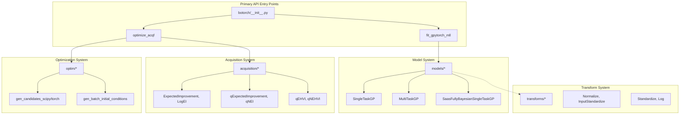
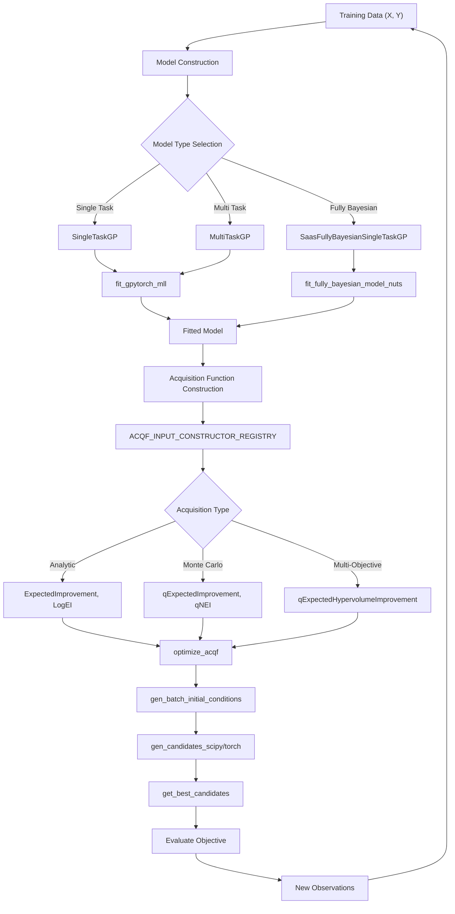
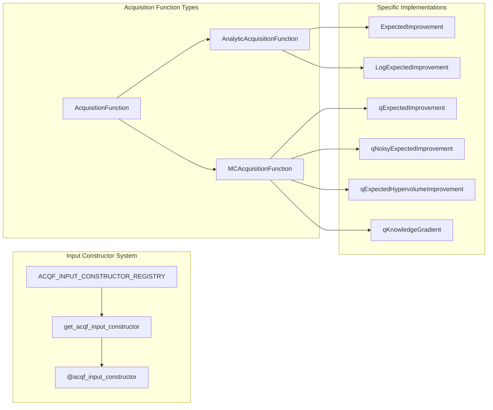
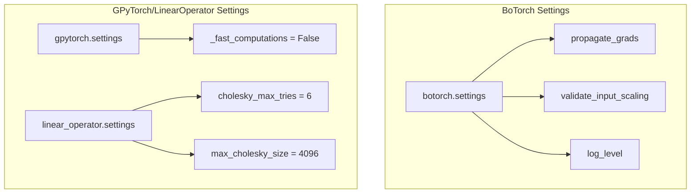

<!-- source: DeepWiki mcp.deepwiki.com · repo pytorch/botorch · page 1 Overview · fetched 2026-10-21 -->

# Overview

Relevant source files

The following files were used as context for generating this wiki page:

- [CHANGELOG.md](CHANGELOG.md)
- [README.md](README.md)
- [botorch/__init__.py](botorch/__init__.py)
- [botorch/settings.py](botorch/settings.py)
- [test/test_settings.py](test/test_settings.py)

## Purpose and Scope

This document provides a comprehensive overview of BoTorch, a library for Bayesian Optimization built on PyTorch. BoTorch serves as a modular, extensible framework for composing Bayesian optimization primitives including probabilistic models, acquisition functions, and optimizers. This overview covers the core architecture, main components, and how they integrate to form complete Bayesian optimization workflows.

For specific implementation details of individual systems, see the following pages:
- For model implementations and fitting procedures, see [Models](#2)
- For input/output preprocessing, see [Transforms](#3) 
- For acquisition function details and construction, see [Acquisition Functions](#4)
- For candidate optimization and constraint handling, see [Optimization](#5)
- For testing infrastructure and development tools, see [Utilities](#6)

## Architecture Overview

BoTorch's architecture centers around a standard Bayesian optimization loop with modular, interchangeable components. The framework provides both low-level primitives for researchers and higher-level convenience functions for practitioners.

### Core Framework Components

**Sources**: [botorch/__init__.py:9-67](), [README.md:23-38]()

### Bayesian Optimization Workflow

BoTorch implements the standard Bayesian optimization loop through a series of modular steps that can be customized and extended:

**Sources**: [README.md:128-170](), [botorch/__init__.py:18-24]()

## Core Components

### Models and Model Fitting

BoTorch's model system provides Gaussian Process models with extensive customization through transforms and kernels. The primary entry point for model fitting is `fit_gpytorch_mll`:

| Model Type | Class | Use Case |
|------------|-------|----------|
| Single Task | `SingleTaskGP` | Standard GP regression |
| Multi Task | `MultiTaskGP` | Multi-task learning |
| Fully Bayesian | `SaasFullyBayesianSingleTaskGP` | Uncertainty over hyperparameters |
| Multi Fidelity | `SingleTaskMultiFidelityGP` | Variable fidelity optimization |

The framework automatically applies sensible defaults including dimension-scaled priors and outcome standardization for robust performance across problem dimensions.

**Sources**: [botorch/__init__.py:19](), [README.md:132-153]()

### Acquisition Functions and Input Constructors

BoTorch provides a comprehensive acquisition function ecosystem with automatic construction via a registry pattern:

The registry system enables automatic acquisition function construction with appropriate default parameters based on the model and problem characteristics.

**Sources**: [README.md:155-170]()

### Optimization Infrastructure

The optimization system handles candidate generation with support for various constraint types and optimization algorithms:

| Function | Purpose | Constraints Supported |
|----------|---------|---------------------|
| `optimize_acqf` | Main optimization entry point | Linear, nonlinear, mixed |
| `gen_candidates_scipy` | SciPy-based optimization | All constraint types |
| `gen_candidates_torch` | PyTorch-based optimization | Differentiable constraints |
| `gen_batch_initial_conditions` | Smart initialization | Box bounds |

**Sources**: [botorch/__init__.py:20-24](), [README.md:162-170]()

## Configuration and Settings

BoTorch provides global configuration through the `settings` module for controlling framework behavior:

BoTorch automatically configures GPyTorch and LinearOperator settings for robustness in Bayesian optimization loops, disabling fast approximations that can be numerically unstable.

**Sources**: [botorch/__init__.py:36-49](), [botorch/settings.py:16-97]()

## Integration with PyTorch Ecosystem

BoTorch leverages PyTorch's features extensively:

- **Auto-differentiation**: Enables gradient-based acquisition function optimization
- **GPU Support**: Device-agnostic code for accelerated computation  
- **Dynamic Computation Graphs**: Supports flexible model architectures
- **Reparameterization Trick**: Enables Monte Carlo acquisition functions

The framework integrates with GPyTorch for probabilistic models and supports seamless integration with deep learning architectures.

**Sources**: [README.md:28-38]()

## Target Audience and Usage Patterns

BoTorch is designed as a low-level API for:

- **Researchers**: Implementing new Bayesian optimization algorithms
- **Sophisticated Practitioners**: Customizing optimization workflows
- **Framework Developers**: Building higher-level optimization platforms

For end-users seeking a complete optimization platform, BoTorch recommends using Ax, which provides a higher-level interface while leveraging BoTorch's primitives.

**Sources**: [README.md:41-51]()

---

