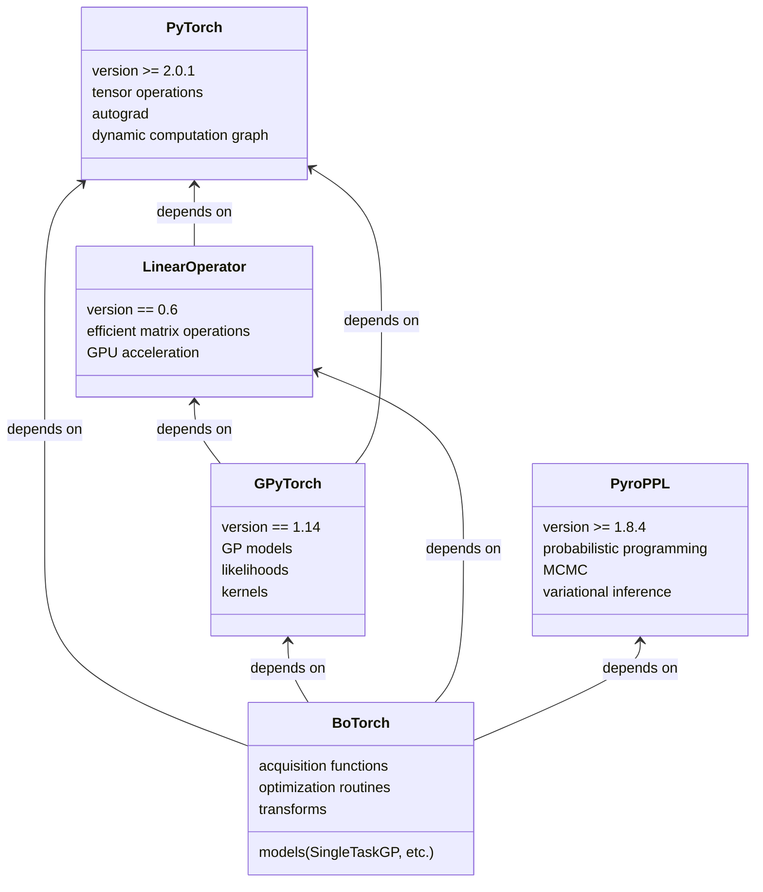
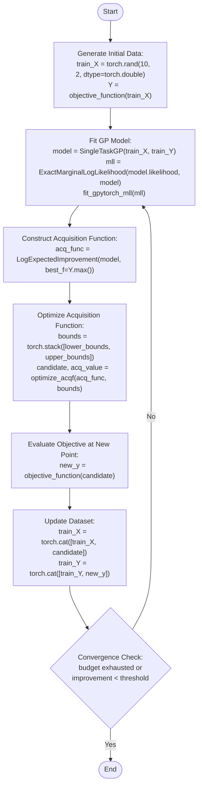

<!-- source: DeepWiki mcp.deepwiki.com · repo pytorch/botorch · page 1.1 Installation and Getting Started · fetched 2026-10-21 -->

# Installation and Getting Started

<details>
<summary>Relevant source files</summary>

The following files were used as context for generating this wiki page:

- [README.md](README.md)

</details>


This page provides comprehensive instructions for installing BoTorch and running your first Bayesian optimization loop. It covers system requirements, installation methods, and basic usage patterns to help you start using BoTorch for Bayesian optimization.

For more detailed information about BoTorch concepts and components, see [Key Concepts](#1.2).

## System Requirements

BoTorch has the following core dependencies:

| Dependency | Required Version |
|------------|------------------|
| Python | >= 3.10 |
| PyTorch | >= 2.0.1 |
| gpytorch | == 1.14 |
| linear_operator | == 0.6 |
| pyro-ppl | >= 1.8.4 |
| scipy | * |
| multiple-dispatch | * |
| threadpoolctl | * |

*\* No specific version requirement*

Sources: [README.md:56-64](), [requirements.txt:1-10](), [setup.py:13-14]()

## Installation Methods

### Diagram: BoTorch Installation Options

```mermaid
flowchart TD
    Start([Start Installation]) --> ChooseMethod{"Choose Installation Method"}
    
    ChooseMethod -->|"Option 1:\nLatest Release"| PIP["pip install botorch"]
    ChooseMethod -->|"Option 1:\nVia conda-forge"| Conda["conda install botorch -c gpytorch -c conda-forge"]
    
    ChooseMethod -->|"Option 2:\nLatest Main Branch"| DevDeps["Install dependencies first:
    pip install --upgrade git+https://github.com/cornellius-gp/linear_operator.git
    pip install --upgrade git+https://github.com/cornellius-gp/gpytorch.git"]
    
    DevDeps --> DevInstall["Set env variable and install BoTorch:
    export ALLOW_LATEST_GPYTORCH_LINOP=true
    pip install --upgrade git+https://github.com/pytorch/botorch.git"]
    
    ChooseMethod -->|"Option 3:\nFor Contributors"| Clone["git clone https://github.com/pytorch/botorch.git
    cd botorch"]
    
    Clone --> BasicEditable["Option 3a: Basic Editable Install
    pip install -e ."]
    
    Clone --> FullEditable["Option 3b: With Development Dependencies
    export ALLOW_BOTORCH_LATEST=true
    pip install -e \".[dev, tutorials]\""]
    
    PIP --> Complete([Installation Complete])
    Conda --> Complete
    DevInstall --> Complete
    BasicEditable --> Complete
    FullEditable --> Complete
```

Sources: [README.md:66-127]()

### Option 1: Installing the Latest Release

The simplest way to install BoTorch is via `pip`:

```bash
pip install botorch
```

BoTorch is also available via conda-forge:

```bash
conda install botorch -c gpytorch -c conda-forge
```

Note: Official Anaconda packages were discontinued after the 0.12 release, but users can still install from the conda-forge channel.

Sources: [README.md:66-83]()

### Option 2: Installing from Latest Main Branch

For access to bleeding-edge features (which may occasionally contain bugs), install directly from GitHub:

```bash
pip install --upgrade git+https://github.com/cornellius-gp/linear_operator.git
pip install --upgrade git+https://github.com/cornellius-gp/gpytorch.git
export ALLOW_LATEST_GPYTORCH_LINOP=true
pip install --upgrade git+https://github.com/pytorch/botorch.git
```

The `ALLOW_LATEST_GPYTORCH_LINOP` environment variable allows installation with the latest development versions of GPyTorch and LinearOperator.

Sources: [README.md:85-97]()

### Option 3: Editable/Development Install

If you want to contribute to BoTorch, an editable install is recommended:

#### Option 3a: Basic Editable Install

```bash
git clone https://github.com/pytorch/botorch.git
cd botorch
pip install -e .
```

#### Option 3b: Editable Install with Development Dependencies

```bash
git clone https://github.com/pytorch/botorch.git
cd botorch
export ALLOW_BOTORCH_LATEST=true
pip install -e ".[dev, tutorials]"
```

- `dev`: Installs tools necessary for development (testing, linting, docs building)
- `tutorials`: Installs packages necessary for running the tutorial notebooks

Sources: [README.md:99-127](), [setup.py:109-112]()

## BoTorch Dependency Architecture



Sources: [requirements.txt:1-10](), [setup.py:60-73]()

## Getting Started with BoTorch

Here's a quick walkthrough of the main components of a Bayesian optimization loop using BoTorch:

### Diagram: Bayesian Optimization Workflow in BoTorch



Sources: [README.md:130-174]()

### Step 1: Fit a Gaussian Process Model

```python
import torch
from botorch.models import SingleTaskGP
from botorch.models.transforms import Normalize, Standardize
from botorch.fit import fit_gpytorch_mll
from gpytorch.mlls import ExactMarginalLogLikelihood

# Double precision is highly recommended for GPs
train_X = torch.rand(10, 2, dtype=torch.double) * 2
Y = 1 - (train_X - 0.5).norm(dim=-1, keepdim=True)  # explicit output dimension
Y += 0.1 * torch.rand_like(Y)

gp = SingleTaskGP(
    train_X=train_X,
    train_Y=Y,
    input_transform=Normalize(d=2),
    outcome_transform=Standardize(m=1),
)
mll = ExactMarginalLogLikelihood(gp.likelihood, gp)
fit_gpytorch_mll(mll)
```

In this step, we:
1. Create synthetic training data
2. Initialize a `SingleTaskGP` model with input and outcome transforms
3. Create a marginal log likelihood (MLL) object
4. Optimize the model hyperparameters using `fit_gpytorch_mll`

Sources: [README.md:136-156]()

### Step 2: Construct an Acquisition Function

```python
from botorch.acquisition import LogExpectedImprovement

logEI = LogExpectedImprovement(model=gp, best_f=Y.max())
```

Acquisition functions evaluate how promising each point in the search space is for evaluation. Here we use `LogExpectedImprovement`, a numerically stable variant of Expected Improvement.

Sources: [README.md:158-164]()

### Step 3: Optimize the Acquisition Function

```python
from botorch.optim import optimize_acqf

bounds = torch.stack([torch.zeros(2), torch.ones(2)]).to(torch.double)
candidate, acq_value = optimize_acqf(
    logEI, bounds=bounds, q=1, num_restarts=5, raw_samples=20,
)
```

This step finds the point that maximizes the acquisition function within the specified bounds. The returned `candidate` is the point recommended for the next function evaluation.

Sources: [README.md:166-174]()

## Important Notes

1. **Double Precision**: Double precision (`torch.double`) is highly recommended for Gaussian Processes to ensure numerical stability.

2. **Integration with Ax**: BoTorch is designed to work as a low-level API for [Ax](https://ax.dev), which provides a more user-friendly interface. If you're not actively researching Bayesian optimization algorithms, you might find Ax easier to use.

3. **Target Audience**: The primary audience for hands-on use of BoTorch are researchers and sophisticated practitioners in Bayesian Optimization and AI.

Sources: [README.md:41-51](), [README.md:143-144]()

## Next Steps

After installing BoTorch and understanding the basic workflow, you can:

1. Explore the [Tutorials and Examples](#1.3) to learn more about BoTorch's capabilities
2. Read about [Key Concepts](#1.2) to deepen your understanding of Bayesian optimization with BoTorch
3. Explore specific [Models](#2) and [Acquisition Functions](#4) documentation to learn about available options

---

