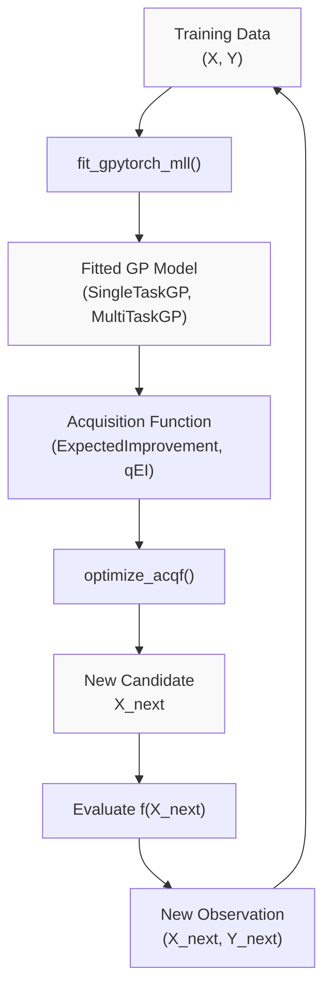
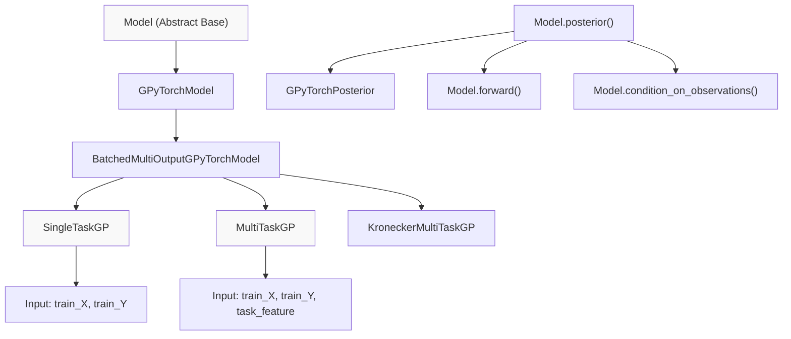
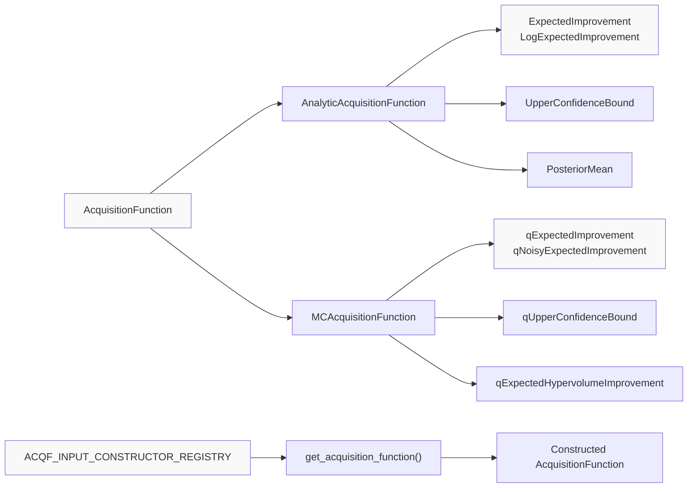
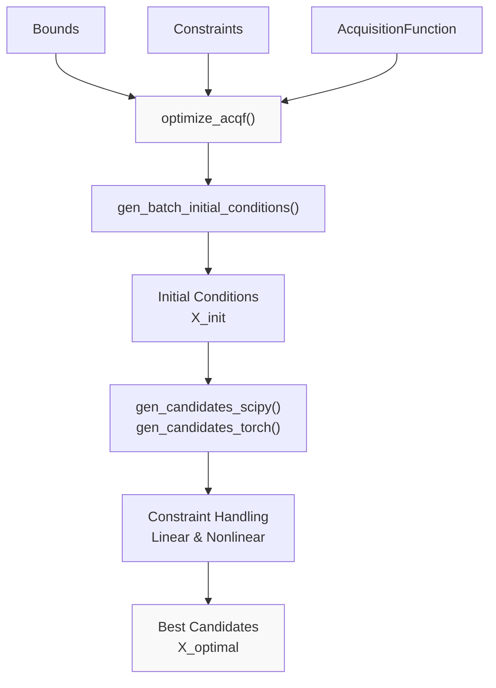
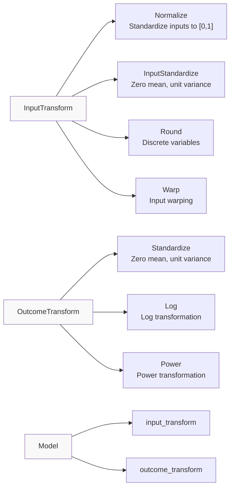
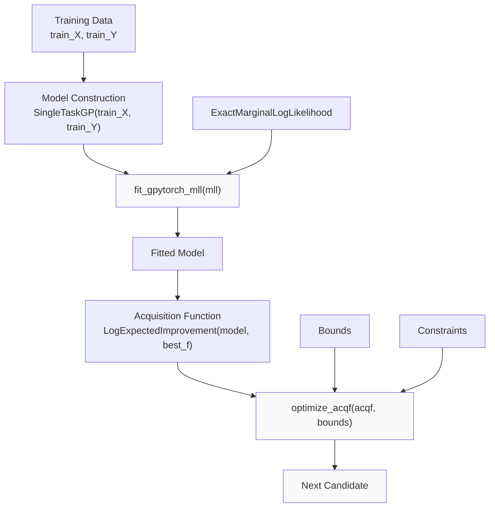
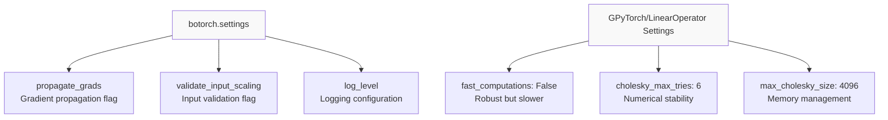

<!-- source: DeepWiki mcp.deepwiki.com · repo pytorch/botorch · page 1.2 Key Concepts · fetched 2026-10-21 -->

# Key Concepts

<details>
<summary>Relevant source files</summary>

The following files were used as context for generating this wiki page:

- [CHANGELOG.md](CHANGELOG.md)
- [README.md](README.md)
- [botorch/__init__.py](botorch/__init__.py)
- [botorch/settings.py](botorch/settings.py)
- [test/test_settings.py](test/test_settings.py)

</details>


This document explains the fundamental concepts of Bayesian optimization as implemented in BoTorch, covering the core abstractions, components, and workflow that form the foundation of the library. For installation instructions and your first optimization loop, see [Installation and Getting Started](#1.1). For hands-on examples, see [Tutorials and Examples](#1.3).

## Bayesian Optimization Fundamentals

Bayesian optimization is a sequential design strategy for optimizing expensive-to-evaluate black-box functions. BoTorch implements this through a modular framework with three core components that work together in an iterative loop:



Sources: [README.md:128-171](), [botorch/__init__.py:19-24]()

## Core Components

### Models: Probabilistic Surrogates

BoTorch uses Gaussian Process (GP) models as probabilistic surrogates for the unknown objective function. These models provide both mean predictions and uncertainty estimates that are crucial for acquisition function evaluation.



The primary model classes are:
- `SingleTaskGP`: Standard GP for single-output regression
- `MultiTaskGP`: Multi-task learning with shared information across tasks  
- `ModelListGP`: Independent models for different outputs
- Fully Bayesian models like `SaasFullyBayesianSingleTaskGP`

Sources: [README.md:132-153](), Architecture diagrams

### Acquisition Functions: Balancing Exploration and Exploitation

Acquisition functions use the model's posterior to determine the next point to evaluate. They balance exploration (high uncertainty) with exploitation (high predicted value).



Key acquisition function families:
- **Analytic**: Closed-form solutions for single-point optimization (`ExpectedImprovement`, `LogExpectedImprovement`)
- **Monte Carlo**: Batch optimization using sampling (`qExpectedImprovement`, `qNoisyExpectedImprovement`)  
- **Multi-objective**: For multiple competing objectives (`qExpectedHypervolumeImprovement`)
- **Knowledge Gradient**: Information-theoretic approach (`qKnowledgeGradient`)

Sources: [README.md:155-160](), Architecture diagrams

### Optimization: Finding Optimal Candidates

The `optimize_acqf` function finds the point that maximizes the acquisition function, typically the most computationally expensive step in the BO loop.



The optimization process involves:
- **Initial conditions**: Smart initialization using `gen_batch_initial_conditions`
- **Candidate generation**: Scipy/PyTorch-based optimizers via `gen_candidates_scipy`/`gen_candidates_torch`
- **Constraint handling**: Support for linear, nonlinear, and mixed constraints
- **Multi-start optimization**: Multiple restarts for global optimization

Sources: [README.md:162-170](), [botorch/__init__.py:20-24]()

### Transforms: Data Preprocessing

Transforms normalize inputs and standardize outputs to improve numerical stability and model performance.



Transform types:
- **Input transforms**: Applied to input data before model training/prediction
- **Outcome transforms**: Applied to target values, automatically inverted for predictions
- **Chaining**: Multiple transforms can be composed using `ChainedInputTransform`

Sources: [README.md:136-150](), Architecture diagrams

## Main API Workflow

The core BoTorch workflow involves two primary functions that encapsulate the Bayesian optimization loop:



### Model Fitting with `fit_gpytorch_mll`

The `fit_gpytorch_mll` function handles GP model training with robust error handling and multiple optimization attempts:

```python
# From README.md example
mll = ExactMarginalLogLikelihood(gp.likelihood, gp)
fit_gpytorch_mll(mll)
```

Key features:
- Multiple-dispatch on model types for custom fitting routines
- Automatic retry on optimization failures  
- Restoration of module states on failed attempts
- Support for fully Bayesian models via `fit_fully_bayesian_model_nuts`

### Acquisition Optimization with `optimize_acqf`

The `optimize_acqf` function maximizes acquisition functions with sophisticated optimization strategies:

```python
# From README.md example  
candidate, acq_value = optimize_acqf(
    logEI, bounds=bounds, q=1, num_restarts=5, raw_samples=20,
)
```

Key parameters:
- `q`: Batch size for joint optimization
- `num_restarts`: Number of optimization restarts
- `raw_samples`: Initial candidate pool size
- Support for linear/nonlinear constraints

Sources: [README.md:132-171](), [botorch/__init__.py:19-24]()

## Configuration and Settings

BoTorch provides global settings to control numerical behavior and optimization strategies:



Default configurations prioritize numerical stability over speed:
- **Fast computations disabled**: BoTorch disables GPyTorch's approximate methods for robustness
- **Input validation**: Automatic checking of data normalization and standardization
- **Increased retry attempts**: More Cholesky decomposition attempts for difficult problems

Key settings classes:
- `propagate_grads`: Context manager for gradient propagation through training data
- `validate_input_scaling`: Ensures proper input/output scaling
- `log_level`: Controls verbosity of BoTorch operations

Sources: [botorch/settings.py:16-97](), [botorch/__init__.py:36-49](), [test/test_settings.py:26-33]()

---

