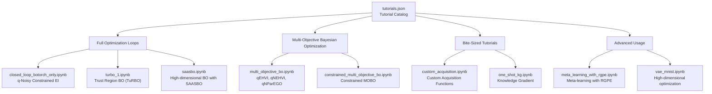
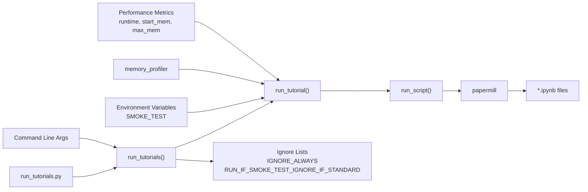
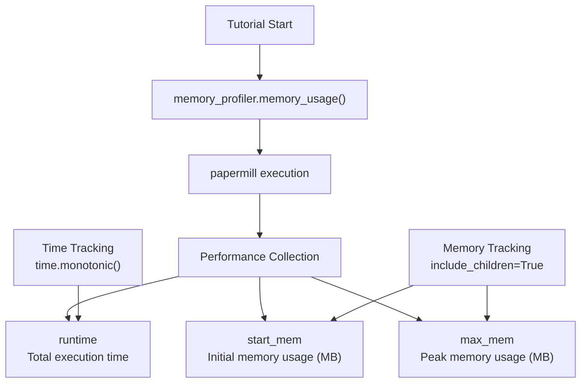
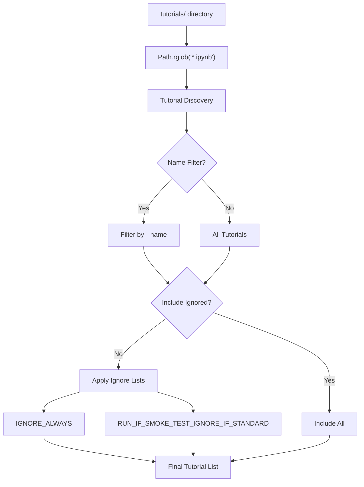
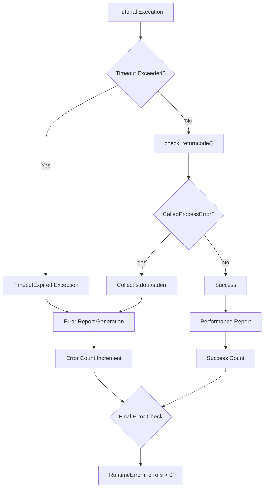

<!-- source: DeepWiki mcp.deepwiki.com · repo pytorch/botorch · page 1.3 Tutorials and Examples · fetched 2026-10-21 -->

# Tutorials and Examples

<details>
<summary>Relevant source files</summary>

The following files were used as context for generating this wiki page:

- [scripts/run_tutorials.py](scripts/run_tutorials.py)
- [website/tutorials.json](website/tutorials.json)

</details>


This page documents BoTorch's comprehensive tutorial system, including available tutorials organized by category, the tutorial execution infrastructure, and how to run tutorials for learning or testing purposes. For information about the core Bayesian optimization concepts demonstrated in these tutorials, see [Key Concepts](#1.2). For installation instructions needed before running tutorials, see [Installation and Getting Started](#1.1).

## Tutorial Categories and Structure

BoTorch provides over 35 tutorials organized into four main categories, each serving different learning objectives and use cases.

### Tutorial Organization



Sources: [website/tutorials.json:1-158]()

### Category Breakdown

| Category | Tutorial Count | Purpose |
|----------|----------------|---------|
| **Full Optimization Loops** | 13 | Complete end-to-end Bayesian optimization workflows demonstrating real optimization scenarios |
| **Multi-Objective Bayesian Optimization** | 4 | Specialized tutorials for optimizing multiple competing objectives simultaneously |
| **Bite-Sized Tutorials** | 17 | Focused tutorials covering specific components, techniques, or use cases |
| **Advanced Usage** | 6 | Complex scenarios including meta-learning, high-dimensional optimization, and composite methods |

Sources: [website/tutorials.json:2-157]()

## Tutorial Execution System

BoTorch implements a robust tutorial execution system that supports both learning and automated testing workflows.

### Execution Architecture



Sources: [scripts/run_tutorials.py:24-84]()

### Execution Modes

The tutorial system supports two primary execution modes:

| Mode | Timeout | Purpose | Environment |
|------|---------|---------|-------------|
| **Standard Mode** | 30 minutes | Complete tutorial execution with full functionality | Default environment |
| **Smoke Test Mode** | 5 minutes | Fast validation to ensure tutorials execute without errors | `SMOKE_TEST=True` |

Sources: [scripts/run_tutorials.py:46](), [scripts/run_tutorials.py:49]()

### Performance Monitoring

Each tutorial execution captures comprehensive performance metrics:



Sources: [scripts/run_tutorials.py:47-82]()

## Running Tutorials

### Command Line Interface

The tutorial system provides a comprehensive command-line interface for running tutorials:

```bash
# Run all tutorials in standard mode
python scripts/run_tutorials.py -p /path/to/botorch

# Run in smoke test mode for fast validation
python scripts/run_tutorials.py -p /path/to/botorch --smoke

# Run a specific tutorial
python scripts/run_tutorials.py -p /path/to/botorch --name "custom_acquisition.ipynb"

# Include normally ignored tutorials
python scripts/run_tutorials.py -p /path/to/botorch --include-ignored
```

Sources: [scripts/run_tutorials.py:136-154]()

### Tutorial Discovery and Filtering



Sources: [scripts/run_tutorials.py:100-116]()

### Ignore Lists and Special Handling

The system maintains two ignore lists for tutorial management:

- **`IGNORE_ALWAYS`**: Tutorials excluded from both smoke tests and standard runs
- **`RUN_IF_SMOKE_TEST_IGNORE_IF_STANDARD`**: Tutorials that run only in smoke test mode (contains `robot.ipynb`)

Sources: [scripts/run_tutorials.py:20-21]()

## Tutorial Content Categories

### Full Optimization Loops

These tutorials demonstrate complete Bayesian optimization workflows:

**Key Tutorials:**
- `closed_loop_botorch_only.ipynb`: q-Noisy Constrained Expected Improvement
- `turbo_1.ipynb`: Trust Region Bayesian Optimization (TuRBO)  
- `saasbo.ipynb`: High-dimensional Bayesian optimization with SAASBO
- `cost_aware_bayesian_optimization.ipynb`: Cost-aware optimization strategies

Sources: [website/tutorials.json:2-54]()

### Multi-Objective Tutorials

Specialized tutorials for multi-objective optimization scenarios:

**Key Tutorials:**
- `multi_objective_bo.ipynb`: qEHVI, qNEHVI, and qNParEGO implementations
- `constrained_multi_objective_bo.ipynb`: Constrained multi-objective optimization
- `robust_multi_objective_bo.ipynb`: Robust optimization under input noise

Sources: [website/tutorials.json:56-72]()

### Bite-Sized Tutorials

Focused tutorials covering specific components and techniques:

**Key Tutorials:**
- `custom_acquisition.ipynb`: Implementing custom acquisition functions
- `one_shot_kg.ipynb`: Knowledge Gradient acquisition function
- `max_value_entropy.ipynb`: Max-value entropy search
- `batch_mode_cross_validation.ipynb`: Fast cross-validation using batch evaluation

Sources: [website/tutorials.json:74-131]()

### Advanced Usage

Complex scenarios and specialized techniques:

**Key Tutorials:**
- `meta_learning_with_rgpe.ipynb`: Meta-learning with Ranked Gaussian Process Ensembles
- `vae_mnist.ipynb`: High-dimensional optimization with Variational Autoencoders
- `multi_fidelity_bo.ipynb`: Multi-fidelity optimization using Knowledge Gradient

Sources: [website/tutorials.json:132-157]()

## Error Handling and Reporting

### Error Detection and Reporting



Sources: [scripts/run_tutorials.py:56-75](), [scripts/run_tutorials.py:129-132]()

### Performance Reporting Format

Successful tutorial runs generate standardized performance reports:

```
Running tutorial {tutorial.name} took {runtime:.2f} seconds. 
Memory usage started at {start_mem} MB and the maximum was {max_mem} MB.
```

Sources: [scripts/run_tutorials.py:122-127]()

## Integration with Development Workflow

The tutorial system integrates with BoTorch's broader development and testing infrastructure:

**Testing Integration:**
- Smoke tests provide fast validation during development
- Full tutorial runs ensure comprehensive functionality testing
- Performance monitoring helps identify regressions

**Documentation Integration:**
- Tutorials serve as both learning materials and functional tests
- Tutorial execution validates that documentation examples remain current
- Performance metrics help optimize tutorial content for user experience

Sources: [scripts/run_tutorials.py:86-133]()

---

