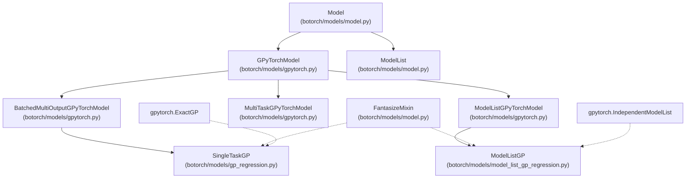
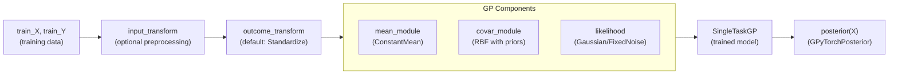
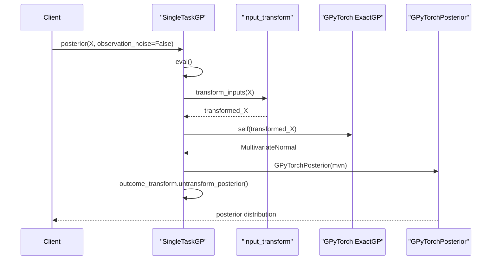
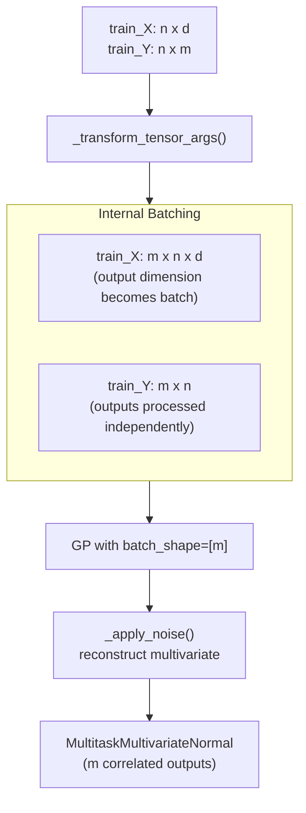
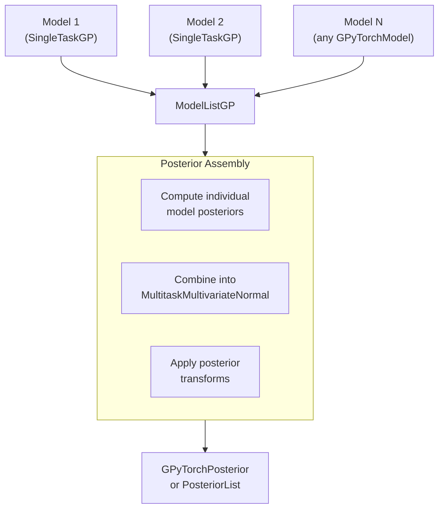
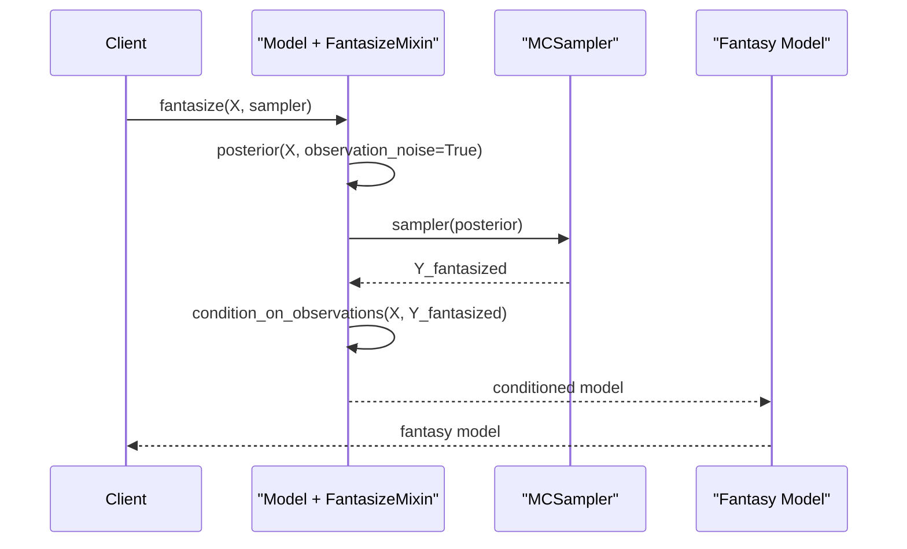
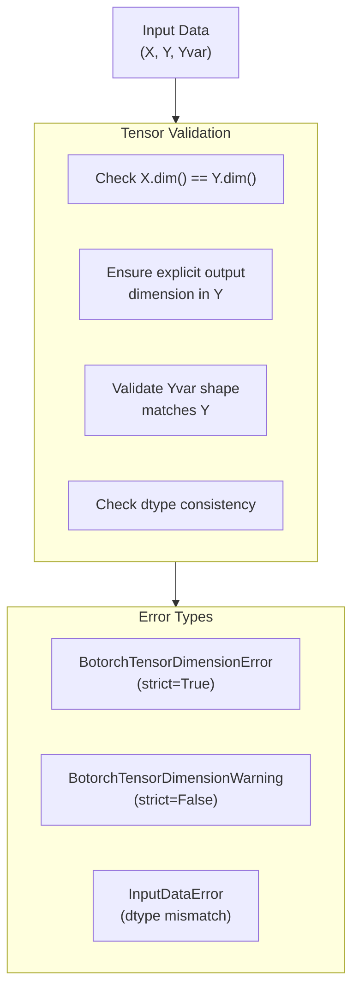

<!-- source: DeepWiki mcp.deepwiki.com · repo pytorch/botorch · page 2 Models · fetched 2026-10-21 -->

# Models

<details>
<summary>Relevant source files</summary>

The following files were used as context for generating this wiki page:

- [botorch/models/gp_regression.py](botorch/models/gp_regression.py)
- [botorch/models/gpytorch.py](botorch/models/gpytorch.py)
- [botorch/models/model.py](botorch/models/model.py)
- [botorch/models/model_list_gp_regression.py](botorch/models/model_list_gp_regression.py)
- [test/models/test_gp_regression.py](test/models/test_gp_regression.py)
- [test/models/test_gpytorch.py](test/models/test_gpytorch.py)
- [test/models/test_model_list_gp_regression.py](test/models/test_model_list_gp_regression.py)

</details>


This page documents BoTorch's model infrastructure, covering the abstract base classes, concrete Gaussian Process implementations, and supporting components for Bayesian optimization. Models in BoTorch represent probabilistic surrogate functions that learn from observed data and provide posterior distributions over unobserved points.

For acquisition functions that use these models, see [Acquisition Functions](#4). For model fitting procedures, see [Model Fitting](#2.5). For input and outcome transforms applied to models, see [Transforms](#3).

## Model Architecture Overview

BoTorch's model system is built on a hierarchical architecture that integrates with GPyTorch for Gaussian Process functionality while providing additional abstractions for Bayesian optimization workflows.

### Core Model Hierarchy



**Sources:** [botorch/models/model.py:46-689](), [botorch/models/gpytorch.py:58-864](), [botorch/models/gp_regression.py:57-243](), [botorch/models/model_list_gp_regression.py:24-140]()

### Key Model Interfaces

Every BoTorch model must implement the core `Model` interface, which defines essential methods for posterior computation and output specification:

| Method | Purpose | Return Type |
|--------|---------|-------------|
| `posterior(X, ...)` | Compute predictive posterior at points X | `Posterior` |
| `batch_shape` | Get batch shape from I/O perspective | `torch.Size` |
| `num_outputs` | Get number of model outputs | `int` |
| `subset_output(idcs)` | Create model subset to specific outputs | `Model` |
| `condition_on_observations(X, Y)` | Create fantasy model with new data | `Model` |

**Sources:** [botorch/models/model.py:80-171]()

## Core GP Models

### SingleTaskGP

`SingleTaskGP` is the primary single-task Gaussian Process implementation, designed for independent outputs with shared training inputs. It inherits from both `BatchedMultiOutputGPyTorchModel` and GPyTorch's `ExactGP`.



Key constructor parameters:
- `train_X`: Training inputs with shape `batch_shape x n x d`
- `train_Y`: Training outputs with shape `batch_shape x n x m`  
- `train_Yvar`: Optional observation noise with same shape as `train_Y`
- `outcome_transform`: Defaults to `Standardize` for zero mean, unit variance
- `input_transform`: Optional input preprocessing (no default)

**Sources:** [botorch/models/gp_regression.py:112-211]()

### Model Posterior Computation

The `posterior()` method is central to all BoTorch models. For GP models, it computes the predictive distribution:



**Sources:** [botorch/models/gpytorch.py:156-204](), [botorch/models/gp_regression.py:237-242]()

## Multi-Output Model Approaches

BoTorch provides two primary strategies for multi-output modeling: batched approaches for independent outputs and model lists for heterogeneous outputs.

### BatchedMultiOutputGPyTorchModel

For independent outputs sharing the same training data, `BatchedMultiOutputGPyTorchModel` uses internal batching to efficiently model multiple outputs:



Key methods:
- `_transform_tensor_args()`: Converts multi-output format to batched format internally
- `get_batch_dimensions()`: Determines input and augmented batch shapes
- `_apply_noise()`: Handles observation noise for multi-output case

**Sources:** [botorch/models/gpytorch.py:288-627]()

### ModelListGP

For outputs with different training data or model types, `ModelListGP` maintains separate models:



Key features:
- Supports different input shapes per model via `X: list[Tensor]` in `condition_on_observations()`
- Handles different model types (e.g., mixing regression and deterministic models)
- Flexible output subsetting with `subset_output()`

**Sources:** [botorch/models/model_list_gp_regression.py:58-129](), [botorch/models/gpytorch.py:629-796]()

## Model Infrastructure Components

### Input and Outcome Transforms

Models integrate with BoTorch's transform system for preprocessing:

| Transform Type | Applied When | Purpose |
|----------------|--------------|---------|
| `input_transform` | `model.eval()` and `posterior()` | Normalize, standardize, or warp inputs |
| `outcome_transform` | Model construction and posterior | Standardize outcomes, handle constraints |

Transform application flow:
1. **Training**: Transforms applied during model instantiation
2. **Evaluation**: `_set_transformed_inputs()` called in `eval()` mode  
3. **Posterior**: `untransform_posterior()` converts back to original space

**Sources:** [botorch/models/model.py:221-265](), [botorch/models/gpytorch.py:183-201]()

### Fantasy Model Generation

The `FantasizeMixin` enables models to generate "fantasy" models conditioned on simulated observations:



Key parameters:
- `X`: Fantasy points with shape `batch_shape x n' x d`
- `sampler`: `MCSampler` for drawing from posterior
- `observation_noise`: Noise level for fantasy observations

**Sources:** [botorch/models/model.py:321-398]()

### Model Validation and Error Handling

BoTorch models include comprehensive validation for tensor shapes and data consistency:



**Sources:** [botorch/models/gpytorch.py:67-134]()

## Model Usage Patterns

### Basic Single-Task Modeling

```python
# Typical SingleTaskGP usage pattern
train_X = torch.rand(20, 2)  # 20 points, 2 dimensions
train_Y = torch.sin(train_X).sum(dim=1, keepdim=True)  # 1 output

model = SingleTaskGP(train_X, train_Y)  # Uses Standardize by default
mll = ExactMarginalLogLikelihood(model.likelihood, model)
fit_gpytorch_mll(mll)  # Optimize hyperparameters

# Posterior computation
test_X = torch.rand(5, 2)
posterior = model.posterior(test_X)
mean = posterior.mean  # 5 x 1
variance = posterior.variance  # 5 x 1
```

**Sources:** [test/models/test_gp_regression.py:88-96]()

### Multi-Output Model Lists

```python
# Different models for different outputs
model1 = SingleTaskGP(train_X1, train_Y1)
model2 = SingleTaskGP(train_X2, train_Y2)  # Different training data
model_list = ModelListGP(model1, model2)

# Conditioning with per-output data
fantasy_X = [torch.rand(2, 1), torch.rand(2, 1)]  # Different X per output
fantasy_Y = torch.rand(2, 2)  # Combined Y tensor
fantasy_model = model_list.condition_on_observations(fantasy_X, fantasy_Y)
```

**Sources:** [test/models/test_model_list_gp_regression.py:41-87]()

This model infrastructure provides the foundation for BoTorch's Bayesian optimization capabilities, with flexible abstractions that support diverse modeling scenarios while maintaining computational efficiency through batching and transform systems.

---

