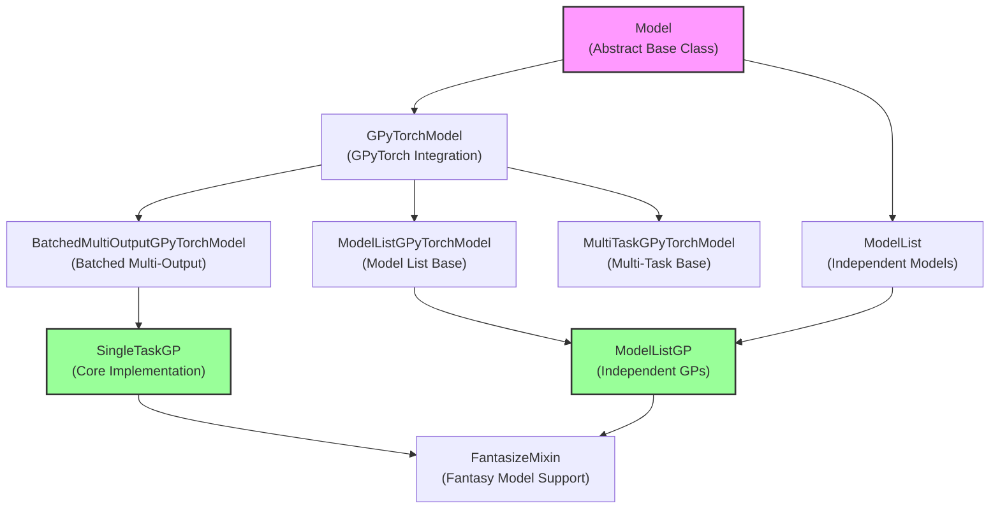
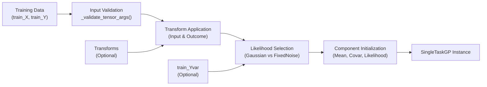
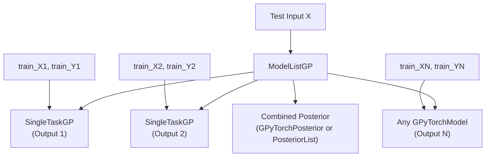

<!-- source: DeepWiki mcp.deepwiki.com · repo pytorch/botorch · page 2.1 Core GP Models · fetched 2026-10-21 -->

# Core GP Models

<details>
<summary>Relevant source files</summary>

The following files were used as context for generating this wiki page:

- [botorch/models/gp_regression.py](botorch/models/gp_regression.py)
- [botorch/models/gpytorch.py](botorch/models/gpytorch.py)
- [botorch/models/model.py](botorch/models/model.py)
- [botorch/models/model_list_gp_regression.py](botorch/models/model_list_gp_regression.py)
- [test/models/test_gp_regression.py](test/models/test_gp_regression.py)
- [test/models/test_gpytorch.py](test/models/test_gpytorch.py)
- [test/models/test_model_list_gp_regression.py](test/models/test_model_list_gp_regression.py)

</details>


This document covers the fundamental Gaussian Process model classes in BoTorch, including the base infrastructure provided by `GPyTorchModel` and the core concrete implementations like `SingleTaskGP`. These models form the foundation for most Bayesian optimization workflows in BoTorch.

For information about multi-task modeling approaches, see [Multi-task GP Models](#2.2). For fully Bayesian models using SAAS and NUTS sampling, see [Fully Bayesian Models](#2.3). For model fitting procedures, see [Model Fitting](#2.5).

## Model Architecture Overview

BoTorch's GP models are built on a hierarchical architecture that integrates with GPyTorch while providing additional functionality for Bayesian optimization. The core architecture follows an inheritance pattern from abstract base classes to concrete implementations.

### Model Class Hierarchy



**Sources:** [botorch/models/model.py:46-271](), [botorch/models/gpytorch.py:58-804](), [botorch/models/gp_regression.py:57-243](), [botorch/models/model_list_gp_regression.py:24-54]()

## Base Model Classes

### Model - Abstract Base Class

The `Model` class serves as the root abstract base class for all BoTorch models, defining the core interface that all models must implement.

**Key Methods:**
- `posterior()` - Computes posterior distributions over model outputs
- `batch_shape` - Property returning the model's batch shape  
- `num_outputs` - Property returning the number of model outputs
- `condition_on_observations()` - Conditions model on new observations
- `subset_output()` - Subsets the model to specific output indices

**Transform Support:**
- `transform_inputs()` - Applies input transforms
- `_set_transformed_inputs()` / `_revert_to_original_inputs()` - Manages input transform state
- Train/eval mode integration for automatic transform application

**Sources:** [botorch/models/model.py:46-271]()

### GPyTorchModel - GPyTorch Integration

`GPyTorchModel` provides the integration layer between BoTorch and GPyTorch, implementing the BoTorch `Model` interface while leveraging GPyTorch's ExactGP functionality.

**Key Features:**
- Tensor argument validation with strict/non-strict modes
- Automatic input transform application in eval mode
- Observation noise handling for both boolean and tensor-valued noise
- Integration with outcome transforms for posterior untransformation

**Validation Methods:**
```python
_validate_tensor_args(X, Y, Yvar=None, strict=True)
```
Ensures proper tensor shapes and data types, with special handling for explicit output dimensions and batch shape compatibility.

**Sources:** [botorch/models/gpytorch.py:58-284]()

### BatchedMultiOutputGPyTorchModel - Efficient Multi-Output Modeling

This class enables efficient modeling of multiple outputs using batch dimensions, where the same training inputs are used for all outputs but each output is modeled independently.

**Batch Dimension Management:**
- `_input_batch_shape` - Original input batch shape
- `_aug_batch_shape` - Output-augmented batch shape (includes output dimension)
- `get_batch_dimensions()` - Static method to compute batch shapes from training data

**Key Architecture:**
- Transforms outputs to batch dimension for efficient computation
- Handles observation noise application across batched outputs
- Supports output subsetting through `subset_output()` method

**Sources:** [botorch/models/gpytorch.py:288-627]()

## Core GP Model Classes

### SingleTaskGP - Primary GP Implementation

`SingleTaskGP` is the most commonly used GP model in BoTorch, implementing a single-task exact GP with strong default priors optimized for normalized inputs and standardized outcomes.

#### Model Construction



**Default Components:**
- **Mean Module:** `ConstantMean` with appropriate batch shape
- **Covar Module:** RBF kernel with dimension-scaled priors from `get_covar_module_with_dim_scaled_prior()`
- **Likelihood:** Gaussian (inferred noise) or FixedNoise (known noise) from `get_gaussian_likelihood_with_lognormal_prior()`
- **Outcome Transform:** `Standardize` by default (can be disabled)

**Constructor Parameters:**
- `train_X` - Training inputs (`batch_shape x n x d`)
- `train_Y` - Training outputs (`batch_shape x n x m`) 
- `train_Yvar` - Optional observation noise (`batch_shape x n x m`)
- `likelihood`, `covar_module`, `mean_module` - Optional custom components
- `outcome_transform`, `input_transform` - Optional transforms

**Sources:** [botorch/models/gp_regression.py:57-243]()

#### Forward Pass and Posterior Computation

The `forward()` method computes the GP prior distribution, while `posterior()` (inherited from `GPyTorchModel`) computes the posterior predictive distribution.

**Key Features:**
- Automatic input transform application during evaluation
- Observation noise integration (boolean or tensor-valued)
- Outcome transform untransformation for proper scaling
- Support for posterior transforms

**Sources:** [botorch/models/gp_regression.py:237-243](), [botorch/models/gpytorch.py:156-204]()

### ModelListGP - Independent Multi-Output Modeling  

`ModelListGP` combines multiple independent `GPyTorchModel` instances to handle scenarios where outputs have different training data or model structures.

#### Architecture



**Key Advantages:**
- Different training data shapes per output
- Mixed model types (e.g., GP + deterministic model)
- Independent hyperparameters per output

**Posterior Computation:**
- Returns `GPyTorchPosterior` when transforms are linear/none
- Returns `PosteriorList` for non-linear transforms
- Automatic handling of batch shape broadcasting

**Sources:** [botorch/models/model_list_gp_regression.py:24-140](), [botorch/models/gpytorch.py:629-796]()

## Model Construction Patterns

### Basic Single-Task GP

```python
# Inferred noise
model = SingleTaskGP(train_X, train_Y)

# Known noise  
model = SingleTaskGP(train_X, train_Y, train_Yvar)

# Custom transforms
model = SingleTaskGP(
    train_X, train_Y,
    input_transform=Normalize(d=train_X.shape[-1]),
    outcome_transform=Standardize(m=train_Y.shape[-1])
)
```

### Multi-Output Scenarios

```python
# Same training data, independent outputs
model = SingleTaskGP(train_X, train_Y_multi)  # Uses batching

# Different training data per output  
model = ModelListGP(
    SingleTaskGP(train_X1, train_Y1),
    SingleTaskGP(train_X2, train_Y2)
)
```

**Sources:** [test/models/test_gp_regression.py:88-106](), [test/models/test_model_list_gp_regression.py:42-87]()

## Advanced Model Features

### Transform Integration

All core GP models support input and outcome transforms that are automatically applied during training and evaluation:

- **Input Transforms:** Applied in eval mode, preserved during fantasization
- **Outcome Transforms:** Applied during construction, untransformed in posterior
- **Transform Persistence:** Maintained through conditioning and fantasization

### Conditioning and Fantasization

Models support conditioning on new observations through the `condition_on_observations()` method:

```python
# Basic conditioning
fantasy_model = model.condition_on_observations(new_X, new_Y)

# With noise specification
fantasy_model = model.condition_on_observations(new_X, new_Y, noise=noise_tensor)
```

The `FantasizeMixin` provides fantasy model generation for acquisition function optimization:

```python
fantasy_model = model.fantasize(X, sampler, observation_noise=noise)
```

**Sources:** [botorch/models/model.py:272-399](), [botorch/models/gpytorch.py:206-283]()

### Validation and Error Handling

The model classes include comprehensive validation:

- **Tensor Validation:** Shape, dtype, and batch compatibility checking
- **Transform Validation:** Proper application and untransformation
- **Input Consistency:** Batch shape broadcasting and dimension validation

**Sources:** [botorch/models/gpytorch.py:68-134](), [test/models/test_gpytorch.py:187-250]()

---

