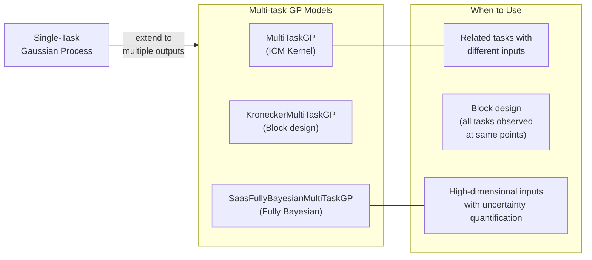
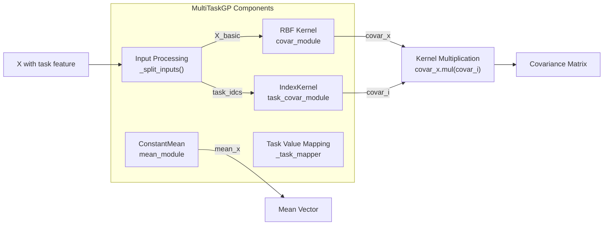
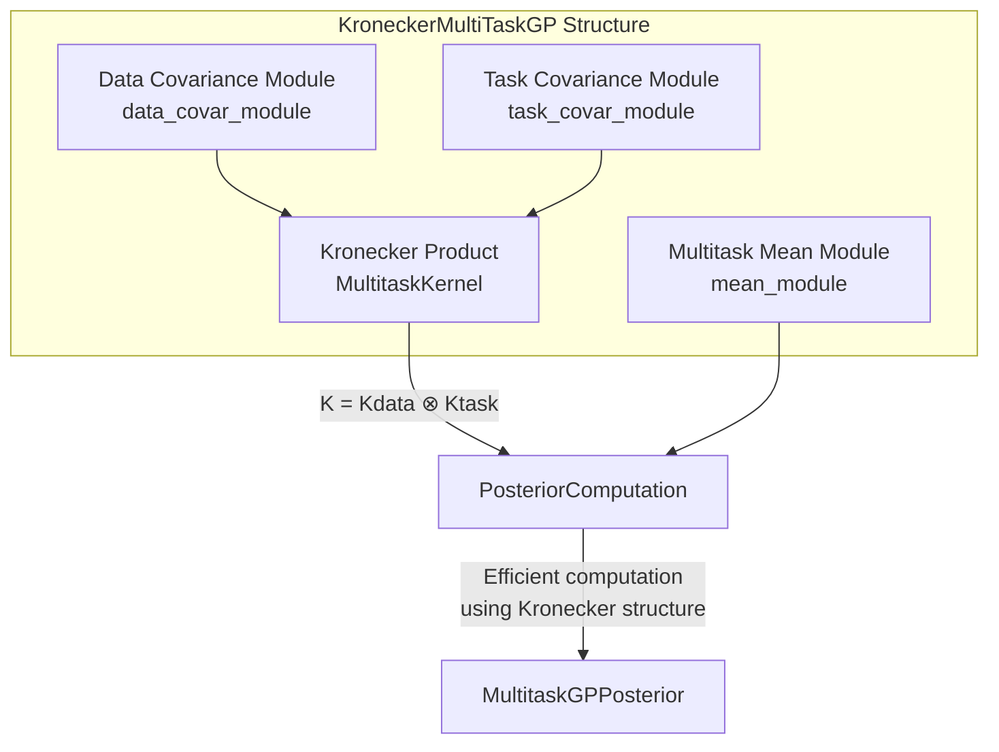
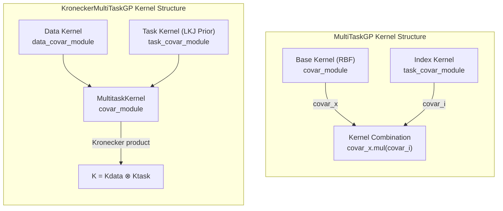

<!-- source: DeepWiki mcp.deepwiki.com · repo pytorch/botorch · page 2.2 Multi-task GP Models · fetched 2026-10-21 -->

# Multi-task GP Models

<details>
<summary>Relevant source files</summary>

The following files were used as context for generating this wiki page:

- [botorch/models/fully_bayesian.py](botorch/models/fully_bayesian.py)
- [botorch/models/fully_bayesian_multitask.py](botorch/models/fully_bayesian_multitask.py)
- [botorch/models/multitask.py](botorch/models/multitask.py)
- [botorch/models/transforms/outcome.py](botorch/models/transforms/outcome.py)
- [botorch/models/utils/assorted.py](botorch/models/utils/assorted.py)
- [test/models/test_fully_bayesian.py](test/models/test_fully_bayesian.py)
- [test/models/test_fully_bayesian_multitask.py](test/models/test_fully_bayesian_multitask.py)
- [test/models/test_multitask.py](test/models/test_multitask.py)
- [test/models/transforms/test_outcome.py](test/models/transforms/test_outcome.py)

</details>


This page documents BoTorch's multi-task Gaussian Process (GP) models, which allow modeling correlations between different but related tasks or outputs. These models are useful when you have multiple related outputs or tasks where data sharing between them can improve predictions. For single-task GP models, see [Core GP Models](2.1), and for fully Bayesian approaches, see [Fully Bayesian Models](2.3).

## Overview of Multi-task GPs

Multi-task Gaussian Process models extend single-task GPs to model multiple related outputs or tasks simultaneously. They capture both the relationships within each task and the correlations between different tasks. BoTorch provides both standard maximum likelihood estimation approaches and fully Bayesian variants using NUTS sampling.



Sources: 
- [botorch/models/multitask.py:86-173](). Main documentation of MultiTaskGP
- [botorch/models/multitask.py:437-466](). Main documentation of KroneckerMultiTaskGP
- [botorch/models/fully_bayesian_multitask.py:190-213](). Main documentation of SaasFullyBayesianMultiTaskGP

## Model Hierarchy and Architecture

Multi-task GP models in BoTorch include both standard MLE-based models and fully Bayesian variants. The standard models extend GPyTorch's `ExactGP`, while fully Bayesian models use a different architecture with Pyro integration.

```mermaid
classDiagram
    direction TD
    
    class "torch.nn.Module" {
        +forward()
    }
    
    class "gpytorch.models.ExactGP" {
        +train_inputs
        +train_targets
        +forward()
    }
    
    class "Model" {
        <<abstract>>
        +posterior()*
        +condition_on_observations()
        +num_outputs*
        +batch_shape*
    }
    
    class "GPyTorchModel" {
        <<abstract>>
        +posterior()
    }
    
    class "MultiTaskGPyTorchModel" {
        <<abstract>>
        +task_feature
        +_map_tasks()
    }
    
    class "MultiTaskGP" {
        +task_feature: int
        +num_tasks: int
        +_output_tasks: list
        +_split_inputs()
        +forward()
    }
    
    class "KroneckerMultiTaskGP" {
        +_task_covar_matrix
        +train_full_covar
        +forward()
    }
    
    class "SaasFullyBayesianMultiTaskGP" {
        +pyro_model: MultitaskSaasPyroModel
        +median_lengthscale
        +num_mcmc_samples
        +load_mcmc_samples()
    }
    
    class "MultitaskSaasPyroModel" {
        +task_feature: int
        +num_tasks: int
        +task_rank: int
        +sample()
        +load_mcmc_samples()
    }
    
    class "FantasizeMixin" {
        +fantasize()
    }
    
    "torch.nn.Module" <|-- "Model"
    "Model" <|-- "GPyTorchModel"
    "gpytorch.models.ExactGP" <|-- "MultiTaskGP"
    "gpytorch.models.ExactGP" <|-- "KroneckerMultiTaskGP"
    "GPyTorchModel" <|-- "MultiTaskGPyTorchModel"
    "MultiTaskGPyTorchModel" <|-- "MultiTaskGP"
    "GPyTorchModel" <|-- "KroneckerMultiTaskGP"
    "FantasizeMixin" <|-- "MultiTaskGP"
    "FantasizeMixin" <|-- "KroneckerMultiTaskGP"
    "MultiTaskGP" <|-- "SaasFullyBayesianMultiTaskGP"
    "SaasFullyBayesianMultiTaskGP" *-- "MultitaskSaasPyroModel"
```

Sources:
- [botorch/models/multitask.py:86-435](). MultiTaskGP implementation
- [botorch/models/multitask.py:437-841](). KroneckerMultiTaskGP implementation  
- [botorch/models/fully_bayesian_multitask.py:190-460](). SaasFullyBayesianMultiTaskGP implementation
- [botorch/models/fully_bayesian_multitask.py:42-188](). MultitaskSaasPyroModel implementation

## MultiTaskGP

The `MultiTaskGP` class implements a multi-task GP model using an Intrinsic Co-regionalization Model (ICM) kernel. This model uses a task feature index to identify which task each training observation belongs to.

### Key Features

- Uses an ICM kernel to model correlations between tasks
- Requires a task feature to identify task membership
- Can handle different-shaped inputs across tasks
- Supports fixed or inferred noise

### Internal Architecture



Sources:
- [botorch/models/multitask.py:86-366](). MultiTaskGP implementation
- [botorch/models/multitask.py:247-285](). _split_inputs and forward methods

### Usage Example

```python
# X1 and X2 represent features for different tasks
X1, X2 = torch.rand(10, 2), torch.rand(20, 2)
# i1 and i2 are task indicators (0 and 1)
i1, i2 = torch.zeros(10, 1), torch.ones(20, 1)
# Combine inputs with task indicators
train_X = torch.cat([
    torch.cat([X1, i1], -1), torch.cat([X2, i2], -1),
])
# Combine outputs
train_Y = torch.cat([f1(X1), f2(X2)]).unsqueeze(-1)
# Create model with task_feature=-1 (last column)
model = MultiTaskGP(train_X, train_Y, task_feature=-1)
```

Sources:
- [botorch/models/multitask.py:161-169](). Example in docstring
- [test/models/test_multitask.py:127-332](). Tests for MultiTaskGP

### Constructor Parameters

| Parameter | Type | Description |
|-----------|------|-------------|
| `train_X` | Tensor | `n x (d + 1)` tensor with training features and task indicators |
| `train_Y` | Tensor | `n x 1` tensor with training observations |
| `task_feature` | int | Column index of the task feature (`-d <= task_feature <= d`) |
| `train_Yvar` | Tensor, optional | Observation noise (if known) |
| `mean_module` | Module, optional | Mean function (defaults to `ConstantMean`) |
| `covar_module` | Module, optional | Covariance function (defaults to `RBFKernel`) |
| `outcome_transform` | OutcomeTransform, optional | Transform applied to outcomes |
| `input_transform` | InputTransform, optional | Transform applied to inputs |

Sources:
- [botorch/models/multitask.py:103-159](). Constructor parameters
- [test/models/test_multitask.py:127-320](). Tests showing parameter usage

## KroneckerMultiTaskGP

The `KroneckerMultiTaskGP` provides an efficient implementation for the special "block design" case where all tasks are observed at all input points.

### Key Features

- Requires all tasks to be observed at all input points
- Uses Kronecker product structure for efficient computation
- Enables efficient posterior sampling with Matheron's rule
- Supports fully batch mode operation



Sources:
- [botorch/models/multitask.py:367-510](). KroneckerMultiTaskGP implementation
- [botorch/models/multitask.py:551-685](). Posterior computation logic

### Usage Example

```python
# train_X contains feature vectors only (no task indicators)
train_X = torch.rand(10, 2)
# train_Y contains outputs for all tasks at each input point
# shape: n x m where n=inputs, m=tasks
train_Y = torch.cat([f_1(X), f_2(X)], dim=-1)
# Create model
model = KroneckerMultiTaskGP(train_X, train_Y)
```

Sources:
- [botorch/models/multitask.py:392-396](). Example in docstring
- [test/models/test_multitask.py:733-859](). Tests for KroneckerMultiTaskGP

### Constructor Parameters

| Parameter | Type | Description |
|-----------|------|-------------|
| `train_X` | Tensor | `batch_shape x n x d` tensor of training features |
| `train_Y` | Tensor | `batch_shape x n x m` tensor of training observations |
| `likelihood` | MultitaskGaussianLikelihood, optional | Likelihood for the model |
| `data_covar_module` | Module, optional | Covariance module for data space |
| `task_covar_prior` | Prior, optional | Prior on the task covariance matrix |
| `rank` | int, optional | Rank of the ICM kernel (defaults to full rank) |
| `outcome_transform` | OutcomeTransform, optional | Transform applied to outcomes |
| `input_transform` | InputTransform, optional | Transform applied to inputs |

Sources:
- [botorch/models/multitask.py:398-435](). Constructor parameters
- [test/models/test_multitask.py:733-791](). Tests showing parameter usage

## Key Implementation Details

### Task Mapping and Indexing

Multi-task GP models use a task mapping mechanism to handle task indices. For `MultiTaskGP`, this is done via:

1. A task feature column in the input tensor
2. A task mapper that converts raw task values to indices
3. A splitting mechanism that separates feature inputs from task indices

```python
# Example task mapping flow:
X_basic, task_idcs = model._split_inputs(X)  # Split inputs
covar_x = model.covar_module(X_basic)  # Compute base covariance
covar_i = model.task_covar_module(task_idcs)  # Compute task covariance
covar = covar_x.mul(covar_i)  # Combine covariances
```

Sources:
- [botorch/models/multitask.py:247-272](). _split_inputs implementation
- [botorch/models/multitask.py:273-285](). forward method implementation

### Kernel Structures

The multi-task GP models use different kernel structures:

1. `MultiTaskGP` uses an ICM kernel with `IndexKernel` for task correlations
2. `KroneckerMultiTaskGP` uses a `MultitaskKernel` combining data and task kernels



Sources:
- [botorch/models/multitask.py:228-233](). Task covariance module creation for MultiTaskGP
- [botorch/models/multitask.py:494-500](). Covariance module creation for KroneckerMultiTaskGP

## Practical Considerations

### When to Use Which Model

- Use `MultiTaskGP` when:
  - Tasks may have different numbers of observations
  - Training inputs can differ across tasks
  - You need to model correlations between tasks

- Use `KroneckerMultiTaskGP` when:
  - All tasks are observed at all input points (block design)
  - You need computational efficiency for large datasets
  - Posterior sampling is a priority

Sources:
- [botorch/models/multitask.py:86-101](). MultiTaskGP description and use cases
- [botorch/models/multitask.py:367-386](). KroneckerMultiTaskGP description and use cases

### Performance Considerations

- `KroneckerMultiTaskGP` is generally more computationally efficient due to its Kronecker structure
- `MultiTaskGP` is more flexible but may be less efficient for large datasets
- Both models benefit from standardizing outcomes per task to improve numerical stability

Sources:
- [botorch/models/multitask.py:86-159](). MultiTaskGP documentation
- [botorch/models/multitask.py:367-510](). KroneckerMultiTaskGP documentation

## Relationship to Other Model Types

In the BoTorch model ecosystem, multi-task GP models complement other model types:

- Unlike `SingleTaskGP`, which models each output independently, multi-task GPs model correlations between outputs
- Unlike `ModelListGP`, which uses separate models for different outputs, multi-task GPs use a single model for all tasks
- Multi-fidelity models (like `SingleTaskMultiFidelityGP`) can be viewed as a special case of multi-task models where tasks represent fidelity levels

Sources:
- [botorch/models/gp_regression.py:57-252](). SingleTaskGP implementation
- [botorch/models/model_list_gp_regression.py:24-140](). ModelListGP implementation
- [botorch/models/gp_regression_fidelity.py:52-182](). SingleTaskMultiFidelityGP implementation

---

