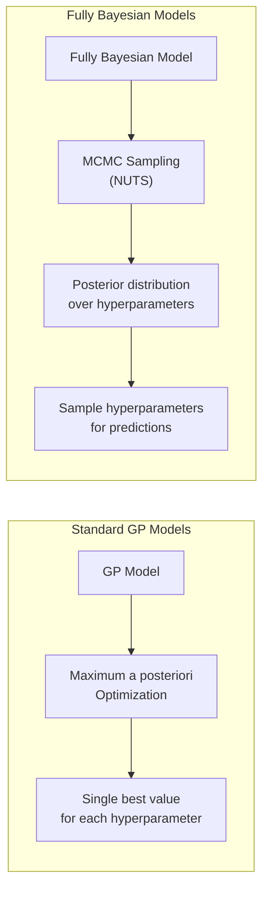
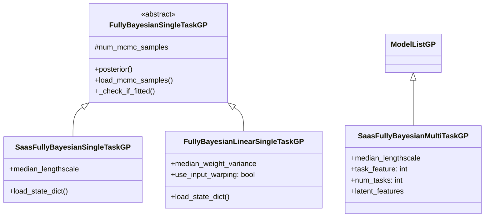
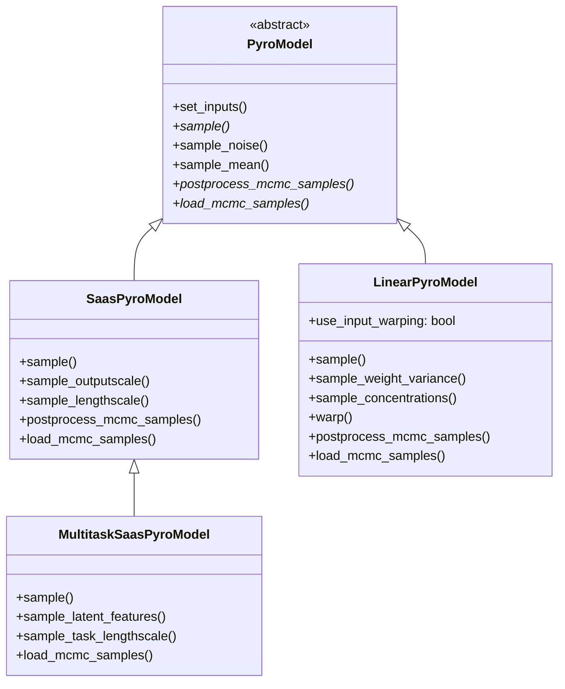
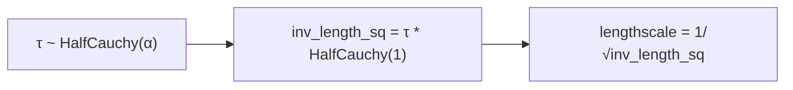
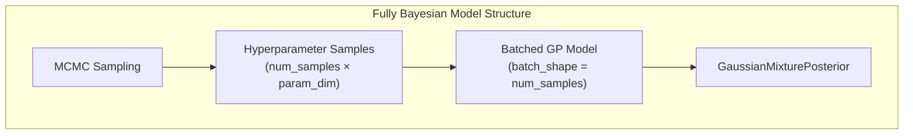
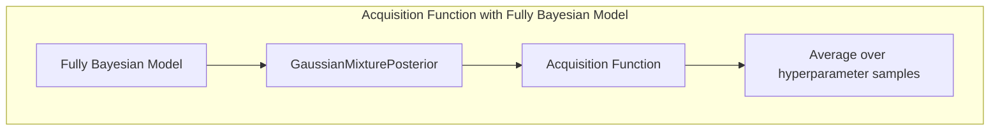
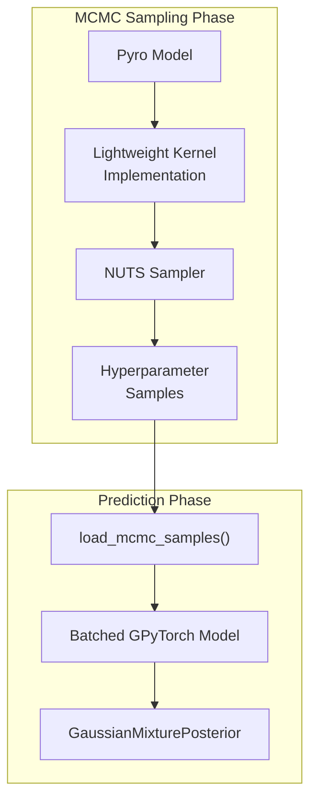

<!-- source: DeepWiki mcp.deepwiki.com · repo pytorch/botorch · page 2.3 Fully Bayesian Models · fetched 2026-10-21 -->

# Fully Bayesian Models

<details>
<summary>Relevant source files</summary>

The following files were used as context for generating this wiki page:

- [botorch/models/fully_bayesian.py](botorch/models/fully_bayesian.py)
- [botorch/models/fully_bayesian_multitask.py](botorch/models/fully_bayesian_multitask.py)
- [botorch/models/multitask.py](botorch/models/multitask.py)
- [botorch/models/transforms/outcome.py](botorch/models/transforms/outcome.py)
- [botorch/models/utils/assorted.py](botorch/models/utils/assorted.py)
- [test/models/test_fully_bayesian.py](test/models/test_fully_bayesian.py)
- [test/models/test_fully_bayesian_multitask.py](test/models/test_fully_bayesian_multitask.py)
- [test/models/test_multitask.py](test/models/test_multitask.py)
- [test/models/transforms/test_outcome.py](test/models/transforms/test_outcome.py)

</details>


This page documents the fully Bayesian models in BoTorch, which use Bayesian inference over model hyperparameters (such as lengthscales and noise variance) rather than point estimates. These models learn a posterior distribution for hyperparameters using the No-U-Turn-Sampler (NUTS) and sample from this distribution during posterior predictions. For information about standard GP models that use maximum a posteriori (MAP) estimation, see [Core GP Models](#2.1).

## Introduction

Fully Bayesian models in BoTorch implement a more complete Bayesian approach compared to standard models by:

1. Learning a full posterior distribution over hyperparameters using MCMC
2. Sampling hyperparameters from this posterior for predictions
3. Providing better calibrated uncertainty estimates, especially in high-dimensional spaces

This approach generally results in better and more well-calibrated models at the cost of higher computational intensity.



Sources: [botorch/models/fully_bayesian.py:7-31]()

## Core Fully Bayesian Models

BoTorch provides several fully Bayesian model implementations:

| Model | Description | Use case |
|-------|-------------|----------|
| `SaasFullyBayesianSingleTaskGP` | Implements SAAS prior with Matern-5/2 kernel | High-dimensional optimization |
| `FullyBayesianLinearSingleTaskGP` | Uses a linear kernel with optional input warping | Linear relationships |
| `SaasFullyBayesianMultiTaskGP` | Multi-task version of the SAAS model | Multi-task/multi-output settings |

All models extend the base `FullyBayesianSingleTaskGP` abstract class, which provides the common functionality.



Sources: [botorch/models/fully_bayesian.py:512-522](), [botorch/models/fully_bayesian.py:753-819](), [botorch/models/fully_bayesian.py:822-969](), [botorch/models/fully_bayesian_multitask.py:168-462]()

## Pyro Models

Fully Bayesian models use Pyro models to define the sampling procedure for hyperparameters. These models define the prior distributions and sampling logic:



The Pyro models implement:
1. Sampling procedures for all hyperparameters (lengthscales, noise, etc.)
2. Postprocessing of MCMC samples
3. Loading of samples into GPyTorch components

Sources: [botorch/models/fully_bayesian.py:116-164](), [botorch/models/fully_bayesian.py:189-324](), [botorch/models/fully_bayesian.py:327-509](), [botorch/models/fully_bayesian_multitask.py:39-166]()

## Model Implementation Details

### SAAS Prior

The SAAS (Sparse Axis-Aligned Subspace) model uses sparsity-inducing priors to identify the most important parameters, making it suitable for high-dimensional Bayesian optimization. The key components of the SAAS prior are:

1. A global shrinkage parameter τ (tau)
2. Dimension-specific inverse lengthscale parameters
3. Half-Cauchy priors on both

The prior effectively performs automatic relevance determination by allowing the model to "turn off" irrelevant dimensions through large lengthscales.



Sources: [botorch/models/fully_bayesian.py:189-260]()

### Model Structure

Fully Bayesian models use a batched model structure where the batch dimension represents different hyperparameter samples:



The batch dimension enables:
1. Maintaining multiple GP models (one per hyperparameter sample)
2. Efficient parallel evaluation during prediction
3. Mixing of predictions to form a Gaussian mixture

Sources: [botorch/models/fully_bayesian.py:614-633](), [botorch/posteriors/fully_bayesian.py]()

## Usage

### Model Initialization

To initialize a fully Bayesian model:

```python
# For SAAS model
model = SaasFullyBayesianSingleTaskGP(
    train_X=X,  # Training features (normalized to [0,1]^d)
    train_Y=Y,  # Training targets (standardized)
    train_Yvar=Yvar,  # Optional observation noise (can be inferred if None)
)

# For linear kernel model
model = FullyBayesianLinearSingleTaskGP(
    train_X=X,
    train_Y=Y,
    train_Yvar=Yvar,
    use_input_warping=True,  # Optional Kumaraswamy input warping
)

# For multi-task model
model = SaasFullyBayesianMultiTaskGP(
    train_X=X,  # Including task feature
    train_Y=Y,
    train_Yvar=Yvar,
    task_feature=task_feature_idx,  # Index of the task feature
    rank=2,  # Optional task embedding dimension
)
```

Sources: [botorch/models/fully_bayesian.py:532-604](), [botorch/models/fully_bayesian.py:823-875](), [botorch/models/fully_bayesian_multitask.py:197-297]()

### Model Fitting

Fully Bayesian models must be fit using NUTS instead of standard optimization:

```python
from botorch import fit_fully_bayesian_model_nuts

# Fit the model using NUTS
fit_fully_bayesian_model_nuts(
    model,
    warmup_steps=512,  # Number of warmup steps
    num_samples=256,   # Number of samples to draw
    thinning=16,       # Keep only every `thinning` samples
)
```

After fitting, the model contains:
1. MCMC samples of all hyperparameters
2. A batched GPyTorch model with batch dimension representing different hyperparameter settings
3. Methods to compute aggregate statistics like median lengthscales

Sources: [test/models/test_fully_bayesian.py:238-249]()

### Making Predictions

After fitting, use the model's posterior method to get predictions:

```python
posterior = model.posterior(X_test)

# Get mean and variance of the mixture distribution
mean = posterior.mixture_mean
variance = posterior.mixture_variance

# Get specific quantiles of the predictive distribution
lower_bound = posterior.quantile(torch.tensor(0.025))
upper_bound = posterior.quantile(torch.tensor(0.975))
```

The returned posterior is a `GaussianMixturePosterior` which provides:
1. Individual Gaussian means and covariances from each hyperparameter sample
2. Mixture statistics (mean, variance, quantiles)
3. Methods to compute arbitrary quantiles of the predictive distribution

Sources: [botorch/models/fully_bayesian.py:679-716](), [botorch/posteriors/fully_bayesian.py]()

## Working with Acquisition Functions

Fully Bayesian models are compatible with all BoTorch acquisition functions. The acquisition functions automatically handle the batch dimension representing hyperparameter samples:



For Monte Carlo acquisition functions, samplers automatically handle the extra batch dimension properly.

Sources: [test/models/test_fully_bayesian.py:539-648]()

## Performance Considerations

Fully Bayesian models are more computationally intensive than standard GP models due to:

1. MCMC sampling during fitting (potentially thousands of model evaluations)
2. Maintaining multiple models for prediction (one per hyperparameter sample)
3. Aggregating predictions across hyperparameter samples

However, they provide better calibrated uncertainty estimates, especially important in:
- High-dimensional problems
- Problems with limited data
- Settings where uncertainty quantification is critical

Sources: [botorch/models/fully_bayesian.py:7-31]()

## Implementation Notes

### Lightweight Implementation

For performance reasons, the fully Bayesian models use a lightweight PyTorch implementation of the Matern-5/2 kernel during MCMC sampling instead of standard GPyTorch models. After sampling, the hyperparameters are loaded into a batched GPyTorch model.



This approach provides the benefits of:
1. Faster MCMC sampling compared to using GPyTorch models directly with Pyro
2. Compatibility with the broader BoTorch ecosystem after fitting
3. Reuse of GPyTorch's efficient predictive machinery

Sources: [botorch/models/fully_bayesian.py:20-23](), [botorch/models/fully_bayesian.py:654-667]()

### Model Reset and State Dict

Fully Bayesian models implement custom state dictionary handling to support serialization and restoration of the fitted model. This is necessary because the model structure is not completely defined until after MCMC sampling completes:

```python
# Save a fitted model
state_dict = model.state_dict()

# Load into a new model
new_model = SaasFullyBayesianSingleTaskGP(train_X=X, train_Y=Y)
new_model.load_state_dict(state_dict)
```

The model's `.train()` method also has a `reset` parameter that controls whether the model's MCMC samples are retained when entering training mode.

Sources: [botorch/models/fully_bayesian.py:634-652](), [botorch/models/fully_bayesian.py:784-819]()

## References

The fully Bayesian models implementation is based on the following research:

- D. Eriksson, M. Jankowiak. High-Dimensional Bayesian Optimization with Sparse Axis-Aligned Subspaces. Proceedings of the Thirty-Seventh Conference on Uncertainty in Artificial Intelligence, 2021. (Referred to as SAASBO)

---

