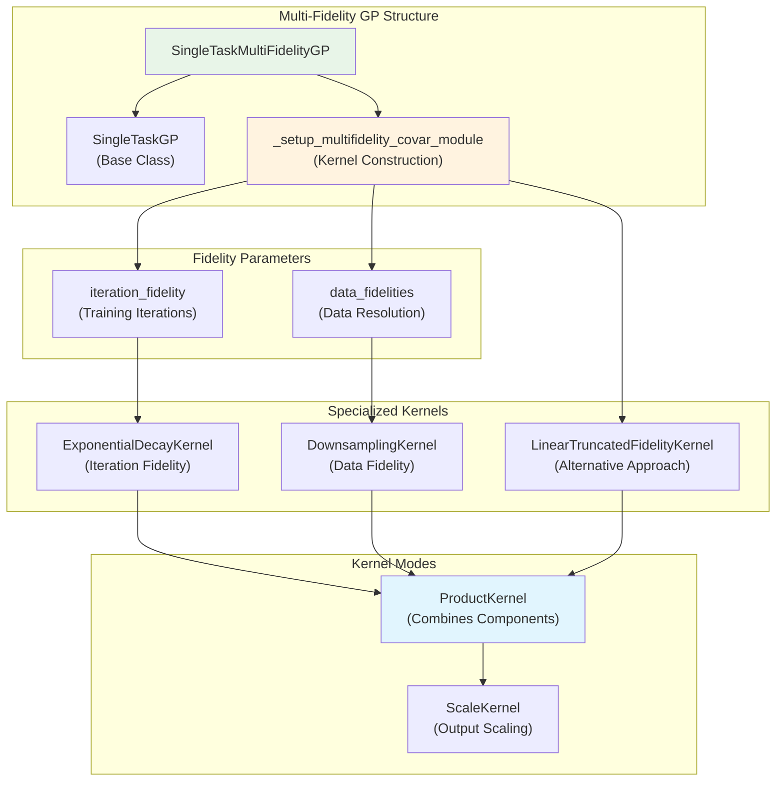
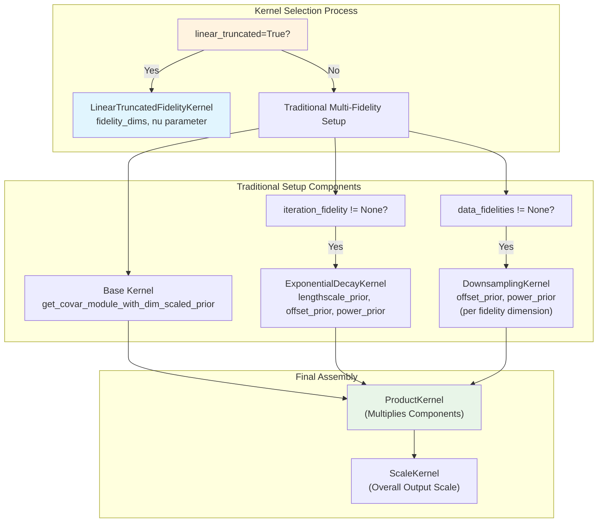
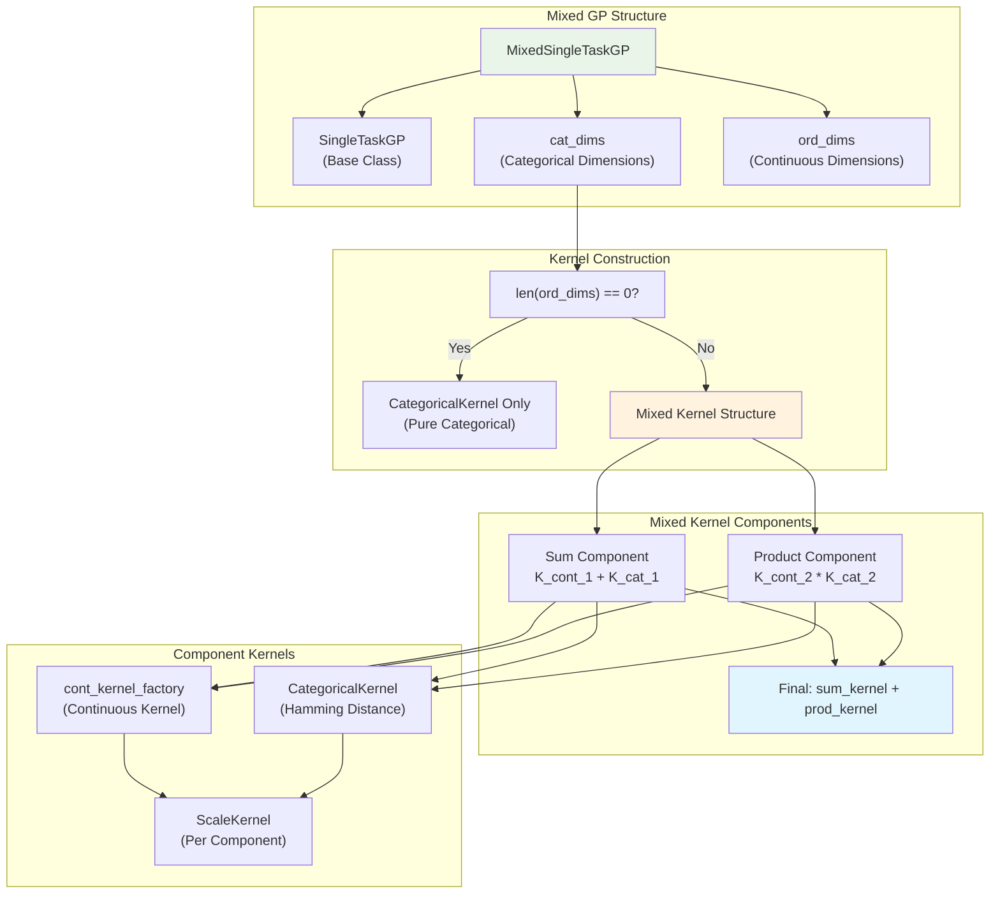
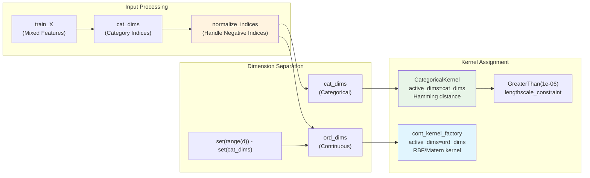
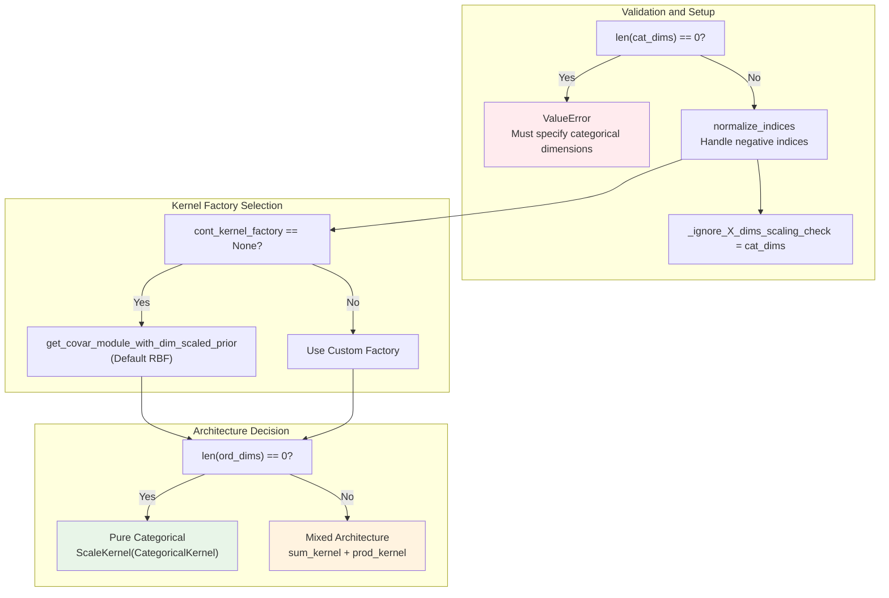
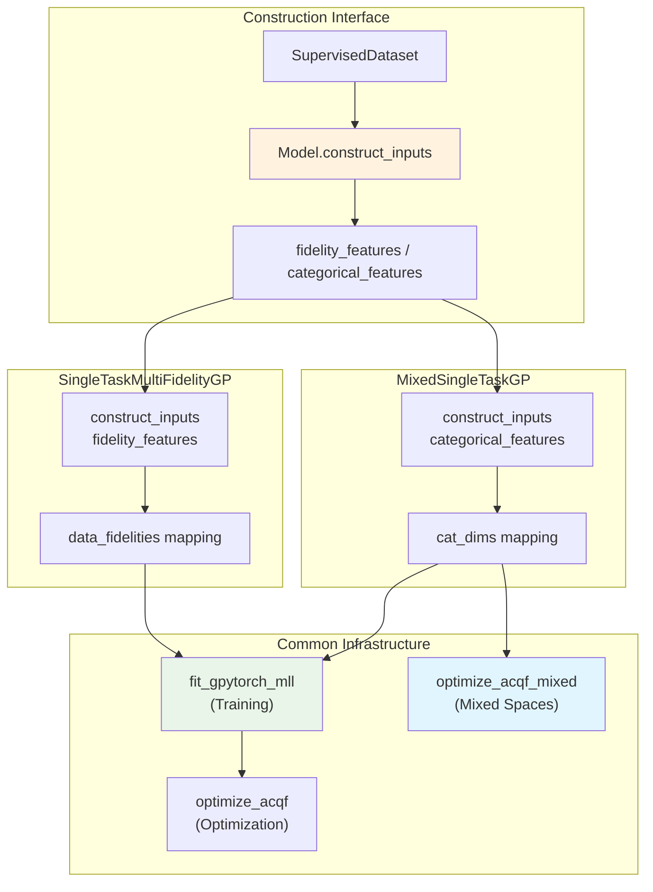

<!-- source: DeepWiki mcp.deepwiki.com · repo pytorch/botorch · page 2.4 Special Purpose Models · fetched 2026-10-21 -->

# Special Purpose Models

<details>
<summary>Relevant source files</summary>

The following files were used as context for generating this wiki page:

- [botorch/models/gp_regression_fidelity.py](botorch/models/gp_regression_fidelity.py)
- [botorch/models/gp_regression_mixed.py](botorch/models/gp_regression_mixed.py)
- [test/models/test_gp_regression_fidelity.py](test/models/test_gp_regression_fidelity.py)
- [test/models/test_gp_regression_mixed.py](test/models/test_gp_regression_mixed.py)

</details>


This page covers specialized Gaussian Process models in BoTorch that handle specific optimization scenarios beyond standard single-task regression. These models extend the core GP infrastructure to support multi-fidelity optimization and mixed search spaces combining continuous and categorical variables.

For standard GP models like `SingleTaskGP` and `MultiTaskGP`, see [Core GP Models](#2.1). For fully Bayesian approaches, see [Fully Bayesian Models](#2.3). For input and outcome transformations, see [Transforms](#3).

## Multi-Fidelity Models

Multi-fidelity Bayesian optimization addresses scenarios where you have access to multiple approximations of an expensive objective function at different levels of accuracy and computational cost. BoTorch provides `SingleTaskMultiFidelityGP` to model correlations between high-fidelity (expensive, accurate) and low-fidelity (cheap, approximate) evaluations.

### SingleTaskMultiFidelityGP Architecture



The `SingleTaskMultiFidelityGP` class supports two types of fidelity parameters:

- **Iteration Fidelity**: Models the relationship between training iterations or computational budget
- **Data Fidelity**: Models the relationship between different data resolutions or sampling densities

**Sources:** [botorch/models/gp_regression_fidelity.py:52-153]()

### Kernel Construction Strategy



The kernel construction logic in `_setup_multifidelity_covar_module` provides two approaches:

1. **Linear Truncated**: Uses `LinearTruncatedFidelityKernel` with all fidelity dimensions
2. **Traditional**: Combines base kernel with specialized fidelity kernels

**Sources:** [botorch/models/gp_regression_fidelity.py:171-297]()

### Usage Patterns

| Parameter | Type | Purpose | Example |
|-----------|------|---------|---------|
| `iteration_fidelity` | `int` | Column index for training iterations | `iteration_fidelity=2` |
| `data_fidelities` | `list[int]` | Column indices for data resolution | `data_fidelities=[3, 4]` |
| `linear_truncated` | `bool` | Use LinearTruncatedFidelityKernel | `linear_truncated=True` |
| `nu` | `float` | Matern kernel smoothness (1/2, 3/2, 5/2) | `nu=2.5` |

**Sources:** [botorch/models/gp_regression_fidelity.py:67-107](), [test/models/test_gp_regression_fidelity.py:43-53]()

## Mixed Search Space Models

Mixed search spaces combine continuous optimization variables with categorical (discrete) variables. The `MixedSingleTaskGP` handles this by using specialized kernel combinations that respect the different nature of continuous and categorical features.

### MixedSingleTaskGP Architecture



The mixed kernel structure implements:
```
K((x1, c1), (x2, c2)) = K_cont_1(x1, x2) + K_cat_1(c1, c2) + K_cont_2(x1, x2) * K_cat_2(c1, c2)
```

**Sources:** [botorch/models/gp_regression_mixed.py:29-162]()

### Categorical Feature Handling



Key implementation details:

- **Categorical Kernel**: Uses Hamming distance between categorical values
- **Dimension Separation**: Automatically separates continuous and categorical features
- **Constraint Handling**: Applies lengthscale constraints to prevent numerical issues

**Sources:** [botorch/models/gp_regression_mixed.py:102-162]()

### Construction and Configuration

| Parameter | Type | Purpose | Constraints |
|-----------|------|---------|-------------|
| `cat_dims` | `list[int]` | Categorical feature indices | Must be non-empty |
| `cont_kernel_factory` | `Callable` | Continuous kernel constructor | Optional, defaults to RBF |
| `input_transform` | `InputTransform` | Input preprocessing | Must not transform categorical dims |



**Sources:** [botorch/models/gp_regression_mixed.py:102-162](), [test/models/test_gp_regression_mixed.py:65-68]()

## Model Integration and Usage

Both special purpose models integrate seamlessly with BoTorch's broader optimization infrastructure:

### Factory Pattern Integration



### Optimization Considerations

| Model | Optimization Method | Key Constraints |
|-------|-------------------|-----------------|
| `SingleTaskMultiFidelityGP` | `optimize_acqf` | Fidelity parameters should be handled appropriately |
| `MixedSingleTaskGP` | `optimize_acqf_mixed` | Categorical variables require discrete optimization |

**Sources:** [botorch/models/gp_regression_fidelity.py:154-168](), [botorch/models/gp_regression_mixed.py:163-182](), [botorch/models/gp_regression_mixed.py:45-48]()

---

