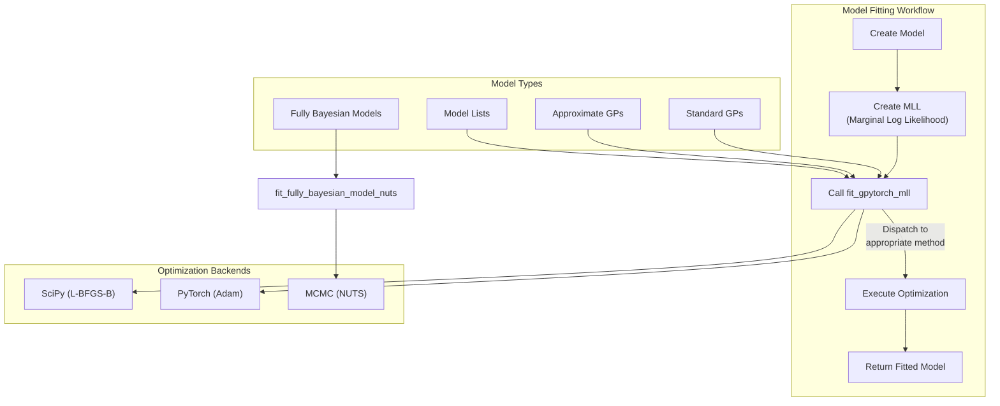
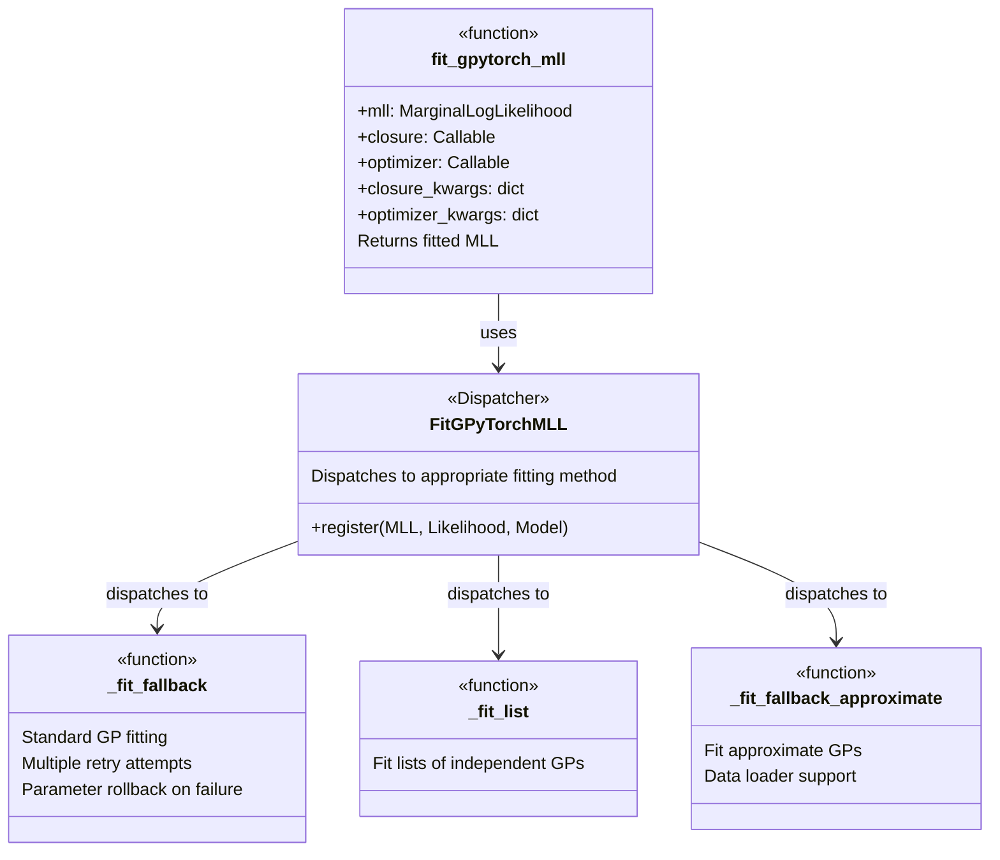
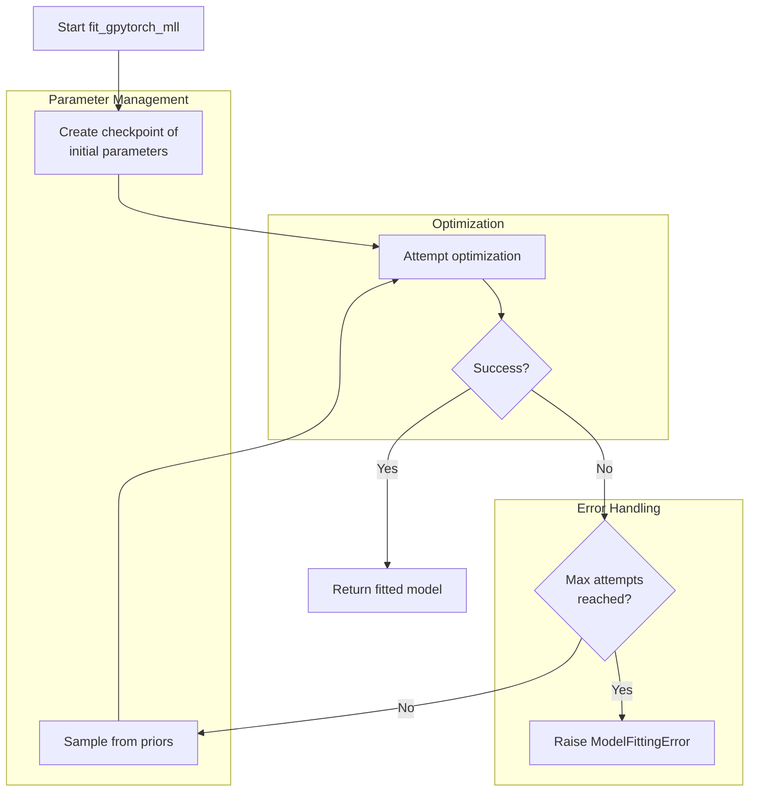
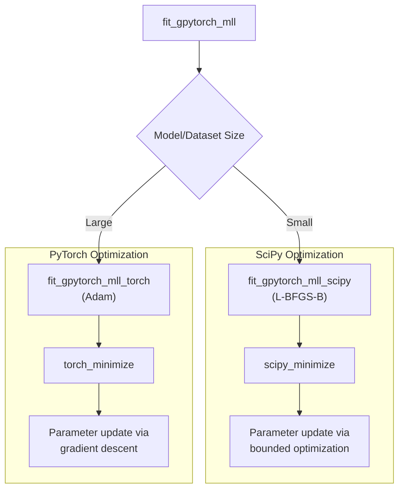
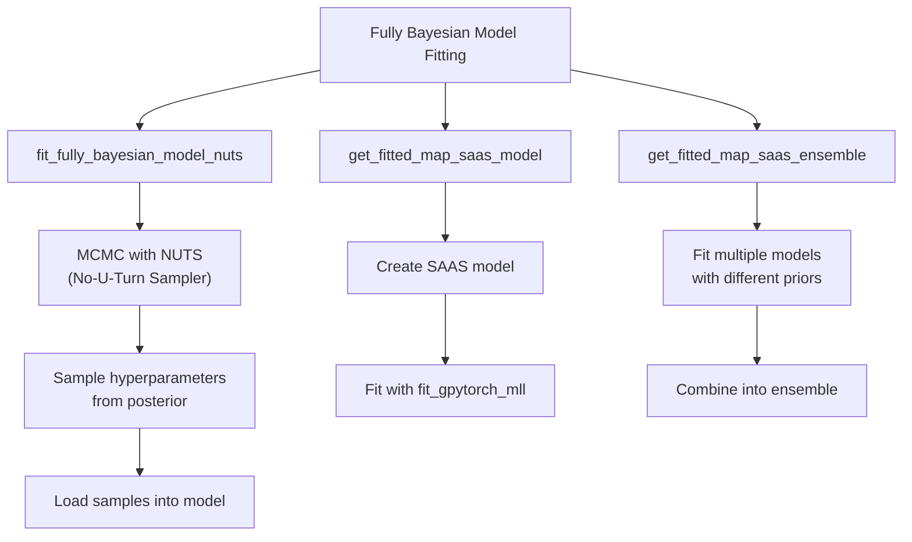
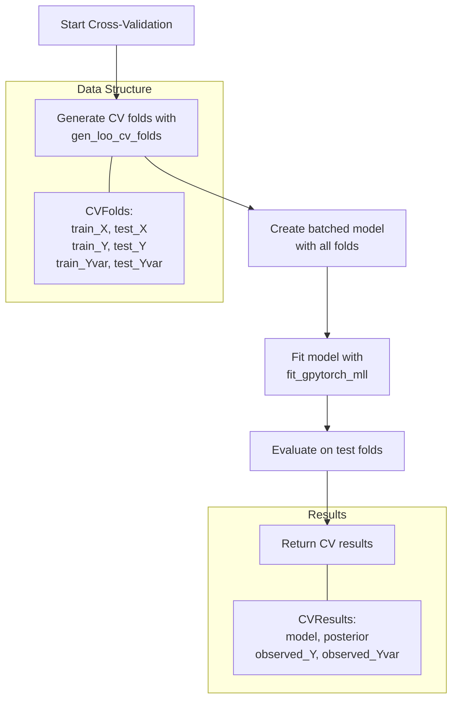
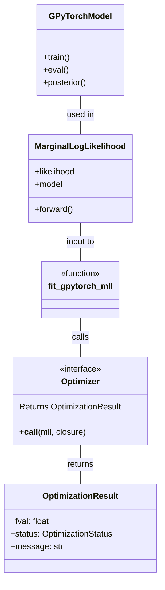

<!-- source: DeepWiki mcp.deepwiki.com · repo pytorch/botorch · page 2.5 Model Fitting · fetched 2026-10-21 -->

# Model Fitting

<details>
<summary>Relevant source files</summary>

The following files were used as context for generating this wiki page:

- [botorch/cross_validation.py](botorch/cross_validation.py)
- [botorch/fit.py](botorch/fit.py)
- [botorch/optim/fit.py](botorch/optim/fit.py)
- [test/optim/test_fit.py](test/optim/test_fit.py)
- [test/test_cross_validation.py](test/test_cross_validation.py)
- [test/test_fit.py](test/test_fit.py)

</details>


This document provides an overview of the model fitting systems in BoTorch. It covers the API for fitting Gaussian Process (GP) models and related utilities like cross-validation. For information about specific model types, see the [Models](#2) page.

## Overview

Model fitting in BoTorch is primarily handled through the `fit_gpytorch_mll` function, which optimizes the hyperparameters of a GP model by maximizing its marginal log-likelihood. The system supports different optimization backends (SciPy and PyTorch), handles errors gracefully, and includes special handling for various model types, including fully Bayesian models.



Sources: [botorch/fit.py:85-123](), [botorch/__init__.py:19]()

## Main Fitting API

### `fit_gpytorch_mll`

The primary function for model fitting is `fit_gpytorch_mll`, which serves as a dispatcher that selects the appropriate fitting method based on the model and likelihood types. When you call this function, it uses a multiple dispatch system to select the right fitting algorithm.



Sources: [botorch/fit.py:85-123](), [botorch/fit.py:82](), [botorch/fit.py:126-264](), [botorch/fit.py:266-287](), [botorch/fit.py:290-336]()

### Fitting Process Details

The generic fallback fitting method (`_fit_fallback`) implements a robust optimization process with the following features:

1. **Multiple Attempts**: If fitting fails, it will retry with different parameter initializations.
2. **Prior Sampling**: For retry attempts, it samples new initial hyperparameters from model priors.
3. **Warning Handling**: It can filter and handle optimization warnings.
4. **State Rollback**: If optimization fails, it rolls back to the initial model state.
5. **Best Selection Mode**: Optionally runs multiple optimizations and selects the best result.



Sources: [botorch/fit.py:126-264](), [botorch/optim/utils.py:38-41]()

## Optimization Backends

BoTorch provides two main optimization backends for model fitting:

### SciPy-based Optimization

`fit_gpytorch_mll_scipy` uses SciPy's optimization routines (L-BFGS-B by default) to maximize the marginal log-likelihood. This is a good default choice for most models, especially with smaller datasets.

Key features:
- Uses limited-memory BFGS with bounds
- Supports parameter bounds
- Handles NaN errors and timeouts
- Returns detailed optimization results

### PyTorch-based Optimization

`fit_gpytorch_mll_torch` uses PyTorch optimizers (Adam by default) and is well-suited for larger models or datasets, particularly when using mini-batching with approximate GPs.

Key features:
- Uses gradient-based optimization in PyTorch
- Supports learning rate schedulers
- Works with custom stopping criteria
- Good for approximate GPs with mini-batching



Sources: [botorch/optim/fit.py:47-111](), [botorch/optim/fit.py:114-177](), [botorch/fit.py:290-336]()

## Fully Bayesian Model Fitting

For fully Bayesian models, BoTorch provides specialized fitting functions that use Markov Chain Monte Carlo (MCMC) for posterior inference:

- `fit_fully_bayesian_model_nuts`: Fits a fully Bayesian GP using the No-U-Turn Sampler (NUTS).
- `get_fitted_map_saas_model`: Returns a fitted MAP (maximum a posteriori) SAAS model.
- `get_fitted_map_saas_ensemble`: Returns a fitted ensemble of SAAS models with different hyperparameters.

These methods provide more comprehensive uncertainty estimation compared to standard GP fitting.



Sources: [botorch/fit.py:339-396](), [botorch/fit.py:398-438](), [botorch/fit.py:441-520]()

## Cross-Validation

BoTorch provides cross-validation utilities to assess model performance, primarily through the `batch_cross_validation` function, which efficiently performs leave-one-out cross-validation using GPyTorch's batch mode.



Sources: [botorch/cross_validation.py:111-196](), [botorch/cross_validation.py:41-108]()

## Best Practices and Advanced Options

### Retry Logic and Robustness

The fitting system is designed to be robust to optimization failures:

- By default, it will make up to 5 attempts to fit a model if warnings or errors occur
- You can control this behavior with the `max_attempts` parameter
- With `pick_best_of_all_attempts=True`, it will try multiple initializations and select the best result

### Performance Considerations

- For standard GPs with smaller datasets (< 1000 points), `fit_gpytorch_mll_scipy` is typically faster
- For larger datasets or approximate GPs, `fit_gpytorch_mll_torch` with mini-batching is more memory-efficient
- For fully Bayesian models, MCMC inference can be computationally expensive, but provides more robust uncertainty estimates

### Common Hyperparameter Patterns

Most BoTorch models now use improved default priors that scale with input dimensionality, making them more robust. Key hyperparameters that are optimized include:

- Lengthscales: Control the smoothness of the GP across each input dimension
- Outputscale: Controls the variance of the GP output
- Noise variance: For models with inferred noise
- Mean constants: For models with constant mean functions

### Example Usage

A typical model fitting workflow looks like:

```python
# Create model and likelihood
model = SingleTaskGP(train_X, train_Y)
mll = ExactMarginalLogLikelihood(model.likelihood, model)

# Fit the model
fit_gpytorch_mll(mll)

# The model is now ready for predictions
posterior = model.posterior(test_X)
```

Sources: [botorch/fit.py:126-264](), [botorch/optim/fit.py:47-111](), [botorch/optim/fit.py:114-177]()

## Technical Implementation Details

The fitting system uses several key technical mechanisms:

1. **Multiple Dispatch**: The `FitGPyTorchMLL` dispatcher selects the appropriate fitting method based on model and likelihood types.

2. **Closures**: Optimization is performed using closures that compute loss and gradients.

3. **Context Managers**: State rollback is implemented using context managers like `module_rollback_ctx` and `parameter_rollback_ctx`.

4. **Parameter Management**: The system carefully manages which parameters require gradients and their bounds.



Sources: [botorch/fit.py:85-123](), [botorch/optim/closures.py](), [botorch/utils/context_managers.py]()

---

