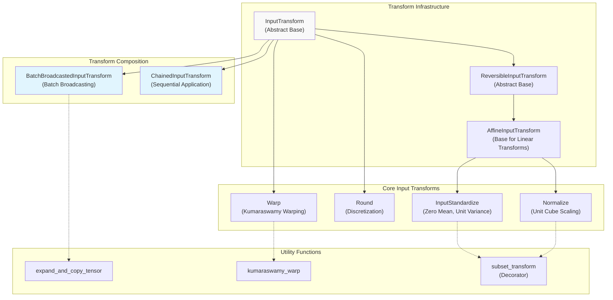
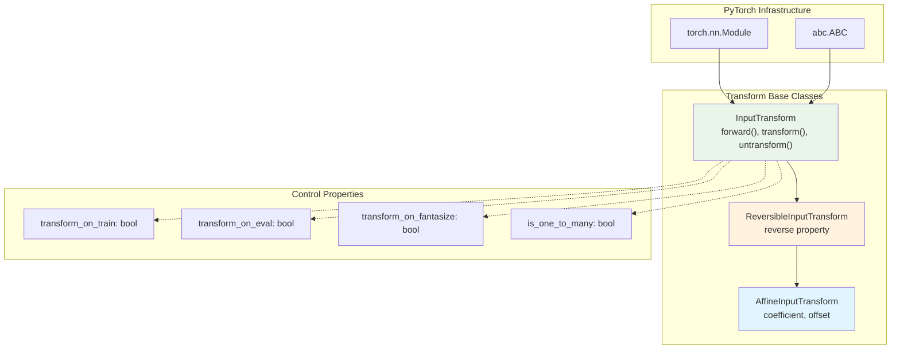
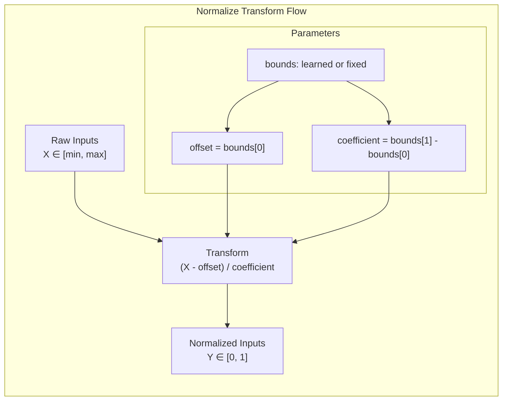
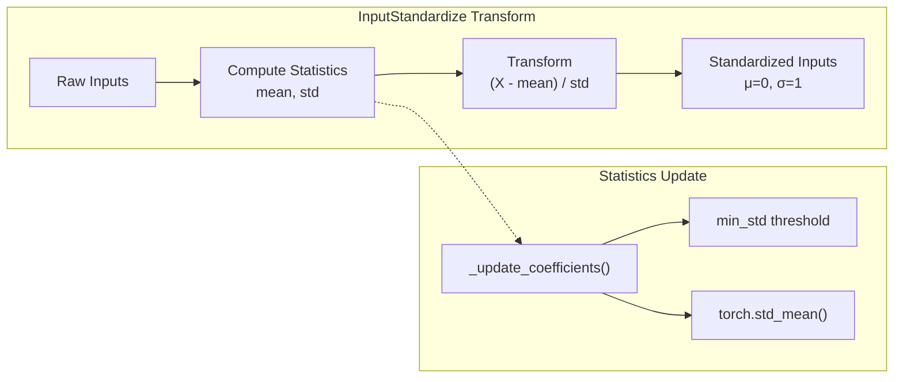
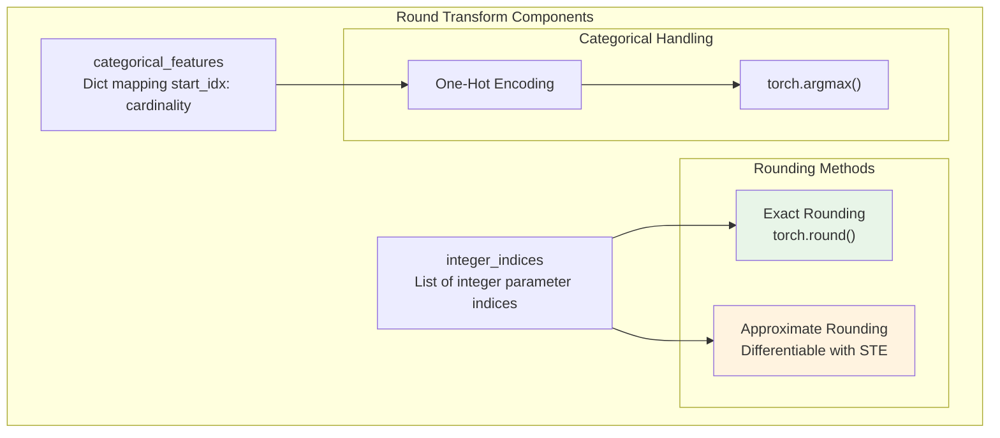
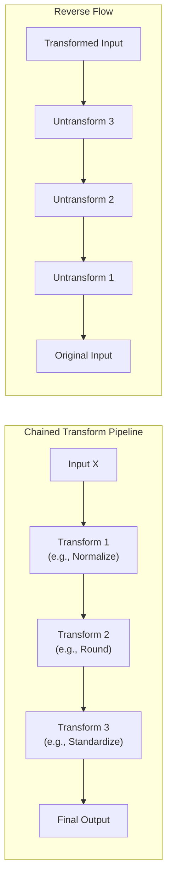
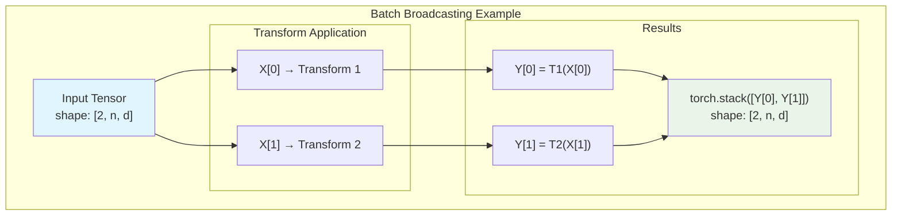
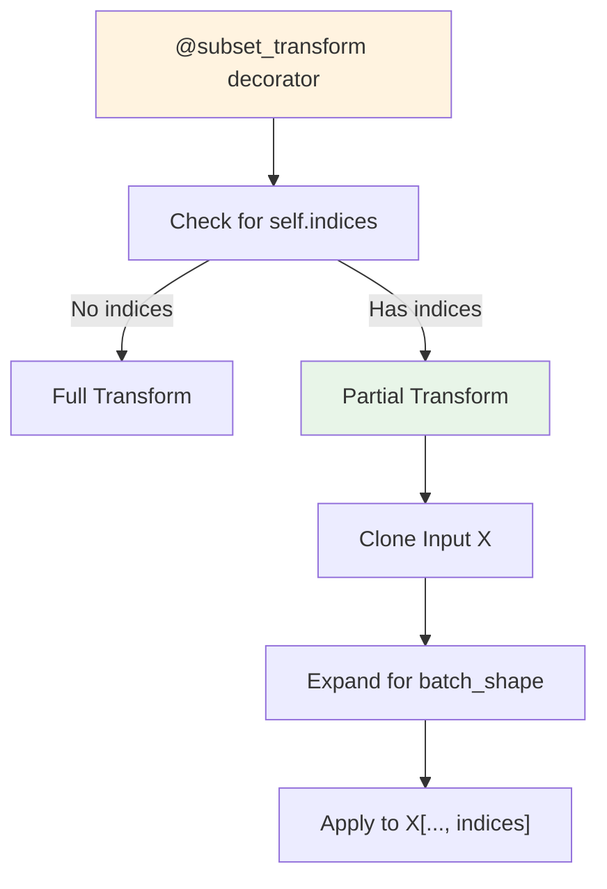
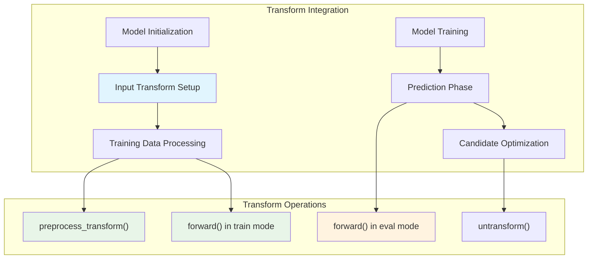

<!-- source: DeepWiki mcp.deepwiki.com · repo pytorch/botorch · page 3 Transforms · fetched 2026-10-21 -->

# Transforms

<details>
<summary>Relevant source files</summary>

The following files were used as context for generating this wiki page:

- [botorch/models/transforms/__init__.py](botorch/models/transforms/__init__.py)
- [botorch/models/transforms/input.py](botorch/models/transforms/input.py)
- [botorch/models/transforms/utils.py](botorch/models/transforms/utils.py)
- [test/models/transforms/test_input.py](test/models/transforms/test_input.py)
- [test/models/transforms/test_utils.py](test/models/transforms/test_utils.py)

</details>


The transform system in BoTorch provides a comprehensive infrastructure for preprocessing inputs and outcomes in Gaussian Process models. Transforms handle normalization, standardization, discretization, and other data preprocessing operations that are essential for effective Bayesian optimization. This system is designed to be modular, composable, and integrates seamlessly with BoTorch's model infrastructure.

For information about model fitting and training, see [Models](#2). For details about acquisition function construction, see [Acquisition Functions](#4).

## Transform System Architecture

The transform system is built around two main categories: input transforms that preprocess model inputs, and outcome transforms that preprocess model outputs. The system uses an abstract base class pattern with concrete implementations for common transformations.

**Transform System Overview**


Sources: [botorch/models/transforms/input.py:45-443](), [botorch/models/transforms/utils.py:116-128]()

## Input Transform Base Classes

The input transform system is built on a hierarchy of abstract base classes that define the core interface and behavior patterns.

**Input Transform Class Hierarchy**


Sources: [botorch/models/transforms/input.py:45-105](), [botorch/models/transforms/input.py:377-443](), [botorch/models/transforms/input.py:445-618]()

### InputTransform Base Class

The `InputTransform` class defines the core interface for all input transformations:

| Method | Purpose | Required Implementation |
|--------|---------|------------------------|
| `forward(X)` | Main entry point, handles mode-dependent application | Inherited |
| `transform(X)` | Core transformation logic | Abstract - must implement |
| `untransform(X)` | Reverse transformation | Optional |
| `preprocess_transform(X)` | Preprocessing without learning | Inherited |
| `equals(other)` | Equality comparison | Inherited |

The transform application is controlled by three boolean flags:
- `transform_on_train`: Apply during model training mode
- `transform_on_eval`: Apply during model evaluation mode  
- `transform_on_fantasize`: Apply during fantasize operations

Sources: [botorch/models/transforms/input.py:45-158]()

## Core Input Transform Implementations

### Normalize Transform

The `Normalize` transform scales inputs to the unit cube, typically centering them at 0.5. It supports both learned bounds (from training data) and fixed bounds.



Key features:
- **Learned bounds mode**: Updates bounds from training data via `_update_coefficients()`
- **Fixed bounds mode**: Uses provided bounds without updates
- **Partial indexing**: Can transform only specified input dimensions
- **Batch support**: Handles batched transformations per batch dimension

Sources: [botorch/models/transforms/input.py:620-774]()

### InputStandardize Transform

The `InputStandardize` transform normalizes inputs to zero mean and unit variance:



The transform includes safeguards against numerical instability with `min_std` parameter to prevent division by very small standard deviations.

Sources: [botorch/models/transforms/input.py:776-853]()

### Round Transform

The `Round` transform handles discretization for integer and categorical variables:



The transform supports both exact rounding (non-differentiable) and approximate rounding (differentiable) with straight-through estimators for gradient computation.

Sources: [botorch/models/transforms/input.py:855-1069]()

## Transform Composition

### ChainedInputTransform

The `ChainedInputTransform` enables sequential application of multiple transforms:



Forward transforms are applied in order, while untransforms are applied in reverse order to maintain correctness.

Sources: [botorch/models/transforms/input.py:284-375]()

### BatchBroadcastedInputTransform

The `BatchBroadcastedInputTransform` applies different transforms to different batch dimensions:



This enables using batched GP models where different batch dimensions require different input preprocessing.

Sources: [botorch/models/transforms/input.py:160-282]()

## Transform Utilities and Helpers

### Subset Transform Decorator

The `subset_transform` decorator handles partial dimension transformation:

```python
@subset_transform
def _transform(self, X: Tensor) -> Tensor:
    # Transform logic here
    return transformed_X
```

This decorator automatically:
- Clones input tensors to avoid in-place modifications
- Applies transforms only to specified indices 
- Handles batch shape expansion when needed
- Returns properly shaped output tensors

**Subset Transform Logic Flow**


Sources: [botorch/models/transforms/utils.py:116-128]()

### Specialized Transform Utilities

The transform system includes several utility functions for specific operations:

| Function | Purpose | Usage |
|----------|---------|-------|
| `kumaraswamy_warp()` | Warp inputs through Kumaraswamy CDF | Input warping transforms |
| `inv_kumaraswamy_warp()` | Inverse Kumaraswamy warping | Reversing warp transforms |
| `expand_and_copy_tensor()` | Expand tensors for batch operations | Batch processing |
| `interaction_features()` | Compute interaction terms | Feature engineering |

Sources: [botorch/models/transforms/utils.py:163-209](), [botorch/models/transforms/utils.py:94-113](), [botorch/models/transforms/utils.py:131-143]()

## Working with Transforms

### Transform Lifecycle

Transforms follow a standard lifecycle pattern within BoTorch models:



### Best Practices

1. **Transform Ordering**: In chained transforms, apply normalization before standardization, and discretization last
2. **Batch Shapes**: Ensure transform batch shapes are compatible with model batch shapes
3. **Gradient Flow**: Use approximate rounding for differentiable optimization pipelines
4. **Preprocessing**: Use `preprocess_transform()` for baseline data in acquisition functions

Sources: [botorch/models/transforms/input.py:132-157](), [botorch/models/transforms/input.py:252-269](), [botorch/models/transforms/input.py:358-374]()

---

