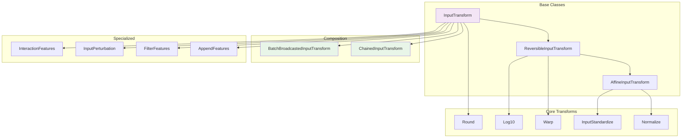
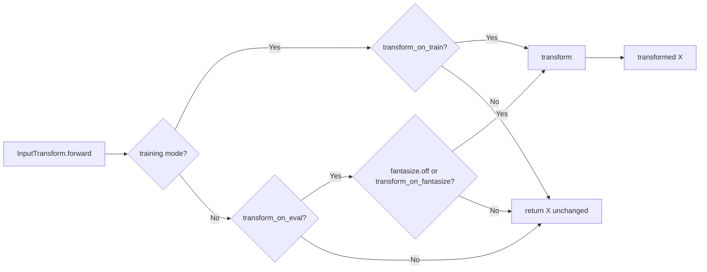
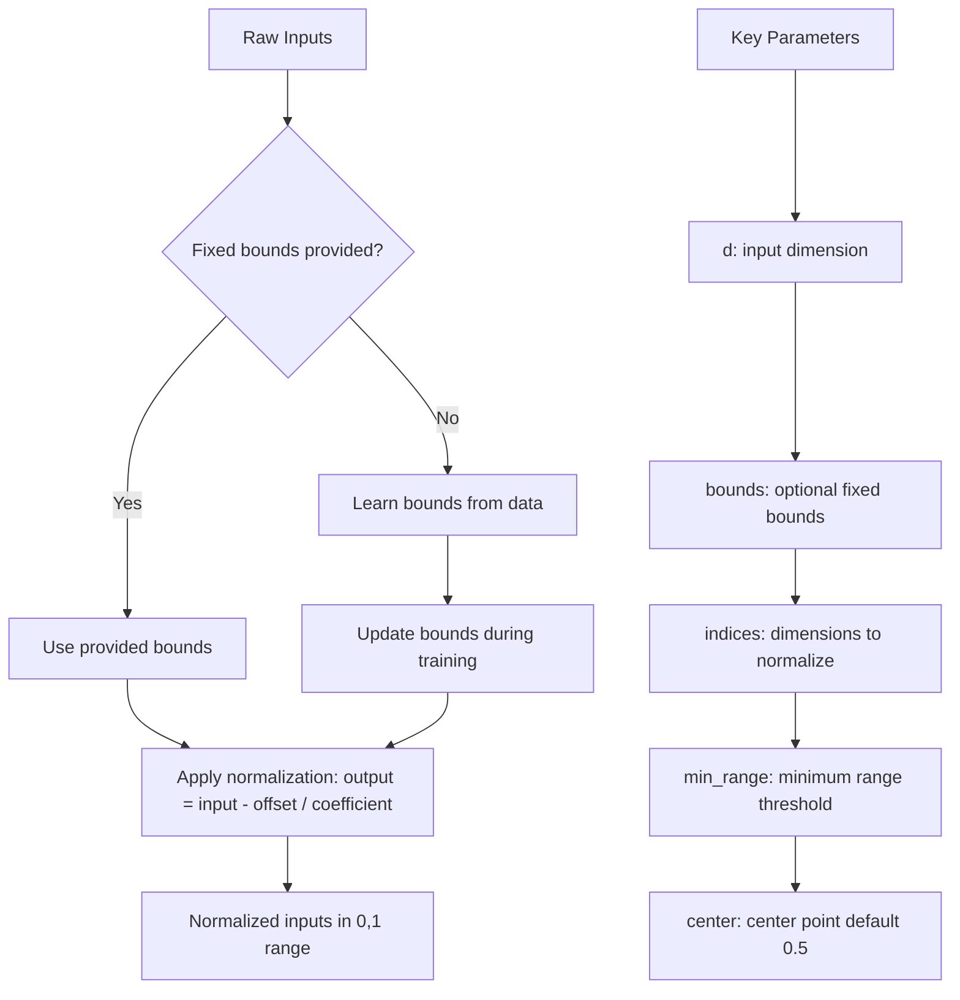
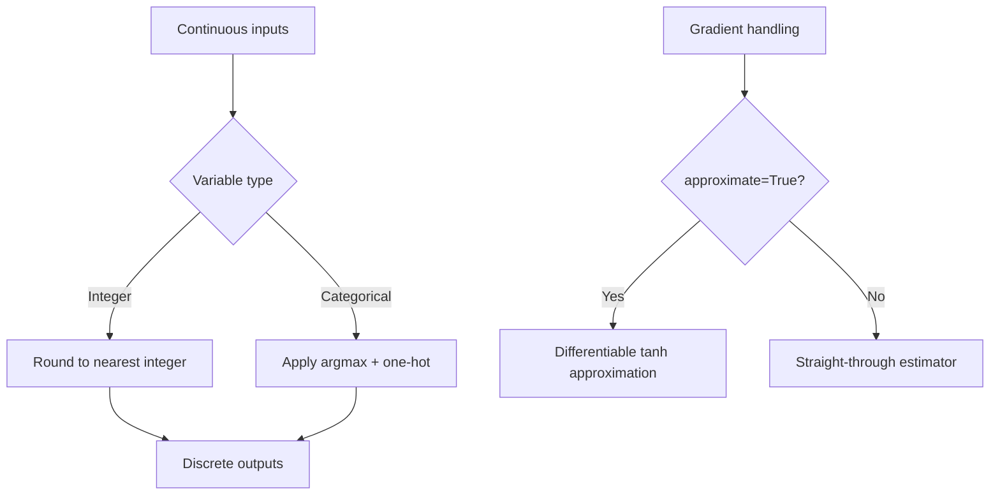
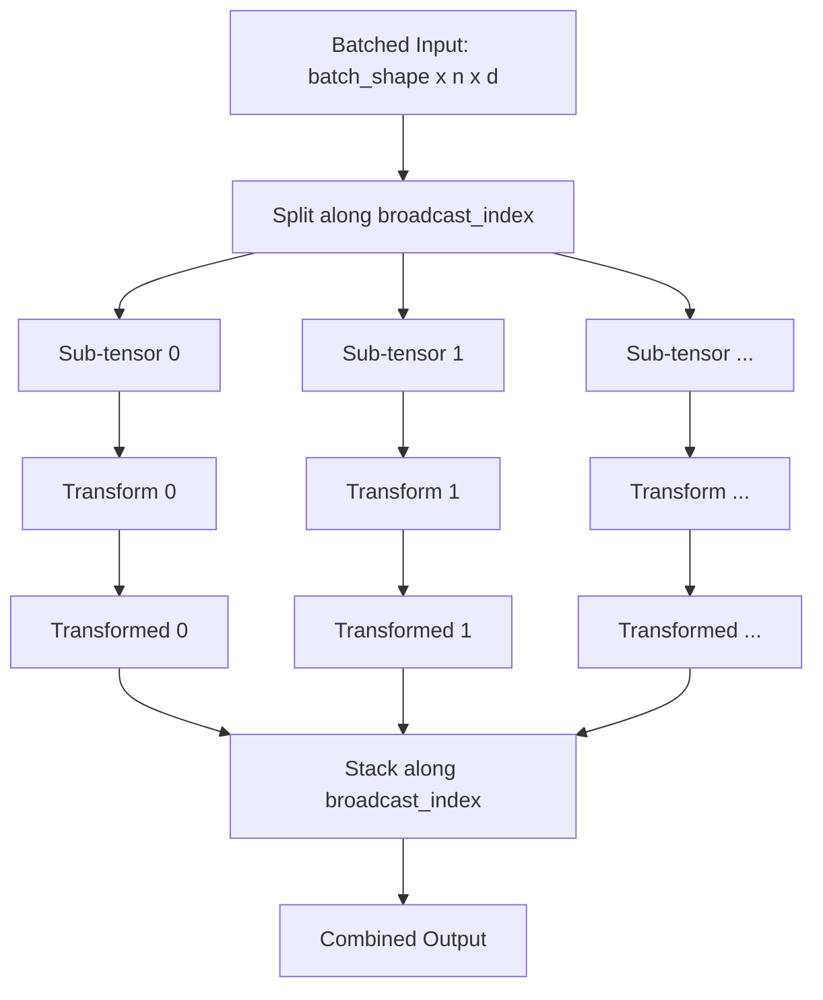
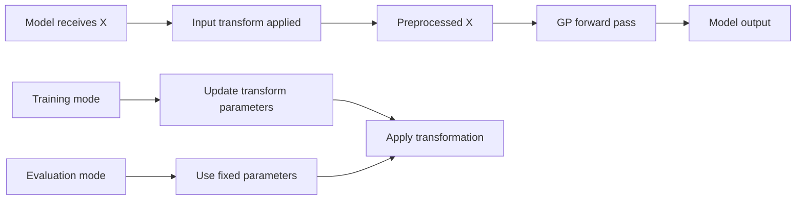

<!-- source: DeepWiki mcp.deepwiki.com · repo pytorch/botorch · page 3.1 Input Transforms · fetched 2026-10-21 -->

# Input Transforms

<details>
<summary>Relevant source files</summary>

The following files were used as context for generating this wiki page:

- [botorch/models/transforms/__init__.py](botorch/models/transforms/__init__.py)
- [botorch/models/transforms/input.py](botorch/models/transforms/input.py)
- [botorch/models/transforms/utils.py](botorch/models/transforms/utils.py)
- [test/models/transforms/test_input.py](test/models/transforms/test_input.py)
- [test/models/transforms/test_utils.py](test/models/transforms/test_utils.py)

</details>


## Purpose and Scope

Input transforms provide a systematic way to preprocess input data before it is passed to Gaussian Process models in BoTorch. These transforms handle common preprocessing tasks such as normalization, standardization, discretization, and learned warping functions to improve model performance and numerical stability.

This document covers the input transform system including the base classes, concrete implementations, and composition patterns. For information about output preprocessing, see [Outcome Transforms](#3.2). For guidance on using transforms effectively, see [Working with Transforms](#3.3).

## Architecture Overview

The input transform system follows a hierarchical class design with abstract base classes defining the interface and concrete implementations providing specific preprocessing functionality.



**Sources:** [botorch/models/transforms/input.py:45-443]()

## Base Classes

### InputTransform

The abstract base class `InputTransform` defines the core interface for all input transformations. It inherits from `torch.nn.Module` to integrate with PyTorch's module system.

**Key Properties:**
- `is_one_to_many`: Whether the transform produces multiple outputs for each input
- `transform_on_train`: Whether to apply transform in training mode
- `transform_on_eval`: Whether to apply transform in evaluation mode  
- `transform_on_fantasize`: Whether to apply transform during fantasy sampling

**Key Methods:**
- `forward(X)`: Main entry point that conditionally applies the transform based on mode
- `transform(X)`: Abstract method implementing the actual transformation
- `untransform(X)`: Reverses the transformation (not always implemented)
- `preprocess_transform(X)`: Applies transform for preprocessing training data



**Sources:** [botorch/models/transforms/input.py:45-158]()

### AffineInputTransform

`AffineInputTransform` provides the base implementation for affine transformations of the form `output = (input - offset) / coefficient`. This class handles the common patterns for normalization and standardization.

**Key Features:**
- Supports batch processing with configurable `batch_shape`
- Can transform only specific dimensions via `indices` parameter
- Implements reversible transformations via the `ReversibleInputTransform` interface
- Supports learnable coefficients that update during training

**Sources:** [botorch/models/transforms/input.py:445-618]()

## Core Transform Implementations

### Normalize

The `Normalize` transform rescales inputs to have unit range and be centered at a configurable point (default 0.5). This is essential for GP models as it ensures all input dimensions have similar scales.



**Usage Pattern:**
- In training: automatically learns bounds from data unless fixed bounds provided
- In evaluation: applies learned or fixed bounds to new inputs
- Handles edge cases where input range is too small via `min_range` parameter

**Sources:** [botorch/models/transforms/input.py:620-774]()

### InputStandardize  

The `InputStandardize` transform applies z-score standardization to inputs (zero mean, unit variance). This is particularly useful when input dimensions have very different scales or when working with standardized experimental designs.

**Key Features:**
- Computes sample mean and standard deviation from training data
- Applies z-score transformation: `(X - mean) / std`
- Handles dimensions with near-zero variance via `min_std` parameter
- Always updates coefficients during training (unlike `Normalize`)

**Sources:** [botorch/models/transforms/input.py:776-853]()

### Round

The `Round` transform handles discrete and categorical variables by rounding continuous relaxations back to valid discrete values.

**Supported Variable Types:**
- **Integer variables**: Rounded to nearest integer values
- **Categorical variables**: One-hot encoded vectors projected to valid categories via argmax

**Rounding Modes:**
- **Exact rounding** (`approximate=False`): Uses PyTorch's `round()` with straight-through estimators for gradients
- **Approximate rounding** (`approximate=True`): Uses differentiable hyperbolic tangent approximation



**Sources:** [botorch/models/transforms/input.py:855-1033]()

## Transform Composition

### ChainedInputTransform

`ChainedInputTransform` allows multiple transforms to be applied in sequence. This is implemented as a `ModuleDict` where transforms are applied in the order they were added.

**Example Usage Pattern:**
```python
# Typical normalization pipeline
tf = ChainedInputTransform(
    unnormalize=Normalize(d=d, bounds=bounds, reverse=True),  # unnormalize from unit cube
    round=Round(integer_indices=[0, 2]),                     # round discrete variables  
    normalize=Normalize(d=d, bounds=bounds)                  # renormalize to unit cube
)
```

**Sources:** [botorch/models/transforms/input.py:284-375]()

### BatchBroadcastedInputTransform

`BatchBroadcastedInputTransform` applies different transforms to different batch dimensions. This enables using different preprocessing for different batch elements in a batched GP model.



**Sources:** [botorch/models/transforms/input.py:160-282]()

## Integration with Models

Input transforms are typically integrated into GP models and applied within the model's `forward()` method. The transform's mode-dependent behavior ensures appropriate preprocessing during training vs. evaluation.



The `preprocess_transform()` method provides special handling for preprocessing baseline points in acquisition functions and training data before calling `set_train_data()`.

**Sources:** [botorch/models/transforms/input.py:132-157]()

## Implementation Details

### Subset Transformation

Many transforms support the `indices` parameter to transform only specific input dimensions. This is implemented via the `@subset_transform` decorator that handles the indexing logic.

**Sources:** [botorch/models/transforms/utils.py:116-128]()

### Numerical Stability

Input transforms include several mechanisms for numerical stability:
- `min_range` parameter in `Normalize` to avoid division by very small ranges
- `min_std` parameter in `InputStandardize` to avoid division by very small standard deviations  
- Clamping operations in warping functions to keep values in valid ranges

**Sources:** [botorch/models/transforms/input.py:639-666](), [botorch/models/transforms/input.py:793-814]()

### Device and Dtype Handling

Transforms automatically handle device and dtype compatibility via the `_to()` method, ensuring coefficients match the input tensor's device and dtype.

**Sources:** [botorch/models/transforms/input.py:605-608]()

---

