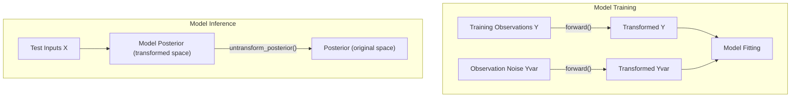
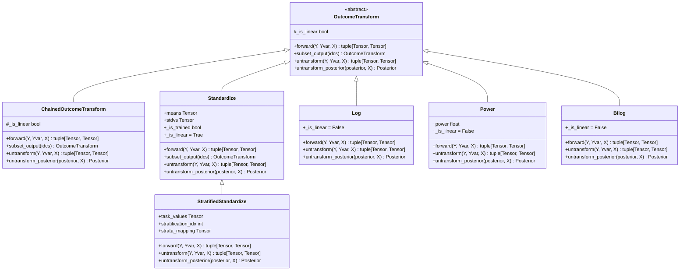
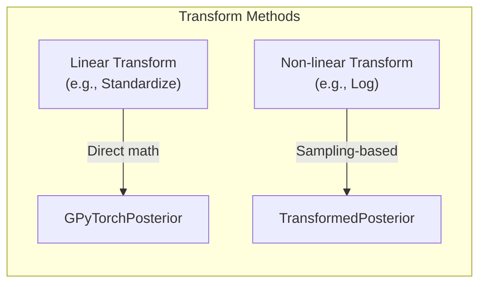

<!-- source: DeepWiki mcp.deepwiki.com · repo pytorch/botorch · page 3.2 Outcome Transforms · fetched 2026-10-21 -->

# Outcome Transforms

<details>
<summary>Relevant source files</summary>

The following files were used as context for generating this wiki page:

- [botorch/models/transforms/__init__.py](botorch/models/transforms/__init__.py)
- [botorch/models/transforms/input.py](botorch/models/transforms/input.py)
- [botorch/models/transforms/utils.py](botorch/models/transforms/utils.py)
- [test/models/transforms/test_input.py](test/models/transforms/test_input.py)
- [test/models/transforms/test_utils.py](test/models/transforms/test_utils.py)

</details>


Outcome transforms in BoTorch provide a way to transform model outputs (observations) during training and inference. These transformations help improve model performance by making data more amenable to Gaussian Process modeling. Unlike [Input Transforms](#3.1), which operate on feature inputs, outcome transforms manipulate the target values and observation noise.

Outcome transforms are applied: (1) during model construction to transform training observations, and (2) during posterior calculation to untransform model predictions back to the original space.



Sources: [botorch/models/transforms/__init__.py:14-20]()

## Architecture

The outcome transform system is built around the abstract base class `OutcomeTransform`, which defines the interface for all outcome transforms.



The `OutcomeTransform` abstract base class defines four key methods:

1. `forward(Y, Yvar, X)`: Transforms training targets and optionally their associated observation noise.
2. `untransform(Y, Yvar, X)`: Reverses the transformation for target values.
3. `untransform_posterior(posterior, X)`: Untransforms a posterior distribution from model space to original space.
4. `subset_output(idcs)`: Creates a new transform that operates on a subset of the output dimensions.

Additionally, transforms have a `_is_linear` property which determines whether the transform preserves the multivariate normal nature of GP posteriors.

Sources: [botorch/models/transforms/__init__.py:14-20]()

## Core Outcome Transforms

### Standardize

The `Standardize` transform normalizes outputs to have zero mean and unit variance. This is one of the most commonly used transforms as many GP models perform best when outputs are standardized.

Key features:
- **Stateful**: Computes and stores means and standard deviations from training data
- **Linear transform**: Preserves the normal distribution properties of GP posteriors
- **Efficiency**: Can directly transform GP posteriors without sampling

```python
# Example usage
standardize = Standardize(m=1)  # For single-output models
standardize = Standardize(m=2)  # For models with 2 outputs
standardize = Standardize(m=2, outputs=[0])  # Only standardize the first output
```

Internally, it applies the transformation:
- Y_transformed = (Y - means) / stdvs
- Yvar_transformed = Yvar / stdvs²

The `Standardize` transform also provides efficient posterior transformation through direct manipulation of the posterior's mean and covariance matrix, preserving the GP nature of the posterior.

Sources: [botorch/models/transforms/__init__.py:19]()

### StratifiedStandardize

The `StratifiedStandardize` transform extends `Standardize` to handle data stratified by some categorical feature (like a task index in multi-task models). It standardizes each stratum independently.

Key features:
- **Task-based**: Standardizes outputs for each task separately
- **Requires inputs**: Needs input features (X) to identify the stratification dimension
- **Supports remapping**: Handles non-contiguous task indices

```python
# Example usage (for task values 0 and 1, with task index in the last dimension)
stratified_standardize = StratifiedStandardize(
    task_values=torch.tensor([0, 1]),
    stratification_idx=-1,  # Last dimension contains task index
)
```

This transform is particularly useful for multi-task Gaussian processes where different tasks may have different scales.

Sources: [botorch/models/transforms/__init__.py:14-20]()

### Log Transform

The `Log` transform applies a natural logarithm to the outputs. This is useful for:
- Data with multiplicative noise
- Strictly positive outcomes
- Data spanning multiple orders of magnitude

Key features:
- **Non-linear**: Changes the distribution of the data
- **Domain restriction**: Only works on positive values
- **Variance handling**: Properly transforms observation noise

When untransforming posteriors, the Log transform needs to account for Jensen's inequality - the expected value of a log-transformed normal random variable is not simply the exponential of the mean. The transform properly accounts for this.

Sources: [botorch/models/transforms/__init__.py:17]()

### Power Transform

The `Power` transform raises outputs to a specified power:
Y_transformed = sign(Y) * |Y|^power

Key features:
- **Flexible**: Can apply different powers for various effects
- **Non-linear**: Changes distribution properties
- **Sign-preserving**: Maintains sign of original values

Common use cases:
- power=0.5: Square root transform (for variance-stabilizing)
- power=2: Squared transform (for emphasizing differences in larger values)

Sources: [botorch/models/transforms/__init__.py:18]()

### Bilog Transform

The `Bilog` (bi-logarithmic) transform is a symmetric log transform that can handle both positive and negative values. It's defined as:
Y_transformed = sign(Y) * log(1 + |Y|)

Key features:
- **Symmetric**: Treats positive and negative values similarly
- **Handles zeros**: Well-defined at zero
- **Smoothly bounded**: Reduces impact of extreme values

This is particularly useful when dealing with objective functions that can be both positive and negative.

Sources: [botorch/models/transforms/__init__.py:15]()

## Composing Transforms

### ChainedOutcomeTransform

The `ChainedOutcomeTransform` class allows you to combine multiple outcome transforms that are applied sequentially.

Key features:
- **Sequential application**: Applies transforms in order for forward, and in reverse order for untransform
- **Preserves interfaces**: Has the same API as individual transforms
- **Linearity preservation**: A chained transform is linear only if all component transforms are linear

```python
# Example of chaining standardization with a log transform
chained_tf = ChainedOutcomeTransform(
    standardize=Standardize(m=1),
    log=Log(),
)
```

When applying chained transforms, the sequence matters. In the example above, the log transform is applied first, then standardization, and for untransforming, standardization is undone first, then the log transform.

Sources: [botorch/models/transforms/__init__.py:16]()

## Working with Posteriors

Outcome transforms must handle both forward transformation of training data and backward transformation of model outputs. The `untransform_posterior` method is especially important as it converts the model's posterior back to the original space.

When working with posteriors, there are two key categories of transforms:

### Linear Transforms

Transforms like `Standardize` that preserve the multivariate normal (MVN) nature of GP posteriors have `_is_linear = True`. These can efficiently transform posteriors by directly modifying the mean and covariance:



For a linear transform, if the model posterior has mean μ and variance σ², the transformed posterior will have:
- Mean: a * μ + b (where a and b are transform-specific parameters)
- Variance: a² * σ²

Sources: [botorch/models/transforms/__init__.py:14-20]()

### Non-linear Transforms

Transforms like `Log` and `Power` that don't preserve MVN properties have `_is_linear = False`. These return a `TransformedPosterior` that applies the transform to samples from the original posterior.

For example, with the Log transform:
- If X ~ N(μ, σ²), then Y = exp(X) is log-normal
- The mean of Y is not exp(μ), but exp(μ + σ²/2)
- The variance needs similar adjustment

The transformation uses utility functions from `botorch/models/transforms/utils.py` to properly handle these statistical transformations.

Sources: [botorch/models/transforms/__init__.py:14-20](), [botorch/models/transforms/utils.py:40-91]()

## Integration with Models

Outcome transforms are typically integrated with models by passing them during model initialization:

```python
# Example of a GP model with outcome standardization
model = SingleTaskGP(
    train_X=X,
    train_Y=Y,
    outcome_transform=Standardize(m=1),
)
```

The model will:
1. Apply the transform to the training data immediately
2. Train using the transformed data
3. Automatically apply `untransform_posterior` when computing posteriors

This allows seamless integration of transforms with the modeling process.

Sources: [botorch/models/transforms/__init__.py:14-20]()

## Summary

Outcome transforms provide a flexible system for preprocessing model outputs to improve model performance. The system supports:

1. Single or multiple output transformations
2. Linear transformations that preserve GP posterior properties
3. Non-linear transformations that can handle various data characteristics
4. Composition of multiple transforms through chaining
5. Stratified transformations for multi-task models

By selecting appropriate transformations, you can adapt models to different data characteristics while maintaining the ability to make predictions in the original outcome space.

---

