<!-- source: DeepWiki mcp.deepwiki.com · repo pytorch/botorch · page 3.3 Working with Transforms · fetched 2026-10-21 -->

# Working with Transforms

Relevant source files

The following files were used as context for generating this wiki page:

- [botorch/models/transforms/__init__.py](botorch/models/transforms/__init__.py)
- [botorch/models/transforms/input.py](botorch/models/transforms/input.py)
- [botorch/models/transforms/utils.py](botorch/models/transforms/utils.py)
- [test/models/transforms/test_input.py](test/models/transforms/test_input.py)
- [test/models/transforms/test_utils.py](test/models/transforms/test_utils.py)

This document covers how to compose, configure, and integrate transforms within BoTorch models. It focuses on the practical aspects of using multiple transforms together, understanding transform behavior across different modes, and following best practices for transform usage. For documentation of specific input transform classes, see [Input Transforms](#3.1). For outcome transform classes, see [Outcome Transforms](#3.2).

## Transform Composition Patterns

BoTorch provides two primary mechanisms for composing multiple transforms: sequential chaining and parallel broadcasting.

### Sequential Chaining with ChainedInputTransform

The `ChainedInputTransform` applies transforms sequentially, where the output of each transform becomes the input to the next transform.

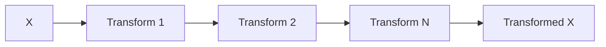

**Sequential Transform Application**

The transforms are applied in the order they are specified, and untransformed in reverse order:

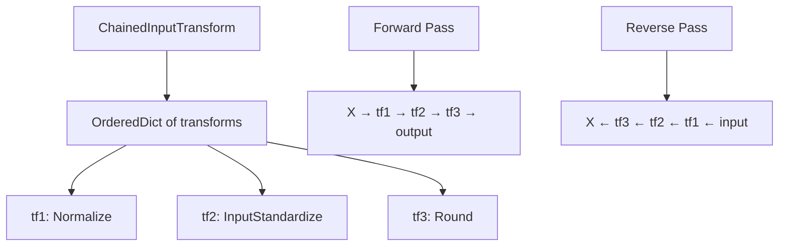

**Transform Properties Inheritance**

Sources: [botorch/models/transforms/input.py:284-375]()

### Parallel Broadcasting with BatchBroadcastedInputTransform

The `BatchBroadcastedInputTransform` applies different transforms to different batch dimensions, enabling batched models with varying preprocessing requirements.

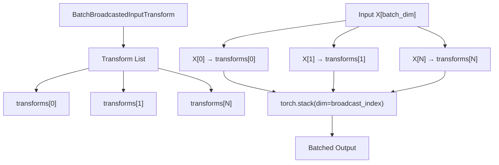

**Broadcast Index Configuration**

Sources: [botorch/models/transforms/input.py:160-282]()

## Transform Lifecycle and Modes

Transforms exhibit different behaviors depending on the model's training state and context. Understanding these modes is crucial for proper transform usage.

### Transform Mode Properties

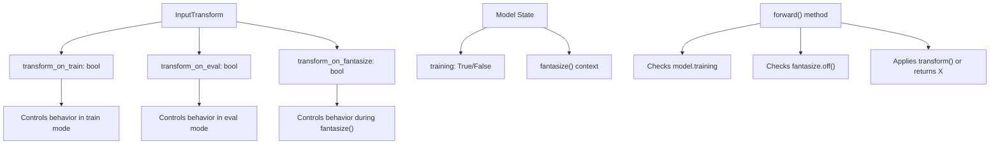

**Mode Decision Logic**

The `forward()` method determines whether to apply the transform based on the current state:

Sources: [botorch/models/transforms/input.py:64-79]()

### Stateful vs Stateless Transforms

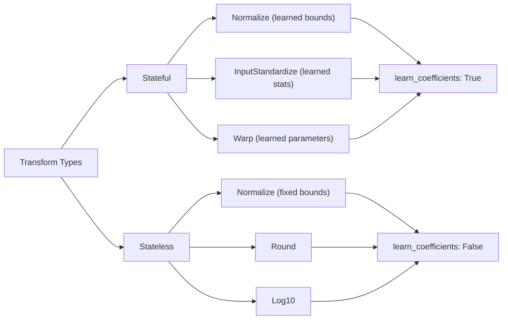

**Learning Coefficient Control**

Sources: [botorch/models/transforms/input.py:520-529](), [botorch/models/transforms/input.py:610-617]()

## Transform Properties and Behaviors

### Reversibility and the ReversibleInputTransform Pattern

Some transforms support bidirectional operation through the `ReversibleInputTransform` base class:

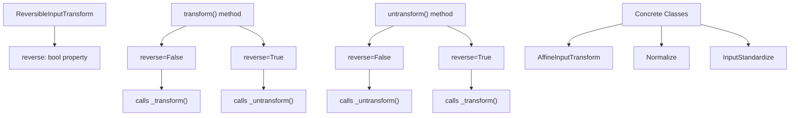

**Reversible Transform Interface**

Sources: [botorch/models/transforms/input.py:377-443]()

### One-to-Many Transform Handling

Transforms can alter the number of output points relative to input points:

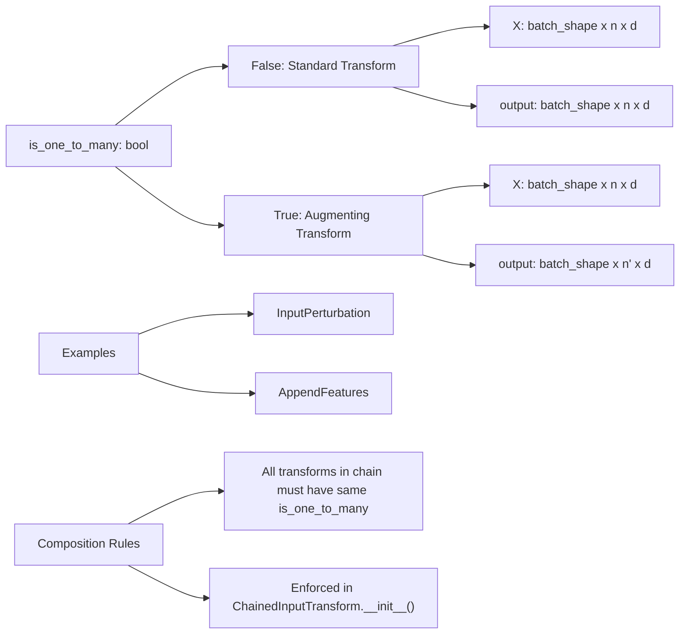

**Transform Augmentation Patterns**

Sources: [botorch/models/transforms/input.py:194-198]()

## Integration with Models

### Model Integration Points

Transforms integrate with BoTorch models at several key points in the modeling pipeline:

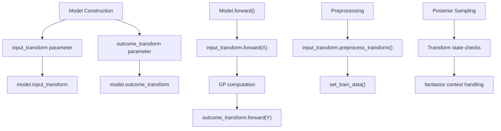

**Model Transform Pipeline**

### Preprocessing for Training Data

The `preprocess_transform()` method handles special preprocessing scenarios:

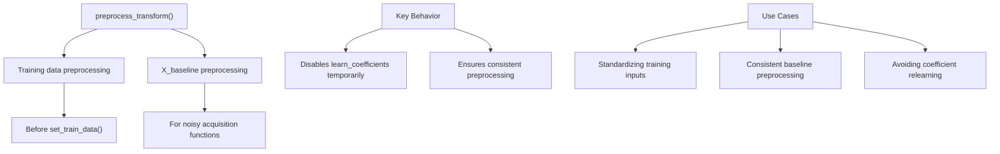

**Preprocessing Transform Logic**

Sources: [botorch/models/transforms/input.py:132-157]()

## Common Patterns and Best Practices

### Standard Normalization Chain

A common pattern combines unnormalization, discretization, and renormalization:

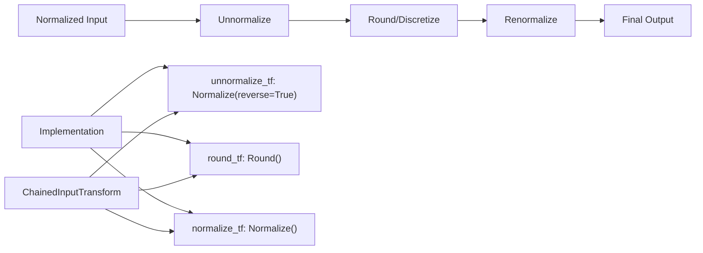

**Discretization Pipeline**

### Transform Equality and State Management

Transform comparison requires careful handling of state and parameters:

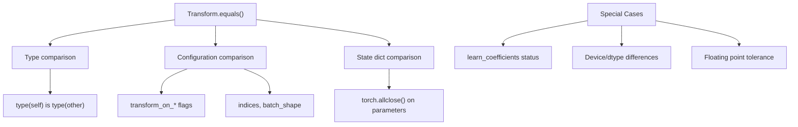

**Transform Comparison Logic**

### Error Handling and Validation

Common transform errors and their handling:

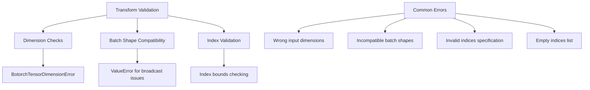

**Validation and Error Patterns**

Sources: [botorch/models/transforms/input.py:582-604](), [test/models/transforms/test_input.py:242-246]()

### Performance Considerations

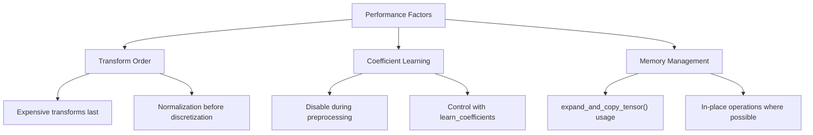

**Optimization Strategies**

Sources: [botorch/models/transforms/input.py:146-157](), [botorch/models/transforms/utils.py:94-113]()

---

