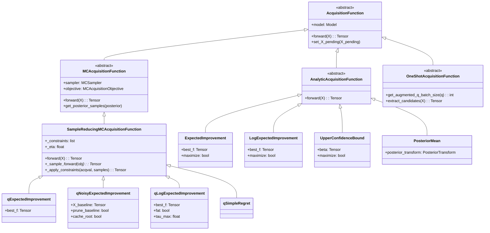
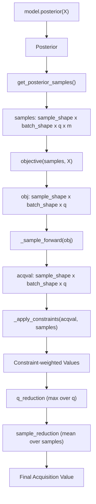
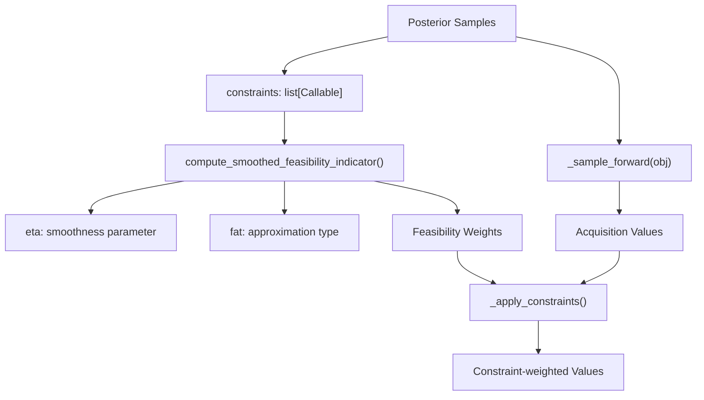
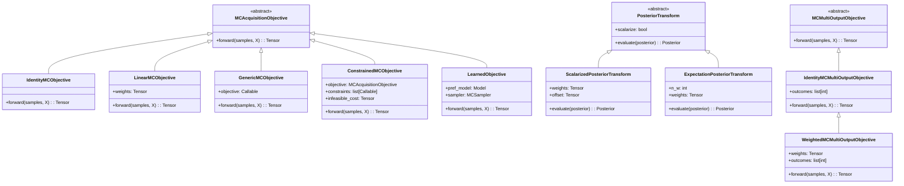
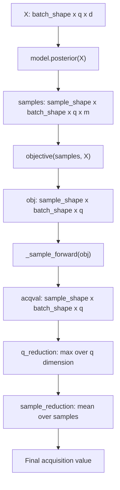

<!-- source: DeepWiki mcp.deepwiki.com · repo pytorch/botorch · page 4 Acquisition Functions · fetched 2026-10-21 -->

# Acquisition Functions

<details>
<summary>Relevant source files</summary>

The following files were used as context for generating this wiki page:

- [botorch/acquisition/__init__.py](botorch/acquisition/__init__.py)
- [botorch/acquisition/input_constructors.py](botorch/acquisition/input_constructors.py)
- [botorch/acquisition/monte_carlo.py](botorch/acquisition/monte_carlo.py)
- [botorch/acquisition/multi_objective/utils.py](botorch/acquisition/multi_objective/utils.py)
- [botorch/acquisition/multioutput_acquisition.py](botorch/acquisition/multioutput_acquisition.py)
- [botorch/acquisition/preference.py](botorch/acquisition/preference.py)
- [botorch/acquisition/utils.py](botorch/acquisition/utils.py)
- [sphinx/source/acquisition.rst](sphinx/source/acquisition.rst)
- [test/acquisition/multi_objective/test_utils.py](test/acquisition/multi_objective/test_utils.py)
- [test/acquisition/test_input_constructors.py](test/acquisition/test_input_constructors.py)
- [test/acquisition/test_monte_carlo.py](test/acquisition/test_monte_carlo.py)
- [test/acquisition/test_multioutput_acquisition.py](test/acquisition/test_multioutput_acquisition.py)
- [test/acquisition/test_preference.py](test/acquisition/test_preference.py)
- [test/acquisition/test_utils.py](test/acquisition/test_utils.py)

</details>


Acquisition functions are the core components of Bayesian optimization that determine which points to evaluate next. They balance exploration (reducing uncertainty) and exploitation (improving the objective) by quantifying the utility of candidate points. BoTorch provides a comprehensive ecosystem of acquisition functions with an automated input construction system, supporting single-objective, multi-objective, and constrained optimization scenarios.

For information about optimizing acquisition functions, see [Optimization](#5).

## Acquisition Function Architecture

BoTorch Acquisition Function Class Hierarchy



The BoTorch acquisition function ecosystem is built on a modular class hierarchy:

1. **`AcquisitionFunction`**: Base abstract class defining the core interface. All acquisition functions implement `forward(X)` to evaluate utility at candidate points.

2. **`AnalyticAcquisitionFunction`**: For acquisition functions with closed-form expressions that operate on posterior mean and variance.

3. **`MCAcquisitionFunction`**: Base class for Monte Carlo-based acquisition functions that use sampling from model posteriors.

4. **`SampleReducingMCAcquisitionFunction`**: Specialized MC acquisition function that handles sample reduction and constraint weighting through `_sample_forward()` and `_apply_constraints()`.

5. **`OneShotAcquisitionFunction`**: For lookahead acquisition functions like Knowledge Gradient that consider future evaluations.

Sources: [botorch/acquisition/acquisition.py:44-169](), [botorch/acquisition/monte_carlo.py:60-338](), [botorch/acquisition/__init__.py:7-84]()

## Key Types of Acquisition Functions

### Analytic Acquisition Functions

Analytic acquisition functions have closed-form expressions and evaluate quickly:

| Acquisition Function | Description | Key Parameters |
|----------------------|-------------|----------------|
| `ExpectedImprovement` | Expected improvement over current best | `best_f`, `maximize` |
| `LogExpectedImprovement` | Log-space EI for numerical stability | `best_f`, `maximize` |
| `ProbabilityOfImprovement` | Probability of improvement | `best_f`, `tau` |
| `LogProbabilityOfImprovement` | Log-space PI | `best_f`, `tau` |
| `UpperConfidenceBound` | Mean + beta * std deviation | `beta`, `maximize` |
| `PosteriorMean` | Model posterior mean | `posterior_transform` |
| `NoisyExpectedImprovement` | EI with noise considerations | `X_observed`, `num_fantasies` |
| `LogNoisyExpectedImprovement` | Log-space noisy EI | `X_observed`, `num_fantasies` |

### Monte Carlo Acquisition Functions

Monte Carlo Evaluation Pipeline



Monte Carlo acquisition functions use sampling to estimate acquisition values:

| Acquisition Function | Description | Key Parameters |
|----------------------|-------------|----------------|
| `qExpectedImprovement` | Batch expected improvement | `best_f`, `constraints`, `eta` |
| `qLogExpectedImprovement` | Log-space qEI with improved numerics | `best_f`, `fat`, `tau_max`, `tau_relu` |
| `qNoisyExpectedImprovement` | qEI for noisy observations | `X_baseline`, `prune_baseline`, `cache_root` |
| `qLogNoisyExpectedImprovement` | Log-space qNEI | `X_baseline`, `fat`, `tau_max`, `incremental` |
| `qProbabilityOfImprovement` | Batch probability of improvement | `best_f`, `tau`, `constraints` |
| `qUpperConfidenceBound` | Batch upper confidence bound | `beta`, `constraints` |
| `qSimpleRegret` | Simple posterior mean maximization | `constraints` |

The `SampleReducingMCAcquisitionFunction` base class implements the evaluation pipeline:
1. **Sample**: `get_posterior_samples()` draws Monte Carlo samples
2. **Transform**: `objective()` transforms samples to objective values
3. **Evaluate**: `_sample_forward()` computes utility per sample
4. **Constrain**: `_apply_constraints()` applies constraint weighting
5. **Reduce**: Sample and q-batch dimensions are reduced to final value

Sources: [botorch/acquisition/analytic.py:56-687](), [botorch/acquisition/monte_carlo.py:340-872](), [botorch/acquisition/logei.py:43-378]()

### Multi-Objective Acquisition Functions

Multi-objective acquisition functions optimize hypervolume improvement:

| Acquisition Function | Description | Key Parameters |
|----------------------|-------------|----------------|
| `ExpectedHypervolumeImprovement` | Analytic hypervolume expected improvement | `ref_point`, `partitioning` |
| `qExpectedHypervolumeImprovement` | MC-based batch EHVI | `ref_point`, `partitioning`, `sampler` |
| `qLogExpectedHypervolumeImprovement` | Log-space qEHVI for numerical stability | `ref_point`, `fat`, `tau_max` |
| `qNoisyExpectedHypervolumeImprovement` | qEHVI for noisy observations | `ref_point`, `X_baseline`, `prune_baseline` |
| `qLogNoisyExpectedHypervolumeImprovement` | Log-space qNEHVI | `ref_point`, `X_baseline`, `fat` |
| `qHypervolumeKnowledgeGradient` | Lookahead hypervolume optimization | `ref_point`, `num_fantasies` |
| `qMultiFidelityHypervolumeKnowledgeGradient` | Multi-fidelity hypervolume KG | `ref_point`, `num_fantasies`, `cost_model` |

These functions evaluate improvement in Pareto frontier hypervolume and work with `MCMultiOutputObjective` for handling multi-output models.

Sources: [botorch/acquisition/multi_objective/monte_carlo.py:52-447](), [botorch/acquisition/multi_objective/logei.py:38-350](), [botorch/acquisition/multi_objective/hypervolume_knowledge_gradient.py:54-329]()

## Input Construction System

BoTorch Acquisition Function Input Constructor Architecture

```mermaid
flowchart TD
    subgraph "Registry System"
        ACQF_INPUT_CONSTRUCTOR_REGISTRY["ACQF_INPUT_CONSTRUCTOR_REGISTRY = {}"]
        acqf_input_constructor["@acqf_input_constructor decorator"]
        get_acqf_input_constructor["get_acqf_input_constructor()"]
        allow_only_specific_variable_kwargs["allow_only_specific_variable_kwargs()"]
    end
    
    subgraph "Input Constructors"
        construct_inputs_best_f["construct_inputs_best_f()"]
        construct_inputs_qEI["construct_inputs_qEI()"]
        construct_inputs_qNEI["construct_inputs_qNEI()"]
        construct_inputs_ucb["construct_inputs_ucb()"]
        construct_inputs_posterior_mean["construct_inputs_posterior_mean()"]
    end
    
    subgraph "Acquisition Function Classes"
        ExpectedImprovement["ExpectedImprovement"]
        qExpectedImprovement["qExpectedImprovement"]
        qNoisyExpectedImprovement["qNoisyExpectedImprovement"]
        UpperConfidenceBound["UpperConfidenceBound"]
        PosteriorMean["PosteriorMean"]
    end
    
    subgraph "Inputs"
        model["model: Model"]
        training_data["training_data: SupervisedDataset"]
        objective["objective: MCAcquisitionObjective"]
        constraints["constraints: list[Callable]"]
        sampler["sampler: MCSampler"]
        best_f["best_f: float | Tensor"]
        X_baseline["X_baseline: Tensor"]
    end
    
    acqf_input_constructor --> ACQF_INPUT_CONSTRUCTOR_REGISTRY
    construct_inputs_best_f --> ACQF_INPUT_CONSTRUCTOR_REGISTRY
    construct_inputs_qEI --> ACQF_INPUT_CONSTRUCTOR_REGISTRY
    construct_inputs_qNEI --> ACQF_INPUT_CONSTRUCTOR_REGISTRY
    construct_inputs_ucb --> ACQF_INPUT_CONSTRUCTOR_REGISTRY
    construct_inputs_posterior_mean --> ACQF_INPUT_CONSTRUCTOR_REGISTRY
    
    get_acqf_input_constructor --> ACQF_INPUT_CONSTRUCTOR_REGISTRY
    get_acqf_input_constructor --> allow_only_specific_variable_kwargs
    
    ExpectedImprovement --> construct_inputs_best_f
    qExpectedImprovement --> construct_inputs_qEI
    qNoisyExpectedImprovement --> construct_inputs_qNEI
    UpperConfidenceBound --> construct_inputs_ucb
    PosteriorMean --> construct_inputs_posterior_mean
    
    model --> construct_inputs_qEI
    training_data --> construct_inputs_qEI
    objective --> construct_inputs_qEI
    constraints --> construct_inputs_qEI
    sampler --> construct_inputs_qEI
    best_f --> construct_inputs_qEI
    X_baseline --> construct_inputs_qNEI
```



The input constructor system automates acquisition function instantiation through a registry-based approach:

### Core Components

1. **`ACQF_INPUT_CONSTRUCTOR_REGISTRY`**: Global dictionary mapping acquisition function classes to their input constructor functions.

2. **`@acqf_input_constructor` decorator**: Registers constructor functions for specific acquisition function classes.

3. **`get_acqf_input_constructor()`**: Retrieves the appropriate constructor function for a given acquisition function class.

4. **`allow_only_specific_variable_kwargs()`**: Filters allowed keyword arguments to prevent errors.

### Key Input Constructor Functions

| Constructor Function | Acquisition Functions | Key Logic |
|---------------------|----------------------|-----------|
| `construct_inputs_best_f` | `ExpectedImprovement`, `LogExpectedImprovement`, `ProbabilityOfImprovement` | Computes `best_f` from training data using `get_best_f_analytic()` |
| `construct_inputs_qEI` | `qExpectedImprovement` | Computes `best_f` with `get_best_f_mc()`, handles constraints |
| `construct_inputs_qNEI` | `qNoisyExpectedImprovement` | Extracts `X_baseline` from training data, handles pruning |
| `construct_inputs_ucb` | `UpperConfidenceBound` | Sets default `beta=0.2` |
| `construct_inputs_posterior_mean` | `PosteriorMean` | Basic model and posterior transform setup |

### Utility Functions

- **`get_best_f_analytic()`**: Computes best objective value for analytic acquisition functions from training data
- **`get_best_f_mc()`**: Computes best objective value for MC acquisition functions with support for constraints
- **`_get_dataset_field()`**: Extracts fields from `SupervisedDataset` objects with validation
- **`_field_is_shared()`**: Checks if dataset fields are shared across multiple datasets

### Usage Pattern

```python
# Automatic usage through registry
input_constructor = get_acqf_input_constructor(qExpectedImprovement)
kwargs = input_constructor(
    model=model,
    training_data=training_data,
    # best_f automatically computed from training_data
)
acqf = qExpectedImprovement(**kwargs)
```

Sources: [botorch/acquisition/input_constructors.py:118-285](), [botorch/acquisition/input_constructors.py:533-588](), [botorch/acquisition/input_constructors.py:704-767]()

## Constraint Handling and Utilities

### Constraint Integration in Acquisition Functions

BoTorch integrates constraints directly into acquisition functions through the `SampleReducingMCAcquisitionFunction` framework:



### Core Constraint Utilities

| Function | Purpose | Key Parameters |
|----------|---------|----------------|
| `compute_best_feasible_objective()` | Finds best objective value satisfying constraints | `samples`, `constraints`, `model`, `X_baseline` |
| `get_infeasible_cost()` | Computes penalty for infeasible points | `X`, `model`, `objective` |
| `prune_inferior_points()` | Removes unlikely optimal points (single-objective) | `model`, `X`, `constraints`, `max_frac` |
| `prune_inferior_points_multi_objective()` | Removes unlikely Pareto optimal points | `model`, `X`, `ref_point`, `constraints` |

### Constraint Types

1. **Outcome constraints**: Functions that map posterior samples to constraint values
   ```python
   constraints = [lambda Y: Y[..., 1] - threshold]  # Y[..., 1] <= threshold
   ```

2. **Smoothed constraint indicators**: Use `eta` parameter to control smoothness of constraint approximation

3. **Fat-tailed approximations**: Use `fat` parameter for improved constraint handling

### Multi-Objective Constraint Utilities

| Function | Purpose | Description |
|----------|---------|-------------|
| `get_default_partitioning_alpha()` | Determines approximation level for hypervolume | Returns `0.0` for ≤4 objectives, approximation level for more |
| `compute_sample_box_decomposition()` | Computes box decompositions for integration | Handles constrained and unconstrained cases |
| `random_search_optimizer()` | Optimizes deterministic models | Used for sample path optimization |

### Usage in Acquisition Functions

```python
# Direct constraint specification
acqf = qExpectedImprovement(
    model=model,
    best_f=best_f,
    constraints=[lambda Y: Y[..., 1] - 2.0],  # Constraint: output 1 <= 2.0
    eta=1e-3  # Smoothness parameter
)

# Automatic handling through input constructors
kwargs = construct_inputs_qEI(
    model=model,
    training_data=training_data,
    constraints=constraints
)
```

Sources: [botorch/acquisition/utils.py:92-314](), [botorch/acquisition/monte_carlo.py:312-337](), [botorch/acquisition/multi_objective/utils.py:42-134]()

## Objectives and Transforms

Objective Transform System for Acquisition Functions



### Single-Output Objectives

For transforming model outputs into scalar objective values:

| Objective Class | Purpose | Key Parameters |
|-----------------|---------|----------------|
| `IdentityMCObjective` | Pass-through (no transformation) | - |
| `LinearMCObjective` | Linear combination of outputs | `weights: Tensor` |
| `GenericMCObjective` | Custom transformation function | `objective: Callable` |
| `ConstrainedMCObjective` | Apply constraints with infeasible penalty | `constraints`, `infeasible_cost` |
| `LearnedObjective` | Use preference model for utility | `pref_model`, `sampler` |

### Posterior Transforms

Transform model posteriors before objective evaluation:

| Transform Class | Purpose | Key Parameters |
|-----------------|---------|----------------|
| `ScalarizedPosteriorTransform` | Linear scalarization of multi-output | `weights`, `offset` |
| `ExpectationPosteriorTransform` | Expectation over sample weights | `n_w`, `weights` |

### Multi-Output Objectives

For multi-objective optimization scenarios:

| Objective Class | Purpose | Key Parameters |
|-----------------|---------|----------------|
| `IdentityMCMultiOutputObjective` | Select subset of model outputs | `outcomes: list[int]` |
| `WeightedMCMultiOutputObjective` | Weighted selection of outputs | `weights`, `outcomes` |

### Integration with Acquisition Functions

Objectives and transforms integrate seamlessly with acquisition functions:

```python
# Using linear objective
objective = LinearMCObjective(weights=torch.tensor([0.7, 0.3]))
acqf = qExpectedImprovement(model=model, best_f=best_f, objective=objective)

# Using posterior transform for multi-output models
posterior_transform = ScalarizedPosteriorTransform(weights=torch.tensor([1.0, -1.0]))
acqf = qUpperConfidenceBound(model=model, posterior_transform=posterior_transform)

# Multi-objective case
mo_objective = IdentityMCMultiOutputObjective(outcomes=[0, 1])
acqf = qExpectedHypervolumeImprovement(
    model=model, 
    ref_point=ref_point, 
    objective=mo_objective
)
```

Sources: [botorch/acquisition/objective.py:56-608](), [botorch/acquisition/multi_objective/objective.py:34-207]()

## Best Practices and Usage Patterns

### Acquisition Function Selection Guide

| Use Case | Recommended Acquisition Function | Key Considerations |
|----------|----------------------------------|-------------------|
| **Standard optimization** | `qLogExpectedImprovement` | Superior numerical stability over `qExpectedImprovement` |
| **Noisy observations** | `qLogNoisyExpectedImprovement` | Handles observation noise, requires `X_baseline` |
| **Multi-objective** | `qLogExpectedHypervolumeImprovement` | Better numerics than `qExpectedHypervolumeImprovement` |
| **Pure exploration** | `qUpperConfidenceBound` | Set higher `beta` values for more exploration |
| **Expensive evaluations** | `qKnowledgeGradient` | One-shot lookahead, good for high evaluation cost |
| **Information-theoretic** | `qMaxValueEntropy` | Maximize information gain about optimum |
| **Sequential optimization** | `ExpectedImprovement` | Fast analytic evaluation for q=1 |

### Constraint Handling Approaches

1. **Direct constraint specification** (recommended):
   ```python
   constraints = [lambda Y: Y[..., 1] - 2.0]  # Output 1 <= 2.0
   acqf = qExpectedImprovement(
       model=model,
       best_f=best_f,
       constraints=constraints,
       eta=1e-3  # Smoothness parameter
   )
   ```

2. **Objective-level constraints** (deprecated):
   ```python
   objective = ConstrainedMCObjective(
       objective=IdentityMCObjective(),
       constraints=constraints,
       infeasible_cost=get_infeasible_cost(X_baseline, model)
   )
   ```

### Numerical Stability Recommendations

1. **Always prefer log-space variants**:
   - Use `qLogExpectedImprovement` over `qExpectedImprovement`
   - Use `qLogNoisyExpectedImprovement` over `qNoisyExpectedImprovement`
   - Use `qLogExpectedHypervolumeImprovement` over `qExpectedHypervolumeImprovement`

2. **Configure smoothness parameters**:
   - `eta`: Controls constraint smoothness (default `1e-3`)
   - `fat`: Use fat-tailed approximations for better constraint handling
   - `tau_max`, `tau_relu`: Control smoothness in log-space functions

### Input Constructor Usage

Leverage the automated input construction system:

```python
# Automatic best_f computation
input_constructor = get_acqf_input_constructor(qLogExpectedImprovement)
kwargs = input_constructor(
    model=model,
    training_data=training_data,
    # best_f automatically computed from training_data
    constraints=constraints if needed
)
acqf = qLogExpectedImprovement(**kwargs)
```

Sources: [botorch/acquisition/logei.py:43-120](), [botorch/acquisition/monte_carlo.py:180-258](), [botorch/acquisition/input_constructors.py:591-652]()

## Advanced Topics

### Batch Acquisition Functions and q-Batch Optimization

All Monte Carlo acquisition functions support batch evaluation with arbitrary batch size `q`:



The `q` prefix indicates batch support:
- `qExpectedImprovement`: Joint improvement over q points
- `qNoisyExpectedImprovement`: Joint improvement considering noise
- `qUpperConfidenceBound`: Joint confidence bound

### One-Shot Acquisition Functions

`OneShotAcquisitionFunction` provides lookahead capabilities:

| Function | Purpose | Key Features |
|----------|---------|-------------|
| `qKnowledgeGradient` | One-shot optimization with fantasies | `num_fantasies`, `sampler` |
| `qHypervolumeKnowledgeGradient` | Multi-objective one-shot | `ref_point`, `num_fantasies` |
| `qMultiFidelityKnowledgeGradient` | Multi-fidelity one-shot | `cost_model`, `project` |

### Custom Acquisition Function Development

1. **Analytic Acquisition Function**:
   ```python
   class CustomAnalyticAcquisition(AnalyticAcquisitionFunction):
       def forward(self, X: Tensor) -> Tensor:
           posterior = self.model.posterior(X)
           # Custom logic using posterior.mean and posterior.variance
           return custom_computation(posterior.mean, posterior.variance)
   ```

2. **Monte Carlo Acquisition Function**:
   ```python
   class CustomMCAcquisition(SampleReducingMCAcquisitionFunction):
       def _sample_forward(self, obj: Tensor) -> Tensor:
           # obj has shape: sample_shape x batch_shape x q
           # Return utility values with same shape
           return custom_utility_computation(obj)
   ```

3. **Register Input Constructor**:
   ```python
   @acqf_input_constructor(CustomMCAcquisition)
   def construct_inputs_custom(model, training_data, **kwargs):
       return {
           "model": model,
           "custom_param": compute_custom_param(training_data),
           **kwargs
       }
   ```

### Cached Cholesky for Efficient Sampling

Functions inheriting from `CachedCholeskyMCSamplerMixin` cache Cholesky decompositions:

- `qNoisyExpectedImprovement`: Caches decomposition over `X_baseline`
- `qLogNoisyExpectedImprovement`: Similar caching for log-space
- Enable with `cache_root=True` for computational efficiency

### Multi-Fidelity Acquisition Functions

For optimization with multiple evaluation fidelities:

| Function | Purpose | Key Parameters |
|----------|---------|----------------|
| `qMultiFidelityKnowledgeGradient` | Multi-fidelity KG | `cost_model`, `project` |
| `qMultiFidelityMaxValueEntropy` | Multi-fidelity information-theoretic | `cost_model`, `project` |

These use `project_to_target_fidelity()` and `expand_trace_observations()` utilities.

Sources: [botorch/acquisition/acquisition.py:115-169](), [botorch/acquisition/monte_carlo.py:146-258](), [botorch/acquisition/knowledge_gradient.py:142-398](), [botorch/acquisition/input_constructors.py:255-277]()

## Integration with Optimization

Acquisition functions integrate with BoTorch's optimization system to identify the best candidates to evaluate next:

```mermaid
flowchart TD
    start[Start BO Iteration] --> model["Fit Surrogate Model"]
    model --> input_constructor["Input Constructor"]
    input_constructor --> acqf["Create Acquisition Function"]
    acqf --> optimize["optimize_acqf()"]
    optimize --> candidate["Candidate Point(s)"]
    candidate --> evaluate["Evaluate Objective Function"]
    evaluate --> update["Update Training Data"]
    update --> convergence{"Converged?"}
    convergence -->|No| model
    convergence -->|Yes| end[End]
```

The acquisition function is optimized using `optimize_acqf()` to find the candidate points with the highest acquisition value.

Sources: [botorch/acquisition/utils.py:317-396](), [botorch/optim/optimize.py]()

---

