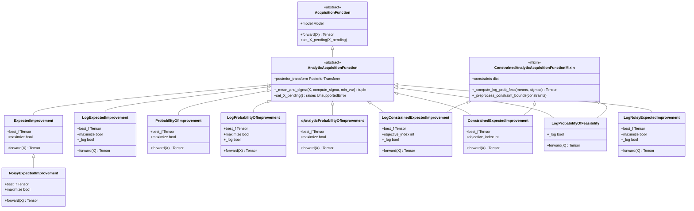
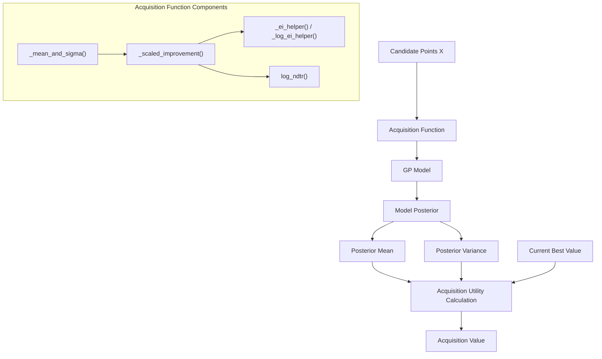
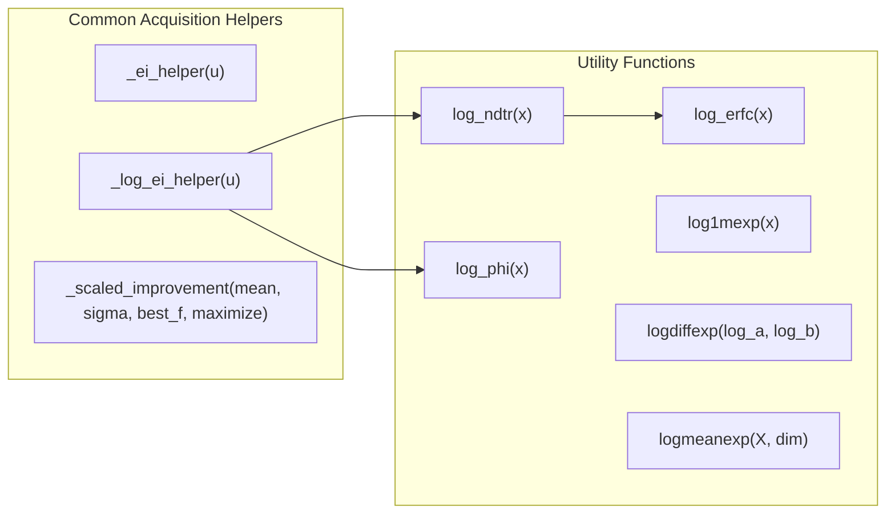

<!-- source: DeepWiki mcp.deepwiki.com · repo pytorch/botorch · page 4.1 Analytic Acquisition Functions · fetched 2026-10-21 -->

# Analytic Acquisition Functions

<details>
<summary>Relevant source files</summary>

The following files were used as context for generating this wiki page:

- [botorch/acquisition/acquisition.py](botorch/acquisition/acquisition.py)
- [botorch/acquisition/analytic.py](botorch/acquisition/analytic.py)
- [botorch/acquisition/knowledge_gradient.py](botorch/acquisition/knowledge_gradient.py)
- [test/acquisition/test_acquisition.py](test/acquisition/test_acquisition.py)
- [test/acquisition/test_analytic.py](test/acquisition/test_analytic.py)
- [test/acquisition/test_knowledge_gradient.py](test/acquisition/test_knowledge_gradient.py)
- [test/acquisition/test_multi_step_lookahead.py](test/acquisition/test_multi_step_lookahead.py)
- [test/models/test_model.py](test/models/test_model.py)

</details>


This page documents BoTorch's implementation of analytic acquisition functions, which are acquisition functions with closed-form expressions that evaluate the posterior without performing Monte Carlo sampling. For acquisition functions that use Monte Carlo sampling, see [Monte Carlo Acquisition Functions](#4.2).

Analytic acquisition functions in BoTorch are computationally efficient and applicable when the posterior distribution can be expressed in closed form, typically when using Gaussian Process models with standard kernels.

## Overview and Base Class

Analytic acquisition functions derive from the `AnalyticAcquisitionFunction` base class, which inherits from `AcquisitionFunction`. They specifically require the model posterior to be Gaussian and evaluate closed-form expressions.

## Core Analytic Acquisition Function Hierarchy



Sources: [botorch/acquisition/analytic.py:51-951]()

The `AnalyticAcquisitionFunction` base class provides:

1. Common initialization logic for analytic acquisition functions
2. A shared `_mean_and_sigma` helper method that computes posterior moments
3. An implementation of `set_X_pending` that raises `UnsupportedError` since analytic acquisition functions don't currently account for pending points

## Acquisition Function Types

### Probability of Improvement

Probability of Improvement (PI) computes the probability that the function value at a candidate point will exceed the current best observed value.

#### ProbabilityOfImprovement

Computes the standard probability of improvement:

`PI(x) = P(y >= best_f), y ~ f(x)`

```python
model = SingleTaskGP(train_X, train_Y)
PI = ProbabilityOfImprovement(model, best_f=0.2)
pi = PI(test_X)
```

#### LogProbabilityOfImprovement

Computes the logarithm of PI, which is numerically more stable:

`logPI(x) = log(P(y >= best_f)), y ~ f(x)`

```python
model = SingleTaskGP(train_X, train_Y)
LogPI = LogProbabilityOfImprovement(model, best_f=0.2)
log_pi = LogPI(test_X)
```

Sources: [botorch/acquisition/analytic.py:110-223]()

### Expected Improvement

Expected Improvement (EI) computes the expected value of the improvement over the current best observed value.

#### ExpectedImprovement

Computes standard expected improvement:

`EI(x) = E(max(f(x) - best_f, 0))`

```python
model = SingleTaskGP(train_X, train_Y)
EI = ExpectedImprovement(model, best_f=0.2)
ei = EI(test_X)
```

#### LogExpectedImprovement

Computes the logarithm of EI, with better numerical stability:

`LogEI(x) = log(E(max(f(x) - best_f, 0)))`

This implementation is recommended over standard EI for improved numerical stability.

```python
model = SingleTaskGP(train_X, train_Y)
LogEI = LogExpectedImprovement(model, best_f=0.2)
log_ei = LogEI(test_X)
```

Sources: [botorch/acquisition/analytic.py:289-415]()

### Upper Confidence Bound

The Upper Confidence Bound (UCB) is a simple acquisition function that balances exploitation (posterior mean) and exploration (posterior standard deviation).

```python
model = SingleTaskGP(train_X, train_Y)
UCB = UpperConfidenceBound(model, beta=0.2)
ucb = UCB(test_X)
```

UCB is defined as:

`UCB(x) = mu(x) + sqrt(beta) * sigma(x)`

where `mu` and `sigma` are the posterior mean and standard deviation, and `beta` is a trade-off parameter.

Sources: [botorch/acquisition/analytic.py:744-796]()

### Posterior Statistics

These acquisition functions use simple statistics from the posterior.

#### PosteriorMean

Returns the posterior mean of the model at candidate points:

```python
model = SingleTaskGP(train_X, train_Y)
PM = PosteriorMean(model)
pm = PM(test_X)
```

#### PosteriorStandardDeviation

Returns the posterior standard deviation:

```python
model = SingleTaskGP(train_X, train_Y)
PSD = PosteriorStandardDeviation(model)
psd = PSD(test_X)
```

Sources: [botorch/acquisition/analytic.py:799-905]()

## Constrained Acquisition Functions

BoTorch provides analytic acquisition functions that incorporate constraints on outputs.

### ConstrainedExpectedImprovement

Computes the expected improvement weighted by the probability of satisfying the constraints:

`Constrained_EI(x) = EI(x) * Product_i P(y_i \in [lower_i, upper_i])`

```python
model = SingleTaskGP(train_X, train_Y)
constraints = {0: (0.0, None)}  # Constraint on output 0: must be >= 0.0
CEI = ConstrainedExpectedImprovement(model, 0.2, 1, constraints)
cei = CEI(test_X)
```

### LogConstrainedExpectedImprovement

Computes the logarithm of constrained EI, which is more numerically stable:

`LogConstrainedEI(x) = log(EI(x)) + Sum_i log(P(y_i \in [lower_i, upper_i]))`

```python
model = SingleTaskGP(train_X, train_Y)
constraints = {0: (0.0, None)}
LogCEI = LogConstrainedExpectedImprovement(model, 0.2, 1, constraints)
log_cei = LogCEI(test_X)
```

Sources: [botorch/acquisition/analytic.py:418-573]()

## Batch Acquisition Functions

Most analytic acquisition functions support only `q=1` (evaluating single points), but BoTorch provides a batch version of PI:

### qAnalyticProbabilityOfImprovement

Approximates the batch probability of improvement using the MVNXPB algorithm:

```python
model = SingleTaskGP(train_X, train_Y)
qPI = qAnalyticProbabilityOfImprovement(model, best_f=0.2)
qpi = qPI(test_X_batch)
```

This approximates the joint probability that at least one of the candidate points will improve over the current best observed value.

Sources: [botorch/acquisition/analytic.py:226-286]()

## Noisy Acquisition Functions

BoTorch includes analytic acquisition functions for settings with observation noise:

### NoisyExpectedImprovement

Computes EI for noisy observations by averaging over fantasy models:

```python
model = SingleTaskGP(train_X, train_Y, train_Yvar=train_Yvar)
NEI = NoisyExpectedImprovement(model, train_X)
nei = NEI(test_X)
```

### LogNoisyExpectedImprovement

Computes the logarithm of NEI for better numerical stability:

```python
model = SingleTaskGP(train_X, train_Y, train_Yvar=train_Yvar)
LogNEI = LogNoisyExpectedImprovement(model, train_X)
log_nei = LogNEI(test_X)
```

Sources: [botorch/acquisition/analytic.py:576-741]()

## Acquisition Function Evaluation Flow

The following diagram shows how analytic acquisition functions evaluate candidate points:



Sources: [botorch/acquisition/analytic.py:83-107](), [botorch/acquisition/analytic.py:336-352](), [botorch/acquisition/analytic.py:400-415]()

## Mathematical Details and Numerical Stability

BoTorch's implementation of analytic acquisition functions pays special attention to numerical stability, particularly through logarithmic variants.

### Key Numerical Stability Functions



Many of the numerical utilities handle edge cases (like very large or small inputs) carefully to maintain stability in both forward and backward passes.

Sources: [botorch/utils/probability/utils.py:132-169](), [botorch/utils/safe_math.py:71-81](), [botorch/utils/safe_math.py:107-120]()

### Logarithmic Forms

The logarithmic variants of acquisition functions (like `LogExpectedImprovement`) are recommended over their standard counterparts because:

1. They prevent underflow/overflow in extreme regions of the input space
2. They enable more stable gradient computations
3. They maintain precision for very small acquisition values
4. They can represent a wider dynamic range of values

When optimization is performed in log-space, the maximum of the logarithm corresponds to the maximum of the original function.

## Usage Considerations

1. **Model Requirements**: Analytic acquisition functions require Gaussian posterior distributions and typically work with single-output models (or multi-output models with a `PosteriorTransform`).

2. **Pending Points**: Analytic acquisition functions do not support pending points (`X_pending`) due to the difficulty of incorporating them in closed-form expressions.

3. **Batch Evaluation**: Most analytic acquisition functions only support `q=1` (single-point evaluation), with `qAnalyticProbabilityOfImprovement` being the exception.

4. **Numerical Stability**: For optimization, prefer logarithmic variants (e.g., `LogExpectedImprovement` over `ExpectedImprovement`) due to their superior numerical properties.

5. **Constraints**: For constrained optimization, use `LogConstrainedExpectedImprovement` or `ConstrainedExpectedImprovement` with appropriate constraint specifications.

---

