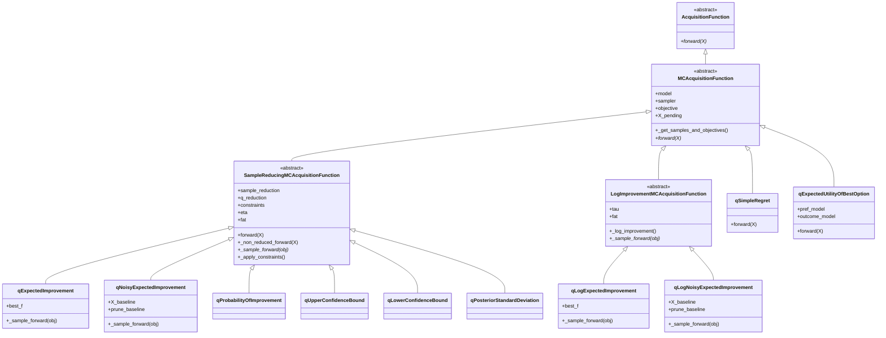
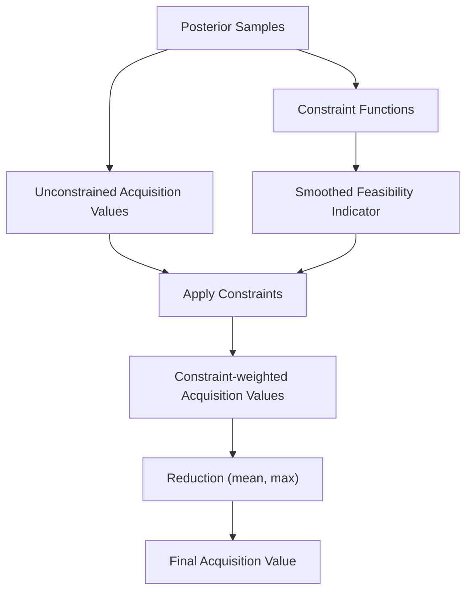
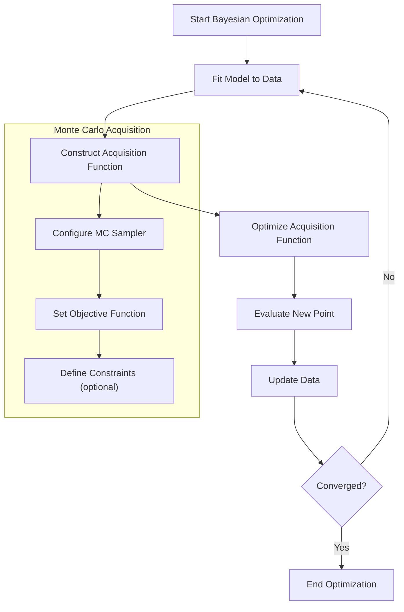
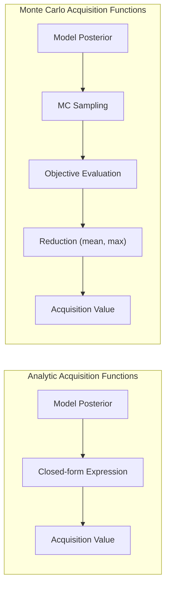

<!-- source: DeepWiki mcp.deepwiki.com · repo pytorch/botorch · page 4.2 Monte Carlo Acquisition Functions · fetched 2026-10-21 -->

# Monte Carlo Acquisition Functions

<details>
<summary>Relevant source files</summary>

The following files were used as context for generating this wiki page:

- [botorch/acquisition/__init__.py](botorch/acquisition/__init__.py)
- [botorch/acquisition/multioutput_acquisition.py](botorch/acquisition/multioutput_acquisition.py)
- [botorch/acquisition/preference.py](botorch/acquisition/preference.py)
- [sphinx/source/acquisition.rst](sphinx/source/acquisition.rst)
- [test/acquisition/test_multioutput_acquisition.py](test/acquisition/test_multioutput_acquisition.py)
- [test/acquisition/test_preference.py](test/acquisition/test_preference.py)

</details>


This page documents Monte Carlo (MC) acquisition functions in BoTorch, which are a class of acquisition functions that use samples from the posterior distribution of surrogate models to evaluate candidate points. Unlike analytic acquisition functions (see [Analytic Acquisition Functions](#4.1)), which use closed-form expressions, MC acquisition functions use Monte Carlo sampling to approximate the expected utility of candidate points, making them more flexible and applicable to a wider range of problems, especially those involving batch optimization and complex objectives.

## Overview of Monte Carlo Acquisition Functions

Monte Carlo acquisition functions work by:
1. Sampling from the posterior distribution of the surrogate model
2. Evaluating these samples using an objective function
3. Computing the acquisition value by applying a reduction strategy (e.g., taking the mean across samples)

This sampling-based approach enables MC acquisition functions to:
- Handle batch optimization (multiple points evaluated in parallel)
- Support arbitrary objective functions
- Incorporate constraints directly into the acquisition function
- Work with complex input and output transformations

```mermaid
flowchart TD
    subgraph "MC Acquisition Function Workflow"
        Input["Input X: batch_shape x q x d"] --> Posterior["model.posterior(X)"]
        Posterior --> Sampler["MC Sampler"]
        Sampler --> Samples["Posterior Samples"]
        Samples --> Objective["Objective Function"]
        Objective --> ObjVals["Objective Values"]
        ObjVals --> ApplyConstraints["Apply Constraints"]
        ApplyConstraints --> SampleReduction["Sample Reduction (e.g., mean)"]
        SampleReduction --> QReduction["q-batch Reduction (e.g., max)"]
        QReduction --> Output["Acquisition Value"]
    end
```



Sources:
- [botorch/acquisition/monte_carlo.py]()
- [botorch/acquisition/__init__.py:55-65]()

## Class Hierarchy

The MC acquisition functions in BoTorch are organized in a class hierarchy, with two main abstract base classes and several concrete implementations:



Sources:
- [botorch/acquisition/monte_carlo.py]()
- [botorch/acquisition/logei.py]()
- [botorch/acquisition/preference.py]()
- [botorch/acquisition/__init__.py:55-65]()

## Base Classes

### MCAcquisitionFunction

The `MCAcquisitionFunction` abstract base class provides the foundation for all Monte Carlo acquisition functions. It defines the basic interface and common functionality:

```python
class MCAcquisitionFunction(AcquisitionFunction, MCSamplerMixin, ABC):
    def __init__(
        self,
        model: Model,
        sampler: MCSampler | None = None,
        objective: MCAcquisitionObjective | None = None,
        posterior_transform: PosteriorTransform | None = None,
        X_pending: Tensor | None = None,
    ) -> None:
        ...
    
    def _get_samples_and_objectives(self, X: Tensor) -> tuple[Tensor, Tensor]:
        ...
        
    @abstractmethod
    def forward(self, X: Tensor) -> Tensor:
        ...
```

Key components:
- `model`: The surrogate model from which to sample
- `sampler`: Used to draw base samples from the posterior
- `objective`: Evaluates the posterior samples
- `posterior_transform`: Transforms the posterior (optional)
- `X_pending`: Points that have been submitted but not yet evaluated

Sources:
- [botorch/acquisition/monte_carlo.py]()

### SampleReducingMCAcquisitionFunction

The `SampleReducingMCAcquisitionFunction` builds on `MCAcquisitionFunction` and adds a general framework for incorporating constraints and reducing across samples:

```python
class SampleReducingMCAcquisitionFunction(MCAcquisitionFunction):
    def __init__(
        self,
        model: Model,
        sampler: MCSampler | None = None,
        objective: MCAcquisitionObjective | None = None,
        posterior_transform: PosteriorTransform | None = None,
        X_pending: Tensor | None = None,
        sample_reduction: SampleReductionProtocol = torch.mean,
        q_reduction: SampleReductionProtocol = torch.amax,
        constraints: list[Callable[[Tensor], Tensor]] | None = None,
        eta: Tensor | float = 1e-3,
        fat: list[bool | None] | bool = False,
    ):
        ...
    
    def forward(self, X: Tensor) -> Tensor:
        ...
        
    def _non_reduced_forward(self, X: Tensor) -> Tensor:
        ...
        
    @abstractmethod
    def _sample_forward(self, obj: Tensor) -> Tensor:
        ...
        
    def _apply_constraints(self, acqval: Tensor, samples: Tensor) -> Tensor:
        ...
```

Key features:
- `sample_reduction`: Reduction function over sample dimension (default: mean)
- `q_reduction`: Reduction function over batch dimension (default: max)
- `constraints`: List of constraint callables to apply to samples
- `eta`: Temperature parameter for constraint smoothing
- `fat`: Controls the smoothing approach for constraints

The method flow in a typical `SampleReducingMCAcquisitionFunction` is:
1. `forward(X)` calls `_non_reduced_forward(X)`
2. `_non_reduced_forward(X)` gets samples and objectives
3. `_sample_forward(obj)` computes acquisition values per sample
4. `_apply_constraints(acqval, samples)` applies constraint weighting
5. `_sample_reduction` and `_q_reduction` are applied to get the final value

Sources:
- [botorch/acquisition/monte_carlo.py]()

## Specific Monte Carlo Acquisition Functions

### qExpectedImprovement

The batch Expected Improvement acquisition function:

```python
class qExpectedImprovement(SampleReducingMCAcquisitionFunction):
    def __init__(
        self,
        model: Model,
        best_f: float | Tensor,
        sampler: MCSampler | None = None,
        objective: MCAcquisitionObjective | None = None,
        posterior_transform: PosteriorTransform | None = None,
        X_pending: Tensor | None = None,
        constraints: list[Callable[[Tensor], Tensor]] | None = None,
        eta: Tensor | float = 1e-3,
    ) -> None:
        ...
        
    def _sample_forward(self, obj: Tensor) -> Tensor:
        return (obj - self.best_f.unsqueeze(-1).to(obj)).clamp_min(0)
```

`qExpectedImprovement` calculates the expected improvement over the current best observed value `best_f`. It defines improvements as the amount by which samples exceed `best_f` (clamped to be non-negative).

Sources:
- [botorch/acquisition/monte_carlo.py]()
- [botorch/acquisition/input_constructors.py]()

### qNoisyExpectedImprovement

The batch Noisy Expected Improvement acquisition function:

```python
class qNoisyExpectedImprovement(
    SampleReducingMCAcquisitionFunction, CachedCholeskyMCSamplerMixin
):
    def __init__(
        self,
        model: Model,
        X_baseline: Tensor,
        sampler: MCSampler | None = None,
        objective: MCAcquisitionObjective | None = None,
        posterior_transform: PosteriorTransform | None = None,
        X_pending: Tensor | None = None,
        prune_baseline: bool = True,
        cache_root: bool = True,
        constraints: list[Callable[[Tensor], Tensor]] | None = None,
        eta: Tensor | float = 1e-3,
        marginalize_dim: int | None = None,
    ) -> None:
        ...
```

`qNoisyExpectedImprovement` is similar to `qExpectedImprovement` but doesn't assume a known best value. Instead, it computes the improvement over the best value in the baseline set `X_baseline`. It's appropriate for settings with noise in the observations.

Sources:
- [botorch/acquisition/monte_carlo.py]()
- [botorch/acquisition/input_constructors.py]()

### Other MC Acquisition Functions

The Monte Carlo acquisition function family includes several additional implementations:

#### Standard MC Functions
- `qProbabilityOfImprovement`: Computes the probability of improving over a reference value
- `qUpperConfidenceBound`/`qLowerConfidenceBound`: Implements UCB with a configurable beta parameter  
- `qPosteriorStandardDeviation`: Returns the standard deviation of the posterior
- `qSimpleRegret`: A simple acquisition function that returns the expected value of the best design

#### Log-Space Variants
For improved numerical stability, especially with large improvement values:

- `qLogExpectedImprovement`: Log-space version of `qExpectedImprovement`
- `qLogNoisyExpectedImprovement`: Log-space version of `qNoisyExpectedImprovement`

These inherit from `LogImprovementMCAcquisitionFunction`, which provides a framework for log-space calculations with a `tau` parameter for controlling the log transformation smoothness.

#### Preference-Based MC Functions
For preference learning and human-in-the-loop optimization:

- `qExpectedUtilityOfBestOption`: Monte Carlo version of Expected Utility of Best Option (qEUBO)
- `PairwiseBayesianActiveLearningByDisagreement`: BALD for pairwise preference data

Sources:
- [botorch/acquisition/monte_carlo.py]()
- [botorch/acquisition/logei.py]()
- [botorch/acquisition/preference.py]()
- [botorch/acquisition/input_constructors.py]()

## Constraints in Monte Carlo Acquisition Functions

A key feature of `SampleReducingMCAcquisitionFunction` is its ability to handle constraints. Constraints are implemented as callables that map posterior samples to constraint values (negative values indicate feasibility).

The constraint handling process:
1. Compute acquisition values without constraints using `_sample_forward`
2. Apply constraints using `_apply_constraints`
3. Use smoothed feasibility indicators to weight acquisition values



`SampleReducingMCAcquisitionFunction` applies constraints by weighting the acquisition values with a smoothed feasibility indicator to ensure differentiability. This is controlled by the `eta` parameter, which affects the sharpness of the sigmoid approximation.

Sources:
- [botorch/acquisition/monte_carlo.py]()
- [botorch/acquisition/utils.py]()

## Input Constructors for MC Acquisition Functions

BoTorch provides input constructor functions to simplify creating acquisition functions:

```python
@acqf_input_constructor(qExpectedImprovement)
def construct_inputs_qEI(
    model: Model,
    training_data: MaybeDict[SupervisedDataset],
    objective: MCAcquisitionObjective | None = None,
    posterior_transform: PosteriorTransform | None = None,
    X_pending: Tensor | None = None,
    sampler: MCSampler | None = None,
    best_f: float | Tensor | None = None,
    constraints: list[Callable[[Tensor], Tensor]] | None = None,
    eta: Tensor | float = 1e-3,
) -> dict[str, Any]:
    ...
```

These constructors handle common setup tasks like:
- Determining the best observed value
- Setting up samplers
- Configuring constraints
- Handling multi-output models

They're registered in a central registry (`ACQF_INPUT_CONSTRUCTOR_REGISTRY`) and accessed via `get_acqf_input_constructor()`.

Sources:
- [botorch/acquisition/input_constructors.py]()

## Usage in Bayesian Optimization

Monte Carlo acquisition functions are a key component in the Bayesian optimization workflow:



A typical usage example:

```python
# Fit a model
model = SingleTaskGP(train_X, train_Y)

# Get the best observed value
best_f = train_Y.max().item()

# Configure MC sampler
sampler = SobolQMCNormalSampler(sample_shape=torch.Size([512]))

# Create acquisition function
qEI = qExpectedImprovement(
    model=model,
    best_f=best_f,
    sampler=sampler,
    objective=objective,  # Optional
    constraints=constraints,  # Optional
)

# Optimize acquisition function
candidates, acq_values = optimize_acqf(
    acq_function=qEI,
    bounds=bounds,
    q=q,  # Batch size
    num_restarts=num_restarts,
    raw_samples=raw_samples,
)
```

Sources:
- [botorch/acquisition/monte_carlo.py]()
- [botorch/acquisition/input_constructors.py]()

## Comparison with Analytic Acquisition Functions



Key differences:
1. **Expressiveness**: MC acquisition functions can handle arbitrary objectives and constraints, while analytic functions require closed-form solutions
2. **Batch Evaluation**: MC acquisition functions naturally support batch evaluation (`q > 1`), while analytic functions typically support only `q=1`
3. **Gradients**: Both support gradient-based optimization, but MC gradients use reparameterization
4. **Computational Cost**: MC acquisition functions are generally more computationally expensive due to the sampling process
5. **Constraints**: MC acquisition functions provide a unified framework for handling constraints

Sources:
- [botorch/acquisition/monte_carlo.py]()
- [botorch/acquisition/analytic.py]()
- [botorch/acquisition/__init__.py:15-27]()
- [botorch/acquisition/__init__.py:55-65]()

## Multi-Objective Monte Carlo Acquisition Functions

For multi-objective optimization problems, BoTorch provides specialized MC acquisition functions that extend the base classes. These are covered in detail in page [4.3 Multi-Objective Acquisition Functions](#4.3).

Examples include:
- `qExpectedHypervolumeImprovement`: Maximizes expected improvement in hypervolume
- `qNoisyExpectedHypervolumeImprovement`: For noisy multi-objective optimization
- `qLogExpectedHypervolumeImprovement`: Log-space formulation for improved numerics

These functions operate on multi-output objectives, which define how to transform the posterior samples for multi-objective evaluation.

Sources:
- [botorch/acquisition/multi_objective/monte_carlo.py]()
- [botorch/acquisition/multi_objective/objective.py]()

## Best Practices and Considerations

When using Monte Carlo acquisition functions, consider the following:

1. **Number of MC samples**: More samples yield more accurate estimates but increase computational cost. Typical values range from 128 to 1024 samples.

2. **Sampler selection**: `SobolQMCNormalSampler` often provides better performance than `IIDNormalSampler` due to more uniform coverage.

3. **Constraint handling**: For constrained optimization, using `SampleReducingMCAcquisitionFunction` with constraint callables is more efficient than a separate feasibility check.

4. **Numerical stability**: For expected improvement calculations, consider using log-space variants like `qLogExpectedImprovement` for better numerical stability.

5. **Batch size considerations**: As batch size (`q`) increases, the number of MC samples should typically increase to maintain accuracy.

6. **Pruning baseline points**: For `qNoisyExpectedImprovement`, enabling `prune_baseline=True` can significantly improve performance by removing points unlikely to be optimal.

Sources:
- [botorch/acquisition/monte_carlo.py:336-418](botorch/acquisition/monte_carlo.py:336-418)
- [botorch/acquisition/input_constructors.py:572-635](botorch/acquisition/input_constructors.py:572-635)
- [botorch/acquisition/utils.py:317-390](botorch/acquisition/utils.py:317-390)

---

