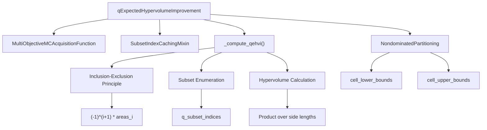
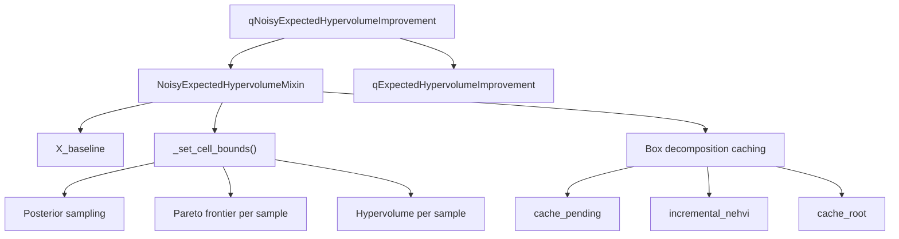
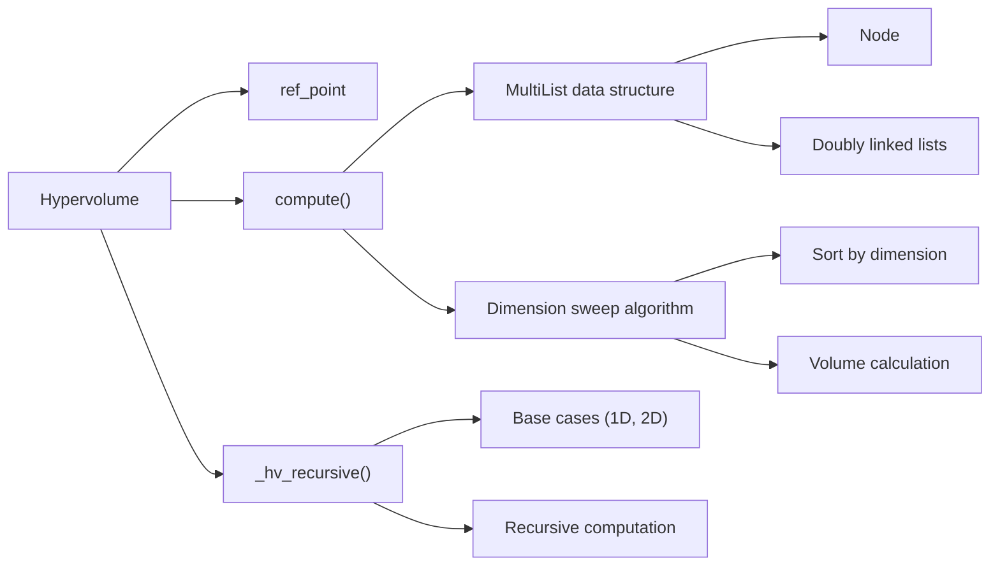
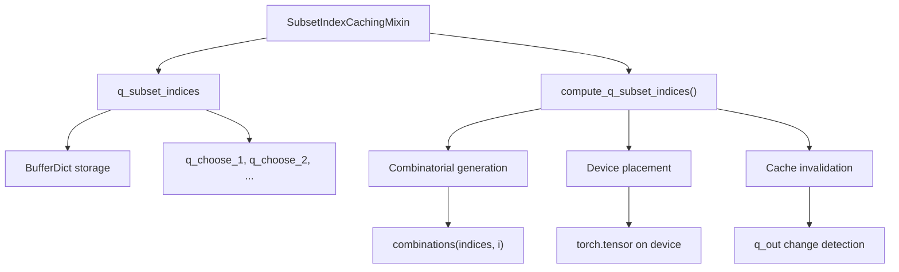
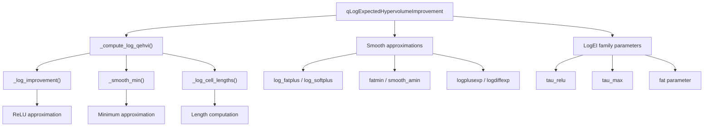
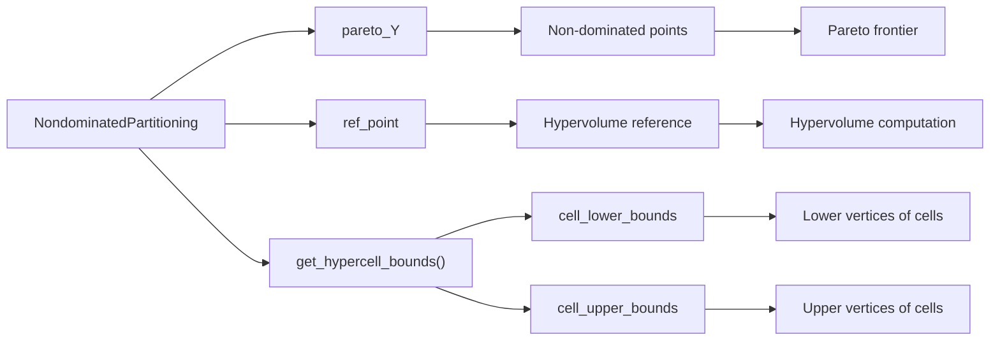
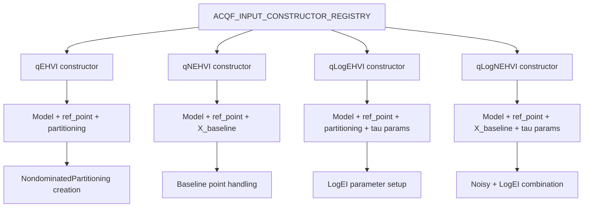

<!-- source: DeepWiki mcp.deepwiki.com · repo pytorch/botorch · page 4.3 Multi-Objective Acquisition Functions · fetched 2026-10-21 -->

# Multi-Objective Acquisition Functions

Relevant source files

The following files were used as context for generating this wiki page:

- [botorch/acquisition/multi_objective/logei.py](botorch/acquisition/multi_objective/logei.py)
- [botorch/acquisition/multi_objective/monte_carlo.py](botorch/acquisition/multi_objective/monte_carlo.py)
- [botorch/utils/multi_objective/__init__.py](botorch/utils/multi_objective/__init__.py)
- [botorch/utils/multi_objective/hypervolume.py](botorch/utils/multi_objective/hypervolume.py)
- [test/acquisition/multi_objective/test_logei.py](test/acquisition/multi_objective/test_logei.py)
- [test/acquisition/multi_objective/test_monte_carlo.py](test/acquisition/multi_objective/test_monte_carlo.py)
- [test/utils/multi_objective/test_hypervolume.py](test/utils/multi_objective/test_hypervolume.py)

This document covers BoTorch's multi-objective acquisition functions that optimize multiple competing objectives simultaneously using hypervolume-based metrics. These functions enable Bayesian optimization for problems with multiple objectives where there are trade-offs between different goals.

For single-objective acquisition functions, see [Analytic Acquisition Functions](#4.1) and [Monte Carlo Acquisition Functions](#4.2). For constraint handling and objective transformations, see [Objective Functions](#4.4).

## Core Multi-Objective Acquisition Functions

BoTorch provides two primary multi-objective acquisition functions based on hypervolume improvement:

### qExpectedHypervolumeImprovement (qEHVI)

The `qExpectedHypervolumeImprovement` class implements the q-Expected Hypervolume Improvement acquisition function for parallel multi-objective optimization. It measures the expected improvement in hypervolume when evaluating a batch of q candidate points.

The acquisition function computes hypervolume improvement using the inclusion-exclusion principle, evaluating all possible subsets of the q candidate points. Key parameters include:

- `ref_point`: Reference point for hypervolume computation
- `partitioning`: Non-dominated partitioning of the objective space
- `constraints`: Optional feasibility constraints
- `eta`: Temperature parameter for constraint approximation
- `fat`: Boolean flag for heavy-tailed constraint approximation

### qNoisyExpectedHypervolumeImprovement (qNEHVI)

The `qNoisyExpectedHypervolumeImprovement` extends qEHVI to handle noisy observations by accounting for uncertainty in the current Pareto frontier. It uses a baseline set of points to construct sample-based Pareto frontiers.

qNEHVI provides several optimization features:
- **Cached Box Decompositions (CBD)**: Efficiently handles pending points
- **Incremental computation**: Computes marginal improvements sequentially
- **Root caching**: Uses low-rank updates for computational efficiency
- **Baseline pruning**: Removes dominated points to reduce computation

Sources: [botorch/acquisition/multi_objective/monte_carlo.py:53-358]()

## Hypervolume Infrastructure

The hypervolume computation infrastructure supports the multi-objective acquisition functions through several key components:

### Hypervolume Class

The `Hypervolume` class implements the dimension sweep algorithm for computing hypervolumes of Pareto frontiers.

The algorithm handles various dimensionalities efficiently:
- **1D case**: Direct computation
- **2D case**: Specialized algorithm
- **Higher dimensions**: Recursive dimension sweep

### Reference Point Inference

The `infer_reference_point` function automatically determines appropriate reference points for hypervolume computation based on the Pareto frontier.

Key logic:
- Uses nadir point minus scaled range when no better points exist
- Respects maximum reference point constraints
- Handles edge cases like empty Pareto sets and singleton points
- Supports scaling parameters for robustness

### Subset Index Caching

The `SubsetIndexCachingMixin` provides efficient caching of subset indices for the inclusion-exclusion computation:

This caching avoids recomputing the exponential number of subsets (2^q - 1) on each evaluation.

Sources: [botorch/utils/multi_objective/hypervolume.py:155-508]()

## Logarithmic Variants

BoTorch provides logarithmically-stable variants of the hypervolume improvement acquisition functions to handle numerical challenges:

### qLogExpectedHypervolumeImprovement (qLogEHVI)

The `qLogExpectedHypervolumeImprovement` implements the logarithmic version of qEHVI using smooth approximations to avoid numerical instabilities.

Key improvements over standard qEHVI:
- **Logarithmic computation**: Avoids numerical underflow/overflow
- **Smooth approximations**: Uses differentiable approximations to min/max operations
- **Fat-tailed variants**: Provides alternative asymptotic behavior
- **Temperature parameters**: Controls approximation sharpness

### qLogNoisyExpectedHypervolumeImprovement (qLogNEHVI)

Combines the logarithmic stability of qLogEHVI with the noisy observation handling of qNEHVI.

The logarithmic variants provide several advantages:
- **Numerical stability**: Avoids extreme values that cause gradient issues
- **Smooth optimization**: Enables gradient-based optimization
- **Configurable approximations**: Allows tuning of smoothness vs. accuracy trade-offs

Sources: [botorch/acquisition/multi_objective/logei.py:47-451]()

## Box Decomposition and Partitioning

Multi-objective acquisition functions rely on partitioning the objective space into hyperrectangles:

### NondominatedPartitioning

The partitioning system decomposes the objective space dominated by the current Pareto frontier:

### FastNondominatedPartitioning

Provides optimized partitioning for improved computational performance, particularly beneficial for higher-dimensional objective spaces.

The partitioning enables efficient hypervolume computation by:
- **Space decomposition**: Breaks complex regions into manageable hyperrectangles
- **Inclusion-exclusion**: Supports systematic enumeration of overlapping regions
- **Efficient updates**: Allows incremental updates as new points are added

Sources: [botorch/utils/multi_objective/box_decompositions/non_dominated.py]()

## Integration with Optimization Pipeline

Multi-objective acquisition functions integrate with BoTorch's optimization pipeline through several mechanisms:

### Input Constructor Registry

Multi-objective acquisition functions register with the acquisition function input constructor system:

### Constraint Support

All multi-objective acquisition functions support feasibility constraints:
- **Smooth indicators**: Use `compute_smoothed_feasibility_indicator` for differentiable constraint handling
- **Temperature control**: The `eta` parameter controls constraint approximation sharpness
- **Fat-tailed approximations**: Optional heavy-tailed sigmoid approximations

### Performance Optimizations

Key optimizations implemented across the multi-objective system:
- **Subset caching**: Avoids recomputing combinatorial subsets
- **Box decomposition caching**: Reuses expensive partitioning computations
- **Incremental updates**: Computes marginal improvements efficiently
- **Batch processing**: Handles multiple candidate points simultaneously

Sources: [botorch/acquisition/multi_objective/monte_carlo.py:1-358](), [botorch/acquisition/multi_objective/logei.py:1-451](), [botorch/utils/multi_objective/hypervolume.py:510-828]()

---

