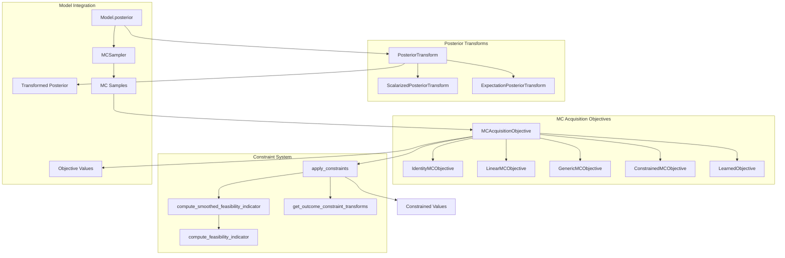
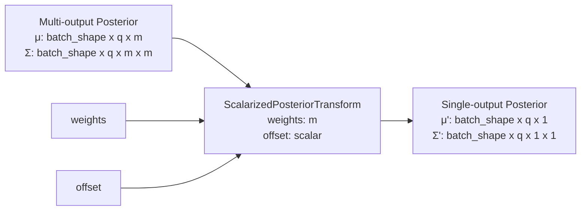
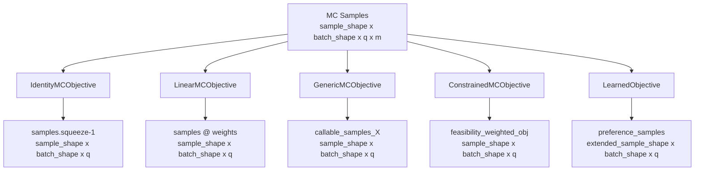
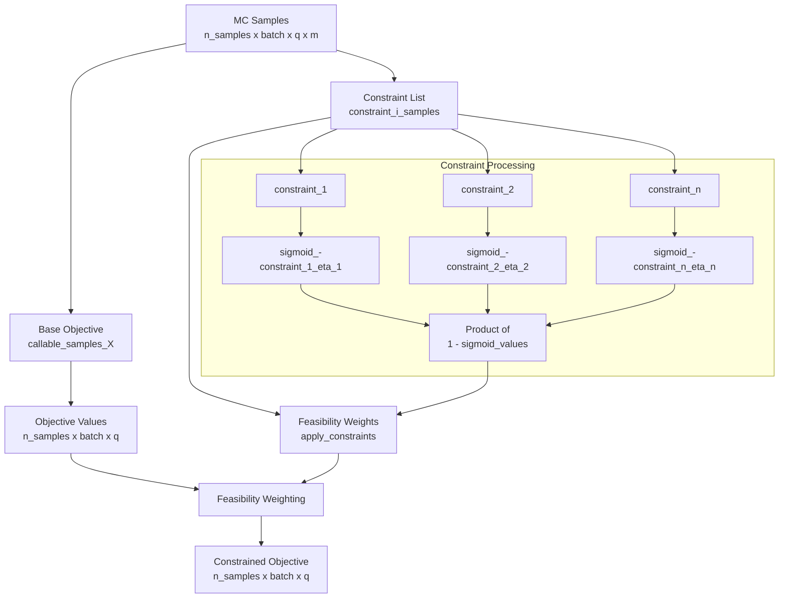
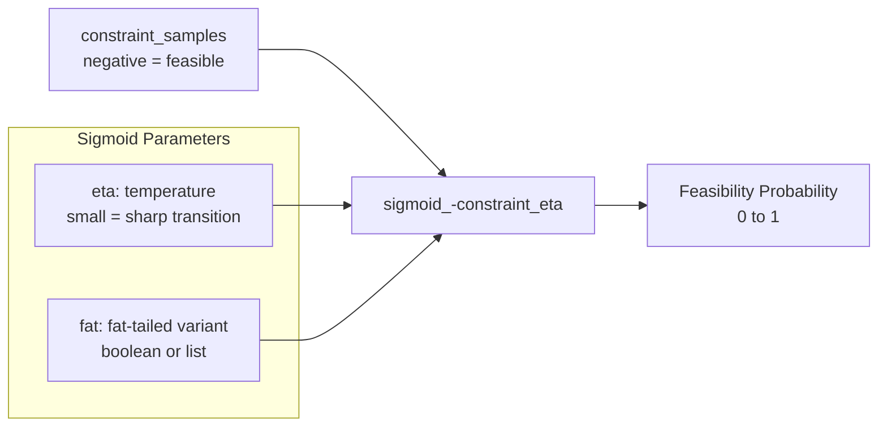

<!-- source: DeepWiki mcp.deepwiki.com · repo pytorch/botorch · page 4.4 Objective Functions · fetched 2026-10-21 -->

# Objective Functions

<details>
<summary>Relevant source files</summary>

The following files were used as context for generating this wiki page:

- [botorch/acquisition/objective.py](botorch/acquisition/objective.py)
- [botorch/utils/constraints.py](botorch/utils/constraints.py)
- [botorch/utils/objective.py](botorch/utils/objective.py)
- [test/acquisition/test_objective.py](test/acquisition/test_objective.py)
- [test/utils/test_constraints.py](test/utils/test_constraints.py)
- [test/utils/test_objective.py](test/utils/test_objective.py)

</details>


This document covers BoTorch's objective function system, which transforms model outputs and posterior distributions for use with acquisition functions. The system includes `PosteriorTransform` classes that operate on model posteriors and `MCAcquisitionObjective` classes that operate on Monte Carlo samples. It also covers the constraint handling infrastructure that enables feasibility-weighted optimization.

For information about acquisition functions that use these objectives, see [Analytic Acquisition Functions](#4.1), [Monte Carlo Acquisition Functions](#4.2), and [Multi-Objective Acquisition Functions](#4.3).

## System Architecture

The objective function system in BoTorch provides a flexible framework for transforming model outputs and handling constraints. The architecture separates concerns between posterior transformations (which operate on distributions) and Monte Carlo objectives (which operate on samples).



**Objective Function System Architecture**

Sources: [botorch/acquisition/objective.py:35-61](), [botorch/acquisition/objective.py:233-266](), [botorch/utils/objective.py:21-64]()

## PosteriorTransform Classes

`PosteriorTransform` is the abstract base class for objectives that transform model posteriors before sampling. These transformations operate on the posterior distribution directly, enabling efficient computation for analytic acquisition functions.

### ScalarizedPosteriorTransform

The `ScalarizedPosteriorTransform` performs linear scalarization of multi-output posteriors using weight vectors. For a Gaussian posterior with mean `μ` and covariance `Σ`, it produces a posterior with mean `w^T μ` and variance `w^T Σ w`.



**ScalarizedPosteriorTransform Operation**

Key methods:
- `evaluate(Y)` - Transforms outcome tensor: `offset + Y @ weights` [botorch/acquisition/objective.py:99-108]()
- `forward(posterior)` - Transforms posterior using `scalarize_posterior` [botorch/acquisition/objective.py:110-124]()

Sources: [botorch/acquisition/objective.py:67-125]()

### ExpectationPosteriorTransform

The `ExpectationPosteriorTransform` computes expectations over consecutive blocks in the q-batch dimension. This is designed for use with input perturbations where each candidate point is evaluated at multiple perturbed locations.

```mermaid
graph TB
    Input[Posterior<br/>batch x "q*n_w" x m] --> EPT[ExpectationPosteriorTransform<br/>n_w: block_size<br/>weights: n_w x m]
    EPT --> Output[Posterior<br/>batch x q x m]
    
    subgraph "Expectation Computation"
        Block1[Block 1<br/>n_w points] --> Weighted1[Weighted Average 1]
        Block2[Block 2<br/>n_w points] --> Weighted2[Weighted Average 2] 
        BlockQ[Block q<br/>n_w points] --> WeightedQ[Weighted Average q]
    end
    
    EPT --> Block1
    EPT --> Block2
    EPT --> BlockQ
```

**ExpectationPosteriorTransform Block Processing**

Key methods:
- `evaluate(Y)` - Computes weighted expectation over blocks [botorch/acquisition/objective.py:166-177]()
- `forward(posterior)` - Transforms posterior distribution [botorch/acquisition/objective.py:179-230]()

Sources: [botorch/acquisition/objective.py:127-231]()

## MCAcquisitionObjective Classes

`MCAcquisitionObjective` is the abstract base class for Monte Carlo-based objectives that operate on posterior samples. These objectives transform sampled function values into objective values for acquisition function optimization.

### Core MC Objective Types



**MCAcquisitionObjective Class Hierarchy**

### IdentityMCObjective

The simplest objective that extracts the last dimension of samples, used for single-objective optimization with single-output models.

```python
def forward(self, samples: Tensor, X: Tensor | None = None) -> Tensor:
    return samples.squeeze(-1)
```

Sources: [botorch/acquisition/objective.py:289-299]()

### LinearMCObjective

Performs linear scalarization using a weight tensor: `sum_i weights[i] * samples[..., i]`. This is the Monte Carlo equivalent of `ScalarizedPosteriorTransform`.

```python 
def forward(self, samples: Tensor, X: Tensor | None = None) -> Tensor:
    return torch.einsum("...m, m", [samples, self.weights])
```

Sources: [botorch/acquisition/objective.py:302-343]()

### GenericMCObjective

Allows arbitrary callable objectives for maximum flexibility. The callable must be differentiable for gradient-based optimization.

```python
def forward(self, samples: Tensor, X: Tensor | None = None) -> Tensor:
    return self.objective(samples, X=X)
```

Sources: [botorch/acquisition/objective.py:345-384]()

## Constraint Handling System

BoTorch provides a comprehensive constraint handling system that uses smooth approximations to feasibility indicators. The system supports both outcome constraints (constraints on model outputs) and input constraints (handled elsewhere).

### ConstrainedMCObjective

The `ConstrainedMCObjective` applies feasibility weighting using sigmoid approximations:

```
mc_acq(X) = (objective(X) + infeasible_cost) * ∏_i (1 - sigmoid(constraint_i(X))) - infeasible_cost
```



**ConstrainedMCObjective Feasibility Weighting**

Sources: [botorch/acquisition/objective.py:386-466](), [botorch/utils/objective.py:213-254]()

### Constraint Utility Functions

The constraint system provides several utility functions:

| Function | Purpose | Input | Output |
|----------|---------|-------|--------|
| `apply_constraints` | Apply feasibility weighting with infeasible cost | Objective values, constraints, samples | Weighted objectives |
| `compute_feasibility_indicator` | Boolean feasibility indicator | Constraints, samples | Boolean feasibility |
| `compute_smoothed_feasibility_indicator` | Smooth feasibility approximation | Constraints, samples, eta | Continuous feasibility |
| `get_outcome_constraint_transforms` | Create constraint callables from tensors | A, b matrices | List of constraint functions |

The smooth feasibility indicator uses sigmoid/fatmoid approximations:



**Smooth Feasibility Computation**

Sources: [botorch/utils/objective.py:134-211](), [botorch/utils/constraints.py:26-69]()

## LearnedObjective for Preference Learning

The `LearnedObjective` enables optimization with learned preference models. It samples from both the outcome model posterior and the preference model posterior to account for uncertainty in learned preferences.

```mermaid
graph TB
    Outcome_Samples[Outcome Model Samples<br/>sample_shape x batch x q x d] --> Pref_Model[Preference Model<br/>PairwiseGP or DeterministicModel]
    
    Pref_Model --> Pref_Posterior[Preference Posterior<br/>utility values]
    
    Pref_Posterior --> Det_Check{Deterministic<br/>Model?}
    Det_Check -->|Yes| Mean[Posterior Mean<br/>sample_shape x batch x q]
    Det_Check -->|No| Sampler[IIDNormalSampler<br/>sample_shape: pref_samples]
    Sampler --> Extended_Samples[Extended Samples<br/>"sample_shape*pref_samples" x batch x q]
    
    subgraph "Sampling Configuration"
        SS[sample_shape<br/>default: torch.Size_16]
        Seed[seed: int<br/>reproducibility]
    end
    
    SS --> Sampler
    Seed --> Sampler
```

**LearnedObjective Preference Sampling**

Key features:
- Supports both deterministic and stochastic preference models [botorch/acquisition/objective.py:515-517]()
- Uses `IIDNormalSampler` for efficiency with large sample sizes [botorch/acquisition/objective.py:521-525]()
- Handles dtype compatibility with warning system [botorch/acquisition/objective.py:539-547]()

Sources: [botorch/acquisition/objective.py:475-560]()

## Usage Patterns

### Basic Linear Scalarization

For multi-objective problems with known preferences:

```python
# Posterior transform approach (for analytic acquisition functions)
weights = torch.tensor([0.7, 0.3])  
transform = ScalarizedPosteriorTransform(weights)
acqf = ExpectedImprovement(model, best_f=0.1, posterior_transform=transform)

# MC objective approach (for Monte Carlo acquisition functions)  
objective = LinearMCObjective(weights)
acqf = qExpectedImprovement(model, best_f=0.1, objective=objective)
```

### Constraint Handling

For optimization with outcome constraints:

```python
# Define constraints: A @ f(x) <= b
A = torch.tensor([[1.0, 0.0], [0.0, 1.0]])  # constrain both outputs  
b = torch.tensor([[0.5], [1.0]])
constraints = get_outcome_constraint_transforms((A, b))

# Create constrained objective
base_objective = LinearMCObjective(torch.tensor([1.0, 0.5]))
constrained_obj = ConstrainedMCObjective(
    objective=base_objective,
    constraints=constraints,
    infeasible_cost=0.0,
    eta=1e-3
)
```

### Custom Objectives

For complex, non-linear objectives:

```python
def custom_objective(samples, X=None):
    # Custom transformation of samples
    return torch.sqrt(samples.sum(dim=-1))

objective = GenericMCObjective(custom_objective)
```

Sources: [botorch/acquisition/objective.py:74-82](), [botorch/acquisition/objective.py:308-315](), [botorch/acquisition/objective.py:352-358](), [botorch/acquisition/objective.py:400-407]()

---

