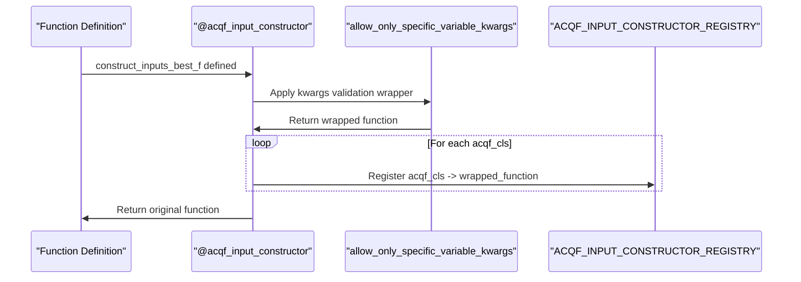
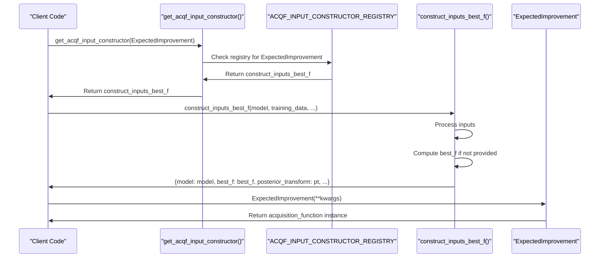
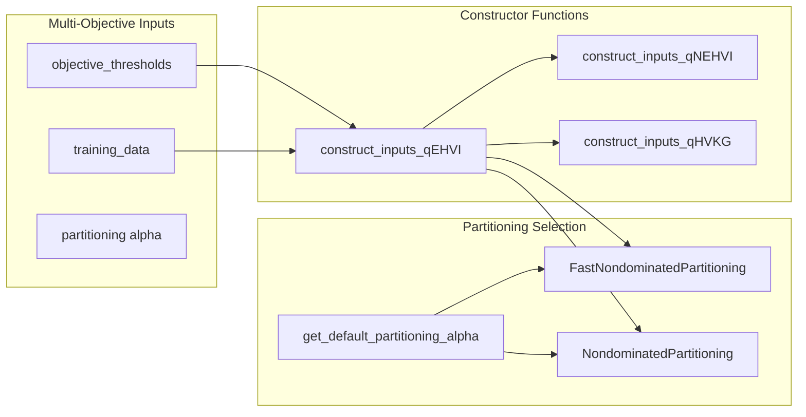
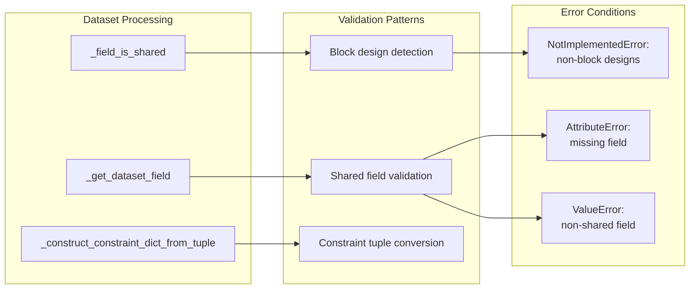

<!-- source: DeepWiki mcp.deepwiki.com · repo pytorch/botorch · page 4.5 Input Constructors · fetched 2026-10-21 -->

# Input Constructors

<details>
<summary>Relevant source files</summary>

The following files were used as context for generating this wiki page:

- [botorch/acquisition/input_constructors.py](botorch/acquisition/input_constructors.py)
- [botorch/acquisition/monte_carlo.py](botorch/acquisition/monte_carlo.py)
- [botorch/acquisition/multi_objective/utils.py](botorch/acquisition/multi_objective/utils.py)
- [botorch/acquisition/utils.py](botorch/acquisition/utils.py)
- [test/acquisition/multi_objective/test_utils.py](test/acquisition/multi_objective/test_utils.py)
- [test/acquisition/test_input_constructors.py](test/acquisition/test_input_constructors.py)
- [test/acquisition/test_monte_carlo.py](test/acquisition/test_monte_carlo.py)
- [test/acquisition/test_utils.py](test/acquisition/test_utils.py)

</details>


Input constructors implement a factory pattern for programmatically generating acquisition function constructor arguments from standardized inputs. The system uses a global registry (`ACQF_INPUT_CONSTRUCTOR_REGISTRY`) that maps acquisition function classes to specialized constructor functions, enabling consistent instantiation across BoTorch's acquisition function ecosystem.

## Purpose and Architecture

Input constructors solve the problem of complex acquisition function instantiation by centralizing preprocessing logic. Each acquisition function requires different combinations of parameters (best observed values, baseline points, constraint handling, etc.), and constructors automate the transformation of standard inputs (`model`, `training_data`, `objective_thresholds`, etc.) into the specific keyword arguments needed for each acquisition function class.

## Registry System

The registry system is implemented through `ACQF_INPUT_CONSTRUCTOR_REGISTRY`, a global dictionary that maps acquisition function classes to their constructor functions. The registry supports one-to-many mappings where a single constructor can handle multiple acquisition function classes.

### Input Constructor Registry Architecture

```mermaid
graph TB
    subgraph "Registry Core"
        REGISTRY["ACQF_INPUT_CONSTRUCTOR_REGISTRY<br/>{AcqfClass: constructor_func}"]
        GET_CONSTRUCTOR["get_acqf_input_constructor"]
        DECORATOR["@acqf_input_constructor"]
    end
    
    subgraph "Acquisition Function Classes"
        EI["ExpectedImprovement"]
        LEI["LogExpectedImprovement"]
        PI["ProbabilityOfImprovement"]
        LPI["LogProbabilityOfImprovement"]
        UCB["UpperConfidenceBound"]
        PM["PosteriorMean"]
        QEI["qExpectedImprovement"]
        QNEI["qNoisyExpectedImprovement"]
        QEHVI["qExpectedHypervolumeImprovement"]
    end
    
    subgraph "Constructor Functions"
        BEST_F["construct_inputs_best_f"]
        UCB_FUNC["construct_inputs_ucb"] 
        PM_FUNC["construct_inputs_posterior_mean"]
        QEI_FUNC["construct_inputs_qEI"]
        QNEI_FUNC["construct_inputs_qNEI"]
        QEHVI_FUNC["construct_inputs_qEHVI"]
    end
    
    DECORATOR --> REGISTRY
    GET_CONSTRUCTOR --> REGISTRY
    
    EI --> BEST_F
    LEI --> BEST_F
    PI --> BEST_F
    LPI --> BEST_F
    
    UCB --> UCB_FUNC
    PM --> PM_FUNC
    QEI --> QEI_FUNC
    QNEI --> QNEI_FUNC
    QEHVI --> QEHVI_FUNC
    
    REGISTRY --> BEST_F
    REGISTRY --> UCB_FUNC
    REGISTRY --> PM_FUNC
    REGISTRY --> QEI_FUNC
    REGISTRY --> QNEI_FUNC
    REGISTRY --> QEHVI_FUNC
```



Sources:
- [botorch/acquisition/input_constructors.py:119-119]()
- [botorch/acquisition/input_constructors.py:187-206]()
- [botorch/acquisition/input_constructors.py:255-277]()
- [botorch/acquisition/input_constructors.py:308-346]()

The `get_acqf_input_constructor` function retrieves constructors from the registry and raises `RuntimeError` for unregistered acquisition functions. The `@acqf_input_constructor` decorator registers multiple classes to a single constructor simultaneously.

## Registration and Validation Mechanisms

Input constructors are registered using the `@acqf_input_constructor` decorator, which also applies `allow_only_specific_variable_kwargs` to enable flexible parameter handling while maintaining type safety.

### Registration Process



The decorator validation ensures that only allowed keyword arguments (`training_data`, `objective_thresholds`, `bounds`, `constraints_tuple`, `posterior_transform`, `objective`, `constraints`) can be passed even if not explicitly in the function signature, enabling consistent interfaces across constructors.

Sources:
- [botorch/acquisition/input_constructors.py:255-277]()
- [botorch/acquisition/input_constructors.py:209-252]()
- [botorch/acquisition/input_constructors.py:280-284]()

## Input Constructor Workflow

The following diagram illustrates the typical workflow when using input constructors:



Sources:
- [botorch/acquisition/input_constructors.py:184-203]()
- [botorch/acquisition/input_constructors.py:298-336]()
- [test/acquisition/test_input_constructors.py:356-414]()

## Constructor Categories and Function Mapping

BoTorch provides input constructors organized by acquisition function complexity and computational requirements:

### Constructor Function Registry

| Constructor Function | Acquisition Functions | Key Features |
|---------------------|---------------------|-------------|
| `construct_inputs_posterior_mean` | `PosteriorMean` | Basic model + posterior transform |
| `construct_inputs_best_f` | `ExpectedImprovement`, `LogExpectedImprovement`, `ProbabilityOfImprovement`, `LogProbabilityOfImprovement` | Auto-computes best_f from training data |
| `construct_inputs_ucb` | `UpperConfidenceBound` | Configurable beta parameter |
| `construct_inputs_noisy_ei` | `NoisyExpectedImprovement`, `LogNoisyExpectedImprovement` | Fantasy-based with X_observed |
| `construct_inputs_qEI` | `qExpectedImprovement` | MC sampling with constraints |
| `construct_inputs_qNEI` | `qNoisyExpectedImprovement` | Baseline pruning + caching |
| `construct_inputs_qLogNEI` | `qLogNoisyExpectedImprovement` | Log-space numerics |
| `construct_inputs_qUCB` | `qUpperConfidenceBound`, `qLowerConfidenceBound` | Batch confidence bounds |
| `construct_inputs_qEHVI` | `qExpectedHypervolumeImprovement` | Multi-objective with partitioning |
| `construct_inputs_qNEHVI` | `qNoisyExpectedHypervolumeImprovement` | Noisy multi-objective |
| `construct_inputs_qHVKG` | `qHypervolumeKnowledgeGradient` | Multi-objective knowledge gradient |

### Constructor Architecture by Complexity

```mermaid
graph TB
    subgraph "Analytic Constructors"
        PM_C["construct_inputs_posterior_mean"]
        BEST_F_C["construct_inputs_best_f"] 
        UCB_C["construct_inputs_ucb"]
        NEI_C["construct_inputs_noisy_ei"]
        CEI_C["construct_inputs_logcei"]
        POF_C["construct_inputs_pof"]
    end
    
    subgraph "Monte Carlo Constructors"
        QEI_C["construct_inputs_qEI"]
        QNEI_C["construct_inputs_qNEI"] 
        QLOGEI_C["construct_inputs_qLogEI"]
        QUCB_C["construct_inputs_qUCB"]
        QSR_C["construct_inputs_qSimpleRegret"]
    end
    
    subgraph "Multi-Objective Constructors"
        QEHVI_C["construct_inputs_qEHVI"]
        QNEHVI_C["construct_inputs_qNEHVI"]
        QHVKG_C["construct_inputs_qHVKG"]
        PAREGO_C["construct_inputs_qLogNParEGO"]
    end
    
    subgraph "Specialized Constructors"
        KG_C["construct_inputs_qKG"]
        MES_C["construct_inputs_qMES"]
        JES_C["construct_inputs_qJES"]
        BAL_C["construct_inputs_qBALD"]
        EUBO_C["construct_inputs_eubo"]
    end
    
    subgraph "Helper Functions"
        BEST_F_ANALYTIC["get_best_f_analytic"]
        BEST_F_MC["get_best_f_mc"]
        OPTIMIZE_OBJ["optimize_objective"]
    end
    
    BEST_F_C --> BEST_F_ANALYTIC
    QEI_C --> BEST_F_MC
    QNEI_C --> BEST_F_MC
    KG_C --> OPTIMIZE_OBJ
```



Sources:
- [botorch/acquisition/input_constructors.py:290-305]()
- [botorch/acquisition/input_constructors.py:308-346]()
- [botorch/acquisition/input_constructors.py:422-447]()
- [botorch/acquisition/input_constructors.py:533-588]()
- [botorch/acquisition/input_constructors.py:970-1046]()
- [botorch/acquisition/input_constructors.py:1380-1456]()

### Analytic Constructors

These handle acquisition functions with closed-form solutions that don't require Monte Carlo sampling.

#### Basic Model-Only Constructor
`construct_inputs_posterior_mean` handles the simplest case requiring only model and optional posterior transform:

```python
@acqf_input_constructor(PosteriorMean)
def construct_inputs_posterior_mean(
    model: Model,
    posterior_transform: PosteriorTransform | None = None,
) -> dict[str, Model | PosteriorTransform | None]:
    return {"model": model, "posterior_transform": posterior_transform}
```

#### Best-f Auto-Computation
`construct_inputs_best_f` automatically computes the best observed value using `get_best_f_analytic` when not provided:

| Function | Computes | From |
|----------|----------|------|
| `get_best_f_analytic` | Best observed value | `training_data.Y.max()` |
| `get_best_f_mc` | Best MC objective | `objective(training_data.Y).max()` |

Sources:
- [botorch/acquisition/input_constructors.py:290-305]()
- [botorch/acquisition/input_constructors.py:1838-1857]()
- [botorch/acquisition/input_constructors.py:1860-1907]()

### Monte Carlo Constructors

These handle acquisition functions that use Monte Carlo sampling for evaluation, requiring more complex preprocessing including baseline handling, constraint processing, and sampler configuration.

#### Core MC Constructor Pattern
All MC constructors follow a pattern of processing training data, computing best values, and handling constraints:

```python
# Pattern used by construct_inputs_qEI, construct_inputs_qNEI, etc.
if best_f is None:
    best_f = get_best_f_mc(
        training_data=training_data,
        objective=objective,
        posterior_transform=posterior_transform,
        constraints=constraints,
        model=model,
    )
```

#### Specialized MC Features

| Constructor | Key Processing | Unique Features |
|------------|----------------|-----------------|
| `construct_inputs_qEI` | `get_best_f_mc` | Basic MC with constraints |
| `construct_inputs_qNEI` | Baseline pruning | `prune_baseline=True`, `cache_root` support |
| `construct_inputs_qLogNEI` | Log-space processing | Fat-tailed approximation, `tau_max/tau_relu` |
| `construct_inputs_qKG` | Optimization wrapper | `optimize_objective` for inner optimization |

Sources:
- [botorch/acquisition/input_constructors.py:533-588]()
- [botorch/acquisition/input_constructors.py:704-767]()
- [botorch/acquisition/input_constructors.py:770-848]()
- [botorch/acquisition/input_constructors.py:1380-1456]()

### Multi-Objective Constructors

Multi-objective constructors handle hypervolume-based acquisition functions requiring partitioning algorithms and reference point processing.

#### Hypervolume Infrastructure



#### Multi-Objective Constructor Features

| Constructor | Partitioning | Baseline Processing | Constraints |
|------------|-------------|-------------------|-------------|
| `construct_inputs_qEHVI` | `FastNondominatedPartitioning` or `NondominatedPartitioning` | N/A | Via `ConstrainedMCObjective` |
| `construct_inputs_qNEHVI` | Same as qEHVI + baseline pruning | `prune_inferior_points_multi_objective` | Supported |
| `construct_inputs_qHVKG` | Hypervolume value function | Inner optimization | Supported |

Sources:
- [botorch/acquisition/input_constructors.py:970-1046]()
- [botorch/acquisition/input_constructors.py:1049-1134]()
- [botorch/acquisition/input_constructors.py:1240-1316]()
- [botorch/acquisition/multi_objective/utils.py:42-63]()

### Specialized and Advanced Constructors

BoTorch includes constructors for specialized acquisition functions including knowledge gradient, information-theoretic, and preference-based approaches.

#### Advanced Constructor Categories

| Category | Functions | Key Preprocessing |
|----------|-----------|------------------|
| **Knowledge Gradient** | `construct_inputs_qKG`, `construct_inputs_qMFKG` | Inner optimization via `optimize_objective` |
| **Information Theory** | `construct_inputs_qMES`, `construct_inputs_qJES` | Optimal sample generation |
| **Active Learning** | `construct_inputs_qBALD`, `construct_inputs_qNIPV` | Posterior variance computation |
| **Preference Learning** | `construct_inputs_eubo` | Preference model integration |
| **Multi-Fidelity** | `construct_inputs_mf_base` | Fidelity projection and trace expansion |

#### Knowledge Gradient Pattern
Knowledge gradient constructors use `optimize_objective` to solve inner optimization problems:

```python
# Used by construct_inputs_qKG and construct_inputs_qHVKG  
fantasy_model = model.fantasize(X=X_baseline, sampler=sampler)
optimal_inputs, optimal_outputs = optimize_objective(
    model=fantasy_model,
    bounds=bounds,
    q=1,
    # ... additional parameters
)
```

Sources:
- [botorch/acquisition/input_constructors.py:1380-1456]()
- [botorch/acquisition/input_constructors.py:1617-1719]()
- [botorch/acquisition/input_constructors.py:1722-1783]()
- [botorch/acquisition/input_constructors.py:1978-2039]()

## Advanced Features and Error Handling

### Automatic Best Value Computation

The system provides two specialized functions for computing best observed values based on acquisition function type:

| Function | Usage | Key Features |
|----------|-------|-------------|
| `get_best_f_analytic` | Analytic acquisition functions | Supports `ScalarizedPosteriorTransform`, requires single-output or transform |
| `get_best_f_mc` | Monte Carlo acquisition functions | Handles `MCAcquisitionObjective`, supports constraints |

Both functions automatically detect block vs. non-block designs in training data and raise `NotImplementedError` for unsupported configurations.

#### Constraint Integration
Constructors automatically handle constraints by either:
- Creating `ConstrainedMCObjective` wrappers with computed infeasible costs
- Using `get_infeasible_cost` to determine appropriate penalty values  
- Integrating constraint indicators into acquisition computation

Sources:
- [botorch/acquisition/input_constructors.py:1838-1857]()
- [botorch/acquisition/input_constructors.py:1860-1907]()
- [botorch/acquisition/utils.py:205-244]()

### Dataset Handling and Validation

The system includes robust validation for multi-dataset scenarios common in multi-task and multi-fidelity optimization:

#### Dataset Utilities



Functions like `_field_is_shared` and `_get_dataset_field` validate that datasets have consistent structures (e.g., shared `X` values for baseline computation) and provide clear error messages when requirements aren't met.

Sources:
- [botorch/acquisition/input_constructors.py:137-159]()
- [botorch/acquisition/input_constructors.py:162-184]()
- [botorch/acquisition/input_constructors.py:1786-1835]()

### Extensibility and Custom Registration

The system supports extension through manual registration and testing utilities:

#### Manual Registration
For testing or custom acquisition functions, use `_register_acqf_input_constructor`:

```python
_register_acqf_input_constructor(
    acqf_cls=CustomAcquisitionFunction,
    input_constructor=custom_constructor_func,
)
```

#### Decorator-Based Registration
The preferred approach for production code:

```python  
@acqf_input_constructor(CustomAcqf1, CustomAcqf2)
def construct_inputs_custom(
    model: Model,
    # ... parameters
) -> dict[str, Any]:
    return {"model": model, ...}
```

The decorator validates against duplicate registrations and applies the `allow_only_specific_variable_kwargs` wrapper for consistent parameter handling.

Sources:
- [botorch/acquisition/input_constructors.py:280-284]()
- [botorch/acquisition/input_constructors.py:255-277]()
- [test/acquisition/test_input_constructors.py:343-357]()

## Constructor Function Reference

Complete mapping of input constructors to their supported acquisition functions:

### Single-Objective Constructors

| Constructor Function | Acquisition Functions | Key Parameters |
|---------------------|---------------------|---------------|
| `construct_inputs_posterior_mean` | `PosteriorMean` | `model`, `posterior_transform` |
| `construct_inputs_best_f` | `ExpectedImprovement`, `LogExpectedImprovement`, `ProbabilityOfImprovement`, `LogProbabilityOfImprovement` | `best_f`, `maximize` |
| `construct_inputs_ucb` | `UpperConfidenceBound` | `beta`, `maximize` |
| `construct_inputs_noisy_ei` | `NoisyExpectedImprovement`, `LogNoisyExpectedImprovement` | `num_fantasies`, `X_observed` |
| `construct_inputs_pof` | `LogProbabilityOfFeasibility` | `constraints_tuple` |
| `construct_inputs_logcei` | `LogConstrainedExpectedImprovement` | `objective_index`, `constraints_tuple` |

### Monte Carlo Constructors  

| Constructor Function | Acquisition Functions | Key Parameters |
|---------------------|---------------------|---------------|
| `construct_inputs_qSimpleRegret` | `qSimpleRegret` | `objective`, `constraints` |
| `construct_inputs_qEI` | `qExpectedImprovement` | `best_f`, `constraints`, `eta` |
| `construct_inputs_qLogEI` | `qLogExpectedImprovement` | `fat`, `tau_max`, `tau_relu` |
| `construct_inputs_qNEI` | `qNoisyExpectedImprovement` | `X_baseline`, `prune_baseline`, `cache_root` |
| `construct_inputs_qLogNEI` | `qLogNoisyExpectedImprovement` | All qNEI params + log-space parameters |
| `construct_inputs_qPI` | `qProbabilityOfImprovement` | `tau`, `best_f` |
| `construct_inputs_qUCB` | `qUpperConfidenceBound`, `qLowerConfidenceBound` | `beta` |

### Multi-Objective and Specialized Constructors

| Constructor Function | Acquisition Functions | Key Parameters |
|---------------------|---------------------|---------------|
| `construct_inputs_qEHVI` | `qExpectedHypervolumeImprovement` | `objective_thresholds`, partitioning |  
| `construct_inputs_qNEHVI` | `qNoisyExpectedHypervolumeImprovement` | All qEHVI params + `X_baseline` |
| `construct_inputs_qLogEHVI` | `qLogExpectedHypervolumeImprovement` | Log-space EHVI |
| `construct_inputs_qHVKG` | `qHypervolumeKnowledgeGradient` | `bounds`, inner optimization |
| `construct_inputs_qKG` | `qKnowledgeGradient` | `bounds`, fantasy models |
| `construct_inputs_qMES` | `qMaxValueEntropy` | Information-theoretic parameters |
| `construct_inputs_eubo` | `AnalyticExpectedUtilityOfBestOption`, `qExpectedUtilityOfBestOption` | `pref_model`, preference learning |

Sources:  
- [botorch/acquisition/input_constructors.py:290-2039]()
- [test/acquisition/test_input_constructors.py:130-2424]()

## Creating Custom Input Constructors

You can create and register custom input constructors using the `@acqf_input_constructor` decorator:

```python
@acqf_input_constructor(MyCustomAcquisitionFunction)
def construct_inputs_my_custom_acqf(
    model: Model,
    # other parameters...
) -> dict[str, Any]:
    # Process inputs
    return {
        "model": model,
        # other keyword arguments...
    }
```

For testing, you can also use the lower-level `_register_acqf_input_constructor` function:

```python
_register_acqf_input_constructor(
    acqf_cls=MyCustomAcquisitionFunction,
    input_constructor=my_custom_constructor_function,
)
```

Sources:
- [botorch/acquisition/input_constructors.py:245-267]()
- [botorch/acquisition/input_constructors.py:270-274]()
- [test/acquisition/test_input_constructors.py:339-353]()

## Conclusion

Input constructors provide a standardized, reusable approach to generating acquisition function inputs. They handle common preprocessing tasks, automate parameter calculation, and ensure compatibility between inputs and acquisition functions. This system simplifies the use of acquisition functions in BoTorch and makes it easier to extend with custom implementations.

---

