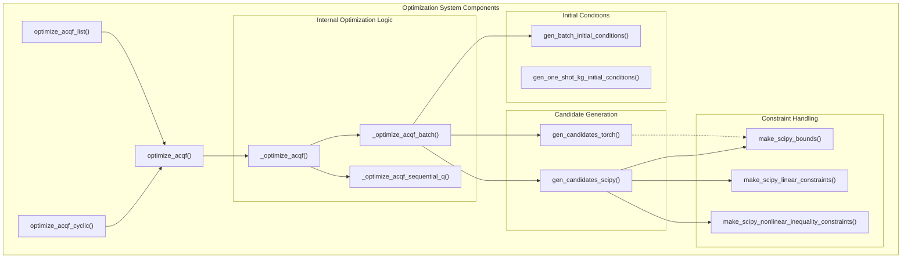
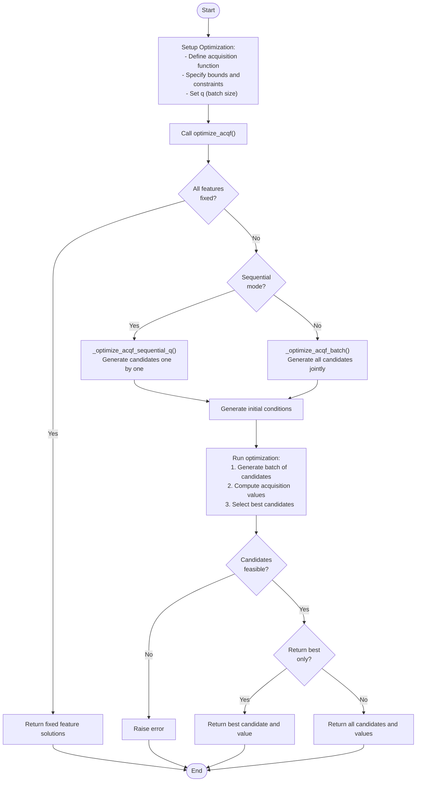
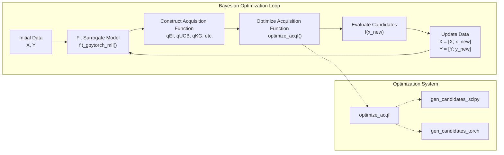

<!-- source: DeepWiki mcp.deepwiki.com · repo pytorch/botorch · page 5 Optimization · fetched 2026-10-21 -->

# Optimization

<details>
<summary>Relevant source files</summary>

The following files were used as context for generating this wiki page:

- [botorch/generation/gen.py](botorch/generation/gen.py)
- [botorch/generation/utils.py](botorch/generation/utils.py)
- [botorch/optim/__init__.py](botorch/optim/__init__.py)
- [botorch/optim/optimize.py](botorch/optim/optimize.py)
- [botorch/optim/parameter_constraints.py](botorch/optim/parameter_constraints.py)
- [test/generation/test_gen.py](test/generation/test_gen.py)
- [test/generation/test_utils.py](test/generation/test_utils.py)
- [test/optim/test_optimize.py](test/optim/test_optimize.py)
- [test/optim/test_parameter_constraints.py](test/optim/test_parameter_constraints.py)

</details>


This page documents the optimization capabilities of BoTorch, which are responsible for finding optimal acquisition function values during Bayesian optimization. The optimization module provides tools to efficiently maximize acquisition functions subject to various constraints.

For information about cross-validation, which is related to model selection optimization, see [Cross-Validation](#5.3).

## Overview of the Optimization System

The optimization system in BoTorch is primarily concerned with finding the best input points that maximize acquisition functions. This is a critical step in the Bayesian optimization loop, determining the next points to evaluate.



Sources: [botorch/optim/optimize.py:1-817](). [botorch/generation/gen.py:1-465](). [botorch/optim/parameter_constraints.py:1-583]().

## Optimization Functions

BoTorch provides several functions for optimizing acquisition functions, each designed for different use cases.

### optimize_acqf

The primary function for optimizing acquisition functions. It supports both joint and sequential optimization modes.

```python
optimize_acqf(
    acq_function,     # Acquisition function to optimize
    bounds,           # Search space bounds
    q,                # Number of candidates to generate
    num_restarts,     # Number of optimization runs with different starting points
    raw_samples=None, # Number of raw samples for initialization
    options=None,     # Dict of options for optimization
    inequality_constraints=None,  # Linear inequality constraints
    equality_constraints=None,    # Linear equality constraints
    nonlinear_inequality_constraints=None,  # Nonlinear inequality constraints
    fixed_features=None,  # Dict mapping feature indices to fixed values
    sequential=False,  # Whether to generate candidates sequentially
    timeout_sec=None,  # Maximum optimization time in seconds
    ...
) -> Tuple[Tensor, Tensor]  # Returns candidates and acquisition values
```

This function maximizes the acquisition function within the specified bounds and returns the best candidates along with their acquisition values.

Sources: [botorch/optim/optimize.py:508-656]().

### optimize_acqf_cyclic

Similar to `optimize_acqf`, but uses a cyclic optimization strategy where candidates are optimized one at a time while keeping the others fixed, then cycling through all candidates.

```python
optimize_acqf_cyclic(
    acq_function,      # Acquisition function to optimize
    bounds,            # Search space bounds
    q,                 # Number of candidates to generate
    num_restarts,      # Number of optimization runs with different starting points
    raw_samples=None,  # Number of raw samples for initialization
    options=None,      # Dict of options for optimization
    cyclic_options=None,  # Options for cyclic optimization
    ...
) -> Tuple[Tensor, Tensor]  # Returns candidates and acquisition values
```

Sources: [botorch/optim/optimize.py:680-815]().

### optimize_acqf_list

Optimizes a list of acquisition functions in sequence, with previous candidates set as pending points.

```python
optimize_acqf_list(
    acq_function_list,  # List of acquisition functions to optimize
    bounds,             # Search space bounds
    num_restarts,       # Number of optimization runs with different starting points
    raw_samples=None,   # Number of raw samples for initialization
    ...
) -> Tuple[Tensor, Tensor]  # Returns candidates and acquisition values
```

Sources: [botorch/optim/optimize.py:818-913]().

## Optimization Workflow

The typical workflow for optimizing an acquisition function in BoTorch involves several steps:



Sources: [botorch/optim/optimize.py:508-656](). [botorch/optim/optimize.py:659-677](). [botorch/optim/optimize.py:315-505]().

## Candidate Generation

BoTorch provides two main methods for generating candidates during optimization:

### gen_candidates_scipy

Uses SciPy's optimization routines (default):

```python
gen_candidates_scipy(
    initial_conditions,       # Starting points for optimization
    acquisition_function,     # Acquisition function to maximize
    lower_bounds=None,        # Minimum values for each dimension
    upper_bounds=None,        # Maximum values for each dimension
    inequality_constraints=None,  # Linear inequality constraints
    equality_constraints=None,    # Linear equality constraints
    nonlinear_inequality_constraints=None,  # Nonlinear inequality constraints
    options=None,             # Options for scipy.optimize.minimize
    fixed_features=None,      # Features to fix during optimization
    timeout_sec=None,         # Maximum optimization time in seconds
) -> Tuple[Tensor, Tensor]    # Returns candidates and acquisition values
```

This method supports all constraint types and uses SciPy's optimization algorithms (SLSQP or L-BFGS-B by default).

Sources: [botorch/generation/gen.py:43-269]().

### gen_candidates_torch

Uses PyTorch's optimization routines:

```python
gen_candidates_torch(
    initial_conditions,      # Starting points for optimization
    acquisition_function,    # Acquisition function to maximize
    lower_bounds=None,       # Minimum values for each dimension
    upper_bounds=None,       # Maximum values for each dimension
    optimizer=torch.optim.Adam,  # PyTorch optimizer to use
    options=None,            # Options controlling the optimization
    fixed_features=None,     # Features to fix during optimization
    timeout_sec=None,        # Maximum optimization time in seconds
) -> Tuple[Tensor, Tensor]   # Returns candidates and acquisition values
```

This method supports fewer constraint types but can leverage GPU acceleration when available.

Sources: [botorch/generation/gen.py:272-395]().

## Constraint Handling

BoTorch supports various types of constraints during optimization:

### Bound Constraints

Simple bounds on the search space dimensions:

```python
bounds = torch.tensor([
    [lower_bound_dim1, lower_bound_dim2, ...],  # Lower bounds
    [upper_bound_dim1, upper_bound_dim2, ...]   # Upper bounds
])
```

### Linear Constraints

Linear equality and inequality constraints of the form:
- Inequality: `∑ᵢ (X[indices[i]] * coefficients[i]) >= rhs`
- Equality: `∑ᵢ (X[indices[i]] * coefficients[i]) = rhs`

```python
# Example: x[0] + 2*x[1] >= 1
inequality_constraints = [
    (torch.tensor([0, 1]), torch.tensor([1.0, 2.0]), 1.0)
]

# Example: x[0] - x[1] = 0
equality_constraints = [
    (torch.tensor([0, 1]), torch.tensor([1.0, -1.0]), 0.0)
]
```

### Nonlinear Constraints

Nonlinear inequality constraints defined as callables:

```python
# Example: x[0]² + x[1]² <= 1
def constraint_func(x):
    return 1 - x[..., 0]**2 - x[..., 1]**2

nonlinear_inequality_constraints = [(constraint_func, True)]
```

The second element in each tuple indicates whether the constraint is intra-point (True) or inter-point (False).

Sources: [botorch/optim/parameter_constraints.py:24-704]().

## Feature Comparison of Optimization Methods

| Feature | optimize_acqf | optimize_acqf_cyclic | optimize_acqf_list |
|---------|---------------|----------------------|--------------------|
| Purpose | General purpose | Better exploitation | Sequential batch selection |
| Optimization approach | Joint or sequential | Cyclic coordinate-wise | Sequential with pending points |
| Best for q | Small to medium | Medium to large | Any |
| Constraint support | Full | Limited | Full |
| Computational cost | Medium | High | Medium |
| Handles fixed features | Yes | Yes | Yes |

| Feature | gen_candidates_scipy | gen_candidates_torch |
|---------|---------------------|----------------------|
| Backend | SciPy | PyTorch |
| Bound constraints | Yes | Yes |
| Linear constraints | Yes | No |
| Nonlinear constraints | Yes | No |
| GPU acceleration | No | Yes |
| Gradient-based | Optional | Yes |
| Default algorithm | SLSQP/L-BFGS-B | Adam |

Sources: [botorch/optim/optimize.py:508-815](). [botorch/generation/gen.py:43-395]().

## Joint vs. Sequential Optimization

BoTorch supports two main strategies for batch optimization:

### Joint Optimization

When `sequential=False` (default), all q candidates are optimized simultaneously:

```python
candidates, acq_values = optimize_acqf(
    acq_function=qEI,
    bounds=bounds,
    q=3,
    num_restarts=10,
    raw_samples=100
)
```

Joint optimization is generally faster but may converge to lower-quality solutions for large batch sizes.

### Sequential Optimization

When `sequential=True`, candidates are optimized one at a time, with previous candidates set as pending:

```python
candidates, acq_values = optimize_acqf(
    acq_function=qEI,
    bounds=bounds,
    q=3,
    num_restarts=10,
    raw_samples=100,
    sequential=True
)
```

Sequential optimization often finds better candidates but is more computationally expensive.

Sources: [botorch/optim/optimize.py:249-291](). [botorch/optim/optimize.py:315-505]().

## Fixed Features

BoTorch allows fixing certain features during optimization, which is useful for constrained optimization or when exploring specific slices of the search space:

```python
# Fix the first feature to 0.5
fixed_features = {0: 0.5}

candidates, acq_values = optimize_acqf(
    acq_function=qEI,
    bounds=bounds,
    q=2,
    num_restarts=10,
    raw_samples=100,
    fixed_features=fixed_features
)
```

When fixed features are specified, the optimization is performed over the reduced domain of only the non-fixed features.

Sources: [botorch/generation/utils.py:72-166](). [botorch/optim/optimize.py:181-200]().

## Error Handling and Timeouts

BoTorch's optimization functions include several mechanisms for handling errors and controlling computational resources:

### Timeout Handling

You can specify a maximum time for optimization using the `timeout_sec` parameter:

```python
candidates, acq_values = optimize_acqf(
    acq_function=qEI,
    bounds=bounds,
    q=2,
    num_restarts=10,
    raw_samples=100,
    timeout_sec=60.0  # Maximum 60 seconds
)
```

### Optimization Warning Retry

By default, if an optimization attempt fails with an `OptimizationWarning`, BoTorch will retry with new initial conditions:

```python
candidates, acq_values = optimize_acqf(
    acq_function=qEI,
    bounds=bounds,
    q=2,
    num_restarts=10,
    raw_samples=100,
    retry_on_optimization_warning=True  # Default
)
```

### Feasibility Checking

After optimization, BoTorch verifies that the candidates satisfy all constraints:

```python
is_feasible = evaluate_feasibility(
    X=candidates,
    inequality_constraints=inequality_constraints,
    equality_constraints=equality_constraints,
    nonlinear_inequality_constraints=nonlinear_inequality_constraints
)
```

If all candidates are infeasible, a `CandidateGenerationError` is raised.

Sources: [botorch/optim/optimize.py:413-466](). [botorch/optim/parameter_constraints.py:476-547]().

## Common Options

The `options` dictionary can contain various parameters that control the optimization process:

```python
options = {
    # For batch optimization
    "batch_limit": 5,  # Process initial conditions in batches
    
    # For scipy.optimize.minimize
    "method": "L-BFGS-B",  # Optimization algorithm
    "maxiter": 1000,      # Maximum iterations
    "tol": 1e-6,          # Tolerance
    
    # For PyTorch optimizers
    "lr": 0.01,           # Learning rate
    
    # Initial condition generation
    "sample_around_best": True,  # Sample near best points
    "sample_around_best_sigma": 0.1,  # Std for sampling
    "nonnegative": True,  # Enforce non-negative solutions
}
```

Sources: [botorch/optim/optimize.py:42-57](). [botorch/generation/gen.py:83-97](). [botorch/generation/gen.py:292-307]().

## Integration in Bayesian Optimization

The optimization system is a critical component in the Bayesian optimization loop:



Sources: [botorch/optim/optimize.py:508-656](). [botorch/generation/gen.py:43-395]().

## Examples

Here are some examples of using BoTorch's optimization capabilities:

### Basic Optimization

```python
# Define acquisition function
qEI = qExpectedImprovement(model, best_f=0.2)

# Define bounds
bounds = torch.tensor([[0.0, 0.0], [1.0, 1.0]])

# Optimize with default settings
candidates, acq_value = optimize_acqf(
    acq_function=qEI,
    bounds=bounds,
    q=2,
    num_restarts=20,
    raw_samples=512
)
```

### With Constraints

```python
# Define linear inequality constraints
# x[0] >= 0.5, x[1] <= 0.8
inequality_constraints = [
    (torch.tensor([0]), torch.tensor([1.0]), 0.5),
    (torch.tensor([1]), torch.tensor([-1.0]), -0.8)
]

# Optimize with constraints
candidates, acq_value = optimize_acqf(
    acq_function=qEI,
    bounds=bounds,
    q=2,
    num_restarts=20,
    raw_samples=512,
    inequality_constraints=inequality_constraints
)
```

### Sequential Optimization

```python
# Optimize sequentially
candidates, acq_values = optimize_acqf(
    acq_function=qEI,
    bounds=bounds,
    q=3,
    num_restarts=15,
    raw_samples=256,
    sequential=True
)
```

### Cyclic Optimization

```python
# Optimize cyclically
candidates, acq_values = optimize_acqf_cyclic(
    acq_function=qEI,
    bounds=bounds,
    q=3,
    num_restarts=15,
    raw_samples=256,
    cyclic_options={"maxiter": 4}
)
```

Sources: [botorch/optim/optimize.py:618-629](). [botorch/optim/optimize.py:751-758]().

## Best Practices and Limitations

### Best Practices

1. **Choosing Appropriate Parameters**:
   - Increase `num_restarts` and `raw_samples` for more thorough optimization
   - Use `sequential=True` for higher quality candidates when q > 1
   - Set reasonable timeouts to avoid excessive computation

2. **Constraint Handling**:
   - Use `gen_candidates_scipy` for problems with constraints
   - Verify that constraints are satisfiable before optimization

3. **Initial Conditions**:
   - Provide good initial conditions when possible
   - For specialized acquisition functions, use appropriate initial condition generators

### Limitations

1. **Scalability**: Large batch sizes (q) can be computationally expensive, especially with sequential optimization.
2. **Constraint Support**: `gen_candidates_torch` does not support linear or nonlinear constraints.
3. **Local Optima**: Like most optimization methods, BoTorch's optimizers may converge to local optima, especially for complex acquisition functions.
4. **Numerical Stability**: Optimization can sometimes fail due to numerical issues, especially for acquisition functions with pathological behavior.

Sources: [botorch/optim/optimize.py:124-165](). [botorch/optim/optimize.py:476-499]().

---

