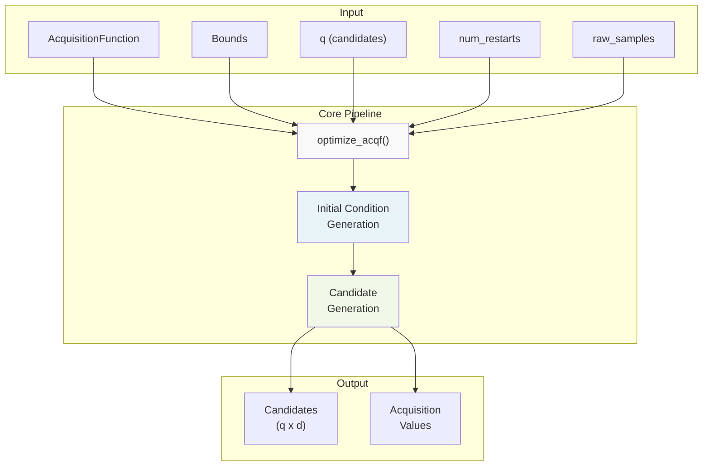
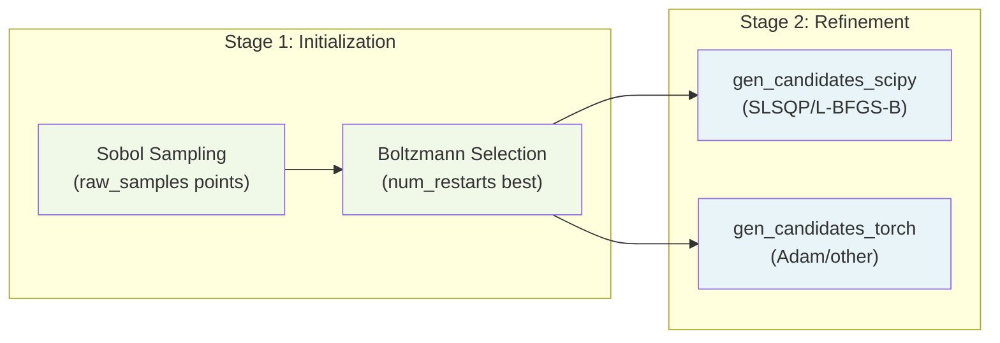
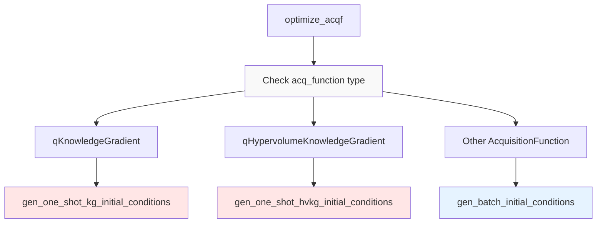
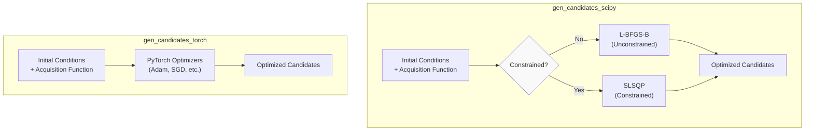
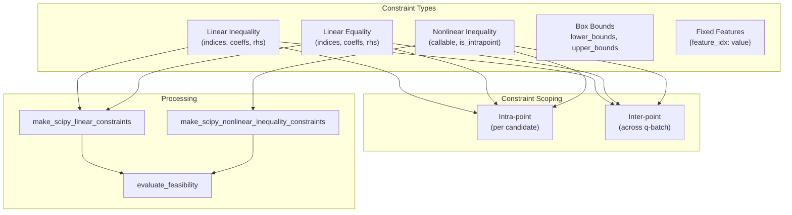

<!-- source: DeepWiki mcp.deepwiki.com · repo pytorch/botorch · page 5.1 Acquisition Function Optimization · fetched 2026-10-21 -->

# Acquisition Function Optimization

<details>
<summary>Relevant source files</summary>

The following files were used as context for generating this wiki page:

- [botorch/generation/gen.py](botorch/generation/gen.py)
- [botorch/generation/utils.py](botorch/generation/utils.py)
- [botorch/optim/__init__.py](botorch/optim/__init__.py)
- [botorch/optim/optimize.py](botorch/optim/optimize.py)
- [botorch/optim/parameter_constraints.py](botorch/optim/parameter_constraints.py)
- [test/generation/test_gen.py](test/generation/test_gen.py)
- [test/generation/test_utils.py](test/generation/test_utils.py)
- [test/optim/test_optimize.py](test/optim/test_optimize.py)
- [test/optim/test_parameter_constraints.py](test/optim/test_parameter_constraints.py)

</details>


This document covers BoTorch's acquisition function optimization infrastructure, which finds the best candidate points to evaluate next in Bayesian optimization. The system implements a robust two-stage optimization pipeline: initial condition sampling followed by gradient-based refinement.

For information about constructing acquisition functions, see [Acquisition Functions](#4). For details on optimization initializers, see [Initializers](#5.2).

## Overview

The acquisition function optimization system is centered around the `optimize_acqf` function, which converts acquisition functions into concrete candidate recommendations. The system supports various optimization strategies, constraint types, and special acquisition function behaviors.



**High-Level Optimization Flow**

Sources: [botorch/optim/optimize.py:582-768](), [botorch/optim/optimize.py:1-44]()

## Core Optimization Pipeline

The optimization process follows a two-stage approach implemented in `optimize_acqf`:

### Stage 1: Initial Condition Generation
The system first samples `raw_samples` random points using Sobol sampling, then selects the best `num_restarts` points using acquisition-function-guided sampling (typically Boltzmann sampling).

### Stage 2: Gradient-Based Optimization
Each initial condition is refined using gradient-based optimizers, with the best result returned.



**Two-Stage Optimization Process**

Sources: [botorch/optim/optimize.py:608-625](), [botorch/generation/gen.py:58-148]()

## OptimizeAcqfInputs Structure

The system uses a dataclass to manage optimization parameters and validation:

| Parameter | Type | Purpose |
|-----------|------|---------|
| `acq_function` | `AcquisitionFunction` | Function to optimize |
| `bounds` | `Tensor` | Box constraints (2 x d) |
| `q` | `int` | Number of candidates to generate |
| `num_restarts` | `int` | Number of optimization restarts |
| `raw_samples` | `int` | Number of initial Sobol samples |
| `sequential` | `bool` | Sequential vs joint optimization |
| `inequality_constraints` | `list` | Linear inequality constraints |
| `equality_constraints` | `list` | Linear equality constraints |
| `nonlinear_inequality_constraints` | `list` | Nonlinear constraints |
| `fixed_features` | `dict` | Features to fix to specific values |

Sources: [botorch/optim/optimize.py:63-92](), [botorch/optim/optimize.py:99-183]()

## Initial Condition Generation Strategy

The system provides different initialization strategies based on acquisition function type:



**Initial Condition Generator Selection**

Sources: [botorch/optim/optimize.py:184-191](), [botorch/optim/initializers.py:32-37]()

## Candidate Generation Methods

BoTorch provides two primary candidate generation backends:

### gen_candidates_scipy
- **Default method** using `scipy.optimize.minimize`
- **Optimizers**: L-BFGS-B (unconstrained), SLSQP (constrained)
- **Constraint support**: Full linear and nonlinear constraint support
- **Parallel mode**: Available for L-BFGS-B with compatible scipy versions

### gen_candidates_torch
- **PyTorch-based** using torch optimizers (Adam, etc.)
- **Constraint support**: Box constraints and fixed features only
- **Use case**: When scipy is unavailable or torch-specific features needed



**Candidate Generation Backends**

Sources: [botorch/generation/gen.py:58-148](), [botorch/generation/gen.py:511-617]()

## Constraint Handling System

The optimization system supports multiple constraint types with different scoping:

### Linear Constraints
- **Format**: `(indices, coefficients, rhs)` tuples
- **Inequality**: `sum(X[indices] * coefficients) >= rhs`
- **Equality**: `sum(X[indices] * coefficients) == rhs`
- **Scoping**: Intra-point (per candidate) or inter-point (across q-batch)

### Nonlinear Constraints
- **Format**: `(callable, is_intrapoint)` tuples
- **Constraint**: `callable(X) >= 0`
- **Intra-point**: Applied to each candidate individually
- **Inter-point**: Applied to entire q-batch



**Constraint System Architecture**

Sources: [botorch/optim/parameter_constraints.py:88-148](), [botorch/optim/parameter_constraints.py:570-575]()

## Sequential vs Joint Optimization

The system supports two optimization strategies for multi-candidate problems (q > 1):

### Joint Optimization (Default)
- **Method**: Optimize all q candidates simultaneously
- **Objective**: Sum of acquisition values across candidates
- **Constraints**: Full support for inter-point constraints

### Sequential Optimization
- **Method**: Optimize candidates one at a time
- **Pending points**: Add optimized candidates to pending set for subsequent optimizations
- **Constraints**: Only intra-point constraints supported
- **Use case**: When acquisition function benefits from sequential conditioning


**Optimization Strategy Comparison**

Sources: [botorch/optim/optimize.py:262-322](), [botorch/optim/optimize.py:216-260]()

## Special Cases and Advanced Features

### OneShotAcquisitionFunction Handling
One-shot acquisition functions (like `qKnowledgeGradient`) optimize over an augmented candidate set including fantasy points, then extract the actual candidates.

```python
if not opt_inputs.full_tree:
    batch_candidates = opt_inputs.acq_function.extract_candidates(
        X_full=batch_candidates
    )
```

### Fixed Features Optimization
When all features are fixed, the system bypasses optimization entirely:

```python
def _optimize_acqf_all_features_fixed(
    *, bounds, fixed_features, q, acq_function
):
    X = torch.tensor([fixed_features[i] for i in range(bounds.shape[-1])])
    X = X.expand(q, *X.shape)
    with torch.no_grad():
        acq_value = acq_function(X)
    return X, acq_value
```

### Feasibility Projection
For infeasible candidates, the system attempts projection to the feasible space using SLSQP:


**Feasibility Handling Pipeline**

Sources: [botorch/optim/optimize.py:194-213](), [botorch/optim/optimize.py:517-579](), [botorch/optim/parameter_constraints.py:585-661]()

## Error Handling and Robustness

The system includes several robustness features:

- **Retry on optimization warnings**: Generates new initial conditions if first attempt fails
- **Timeout support**: Graceful handling of optimization timeouts
- **Gradient validation**: Detects and reports NaN gradients with helpful error messages
- **Constraint validation**: Comprehensive validation of constraint specifications

Sources: [botorch/optim/optimize.py:456-507](), [botorch/generation/gen.py:650-668](), [botorch/generation/gen.py:353-377]()

---

