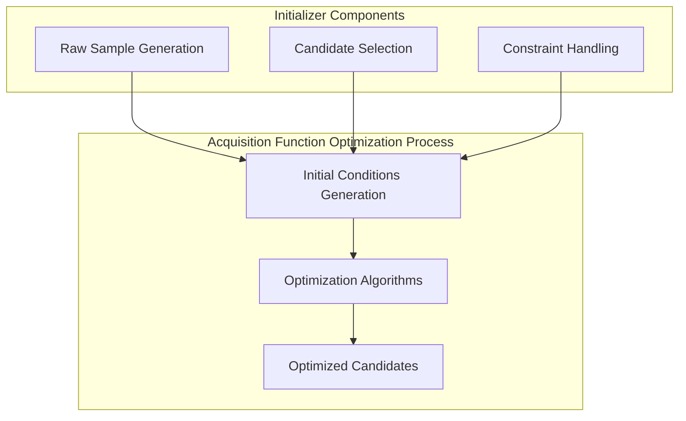
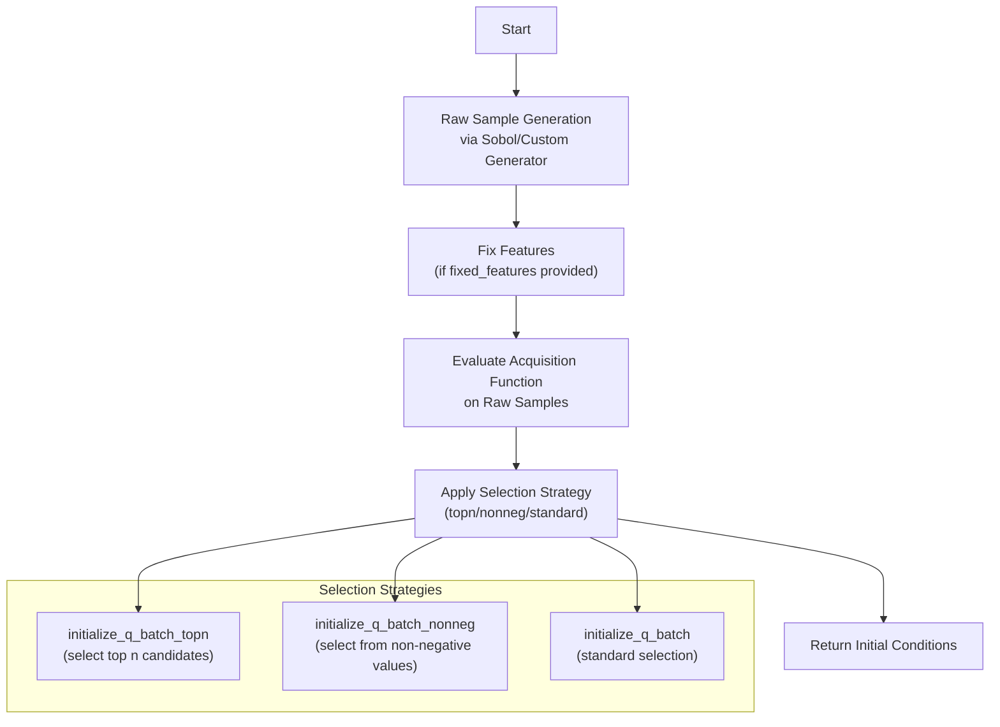
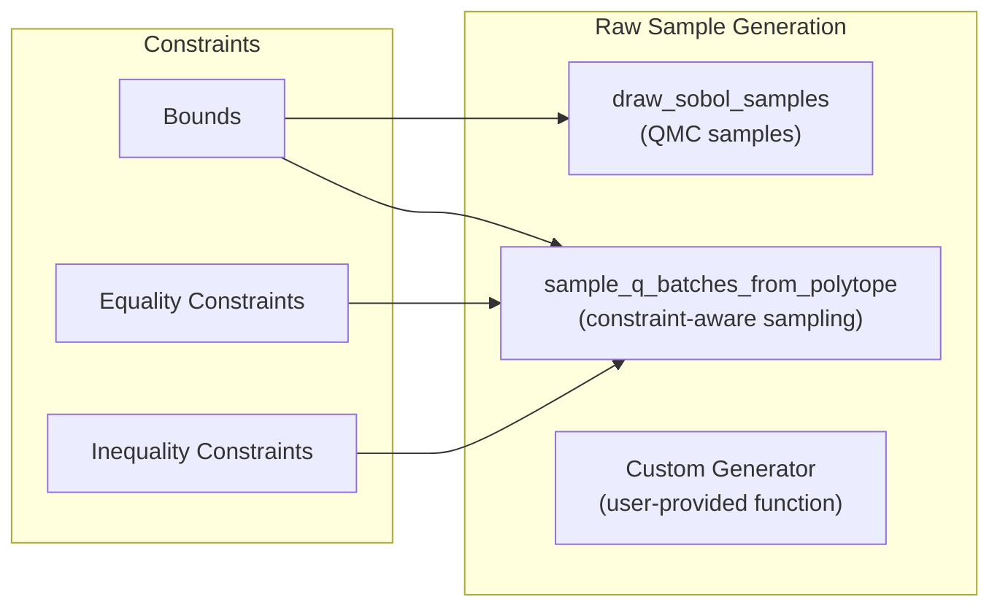
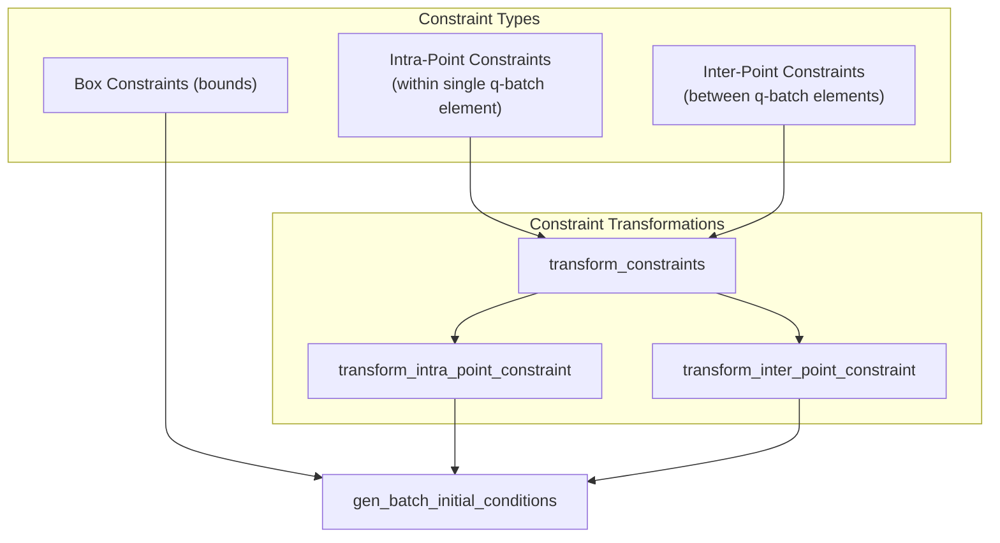
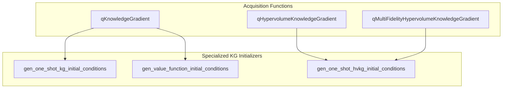
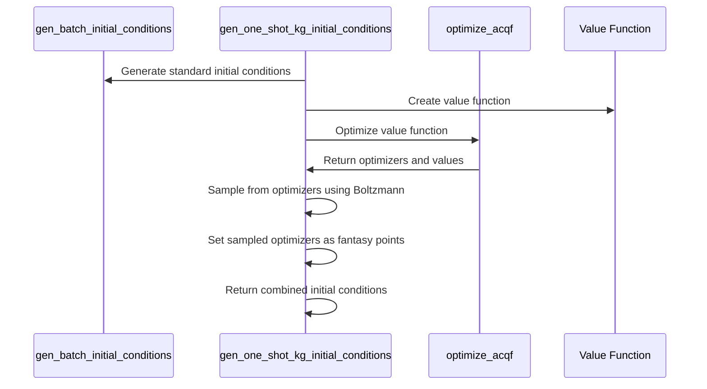
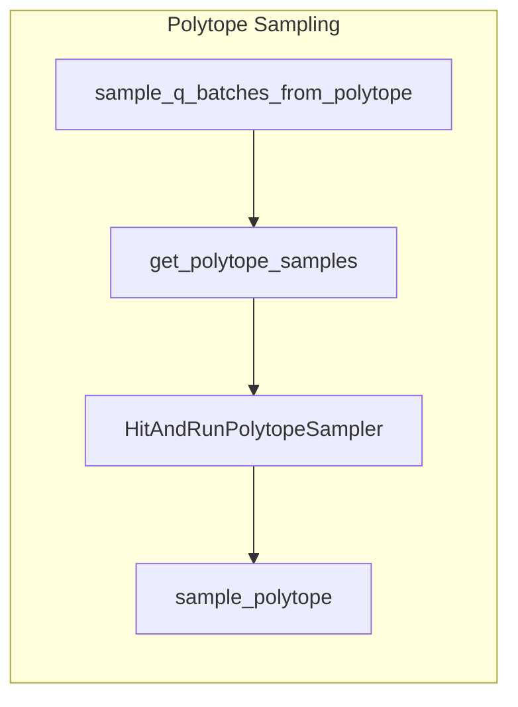
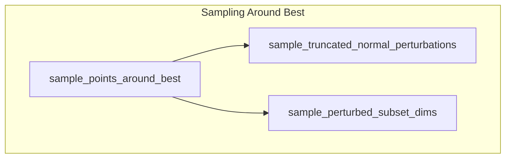
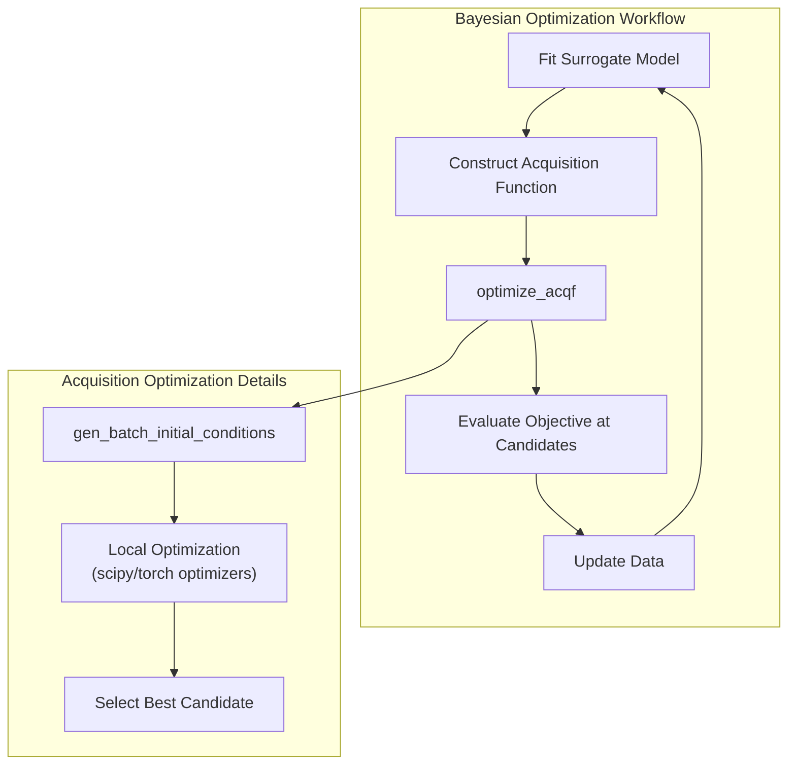

<!-- source: DeepWiki mcp.deepwiki.com · repo pytorch/botorch · page 5.2 Initializers · fetched 2026-10-21 -->

# Initializers

<details>
<summary>Relevant source files</summary>

The following files were used as context for generating this wiki page:

- [botorch/optim/initializers.py](botorch/optim/initializers.py)
- [botorch/utils/sampling.py](botorch/utils/sampling.py)
- [test/optim/test_initializers.py](test/optim/test_initializers.py)
- [test/utils/test_sampling.py](test/utils/test_sampling.py)

</details>


This document provides an overview of the initializers in BoTorch, which play a critical role in the optimization of acquisition functions. Initializers generate starting points (initial conditions) for optimization algorithms, significantly impacting the quality of solutions found during Bayesian optimization. For information about the broader optimization system, see [Acquisition Function Optimization](#5.1).

## Purpose and Role

Initializers address a key challenge in acquisition function optimization: finding good starting points to increase the likelihood of discovering global optima. Since acquisition functions are often non-convex with multiple local optima, the choice of starting points greatly affects optimization outcomes. BoTorch initializers provide various strategies for generating diverse, promising initial candidates.



Sources: [botorch/optim/initializers.py:245-469](). [botorch/optim/initializers.py:73-178]()

## Core Initializer System

The main entry point for generating initial conditions is `gen_batch_initial_conditions`, which orchestrates the entire initialization process. It generates raw samples, evaluates them with the acquisition function, and selects the most promising candidates as starting points.



Sources: [botorch/optim/initializers.py:245-469](), [botorch/optim/__init__.py:25-29]()

### Raw Sample Generation

BoTorch generates raw samples using several techniques:

1. **Quasi-Monte Carlo sampling**: Uses Sobol sequences for better coverage of the search space
2. **Polytope sampling**: For problems with complex constraints 
3. **Custom generators**: User-defined sampling functions



Sources: [botorch/optim/initializers.py:353-391](), [botorch/utils/sampling.py:78-115]()

### Selection Strategies

After evaluating the acquisition function on raw samples, BoTorch offers three strategies for selecting initial conditions:

1. **`initialize_q_batch_topn`**: Selects the top `n` candidates with the highest acquisition values
2. **`initialize_q_batch_nonneg`**: Selects candidates with non-negative acquisition values, using the `alpha` parameter for thresholding
3. **`initialize_q_batch`**: Uses Boltzmann selection with an `eta` parameter controlling the exploration-exploitation trade-off

These strategies are chosen based on options passed to `gen_batch_initial_conditions`, prioritizing in this order: topn > nonneg > standard.

Sources: [botorch/optim/initializers.py:334-342](), [botorch/optim/__init__.py:26-28]()

## Constraint Handling

BoTorch initializers support complex constraints through a series of constraint transformation functions.



Sources: [botorch/optim/initializers.py:73-178]()

### Constraint Types and Transformation

BoTorch supports two main types of constraints in initializers:

1. **Intra-point constraints**: Apply to individual candidate points, specified as tuples of indices, coefficients, and right-hand side values
2. **Inter-point constraints**: Apply across points in a q-batch, enabling constraints between multiple batch elements

Constraints are transformed from a sparse representation to a dense form suitable for the polytope sampling methods using transformation functions.

Sources: [botorch/optim/initializers.py:107-177]()

## Specialized Initializers

BoTorch includes specialized initializers for more advanced acquisition functions like Knowledge Gradient variants.

### Knowledge Gradient Initializers

For Knowledge Gradient (KG) type acquisition functions, BoTorch offers specialized initializers that leverage problem structure for more effective initialization.



These specialized initializers improve optimization by:

1. Leveraging value function optimization to generate smart fantasy points
2. Using Boltzmann sampling to balance exploration and exploitation
3. Supporting multi-fidelity and multi-objective variants

Sources: [botorch/optim/initializers.py:471-868]()

### One-Shot Knowledge Gradient Initialization

The one-shot KG initializer works by:

1. Optimizing the posterior objective using `gen_batch_initial_conditions`
2. Sampling from the set of optimizers according to a softmax transformation
3. Setting the fantasy points to these sampled optimizers
4. Keeping a fraction of random fantasy points for exploration



Sources: [botorch/optim/initializers.py:471-604](), [botorch/utils/sampling.py:321-363]()

## Sampling Utilities

BoTorch includes several sampling utilities to generate diverse initial candidates:

### Polytope Sampling

For constrained optimization problems, BoTorch provides utilities to sample from polytopes defined by linear constraints:



The polytope sampling system handles both equality and inequality constraints, enabling sampling from complex feasible regions.

Sources: [botorch/optim/initializers.py:180-242](), [botorch/utils/sampling.py:893-965]()

### Sampling Around Best Points

BoTorch also provides functionality to generate samples by perturbing around the best observed points, which can be particularly useful for refining existing solutions:



This sampling mode is activated by setting `sample_around_best=True` in the options dictionary passed to `gen_batch_initial_conditions`.

Sources: [botorch/optim/initializers.py:394-410]()

## Integration with Optimization Workflow

Initializers are a key component of the overall optimization workflow in BoTorch. The following diagram illustrates how initializers integrate with the acquisition function optimization process:



Sources: [botorch/optim/initializers.py:245-469]()

## Usage Examples

Using initializers typically involves calling `gen_batch_initial_conditions` with appropriate options:

Basic usage:
```python
initial_conditions = gen_batch_initial_conditions(
    acq_function=acq_function,
    bounds=bounds,
    q=q,  # batch size
    num_restarts=num_restarts,  # number of starting points
    raw_samples=raw_samples,  # number of samples to evaluate
)
```

With constraints:
```python
initial_conditions = gen_batch_initial_conditions(
    acq_function=acq_function,
    bounds=bounds,
    q=q,
    num_restarts=num_restarts,
    raw_samples=raw_samples,
    inequality_constraints=inequality_constraints,
    equality_constraints=equality_constraints,
)
```

With specialized options:
```python
initial_conditions = gen_batch_initial_conditions(
    acq_function=acq_function,
    bounds=bounds,
    q=q,
    num_restarts=num_restarts,
    raw_samples=raw_samples,
    fixed_features={0: 0.5},  # fix feature 0 to value 0.5
    options={
        "sample_around_best": True,  # sample around best observed points
        "nonnegative": True,  # use non-negative selection strategy
        "eta": 0.5,  # temperature parameter for Boltzmann selection
    },
)
```

Sources: [botorch/optim/initializers.py:245-469]()

---

