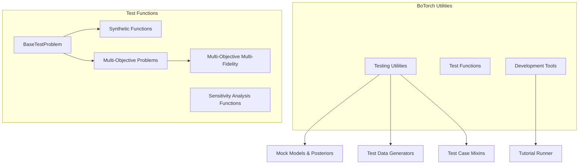
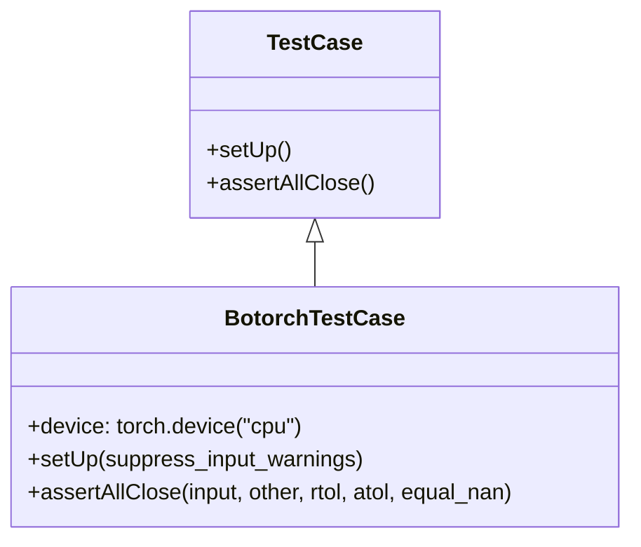
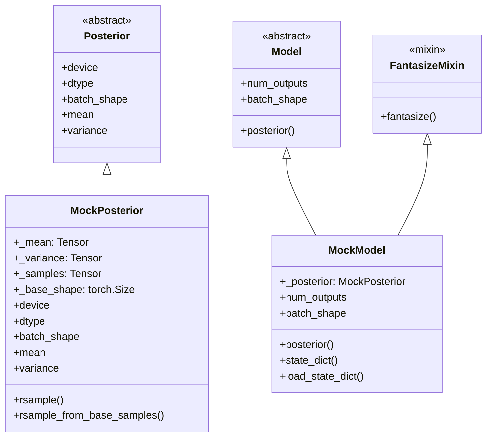
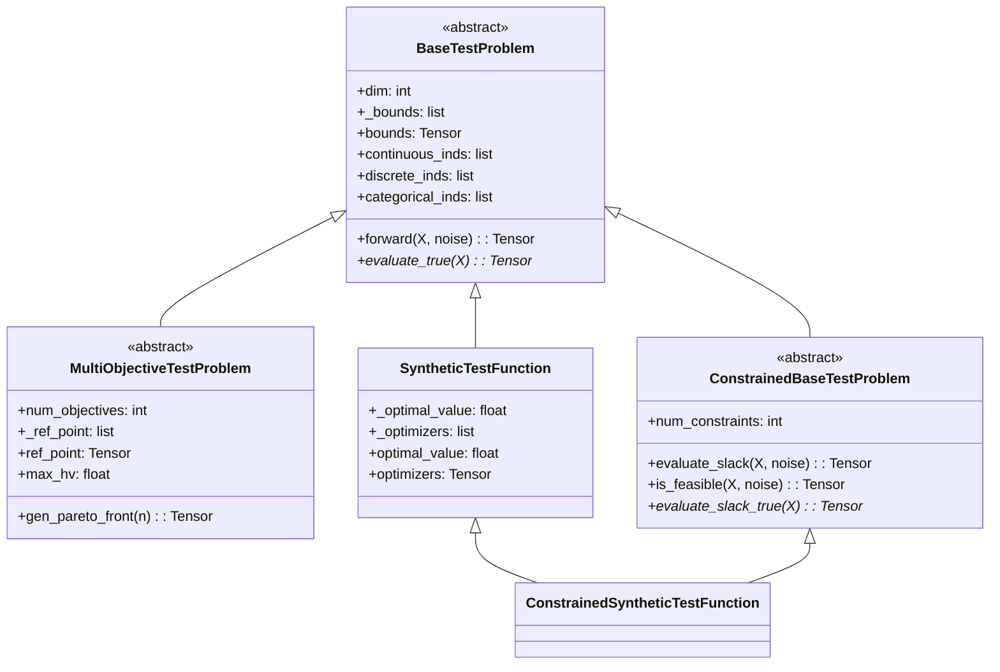
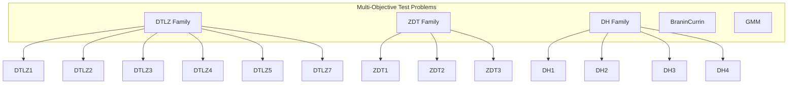
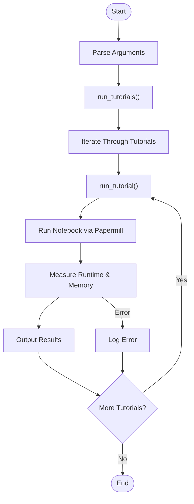
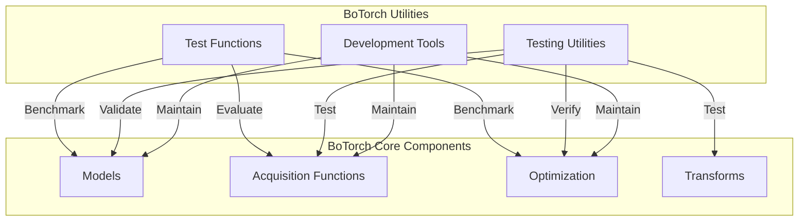

<!-- source: DeepWiki mcp.deepwiki.com · repo pytorch/botorch · page 6 Utilities · fetched 2026-10-21 -->

# Utilities

Relevant source files

The following files were used as context for generating this wiki page:

- [botorch/test_functions/__init__.py](botorch/test_functions/__init__.py)
- [botorch/test_functions/base.py](botorch/test_functions/base.py)
- [botorch/test_functions/multi_fidelity.py](botorch/test_functions/multi_fidelity.py)
- [botorch/test_functions/multi_objective.py](botorch/test_functions/multi_objective.py)
- [botorch/test_functions/multi_objective_multi_fidelity.py](botorch/test_functions/multi_objective_multi_fidelity.py)
- [botorch/test_functions/sensitivity_analysis.py](botorch/test_functions/sensitivity_analysis.py)
- [botorch/test_functions/synthetic.py](botorch/test_functions/synthetic.py)
- [botorch/utils/testing.py](botorch/utils/testing.py)
- [botorch/utils/torch.py](botorch/utils/torch.py)
- [test/test_functions/test_base.py](test/test_functions/test_base.py)
- [test/test_functions/test_multi_objective.py](test/test_functions/test_multi_objective.py)
- [test/test_functions/test_sensitivity_analysis.py](test/test_functions/test_sensitivity_analysis.py)
- [test/test_functions/test_synthetic.py](test/test_functions/test_synthetic.py)

BoTorch provides a variety of utility modules to support Bayesian optimization workflows, benchmarking, and development. These utilities include testing infrastructure, synthetic test functions for benchmarking, and development tools. While these utilities are primarily intended for internal usage and testing of BoTorch itself, they are also valuable for users who want to benchmark new algorithms, develop custom components, or extend BoTorch.

## Overview

The utility modules in BoTorch can be categorized into several main areas:

Sources: [botorch/utils/testing.py](botorch/utils/testing.py), [botorch/test_functions/base.py](botorch/test_functions/base.py), [botorch/test_functions/synthetic.py](botorch/test_functions/synthetic.py), [botorch/test_functions/multi_objective.py](botorch/test_functions/multi_objective.py), [scripts/run_tutorials.py](scripts/run_tutorials.py)

## Testing Utilities

BoTorch provides comprehensive testing utilities in `botorch.utils.testing` to facilitate testing of components and ensure correctness of implementations.

### Base Test Case

The `BotorchTestCase` class serves as the foundation for writing tests in BoTorch. It extends from Python's `unittest.TestCase` and provides additional functionality:

The `BotorchTestCase` class:
- Sets the default device to `torch.device("cpu")`
- Ensures warnings are not suppressed by default
- Provides functionality to suppress common input warnings
- Implements `assertAllClose()` method for comparing tensors with tolerance

Sources: [botorch/utils/testing.py:42-132](botorch/utils/testing.py)

### Mock Models and Posteriors

To facilitate testing of acquisition functions and optimization procedures without relying on actual models, BoTorch provides mock implementations:

The mock classes include:

- `MockPosterior`: Simulates a posterior with specified mean, variance, and samples
- `MockModel`: A dummy model that returns a specified `MockPosterior`
- `MockAcquisitionFunction`: A simple acquisition function implementation for testing

These mocks are particularly useful for testing optimization logic without depending on actual model computation.

Sources: [botorch/utils/testing.py:378-598](botorch/utils/testing.py)

### Test Data Generators

BoTorch includes utility functions to generate test data and posteriors:

- `get_random_data()`: Generates random training data for testing purposes
- `get_test_posterior()`: Creates a test GPyTorchPosterior for testing
- `get_max_violation_of_bounds()`: Checks if samples violate box constraints
- `get_max_violation_of_constraints()`: Checks if samples violate linear constraints

These functions streamline the process of creating test cases with controlled inputs.

Sources: [botorch/utils/testing.py:600-723](botorch/utils/testing.py)

## Test Functions

BoTorch provides a comprehensive collection of test functions for benchmarking optimization algorithms. These functions have known properties (e.g., number of global optima, optimizers' locations) that make them suitable for evaluating the performance of optimization methods.

### Test Function Hierarchy

The test functions in BoTorch follow a well-defined class hierarchy:

This hierarchy enables:
- Common functionality through the base classes
- Different types of test problems (single-objective, multi-objective, constrained)
- Easy implementation of new test functions

Sources: [botorch/test_functions/base.py:78-155](botorch/test_functions/base.py), [botorch/test_functions/base.py:157-222](botorch/test_functions/base.py), [botorch/test_functions/base.py:224-273](botorch/test_functions/base.py), [botorch/test_functions/synthetic.py:64-125](botorch/test_functions/synthetic.py)

### Synthetic Test Functions

BoTorch implements numerous synthetic test functions that are commonly used in optimization literature:

| Function | Dimensions | Description | Global Optima |
|----------|------------|-------------|--------------|
| Ackley | d | Highly multimodal with many local minima | Single optimum at origin |
| Beale | 2 | Unimodal with steep gradients | Single optimum |
| Branin | 2 | Multi-modal with three global minima | Three optima |
| Bukin | 2 | Discontinuous, non-differentiable | Single optimum |
| Hartmann | 3,4,6 | Multimodal with multiple local minima | Single optimum |
| Levy | d | Multimodal with multiple local minima | Single optimum at [1,...,1] |
| Rosenbrock | d | Unimodal "banana" function with curved valley | Single optimum at [1,...,1] |
| Shekel | 4 | Multimodal with multiple deep local minima | Single optimum |

These functions implement the `evaluate_true()` method which computes the actual function value without noise.

Sources: [botorch/test_functions/synthetic.py:127-306](botorch/test_functions/synthetic.py), [botorch/test_functions/synthetic.py:373-476](botorch/test_functions/synthetic.py), [botorch/test_functions/synthetic.py:511-562](botorch/test_functions/synthetic.py), [botorch/test_functions/synthetic.py:702-742](botorch/test_functions/synthetic.py)

### Multi-Objective Test Problems

For benchmarking multi-objective optimization algorithms, BoTorch provides several multi-objective test problems:

Key features of multi-objective test problems:
- Support for computing the true Pareto frontier
- Reference points for computing hypervolume metrics
- Maximum hypervolume values for benchmarking
- Support for noise in observations
- Options for negating objectives (maximization vs. minimization)

Sources: [botorch/test_functions/multi_objective.py:94-166](botorch/test_functions/multi_objective.py), [botorch/test_functions/multi_objective.py:156-334](botorch/test_functions/multi_objective.py), [botorch/test_functions/multi_objective.py:336-588](botorch/test_functions/multi_objective.py)

### Multi-Fidelity Test Functions

BoTorch also provides test functions for multi-fidelity optimization, where evaluations can be performed at different fidelity levels with different costs:

- `AugmentedBranin`, `AugmentedHartmann`, `AugmentedRosenbrock`: Standard test functions augmented with fidelity parameters
- `WingWeightMultiFidelity`, `BoreholeMultiFidelity`: Real-world inspired problems with multiple fidelity levels

These functions include a fidelity parameter that controls the accuracy of the function evaluation, with higher fidelity providing more accurate results at higher cost.

Sources: [botorch/test_functions/multi_fidelity.py:27-126](botorch/test_functions/multi_fidelity.py), [botorch/test_functions/multi_fidelity.py:175-366](botorch/test_functions/multi_fidelity.py)

### Multi-Objective Multi-Fidelity Test Problems

For even more complex benchmarking scenarios, BoTorch provides multi-objective multi-fidelity test problems:

- `MOMFBraninCurrin`: A multi-objective version of Branin-Currin with fidelity parameters
- `MOMFPark`: A multi-objective version of the Park function with fidelity parameters

These problems combine the challenges of multi-objective optimization with the additional complexity of multiple fidelity levels.

Sources: [botorch/test_functions/multi_objective_multi_fidelity.py:25-87](botorch/test_functions/multi_objective_multi_fidelity.py), [botorch/test_functions/multi_objective_multi_fidelity.py:90-166](botorch/test_functions/multi_objective_multi_fidelity.py)

### Sensitivity Analysis Functions

BoTorch includes specialized test functions designed for sensitivity analysis:

- `Ishigami`: Three-dimensional function with strong nonlinearity and nonmonotonicity
- `Gsobol`: d-dimensional function with known Sobol indices
- `Morris`: 20-dimensional function for testing sensitivity analysis methods

These functions include known sensitivity indices to benchmark sensitivity analysis techniques.

Sources: [botorch/test_functions/sensitivity_analysis.py:14-107](botorch/test_functions/sensitivity_analysis.py), [botorch/test_functions/sensitivity_analysis.py:109-206](botorch/test_functions/sensitivity_analysis.py), [botorch/test_functions/sensitivity_analysis.py:208-295](botorch/test_functions/sensitivity_analysis.py)

## Development Utilities

### Tutorial Runner

BoTorch includes a utility script for running and testing tutorial notebooks:

Key features of the tutorial runner:
- Runs tutorial notebooks using Papermill to execute them
- Measures runtime and memory usage for each tutorial
- Supports a "smoke test" mode for quick validation
- Handles timeouts and errors gracefully
- Provides detailed performance information

This utility is valuable for ensuring that tutorials remain functional as the codebase evolves.

Sources: [scripts/run_tutorials.py:23-161](scripts/run_tutorials.py)

## Integration with BoTorch Ecosystem

Utilities play a crucial role in the overall BoTorch ecosystem:

The utility modules provide essential tools for:
- Benchmarking new algorithms against established test problems
- Validating the correctness of implementations through testing
- Facilitating development and maintenance of the library

Sources: [botorch/utils/testing.py](botorch/utils/testing.py), [botorch/test_functions/base.py](botorch/test_functions/base.py), [scripts/run_tutorials.py](scripts/run_tutorials.py)

---

