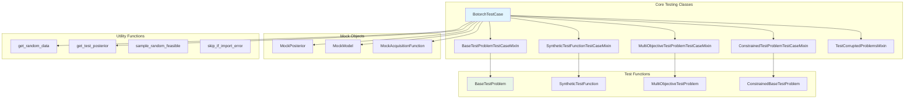
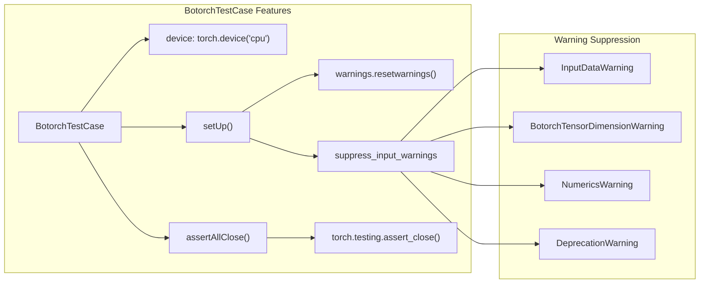
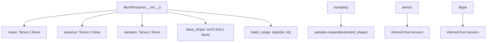
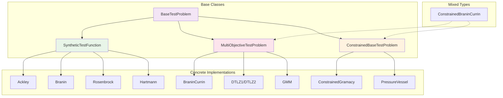
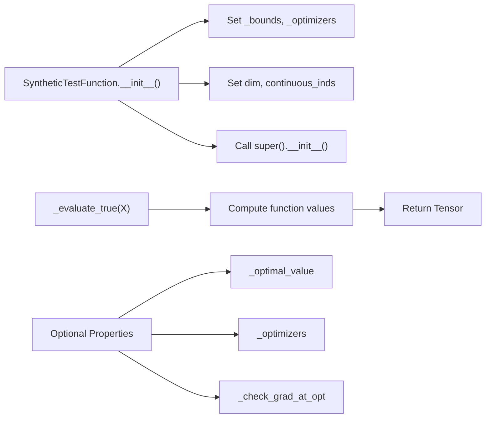
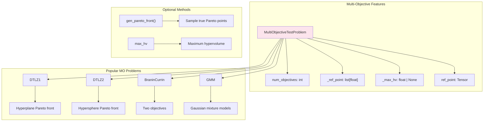
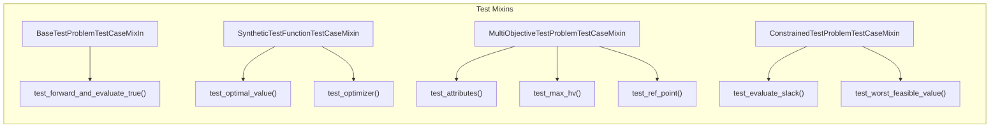
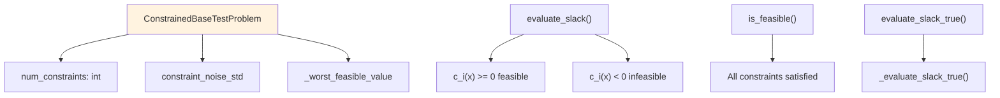

<!-- source: DeepWiki mcp.deepwiki.com · repo pytorch/botorch · page 6.1 Testing Utilities and Test Functions · fetched 2026-10-21 -->

# Testing Utilities and Test Functions

<details>
<summary>Relevant source files</summary>

The following files were used as context for generating this wiki page:

- [botorch/test_functions/__init__.py](botorch/test_functions/__init__.py)
- [botorch/test_functions/base.py](botorch/test_functions/base.py)
- [botorch/test_functions/multi_fidelity.py](botorch/test_functions/multi_fidelity.py)
- [botorch/test_functions/multi_objective.py](botorch/test_functions/multi_objective.py)
- [botorch/test_functions/multi_objective_multi_fidelity.py](botorch/test_functions/multi_objective_multi_fidelity.py)
- [botorch/test_functions/sensitivity_analysis.py](botorch/test_functions/sensitivity_analysis.py)
- [botorch/test_functions/synthetic.py](botorch/test_functions/synthetic.py)
- [botorch/utils/testing.py](botorch/utils/testing.py)
- [botorch/utils/torch.py](botorch/utils/torch.py)
- [test/test_functions/test_base.py](test/test_functions/test_base.py)
- [test/test_functions/test_multi_objective.py](test/test_functions/test_multi_objective.py)
- [test/test_functions/test_sensitivity_analysis.py](test/test_functions/test_sensitivity_analysis.py)
- [test/test_functions/test_synthetic.py](test/test_functions/test_synthetic.py)

</details>


This document covers BoTorch's comprehensive testing infrastructure, including base test classes, mock objects, synthetic test functions, and testing utilities used throughout the codebase. The testing system provides both unit testing infrastructure and a rich collection of benchmark optimization problems for evaluating Bayesian optimization algorithms.

For information about CI/CD workflows and documentation systems, see [Development and Documentation](#6.2).

## Testing Infrastructure Overview

BoTorch's testing infrastructure is built around several key components that work together to provide comprehensive test coverage and benchmarking capabilities.



**Testing Infrastructure Architecture**
Sources: [botorch/utils/testing.py:99-189](), [botorch/test_functions/base.py:117-228]()

## Core Testing Utilities

### BotorchTestCase

The `BotorchTestCase` class serves as the foundation for all BoTorch tests, extending Python's standard `TestCase` with BoTorch-specific functionality.



**BotorchTestCase Structure and Features**
Sources: [botorch/utils/testing.py:99-189]()

Key features of `BotorchTestCase`:
- Sets default device to CPU for consistent testing
- Provides `assertAllClose()` method for tensor comparisons using `torch.testing.assert_close`
- Automatically suppresses common input warnings during testing
- Manages warning state with `warnings.resetwarnings()`

### Mock Objects

BoTorch provides several mock objects for testing components without dependencies on complex model implementations.

| Mock Class | Purpose | Key Methods |
|------------|---------|-------------|
| `MockPosterior` | Simulates posterior with deterministic outputs | `mean`, `variance`, `rsample()` |
| `MockModel` | Mock model implementation | `posterior()`, `num_outputs`, `batch_shape` |
| `MockAcquisitionFunction` | Simple acquisition function for testing | `__call__()`, `set_X_pending()` |

**MockPosterior Implementation**:
The `MockPosterior` class allows deterministic testing by providing pre-specified mean, variance, and samples.



**MockPosterior Architecture**
Sources: [botorch/utils/testing.py:477-598]()

### Testing Utility Functions

Several utility functions support test data generation and validation:

- `get_random_data()`: Generates synthetic training data with specified batch shapes and dimensions
- `get_test_posterior()`: Creates `GPyTorchPosterior` objects for testing with configurable properties
- `sample_random_feasible()`: Samples feasible points for constrained test problems
- `skip_if_import_error()`: Decorator for gracefully handling missing optional dependencies

Sources: [botorch/utils/testing.py:708-798]()

## Test Function Hierarchy

BoTorch's test functions follow a well-defined class hierarchy that supports various types of optimization problems.



**Test Function Class Hierarchy**
Sources: [botorch/test_functions/base.py:117-435](), [botorch/test_functions/synthetic.py:68-133]()

### BaseTestProblem

The `BaseTestProblem` class provides core functionality for all test functions:

**Key Properties**:
- `dim`: Problem dimensionality
- `bounds`: Parameter bounds as a `2 x dim` tensor
- `continuous_inds`, `discrete_inds`, `categorical_inds`: Parameter type specifications
- `noise_std`: Optional observation noise
- `negate`: Flag for converting between minimization/maximization

**Essential Methods**:
- `forward()`: Evaluates function with optional noise
- `evaluate_true()`: Noise-free evaluation with input validation
- `_evaluate_true()`: Abstract method for actual function implementation

Sources: [botorch/test_functions/base.py:117-228]()

## Synthetic Test Functions

The synthetic test functions in BoTorch provide a comprehensive suite of benchmark optimization problems with known properties.

### Popular Synthetic Functions

| Function | Dimension | Domain | Global Minimum | Key Features |
|----------|-----------|---------|----------------|--------------|
| `Ackley` | Configurable | `[-32.768, 32.768]^d` | 0.0 at origin | Many local minima |
| `Branin` | 2 | `[-5,10] x [0,15]` | 0.397887 | Three global minima |
| `Hartmann` | 3, 4, or 6 | `[0,1]^d` | -3.32237 (6D) | High-dimensional |
| `Rosenbrock` | Configurable | `[-5,10]^d` | 0.0 at `(1,...,1)` | Narrow valley |

### Function Implementation Pattern

All synthetic functions follow a consistent implementation pattern:



**Synthetic Function Implementation Flow**
Sources: [botorch/test_functions/synthetic.py:68-133]()

### Example: Branin Function

The Branin function demonstrates typical synthetic function implementation:

**Mathematical Definition**: `B(x) = (x_2 - b*x_1^2 + c*x_1 - r)^2 + 10(1-t)cos(x_1) + 10`

**Implementation Details**:
- Constants: `b = 5.1/(4π²)`, `c = 5/π`, `r = 6`, `t = 1/(8π)`
- Three global minima at known locations
- Domain: `[-5, 10] × [0, 15]`

Sources: [botorch/test_functions/synthetic.py:197-225]()

## Multi-Objective Test Problems

Multi-objective test functions extend the base framework to support multiple conflicting objectives.



**Multi-Objective Test Problem Structure**
Sources: [botorch/test_functions/base.py:338-435](), [botorch/test_functions/multi_objective.py:94-154]()

### DTLZ Test Suite

The DTLZ (Deb-Thiele-Laumanns-Zitzler) problems are widely used multi-objective benchmarks:

- **DTLZ1**: Linear Pareto front on hyperplane `∑f_i = 0.5`
- **DTLZ2**: Concave Pareto front on unit hypersphere
- **DTLZ3**: Similar to DTLZ2 but with many local fronts
- **DTLZ7**: Disconnected Pareto regions

Each DTLZ problem supports configurable dimensionality and number of objectives with `dim > num_objectives`.

Sources: [botorch/test_functions/multi_objective.py:336-599]()

## Testing Mixins and Patterns

BoTorch uses mixin classes to provide reusable testing patterns for different types of test problems.

### Key Testing Mixins



**Testing Mixin Structure**
Sources: [botorch/utils/testing.py:191-432]()

### Testing Pattern Example

A typical test class combines `BotorchTestCase` with relevant mixins:

```python
class TestBranin(
    BotorchTestCase, 
    BaseTestProblemTestCaseMixIn, 
    SyntheticTestFunctionTestCaseMixin
):
    functions = [Branin(), Branin(negate=True), Branin(noise_std=0.1)]
```

Each mixin automatically tests appropriate functionality across all functions in the `functions` list, including:
- Forward evaluation correctness
- Boundary condition handling  
- Optimal value computation
- Gradient checking at optima
- Device and dtype compatibility

Sources: [test/test_functions/test_synthetic.py:164-167]()

## Constraint Handling in Test Functions

Constrained test problems extend the base framework with inequality constraints of the form `c_i(x) ≥ 0`.

### ConstrainedBaseTestProblem Features



**Constrained Test Problem Architecture**
Sources: [botorch/test_functions/base.py:230-336]()

Constrained problems support:
- Constraint noise via `constraint_noise_std`
- Feasibility checking with `is_feasible()`
- Worst-case feasible values for performance evaluation
- Both noise-free and noisy constraint evaluation

Sources: [botorch/test_functions/base.py:244-335]()

---

