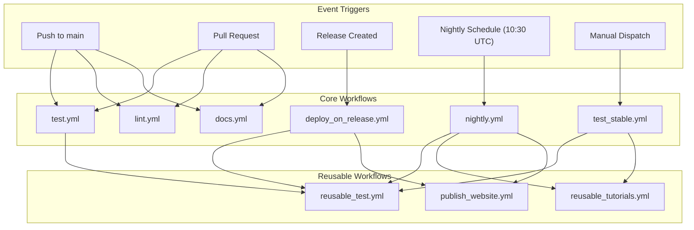
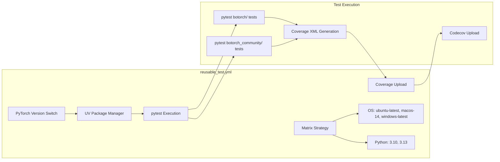
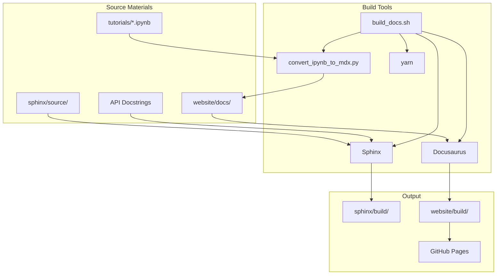
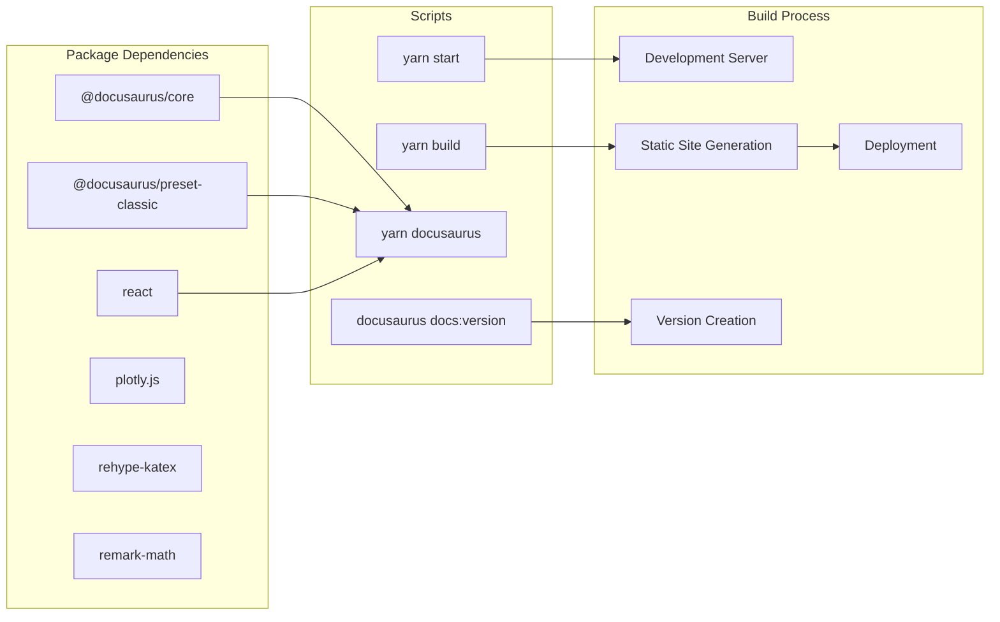
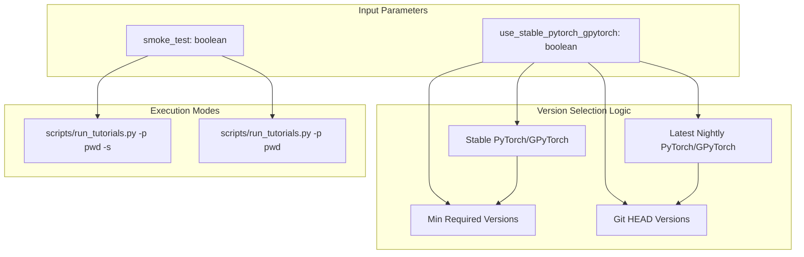
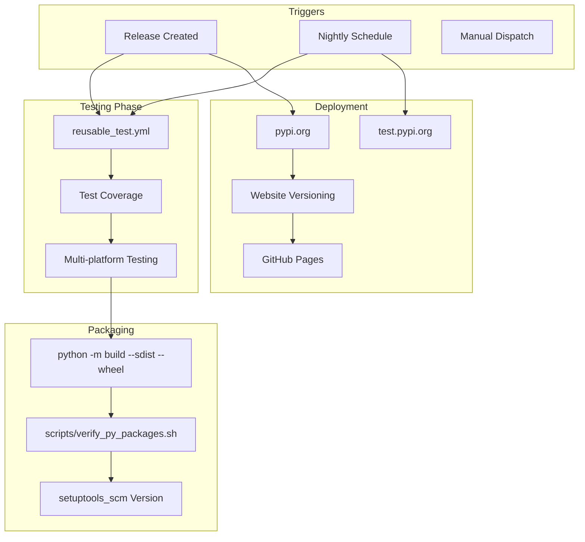
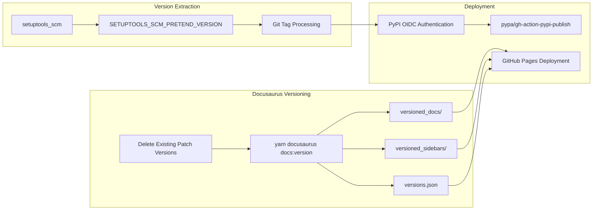
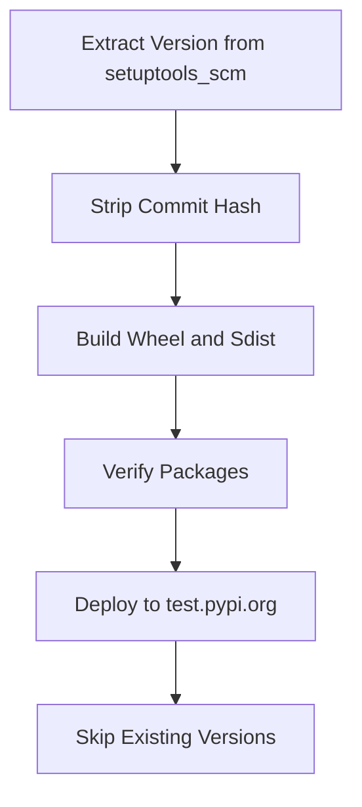
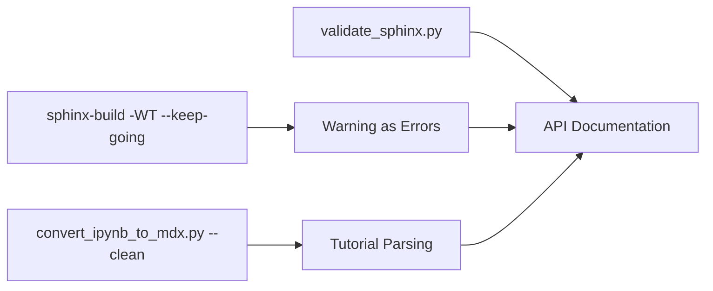

<!-- source: DeepWiki mcp.deepwiki.com · repo pytorch/botorch · page 6.2 Development and Documentation · fetched 2026-10-21 -->

# Development and Documentation

Relevant source files

The following files were used as context for generating this wiki page:

- [.github/workflows/deploy_on_release.yml](.github/workflows/deploy_on_release.yml)
- [.github/workflows/docs.yml](.github/workflows/docs.yml)
- [.github/workflows/lint.yml](.github/workflows/lint.yml)
- [.github/workflows/nightly.yml](.github/workflows/nightly.yml)
- [.github/workflows/publish_website.yml](.github/workflows/publish_website.yml)
- [.github/workflows/reusable_test.yml](.github/workflows/reusable_test.yml)
- [.github/workflows/reusable_tutorials.yml](.github/workflows/reusable_tutorials.yml)
- [.github/workflows/test.yml](.github/workflows/test.yml)
- [.github/workflows/test_stable.yml](.github/workflows/test_stable.yml)
- [scripts/build_docs.sh](scripts/build_docs.sh)
- [website/package.json](website/package.json)
- [website/static/.nojekyll](website/static/.nojekyll)
- [website/yarn.lock](website/yarn.lock)

This document covers BoTorch's development infrastructure, continuous integration/continuous deployment (CI/CD) pipelines, documentation build system, and release processes. It focuses on the GitHub Actions workflows, documentation toolchain, tutorial execution system, and automated testing infrastructure that support BoTorch development.

For information about testing utilities and test functions used within the codebase, see [Testing Utilities and Test Functions](#6.1).

## CI/CD Pipeline Architecture

BoTorch uses a comprehensive GitHub Actions-based CI/CD system with multiple interconnected workflows that handle testing, documentation, tutorials, and releases.

### Primary CI/CD Workflows

**Sources:** [.github/workflows/test.yml:1-18](), [.github/workflows/nightly.yml:1-77](), [.github/workflows/deploy_on_release.yml:1-62](), [.github/workflows/test_stable.yml:1-66](), [.github/workflows/lint.yml:1-32](), [.github/workflows/docs.yml:1-44](), [.github/workflows/reusable_test.yml:1-59](), [.github/workflows/reusable_tutorials.yml:1-67](), [.github/workflows/publish_website.yml:1-117]()

### Testing Infrastructure Workflow

**Sources:** [.github/workflows/reusable_test.yml:16-59]()

## Documentation Build System

BoTorch uses a dual documentation system combining Sphinx for API documentation and Docusaurus for the main website, with automated tutorial conversion.

### Documentation Architecture

**Sources:** [scripts/build_docs.sh:1-65](), [.github/workflows/docs.yml:34-44](), [website/package.json:1-33]()

### Build Script Workflow

The `build_docs.sh` script orchestrates the entire documentation build process:

| Flag | Purpose | Action |
|------|---------|---------|
| `-b` | Build static | Creates production build instead of dev server |
| `-o` | Only Docusaurus | Skips Sphinx and tutorial conversion |
| `-h` | Help | Shows usage information |

**Sources:** [scripts/build_docs.sh:9-18](), [scripts/build_docs.sh:23-38]()

### Docusaurus Configuration

**Sources:** [website/package.json:2-12](), [website/package.json:18-31]()

## Tutorial Execution System

BoTorch provides automated tutorial execution and validation through the `reusable_tutorials.yml` workflow.

### Tutorial Workflow Parameters

**Sources:** [.github/workflows/reusable_tutorials.yml:6-22](), [.github/workflows/reusable_tutorials.yml:41-66]()

### Tutorial Version Management

The tutorial system supports testing against different dependency versions:

| Scenario | PyTorch | GPyTorch | linear_operator | Use Case |
|----------|---------|----------|-----------------|----------|
| Nightly | `--pre torch` from nightly index | Git HEAD | Git HEAD | Latest features |
| Stable | Min version from `pyproject.toml` | Min version from `pyproject.toml` | Min version from `pyproject.toml` | Compatibility testing |

**Sources:** [.github/workflows/reusable_tutorials.yml:41-55]()

## Release and Deployment Process

BoTorch implements automated release processes for both test and production PyPI deployments with coordinated website updates.

### Release Pipeline

**Sources:** [.github/workflows/deploy_on_release.yml:18-51](), [.github/workflows/nightly.yml:18-61]()

### Version Management Process

**Sources:** [.github/workflows/nightly.yml:43-48](), [.github/workflows/publish_website.yml:63-93](), [.github/workflows/deploy_on_release.yml:22-50]()

## Nightly Automation

The nightly workflow provides comprehensive automated testing and deployment validation.

### Nightly Workflow Components

| Job | Purpose | Dependencies |
|-----|---------|--------------|
| `tests-and-coverage-nightly` | Test with latest PyTorch/GPyTorch | `reusable_test.yml` |
| `package-test-deploy-pypi` | Test PyPI packaging and deploy to test.pypi.org | None |
| `publish-latest-website` | Update documentation website | Both previous jobs |
| `run_tutorials` | Execute tutorials without smoke test | `reusable_tutorials.yml` |

**Sources:** [.github/workflows/nightly.yml:10-77]()

### PyPI Test Deployment Process

The nightly workflow includes automated test deployment to validate the packaging process:

**Sources:** [.github/workflows/nightly.yml:43-60]()

## Documentation Validation

BoTorch includes comprehensive documentation validation to ensure quality and consistency.

### Sphinx Validation Process

**Sources:** [.github/workflows/docs.yml:34-43]()

### Continuous Documentation Testing

The documentation workflow runs on every push and pull request to ensure:

- Sphinx builds without warnings
- Tutorial notebooks are valid and parseable
- API documentation is complete
- Docusaurus configuration is valid

**Sources:** [.github/workflows/docs.yml:3-8](), [.github/workflows/docs.yml:14-43]()