# Page: Overview

# Overview

<details>
<summary>Relevant source files</summary>

The following files were used as context for generating this wiki page:

- [CHANGELOG.md](CHANGELOG.md)
- [README.md](README.md)
- [botorch/__init__.py](botorch/__init__.py)
- [botorch/settings.py](botorch/settings.py)
- [test/test_settings.py](test/test_settings.py)

</details>


## Purpose and Scope

This document provides a comprehensive overview of BoTorch, a library for Bayesian Optimization built on PyTorch. BoTorch serves as a modular, extensible framework for composing Bayesian optimization primitives including probabilistic models, acquisition functions, and optimizers. This overview covers the core architecture, main components, and how they integrate to form complete Bayesian optimization workflows.

For specific implementation details of individual systems, see the following pages:
- For model implementations and fitting procedures, see [Models](#2)
- For input/output preprocessing, see [Transforms](#3) 
- For acquisition function details and construction, see [Acquisition Functions](#4)
- For candidate optimization and constraint handling, see [Optimization](#5)
- For testing infrastructure and development tools, see [Utilities](#6)

## Architecture Overview

BoTorch's architecture centers around a standard Bayesian optimization loop with modular, interchangeable components. The framework provides both low-level primitives for researchers and higher-level convenience functions for practitioners.

### Core Framework Components

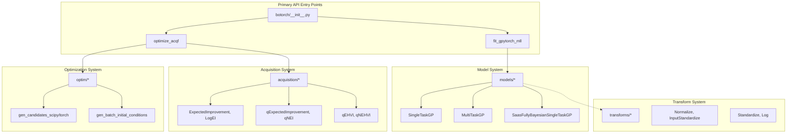

**Sources**: [botorch/__init__.py:9-67](), [README.md:23-38]()

### Bayesian Optimization Workflow

BoTorch implements the standard Bayesian optimization loop through a series of modular steps that can be customized and extended:

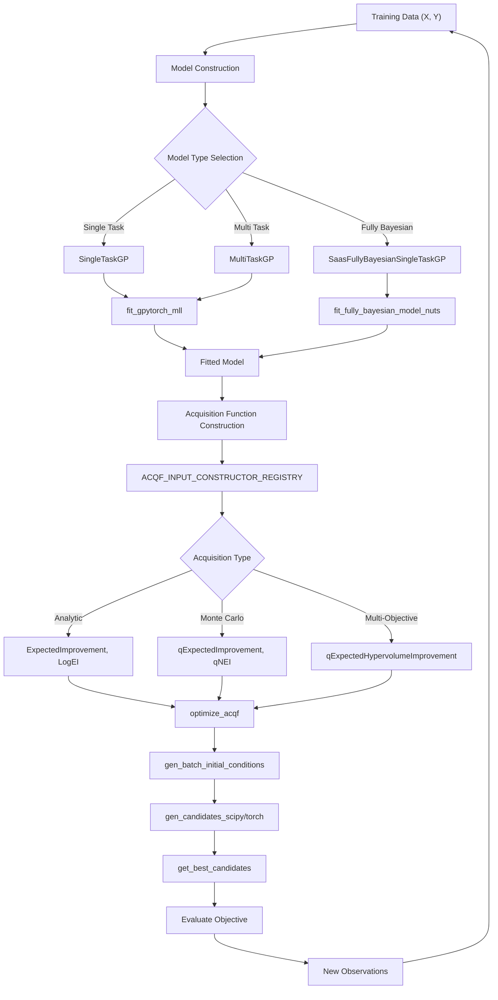

**Sources**: [README.md:128-170](), [botorch/__init__.py:18-24]()

## Core Components

### Models and Model Fitting

BoTorch's model system provides Gaussian Process models with extensive customization through transforms and kernels. The primary entry point for model fitting is `fit_gpytorch_mll`:

| Model Type | Class | Use Case |
|------------|-------|----------|
| Single Task | `SingleTaskGP` | Standard GP regression |
| Multi Task | `MultiTaskGP` | Multi-task learning |
| Fully Bayesian | `SaasFullyBayesianSingleTaskGP` | Uncertainty over hyperparameters |
| Multi Fidelity | `SingleTaskMultiFidelityGP` | Variable fidelity optimization |

The framework automatically applies sensible defaults including dimension-scaled priors and outcome standardization for robust performance across problem dimensions.

**Sources**: [botorch/__init__.py:19](), [README.md:132-153]()

### Acquisition Functions and Input Constructors

BoTorch provides a comprehensive acquisition function ecosystem with automatic construction via a registry pattern:

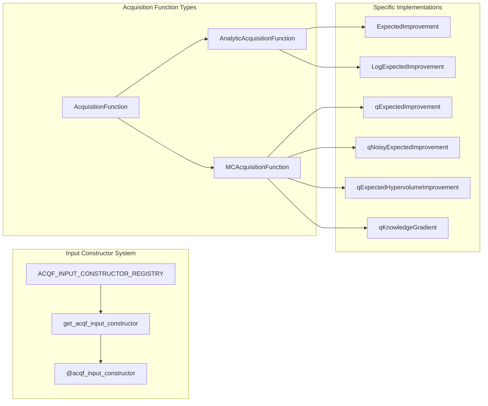

The registry system enables automatic acquisition function construction with appropriate default parameters based on the model and problem characteristics.

**Sources**: [README.md:155-170]()

### Optimization Infrastructure

The optimization system handles candidate generation with support for various constraint types and optimization algorithms:

| Function | Purpose | Constraints Supported |
|----------|---------|---------------------|
| `optimize_acqf` | Main optimization entry point | Linear, nonlinear, mixed |
| `gen_candidates_scipy` | SciPy-based optimization | All constraint types |
| `gen_candidates_torch` | PyTorch-based optimization | Differentiable constraints |
| `gen_batch_initial_conditions` | Smart initialization | Box bounds |

**Sources**: [botorch/__init__.py:20-24](), [README.md:162-170]()

## Configuration and Settings

BoTorch provides global configuration through the `settings` module for controlling framework behavior:

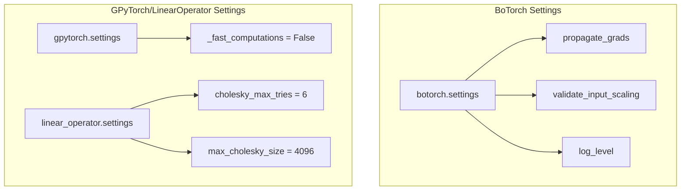

BoTorch automatically configures GPyTorch and LinearOperator settings for robustness in Bayesian optimization loops, disabling fast approximations that can be numerically unstable.

**Sources**: [botorch/__init__.py:36-49](), [botorch/settings.py:16-97]()

## Integration with PyTorch Ecosystem

BoTorch leverages PyTorch's features extensively:

- **Auto-differentiation**: Enables gradient-based acquisition function optimization
- **GPU Support**: Device-agnostic code for accelerated computation  
- **Dynamic Computation Graphs**: Supports flexible model architectures
- **Reparameterization Trick**: Enables Monte Carlo acquisition functions

The framework integrates with GPyTorch for probabilistic models and supports seamless integration with deep learning architectures.

**Sources**: [README.md:28-38]()

## Target Audience and Usage Patterns

BoTorch is designed as a low-level API for:

- **Researchers**: Implementing new Bayesian optimization algorithms
- **Sophisticated Practitioners**: Customizing optimization workflows
- **Framework Developers**: Building higher-level optimization platforms

For end-users seeking a complete optimization platform, BoTorch recommends using Ax, which provides a higher-level interface while leveraging BoTorch's primitives.

**Sources**: [README.md:41-51]()

---

# Page: Installation and Getting Started

# Installation and Getting Started

<details>
<summary>Relevant source files</summary>

The following files were used as context for generating this wiki page:

- [README.md](README.md)

</details>


This page provides comprehensive instructions for installing BoTorch and running your first Bayesian optimization loop. It covers system requirements, installation methods, and basic usage patterns to help you start using BoTorch for Bayesian optimization.

For more detailed information about BoTorch concepts and components, see [Key Concepts](#1.2).

## System Requirements

BoTorch has the following core dependencies:

| Dependency | Required Version |
|------------|------------------|
| Python | >= 3.10 |
| PyTorch | >= 2.0.1 |
| gpytorch | == 1.14 |
| linear_operator | == 0.6 |
| pyro-ppl | >= 1.8.4 |
| scipy | * |
| multiple-dispatch | * |
| threadpoolctl | * |

*\* No specific version requirement*

Sources: [README.md:56-64](), [requirements.txt:1-10](), [setup.py:13-14]()

## Installation Methods

### Diagram: BoTorch Installation Options

```mermaid
flowchart TD
    Start([Start Installation]) --> ChooseMethod{"Choose Installation Method"}
    
    ChooseMethod -->|"Option 1:\nLatest Release"| PIP["pip install botorch"]
    ChooseMethod -->|"Option 1:\nVia conda-forge"| Conda["conda install botorch -c gpytorch -c conda-forge"]
    
    ChooseMethod -->|"Option 2:\nLatest Main Branch"| DevDeps["Install dependencies first:
    pip install --upgrade git+https://github.com/cornellius-gp/linear_operator.git
    pip install --upgrade git+https://github.com/cornellius-gp/gpytorch.git"]
    
    DevDeps --> DevInstall["Set env variable and install BoTorch:
    export ALLOW_LATEST_GPYTORCH_LINOP=true
    pip install --upgrade git+https://github.com/pytorch/botorch.git"]
    
    ChooseMethod -->|"Option 3:\nFor Contributors"| Clone["git clone https://github.com/pytorch/botorch.git
    cd botorch"]
    
    Clone --> BasicEditable["Option 3a: Basic Editable Install
    pip install -e ."]
    
    Clone --> FullEditable["Option 3b: With Development Dependencies
    export ALLOW_BOTORCH_LATEST=true
    pip install -e \".[dev, tutorials]\""]
    
    PIP --> Complete([Installation Complete])
    Conda --> Complete
    DevInstall --> Complete
    BasicEditable --> Complete
    FullEditable --> Complete
```

Sources: [README.md:66-127]()

### Option 1: Installing the Latest Release

The simplest way to install BoTorch is via `pip`:

```bash
pip install botorch
```

BoTorch is also available via conda-forge:

```bash
conda install botorch -c gpytorch -c conda-forge
```

Note: Official Anaconda packages were discontinued after the 0.12 release, but users can still install from the conda-forge channel.

Sources: [README.md:66-83]()

### Option 2: Installing from Latest Main Branch

For access to bleeding-edge features (which may occasionally contain bugs), install directly from GitHub:

```bash
pip install --upgrade git+https://github.com/cornellius-gp/linear_operator.git
pip install --upgrade git+https://github.com/cornellius-gp/gpytorch.git
export ALLOW_LATEST_GPYTORCH_LINOP=true
pip install --upgrade git+https://github.com/pytorch/botorch.git
```

The `ALLOW_LATEST_GPYTORCH_LINOP` environment variable allows installation with the latest development versions of GPyTorch and LinearOperator.

Sources: [README.md:85-97]()

### Option 3: Editable/Development Install

If you want to contribute to BoTorch, an editable install is recommended:

#### Option 3a: Basic Editable Install

```bash
git clone https://github.com/pytorch/botorch.git
cd botorch
pip install -e .
```

#### Option 3b: Editable Install with Development Dependencies

```bash
git clone https://github.com/pytorch/botorch.git
cd botorch
export ALLOW_BOTORCH_LATEST=true
pip install -e ".[dev, tutorials]"
```

- `dev`: Installs tools necessary for development (testing, linting, docs building)
- `tutorials`: Installs packages necessary for running the tutorial notebooks

Sources: [README.md:99-127](), [setup.py:109-112]()

## BoTorch Dependency Architecture

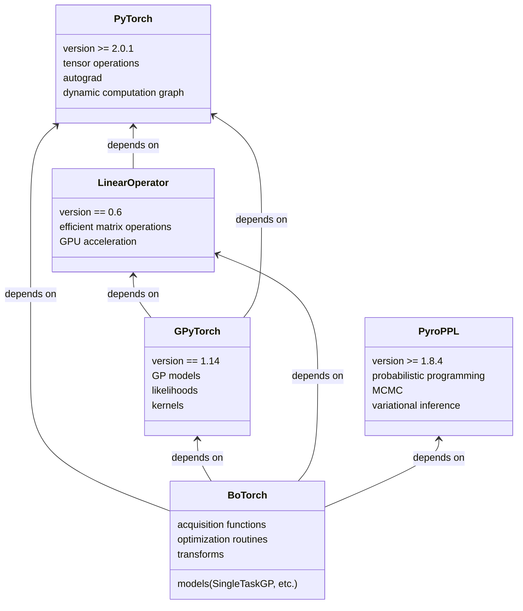

Sources: [requirements.txt:1-10](), [setup.py:60-73]()

## Getting Started with BoTorch

Here's a quick walkthrough of the main components of a Bayesian optimization loop using BoTorch:

### Diagram: Bayesian Optimization Workflow in BoTorch

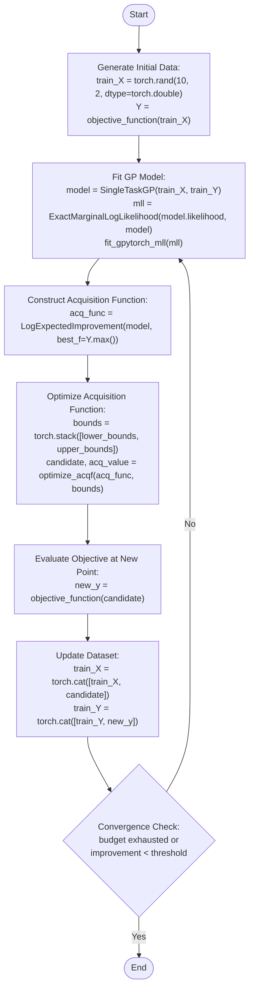

Sources: [README.md:130-174]()

### Step 1: Fit a Gaussian Process Model

```python
import torch
from botorch.models import SingleTaskGP
from botorch.models.transforms import Normalize, Standardize
from botorch.fit import fit_gpytorch_mll
from gpytorch.mlls import ExactMarginalLogLikelihood

# Double precision is highly recommended for GPs
train_X = torch.rand(10, 2, dtype=torch.double) * 2
Y = 1 - (train_X - 0.5).norm(dim=-1, keepdim=True)  # explicit output dimension
Y += 0.1 * torch.rand_like(Y)

gp = SingleTaskGP(
    train_X=train_X,
    train_Y=Y,
    input_transform=Normalize(d=2),
    outcome_transform=Standardize(m=1),
)
mll = ExactMarginalLogLikelihood(gp.likelihood, gp)
fit_gpytorch_mll(mll)
```

In this step, we:
1. Create synthetic training data
2. Initialize a `SingleTaskGP` model with input and outcome transforms
3. Create a marginal log likelihood (MLL) object
4. Optimize the model hyperparameters using `fit_gpytorch_mll`

Sources: [README.md:136-156]()

### Step 2: Construct an Acquisition Function

```python
from botorch.acquisition import LogExpectedImprovement

logEI = LogExpectedImprovement(model=gp, best_f=Y.max())
```

Acquisition functions evaluate how promising each point in the search space is for evaluation. Here we use `LogExpectedImprovement`, a numerically stable variant of Expected Improvement.

Sources: [README.md:158-164]()

### Step 3: Optimize the Acquisition Function

```python
from botorch.optim import optimize_acqf

bounds = torch.stack([torch.zeros(2), torch.ones(2)]).to(torch.double)
candidate, acq_value = optimize_acqf(
    logEI, bounds=bounds, q=1, num_restarts=5, raw_samples=20,
)
```

This step finds the point that maximizes the acquisition function within the specified bounds. The returned `candidate` is the point recommended for the next function evaluation.

Sources: [README.md:166-174]()

## Important Notes

1. **Double Precision**: Double precision (`torch.double`) is highly recommended for Gaussian Processes to ensure numerical stability.

2. **Integration with Ax**: BoTorch is designed to work as a low-level API for [Ax](https://ax.dev), which provides a more user-friendly interface. If you're not actively researching Bayesian optimization algorithms, you might find Ax easier to use.

3. **Target Audience**: The primary audience for hands-on use of BoTorch are researchers and sophisticated practitioners in Bayesian Optimization and AI.

Sources: [README.md:41-51](), [README.md:143-144]()

## Next Steps

After installing BoTorch and understanding the basic workflow, you can:

1. Explore the [Tutorials and Examples](#1.3) to learn more about BoTorch's capabilities
2. Read about [Key Concepts](#1.2) to deepen your understanding of Bayesian optimization with BoTorch
3. Explore specific [Models](#2) and [Acquisition Functions](#4) documentation to learn about available options

---

# Page: Key Concepts

# Key Concepts

<details>
<summary>Relevant source files</summary>

The following files were used as context for generating this wiki page:

- [CHANGELOG.md](CHANGELOG.md)
- [README.md](README.md)
- [botorch/__init__.py](botorch/__init__.py)
- [botorch/settings.py](botorch/settings.py)
- [test/test_settings.py](test/test_settings.py)

</details>


This document explains the fundamental concepts of Bayesian optimization as implemented in BoTorch, covering the core abstractions, components, and workflow that form the foundation of the library. For installation instructions and your first optimization loop, see [Installation and Getting Started](#1.1). For hands-on examples, see [Tutorials and Examples](#1.3).

## Bayesian Optimization Fundamentals

Bayesian optimization is a sequential design strategy for optimizing expensive-to-evaluate black-box functions. BoTorch implements this through a modular framework with three core components that work together in an iterative loop:

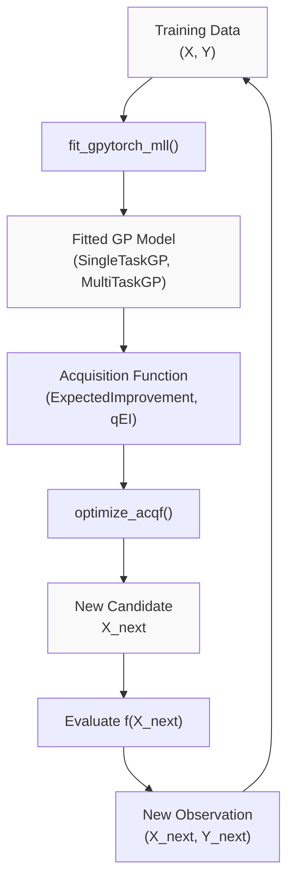

Sources: [README.md:128-171](), [botorch/__init__.py:19-24]()

## Core Components

### Models: Probabilistic Surrogates

BoTorch uses Gaussian Process (GP) models as probabilistic surrogates for the unknown objective function. These models provide both mean predictions and uncertainty estimates that are crucial for acquisition function evaluation.

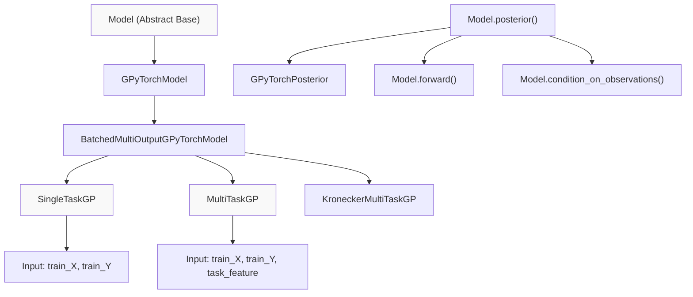

The primary model classes are:
- `SingleTaskGP`: Standard GP for single-output regression
- `MultiTaskGP`: Multi-task learning with shared information across tasks  
- `ModelListGP`: Independent models for different outputs
- Fully Bayesian models like `SaasFullyBayesianSingleTaskGP`

Sources: [README.md:132-153](), Architecture diagrams

### Acquisition Functions: Balancing Exploration and Exploitation

Acquisition functions use the model's posterior to determine the next point to evaluate. They balance exploration (high uncertainty) with exploitation (high predicted value).

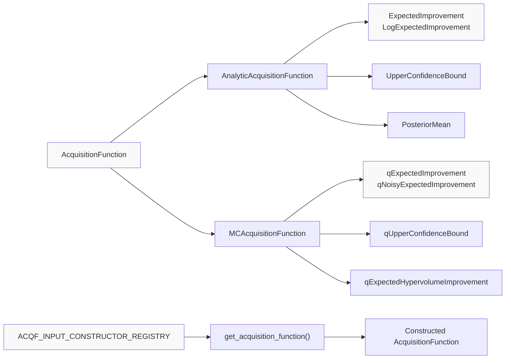

Key acquisition function families:
- **Analytic**: Closed-form solutions for single-point optimization (`ExpectedImprovement`, `LogExpectedImprovement`)
- **Monte Carlo**: Batch optimization using sampling (`qExpectedImprovement`, `qNoisyExpectedImprovement`)  
- **Multi-objective**: For multiple competing objectives (`qExpectedHypervolumeImprovement`)
- **Knowledge Gradient**: Information-theoretic approach (`qKnowledgeGradient`)

Sources: [README.md:155-160](), Architecture diagrams

### Optimization: Finding Optimal Candidates

The `optimize_acqf` function finds the point that maximizes the acquisition function, typically the most computationally expensive step in the BO loop.

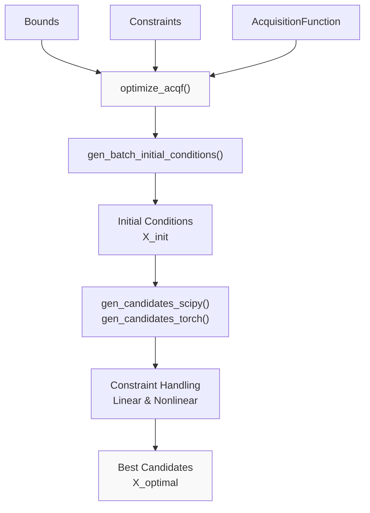

The optimization process involves:
- **Initial conditions**: Smart initialization using `gen_batch_initial_conditions`
- **Candidate generation**: Scipy/PyTorch-based optimizers via `gen_candidates_scipy`/`gen_candidates_torch`
- **Constraint handling**: Support for linear, nonlinear, and mixed constraints
- **Multi-start optimization**: Multiple restarts for global optimization

Sources: [README.md:162-170](), [botorch/__init__.py:20-24]()

### Transforms: Data Preprocessing

Transforms normalize inputs and standardize outputs to improve numerical stability and model performance.

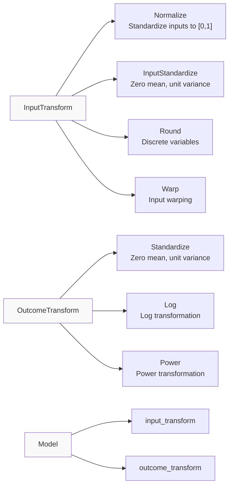

Transform types:
- **Input transforms**: Applied to input data before model training/prediction
- **Outcome transforms**: Applied to target values, automatically inverted for predictions
- **Chaining**: Multiple transforms can be composed using `ChainedInputTransform`

Sources: [README.md:136-150](), Architecture diagrams

## Main API Workflow

The core BoTorch workflow involves two primary functions that encapsulate the Bayesian optimization loop:

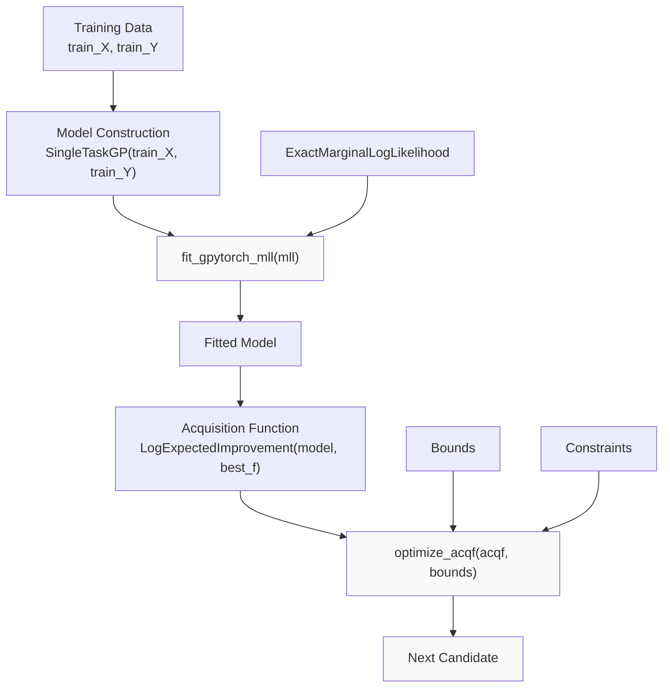

### Model Fitting with `fit_gpytorch_mll`

The `fit_gpytorch_mll` function handles GP model training with robust error handling and multiple optimization attempts:

```python
# From README.md example
mll = ExactMarginalLogLikelihood(gp.likelihood, gp)
fit_gpytorch_mll(mll)
```

Key features:
- Multiple-dispatch on model types for custom fitting routines
- Automatic retry on optimization failures  
- Restoration of module states on failed attempts
- Support for fully Bayesian models via `fit_fully_bayesian_model_nuts`

### Acquisition Optimization with `optimize_acqf`

The `optimize_acqf` function maximizes acquisition functions with sophisticated optimization strategies:

```python
# From README.md example  
candidate, acq_value = optimize_acqf(
    logEI, bounds=bounds, q=1, num_restarts=5, raw_samples=20,
)
```

Key parameters:
- `q`: Batch size for joint optimization
- `num_restarts`: Number of optimization restarts
- `raw_samples`: Initial candidate pool size
- Support for linear/nonlinear constraints

Sources: [README.md:132-171](), [botorch/__init__.py:19-24]()

## Configuration and Settings

BoTorch provides global settings to control numerical behavior and optimization strategies:

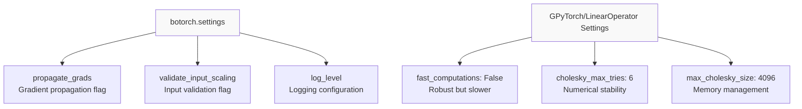

Default configurations prioritize numerical stability over speed:
- **Fast computations disabled**: BoTorch disables GPyTorch's approximate methods for robustness
- **Input validation**: Automatic checking of data normalization and standardization
- **Increased retry attempts**: More Cholesky decomposition attempts for difficult problems

Key settings classes:
- `propagate_grads`: Context manager for gradient propagation through training data
- `validate_input_scaling`: Ensures proper input/output scaling
- `log_level`: Controls verbosity of BoTorch operations

Sources: [botorch/settings.py:16-97](), [botorch/__init__.py:36-49](), [test/test_settings.py:26-33]()

---

# Page: Tutorials and Examples

# Tutorials and Examples

<details>
<summary>Relevant source files</summary>

The following files were used as context for generating this wiki page:

- [scripts/run_tutorials.py](scripts/run_tutorials.py)
- [website/tutorials.json](website/tutorials.json)

</details>


This page documents BoTorch's comprehensive tutorial system, including available tutorials organized by category, the tutorial execution infrastructure, and how to run tutorials for learning or testing purposes. For information about the core Bayesian optimization concepts demonstrated in these tutorials, see [Key Concepts](#1.2). For installation instructions needed before running tutorials, see [Installation and Getting Started](#1.1).

## Tutorial Categories and Structure

BoTorch provides over 35 tutorials organized into four main categories, each serving different learning objectives and use cases.

### Tutorial Organization

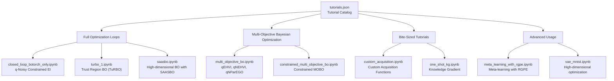

Sources: [website/tutorials.json:1-158]()

### Category Breakdown

| Category | Tutorial Count | Purpose |
|----------|----------------|---------|
| **Full Optimization Loops** | 13 | Complete end-to-end Bayesian optimization workflows demonstrating real optimization scenarios |
| **Multi-Objective Bayesian Optimization** | 4 | Specialized tutorials for optimizing multiple competing objectives simultaneously |
| **Bite-Sized Tutorials** | 17 | Focused tutorials covering specific components, techniques, or use cases |
| **Advanced Usage** | 6 | Complex scenarios including meta-learning, high-dimensional optimization, and composite methods |

Sources: [website/tutorials.json:2-157]()

## Tutorial Execution System

BoTorch implements a robust tutorial execution system that supports both learning and automated testing workflows.

### Execution Architecture

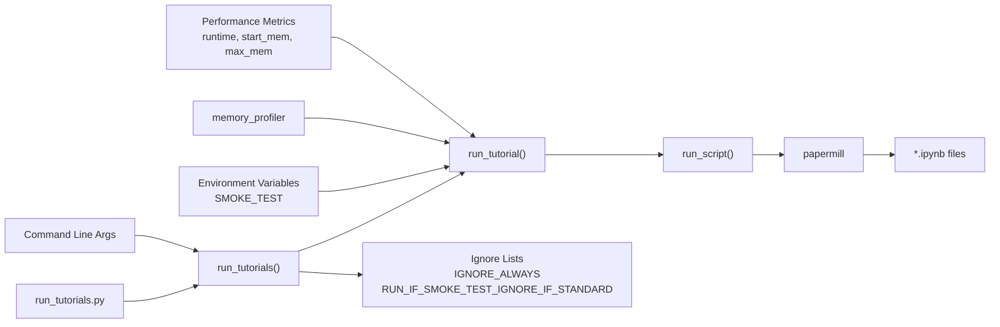

Sources: [scripts/run_tutorials.py:24-84]()

### Execution Modes

The tutorial system supports two primary execution modes:

| Mode | Timeout | Purpose | Environment |
|------|---------|---------|-------------|
| **Standard Mode** | 30 minutes | Complete tutorial execution with full functionality | Default environment |
| **Smoke Test Mode** | 5 minutes | Fast validation to ensure tutorials execute without errors | `SMOKE_TEST=True` |

Sources: [scripts/run_tutorials.py:46](), [scripts/run_tutorials.py:49]()

### Performance Monitoring

Each tutorial execution captures comprehensive performance metrics:

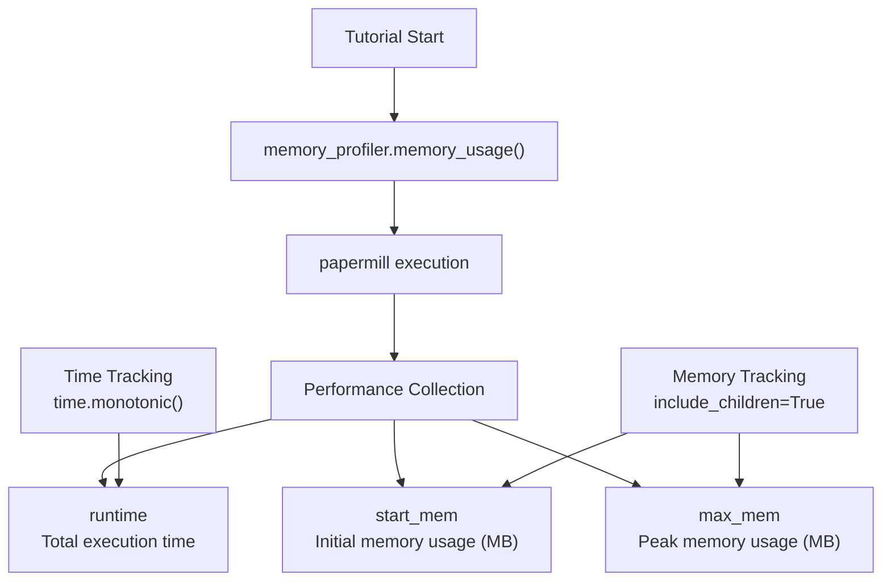

Sources: [scripts/run_tutorials.py:47-82]()

## Running Tutorials

### Command Line Interface

The tutorial system provides a comprehensive command-line interface for running tutorials:

```bash
# Run all tutorials in standard mode
python scripts/run_tutorials.py -p /path/to/botorch

# Run in smoke test mode for fast validation
python scripts/run_tutorials.py -p /path/to/botorch --smoke

# Run a specific tutorial
python scripts/run_tutorials.py -p /path/to/botorch --name "custom_acquisition.ipynb"

# Include normally ignored tutorials
python scripts/run_tutorials.py -p /path/to/botorch --include-ignored
```

Sources: [scripts/run_tutorials.py:136-154]()

### Tutorial Discovery and Filtering

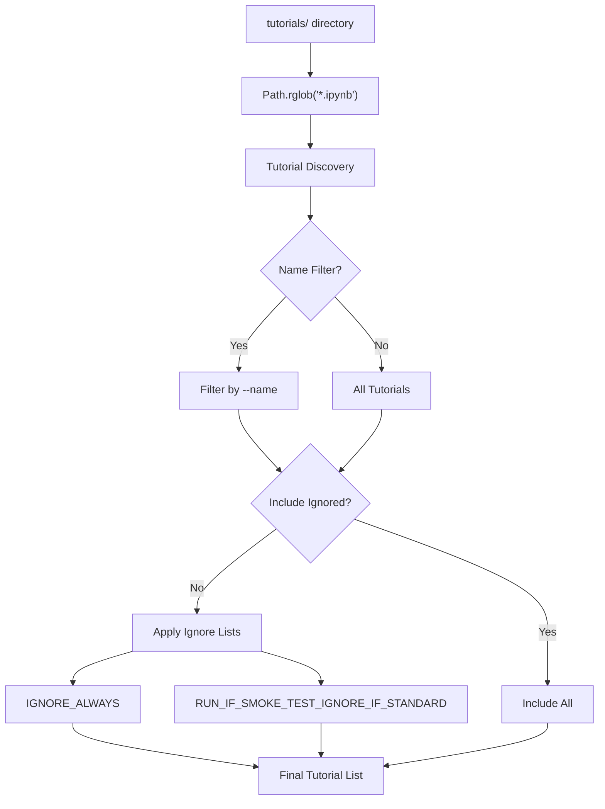

Sources: [scripts/run_tutorials.py:100-116]()

### Ignore Lists and Special Handling

The system maintains two ignore lists for tutorial management:

- **`IGNORE_ALWAYS`**: Tutorials excluded from both smoke tests and standard runs
- **`RUN_IF_SMOKE_TEST_IGNORE_IF_STANDARD`**: Tutorials that run only in smoke test mode (contains `robot.ipynb`)

Sources: [scripts/run_tutorials.py:20-21]()

## Tutorial Content Categories

### Full Optimization Loops

These tutorials demonstrate complete Bayesian optimization workflows:

**Key Tutorials:**
- `closed_loop_botorch_only.ipynb`: q-Noisy Constrained Expected Improvement
- `turbo_1.ipynb`: Trust Region Bayesian Optimization (TuRBO)  
- `saasbo.ipynb`: High-dimensional Bayesian optimization with SAASBO
- `cost_aware_bayesian_optimization.ipynb`: Cost-aware optimization strategies

Sources: [website/tutorials.json:2-54]()

### Multi-Objective Tutorials

Specialized tutorials for multi-objective optimization scenarios:

**Key Tutorials:**
- `multi_objective_bo.ipynb`: qEHVI, qNEHVI, and qNParEGO implementations
- `constrained_multi_objective_bo.ipynb`: Constrained multi-objective optimization
- `robust_multi_objective_bo.ipynb`: Robust optimization under input noise

Sources: [website/tutorials.json:56-72]()

### Bite-Sized Tutorials

Focused tutorials covering specific components and techniques:

**Key Tutorials:**
- `custom_acquisition.ipynb`: Implementing custom acquisition functions
- `one_shot_kg.ipynb`: Knowledge Gradient acquisition function
- `max_value_entropy.ipynb`: Max-value entropy search
- `batch_mode_cross_validation.ipynb`: Fast cross-validation using batch evaluation

Sources: [website/tutorials.json:74-131]()

### Advanced Usage

Complex scenarios and specialized techniques:

**Key Tutorials:**
- `meta_learning_with_rgpe.ipynb`: Meta-learning with Ranked Gaussian Process Ensembles
- `vae_mnist.ipynb`: High-dimensional optimization with Variational Autoencoders
- `multi_fidelity_bo.ipynb`: Multi-fidelity optimization using Knowledge Gradient

Sources: [website/tutorials.json:132-157]()

## Error Handling and Reporting

### Error Detection and Reporting

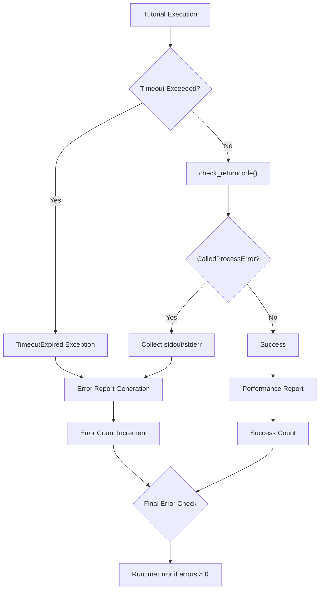

Sources: [scripts/run_tutorials.py:56-75](), [scripts/run_tutorials.py:129-132]()

### Performance Reporting Format

Successful tutorial runs generate standardized performance reports:

```
Running tutorial {tutorial.name} took {runtime:.2f} seconds. 
Memory usage started at {start_mem} MB and the maximum was {max_mem} MB.
```

Sources: [scripts/run_tutorials.py:122-127]()

## Integration with Development Workflow

The tutorial system integrates with BoTorch's broader development and testing infrastructure:

**Testing Integration:**
- Smoke tests provide fast validation during development
- Full tutorial runs ensure comprehensive functionality testing
- Performance monitoring helps identify regressions

**Documentation Integration:**
- Tutorials serve as both learning materials and functional tests
- Tutorial execution validates that documentation examples remain current
- Performance metrics help optimize tutorial content for user experience

Sources: [scripts/run_tutorials.py:86-133]()

---

# Page: Models

# Models

<details>
<summary>Relevant source files</summary>

The following files were used as context for generating this wiki page:

- [botorch/models/gp_regression.py](botorch/models/gp_regression.py)
- [botorch/models/gpytorch.py](botorch/models/gpytorch.py)
- [botorch/models/model.py](botorch/models/model.py)
- [botorch/models/model_list_gp_regression.py](botorch/models/model_list_gp_regression.py)
- [test/models/test_gp_regression.py](test/models/test_gp_regression.py)
- [test/models/test_gpytorch.py](test/models/test_gpytorch.py)
- [test/models/test_model_list_gp_regression.py](test/models/test_model_list_gp_regression.py)

</details>


This page documents BoTorch's model infrastructure, covering the abstract base classes, concrete Gaussian Process implementations, and supporting components for Bayesian optimization. Models in BoTorch represent probabilistic surrogate functions that learn from observed data and provide posterior distributions over unobserved points.

For acquisition functions that use these models, see [Acquisition Functions](#4). For model fitting procedures, see [Model Fitting](#2.5). For input and outcome transforms applied to models, see [Transforms](#3).

## Model Architecture Overview

BoTorch's model system is built on a hierarchical architecture that integrates with GPyTorch for Gaussian Process functionality while providing additional abstractions for Bayesian optimization workflows.

### Core Model Hierarchy

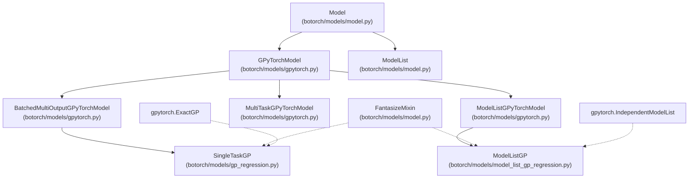

**Sources:** [botorch/models/model.py:46-689](), [botorch/models/gpytorch.py:58-864](), [botorch/models/gp_regression.py:57-243](), [botorch/models/model_list_gp_regression.py:24-140]()

### Key Model Interfaces

Every BoTorch model must implement the core `Model` interface, which defines essential methods for posterior computation and output specification:

| Method | Purpose | Return Type |
|--------|---------|-------------|
| `posterior(X, ...)` | Compute predictive posterior at points X | `Posterior` |
| `batch_shape` | Get batch shape from I/O perspective | `torch.Size` |
| `num_outputs` | Get number of model outputs | `int` |
| `subset_output(idcs)` | Create model subset to specific outputs | `Model` |
| `condition_on_observations(X, Y)` | Create fantasy model with new data | `Model` |

**Sources:** [botorch/models/model.py:80-171]()

## Core GP Models

### SingleTaskGP

`SingleTaskGP` is the primary single-task Gaussian Process implementation, designed for independent outputs with shared training inputs. It inherits from both `BatchedMultiOutputGPyTorchModel` and GPyTorch's `ExactGP`.

```mermaid
graph LR
    TrainingData["train_X, train_Y<br/>(training data)"] --> InputTransform["input_transform<br/>(optional preprocessing)"]
    InputTransform --> OutcomeTransform["outcome_transform<br/>(default: Standardize)"]
    OutcomeTransform --> GPComponents["GP Components"]
    
    subgraph GPComponents["GP Components"]
        MeanModule["mean_module<br/>(ConstantMean)"]
        CovarModule["covar_module<br/>(RBF with priors)"]
        Likelihood["likelihood<br/>(Gaussian/FixedNoise)"]
    end
    
    GPComponents --> SingleTaskGP["SingleTaskGP<br/>(trained model)"]
    SingleTaskGP --> Posterior["posterior(X)<br/>(GPyTorchPosterior)"]
```

Key constructor parameters:
- `train_X`: Training inputs with shape `batch_shape x n x d`
- `train_Y`: Training outputs with shape `batch_shape x n x m`  
- `train_Yvar`: Optional observation noise with same shape as `train_Y`
- `outcome_transform`: Defaults to `Standardize` for zero mean, unit variance
- `input_transform`: Optional input preprocessing (no default)

**Sources:** [botorch/models/gp_regression.py:112-211]()

### Model Posterior Computation

The `posterior()` method is central to all BoTorch models. For GP models, it computes the predictive distribution:

```mermaid
sequenceDiagram
    participant Client
    participant Model as "SingleTaskGP"
    participant Transform as "input_transform"
    participant GP as "GPyTorch ExactGP"
    participant Posterior as "GPyTorchPosterior"
    
    Client->>Model: posterior(X, observation_noise=False)
    Model->>Model: eval()
    Model->>Transform: transform_inputs(X)
    Transform-->>Model: transformed_X
    Model->>GP: self(transformed_X)
    GP-->>Model: MultivariateNormal
    Model->>Posterior: GPyTorchPosterior(mvn)
    Model->>Model: outcome_transform.untransform_posterior()
    Posterior-->>Client: posterior distribution
```

**Sources:** [botorch/models/gpytorch.py:156-204](), [botorch/models/gp_regression.py:237-242]()

## Multi-Output Model Approaches

BoTorch provides two primary strategies for multi-output modeling: batched approaches for independent outputs and model lists for heterogeneous outputs.

### BatchedMultiOutputGPyTorchModel

For independent outputs sharing the same training data, `BatchedMultiOutputGPyTorchModel` uses internal batching to efficiently model multiple outputs:

```mermaid
graph TD
    TrainData["train_X: n x d<br/>train_Y: n x m"] --> Transform["_transform_tensor_args()"]
    Transform --> BatchedData["Batched Representation"]
    
    subgraph BatchedData["Internal Batching"]
        BatchX["train_X: m x n x d<br/>(output dimension becomes batch)"]
        BatchY["train_Y: m x n<br/>(outputs processed independently)"]
    end
    
    BatchedData --> GPBatch["GP with batch_shape=[m]"]
    GPBatch --> PostProcess["_apply_noise()<br/>reconstruct multivariate"]
    PostProcess --> MTMVN["MultitaskMultivariateNormal<br/>(m correlated outputs)"]
```

Key methods:
- `_transform_tensor_args()`: Converts multi-output format to batched format internally
- `get_batch_dimensions()`: Determines input and augmented batch shapes
- `_apply_noise()`: Handles observation noise for multi-output case

**Sources:** [botorch/models/gpytorch.py:288-627]()

### ModelListGP

For outputs with different training data or model types, `ModelListGP` maintains separate models:

```mermaid
graph TD
    Model1["Model 1<br/>(SingleTaskGP)"] --> ModelListGP["ModelListGP"]
    Model2["Model 2<br/>(SingleTaskGP)"] --> ModelListGP
    ModelN["Model N<br/>(any GPyTorchModel)"] --> ModelListGP
    
    ModelListGP --> PosteriorComputation["posterior() computation"]
    
    subgraph PosteriorComputation["Posterior Assembly"]
        Individual["Compute individual<br/>model posteriors"]
        Combine["Combine into<br/>MultitaskMultivariateNormal"]
        Transform["Apply posterior<br/>transforms"]
    end
    
    PosteriorComputation --> Result["GPyTorchPosterior<br/>or PosteriorList"]
```

Key features:
- Supports different input shapes per model via `X: list[Tensor]` in `condition_on_observations()`
- Handles different model types (e.g., mixing regression and deterministic models)
- Flexible output subsetting with `subset_output()`

**Sources:** [botorch/models/model_list_gp_regression.py:58-129](), [botorch/models/gpytorch.py:629-796]()

## Model Infrastructure Components

### Input and Outcome Transforms

Models integrate with BoTorch's transform system for preprocessing:

| Transform Type | Applied When | Purpose |
|----------------|--------------|---------|
| `input_transform` | `model.eval()` and `posterior()` | Normalize, standardize, or warp inputs |
| `outcome_transform` | Model construction and posterior | Standardize outcomes, handle constraints |

Transform application flow:
1. **Training**: Transforms applied during model instantiation
2. **Evaluation**: `_set_transformed_inputs()` called in `eval()` mode  
3. **Posterior**: `untransform_posterior()` converts back to original space

**Sources:** [botorch/models/model.py:221-265](), [botorch/models/gpytorch.py:183-201]()

### Fantasy Model Generation

The `FantasizeMixin` enables models to generate "fantasy" models conditioned on simulated observations:

```mermaid
sequenceDiagram
    participant Client
    participant Model as "Model + FantasizeMixin"
    participant Sampler as "MCSampler"
    participant Fantasy as "Fantasy Model"
    
    Client->>Model: fantasize(X, sampler)
    Model->>Model: posterior(X, observation_noise=True)
    Model->>Sampler: sampler(posterior)
    Sampler-->>Model: Y_fantasized
    Model->>Model: condition_on_observations(X, Y_fantasized)
    Model-->>Fantasy: conditioned model
    Fantasy-->>Client: fantasy model
```

Key parameters:
- `X`: Fantasy points with shape `batch_shape x n' x d`
- `sampler`: `MCSampler` for drawing from posterior
- `observation_noise`: Noise level for fantasy observations

**Sources:** [botorch/models/model.py:321-398]()

### Model Validation and Error Handling

BoTorch models include comprehensive validation for tensor shapes and data consistency:

```mermaid
graph TD
    Input["Input Data<br/>(X, Y, Yvar)"] --> Validation["_validate_tensor_args()"]
    
    subgraph Validation["Tensor Validation"]
        DimCheck["Check X.dim() == Y.dim()"]
        OutputCheck["Ensure explicit output<br/>dimension in Y"]
        NoiseCheck["Validate Yvar shape<br/>matches Y"]
        DtypeCheck["Check dtype consistency"]
    end
    
    Validation --> ErrorHandling["Error Handling"]
    
    subgraph ErrorHandling["Error Types"]
        DimError["BotorchTensorDimensionError<br/>(strict=True)"]
        DimWarning["BotorchTensorDimensionWarning<br/>(strict=False)"] 
        DataError["InputDataError<br/>(dtype mismatch)"]
    end
```

**Sources:** [botorch/models/gpytorch.py:67-134]()

## Model Usage Patterns

### Basic Single-Task Modeling

```python
# Typical SingleTaskGP usage pattern
train_X = torch.rand(20, 2)  # 20 points, 2 dimensions
train_Y = torch.sin(train_X).sum(dim=1, keepdim=True)  # 1 output

model = SingleTaskGP(train_X, train_Y)  # Uses Standardize by default
mll = ExactMarginalLogLikelihood(model.likelihood, model)
fit_gpytorch_mll(mll)  # Optimize hyperparameters

# Posterior computation
test_X = torch.rand(5, 2)
posterior = model.posterior(test_X)
mean = posterior.mean  # 5 x 1
variance = posterior.variance  # 5 x 1
```

**Sources:** [test/models/test_gp_regression.py:88-96]()

### Multi-Output Model Lists

```python
# Different models for different outputs
model1 = SingleTaskGP(train_X1, train_Y1)
model2 = SingleTaskGP(train_X2, train_Y2)  # Different training data
model_list = ModelListGP(model1, model2)

# Conditioning with per-output data
fantasy_X = [torch.rand(2, 1), torch.rand(2, 1)]  # Different X per output
fantasy_Y = torch.rand(2, 2)  # Combined Y tensor
fantasy_model = model_list.condition_on_observations(fantasy_X, fantasy_Y)
```

**Sources:** [test/models/test_model_list_gp_regression.py:41-87]()

This model infrastructure provides the foundation for BoTorch's Bayesian optimization capabilities, with flexible abstractions that support diverse modeling scenarios while maintaining computational efficiency through batching and transform systems.

---

# Page: Core GP Models

# Core GP Models

<details>
<summary>Relevant source files</summary>

The following files were used as context for generating this wiki page:

- [botorch/models/gp_regression.py](botorch/models/gp_regression.py)
- [botorch/models/gpytorch.py](botorch/models/gpytorch.py)
- [botorch/models/model.py](botorch/models/model.py)
- [botorch/models/model_list_gp_regression.py](botorch/models/model_list_gp_regression.py)
- [test/models/test_gp_regression.py](test/models/test_gp_regression.py)
- [test/models/test_gpytorch.py](test/models/test_gpytorch.py)
- [test/models/test_model_list_gp_regression.py](test/models/test_model_list_gp_regression.py)

</details>


This document covers the fundamental Gaussian Process model classes in BoTorch, including the base infrastructure provided by `GPyTorchModel` and the core concrete implementations like `SingleTaskGP`. These models form the foundation for most Bayesian optimization workflows in BoTorch.

For information about multi-task modeling approaches, see [Multi-task GP Models](#2.2). For fully Bayesian models using SAAS and NUTS sampling, see [Fully Bayesian Models](#2.3). For model fitting procedures, see [Model Fitting](#2.5).

## Model Architecture Overview

BoTorch's GP models are built on a hierarchical architecture that integrates with GPyTorch while providing additional functionality for Bayesian optimization. The core architecture follows an inheritance pattern from abstract base classes to concrete implementations.

### Model Class Hierarchy

```mermaid
graph TD
    A["Model<br/>(Abstract Base Class)"] --> B["GPyTorchModel<br/>(GPyTorch Integration)"]
    A --> C["ModelList<br/>(Independent Models)"]
    
    B --> D["BatchedMultiOutputGPyTorchModel<br/>(Batched Multi-Output)"]
    B --> E["ModelListGPyTorchModel<br/>(Model List Base)"]
    B --> F["MultiTaskGPyTorchModel<br/>(Multi-Task Base)"]
    
    D --> G["SingleTaskGP<br/>(Core Implementation)"]
    
    C --> H["ModelListGP<br/>(Independent GPs)"]
    E --> H
    
    G --> I["FantasizeMixin<br/>(Fantasy Model Support)"]
    H --> I
    
    style A fill:#f9f,stroke:#333,stroke-width:2px
    style G fill:#9f9,stroke:#333,stroke-width:2px
    style H fill:#9f9,stroke:#333,stroke-width:2px
```

**Sources:** [botorch/models/model.py:46-271](), [botorch/models/gpytorch.py:58-804](), [botorch/models/gp_regression.py:57-243](), [botorch/models/model_list_gp_regression.py:24-54]()

## Base Model Classes

### Model - Abstract Base Class

The `Model` class serves as the root abstract base class for all BoTorch models, defining the core interface that all models must implement.

**Key Methods:**
- `posterior()` - Computes posterior distributions over model outputs
- `batch_shape` - Property returning the model's batch shape  
- `num_outputs` - Property returning the number of model outputs
- `condition_on_observations()` - Conditions model on new observations
- `subset_output()` - Subsets the model to specific output indices

**Transform Support:**
- `transform_inputs()` - Applies input transforms
- `_set_transformed_inputs()` / `_revert_to_original_inputs()` - Manages input transform state
- Train/eval mode integration for automatic transform application

**Sources:** [botorch/models/model.py:46-271]()

### GPyTorchModel - GPyTorch Integration

`GPyTorchModel` provides the integration layer between BoTorch and GPyTorch, implementing the BoTorch `Model` interface while leveraging GPyTorch's ExactGP functionality.

**Key Features:**
- Tensor argument validation with strict/non-strict modes
- Automatic input transform application in eval mode
- Observation noise handling for both boolean and tensor-valued noise
- Integration with outcome transforms for posterior untransformation

**Validation Methods:**
```python
_validate_tensor_args(X, Y, Yvar=None, strict=True)
```
Ensures proper tensor shapes and data types, with special handling for explicit output dimensions and batch shape compatibility.

**Sources:** [botorch/models/gpytorch.py:58-284]()

### BatchedMultiOutputGPyTorchModel - Efficient Multi-Output Modeling

This class enables efficient modeling of multiple outputs using batch dimensions, where the same training inputs are used for all outputs but each output is modeled independently.

**Batch Dimension Management:**
- `_input_batch_shape` - Original input batch shape
- `_aug_batch_shape` - Output-augmented batch shape (includes output dimension)
- `get_batch_dimensions()` - Static method to compute batch shapes from training data

**Key Architecture:**
- Transforms outputs to batch dimension for efficient computation
- Handles observation noise application across batched outputs
- Supports output subsetting through `subset_output()` method

**Sources:** [botorch/models/gpytorch.py:288-627]()

## Core GP Model Classes

### SingleTaskGP - Primary GP Implementation

`SingleTaskGP` is the most commonly used GP model in BoTorch, implementing a single-task exact GP with strong default priors optimized for normalized inputs and standardized outcomes.

#### Model Construction

```mermaid
graph LR
    A["Training Data<br/>(train_X, train_Y)"] --> B["Input Validation<br/>_validate_tensor_args()"]
    B --> C["Transform Application<br/>(Input & Outcome)"]
    C --> D["Likelihood Selection<br/>(Gaussian vs FixedNoise)"]
    D --> E["Component Initialization<br/>(Mean, Covar, Likelihood)"]
    E --> F["SingleTaskGP Instance"]
    
    G["train_Yvar<br/>(Optional)"] --> D
    H["Transforms<br/>(Optional)"] --> C
```

**Default Components:**
- **Mean Module:** `ConstantMean` with appropriate batch shape
- **Covar Module:** RBF kernel with dimension-scaled priors from `get_covar_module_with_dim_scaled_prior()`
- **Likelihood:** Gaussian (inferred noise) or FixedNoise (known noise) from `get_gaussian_likelihood_with_lognormal_prior()`
- **Outcome Transform:** `Standardize` by default (can be disabled)

**Constructor Parameters:**
- `train_X` - Training inputs (`batch_shape x n x d`)
- `train_Y` - Training outputs (`batch_shape x n x m`) 
- `train_Yvar` - Optional observation noise (`batch_shape x n x m`)
- `likelihood`, `covar_module`, `mean_module` - Optional custom components
- `outcome_transform`, `input_transform` - Optional transforms

**Sources:** [botorch/models/gp_regression.py:57-243]()

#### Forward Pass and Posterior Computation

The `forward()` method computes the GP prior distribution, while `posterior()` (inherited from `GPyTorchModel`) computes the posterior predictive distribution.

**Key Features:**
- Automatic input transform application during evaluation
- Observation noise integration (boolean or tensor-valued)
- Outcome transform untransformation for proper scaling
- Support for posterior transforms

**Sources:** [botorch/models/gp_regression.py:237-243](), [botorch/models/gpytorch.py:156-204]()

### ModelListGP - Independent Multi-Output Modeling  

`ModelListGP` combines multiple independent `GPyTorchModel` instances to handle scenarios where outputs have different training data or model structures.

#### Architecture

```mermaid
graph TD
    A["ModelListGP"] --> B["SingleTaskGP<br/>(Output 1)"]
    A --> C["SingleTaskGP<br/>(Output 2)"]  
    A --> D["Any GPyTorchModel<br/>(Output N)"]
    
    E["train_X1, train_Y1"] --> B
    F["train_X2, train_Y2"] --> C
    G["train_XN, train_YN"] --> D
    
    H["Test Input X"] --> A
    A --> I["Combined Posterior<br/>(GPyTorchPosterior or PosteriorList)"]
```

**Key Advantages:**
- Different training data shapes per output
- Mixed model types (e.g., GP + deterministic model)
- Independent hyperparameters per output

**Posterior Computation:**
- Returns `GPyTorchPosterior` when transforms are linear/none
- Returns `PosteriorList` for non-linear transforms
- Automatic handling of batch shape broadcasting

**Sources:** [botorch/models/model_list_gp_regression.py:24-140](), [botorch/models/gpytorch.py:629-796]()

## Model Construction Patterns

### Basic Single-Task GP

```python
# Inferred noise
model = SingleTaskGP(train_X, train_Y)

# Known noise  
model = SingleTaskGP(train_X, train_Y, train_Yvar)

# Custom transforms
model = SingleTaskGP(
    train_X, train_Y,
    input_transform=Normalize(d=train_X.shape[-1]),
    outcome_transform=Standardize(m=train_Y.shape[-1])
)
```

### Multi-Output Scenarios

```python
# Same training data, independent outputs
model = SingleTaskGP(train_X, train_Y_multi)  # Uses batching

# Different training data per output  
model = ModelListGP(
    SingleTaskGP(train_X1, train_Y1),
    SingleTaskGP(train_X2, train_Y2)
)
```

**Sources:** [test/models/test_gp_regression.py:88-106](), [test/models/test_model_list_gp_regression.py:42-87]()

## Advanced Model Features

### Transform Integration

All core GP models support input and outcome transforms that are automatically applied during training and evaluation:

- **Input Transforms:** Applied in eval mode, preserved during fantasization
- **Outcome Transforms:** Applied during construction, untransformed in posterior
- **Transform Persistence:** Maintained through conditioning and fantasization

### Conditioning and Fantasization

Models support conditioning on new observations through the `condition_on_observations()` method:

```python
# Basic conditioning
fantasy_model = model.condition_on_observations(new_X, new_Y)

# With noise specification
fantasy_model = model.condition_on_observations(new_X, new_Y, noise=noise_tensor)
```

The `FantasizeMixin` provides fantasy model generation for acquisition function optimization:

```python
fantasy_model = model.fantasize(X, sampler, observation_noise=noise)
```

**Sources:** [botorch/models/model.py:272-399](), [botorch/models/gpytorch.py:206-283]()

### Validation and Error Handling

The model classes include comprehensive validation:

- **Tensor Validation:** Shape, dtype, and batch compatibility checking
- **Transform Validation:** Proper application and untransformation
- **Input Consistency:** Batch shape broadcasting and dimension validation

**Sources:** [botorch/models/gpytorch.py:68-134](), [test/models/test_gpytorch.py:187-250]()

---

# Page: Multi-task GP Models

# Multi-task GP Models

<details>
<summary>Relevant source files</summary>

The following files were used as context for generating this wiki page:

- [botorch/models/fully_bayesian.py](botorch/models/fully_bayesian.py)
- [botorch/models/fully_bayesian_multitask.py](botorch/models/fully_bayesian_multitask.py)
- [botorch/models/multitask.py](botorch/models/multitask.py)
- [botorch/models/transforms/outcome.py](botorch/models/transforms/outcome.py)
- [botorch/models/utils/assorted.py](botorch/models/utils/assorted.py)
- [test/models/test_fully_bayesian.py](test/models/test_fully_bayesian.py)
- [test/models/test_fully_bayesian_multitask.py](test/models/test_fully_bayesian_multitask.py)
- [test/models/test_multitask.py](test/models/test_multitask.py)
- [test/models/transforms/test_outcome.py](test/models/transforms/test_outcome.py)

</details>


This page documents BoTorch's multi-task Gaussian Process (GP) models, which allow modeling correlations between different but related tasks or outputs. These models are useful when you have multiple related outputs or tasks where data sharing between them can improve predictions. For single-task GP models, see [Core GP Models](2.1), and for fully Bayesian approaches, see [Fully Bayesian Models](2.3).

## Overview of Multi-task GPs

Multi-task Gaussian Process models extend single-task GPs to model multiple related outputs or tasks simultaneously. They capture both the relationships within each task and the correlations between different tasks. BoTorch provides both standard maximum likelihood estimation approaches and fully Bayesian variants using NUTS sampling.

```mermaid
flowchart LR
    SingleTask["Single-Task \nGaussian Process"] -->|"extend to \nmultiple outputs"| MultiTask["Multi-task Models"]
    
    subgraph MultiTask["Multi-task GP Models"]
        MultiTaskGP["MultiTaskGP\n(ICM Kernel)"]
        KroneckerMultiTaskGP["KroneckerMultiTaskGP\n(Block design)"]
        SaasMultiTaskGP["SaasFullyBayesianMultiTaskGP\n(Fully Bayesian)"]
    end
    
    subgraph UseCases["When to Use"]
        UseCase1["Related tasks with \ndifferent inputs"]
        UseCase2["Block design \n(all tasks observed \nat same points)"]
        UseCase3["High-dimensional inputs\nwith uncertainty quantification"]
    end
    
    MultiTaskGP --- UseCase1
    KroneckerMultiTaskGP --- UseCase2
    SaasMultiTaskGP --- UseCase3
```

Sources: 
- [botorch/models/multitask.py:86-173](). Main documentation of MultiTaskGP
- [botorch/models/multitask.py:437-466](). Main documentation of KroneckerMultiTaskGP
- [botorch/models/fully_bayesian_multitask.py:190-213](). Main documentation of SaasFullyBayesianMultiTaskGP

## Model Hierarchy and Architecture

Multi-task GP models in BoTorch include both standard MLE-based models and fully Bayesian variants. The standard models extend GPyTorch's `ExactGP`, while fully Bayesian models use a different architecture with Pyro integration.

```mermaid
classDiagram
    direction TD
    
    class "torch.nn.Module" {
        +forward()
    }
    
    class "gpytorch.models.ExactGP" {
        +train_inputs
        +train_targets
        +forward()
    }
    
    class "Model" {
        <<abstract>>
        +posterior()*
        +condition_on_observations()
        +num_outputs*
        +batch_shape*
    }
    
    class "GPyTorchModel" {
        <<abstract>>
        +posterior()
    }
    
    class "MultiTaskGPyTorchModel" {
        <<abstract>>
        +task_feature
        +_map_tasks()
    }
    
    class "MultiTaskGP" {
        +task_feature: int
        +num_tasks: int
        +_output_tasks: list
        +_split_inputs()
        +forward()
    }
    
    class "KroneckerMultiTaskGP" {
        +_task_covar_matrix
        +train_full_covar
        +forward()
    }
    
    class "SaasFullyBayesianMultiTaskGP" {
        +pyro_model: MultitaskSaasPyroModel
        +median_lengthscale
        +num_mcmc_samples
        +load_mcmc_samples()
    }
    
    class "MultitaskSaasPyroModel" {
        +task_feature: int
        +num_tasks: int
        +task_rank: int
        +sample()
        +load_mcmc_samples()
    }
    
    class "FantasizeMixin" {
        +fantasize()
    }
    
    "torch.nn.Module" <|-- "Model"
    "Model" <|-- "GPyTorchModel"
    "gpytorch.models.ExactGP" <|-- "MultiTaskGP"
    "gpytorch.models.ExactGP" <|-- "KroneckerMultiTaskGP"
    "GPyTorchModel" <|-- "MultiTaskGPyTorchModel"
    "MultiTaskGPyTorchModel" <|-- "MultiTaskGP"
    "GPyTorchModel" <|-- "KroneckerMultiTaskGP"
    "FantasizeMixin" <|-- "MultiTaskGP"
    "FantasizeMixin" <|-- "KroneckerMultiTaskGP"
    "MultiTaskGP" <|-- "SaasFullyBayesianMultiTaskGP"
    "SaasFullyBayesianMultiTaskGP" *-- "MultitaskSaasPyroModel"
```

Sources:
- [botorch/models/multitask.py:86-435](). MultiTaskGP implementation
- [botorch/models/multitask.py:437-841](). KroneckerMultiTaskGP implementation  
- [botorch/models/fully_bayesian_multitask.py:190-460](). SaasFullyBayesianMultiTaskGP implementation
- [botorch/models/fully_bayesian_multitask.py:42-188](). MultitaskSaasPyroModel implementation

## MultiTaskGP

The `MultiTaskGP` class implements a multi-task GP model using an Intrinsic Co-regionalization Model (ICM) kernel. This model uses a task feature index to identify which task each training observation belongs to.

### Key Features

- Uses an ICM kernel to model correlations between tasks
- Requires a task feature to identify task membership
- Can handle different-shaped inputs across tasks
- Supports fixed or inferred noise

### Internal Architecture

```mermaid
flowchart LR
    subgraph "MultiTaskGP Components"
        InputProcess["Input Processing\n_split_inputs()"]
        MeanModule["ConstantMean\nmean_module"]
        CovarModule["RBF Kernel\ncovar_module"]
        TaskCovar["IndexKernel\ntask_covar_module"]
        TaskMapper["Task Value Mapping\n_task_mapper"]
    end
    
    Input["X with task feature"] --> InputProcess
    InputProcess --> |"X_basic"| CovarModule
    InputProcess --> |"task_idcs"| TaskCovar
    CovarModule --> |"covar_x"| KernelMultiplication
    TaskCovar --> |"covar_i"| KernelMultiplication
    KernelMultiplication["Kernel Multiplication\ncovar_x.mul(covar_i)"] --> Output["Covariance Matrix"]
    MeanModule --> |"mean_x"| MeanOutput["Mean Vector"]
```

Sources:
- [botorch/models/multitask.py:86-366](). MultiTaskGP implementation
- [botorch/models/multitask.py:247-285](). _split_inputs and forward methods

### Usage Example

```python
# X1 and X2 represent features for different tasks
X1, X2 = torch.rand(10, 2), torch.rand(20, 2)
# i1 and i2 are task indicators (0 and 1)
i1, i2 = torch.zeros(10, 1), torch.ones(20, 1)
# Combine inputs with task indicators
train_X = torch.cat([
    torch.cat([X1, i1], -1), torch.cat([X2, i2], -1),
])
# Combine outputs
train_Y = torch.cat([f1(X1), f2(X2)]).unsqueeze(-1)
# Create model with task_feature=-1 (last column)
model = MultiTaskGP(train_X, train_Y, task_feature=-1)
```

Sources:
- [botorch/models/multitask.py:161-169](). Example in docstring
- [test/models/test_multitask.py:127-332](). Tests for MultiTaskGP

### Constructor Parameters

| Parameter | Type | Description |
|-----------|------|-------------|
| `train_X` | Tensor | `n x (d + 1)` tensor with training features and task indicators |
| `train_Y` | Tensor | `n x 1` tensor with training observations |
| `task_feature` | int | Column index of the task feature (`-d <= task_feature <= d`) |
| `train_Yvar` | Tensor, optional | Observation noise (if known) |
| `mean_module` | Module, optional | Mean function (defaults to `ConstantMean`) |
| `covar_module` | Module, optional | Covariance function (defaults to `RBFKernel`) |
| `outcome_transform` | OutcomeTransform, optional | Transform applied to outcomes |
| `input_transform` | InputTransform, optional | Transform applied to inputs |

Sources:
- [botorch/models/multitask.py:103-159](). Constructor parameters
- [test/models/test_multitask.py:127-320](). Tests showing parameter usage

## KroneckerMultiTaskGP

The `KroneckerMultiTaskGP` provides an efficient implementation for the special "block design" case where all tasks are observed at all input points.

### Key Features

- Requires all tasks to be observed at all input points
- Uses Kronecker product structure for efficient computation
- Enables efficient posterior sampling with Matheron's rule
- Supports fully batch mode operation

```mermaid
flowchart TD
    subgraph "KroneckerMultiTaskGP Structure"
        direction LR
        DataCovar["Data Covariance Module\ndata_covar_module"]
        TaskCovar["Task Covariance Module\ntask_covar_module"]
        Mean["Multitask Mean Module\nmean_module"]
        KroneckerProduct["Kronecker Product\nMultitaskKernel"]
    end
    
    DataCovar --> KroneckerProduct
    TaskCovar --> KroneckerProduct
    
    KroneckerProduct --> |"K = Kdata ⊗ Ktask"| PosteriorComputation
    Mean --> PosteriorComputation
    
    PosteriorComputation --> |"Efficient computation\nusing Kronecker structure"| Posterior["MultitaskGPPosterior"]
```

Sources:
- [botorch/models/multitask.py:367-510](). KroneckerMultiTaskGP implementation
- [botorch/models/multitask.py:551-685](). Posterior computation logic

### Usage Example

```python
# train_X contains feature vectors only (no task indicators)
train_X = torch.rand(10, 2)
# train_Y contains outputs for all tasks at each input point
# shape: n x m where n=inputs, m=tasks
train_Y = torch.cat([f_1(X), f_2(X)], dim=-1)
# Create model
model = KroneckerMultiTaskGP(train_X, train_Y)
```

Sources:
- [botorch/models/multitask.py:392-396](). Example in docstring
- [test/models/test_multitask.py:733-859](). Tests for KroneckerMultiTaskGP

### Constructor Parameters

| Parameter | Type | Description |
|-----------|------|-------------|
| `train_X` | Tensor | `batch_shape x n x d` tensor of training features |
| `train_Y` | Tensor | `batch_shape x n x m` tensor of training observations |
| `likelihood` | MultitaskGaussianLikelihood, optional | Likelihood for the model |
| `data_covar_module` | Module, optional | Covariance module for data space |
| `task_covar_prior` | Prior, optional | Prior on the task covariance matrix |
| `rank` | int, optional | Rank of the ICM kernel (defaults to full rank) |
| `outcome_transform` | OutcomeTransform, optional | Transform applied to outcomes |
| `input_transform` | InputTransform, optional | Transform applied to inputs |

Sources:
- [botorch/models/multitask.py:398-435](). Constructor parameters
- [test/models/test_multitask.py:733-791](). Tests showing parameter usage

## Key Implementation Details

### Task Mapping and Indexing

Multi-task GP models use a task mapping mechanism to handle task indices. For `MultiTaskGP`, this is done via:

1. A task feature column in the input tensor
2. A task mapper that converts raw task values to indices
3. A splitting mechanism that separates feature inputs from task indices

```python
# Example task mapping flow:
X_basic, task_idcs = model._split_inputs(X)  # Split inputs
covar_x = model.covar_module(X_basic)  # Compute base covariance
covar_i = model.task_covar_module(task_idcs)  # Compute task covariance
covar = covar_x.mul(covar_i)  # Combine covariances
```

Sources:
- [botorch/models/multitask.py:247-272](). _split_inputs implementation
- [botorch/models/multitask.py:273-285](). forward method implementation

### Kernel Structures

The multi-task GP models use different kernel structures:

1. `MultiTaskGP` uses an ICM kernel with `IndexKernel` for task correlations
2. `KroneckerMultiTaskGP` uses a `MultitaskKernel` combining data and task kernels

```mermaid
flowchart TD
    subgraph "MultiTaskGP Kernel Structure"
        direction TB
        BaseKernel["Base Kernel (RBF)\ncovar_module"] --> |"covar_x"| Combine["Kernel Combination\ncovar_x.mul(covar_i)"]
        IndexKernel["Index Kernel\ntask_covar_module"] --> |"covar_i"| Combine
    end
    
    subgraph "KroneckerMultiTaskGP Kernel Structure"
        direction TB
        DataKernel["Data Kernel\ndata_covar_module"] --> MTKernel["MultitaskKernel\ncovar_module"]
        TaskKernel["Task Kernel (LKJ Prior)\ntask_covar_module"] --> MTKernel
        MTKernel --> |"Kronecker product"| KronOutput["K = Kdata ⊗ Ktask"]
    end
```

Sources:
- [botorch/models/multitask.py:228-233](). Task covariance module creation for MultiTaskGP
- [botorch/models/multitask.py:494-500](). Covariance module creation for KroneckerMultiTaskGP

## Practical Considerations

### When to Use Which Model

- Use `MultiTaskGP` when:
  - Tasks may have different numbers of observations
  - Training inputs can differ across tasks
  - You need to model correlations between tasks

- Use `KroneckerMultiTaskGP` when:
  - All tasks are observed at all input points (block design)
  - You need computational efficiency for large datasets
  - Posterior sampling is a priority

Sources:
- [botorch/models/multitask.py:86-101](). MultiTaskGP description and use cases
- [botorch/models/multitask.py:367-386](). KroneckerMultiTaskGP description and use cases

### Performance Considerations

- `KroneckerMultiTaskGP` is generally more computationally efficient due to its Kronecker structure
- `MultiTaskGP` is more flexible but may be less efficient for large datasets
- Both models benefit from standardizing outcomes per task to improve numerical stability

Sources:
- [botorch/models/multitask.py:86-159](). MultiTaskGP documentation
- [botorch/models/multitask.py:367-510](). KroneckerMultiTaskGP documentation

## Relationship to Other Model Types

In the BoTorch model ecosystem, multi-task GP models complement other model types:

- Unlike `SingleTaskGP`, which models each output independently, multi-task GPs model correlations between outputs
- Unlike `ModelListGP`, which uses separate models for different outputs, multi-task GPs use a single model for all tasks
- Multi-fidelity models (like `SingleTaskMultiFidelityGP`) can be viewed as a special case of multi-task models where tasks represent fidelity levels

Sources:
- [botorch/models/gp_regression.py:57-252](). SingleTaskGP implementation
- [botorch/models/model_list_gp_regression.py:24-140](). ModelListGP implementation
- [botorch/models/gp_regression_fidelity.py:52-182](). SingleTaskMultiFidelityGP implementation

---

# Page: Fully Bayesian Models

# Fully Bayesian Models

<details>
<summary>Relevant source files</summary>

The following files were used as context for generating this wiki page:

- [botorch/models/fully_bayesian.py](botorch/models/fully_bayesian.py)
- [botorch/models/fully_bayesian_multitask.py](botorch/models/fully_bayesian_multitask.py)
- [botorch/models/multitask.py](botorch/models/multitask.py)
- [botorch/models/transforms/outcome.py](botorch/models/transforms/outcome.py)
- [botorch/models/utils/assorted.py](botorch/models/utils/assorted.py)
- [test/models/test_fully_bayesian.py](test/models/test_fully_bayesian.py)
- [test/models/test_fully_bayesian_multitask.py](test/models/test_fully_bayesian_multitask.py)
- [test/models/test_multitask.py](test/models/test_multitask.py)
- [test/models/transforms/test_outcome.py](test/models/transforms/test_outcome.py)

</details>


This page documents the fully Bayesian models in BoTorch, which use Bayesian inference over model hyperparameters (such as lengthscales and noise variance) rather than point estimates. These models learn a posterior distribution for hyperparameters using the No-U-Turn-Sampler (NUTS) and sample from this distribution during posterior predictions. For information about standard GP models that use maximum a posteriori (MAP) estimation, see [Core GP Models](#2.1).

## Introduction

Fully Bayesian models in BoTorch implement a more complete Bayesian approach compared to standard models by:

1. Learning a full posterior distribution over hyperparameters using MCMC
2. Sampling hyperparameters from this posterior for predictions
3. Providing better calibrated uncertainty estimates, especially in high-dimensional spaces

This approach generally results in better and more well-calibrated models at the cost of higher computational intensity.

```mermaid
flowchart LR
    subgraph "Standard GP Models"
        direction TB
        GP["GP Model"] --> MAP["Maximum a posteriori\nOptimization"]
        MAP --> SingleHyperParam["Single best value\nfor each hyperparameter"]
    end
    
    subgraph "Fully Bayesian Models"
        direction TB
        FBM["Fully Bayesian Model"] --> MCMC["MCMC Sampling\n(NUTS)"]
        MCMC --> HyperDist["Posterior distribution\nover hyperparameters"]
        HyperDist --> Samples["Sample hyperparameters\nfor predictions"]
    end
```

Sources: [botorch/models/fully_bayesian.py:7-31]()

## Core Fully Bayesian Models

BoTorch provides several fully Bayesian model implementations:

| Model | Description | Use case |
|-------|-------------|----------|
| `SaasFullyBayesianSingleTaskGP` | Implements SAAS prior with Matern-5/2 kernel | High-dimensional optimization |
| `FullyBayesianLinearSingleTaskGP` | Uses a linear kernel with optional input warping | Linear relationships |
| `SaasFullyBayesianMultiTaskGP` | Multi-task version of the SAAS model | Multi-task/multi-output settings |

All models extend the base `FullyBayesianSingleTaskGP` abstract class, which provides the common functionality.

```mermaid
classDiagram
    class FullyBayesianSingleTaskGP {
        <<abstract>>
        +posterior()
        +load_mcmc_samples()
        +_check_if_fitted()
        #num_mcmc_samples
    }
    
    class SaasFullyBayesianSingleTaskGP {
        +median_lengthscale
        +load_state_dict()
    }
    
    class FullyBayesianLinearSingleTaskGP {
        +median_weight_variance
        +use_input_warping: bool
        +load_state_dict()
    }
    
    class SaasFullyBayesianMultiTaskGP {
        +median_lengthscale
        +task_feature: int
        +num_tasks: int
        +latent_features
    }
    
    FullyBayesianSingleTaskGP <|-- SaasFullyBayesianSingleTaskGP
    FullyBayesianSingleTaskGP <|-- FullyBayesianLinearSingleTaskGP
    ModelListGP <|-- SaasFullyBayesianMultiTaskGP
```

Sources: [botorch/models/fully_bayesian.py:512-522](), [botorch/models/fully_bayesian.py:753-819](), [botorch/models/fully_bayesian.py:822-969](), [botorch/models/fully_bayesian_multitask.py:168-462]()

## Pyro Models

Fully Bayesian models use Pyro models to define the sampling procedure for hyperparameters. These models define the prior distributions and sampling logic:

```mermaid
classDiagram
    class PyroModel {
        <<abstract>>
        +set_inputs()
        +sample()*
        +sample_noise()
        +sample_mean()
        +postprocess_mcmc_samples()*
        +load_mcmc_samples()*
    }
    
    class SaasPyroModel {
        +sample()
        +sample_outputscale()
        +sample_lengthscale()
        +postprocess_mcmc_samples()
        +load_mcmc_samples()
    }
    
    class LinearPyroModel {
        +use_input_warping: bool
        +sample()
        +sample_weight_variance()
        +sample_concentrations()
        +warp()
        +postprocess_mcmc_samples()
        +load_mcmc_samples()
    }
    
    class MultitaskSaasPyroModel {
        +sample()
        +sample_latent_features()
        +sample_task_lengthscale()
        +load_mcmc_samples()
    }
    
    PyroModel <|-- SaasPyroModel
    PyroModel <|-- LinearPyroModel
    SaasPyroModel <|-- MultitaskSaasPyroModel
```

The Pyro models implement:
1. Sampling procedures for all hyperparameters (lengthscales, noise, etc.)
2. Postprocessing of MCMC samples
3. Loading of samples into GPyTorch components

Sources: [botorch/models/fully_bayesian.py:116-164](), [botorch/models/fully_bayesian.py:189-324](), [botorch/models/fully_bayesian.py:327-509](), [botorch/models/fully_bayesian_multitask.py:39-166]()

## Model Implementation Details

### SAAS Prior

The SAAS (Sparse Axis-Aligned Subspace) model uses sparsity-inducing priors to identify the most important parameters, making it suitable for high-dimensional Bayesian optimization. The key components of the SAAS prior are:

1. A global shrinkage parameter τ (tau)
2. Dimension-specific inverse lengthscale parameters
3. Half-Cauchy priors on both

The prior effectively performs automatic relevance determination by allowing the model to "turn off" irrelevant dimensions through large lengthscales.

```mermaid
flowchart LR
    tau["τ ~ HalfCauchy(α)"] --> invLenSq["inv_length_sq = τ * HalfCauchy(1)"]
    invLenSq --> len["lengthscale = 1/√inv_length_sq"]
```

Sources: [botorch/models/fully_bayesian.py:189-260]()

### Model Structure

Fully Bayesian models use a batched model structure where the batch dimension represents different hyperparameter samples:

```mermaid
flowchart TB
    subgraph "Fully Bayesian Model Structure"
        direction LR
        MCMC["MCMC Sampling"] --> Samples["Hyperparameter Samples\n(num_samples × param_dim)"]
        Samples --> BatchedGP["Batched GP Model\n(batch_shape = num_samples)"]
        BatchedGP --> GMMPost["GaussianMixturePosterior"]
    end
```

The batch dimension enables:
1. Maintaining multiple GP models (one per hyperparameter sample)
2. Efficient parallel evaluation during prediction
3. Mixing of predictions to form a Gaussian mixture

Sources: [botorch/models/fully_bayesian.py:614-633](), [botorch/posteriors/fully_bayesian.py]()

## Usage

### Model Initialization

To initialize a fully Bayesian model:

```python
# For SAAS model
model = SaasFullyBayesianSingleTaskGP(
    train_X=X,  # Training features (normalized to [0,1]^d)
    train_Y=Y,  # Training targets (standardized)
    train_Yvar=Yvar,  # Optional observation noise (can be inferred if None)
)

# For linear kernel model
model = FullyBayesianLinearSingleTaskGP(
    train_X=X,
    train_Y=Y,
    train_Yvar=Yvar,
    use_input_warping=True,  # Optional Kumaraswamy input warping
)

# For multi-task model
model = SaasFullyBayesianMultiTaskGP(
    train_X=X,  # Including task feature
    train_Y=Y,
    train_Yvar=Yvar,
    task_feature=task_feature_idx,  # Index of the task feature
    rank=2,  # Optional task embedding dimension
)
```

Sources: [botorch/models/fully_bayesian.py:532-604](), [botorch/models/fully_bayesian.py:823-875](), [botorch/models/fully_bayesian_multitask.py:197-297]()

### Model Fitting

Fully Bayesian models must be fit using NUTS instead of standard optimization:

```python
from botorch import fit_fully_bayesian_model_nuts

# Fit the model using NUTS
fit_fully_bayesian_model_nuts(
    model,
    warmup_steps=512,  # Number of warmup steps
    num_samples=256,   # Number of samples to draw
    thinning=16,       # Keep only every `thinning` samples
)
```

After fitting, the model contains:
1. MCMC samples of all hyperparameters
2. A batched GPyTorch model with batch dimension representing different hyperparameter settings
3. Methods to compute aggregate statistics like median lengthscales

Sources: [test/models/test_fully_bayesian.py:238-249]()

### Making Predictions

After fitting, use the model's posterior method to get predictions:

```python
posterior = model.posterior(X_test)

# Get mean and variance of the mixture distribution
mean = posterior.mixture_mean
variance = posterior.mixture_variance

# Get specific quantiles of the predictive distribution
lower_bound = posterior.quantile(torch.tensor(0.025))
upper_bound = posterior.quantile(torch.tensor(0.975))
```

The returned posterior is a `GaussianMixturePosterior` which provides:
1. Individual Gaussian means and covariances from each hyperparameter sample
2. Mixture statistics (mean, variance, quantiles)
3. Methods to compute arbitrary quantiles of the predictive distribution

Sources: [botorch/models/fully_bayesian.py:679-716](), [botorch/posteriors/fully_bayesian.py]()

## Working with Acquisition Functions

Fully Bayesian models are compatible with all BoTorch acquisition functions. The acquisition functions automatically handle the batch dimension representing hyperparameter samples:

```mermaid
flowchart TB
    subgraph "Acquisition Function with Fully Bayesian Model"
        direction LR
        FBM["Fully Bayesian Model"] --> Post["GaussianMixturePosterior"]
        Post --> Acqf["Acquisition Function"]
        Acqf --> Avg["Average over hyperparameter samples"]
    end
```

For Monte Carlo acquisition functions, samplers automatically handle the extra batch dimension properly.

Sources: [test/models/test_fully_bayesian.py:539-648]()

## Performance Considerations

Fully Bayesian models are more computationally intensive than standard GP models due to:

1. MCMC sampling during fitting (potentially thousands of model evaluations)
2. Maintaining multiple models for prediction (one per hyperparameter sample)
3. Aggregating predictions across hyperparameter samples

However, they provide better calibrated uncertainty estimates, especially important in:
- High-dimensional problems
- Problems with limited data
- Settings where uncertainty quantification is critical

Sources: [botorch/models/fully_bayesian.py:7-31]()

## Implementation Notes

### Lightweight Implementation

For performance reasons, the fully Bayesian models use a lightweight PyTorch implementation of the Matern-5/2 kernel during MCMC sampling instead of standard GPyTorch models. After sampling, the hyperparameters are loaded into a batched GPyTorch model.

```mermaid
flowchart TB
    subgraph "MCMC Sampling Phase"
        direction LR
        PyroModel["Pyro Model"] --> LightweightKernel["Lightweight Kernel\nImplementation"]
        LightweightKernel --> NUTS["NUTS Sampler"]
        NUTS --> Samples["Hyperparameter\nSamples"]
    end
    
    subgraph "Prediction Phase"
        direction LR
        Samples --> LoadSamples["load_mcmc_samples()"]
        LoadSamples --> BatchedModel["Batched GPyTorch Model"]
        BatchedModel --> Posterior["GaussianMixturePosterior"]
    end
```

This approach provides the benefits of:
1. Faster MCMC sampling compared to using GPyTorch models directly with Pyro
2. Compatibility with the broader BoTorch ecosystem after fitting
3. Reuse of GPyTorch's efficient predictive machinery

Sources: [botorch/models/fully_bayesian.py:20-23](), [botorch/models/fully_bayesian.py:654-667]()

### Model Reset and State Dict

Fully Bayesian models implement custom state dictionary handling to support serialization and restoration of the fitted model. This is necessary because the model structure is not completely defined until after MCMC sampling completes:

```python
# Save a fitted model
state_dict = model.state_dict()

# Load into a new model
new_model = SaasFullyBayesianSingleTaskGP(train_X=X, train_Y=Y)
new_model.load_state_dict(state_dict)
```

The model's `.train()` method also has a `reset` parameter that controls whether the model's MCMC samples are retained when entering training mode.

Sources: [botorch/models/fully_bayesian.py:634-652](), [botorch/models/fully_bayesian.py:784-819]()

## References

The fully Bayesian models implementation is based on the following research:

- D. Eriksson, M. Jankowiak. High-Dimensional Bayesian Optimization with Sparse Axis-Aligned Subspaces. Proceedings of the Thirty-Seventh Conference on Uncertainty in Artificial Intelligence, 2021. (Referred to as SAASBO)

---

# Page: Special Purpose Models

# Special Purpose Models

<details>
<summary>Relevant source files</summary>

The following files were used as context for generating this wiki page:

- [botorch/models/gp_regression_fidelity.py](botorch/models/gp_regression_fidelity.py)
- [botorch/models/gp_regression_mixed.py](botorch/models/gp_regression_mixed.py)
- [test/models/test_gp_regression_fidelity.py](test/models/test_gp_regression_fidelity.py)
- [test/models/test_gp_regression_mixed.py](test/models/test_gp_regression_mixed.py)

</details>


This page covers specialized Gaussian Process models in BoTorch that handle specific optimization scenarios beyond standard single-task regression. These models extend the core GP infrastructure to support multi-fidelity optimization and mixed search spaces combining continuous and categorical variables.

For standard GP models like `SingleTaskGP` and `MultiTaskGP`, see [Core GP Models](#2.1). For fully Bayesian approaches, see [Fully Bayesian Models](#2.3). For input and outcome transformations, see [Transforms](#3).

## Multi-Fidelity Models

Multi-fidelity Bayesian optimization addresses scenarios where you have access to multiple approximations of an expensive objective function at different levels of accuracy and computational cost. BoTorch provides `SingleTaskMultiFidelityGP` to model correlations between high-fidelity (expensive, accurate) and low-fidelity (cheap, approximate) evaluations.

### SingleTaskMultiFidelityGP Architecture

```mermaid
graph TB
    subgraph "Multi-Fidelity GP Structure"
        A["SingleTaskMultiFidelityGP"]
        B["SingleTaskGP<br/>(Base Class)"]
        C["_setup_multifidelity_covar_module<br/>(Kernel Construction)"]
    end
    
    subgraph "Fidelity Parameters"
        D["iteration_fidelity<br/>(Training Iterations)"]
        E["data_fidelities<br/>(Data Resolution)"]
    end
    
    subgraph "Specialized Kernels"
        F["ExponentialDecayKernel<br/>(Iteration Fidelity)"]
        G["DownsamplingKernel<br/>(Data Fidelity)"]
        H["LinearTruncatedFidelityKernel<br/>(Alternative Approach)"]
    end
    
    subgraph "Kernel Modes"
        I["ProductKernel<br/>(Combines Components)"]
        J["ScaleKernel<br/>(Output Scaling)"]
    end
    
    A --> B
    A --> C
    C --> D
    C --> E
    D --> F
    E --> G
    C --> H
    F --> I
    G --> I
    H --> I
    I --> J
    
    style A fill:#e8f5e8
    style C fill:#fff3e0
    style I fill:#e1f5fe
```

The `SingleTaskMultiFidelityGP` class supports two types of fidelity parameters:

- **Iteration Fidelity**: Models the relationship between training iterations or computational budget
- **Data Fidelity**: Models the relationship between different data resolutions or sampling densities

**Sources:** [botorch/models/gp_regression_fidelity.py:52-153]()

### Kernel Construction Strategy

```mermaid
graph TD
    subgraph "Kernel Selection Process"
        A["linear_truncated=True?"]
        B["LinearTruncatedFidelityKernel<br/>fidelity_dims, nu parameter"]
        C["Traditional Multi-Fidelity Setup"]
    end
    
    subgraph "Traditional Setup Components"
        D["Base Kernel<br/>get_covar_module_with_dim_scaled_prior"]
        E["iteration_fidelity != None?"]
        F["ExponentialDecayKernel<br/>lengthscale_prior, offset_prior, power_prior"]
        G["data_fidelities != None?"]
        H["DownsamplingKernel<br/>offset_prior, power_prior<br/>(per fidelity dimension)"]
    end
    
    subgraph "Final Assembly"
        I["ProductKernel<br/>(Multiplies Components)"]
        J["ScaleKernel<br/>(Overall Output Scale)"]
    end
    
    A -->|Yes| B
    A -->|No| C
    C --> D
    C --> E
    E -->|Yes| F
    C --> G
    G -->|Yes| H
    D --> I
    F --> I
    H --> I
    I --> J
    
    style A fill:#fff3e0
    style I fill:#e8f5e8
    style B fill:#e1f5fe
```

The kernel construction logic in `_setup_multifidelity_covar_module` provides two approaches:

1. **Linear Truncated**: Uses `LinearTruncatedFidelityKernel` with all fidelity dimensions
2. **Traditional**: Combines base kernel with specialized fidelity kernels

**Sources:** [botorch/models/gp_regression_fidelity.py:171-297]()

### Usage Patterns

| Parameter | Type | Purpose | Example |
|-----------|------|---------|---------|
| `iteration_fidelity` | `int` | Column index for training iterations | `iteration_fidelity=2` |
| `data_fidelities` | `list[int]` | Column indices for data resolution | `data_fidelities=[3, 4]` |
| `linear_truncated` | `bool` | Use LinearTruncatedFidelityKernel | `linear_truncated=True` |
| `nu` | `float` | Matern kernel smoothness (1/2, 3/2, 5/2) | `nu=2.5` |

**Sources:** [botorch/models/gp_regression_fidelity.py:67-107](), [test/models/test_gp_regression_fidelity.py:43-53]()

## Mixed Search Space Models

Mixed search spaces combine continuous optimization variables with categorical (discrete) variables. The `MixedSingleTaskGP` handles this by using specialized kernel combinations that respect the different nature of continuous and categorical features.

### MixedSingleTaskGP Architecture

```mermaid
graph TB
    subgraph "Mixed GP Structure"
        A["MixedSingleTaskGP"]
        B["SingleTaskGP<br/>(Base Class)"]
        C["cat_dims<br/>(Categorical Dimensions)"]
        D["ord_dims<br/>(Continuous Dimensions)"]
    end
    
    subgraph "Kernel Construction"
        E["len(ord_dims) == 0?"]
        F["CategoricalKernel Only<br/>(Pure Categorical)"]
        G["Mixed Kernel Structure"]
    end
    
    subgraph "Mixed Kernel Components"
        H["Sum Component<br/>K_cont_1 + K_cat_1"]
        I["Product Component<br/>K_cont_2 * K_cat_2"]
        J["Final: sum_kernel + prod_kernel"]
    end
    
    subgraph "Component Kernels"
        K["cont_kernel_factory<br/>(Continuous Kernel)"]
        L["CategoricalKernel<br/>(Hamming Distance)"]
        M["ScaleKernel<br/>(Per Component)"]
    end
    
    A --> B
    A --> C
    A --> D
    C --> E
    E -->|Yes| F
    E -->|No| G
    G --> H
    G --> I
    H --> J
    I --> J
    H --> K
    H --> L
    I --> K
    I --> L
    K --> M
    L --> M
    
    style A fill:#e8f5e8
    style G fill:#fff3e0
    style J fill:#e1f5fe
```

The mixed kernel structure implements:
```
K((x1, c1), (x2, c2)) = K_cont_1(x1, x2) + K_cat_1(c1, c2) + K_cont_2(x1, x2) * K_cat_2(c1, c2)
```

**Sources:** [botorch/models/gp_regression_mixed.py:29-162]()

### Categorical Feature Handling

```mermaid
graph LR
    subgraph "Input Processing"
        A["train_X<br/>(Mixed Features)"]
        B["cat_dims<br/>(Category Indices)"]
        C["normalize_indices<br/>(Handle Negative Indices)"]
    end
    
    subgraph "Dimension Separation"
        D["ord_dims<br/>(Continuous)"]
        E["cat_dims<br/>(Categorical)"]
        F["set(range(d)) - set(cat_dims)"]
    end
    
    subgraph "Kernel Assignment"
        G["CategoricalKernel<br/>active_dims=cat_dims<br/>Hamming distance"]
        H["cont_kernel_factory<br/>active_dims=ord_dims<br/>RBF/Matern kernel"]
        I["GreaterThan(1e-06)<br/>lengthscale_constraint"]
    end
    
    A --> B
    B --> C
    C --> D
    C --> E
    F --> D
    E --> G
    D --> H
    G --> I
    
    style C fill:#fff3e0
    style G fill:#e8f5e8
    style H fill:#e1f5fe
```

Key implementation details:

- **Categorical Kernel**: Uses Hamming distance between categorical values
- **Dimension Separation**: Automatically separates continuous and categorical features
- **Constraint Handling**: Applies lengthscale constraints to prevent numerical issues

**Sources:** [botorch/models/gp_regression_mixed.py:102-162]()

### Construction and Configuration

| Parameter | Type | Purpose | Constraints |
|-----------|------|---------|-------------|
| `cat_dims` | `list[int]` | Categorical feature indices | Must be non-empty |
| `cont_kernel_factory` | `Callable` | Continuous kernel constructor | Optional, defaults to RBF |
| `input_transform` | `InputTransform` | Input preprocessing | Must not transform categorical dims |

```mermaid
graph TD
    subgraph "Validation and Setup"
        A["len(cat_dims) == 0?"]
        B["ValueError<br/>Must specify categorical dimensions"]
        C["normalize_indices<br/>Handle negative indices"]
        D["_ignore_X_dims_scaling_check = cat_dims"]
    end
    
    subgraph "Kernel Factory Selection"
        E["cont_kernel_factory == None?"]
        F["get_covar_module_with_dim_scaled_prior<br/>(Default RBF)"]
        G["Use Custom Factory"]
    end
    
    subgraph "Architecture Decision"
        H["len(ord_dims) == 0?"]
        I["Pure Categorical<br/>ScaleKernel(CategoricalKernel)"]
        J["Mixed Architecture<br/>sum_kernel + prod_kernel"]
    end
    
    A -->|Yes| B
    A -->|No| C
    C --> D
    C --> E
    E -->|Yes| F
    E -->|No| G
    F --> H
    G --> H
    H -->|Yes| I
    H -->|No| J
    
    style B fill:#ffebee
    style I fill:#e8f5e8
    style J fill:#fff3e0
```

**Sources:** [botorch/models/gp_regression_mixed.py:102-162](), [test/models/test_gp_regression_mixed.py:65-68]()

## Model Integration and Usage

Both special purpose models integrate seamlessly with BoTorch's broader optimization infrastructure:

### Factory Pattern Integration

```mermaid
graph TD
    subgraph "Construction Interface"
        A["SupervisedDataset"]
        B["Model.construct_inputs"]
        C["fidelity_features / categorical_features"]
    end
    
    subgraph "SingleTaskMultiFidelityGP"
        D["construct_inputs<br/>fidelity_features"]
        E["data_fidelities mapping"]
    end
    
    subgraph "MixedSingleTaskGP"
        F["construct_inputs<br/>categorical_features"]
        G["cat_dims mapping"]
    end
    
    subgraph "Common Infrastructure"
        H["fit_gpytorch_mll<br/>(Training)"]
        I["optimize_acqf<br/>(Optimization)"]
        J["optimize_acqf_mixed<br/>(Mixed Spaces)"]
    end
    
    A --> B
    B --> C
    C --> D
    C --> F
    D --> E
    F --> G
    E --> H
    G --> H
    H --> I
    G --> J
    
    style B fill:#fff3e0
    style H fill:#e8f5e8
    style J fill:#e1f5fe
```

### Optimization Considerations

| Model | Optimization Method | Key Constraints |
|-------|-------------------|-----------------|
| `SingleTaskMultiFidelityGP` | `optimize_acqf` | Fidelity parameters should be handled appropriately |
| `MixedSingleTaskGP` | `optimize_acqf_mixed` | Categorical variables require discrete optimization |

**Sources:** [botorch/models/gp_regression_fidelity.py:154-168](), [botorch/models/gp_regression_mixed.py:163-182](), [botorch/models/gp_regression_mixed.py:45-48]()

---

# Page: Model Fitting

# Model Fitting

<details>
<summary>Relevant source files</summary>

The following files were used as context for generating this wiki page:

- [botorch/cross_validation.py](botorch/cross_validation.py)
- [botorch/fit.py](botorch/fit.py)
- [botorch/optim/fit.py](botorch/optim/fit.py)
- [test/optim/test_fit.py](test/optim/test_fit.py)
- [test/test_cross_validation.py](test/test_cross_validation.py)
- [test/test_fit.py](test/test_fit.py)

</details>


This document provides an overview of the model fitting systems in BoTorch. It covers the API for fitting Gaussian Process (GP) models and related utilities like cross-validation. For information about specific model types, see the [Models](#2) page.

## Overview

Model fitting in BoTorch is primarily handled through the `fit_gpytorch_mll` function, which optimizes the hyperparameters of a GP model by maximizing its marginal log-likelihood. The system supports different optimization backends (SciPy and PyTorch), handles errors gracefully, and includes special handling for various model types, including fully Bayesian models.

```mermaid
flowchart TD
    subgraph "Model Fitting Workflow"
        A["Create Model"] --> B["Create MLL\n(Marginal Log Likelihood)"]
        B --> C["Call fit_gpytorch_mll"]
        C -- "Dispatch to\nappropriate method" --> D["Execute Optimization"]
        D --> E["Return Fitted Model"]
    end

    subgraph "Model Types"
        M1["Standard GPs"]
        M2["Approximate GPs"]
        M3["Model Lists"]
        M4["Fully Bayesian Models"]
    end

    subgraph "Optimization Backends"
        O1["SciPy (L-BFGS-B)"]
        O2["PyTorch (Adam)"]
        O3["MCMC (NUTS)"]
    end

    M1 & M2 & M3 --> C
    M4 --> F["fit_fully_bayesian_model_nuts"]
    C --> O1 & O2
    F --> O3
```

Sources: [botorch/fit.py:85-123](), [botorch/__init__.py:19]()

## Main Fitting API

### `fit_gpytorch_mll`

The primary function for model fitting is `fit_gpytorch_mll`, which serves as a dispatcher that selects the appropriate fitting method based on the model and likelihood types. When you call this function, it uses a multiple dispatch system to select the right fitting algorithm.

```mermaid
classDiagram
    class fit_gpytorch_mll {
        <<function>>
        +mll: MarginalLogLikelihood
        +closure: Callable
        +optimizer: Callable
        +closure_kwargs: dict
        +optimizer_kwargs: dict
        Returns fitted MLL
    }

    class FitGPyTorchMLL {
        <<Dispatcher>>
        +register(MLL, Likelihood, Model)
        Dispatches to appropriate fitting method
    }

    class _fit_fallback {
        <<function>>
        Standard GP fitting
        Multiple retry attempts
        Parameter rollback on failure
    }

    class _fit_list {
        <<function>>
        Fit lists of independent GPs
    }

    class _fit_fallback_approximate {
        <<function>>
        Fit approximate GPs
        Data loader support
    }

    fit_gpytorch_mll --> FitGPyTorchMLL : uses
    FitGPyTorchMLL --> _fit_fallback : dispatches to
    FitGPyTorchMLL --> _fit_list : dispatches to
    FitGPyTorchMLL --> _fit_fallback_approximate : dispatches to
```

Sources: [botorch/fit.py:85-123](), [botorch/fit.py:82](), [botorch/fit.py:126-264](), [botorch/fit.py:266-287](), [botorch/fit.py:290-336]()

### Fitting Process Details

The generic fallback fitting method (`_fit_fallback`) implements a robust optimization process with the following features:

1. **Multiple Attempts**: If fitting fails, it will retry with different parameter initializations.
2. **Prior Sampling**: For retry attempts, it samples new initial hyperparameters from model priors.
3. **Warning Handling**: It can filter and handle optimization warnings.
4. **State Rollback**: If optimization fails, it rolls back to the initial model state.
5. **Best Selection Mode**: Optionally runs multiple optimizations and selects the best result.

```mermaid
flowchart TD
    A["Start fit_gpytorch_mll"] --> B["Create checkpoint of\ninitial parameters"]
    B --> C["Attempt optimization"]
    C --> D{"Success?"}
    D -- "Yes" --> E["Return fitted model"]
    D -- "No" --> F{"Max attempts\nreached?"}
    F -- "Yes" --> G["Raise ModelFittingError"]
    F -- "No" --> H["Sample from priors"]
    H --> C
    
    subgraph "Parameter Management"
        B
        H
    end
    
    subgraph "Optimization"
        C
        D
    end
    
    subgraph "Error Handling"
        F
        G
    end
```

Sources: [botorch/fit.py:126-264](), [botorch/optim/utils.py:38-41]()

## Optimization Backends

BoTorch provides two main optimization backends for model fitting:

### SciPy-based Optimization

`fit_gpytorch_mll_scipy` uses SciPy's optimization routines (L-BFGS-B by default) to maximize the marginal log-likelihood. This is a good default choice for most models, especially with smaller datasets.

Key features:
- Uses limited-memory BFGS with bounds
- Supports parameter bounds
- Handles NaN errors and timeouts
- Returns detailed optimization results

### PyTorch-based Optimization

`fit_gpytorch_mll_torch` uses PyTorch optimizers (Adam by default) and is well-suited for larger models or datasets, particularly when using mini-batching with approximate GPs.

Key features:
- Uses gradient-based optimization in PyTorch
- Supports learning rate schedulers
- Works with custom stopping criteria
- Good for approximate GPs with mini-batching

```mermaid
flowchart TD
    A["fit_gpytorch_mll"] --> B{"Model/Dataset Size"}
    B -- "Small" --> C["fit_gpytorch_mll_scipy\n(L-BFGS-B)"]
    B -- "Large" --> D["fit_gpytorch_mll_torch\n(Adam)"]
    
    subgraph "SciPy Optimization"
        C --> E["scipy_minimize"]
        E --> F["Parameter update via\nbounded optimization"]
    end
    
    subgraph "PyTorch Optimization"
        D --> G["torch_minimize"]
        G --> H["Parameter update via\ngradient descent"]
    end
```

Sources: [botorch/optim/fit.py:47-111](), [botorch/optim/fit.py:114-177](), [botorch/fit.py:290-336]()

## Fully Bayesian Model Fitting

For fully Bayesian models, BoTorch provides specialized fitting functions that use Markov Chain Monte Carlo (MCMC) for posterior inference:

- `fit_fully_bayesian_model_nuts`: Fits a fully Bayesian GP using the No-U-Turn Sampler (NUTS).
- `get_fitted_map_saas_model`: Returns a fitted MAP (maximum a posteriori) SAAS model.
- `get_fitted_map_saas_ensemble`: Returns a fitted ensemble of SAAS models with different hyperparameters.

These methods provide more comprehensive uncertainty estimation compared to standard GP fitting.

```mermaid
flowchart TD
    A["Fully Bayesian Model Fitting"] --> B["fit_fully_bayesian_model_nuts"]
    A --> C["get_fitted_map_saas_model"]
    A --> D["get_fitted_map_saas_ensemble"]
    
    B --> E["MCMC with NUTS\n(No-U-Turn Sampler)"]
    E --> F["Sample hyperparameters\nfrom posterior"]
    F --> G["Load samples into model"]
    
    C --> H["Create SAAS model"]
    H --> I["Fit with fit_gpytorch_mll"]
    
    D --> J["Fit multiple models\nwith different priors"]
    J --> K["Combine into ensemble"]
```

Sources: [botorch/fit.py:339-396](), [botorch/fit.py:398-438](), [botorch/fit.py:441-520]()

## Cross-Validation

BoTorch provides cross-validation utilities to assess model performance, primarily through the `batch_cross_validation` function, which efficiently performs leave-one-out cross-validation using GPyTorch's batch mode.

```mermaid
flowchart TD
    A["Start Cross-Validation"] --> B["Generate CV folds with\ngen_loo_cv_folds"]
    B --> C["Create batched model\nwith all folds"]
    C --> D["Fit model with\nfit_gpytorch_mll"]
    D --> E["Evaluate on test folds"]
    E --> F["Return CV results"]
    
    subgraph "Data Structure"
        B --- G["CVFolds:\ntrain_X, test_X\ntrain_Y, test_Y\ntrain_Yvar, test_Yvar"]
    end
    
    subgraph "Results"
        F --- H["CVResults:\nmodel, posterior\nobserved_Y, observed_Yvar"]
    end
```

Sources: [botorch/cross_validation.py:111-196](), [botorch/cross_validation.py:41-108]()

## Best Practices and Advanced Options

### Retry Logic and Robustness

The fitting system is designed to be robust to optimization failures:

- By default, it will make up to 5 attempts to fit a model if warnings or errors occur
- You can control this behavior with the `max_attempts` parameter
- With `pick_best_of_all_attempts=True`, it will try multiple initializations and select the best result

### Performance Considerations

- For standard GPs with smaller datasets (< 1000 points), `fit_gpytorch_mll_scipy` is typically faster
- For larger datasets or approximate GPs, `fit_gpytorch_mll_torch` with mini-batching is more memory-efficient
- For fully Bayesian models, MCMC inference can be computationally expensive, but provides more robust uncertainty estimates

### Common Hyperparameter Patterns

Most BoTorch models now use improved default priors that scale with input dimensionality, making them more robust. Key hyperparameters that are optimized include:

- Lengthscales: Control the smoothness of the GP across each input dimension
- Outputscale: Controls the variance of the GP output
- Noise variance: For models with inferred noise
- Mean constants: For models with constant mean functions

### Example Usage

A typical model fitting workflow looks like:

```python
# Create model and likelihood
model = SingleTaskGP(train_X, train_Y)
mll = ExactMarginalLogLikelihood(model.likelihood, model)

# Fit the model
fit_gpytorch_mll(mll)

# The model is now ready for predictions
posterior = model.posterior(test_X)
```

Sources: [botorch/fit.py:126-264](), [botorch/optim/fit.py:47-111](), [botorch/optim/fit.py:114-177]()

## Technical Implementation Details

The fitting system uses several key technical mechanisms:

1. **Multiple Dispatch**: The `FitGPyTorchMLL` dispatcher selects the appropriate fitting method based on model and likelihood types.

2. **Closures**: Optimization is performed using closures that compute loss and gradients.

3. **Context Managers**: State rollback is implemented using context managers like `module_rollback_ctx` and `parameter_rollback_ctx`.

4. **Parameter Management**: The system carefully manages which parameters require gradients and their bounds.

```mermaid
classDiagram
    class MarginalLogLikelihood {
        +likelihood
        +model
        +forward()
    }
    
    class GPyTorchModel {
        +train()
        +eval()
        +posterior()
    }
    
    class Optimizer {
        <<interface>>
        +__call__(mll, closure)
        Returns OptimizationResult
    }
    
    class OptimizationResult {
        +fval: float
        +status: OptimizationStatus
        +message: str
    }
    
    class fit_gpytorch_mll {
        <<function>>
    }
    
    GPyTorchModel -- MarginalLogLikelihood : used in
    MarginalLogLikelihood -- fit_gpytorch_mll : input to
    fit_gpytorch_mll -- Optimizer : calls
    Optimizer -- OptimizationResult : returns
```

Sources: [botorch/fit.py:85-123](), [botorch/optim/closures.py](), [botorch/utils/context_managers.py]()

---

# Page: Transforms

# Transforms

<details>
<summary>Relevant source files</summary>

The following files were used as context for generating this wiki page:

- [botorch/models/transforms/__init__.py](botorch/models/transforms/__init__.py)
- [botorch/models/transforms/input.py](botorch/models/transforms/input.py)
- [botorch/models/transforms/utils.py](botorch/models/transforms/utils.py)
- [test/models/transforms/test_input.py](test/models/transforms/test_input.py)
- [test/models/transforms/test_utils.py](test/models/transforms/test_utils.py)

</details>


The transform system in BoTorch provides a comprehensive infrastructure for preprocessing inputs and outcomes in Gaussian Process models. Transforms handle normalization, standardization, discretization, and other data preprocessing operations that are essential for effective Bayesian optimization. This system is designed to be modular, composable, and integrates seamlessly with BoTorch's model infrastructure.

For information about model fitting and training, see [Models](#2). For details about acquisition function construction, see [Acquisition Functions](#4).

## Transform System Architecture

The transform system is built around two main categories: input transforms that preprocess model inputs, and outcome transforms that preprocess model outputs. The system uses an abstract base class pattern with concrete implementations for common transformations.

**Transform System Overview**
```mermaid
graph TB
    subgraph "Transform Infrastructure"
        IT["InputTransform<br/>(Abstract Base)"]
        RT["ReversibleInputTransform<br/>(Abstract Base)"]
        AT["AffineInputTransform<br/>(Base for Linear Transforms)"]
    end
    
    subgraph "Core Input Transforms" 
        N["Normalize<br/>(Unit Cube Scaling)"]
        IS["InputStandardize<br/>(Zero Mean, Unit Variance)"]
        R["Round<br/>(Discretization)"]
        W["Warp<br/>(Kumaraswamy Warping)"]
    end
    
    subgraph "Transform Composition"
        CT["ChainedInputTransform<br/>(Sequential Application)"]
        BT["BatchBroadcastedInputTransform<br/>(Batch Broadcasting)"]
    end
    
    subgraph "Utility Functions"
        ST["subset_transform<br/>(Decorator)"]
        EU["expand_and_copy_tensor"]
        KW["kumaraswamy_warp"]
    end
    
    IT --> RT
    RT --> AT
    AT --> N
    AT --> IS
    IT --> R
    IT --> W
    IT --> CT
    IT --> BT
    
    N -.-> ST
    IS -.-> ST
    W -.-> KW
    BT -.-> EU
    
    style IT fill:#f9f9f9
    style CT fill:#e1f5fe
    style BT fill:#e1f5fe
```

Sources: [botorch/models/transforms/input.py:45-443](), [botorch/models/transforms/utils.py:116-128]()

## Input Transform Base Classes

The input transform system is built on a hierarchy of abstract base classes that define the core interface and behavior patterns.

**Input Transform Class Hierarchy**
```mermaid
graph TB
    subgraph "PyTorch Infrastructure"
        PM["torch.nn.Module"]
        ABC["abc.ABC"]
    end
    
    subgraph "Transform Base Classes"
        IT["InputTransform<br/>forward(), transform(), untransform()"]
        RIT["ReversibleInputTransform<br/>reverse property"]
        AIT["AffineInputTransform<br/>coefficient, offset"]
    end
    
    subgraph "Control Properties"
        TTE["transform_on_train: bool"]
        TEE["transform_on_eval: bool"] 
        TTF["transform_on_fantasize: bool"]
        OTM["is_one_to_many: bool"]
    end
    
    PM --> IT
    ABC --> IT
    IT --> RIT
    RIT --> AIT
    
    IT -.-> TTE
    IT -.-> TEE
    IT -.-> TTF
    IT -.-> OTM
    
    style IT fill:#e8f5e8
    style RIT fill:#fff3e0
    style AIT fill:#e1f5fe
```

Sources: [botorch/models/transforms/input.py:45-105](), [botorch/models/transforms/input.py:377-443](), [botorch/models/transforms/input.py:445-618]()

### InputTransform Base Class

The `InputTransform` class defines the core interface for all input transformations:

| Method | Purpose | Required Implementation |
|--------|---------|------------------------|
| `forward(X)` | Main entry point, handles mode-dependent application | Inherited |
| `transform(X)` | Core transformation logic | Abstract - must implement |
| `untransform(X)` | Reverse transformation | Optional |
| `preprocess_transform(X)` | Preprocessing without learning | Inherited |
| `equals(other)` | Equality comparison | Inherited |

The transform application is controlled by three boolean flags:
- `transform_on_train`: Apply during model training mode
- `transform_on_eval`: Apply during model evaluation mode  
- `transform_on_fantasize`: Apply during fantasize operations

Sources: [botorch/models/transforms/input.py:45-158]()

## Core Input Transform Implementations

### Normalize Transform

The `Normalize` transform scales inputs to the unit cube, typically centering them at 0.5. It supports both learned bounds (from training data) and fixed bounds.

```mermaid
graph LR
    subgraph "Normalize Transform Flow"
        X["Raw Inputs<br/>X ∈ [min, max]"]
        T["Transform<br/>(X - offset) / coefficient"]
        Y["Normalized Inputs<br/>Y ∈ [0, 1]"]
        
        subgraph "Parameters"
            O["offset = bounds[0]"]
            C["coefficient = bounds[1] - bounds[0]"]
            B["bounds: learned or fixed"]
        end
    end
    
    X --> T
    T --> Y
    O --> T
    C --> T
    B --> O
    B --> C
```

Key features:
- **Learned bounds mode**: Updates bounds from training data via `_update_coefficients()`
- **Fixed bounds mode**: Uses provided bounds without updates
- **Partial indexing**: Can transform only specified input dimensions
- **Batch support**: Handles batched transformations per batch dimension

Sources: [botorch/models/transforms/input.py:620-774]()

### InputStandardize Transform

The `InputStandardize` transform normalizes inputs to zero mean and unit variance:

```mermaid
graph LR
    subgraph "InputStandardize Transform"
        X["Raw Inputs"]
        SM["Compute Statistics<br/>mean, std"]
        T["Transform<br/>(X - mean) / std"]
        Y["Standardized Inputs<br/>μ=0, σ=1"]
    end
    
    X --> SM
    SM --> T
    T --> Y
    
    subgraph "Statistics Update"
        UD["_update_coefficients()"]
        MS["min_std threshold"]
        TM["torch.std_mean()"]
    end
    
    SM -.-> UD
    UD --> MS
    UD --> TM
```

The transform includes safeguards against numerical instability with `min_std` parameter to prevent division by very small standard deviations.

Sources: [botorch/models/transforms/input.py:776-853]()

### Round Transform

The `Round` transform handles discretization for integer and categorical variables:

```mermaid
graph TB
    subgraph "Round Transform Components"
        II["integer_indices<br/>List of integer parameter indices"]
        CF["categorical_features<br/>Dict mapping start_idx: cardinality"]
        
        subgraph "Rounding Methods"
            ER["Exact Rounding<br/>torch.round()"]
            AR["Approximate Rounding<br/>Differentiable with STE"]
        end
        
        subgraph "Categorical Handling"
            OH["One-Hot Encoding"]
            AM["torch.argmax()"]
        end
    end
    
    II --> ER
    II --> AR
    CF --> OH
    OH --> AM
    
    style ER fill:#e8f5e8
    style AR fill:#fff3e0
```

The transform supports both exact rounding (non-differentiable) and approximate rounding (differentiable) with straight-through estimators for gradient computation.

Sources: [botorch/models/transforms/input.py:855-1069]()

## Transform Composition

### ChainedInputTransform

The `ChainedInputTransform` enables sequential application of multiple transforms:

```mermaid
graph LR
    subgraph "Chained Transform Pipeline"
        X["Input X"]
        T1["Transform 1<br/>(e.g., Normalize)"]
        T2["Transform 2<br/>(e.g., Round)"]
        T3["Transform 3<br/>(e.g., Standardize)"]
        Y["Final Output"]
    end
    
    X --> T1
    T1 --> T2 
    T2 --> T3
    T3 --> Y
    
    subgraph "Reverse Flow"
        Y2["Transformed Input"]
        U3["Untransform 3"]
        U2["Untransform 2"] 
        U1["Untransform 1"]
        X2["Original Input"]
    end
    
    Y2 --> U3
    U3 --> U2
    U2 --> U1
    U1 --> X2
```

Forward transforms are applied in order, while untransforms are applied in reverse order to maintain correctness.

Sources: [botorch/models/transforms/input.py:284-375]()

### BatchBroadcastedInputTransform

The `BatchBroadcastedInputTransform` applies different transforms to different batch dimensions:

```mermaid
graph TB
    subgraph "Batch Broadcasting Example"
        X["Input Tensor<br/>shape: [2, n, d]"]
        
        subgraph "Transform Application"
            X0["X[0] → Transform 1"]
            X1["X[1] → Transform 2"]
        end
        
        subgraph "Results"
            Y0["Y[0] = T1(X[0])"]
            Y1["Y[1] = T2(X[1])"]
            Y["torch.stack([Y[0], Y[1]])<br/>shape: [2, n, d]"]
        end
    end
    
    X --> X0
    X --> X1
    X0 --> Y0
    X1 --> Y1
    Y0 --> Y
    Y1 --> Y
    
    style X fill:#e1f5fe
    style Y fill:#e8f5e8
```

This enables using batched GP models where different batch dimensions require different input preprocessing.

Sources: [botorch/models/transforms/input.py:160-282]()

## Transform Utilities and Helpers

### Subset Transform Decorator

The `subset_transform` decorator handles partial dimension transformation:

```python
@subset_transform
def _transform(self, X: Tensor) -> Tensor:
    # Transform logic here
    return transformed_X
```

This decorator automatically:
- Clones input tensors to avoid in-place modifications
- Applies transforms only to specified indices 
- Handles batch shape expansion when needed
- Returns properly shaped output tensors

**Subset Transform Logic Flow**
```mermaid
graph TD
    D["@subset_transform decorator"]
    C["Check for self.indices"]
    F["Full Transform"]
    P["Partial Transform"]
    CL["Clone Input X"]
    E["Expand for batch_shape"]
    A["Apply to X[..., indices]"]
    
    D --> C
    C -->|No indices| F
    C -->|Has indices| P
    P --> CL
    CL --> E
    E --> A
    
    style D fill:#fff3e0
    style P fill:#e8f5e8
```

Sources: [botorch/models/transforms/utils.py:116-128]()

### Specialized Transform Utilities

The transform system includes several utility functions for specific operations:

| Function | Purpose | Usage |
|----------|---------|-------|
| `kumaraswamy_warp()` | Warp inputs through Kumaraswamy CDF | Input warping transforms |
| `inv_kumaraswamy_warp()` | Inverse Kumaraswamy warping | Reversing warp transforms |
| `expand_and_copy_tensor()` | Expand tensors for batch operations | Batch processing |
| `interaction_features()` | Compute interaction terms | Feature engineering |

Sources: [botorch/models/transforms/utils.py:163-209](), [botorch/models/transforms/utils.py:94-113](), [botorch/models/transforms/utils.py:131-143]()

## Working with Transforms

### Transform Lifecycle

Transforms follow a standard lifecycle pattern within BoTorch models:

```mermaid
graph TD
    subgraph "Transform Integration"
        MI["Model Initialization"]
        IT["Input Transform Setup"]
        TD["Training Data Processing"]
        MT["Model Training"]
        P["Prediction Phase"]
        CO["Candidate Optimization"]
    end
    
    subgraph "Transform Operations"
        PP["preprocess_transform()"]
        FT["forward() in train mode"]
        FE["forward() in eval mode"]
        UT["untransform()"]
    end
    
    MI --> IT
    IT --> TD
    TD --> PP
    TD --> FT
    MT --> P
    P --> FE
    P --> CO
    CO --> UT
    
    style IT fill:#e1f5fe
    style PP fill:#e8f5e8
    style FT fill:#e8f5e8
    style FE fill:#fff3e0
```

### Best Practices

1. **Transform Ordering**: In chained transforms, apply normalization before standardization, and discretization last
2. **Batch Shapes**: Ensure transform batch shapes are compatible with model batch shapes
3. **Gradient Flow**: Use approximate rounding for differentiable optimization pipelines
4. **Preprocessing**: Use `preprocess_transform()` for baseline data in acquisition functions

Sources: [botorch/models/transforms/input.py:132-157](), [botorch/models/transforms/input.py:252-269](), [botorch/models/transforms/input.py:358-374]()

---

# Page: Input Transforms

# Input Transforms

<details>
<summary>Relevant source files</summary>

The following files were used as context for generating this wiki page:

- [botorch/models/transforms/__init__.py](botorch/models/transforms/__init__.py)
- [botorch/models/transforms/input.py](botorch/models/transforms/input.py)
- [botorch/models/transforms/utils.py](botorch/models/transforms/utils.py)
- [test/models/transforms/test_input.py](test/models/transforms/test_input.py)
- [test/models/transforms/test_utils.py](test/models/transforms/test_utils.py)

</details>


## Purpose and Scope

Input transforms provide a systematic way to preprocess input data before it is passed to Gaussian Process models in BoTorch. These transforms handle common preprocessing tasks such as normalization, standardization, discretization, and learned warping functions to improve model performance and numerical stability.

This document covers the input transform system including the base classes, concrete implementations, and composition patterns. For information about output preprocessing, see [Outcome Transforms](#3.2). For guidance on using transforms effectively, see [Working with Transforms](#3.3).

## Architecture Overview

The input transform system follows a hierarchical class design with abstract base classes defining the interface and concrete implementations providing specific preprocessing functionality.

```mermaid
graph TB
    subgraph "Base Classes"
        A[InputTransform]
        B[ReversibleInputTransform]
        C[AffineInputTransform]
    end
    
    subgraph "Core Transforms"
        D[Normalize]
        E[InputStandardize]
        F[Round]
        G[Warp]
        H[Log10]
    end
    
    subgraph "Composition"
        I[ChainedInputTransform]
        J[BatchBroadcastedInputTransform]
    end
    
    subgraph "Specialized"
        K[AppendFeatures]
        L[FilterFeatures]
        M[InputPerturbation]
        N[InteractionFeatures]
    end
    
    A --> B
    B --> C
    C --> D
    C --> E
    A --> F
    B --> G
    B --> H
    A --> I
    A --> J
    A --> K
    A --> L
    A --> M
    A --> N
    
    style A fill:#f3e5f5
    style I fill:#e8f5e8
    style J fill:#e8f5e8
```

**Sources:** [botorch/models/transforms/input.py:45-443]()

## Base Classes

### InputTransform

The abstract base class `InputTransform` defines the core interface for all input transformations. It inherits from `torch.nn.Module` to integrate with PyTorch's module system.

**Key Properties:**
- `is_one_to_many`: Whether the transform produces multiple outputs for each input
- `transform_on_train`: Whether to apply transform in training mode
- `transform_on_eval`: Whether to apply transform in evaluation mode  
- `transform_on_fantasize`: Whether to apply transform during fantasy sampling

**Key Methods:**
- `forward(X)`: Main entry point that conditionally applies the transform based on mode
- `transform(X)`: Abstract method implementing the actual transformation
- `untransform(X)`: Reverses the transformation (not always implemented)
- `preprocess_transform(X)`: Applies transform for preprocessing training data

```mermaid
graph LR
    A[InputTransform.forward] --> B{training mode?}
    B -->|Yes| C{transform_on_train?}
    B -->|No| D{transform_on_eval?}
    C -->|Yes| E[transform]
    C -->|No| F[return X unchanged]
    D -->|Yes| G{fantasize.off or transform_on_fantasize?}
    D -->|No| F
    G -->|Yes| E
    G -->|No| F
    E --> H[transformed X]
```

**Sources:** [botorch/models/transforms/input.py:45-158]()

### AffineInputTransform

`AffineInputTransform` provides the base implementation for affine transformations of the form `output = (input - offset) / coefficient`. This class handles the common patterns for normalization and standardization.

**Key Features:**
- Supports batch processing with configurable `batch_shape`
- Can transform only specific dimensions via `indices` parameter
- Implements reversible transformations via the `ReversibleInputTransform` interface
- Supports learnable coefficients that update during training

**Sources:** [botorch/models/transforms/input.py:445-618]()

## Core Transform Implementations

### Normalize

The `Normalize` transform rescales inputs to have unit range and be centered at a configurable point (default 0.5). This is essential for GP models as it ensures all input dimensions have similar scales.

```mermaid
graph TD
    A[Raw Inputs] --> B{Fixed bounds provided?}
    B -->|Yes| C[Use provided bounds]
    B -->|No| D[Learn bounds from data]
    C --> E[Apply normalization: output = input - offset / coefficient]
    D --> F[Update bounds during training]
    F --> E
    E --> G[Normalized inputs in 0,1 range]
    
    H[Key Parameters] --> I["d: input dimension"]
    I --> J["bounds: optional fixed bounds"]
    J --> K["indices: dimensions to normalize"]
    K --> L["min_range: minimum range threshold"]
    L --> M["center: center point default 0.5"]
```

**Usage Pattern:**
- In training: automatically learns bounds from data unless fixed bounds provided
- In evaluation: applies learned or fixed bounds to new inputs
- Handles edge cases where input range is too small via `min_range` parameter

**Sources:** [botorch/models/transforms/input.py:620-774]()

### InputStandardize  

The `InputStandardize` transform applies z-score standardization to inputs (zero mean, unit variance). This is particularly useful when input dimensions have very different scales or when working with standardized experimental designs.

**Key Features:**
- Computes sample mean and standard deviation from training data
- Applies z-score transformation: `(X - mean) / std`
- Handles dimensions with near-zero variance via `min_std` parameter
- Always updates coefficients during training (unlike `Normalize`)

**Sources:** [botorch/models/transforms/input.py:776-853]()

### Round

The `Round` transform handles discrete and categorical variables by rounding continuous relaxations back to valid discrete values.

**Supported Variable Types:**
- **Integer variables**: Rounded to nearest integer values
- **Categorical variables**: One-hot encoded vectors projected to valid categories via argmax

**Rounding Modes:**
- **Exact rounding** (`approximate=False`): Uses PyTorch's `round()` with straight-through estimators for gradients
- **Approximate rounding** (`approximate=True`): Uses differentiable hyperbolic tangent approximation

```mermaid
graph TD
    A[Continuous inputs] --> B{Variable type}
    B -->|Integer| C[Round to nearest integer]
    B -->|Categorical| D[Apply argmax + one-hot]
    C --> E[Discrete outputs]
    D --> E
    
    F[Gradient handling] --> G{approximate=True?}
    G -->|Yes| H[Differentiable tanh approximation]
    G -->|No| I[Straight-through estimator]
```

**Sources:** [botorch/models/transforms/input.py:855-1033]()

## Transform Composition

### ChainedInputTransform

`ChainedInputTransform` allows multiple transforms to be applied in sequence. This is implemented as a `ModuleDict` where transforms are applied in the order they were added.

**Example Usage Pattern:**
```python
# Typical normalization pipeline
tf = ChainedInputTransform(
    unnormalize=Normalize(d=d, bounds=bounds, reverse=True),  # unnormalize from unit cube
    round=Round(integer_indices=[0, 2]),                     # round discrete variables  
    normalize=Normalize(d=d, bounds=bounds)                  # renormalize to unit cube
)
```

**Sources:** [botorch/models/transforms/input.py:284-375]()

### BatchBroadcastedInputTransform

`BatchBroadcastedInputTransform` applies different transforms to different batch dimensions. This enables using different preprocessing for different batch elements in a batched GP model.

```mermaid
graph TB
    A[Batched Input: batch_shape x n x d] --> B[Split along broadcast_index]
    B --> C[Sub-tensor 0] 
    B --> D[Sub-tensor 1]
    B --> E[Sub-tensor ...]
    C --> F[Transform 0]
    D --> G[Transform 1] 
    E --> H[Transform ...]
    F --> I[Transformed 0]
    G --> J[Transformed 1]
    H --> K[Transformed ...]
    I --> L[Stack along broadcast_index]
    J --> L
    K --> L
    L --> M[Combined Output]
```

**Sources:** [botorch/models/transforms/input.py:160-282]()

## Integration with Models

Input transforms are typically integrated into GP models and applied within the model's `forward()` method. The transform's mode-dependent behavior ensures appropriate preprocessing during training vs. evaluation.

```mermaid
graph LR
    A[Model receives X] --> B[Input transform applied]
    B --> C[Preprocessed X] --> D[GP forward pass]
    D --> E[Model output]
    
    F[Training mode] --> G[Update transform parameters]
    G --> H[Apply transformation]
    
    I[Evaluation mode] --> J[Use fixed parameters]
    J --> H
```

The `preprocess_transform()` method provides special handling for preprocessing baseline points in acquisition functions and training data before calling `set_train_data()`.

**Sources:** [botorch/models/transforms/input.py:132-157]()

## Implementation Details

### Subset Transformation

Many transforms support the `indices` parameter to transform only specific input dimensions. This is implemented via the `@subset_transform` decorator that handles the indexing logic.

**Sources:** [botorch/models/transforms/utils.py:116-128]()

### Numerical Stability

Input transforms include several mechanisms for numerical stability:
- `min_range` parameter in `Normalize` to avoid division by very small ranges
- `min_std` parameter in `InputStandardize` to avoid division by very small standard deviations  
- Clamping operations in warping functions to keep values in valid ranges

**Sources:** [botorch/models/transforms/input.py:639-666](), [botorch/models/transforms/input.py:793-814]()

### Device and Dtype Handling

Transforms automatically handle device and dtype compatibility via the `_to()` method, ensuring coefficients match the input tensor's device and dtype.

**Sources:** [botorch/models/transforms/input.py:605-608]()

---

# Page: Outcome Transforms

# Outcome Transforms

<details>
<summary>Relevant source files</summary>

The following files were used as context for generating this wiki page:

- [botorch/models/transforms/__init__.py](botorch/models/transforms/__init__.py)
- [botorch/models/transforms/input.py](botorch/models/transforms/input.py)
- [botorch/models/transforms/utils.py](botorch/models/transforms/utils.py)
- [test/models/transforms/test_input.py](test/models/transforms/test_input.py)
- [test/models/transforms/test_utils.py](test/models/transforms/test_utils.py)

</details>


Outcome transforms in BoTorch provide a way to transform model outputs (observations) during training and inference. These transformations help improve model performance by making data more amenable to Gaussian Process modeling. Unlike [Input Transforms](#3.1), which operate on feature inputs, outcome transforms manipulate the target values and observation noise.

Outcome transforms are applied: (1) during model construction to transform training observations, and (2) during posterior calculation to untransform model predictions back to the original space.

```mermaid
flowchart TD
    subgraph "Model Training"
        TrainY["Training Observations Y"] --> |"forward()"| TransformedY["Transformed Y"]
        TrainYvar["Observation Noise Yvar"] --> |"forward()"| TransformedYvar["Transformed Yvar"]
        TransformedY --> ModelFitting["Model Fitting"]
        TransformedYvar --> ModelFitting
    end
    
    subgraph "Model Inference"
        TestX["Test Inputs X"] --> ModelPosterior["Model Posterior (transformed space)"]
        ModelPosterior --> |"untransform_posterior()"| OriginalPosterior["Posterior (original space)"]
    end
```

Sources: [botorch/models/transforms/__init__.py:14-20]()

## Architecture

The outcome transform system is built around the abstract base class `OutcomeTransform`, which defines the interface for all outcome transforms.

```mermaid
classDiagram
    class OutcomeTransform {
        <<abstract>>
        +forward(Y, Yvar, X) tuple[Tensor, Tensor]
        +subset_output(idcs) OutcomeTransform
        +untransform(Y, Yvar, X) tuple[Tensor, Tensor]
        +untransform_posterior(posterior, X) Posterior
        #_is_linear bool
    }
    
    class ChainedOutcomeTransform {
        +forward(Y, Yvar, X) tuple[Tensor, Tensor]
        +subset_output(idcs) OutcomeTransform
        +untransform(Y, Yvar, X) tuple[Tensor, Tensor]
        +untransform_posterior(posterior, X) Posterior
        #_is_linear bool
    }
    
    class Standardize {
        +means Tensor
        +stdvs Tensor
        +_is_trained bool
        +_is_linear = True
        +forward(Y, Yvar, X) tuple[Tensor, Tensor]
        +subset_output(idcs) OutcomeTransform
        +untransform(Y, Yvar, X) tuple[Tensor, Tensor]
        +untransform_posterior(posterior, X) Posterior
    }
    
    class StratifiedStandardize {
        +task_values Tensor
        +stratification_idx int
        +strata_mapping Tensor
        +forward(Y, Yvar, X) tuple[Tensor, Tensor]
        +untransform(Y, Yvar, X) tuple[Tensor, Tensor]
        +untransform_posterior(posterior, X) Posterior
    }
    
    class Log {
        +_is_linear = False
        +forward(Y, Yvar, X) tuple[Tensor, Tensor]
        +untransform(Y, Yvar, X) tuple[Tensor, Tensor]
        +untransform_posterior(posterior, X) Posterior
    }
    
    class Power {
        +power float
        +_is_linear = False
        +forward(Y, Yvar, X) tuple[Tensor, Tensor]
        +untransform(Y, Yvar, X) tuple[Tensor, Tensor]
        +untransform_posterior(posterior, X) Posterior
    }
    
    class Bilog {
        +_is_linear = False
        +forward(Y, Yvar, X) tuple[Tensor, Tensor]
        +untransform(Y, Yvar, X) tuple[Tensor, Tensor]
        +untransform_posterior(posterior, X) Posterior
    }
    
    OutcomeTransform <|-- ChainedOutcomeTransform
    OutcomeTransform <|-- Standardize
    Standardize <|-- StratifiedStandardize
    OutcomeTransform <|-- Log
    OutcomeTransform <|-- Power
    OutcomeTransform <|-- Bilog
```

The `OutcomeTransform` abstract base class defines four key methods:

1. `forward(Y, Yvar, X)`: Transforms training targets and optionally their associated observation noise.
2. `untransform(Y, Yvar, X)`: Reverses the transformation for target values.
3. `untransform_posterior(posterior, X)`: Untransforms a posterior distribution from model space to original space.
4. `subset_output(idcs)`: Creates a new transform that operates on a subset of the output dimensions.

Additionally, transforms have a `_is_linear` property which determines whether the transform preserves the multivariate normal nature of GP posteriors.

Sources: [botorch/models/transforms/__init__.py:14-20]()

## Core Outcome Transforms

### Standardize

The `Standardize` transform normalizes outputs to have zero mean and unit variance. This is one of the most commonly used transforms as many GP models perform best when outputs are standardized.

Key features:
- **Stateful**: Computes and stores means and standard deviations from training data
- **Linear transform**: Preserves the normal distribution properties of GP posteriors
- **Efficiency**: Can directly transform GP posteriors without sampling

```python
# Example usage
standardize = Standardize(m=1)  # For single-output models
standardize = Standardize(m=2)  # For models with 2 outputs
standardize = Standardize(m=2, outputs=[0])  # Only standardize the first output
```

Internally, it applies the transformation:
- Y_transformed = (Y - means) / stdvs
- Yvar_transformed = Yvar / stdvs²

The `Standardize` transform also provides efficient posterior transformation through direct manipulation of the posterior's mean and covariance matrix, preserving the GP nature of the posterior.

Sources: [botorch/models/transforms/__init__.py:19]()

### StratifiedStandardize

The `StratifiedStandardize` transform extends `Standardize` to handle data stratified by some categorical feature (like a task index in multi-task models). It standardizes each stratum independently.

Key features:
- **Task-based**: Standardizes outputs for each task separately
- **Requires inputs**: Needs input features (X) to identify the stratification dimension
- **Supports remapping**: Handles non-contiguous task indices

```python
# Example usage (for task values 0 and 1, with task index in the last dimension)
stratified_standardize = StratifiedStandardize(
    task_values=torch.tensor([0, 1]),
    stratification_idx=-1,  # Last dimension contains task index
)
```

This transform is particularly useful for multi-task Gaussian processes where different tasks may have different scales.

Sources: [botorch/models/transforms/__init__.py:14-20]()

### Log Transform

The `Log` transform applies a natural logarithm to the outputs. This is useful for:
- Data with multiplicative noise
- Strictly positive outcomes
- Data spanning multiple orders of magnitude

Key features:
- **Non-linear**: Changes the distribution of the data
- **Domain restriction**: Only works on positive values
- **Variance handling**: Properly transforms observation noise

When untransforming posteriors, the Log transform needs to account for Jensen's inequality - the expected value of a log-transformed normal random variable is not simply the exponential of the mean. The transform properly accounts for this.

Sources: [botorch/models/transforms/__init__.py:17]()

### Power Transform

The `Power` transform raises outputs to a specified power:
Y_transformed = sign(Y) * |Y|^power

Key features:
- **Flexible**: Can apply different powers for various effects
- **Non-linear**: Changes distribution properties
- **Sign-preserving**: Maintains sign of original values

Common use cases:
- power=0.5: Square root transform (for variance-stabilizing)
- power=2: Squared transform (for emphasizing differences in larger values)

Sources: [botorch/models/transforms/__init__.py:18]()

### Bilog Transform

The `Bilog` (bi-logarithmic) transform is a symmetric log transform that can handle both positive and negative values. It's defined as:
Y_transformed = sign(Y) * log(1 + |Y|)

Key features:
- **Symmetric**: Treats positive and negative values similarly
- **Handles zeros**: Well-defined at zero
- **Smoothly bounded**: Reduces impact of extreme values

This is particularly useful when dealing with objective functions that can be both positive and negative.

Sources: [botorch/models/transforms/__init__.py:15]()

## Composing Transforms

### ChainedOutcomeTransform

The `ChainedOutcomeTransform` class allows you to combine multiple outcome transforms that are applied sequentially.

Key features:
- **Sequential application**: Applies transforms in order for forward, and in reverse order for untransform
- **Preserves interfaces**: Has the same API as individual transforms
- **Linearity preservation**: A chained transform is linear only if all component transforms are linear

```python
# Example of chaining standardization with a log transform
chained_tf = ChainedOutcomeTransform(
    standardize=Standardize(m=1),
    log=Log(),
)
```

When applying chained transforms, the sequence matters. In the example above, the log transform is applied first, then standardization, and for untransforming, standardization is undone first, then the log transform.

Sources: [botorch/models/transforms/__init__.py:16]()

## Working with Posteriors

Outcome transforms must handle both forward transformation of training data and backward transformation of model outputs. The `untransform_posterior` method is especially important as it converts the model's posterior back to the original space.

When working with posteriors, there are two key categories of transforms:

### Linear Transforms

Transforms like `Standardize` that preserve the multivariate normal (MVN) nature of GP posteriors have `_is_linear = True`. These can efficiently transform posteriors by directly modifying the mean and covariance:

```mermaid
flowchart LR
    subgraph "Transform Methods"
        direction TB
        LinearMethod["Linear Transform \n(e.g., Standardize)"] --> |"Direct math"| GPytorchPosterior["GPyTorchPosterior"]
        NonlinearMethod["Non-linear Transform \n(e.g., Log)"] --> |"Sampling-based"| TransformedPosterior["TransformedPosterior"]
    end
```

For a linear transform, if the model posterior has mean μ and variance σ², the transformed posterior will have:
- Mean: a * μ + b (where a and b are transform-specific parameters)
- Variance: a² * σ²

Sources: [botorch/models/transforms/__init__.py:14-20]()

### Non-linear Transforms

Transforms like `Log` and `Power` that don't preserve MVN properties have `_is_linear = False`. These return a `TransformedPosterior` that applies the transform to samples from the original posterior.

For example, with the Log transform:
- If X ~ N(μ, σ²), then Y = exp(X) is log-normal
- The mean of Y is not exp(μ), but exp(μ + σ²/2)
- The variance needs similar adjustment

The transformation uses utility functions from `botorch/models/transforms/utils.py` to properly handle these statistical transformations.

Sources: [botorch/models/transforms/__init__.py:14-20](), [botorch/models/transforms/utils.py:40-91]()

## Integration with Models

Outcome transforms are typically integrated with models by passing them during model initialization:

```python
# Example of a GP model with outcome standardization
model = SingleTaskGP(
    train_X=X,
    train_Y=Y,
    outcome_transform=Standardize(m=1),
)
```

The model will:
1. Apply the transform to the training data immediately
2. Train using the transformed data
3. Automatically apply `untransform_posterior` when computing posteriors

This allows seamless integration of transforms with the modeling process.

Sources: [botorch/models/transforms/__init__.py:14-20]()

## Summary

Outcome transforms provide a flexible system for preprocessing model outputs to improve model performance. The system supports:

1. Single or multiple output transformations
2. Linear transformations that preserve GP posterior properties
3. Non-linear transformations that can handle various data characteristics
4. Composition of multiple transforms through chaining
5. Stratified transformations for multi-task models

By selecting appropriate transformations, you can adapt models to different data characteristics while maintaining the ability to make predictions in the original outcome space.

---

# Page: Working with Transforms

# Working with Transforms

<details>
<summary>Relevant source files</summary>

The following files were used as context for generating this wiki page:

- [botorch/models/transforms/__init__.py](botorch/models/transforms/__init__.py)
- [botorch/models/transforms/input.py](botorch/models/transforms/input.py)
- [botorch/models/transforms/utils.py](botorch/models/transforms/utils.py)
- [test/models/transforms/test_input.py](test/models/transforms/test_input.py)
- [test/models/transforms/test_utils.py](test/models/transforms/test_utils.py)

</details>


This document covers how to compose, configure, and integrate transforms within BoTorch models. It focuses on the practical aspects of using multiple transforms together, understanding transform behavior across different modes, and following best practices for transform usage. For documentation of specific input transform classes, see [Input Transforms](#3.1). For outcome transform classes, see [Outcome Transforms](#3.2).

## Transform Composition Patterns

BoTorch provides two primary mechanisms for composing multiple transforms: sequential chaining and parallel broadcasting.

### Sequential Chaining with ChainedInputTransform

The `ChainedInputTransform` applies transforms sequentially, where the output of each transform becomes the input to the next transform.

```mermaid
graph LR
    A["X"] --> B["Transform 1"]
    B --> C["Transform 2"] 
    C --> D["Transform N"]
    D --> E["Transformed X"]
```

**Sequential Transform Application**

The transforms are applied in the order they are specified, and untransformed in reverse order:

```mermaid
graph TD
    A["ChainedInputTransform"] --> B["OrderedDict of transforms"]
    B --> C["tf1: Normalize"]
    B --> D["tf2: InputStandardize"]
    B --> E["tf3: Round"]
    
    F["Forward Pass"] --> G["X → tf1 → tf2 → tf3 → output"]
    H["Reverse Pass"] --> I["X ← tf3 ← tf2 ← tf1 ← input"]
```

**Transform Properties Inheritance**

Sources: [botorch/models/transforms/input.py:284-375]()

### Parallel Broadcasting with BatchBroadcastedInputTransform

The `BatchBroadcastedInputTransform` applies different transforms to different batch dimensions, enabling batched models with varying preprocessing requirements.

```mermaid
graph TD
    A["BatchBroadcastedInputTransform"] --> B["Transform List"]
    B --> C["transforms[0]"]
    B --> D["transforms[1]"] 
    B --> E["transforms[N]"]
    
    F["Input X[batch_dim]"] --> G["X[0] → transforms[0]"]
    F --> H["X[1] → transforms[1]"]
    F --> I["X[N] → transforms[N]"]
    
    G --> J["torch.stack(dim=broadcast_index)"]
    H --> J
    I --> J
    J --> K["Batched Output"]
```

**Broadcast Index Configuration**

Sources: [botorch/models/transforms/input.py:160-282]()

## Transform Lifecycle and Modes

Transforms exhibit different behaviors depending on the model's training state and context. Understanding these modes is crucial for proper transform usage.

### Transform Mode Properties

```mermaid
graph TD
    A["InputTransform"] --> B["transform_on_train: bool"]
    A --> C["transform_on_eval: bool"]
    A --> D["transform_on_fantasize: bool"]
    
    E["Model State"] --> F["training: True/False"]
    E --> G["fantasize() context"]
    
    B --> H["Controls behavior in train mode"]
    C --> I["Controls behavior in eval mode"]
    D --> J["Controls behavior during fantasize()"]
    
    K["forward() method"] --> L["Checks model.training"]
    K --> M["Checks fantasize.off()"]
    K --> N["Applies transform() or returns X"]
```

**Mode Decision Logic**

The `forward()` method determines whether to apply the transform based on the current state:

Sources: [botorch/models/transforms/input.py:64-79]()

### Stateful vs Stateless Transforms

```mermaid
graph LR
    A["Transform Types"] --> B["Stateful"]
    A --> C["Stateless"]
    
    B --> D["Normalize (learned bounds)"]
    B --> E["InputStandardize (learned stats)"]
    B --> F["Warp (learned parameters)"]
    
    C --> G["Normalize (fixed bounds)"]
    C --> H["Round"]
    C --> I["Log10"]
    
    D --> J["learn_coefficients: True"]
    E --> J
    F --> J
    
    G --> K["learn_coefficients: False"]
    H --> K
    I --> K
```

**Learning Coefficient Control**

Sources: [botorch/models/transforms/input.py:520-529](), [botorch/models/transforms/input.py:610-617]()

## Transform Properties and Behaviors

### Reversibility and the ReversibleInputTransform Pattern

Some transforms support bidirectional operation through the `ReversibleInputTransform` base class:

```mermaid
graph TD
    A["ReversibleInputTransform"] --> B["reverse: bool property"]
    
    C["transform() method"] --> D["reverse=False"]
    C --> E["reverse=True"]
    
    D --> F["calls _transform()"]
    E --> G["calls _untransform()"]
    
    H["untransform() method"] --> I["reverse=False"]  
    H --> J["reverse=True"]
    
    I --> K["calls _untransform()"]
    J --> L["calls _transform()"]
    
    M["Concrete Classes"] --> N["AffineInputTransform"]
    M --> O["Normalize"]
    M --> P["InputStandardize"]
```

**Reversible Transform Interface**

Sources: [botorch/models/transforms/input.py:377-443]()

### One-to-Many Transform Handling

Transforms can alter the number of output points relative to input points:

```mermaid
graph LR
    A["is_one_to_many: bool"] --> B["False: Standard Transform"]
    A --> C["True: Augmenting Transform"]
    
    B --> D["X: batch_shape x n x d"]
    B --> E["output: batch_shape x n x d"]
    
    C --> F["X: batch_shape x n x d"]  
    C --> G["output: batch_shape x n' x d"]
    
    H["Examples"] --> I["InputPerturbation"]
    H --> J["AppendFeatures"]
    
    K["Composition Rules"] --> L["All transforms in chain must have same is_one_to_many"]
    K --> M["Enforced in ChainedInputTransform.__init__()"]
```

**Transform Augmentation Patterns**

Sources: [botorch/models/transforms/input.py:194-198]()

## Integration with Models

### Model Integration Points

Transforms integrate with BoTorch models at several key points in the modeling pipeline:

```mermaid
graph TD
    A["Model Construction"] --> B["input_transform parameter"]
    A --> C["outcome_transform parameter"]
    
    B --> D["model.input_transform"]
    C --> E["model.outcome_transform"]
    
    F["Model.forward()"] --> G["input_transform.forward(X)"]
    G --> H["GP computation"]
    H --> I["outcome_transform.forward(Y)"]
    
    J["Preprocessing"] --> K["input_transform.preprocess_transform()"]
    K --> L["set_train_data()"]
    
    M["Posterior Sampling"] --> N["Transform state checks"]
    N --> O["fantasize context handling"]
```

**Model Transform Pipeline**

### Preprocessing for Training Data

The `preprocess_transform()` method handles special preprocessing scenarios:

```mermaid
graph TD
    A["preprocess_transform()"] --> B["Training data preprocessing"]
    A --> C["X_baseline preprocessing"]
    
    B --> D["Before set_train_data()"]
    C --> E["For noisy acquisition functions"]
    
    F["Key Behavior"] --> G["Disables learn_coefficients temporarily"]
    F --> H["Ensures consistent preprocessing"]
    
    I["Use Cases"] --> J["Standardizing training inputs"]
    I --> K["Consistent baseline preprocessing"]
    I --> L["Avoiding coefficient relearning"]
```

**Preprocessing Transform Logic**

Sources: [botorch/models/transforms/input.py:132-157]()

## Common Patterns and Best Practices

### Standard Normalization Chain

A common pattern combines unnormalization, discretization, and renormalization:

```mermaid
graph LR
    A["Normalized Input"] --> B["Unnormalize"]
    B --> C["Round/Discretize"]
    C --> D["Renormalize"]
    D --> E["Final Output"]
    
    F["Implementation"] --> G["unnormalize_tf: Normalize(reverse=True)"]
    F --> H["round_tf: Round()"]
    F --> I["normalize_tf: Normalize()"]
    
    J["ChainedInputTransform"] --> G
    J --> H
    J --> I
```

**Discretization Pipeline**

### Transform Equality and State Management

Transform comparison requires careful handling of state and parameters:

```mermaid
graph TD
    A["Transform.equals()"] --> B["Type comparison"]
    A --> C["Configuration comparison"]
    A --> D["State dict comparison"]
    
    B --> E["type(self) is type(other)"]
    C --> F["transform_on_* flags"]
    C --> G["indices, batch_shape"]
    D --> H["torch.allclose() on parameters"]
    
    I["Special Cases"] --> J["learn_coefficients status"]
    I --> K["Device/dtype differences"]
    I --> L["Floating point tolerance"]
```

**Transform Comparison Logic**

### Error Handling and Validation

Common transform errors and their handling:

```mermaid
graph TD
    A["Transform Validation"] --> B["Dimension Checks"]
    A --> C["Batch Shape Compatibility"]
    A --> D["Index Validation"]
    
    B --> E["BotorchTensorDimensionError"]
    C --> F["ValueError for broadcast issues"]
    D --> G["Index bounds checking"]
    
    H["Common Errors"] --> I["Wrong input dimensions"]
    H --> J["Incompatible batch shapes"]
    H --> K["Invalid indices specification"]
    H --> L["Empty indices list"]
```

**Validation and Error Patterns**

Sources: [botorch/models/transforms/input.py:582-604](), [test/models/transforms/test_input.py:242-246]()

### Performance Considerations

```mermaid
graph TD
    A["Performance Factors"] --> B["Transform Order"]
    A --> C["Coefficient Learning"]
    A --> D["Memory Management"]
    
    B --> E["Expensive transforms last"]
    B --> F["Normalization before discretization"]
    
    C --> G["Disable during preprocessing"]
    C --> H["Control with learn_coefficients"]
    
    D --> I["expand_and_copy_tensor() usage"]
    D --> J["In-place operations where possible"]
```

**Optimization Strategies**

Sources: [botorch/models/transforms/input.py:146-157](), [botorch/models/transforms/utils.py:94-113]()

---

# Page: Acquisition Functions

# Acquisition Functions

<details>
<summary>Relevant source files</summary>

The following files were used as context for generating this wiki page:

- [botorch/acquisition/__init__.py](botorch/acquisition/__init__.py)
- [botorch/acquisition/input_constructors.py](botorch/acquisition/input_constructors.py)
- [botorch/acquisition/monte_carlo.py](botorch/acquisition/monte_carlo.py)
- [botorch/acquisition/multi_objective/utils.py](botorch/acquisition/multi_objective/utils.py)
- [botorch/acquisition/multioutput_acquisition.py](botorch/acquisition/multioutput_acquisition.py)
- [botorch/acquisition/preference.py](botorch/acquisition/preference.py)
- [botorch/acquisition/utils.py](botorch/acquisition/utils.py)
- [sphinx/source/acquisition.rst](sphinx/source/acquisition.rst)
- [test/acquisition/multi_objective/test_utils.py](test/acquisition/multi_objective/test_utils.py)
- [test/acquisition/test_input_constructors.py](test/acquisition/test_input_constructors.py)
- [test/acquisition/test_monte_carlo.py](test/acquisition/test_monte_carlo.py)
- [test/acquisition/test_multioutput_acquisition.py](test/acquisition/test_multioutput_acquisition.py)
- [test/acquisition/test_preference.py](test/acquisition/test_preference.py)
- [test/acquisition/test_utils.py](test/acquisition/test_utils.py)

</details>


Acquisition functions are the core components of Bayesian optimization that determine which points to evaluate next. They balance exploration (reducing uncertainty) and exploitation (improving the objective) by quantifying the utility of candidate points. BoTorch provides a comprehensive ecosystem of acquisition functions with an automated input construction system, supporting single-objective, multi-objective, and constrained optimization scenarios.

For information about optimizing acquisition functions, see [Optimization](#5).

## Acquisition Function Architecture

BoTorch Acquisition Function Class Hierarchy

```mermaid
classDiagram
    class AcquisitionFunction {
        <<abstract>>
        +forward(X): Tensor
        +set_X_pending(X_pending)
        +model: Model
    }
    
    class AnalyticAcquisitionFunction {
        <<abstract>>
        +forward(X): Tensor
    }
    
    class MCAcquisitionFunction {
        <<abstract>>
        +forward(X): Tensor
        +get_posterior_samples(posterior)
        +sampler: MCSampler
        +objective: MCAcquisitionObjective
    }
    
    class SampleReducingMCAcquisitionFunction {
        +forward(X): Tensor
        +_sample_forward(obj)* : Tensor
        +_apply_constraints(acqval, samples): Tensor
        +_constraints: list
        +_eta: float
    }
    
    class OneShotAcquisitionFunction {
        <<abstract>>
        +get_augmented_q_batch_size(q): int
        +extract_candidates(X): Tensor
    }
    
    AcquisitionFunction <|-- AnalyticAcquisitionFunction
    AcquisitionFunction <|-- MCAcquisitionFunction
    AcquisitionFunction <|-- OneShotAcquisitionFunction
    MCAcquisitionFunction <|-- SampleReducingMCAcquisitionFunction
    
    class ExpectedImprovement {
        +best_f: Tensor
        +maximize: bool
    }
    
    class LogExpectedImprovement {
        +best_f: Tensor
        +maximize: bool
    }
    
    class UpperConfidenceBound {
        +beta: Tensor
        +maximize: bool
    }
    
    class PosteriorMean {
        +posterior_transform: PosteriorTransform
    }
    
    AnalyticAcquisitionFunction <|-- ExpectedImprovement
    AnalyticAcquisitionFunction <|-- LogExpectedImprovement
    AnalyticAcquisitionFunction <|-- UpperConfidenceBound
    AnalyticAcquisitionFunction <|-- PosteriorMean
    
    class qExpectedImprovement {
        +best_f: Tensor
    }
    
    class qNoisyExpectedImprovement {
        +X_baseline: Tensor
        +prune_baseline: bool
        +cache_root: bool
    }
    
    class qLogExpectedImprovement {
        +best_f: Tensor
        +fat: bool
        +tau_max: float
    }
    
    class qSimpleRegret {
    }
    
    SampleReducingMCAcquisitionFunction <|-- qExpectedImprovement
    SampleReducingMCAcquisitionFunction <|-- qNoisyExpectedImprovement
    SampleReducingMCAcquisitionFunction <|-- qLogExpectedImprovement
    SampleReducingMCAcquisitionFunction <|-- qSimpleRegret
```

The BoTorch acquisition function ecosystem is built on a modular class hierarchy:

1. **`AcquisitionFunction`**: Base abstract class defining the core interface. All acquisition functions implement `forward(X)` to evaluate utility at candidate points.

2. **`AnalyticAcquisitionFunction`**: For acquisition functions with closed-form expressions that operate on posterior mean and variance.

3. **`MCAcquisitionFunction`**: Base class for Monte Carlo-based acquisition functions that use sampling from model posteriors.

4. **`SampleReducingMCAcquisitionFunction`**: Specialized MC acquisition function that handles sample reduction and constraint weighting through `_sample_forward()` and `_apply_constraints()`.

5. **`OneShotAcquisitionFunction`**: For lookahead acquisition functions like Knowledge Gradient that consider future evaluations.

Sources: [botorch/acquisition/acquisition.py:44-169](), [botorch/acquisition/monte_carlo.py:60-338](), [botorch/acquisition/__init__.py:7-84]()

## Key Types of Acquisition Functions

### Analytic Acquisition Functions

Analytic acquisition functions have closed-form expressions and evaluate quickly:

| Acquisition Function | Description | Key Parameters |
|----------------------|-------------|----------------|
| `ExpectedImprovement` | Expected improvement over current best | `best_f`, `maximize` |
| `LogExpectedImprovement` | Log-space EI for numerical stability | `best_f`, `maximize` |
| `ProbabilityOfImprovement` | Probability of improvement | `best_f`, `tau` |
| `LogProbabilityOfImprovement` | Log-space PI | `best_f`, `tau` |
| `UpperConfidenceBound` | Mean + beta * std deviation | `beta`, `maximize` |
| `PosteriorMean` | Model posterior mean | `posterior_transform` |
| `NoisyExpectedImprovement` | EI with noise considerations | `X_observed`, `num_fantasies` |
| `LogNoisyExpectedImprovement` | Log-space noisy EI | `X_observed`, `num_fantasies` |

### Monte Carlo Acquisition Functions

Monte Carlo Evaluation Pipeline

```mermaid
flowchart TD
    model["model.posterior(X)"] --> posterior["Posterior"]
    posterior --> get_samples["get_posterior_samples()"]
    get_samples --> samples["samples: sample_shape x batch_shape x q x m"]
    samples --> objective["objective(samples, X)"]
    objective --> obj_vals["obj: sample_shape x batch_shape x q"]
    obj_vals --> sample_forward["_sample_forward(obj)"]
    sample_forward --> acq_vals["acqval: sample_shape x batch_shape x q"]
    acq_vals --> apply_constraints["_apply_constraints(acqval, samples)"]
    apply_constraints --> weighted_vals["Constraint-weighted Values"]
    weighted_vals --> q_reduction["q_reduction (max over q)"]
    q_reduction --> sample_reduction["sample_reduction (mean over samples)"]
    sample_reduction --> final["Final Acquisition Value"]
```

Monte Carlo acquisition functions use sampling to estimate acquisition values:

| Acquisition Function | Description | Key Parameters |
|----------------------|-------------|----------------|
| `qExpectedImprovement` | Batch expected improvement | `best_f`, `constraints`, `eta` |
| `qLogExpectedImprovement` | Log-space qEI with improved numerics | `best_f`, `fat`, `tau_max`, `tau_relu` |
| `qNoisyExpectedImprovement` | qEI for noisy observations | `X_baseline`, `prune_baseline`, `cache_root` |
| `qLogNoisyExpectedImprovement` | Log-space qNEI | `X_baseline`, `fat`, `tau_max`, `incremental` |
| `qProbabilityOfImprovement` | Batch probability of improvement | `best_f`, `tau`, `constraints` |
| `qUpperConfidenceBound` | Batch upper confidence bound | `beta`, `constraints` |
| `qSimpleRegret` | Simple posterior mean maximization | `constraints` |

The `SampleReducingMCAcquisitionFunction` base class implements the evaluation pipeline:
1. **Sample**: `get_posterior_samples()` draws Monte Carlo samples
2. **Transform**: `objective()` transforms samples to objective values
3. **Evaluate**: `_sample_forward()` computes utility per sample
4. **Constrain**: `_apply_constraints()` applies constraint weighting
5. **Reduce**: Sample and q-batch dimensions are reduced to final value

Sources: [botorch/acquisition/analytic.py:56-687](), [botorch/acquisition/monte_carlo.py:340-872](), [botorch/acquisition/logei.py:43-378]()

### Multi-Objective Acquisition Functions

Multi-objective acquisition functions optimize hypervolume improvement:

| Acquisition Function | Description | Key Parameters |
|----------------------|-------------|----------------|
| `ExpectedHypervolumeImprovement` | Analytic hypervolume expected improvement | `ref_point`, `partitioning` |
| `qExpectedHypervolumeImprovement` | MC-based batch EHVI | `ref_point`, `partitioning`, `sampler` |
| `qLogExpectedHypervolumeImprovement` | Log-space qEHVI for numerical stability | `ref_point`, `fat`, `tau_max` |
| `qNoisyExpectedHypervolumeImprovement` | qEHVI for noisy observations | `ref_point`, `X_baseline`, `prune_baseline` |
| `qLogNoisyExpectedHypervolumeImprovement` | Log-space qNEHVI | `ref_point`, `X_baseline`, `fat` |
| `qHypervolumeKnowledgeGradient` | Lookahead hypervolume optimization | `ref_point`, `num_fantasies` |
| `qMultiFidelityHypervolumeKnowledgeGradient` | Multi-fidelity hypervolume KG | `ref_point`, `num_fantasies`, `cost_model` |

These functions evaluate improvement in Pareto frontier hypervolume and work with `MCMultiOutputObjective` for handling multi-output models.

Sources: [botorch/acquisition/multi_objective/monte_carlo.py:52-447](), [botorch/acquisition/multi_objective/logei.py:38-350](), [botorch/acquisition/multi_objective/hypervolume_knowledge_gradient.py:54-329]()

## Input Construction System

BoTorch Acquisition Function Input Constructor Architecture

```mermaid
flowchart TD
    subgraph "Registry System"
        ACQF_INPUT_CONSTRUCTOR_REGISTRY["ACQF_INPUT_CONSTRUCTOR_REGISTRY = {}"]
        acqf_input_constructor["@acqf_input_constructor decorator"]
        get_acqf_input_constructor["get_acqf_input_constructor()"]
        allow_only_specific_variable_kwargs["allow_only_specific_variable_kwargs()"]
    end
    
    subgraph "Input Constructors"
        construct_inputs_best_f["construct_inputs_best_f()"]
        construct_inputs_qEI["construct_inputs_qEI()"]
        construct_inputs_qNEI["construct_inputs_qNEI()"]
        construct_inputs_ucb["construct_inputs_ucb()"]
        construct_inputs_posterior_mean["construct_inputs_posterior_mean()"]
    end
    
    subgraph "Acquisition Function Classes"
        ExpectedImprovement["ExpectedImprovement"]
        qExpectedImprovement["qExpectedImprovement"]
        qNoisyExpectedImprovement["qNoisyExpectedImprovement"]
        UpperConfidenceBound["UpperConfidenceBound"]
        PosteriorMean["PosteriorMean"]
    end
    
    subgraph "Inputs"
        model["model: Model"]
        training_data["training_data: SupervisedDataset"]
        objective["objective: MCAcquisitionObjective"]
        constraints["constraints: list[Callable]"]
        sampler["sampler: MCSampler"]
        best_f["best_f: float | Tensor"]
        X_baseline["X_baseline: Tensor"]
    end
    
    acqf_input_constructor --> ACQF_INPUT_CONSTRUCTOR_REGISTRY
    construct_inputs_best_f --> ACQF_INPUT_CONSTRUCTOR_REGISTRY
    construct_inputs_qEI --> ACQF_INPUT_CONSTRUCTOR_REGISTRY
    construct_inputs_qNEI --> ACQF_INPUT_CONSTRUCTOR_REGISTRY
    construct_inputs_ucb --> ACQF_INPUT_CONSTRUCTOR_REGISTRY
    construct_inputs_posterior_mean --> ACQF_INPUT_CONSTRUCTOR_REGISTRY
    
    get_acqf_input_constructor --> ACQF_INPUT_CONSTRUCTOR_REGISTRY
    get_acqf_input_constructor --> allow_only_specific_variable_kwargs
    
    ExpectedImprovement --> construct_inputs_best_f
    qExpectedImprovement --> construct_inputs_qEI
    qNoisyExpectedImprovement --> construct_inputs_qNEI
    UpperConfidenceBound --> construct_inputs_ucb
    PosteriorMean --> construct_inputs_posterior_mean
    
    model --> construct_inputs_qEI
    training_data --> construct_inputs_qEI
    objective --> construct_inputs_qEI
    constraints --> construct_inputs_qEI
    sampler --> construct_inputs_qEI
    best_f --> construct_inputs_qEI
    X_baseline --> construct_inputs_qNEI
```

The input constructor system automates acquisition function instantiation through a registry-based approach:

### Core Components

1. **`ACQF_INPUT_CONSTRUCTOR_REGISTRY`**: Global dictionary mapping acquisition function classes to their input constructor functions.

2. **`@acqf_input_constructor` decorator**: Registers constructor functions for specific acquisition function classes.

3. **`get_acqf_input_constructor()`**: Retrieves the appropriate constructor function for a given acquisition function class.

4. **`allow_only_specific_variable_kwargs()`**: Filters allowed keyword arguments to prevent errors.

### Key Input Constructor Functions

| Constructor Function | Acquisition Functions | Key Logic |
|---------------------|----------------------|-----------|
| `construct_inputs_best_f` | `ExpectedImprovement`, `LogExpectedImprovement`, `ProbabilityOfImprovement` | Computes `best_f` from training data using `get_best_f_analytic()` |
| `construct_inputs_qEI` | `qExpectedImprovement` | Computes `best_f` with `get_best_f_mc()`, handles constraints |
| `construct_inputs_qNEI` | `qNoisyExpectedImprovement` | Extracts `X_baseline` from training data, handles pruning |
| `construct_inputs_ucb` | `UpperConfidenceBound` | Sets default `beta=0.2` |
| `construct_inputs_posterior_mean` | `PosteriorMean` | Basic model and posterior transform setup |

### Utility Functions

- **`get_best_f_analytic()`**: Computes best objective value for analytic acquisition functions from training data
- **`get_best_f_mc()`**: Computes best objective value for MC acquisition functions with support for constraints
- **`_get_dataset_field()`**: Extracts fields from `SupervisedDataset` objects with validation
- **`_field_is_shared()`**: Checks if dataset fields are shared across multiple datasets

### Usage Pattern

```python
# Automatic usage through registry
input_constructor = get_acqf_input_constructor(qExpectedImprovement)
kwargs = input_constructor(
    model=model,
    training_data=training_data,
    # best_f automatically computed from training_data
)
acqf = qExpectedImprovement(**kwargs)
```

Sources: [botorch/acquisition/input_constructors.py:118-285](), [botorch/acquisition/input_constructors.py:533-588](), [botorch/acquisition/input_constructors.py:704-767]()

## Constraint Handling and Utilities

### Constraint Integration in Acquisition Functions

BoTorch integrates constraints directly into acquisition functions through the `SampleReducingMCAcquisitionFunction` framework:

```mermaid
flowchart TD
    samples["Posterior Samples"] --> constraints["constraints: list[Callable]"]
    constraints --> compute_smoothed_feasibility_indicator["compute_smoothed_feasibility_indicator()"]
    compute_smoothed_feasibility_indicator --> eta["eta: smoothness parameter"]
    compute_smoothed_feasibility_indicator --> fat["fat: approximation type"]
    compute_smoothed_feasibility_indicator --> feasibility_weights["Feasibility Weights"]
    
    samples --> sample_forward["_sample_forward(obj)"]
    sample_forward --> acqval["Acquisition Values"]
    
    acqval --> apply_constraints["_apply_constraints()"]
    feasibility_weights --> apply_constraints
    apply_constraints --> weighted_acqval["Constraint-weighted Values"]
```

### Core Constraint Utilities

| Function | Purpose | Key Parameters |
|----------|---------|----------------|
| `compute_best_feasible_objective()` | Finds best objective value satisfying constraints | `samples`, `constraints`, `model`, `X_baseline` |
| `get_infeasible_cost()` | Computes penalty for infeasible points | `X`, `model`, `objective` |
| `prune_inferior_points()` | Removes unlikely optimal points (single-objective) | `model`, `X`, `constraints`, `max_frac` |
| `prune_inferior_points_multi_objective()` | Removes unlikely Pareto optimal points | `model`, `X`, `ref_point`, `constraints` |

### Constraint Types

1. **Outcome constraints**: Functions that map posterior samples to constraint values
   ```python
   constraints = [lambda Y: Y[..., 1] - threshold]  # Y[..., 1] <= threshold
   ```

2. **Smoothed constraint indicators**: Use `eta` parameter to control smoothness of constraint approximation

3. **Fat-tailed approximations**: Use `fat` parameter for improved constraint handling

### Multi-Objective Constraint Utilities

| Function | Purpose | Description |
|----------|---------|-------------|
| `get_default_partitioning_alpha()` | Determines approximation level for hypervolume | Returns `0.0` for ≤4 objectives, approximation level for more |
| `compute_sample_box_decomposition()` | Computes box decompositions for integration | Handles constrained and unconstrained cases |
| `random_search_optimizer()` | Optimizes deterministic models | Used for sample path optimization |

### Usage in Acquisition Functions

```python
# Direct constraint specification
acqf = qExpectedImprovement(
    model=model,
    best_f=best_f,
    constraints=[lambda Y: Y[..., 1] - 2.0],  # Constraint: output 1 <= 2.0
    eta=1e-3  # Smoothness parameter
)

# Automatic handling through input constructors
kwargs = construct_inputs_qEI(
    model=model,
    training_data=training_data,
    constraints=constraints
)
```

Sources: [botorch/acquisition/utils.py:92-314](), [botorch/acquisition/monte_carlo.py:312-337](), [botorch/acquisition/multi_objective/utils.py:42-134]()

## Objectives and Transforms

Objective Transform System for Acquisition Functions

```mermaid
classDiagram
    class MCAcquisitionObjective {
        <<abstract>>
        +forward(samples, X): Tensor
    }
    
    class IdentityMCObjective {
        +forward(samples, X): Tensor
    }
    
    class LinearMCObjective {
        +weights: Tensor
        +forward(samples, X): Tensor
    }
    
    class GenericMCObjective {
        +objective: Callable
        +forward(samples, X): Tensor
    }
    
    class ConstrainedMCObjective {
        +objective: MCAcquisitionObjective
        +constraints: list[Callable]
        +infeasible_cost: Tensor
        +forward(samples, X): Tensor
    }
    
    class LearnedObjective {
        +pref_model: Model
        +sampler: MCSampler
        +forward(samples, X): Tensor
    }
    
    MCAcquisitionObjective <|-- IdentityMCObjective
    MCAcquisitionObjective <|-- LinearMCObjective
    MCAcquisitionObjective <|-- GenericMCObjective
    MCAcquisitionObjective <|-- ConstrainedMCObjective
    MCAcquisitionObjective <|-- LearnedObjective
    
    class PosteriorTransform {
        <<abstract>>
        +evaluate(posterior): Posterior
        +scalarize: bool
    }
    
    class ScalarizedPosteriorTransform {
        +weights: Tensor
        +offset: Tensor
        +evaluate(posterior): Posterior
    }
    
    class ExpectationPosteriorTransform {
        +n_w: int
        +weights: Tensor
        +evaluate(posterior): Posterior
    }
    
    PosteriorTransform <|-- ScalarizedPosteriorTransform
    PosteriorTransform <|-- ExpectationPosteriorTransform
    
    class MCMultiOutputObjective {
        <<abstract>>
        +forward(samples, X): Tensor
    }
    
    class IdentityMCMultiOutputObjective {
        +outcomes: list[int]
        +forward(samples, X): Tensor
    }
    
    class WeightedMCMultiOutputObjective {
        +weights: Tensor
        +outcomes: list[int]
        +forward(samples, X): Tensor
    }
    
    MCMultiOutputObjective <|-- IdentityMCMultiOutputObjective
    IdentityMCMultiOutputObjective <|-- WeightedMCMultiOutputObjective
```

### Single-Output Objectives

For transforming model outputs into scalar objective values:

| Objective Class | Purpose | Key Parameters |
|-----------------|---------|----------------|
| `IdentityMCObjective` | Pass-through (no transformation) | - |
| `LinearMCObjective` | Linear combination of outputs | `weights: Tensor` |
| `GenericMCObjective` | Custom transformation function | `objective: Callable` |
| `ConstrainedMCObjective` | Apply constraints with infeasible penalty | `constraints`, `infeasible_cost` |
| `LearnedObjective` | Use preference model for utility | `pref_model`, `sampler` |

### Posterior Transforms

Transform model posteriors before objective evaluation:

| Transform Class | Purpose | Key Parameters |
|-----------------|---------|----------------|
| `ScalarizedPosteriorTransform` | Linear scalarization of multi-output | `weights`, `offset` |
| `ExpectationPosteriorTransform` | Expectation over sample weights | `n_w`, `weights` |

### Multi-Output Objectives

For multi-objective optimization scenarios:

| Objective Class | Purpose | Key Parameters |
|-----------------|---------|----------------|
| `IdentityMCMultiOutputObjective` | Select subset of model outputs | `outcomes: list[int]` |
| `WeightedMCMultiOutputObjective` | Weighted selection of outputs | `weights`, `outcomes` |

### Integration with Acquisition Functions

Objectives and transforms integrate seamlessly with acquisition functions:

```python
# Using linear objective
objective = LinearMCObjective(weights=torch.tensor([0.7, 0.3]))
acqf = qExpectedImprovement(model=model, best_f=best_f, objective=objective)

# Using posterior transform for multi-output models
posterior_transform = ScalarizedPosteriorTransform(weights=torch.tensor([1.0, -1.0]))
acqf = qUpperConfidenceBound(model=model, posterior_transform=posterior_transform)

# Multi-objective case
mo_objective = IdentityMCMultiOutputObjective(outcomes=[0, 1])
acqf = qExpectedHypervolumeImprovement(
    model=model, 
    ref_point=ref_point, 
    objective=mo_objective
)
```

Sources: [botorch/acquisition/objective.py:56-608](), [botorch/acquisition/multi_objective/objective.py:34-207]()

## Best Practices and Usage Patterns

### Acquisition Function Selection Guide

| Use Case | Recommended Acquisition Function | Key Considerations |
|----------|----------------------------------|-------------------|
| **Standard optimization** | `qLogExpectedImprovement` | Superior numerical stability over `qExpectedImprovement` |
| **Noisy observations** | `qLogNoisyExpectedImprovement` | Handles observation noise, requires `X_baseline` |
| **Multi-objective** | `qLogExpectedHypervolumeImprovement` | Better numerics than `qExpectedHypervolumeImprovement` |
| **Pure exploration** | `qUpperConfidenceBound` | Set higher `beta` values for more exploration |
| **Expensive evaluations** | `qKnowledgeGradient` | One-shot lookahead, good for high evaluation cost |
| **Information-theoretic** | `qMaxValueEntropy` | Maximize information gain about optimum |
| **Sequential optimization** | `ExpectedImprovement` | Fast analytic evaluation for q=1 |

### Constraint Handling Approaches

1. **Direct constraint specification** (recommended):
   ```python
   constraints = [lambda Y: Y[..., 1] - 2.0]  # Output 1 <= 2.0
   acqf = qExpectedImprovement(
       model=model,
       best_f=best_f,
       constraints=constraints,
       eta=1e-3  # Smoothness parameter
   )
   ```

2. **Objective-level constraints** (deprecated):
   ```python
   objective = ConstrainedMCObjective(
       objective=IdentityMCObjective(),
       constraints=constraints,
       infeasible_cost=get_infeasible_cost(X_baseline, model)
   )
   ```

### Numerical Stability Recommendations

1. **Always prefer log-space variants**:
   - Use `qLogExpectedImprovement` over `qExpectedImprovement`
   - Use `qLogNoisyExpectedImprovement` over `qNoisyExpectedImprovement`
   - Use `qLogExpectedHypervolumeImprovement` over `qExpectedHypervolumeImprovement`

2. **Configure smoothness parameters**:
   - `eta`: Controls constraint smoothness (default `1e-3`)
   - `fat`: Use fat-tailed approximations for better constraint handling
   - `tau_max`, `tau_relu`: Control smoothness in log-space functions

### Input Constructor Usage

Leverage the automated input construction system:

```python
# Automatic best_f computation
input_constructor = get_acqf_input_constructor(qLogExpectedImprovement)
kwargs = input_constructor(
    model=model,
    training_data=training_data,
    # best_f automatically computed from training_data
    constraints=constraints if needed
)
acqf = qLogExpectedImprovement(**kwargs)
```

Sources: [botorch/acquisition/logei.py:43-120](), [botorch/acquisition/monte_carlo.py:180-258](), [botorch/acquisition/input_constructors.py:591-652]()

## Advanced Topics

### Batch Acquisition Functions and q-Batch Optimization

All Monte Carlo acquisition functions support batch evaluation with arbitrary batch size `q`:

```mermaid
flowchart TD
    X_batch["X: batch_shape x q x d"] --> model_posterior["model.posterior(X)"]
    model_posterior --> samples["samples: sample_shape x batch_shape x q x m"]
    samples --> objective_eval["objective(samples, X)"]
    objective_eval --> obj_vals["obj: sample_shape x batch_shape x q"]
    obj_vals --> sample_forward["_sample_forward(obj)"]
    sample_forward --> acq_vals["acqval: sample_shape x batch_shape x q"]
    acq_vals --> q_reduction["q_reduction: max over q dimension"]
    q_reduction --> sample_reduction["sample_reduction: mean over samples"]
    sample_reduction --> final_value["Final acquisition value"]
```

The `q` prefix indicates batch support:
- `qExpectedImprovement`: Joint improvement over q points
- `qNoisyExpectedImprovement`: Joint improvement considering noise
- `qUpperConfidenceBound`: Joint confidence bound

### One-Shot Acquisition Functions

`OneShotAcquisitionFunction` provides lookahead capabilities:

| Function | Purpose | Key Features |
|----------|---------|-------------|
| `qKnowledgeGradient` | One-shot optimization with fantasies | `num_fantasies`, `sampler` |
| `qHypervolumeKnowledgeGradient` | Multi-objective one-shot | `ref_point`, `num_fantasies` |
| `qMultiFidelityKnowledgeGradient` | Multi-fidelity one-shot | `cost_model`, `project` |

### Custom Acquisition Function Development

1. **Analytic Acquisition Function**:
   ```python
   class CustomAnalyticAcquisition(AnalyticAcquisitionFunction):
       def forward(self, X: Tensor) -> Tensor:
           posterior = self.model.posterior(X)
           # Custom logic using posterior.mean and posterior.variance
           return custom_computation(posterior.mean, posterior.variance)
   ```

2. **Monte Carlo Acquisition Function**:
   ```python
   class CustomMCAcquisition(SampleReducingMCAcquisitionFunction):
       def _sample_forward(self, obj: Tensor) -> Tensor:
           # obj has shape: sample_shape x batch_shape x q
           # Return utility values with same shape
           return custom_utility_computation(obj)
   ```

3. **Register Input Constructor**:
   ```python
   @acqf_input_constructor(CustomMCAcquisition)
   def construct_inputs_custom(model, training_data, **kwargs):
       return {
           "model": model,
           "custom_param": compute_custom_param(training_data),
           **kwargs
       }
   ```

### Cached Cholesky for Efficient Sampling

Functions inheriting from `CachedCholeskyMCSamplerMixin` cache Cholesky decompositions:

- `qNoisyExpectedImprovement`: Caches decomposition over `X_baseline`
- `qLogNoisyExpectedImprovement`: Similar caching for log-space
- Enable with `cache_root=True` for computational efficiency

### Multi-Fidelity Acquisition Functions

For optimization with multiple evaluation fidelities:

| Function | Purpose | Key Parameters |
|----------|---------|----------------|
| `qMultiFidelityKnowledgeGradient` | Multi-fidelity KG | `cost_model`, `project` |
| `qMultiFidelityMaxValueEntropy` | Multi-fidelity information-theoretic | `cost_model`, `project` |

These use `project_to_target_fidelity()` and `expand_trace_observations()` utilities.

Sources: [botorch/acquisition/acquisition.py:115-169](), [botorch/acquisition/monte_carlo.py:146-258](), [botorch/acquisition/knowledge_gradient.py:142-398](), [botorch/acquisition/input_constructors.py:255-277]()

## Integration with Optimization

Acquisition functions integrate with BoTorch's optimization system to identify the best candidates to evaluate next:

```mermaid
flowchart TD
    start[Start BO Iteration] --> model["Fit Surrogate Model"]
    model --> input_constructor["Input Constructor"]
    input_constructor --> acqf["Create Acquisition Function"]
    acqf --> optimize["optimize_acqf()"]
    optimize --> candidate["Candidate Point(s)"]
    candidate --> evaluate["Evaluate Objective Function"]
    evaluate --> update["Update Training Data"]
    update --> convergence{"Converged?"}
    convergence -->|No| model
    convergence -->|Yes| end[End]
```

The acquisition function is optimized using `optimize_acqf()` to find the candidate points with the highest acquisition value.

Sources: [botorch/acquisition/utils.py:317-396](), [botorch/optim/optimize.py]()

---

# Page: Analytic Acquisition Functions

# Analytic Acquisition Functions

<details>
<summary>Relevant source files</summary>

The following files were used as context for generating this wiki page:

- [botorch/acquisition/acquisition.py](botorch/acquisition/acquisition.py)
- [botorch/acquisition/analytic.py](botorch/acquisition/analytic.py)
- [botorch/acquisition/knowledge_gradient.py](botorch/acquisition/knowledge_gradient.py)
- [test/acquisition/test_acquisition.py](test/acquisition/test_acquisition.py)
- [test/acquisition/test_analytic.py](test/acquisition/test_analytic.py)
- [test/acquisition/test_knowledge_gradient.py](test/acquisition/test_knowledge_gradient.py)
- [test/acquisition/test_multi_step_lookahead.py](test/acquisition/test_multi_step_lookahead.py)
- [test/models/test_model.py](test/models/test_model.py)

</details>


This page documents BoTorch's implementation of analytic acquisition functions, which are acquisition functions with closed-form expressions that evaluate the posterior without performing Monte Carlo sampling. For acquisition functions that use Monte Carlo sampling, see [Monte Carlo Acquisition Functions](#4.2).

Analytic acquisition functions in BoTorch are computationally efficient and applicable when the posterior distribution can be expressed in closed form, typically when using Gaussian Process models with standard kernels.

## Overview and Base Class

Analytic acquisition functions derive from the `AnalyticAcquisitionFunction` base class, which inherits from `AcquisitionFunction`. They specifically require the model posterior to be Gaussian and evaluate closed-form expressions.

## Core Analytic Acquisition Function Hierarchy

```mermaid
classDiagram
    class AcquisitionFunction {
        <<abstract>>
        +forward(X) Tensor
        +set_X_pending(X_pending)
        +model Model
    }
    
    class AnalyticAcquisitionFunction {
        <<abstract>>
        +_mean_and_sigma(X, compute_sigma, min_var) tuple
        +set_X_pending() raises UnsupportedError
        +posterior_transform PosteriorTransform
    }
    
    class ExpectedImprovement {
        +best_f Tensor
        +maximize bool
        +forward(X) Tensor
    }
    
    class LogExpectedImprovement {
        +best_f Tensor  
        +maximize bool
        +_log bool
        +forward(X) Tensor
    }
    
    class ProbabilityOfImprovement {
        +best_f Tensor
        +maximize bool
        +forward(X) Tensor
    }
    
    class LogProbabilityOfImprovement {
        +best_f Tensor
        +maximize bool
        +_log bool
        +forward(X) Tensor
    }
    
    class qAnalyticProbabilityOfImprovement {
        +best_f Tensor
        +maximize bool
        +forward(X) Tensor
    }
    
    class ConstrainedAnalyticAcquisitionFunctionMixin {
        <<mixin>>
        +constraints dict
        +_compute_log_prob_feas(means, sigmas) Tensor
        +_preprocess_constraint_bounds(constraints)
    }
    
    class LogConstrainedExpectedImprovement {
        +best_f Tensor
        +objective_index int
        +_log bool
        +forward(X) Tensor
    }
    
    class ConstrainedExpectedImprovement {
        +best_f Tensor
        +objective_index int
        +forward(X) Tensor
    }
    
    class LogProbabilityOfFeasibility {
        +_log bool
        +forward(X) Tensor
    }
    
    class NoisyExpectedImprovement {
        +best_f Tensor
        +maximize bool
        +forward(X) Tensor
    }
    
    class LogNoisyExpectedImprovement {
        +best_f Tensor
        +maximize bool
        +_log bool
        +forward(X) Tensor
    }
    
    AcquisitionFunction <|-- AnalyticAcquisitionFunction
    AnalyticAcquisitionFunction <|-- ExpectedImprovement
    AnalyticAcquisitionFunction <|-- LogExpectedImprovement
    AnalyticAcquisitionFunction <|-- ProbabilityOfImprovement
    AnalyticAcquisitionFunction <|-- LogProbabilityOfImprovement
    AnalyticAcquisitionFunction <|-- qAnalyticProbabilityOfImprovement
    AnalyticAcquisitionFunction <|-- LogConstrainedExpectedImprovement
    AnalyticAcquisitionFunction <|-- ConstrainedExpectedImprovement
    AnalyticAcquisitionFunction <|-- LogProbabilityOfFeasibility
    ExpectedImprovement <|-- NoisyExpectedImprovement
    AnalyticAcquisitionFunction <|-- LogNoisyExpectedImprovement
    ConstrainedAnalyticAcquisitionFunctionMixin <|-- LogConstrainedExpectedImprovement
    ConstrainedAnalyticAcquisitionFunctionMixin <|-- ConstrainedExpectedImprovement
    ConstrainedAnalyticAcquisitionFunctionMixin <|-- LogProbabilityOfFeasibility
```

Sources: [botorch/acquisition/analytic.py:51-951]()

The `AnalyticAcquisitionFunction` base class provides:

1. Common initialization logic for analytic acquisition functions
2. A shared `_mean_and_sigma` helper method that computes posterior moments
3. An implementation of `set_X_pending` that raises `UnsupportedError` since analytic acquisition functions don't currently account for pending points

## Acquisition Function Types

### Probability of Improvement

Probability of Improvement (PI) computes the probability that the function value at a candidate point will exceed the current best observed value.

#### ProbabilityOfImprovement

Computes the standard probability of improvement:

`PI(x) = P(y >= best_f), y ~ f(x)`

```python
model = SingleTaskGP(train_X, train_Y)
PI = ProbabilityOfImprovement(model, best_f=0.2)
pi = PI(test_X)
```

#### LogProbabilityOfImprovement

Computes the logarithm of PI, which is numerically more stable:

`logPI(x) = log(P(y >= best_f)), y ~ f(x)`

```python
model = SingleTaskGP(train_X, train_Y)
LogPI = LogProbabilityOfImprovement(model, best_f=0.2)
log_pi = LogPI(test_X)
```

Sources: [botorch/acquisition/analytic.py:110-223]()

### Expected Improvement

Expected Improvement (EI) computes the expected value of the improvement over the current best observed value.

#### ExpectedImprovement

Computes standard expected improvement:

`EI(x) = E(max(f(x) - best_f, 0))`

```python
model = SingleTaskGP(train_X, train_Y)
EI = ExpectedImprovement(model, best_f=0.2)
ei = EI(test_X)
```

#### LogExpectedImprovement

Computes the logarithm of EI, with better numerical stability:

`LogEI(x) = log(E(max(f(x) - best_f, 0)))`

This implementation is recommended over standard EI for improved numerical stability.

```python
model = SingleTaskGP(train_X, train_Y)
LogEI = LogExpectedImprovement(model, best_f=0.2)
log_ei = LogEI(test_X)
```

Sources: [botorch/acquisition/analytic.py:289-415]()

### Upper Confidence Bound

The Upper Confidence Bound (UCB) is a simple acquisition function that balances exploitation (posterior mean) and exploration (posterior standard deviation).

```python
model = SingleTaskGP(train_X, train_Y)
UCB = UpperConfidenceBound(model, beta=0.2)
ucb = UCB(test_X)
```

UCB is defined as:

`UCB(x) = mu(x) + sqrt(beta) * sigma(x)`

where `mu` and `sigma` are the posterior mean and standard deviation, and `beta` is a trade-off parameter.

Sources: [botorch/acquisition/analytic.py:744-796]()

### Posterior Statistics

These acquisition functions use simple statistics from the posterior.

#### PosteriorMean

Returns the posterior mean of the model at candidate points:

```python
model = SingleTaskGP(train_X, train_Y)
PM = PosteriorMean(model)
pm = PM(test_X)
```

#### PosteriorStandardDeviation

Returns the posterior standard deviation:

```python
model = SingleTaskGP(train_X, train_Y)
PSD = PosteriorStandardDeviation(model)
psd = PSD(test_X)
```

Sources: [botorch/acquisition/analytic.py:799-905]()

## Constrained Acquisition Functions

BoTorch provides analytic acquisition functions that incorporate constraints on outputs.

### ConstrainedExpectedImprovement

Computes the expected improvement weighted by the probability of satisfying the constraints:

`Constrained_EI(x) = EI(x) * Product_i P(y_i \in [lower_i, upper_i])`

```python
model = SingleTaskGP(train_X, train_Y)
constraints = {0: (0.0, None)}  # Constraint on output 0: must be >= 0.0
CEI = ConstrainedExpectedImprovement(model, 0.2, 1, constraints)
cei = CEI(test_X)
```

### LogConstrainedExpectedImprovement

Computes the logarithm of constrained EI, which is more numerically stable:

`LogConstrainedEI(x) = log(EI(x)) + Sum_i log(P(y_i \in [lower_i, upper_i]))`

```python
model = SingleTaskGP(train_X, train_Y)
constraints = {0: (0.0, None)}
LogCEI = LogConstrainedExpectedImprovement(model, 0.2, 1, constraints)
log_cei = LogCEI(test_X)
```

Sources: [botorch/acquisition/analytic.py:418-573]()

## Batch Acquisition Functions

Most analytic acquisition functions support only `q=1` (evaluating single points), but BoTorch provides a batch version of PI:

### qAnalyticProbabilityOfImprovement

Approximates the batch probability of improvement using the MVNXPB algorithm:

```python
model = SingleTaskGP(train_X, train_Y)
qPI = qAnalyticProbabilityOfImprovement(model, best_f=0.2)
qpi = qPI(test_X_batch)
```

This approximates the joint probability that at least one of the candidate points will improve over the current best observed value.

Sources: [botorch/acquisition/analytic.py:226-286]()

## Noisy Acquisition Functions

BoTorch includes analytic acquisition functions for settings with observation noise:

### NoisyExpectedImprovement

Computes EI for noisy observations by averaging over fantasy models:

```python
model = SingleTaskGP(train_X, train_Y, train_Yvar=train_Yvar)
NEI = NoisyExpectedImprovement(model, train_X)
nei = NEI(test_X)
```

### LogNoisyExpectedImprovement

Computes the logarithm of NEI for better numerical stability:

```python
model = SingleTaskGP(train_X, train_Y, train_Yvar=train_Yvar)
LogNEI = LogNoisyExpectedImprovement(model, train_X)
log_nei = LogNEI(test_X)
```

Sources: [botorch/acquisition/analytic.py:576-741]()

## Acquisition Function Evaluation Flow

The following diagram shows how analytic acquisition functions evaluate candidate points:

```mermaid
flowchart TD
    X["Candidate Points X"] --> AF["Acquisition Function"]
    AF --> Model["GP Model"]
    Model --> Post["Model Posterior"]
    Post --> Mean["Posterior Mean"]
    Post --> Var["Posterior Variance"]
    Mean --> Utility["Acquisition Utility Calculation"]
    Var --> Utility
    BestF["Current Best Value"] --> Utility
    Utility --> Value["Acquisition Value"]
    
    subgraph "Acquisition Function Components"
        direction LR
        Comp1["_mean_and_sigma()"] --> Comp2["_scaled_improvement()"]
        Comp2 --> Comp3["_ei_helper() / _log_ei_helper()"]
        Comp2 --> Comp4["log_ndtr()"]
    end
```

Sources: [botorch/acquisition/analytic.py:83-107](), [botorch/acquisition/analytic.py:336-352](), [botorch/acquisition/analytic.py:400-415]()

## Mathematical Details and Numerical Stability

BoTorch's implementation of analytic acquisition functions pays special attention to numerical stability, particularly through logarithmic variants.

### Key Numerical Stability Functions

```mermaid
flowchart LR
    subgraph "Utility Functions"
        direction TB
        log_ndtr["log_ndtr(x)"] --> log_erfc["log_erfc(x)"]
        log_phi["log_phi(x)"]
        log1mexp["log1mexp(x)"]
        logdiffexp["logdiffexp(log_a, log_b)"]
        logmeanexp["logmeanexp(X, dim)"]
    end
    
    subgraph "Common Acquisition Helpers"
        _ei_helper["_ei_helper(u)"]
        _log_ei_helper["_log_ei_helper(u)"]
        _scaled_improvement["_scaled_improvement(mean, sigma, best_f, maximize)"]
    end
    
    _log_ei_helper --> log_ndtr
    _log_ei_helper --> log_phi
```

Many of the numerical utilities handle edge cases (like very large or small inputs) carefully to maintain stability in both forward and backward passes.

Sources: [botorch/utils/probability/utils.py:132-169](), [botorch/utils/safe_math.py:71-81](), [botorch/utils/safe_math.py:107-120]()

### Logarithmic Forms

The logarithmic variants of acquisition functions (like `LogExpectedImprovement`) are recommended over their standard counterparts because:

1. They prevent underflow/overflow in extreme regions of the input space
2. They enable more stable gradient computations
3. They maintain precision for very small acquisition values
4. They can represent a wider dynamic range of values

When optimization is performed in log-space, the maximum of the logarithm corresponds to the maximum of the original function.

## Usage Considerations

1. **Model Requirements**: Analytic acquisition functions require Gaussian posterior distributions and typically work with single-output models (or multi-output models with a `PosteriorTransform`).

2. **Pending Points**: Analytic acquisition functions do not support pending points (`X_pending`) due to the difficulty of incorporating them in closed-form expressions.

3. **Batch Evaluation**: Most analytic acquisition functions only support `q=1` (single-point evaluation), with `qAnalyticProbabilityOfImprovement` being the exception.

4. **Numerical Stability**: For optimization, prefer logarithmic variants (e.g., `LogExpectedImprovement` over `ExpectedImprovement`) due to their superior numerical properties.

5. **Constraints**: For constrained optimization, use `LogConstrainedExpectedImprovement` or `ConstrainedExpectedImprovement` with appropriate constraint specifications.

---

# Page: Monte Carlo Acquisition Functions

# Monte Carlo Acquisition Functions

<details>
<summary>Relevant source files</summary>

The following files were used as context for generating this wiki page:

- [botorch/acquisition/__init__.py](botorch/acquisition/__init__.py)
- [botorch/acquisition/multioutput_acquisition.py](botorch/acquisition/multioutput_acquisition.py)
- [botorch/acquisition/preference.py](botorch/acquisition/preference.py)
- [sphinx/source/acquisition.rst](sphinx/source/acquisition.rst)
- [test/acquisition/test_multioutput_acquisition.py](test/acquisition/test_multioutput_acquisition.py)
- [test/acquisition/test_preference.py](test/acquisition/test_preference.py)

</details>


This page documents Monte Carlo (MC) acquisition functions in BoTorch, which are a class of acquisition functions that use samples from the posterior distribution of surrogate models to evaluate candidate points. Unlike analytic acquisition functions (see [Analytic Acquisition Functions](#4.1)), which use closed-form expressions, MC acquisition functions use Monte Carlo sampling to approximate the expected utility of candidate points, making them more flexible and applicable to a wider range of problems, especially those involving batch optimization and complex objectives.

## Overview of Monte Carlo Acquisition Functions

Monte Carlo acquisition functions work by:
1. Sampling from the posterior distribution of the surrogate model
2. Evaluating these samples using an objective function
3. Computing the acquisition value by applying a reduction strategy (e.g., taking the mean across samples)

This sampling-based approach enables MC acquisition functions to:
- Handle batch optimization (multiple points evaluated in parallel)
- Support arbitrary objective functions
- Incorporate constraints directly into the acquisition function
- Work with complex input and output transformations

```mermaid
flowchart TD
    subgraph "MC Acquisition Function Workflow"
        Input["Input X: batch_shape x q x d"] --> Posterior["model.posterior(X)"]
        Posterior --> Sampler["MC Sampler"]
        Sampler --> Samples["Posterior Samples"]
        Samples --> Objective["Objective Function"]
        Objective --> ObjVals["Objective Values"]
        ObjVals --> ApplyConstraints["Apply Constraints"]
        ApplyConstraints --> SampleReduction["Sample Reduction (e.g., mean)"]
        SampleReduction --> QReduction["q-batch Reduction (e.g., max)"]
        QReduction --> Output["Acquisition Value"]
    end
```

Sources:
- [botorch/acquisition/monte_carlo.py]()
- [botorch/acquisition/__init__.py:55-65]()

## Class Hierarchy

The MC acquisition functions in BoTorch are organized in a class hierarchy, with two main abstract base classes and several concrete implementations:

```mermaid
classDiagram
    AcquisitionFunction <|-- MCAcquisitionFunction
    MCAcquisitionFunction <|-- SampleReducingMCAcquisitionFunction
    MCAcquisitionFunction <|-- LogImprovementMCAcquisitionFunction
    MCAcquisitionFunction <|-- qSimpleRegret
    MCAcquisitionFunction <|-- qExpectedUtilityOfBestOption
    SampleReducingMCAcquisitionFunction <|-- qExpectedImprovement
    SampleReducingMCAcquisitionFunction <|-- qNoisyExpectedImprovement
    SampleReducingMCAcquisitionFunction <|-- qProbabilityOfImprovement
    SampleReducingMCAcquisitionFunction <|-- qUpperConfidenceBound
    SampleReducingMCAcquisitionFunction <|-- qLowerConfidenceBound
    SampleReducingMCAcquisitionFunction <|-- qPosteriorStandardDeviation
    LogImprovementMCAcquisitionFunction <|-- qLogExpectedImprovement
    LogImprovementMCAcquisitionFunction <|-- qLogNoisyExpectedImprovement
    
    class AcquisitionFunction {
        <<abstract>>
        +forward(X)* 
    }
    
    class MCAcquisitionFunction {
        <<abstract>>
        +model
        +sampler
        +objective
        +X_pending
        +_get_samples_and_objectives()
        +forward(X)*
    }
    
    class SampleReducingMCAcquisitionFunction {
        <<abstract>>
        +sample_reduction
        +q_reduction
        +constraints
        +eta
        +fat
        +forward(X)
        +_non_reduced_forward(X)
        +_sample_forward(obj)*
        +_apply_constraints()
    }
    
    class LogImprovementMCAcquisitionFunction {
        <<abstract>>
        +tau
        +fat
        +_log_improvement()
        +_sample_forward(obj)*
    }
    
    class qExpectedImprovement {
        +best_f
        +_sample_forward(obj)
    }
    
    class qNoisyExpectedImprovement {
        +X_baseline
        +prune_baseline
        +_sample_forward(obj)
    }
    
    class qLogExpectedImprovement {
        +best_f
        +_sample_forward(obj)
    }
    
    class qLogNoisyExpectedImprovement {
        +X_baseline
        +prune_baseline
        +_sample_forward(obj)
    }
    
    class qSimpleRegret {
        +forward(X)
    }
    
    class qExpectedUtilityOfBestOption {
        +pref_model
        +outcome_model
        +forward(X)
    }
```

Sources:
- [botorch/acquisition/monte_carlo.py]()
- [botorch/acquisition/logei.py]()
- [botorch/acquisition/preference.py]()
- [botorch/acquisition/__init__.py:55-65]()

## Base Classes

### MCAcquisitionFunction

The `MCAcquisitionFunction` abstract base class provides the foundation for all Monte Carlo acquisition functions. It defines the basic interface and common functionality:

```python
class MCAcquisitionFunction(AcquisitionFunction, MCSamplerMixin, ABC):
    def __init__(
        self,
        model: Model,
        sampler: MCSampler | None = None,
        objective: MCAcquisitionObjective | None = None,
        posterior_transform: PosteriorTransform | None = None,
        X_pending: Tensor | None = None,
    ) -> None:
        ...
    
    def _get_samples_and_objectives(self, X: Tensor) -> tuple[Tensor, Tensor]:
        ...
        
    @abstractmethod
    def forward(self, X: Tensor) -> Tensor:
        ...
```

Key components:
- `model`: The surrogate model from which to sample
- `sampler`: Used to draw base samples from the posterior
- `objective`: Evaluates the posterior samples
- `posterior_transform`: Transforms the posterior (optional)
- `X_pending`: Points that have been submitted but not yet evaluated

Sources:
- [botorch/acquisition/monte_carlo.py]()

### SampleReducingMCAcquisitionFunction

The `SampleReducingMCAcquisitionFunction` builds on `MCAcquisitionFunction` and adds a general framework for incorporating constraints and reducing across samples:

```python
class SampleReducingMCAcquisitionFunction(MCAcquisitionFunction):
    def __init__(
        self,
        model: Model,
        sampler: MCSampler | None = None,
        objective: MCAcquisitionObjective | None = None,
        posterior_transform: PosteriorTransform | None = None,
        X_pending: Tensor | None = None,
        sample_reduction: SampleReductionProtocol = torch.mean,
        q_reduction: SampleReductionProtocol = torch.amax,
        constraints: list[Callable[[Tensor], Tensor]] | None = None,
        eta: Tensor | float = 1e-3,
        fat: list[bool | None] | bool = False,
    ):
        ...
    
    def forward(self, X: Tensor) -> Tensor:
        ...
        
    def _non_reduced_forward(self, X: Tensor) -> Tensor:
        ...
        
    @abstractmethod
    def _sample_forward(self, obj: Tensor) -> Tensor:
        ...
        
    def _apply_constraints(self, acqval: Tensor, samples: Tensor) -> Tensor:
        ...
```

Key features:
- `sample_reduction`: Reduction function over sample dimension (default: mean)
- `q_reduction`: Reduction function over batch dimension (default: max)
- `constraints`: List of constraint callables to apply to samples
- `eta`: Temperature parameter for constraint smoothing
- `fat`: Controls the smoothing approach for constraints

The method flow in a typical `SampleReducingMCAcquisitionFunction` is:
1. `forward(X)` calls `_non_reduced_forward(X)`
2. `_non_reduced_forward(X)` gets samples and objectives
3. `_sample_forward(obj)` computes acquisition values per sample
4. `_apply_constraints(acqval, samples)` applies constraint weighting
5. `_sample_reduction` and `_q_reduction` are applied to get the final value

Sources:
- [botorch/acquisition/monte_carlo.py]()

## Specific Monte Carlo Acquisition Functions

### qExpectedImprovement

The batch Expected Improvement acquisition function:

```python
class qExpectedImprovement(SampleReducingMCAcquisitionFunction):
    def __init__(
        self,
        model: Model,
        best_f: float | Tensor,
        sampler: MCSampler | None = None,
        objective: MCAcquisitionObjective | None = None,
        posterior_transform: PosteriorTransform | None = None,
        X_pending: Tensor | None = None,
        constraints: list[Callable[[Tensor], Tensor]] | None = None,
        eta: Tensor | float = 1e-3,
    ) -> None:
        ...
        
    def _sample_forward(self, obj: Tensor) -> Tensor:
        return (obj - self.best_f.unsqueeze(-1).to(obj)).clamp_min(0)
```

`qExpectedImprovement` calculates the expected improvement over the current best observed value `best_f`. It defines improvements as the amount by which samples exceed `best_f` (clamped to be non-negative).

Sources:
- [botorch/acquisition/monte_carlo.py]()
- [botorch/acquisition/input_constructors.py]()

### qNoisyExpectedImprovement

The batch Noisy Expected Improvement acquisition function:

```python
class qNoisyExpectedImprovement(
    SampleReducingMCAcquisitionFunction, CachedCholeskyMCSamplerMixin
):
    def __init__(
        self,
        model: Model,
        X_baseline: Tensor,
        sampler: MCSampler | None = None,
        objective: MCAcquisitionObjective | None = None,
        posterior_transform: PosteriorTransform | None = None,
        X_pending: Tensor | None = None,
        prune_baseline: bool = True,
        cache_root: bool = True,
        constraints: list[Callable[[Tensor], Tensor]] | None = None,
        eta: Tensor | float = 1e-3,
        marginalize_dim: int | None = None,
    ) -> None:
        ...
```

`qNoisyExpectedImprovement` is similar to `qExpectedImprovement` but doesn't assume a known best value. Instead, it computes the improvement over the best value in the baseline set `X_baseline`. It's appropriate for settings with noise in the observations.

Sources:
- [botorch/acquisition/monte_carlo.py]()
- [botorch/acquisition/input_constructors.py]()

### Other MC Acquisition Functions

The Monte Carlo acquisition function family includes several additional implementations:

#### Standard MC Functions
- `qProbabilityOfImprovement`: Computes the probability of improving over a reference value
- `qUpperConfidenceBound`/`qLowerConfidenceBound`: Implements UCB with a configurable beta parameter  
- `qPosteriorStandardDeviation`: Returns the standard deviation of the posterior
- `qSimpleRegret`: A simple acquisition function that returns the expected value of the best design

#### Log-Space Variants
For improved numerical stability, especially with large improvement values:

- `qLogExpectedImprovement`: Log-space version of `qExpectedImprovement`
- `qLogNoisyExpectedImprovement`: Log-space version of `qNoisyExpectedImprovement`

These inherit from `LogImprovementMCAcquisitionFunction`, which provides a framework for log-space calculations with a `tau` parameter for controlling the log transformation smoothness.

#### Preference-Based MC Functions
For preference learning and human-in-the-loop optimization:

- `qExpectedUtilityOfBestOption`: Monte Carlo version of Expected Utility of Best Option (qEUBO)
- `PairwiseBayesianActiveLearningByDisagreement`: BALD for pairwise preference data

Sources:
- [botorch/acquisition/monte_carlo.py]()
- [botorch/acquisition/logei.py]()
- [botorch/acquisition/preference.py]()
- [botorch/acquisition/input_constructors.py]()

## Constraints in Monte Carlo Acquisition Functions

A key feature of `SampleReducingMCAcquisitionFunction` is its ability to handle constraints. Constraints are implemented as callables that map posterior samples to constraint values (negative values indicate feasibility).

The constraint handling process:
1. Compute acquisition values without constraints using `_sample_forward`
2. Apply constraints using `_apply_constraints`
3. Use smoothed feasibility indicators to weight acquisition values

```mermaid
flowchart TD
    Samples["Posterior Samples"] --> AcqValues["Unconstrained Acquisition Values"]
    Samples --> Constraints["Constraint Functions"]
    Constraints --> FeasibilityIndicator["Smoothed Feasibility Indicator"]
    AcqValues --> ApplyConstraints["Apply Constraints"]
    FeasibilityIndicator --> ApplyConstraints
    ApplyConstraints --> WeightedAcqValues["Constraint-weighted Acquisition Values"]
    WeightedAcqValues --> Reduction["Reduction (mean, max)"]
    Reduction --> FinalAcqValue["Final Acquisition Value"]
```

`SampleReducingMCAcquisitionFunction` applies constraints by weighting the acquisition values with a smoothed feasibility indicator to ensure differentiability. This is controlled by the `eta` parameter, which affects the sharpness of the sigmoid approximation.

Sources:
- [botorch/acquisition/monte_carlo.py]()
- [botorch/acquisition/utils.py]()

## Input Constructors for MC Acquisition Functions

BoTorch provides input constructor functions to simplify creating acquisition functions:

```python
@acqf_input_constructor(qExpectedImprovement)
def construct_inputs_qEI(
    model: Model,
    training_data: MaybeDict[SupervisedDataset],
    objective: MCAcquisitionObjective | None = None,
    posterior_transform: PosteriorTransform | None = None,
    X_pending: Tensor | None = None,
    sampler: MCSampler | None = None,
    best_f: float | Tensor | None = None,
    constraints: list[Callable[[Tensor], Tensor]] | None = None,
    eta: Tensor | float = 1e-3,
) -> dict[str, Any]:
    ...
```

These constructors handle common setup tasks like:
- Determining the best observed value
- Setting up samplers
- Configuring constraints
- Handling multi-output models

They're registered in a central registry (`ACQF_INPUT_CONSTRUCTOR_REGISTRY`) and accessed via `get_acqf_input_constructor()`.

Sources:
- [botorch/acquisition/input_constructors.py]()

## Usage in Bayesian Optimization

Monte Carlo acquisition functions are a key component in the Bayesian optimization workflow:

```mermaid
flowchart TD
    StartBO["Start Bayesian Optimization"] --> FitModel["Fit Model to Data"]
    FitModel --> ConstructAcqf["Construct Acquisition Function"]
    ConstructAcqf --> OptimizeAcqf["Optimize Acquisition Function"]
    OptimizeAcqf --> EvaluatePoint["Evaluate New Point"]
    EvaluatePoint --> UpdateData["Update Data"]
    UpdateData --> CheckConvergence{"Converged?"}
    CheckConvergence -->|No| FitModel
    CheckConvergence -->|Yes| End["End Optimization"]
    
    subgraph "Monte Carlo Acquisition"
        ConstructAcqf --> ConfigureSampler["Configure MC Sampler"]
        ConfigureSampler --> SetObjective["Set Objective Function"]
        SetObjective --> DefineConstraints["Define Constraints (optional)"]
        ConstructAcqf
    end
```

A typical usage example:

```python
# Fit a model
model = SingleTaskGP(train_X, train_Y)

# Get the best observed value
best_f = train_Y.max().item()

# Configure MC sampler
sampler = SobolQMCNormalSampler(sample_shape=torch.Size([512]))

# Create acquisition function
qEI = qExpectedImprovement(
    model=model,
    best_f=best_f,
    sampler=sampler,
    objective=objective,  # Optional
    constraints=constraints,  # Optional
)

# Optimize acquisition function
candidates, acq_values = optimize_acqf(
    acq_function=qEI,
    bounds=bounds,
    q=q,  # Batch size
    num_restarts=num_restarts,
    raw_samples=raw_samples,
)
```

Sources:
- [botorch/acquisition/monte_carlo.py]()
- [botorch/acquisition/input_constructors.py]()

## Comparison with Analytic Acquisition Functions

```mermaid
flowchart LR
    subgraph "Analytic Acquisition Functions"
        AnalyticModel["Model Posterior"] --> AnalyticForm["Closed-form Expression"]
        AnalyticForm --> AnalyticValue["Acquisition Value"]
    end
    
    subgraph "Monte Carlo Acquisition Functions"
        MCModel["Model Posterior"] --> MCSampling["MC Sampling"]
        MCSampling --> MCObjective["Objective Evaluation"]
        MCObjective --> MCReduction["Reduction (mean, max)"]
        MCReduction --> MCValue["Acquisition Value"]
    end
```

Key differences:
1. **Expressiveness**: MC acquisition functions can handle arbitrary objectives and constraints, while analytic functions require closed-form solutions
2. **Batch Evaluation**: MC acquisition functions naturally support batch evaluation (`q > 1`), while analytic functions typically support only `q=1`
3. **Gradients**: Both support gradient-based optimization, but MC gradients use reparameterization
4. **Computational Cost**: MC acquisition functions are generally more computationally expensive due to the sampling process
5. **Constraints**: MC acquisition functions provide a unified framework for handling constraints

Sources:
- [botorch/acquisition/monte_carlo.py]()
- [botorch/acquisition/analytic.py]()
- [botorch/acquisition/__init__.py:15-27]()
- [botorch/acquisition/__init__.py:55-65]()

## Multi-Objective Monte Carlo Acquisition Functions

For multi-objective optimization problems, BoTorch provides specialized MC acquisition functions that extend the base classes. These are covered in detail in page [4.3 Multi-Objective Acquisition Functions](#4.3).

Examples include:
- `qExpectedHypervolumeImprovement`: Maximizes expected improvement in hypervolume
- `qNoisyExpectedHypervolumeImprovement`: For noisy multi-objective optimization
- `qLogExpectedHypervolumeImprovement`: Log-space formulation for improved numerics

These functions operate on multi-output objectives, which define how to transform the posterior samples for multi-objective evaluation.

Sources:
- [botorch/acquisition/multi_objective/monte_carlo.py]()
- [botorch/acquisition/multi_objective/objective.py]()

## Best Practices and Considerations

When using Monte Carlo acquisition functions, consider the following:

1. **Number of MC samples**: More samples yield more accurate estimates but increase computational cost. Typical values range from 128 to 1024 samples.

2. **Sampler selection**: `SobolQMCNormalSampler` often provides better performance than `IIDNormalSampler` due to more uniform coverage.

3. **Constraint handling**: For constrained optimization, using `SampleReducingMCAcquisitionFunction` with constraint callables is more efficient than a separate feasibility check.

4. **Numerical stability**: For expected improvement calculations, consider using log-space variants like `qLogExpectedImprovement` for better numerical stability.

5. **Batch size considerations**: As batch size (`q`) increases, the number of MC samples should typically increase to maintain accuracy.

6. **Pruning baseline points**: For `qNoisyExpectedImprovement`, enabling `prune_baseline=True` can significantly improve performance by removing points unlikely to be optimal.

Sources:
- [botorch/acquisition/monte_carlo.py:336-418](botorch/acquisition/monte_carlo.py:336-418)
- [botorch/acquisition/input_constructors.py:572-635](botorch/acquisition/input_constructors.py:572-635)
- [botorch/acquisition/utils.py:317-390](botorch/acquisition/utils.py:317-390)

---

# Page: Multi-Objective Acquisition Functions

# Multi-Objective Acquisition Functions

<details>
<summary>Relevant source files</summary>

The following files were used as context for generating this wiki page:

- [botorch/acquisition/multi_objective/logei.py](botorch/acquisition/multi_objective/logei.py)
- [botorch/acquisition/multi_objective/monte_carlo.py](botorch/acquisition/multi_objective/monte_carlo.py)
- [botorch/utils/multi_objective/__init__.py](botorch/utils/multi_objective/__init__.py)
- [botorch/utils/multi_objective/hypervolume.py](botorch/utils/multi_objective/hypervolume.py)
- [test/acquisition/multi_objective/test_logei.py](test/acquisition/multi_objective/test_logei.py)
- [test/acquisition/multi_objective/test_monte_carlo.py](test/acquisition/multi_objective/test_monte_carlo.py)
- [test/utils/multi_objective/test_hypervolume.py](test/utils/multi_objective/test_hypervolume.py)

</details>


This document covers BoTorch's multi-objective acquisition functions that optimize multiple competing objectives simultaneously using hypervolume-based metrics. These functions enable Bayesian optimization for problems with multiple objectives where there are trade-offs between different goals.

For single-objective acquisition functions, see [Analytic Acquisition Functions](#4.1) and [Monte Carlo Acquisition Functions](#4.2). For constraint handling and objective transformations, see [Objective Functions](#4.4).

## Core Multi-Objective Acquisition Functions

BoTorch provides two primary multi-objective acquisition functions based on hypervolume improvement:

### qExpectedHypervolumeImprovement (qEHVI)

The `qExpectedHypervolumeImprovement` class implements the q-Expected Hypervolume Improvement acquisition function for parallel multi-objective optimization. It measures the expected improvement in hypervolume when evaluating a batch of q candidate points.

```mermaid
graph TD
    A["qExpectedHypervolumeImprovement"] --> B["MultiObjectiveMCAcquisitionFunction"]
    A --> C["SubsetIndexCachingMixin"]
    A --> D["_compute_qehvi()"]
    A --> E["NondominatedPartitioning"]
    
    D --> F["Inclusion-Exclusion Principle"]
    D --> G["Subset Enumeration"]
    D --> H["Hypervolume Calculation"]
    
    E --> I["cell_lower_bounds"]
    E --> J["cell_upper_bounds"]
    
    F --> K["(-1)^(i+1) * areas_i"]
    G --> L["q_subset_indices"]
    H --> M["Product over side lengths"]
```

The acquisition function computes hypervolume improvement using the inclusion-exclusion principle, evaluating all possible subsets of the q candidate points. Key parameters include:

- `ref_point`: Reference point for hypervolume computation
- `partitioning`: Non-dominated partitioning of the objective space
- `constraints`: Optional feasibility constraints
- `eta`: Temperature parameter for constraint approximation
- `fat`: Boolean flag for heavy-tailed constraint approximation

### qNoisyExpectedHypervolumeImprovement (qNEHVI)

The `qNoisyExpectedHypervolumeImprovement` extends qEHVI to handle noisy observations by accounting for uncertainty in the current Pareto frontier. It uses a baseline set of points to construct sample-based Pareto frontiers.

```mermaid
graph TD
    A["qNoisyExpectedHypervolumeImprovement"] --> B["NoisyExpectedHypervolumeMixin"]
    A --> C["qExpectedHypervolumeImprovement"]
    
    B --> D["X_baseline"]
    B --> E["_set_cell_bounds()"]
    B --> F["Box decomposition caching"]
    
    E --> G["Posterior sampling"]
    E --> H["Pareto frontier per sample"]
    E --> I["Hypervolume per sample"]
    
    F --> J["cache_pending"]
    F --> K["incremental_nehvi"]
    F --> L["cache_root"]
```

qNEHVI provides several optimization features:
- **Cached Box Decompositions (CBD)**: Efficiently handles pending points
- **Incremental computation**: Computes marginal improvements sequentially
- **Root caching**: Uses low-rank updates for computational efficiency
- **Baseline pruning**: Removes dominated points to reduce computation

Sources: [botorch/acquisition/multi_objective/monte_carlo.py:53-358]()

## Hypervolume Infrastructure

The hypervolume computation infrastructure supports the multi-objective acquisition functions through several key components:

### Hypervolume Class

The `Hypervolume` class implements the dimension sweep algorithm for computing hypervolumes of Pareto frontiers.

```mermaid
graph LR
    A["Hypervolume"] --> B["ref_point"]
    A --> C["compute()"]
    A --> D["_hv_recursive()"]
    
    C --> E["MultiList data structure"]
    C --> F["Dimension sweep algorithm"]
    
    D --> G["Base cases (1D, 2D)"]
    D --> H["Recursive computation"]
    
    E --> I["Node"]
    E --> J["Doubly linked lists"]
    
    F --> K["Sort by dimension"]
    F --> L["Volume calculation"]
```

The algorithm handles various dimensionalities efficiently:
- **1D case**: Direct computation
- **2D case**: Specialized algorithm
- **Higher dimensions**: Recursive dimension sweep

### Reference Point Inference

The `infer_reference_point` function automatically determines appropriate reference points for hypervolume computation based on the Pareto frontier.

Key logic:
- Uses nadir point minus scaled range when no better points exist
- Respects maximum reference point constraints
- Handles edge cases like empty Pareto sets and singleton points
- Supports scaling parameters for robustness

### Subset Index Caching

The `SubsetIndexCachingMixin` provides efficient caching of subset indices for the inclusion-exclusion computation:

```mermaid
graph TD
    A["SubsetIndexCachingMixin"] --> B["q_subset_indices"]
    A --> C["compute_q_subset_indices()"]
    
    B --> D["BufferDict storage"]
    B --> E["q_choose_1, q_choose_2, ..."]
    
    C --> F["Combinatorial generation"]
    C --> G["Device placement"]
    C --> H["Cache invalidation"]
    
    F --> I["combinations(indices, i)"]
    G --> J["torch.tensor on device"]
    H --> K["q_out change detection"]
```

This caching avoids recomputing the exponential number of subsets (2^q - 1) on each evaluation.

Sources: [botorch/utils/multi_objective/hypervolume.py:155-508]()

## Logarithmic Variants

BoTorch provides logarithmically-stable variants of the hypervolume improvement acquisition functions to handle numerical challenges:

### qLogExpectedHypervolumeImprovement (qLogEHVI)

The `qLogExpectedHypervolumeImprovement` implements the logarithmic version of qEHVI using smooth approximations to avoid numerical instabilities.

```mermaid
graph TD
    A["qLogExpectedHypervolumeImprovement"] --> B["_compute_log_qehvi()"]
    A --> C["Smooth approximations"]
    A --> D["LogEI family parameters"]
    
    B --> E["_log_improvement()"]
    B --> F["_smooth_min()"]
    B --> G["_log_cell_lengths()"]
    
    C --> H["log_fatplus / log_softplus"]
    C --> I["fatmin / smooth_amin"]
    C --> J["logplusexp / logdiffexp"]
    
    D --> K["tau_relu"]
    D --> L["tau_max"]
    D --> M["fat parameter"]
    
    E --> N["ReLU approximation"]
    F --> O["Minimum approximation"]
    G --> P["Length computation"]
```

Key improvements over standard qEHVI:
- **Logarithmic computation**: Avoids numerical underflow/overflow
- **Smooth approximations**: Uses differentiable approximations to min/max operations
- **Fat-tailed variants**: Provides alternative asymptotic behavior
- **Temperature parameters**: Controls approximation sharpness

### qLogNoisyExpectedHypervolumeImprovement (qLogNEHVI)

Combines the logarithmic stability of qLogEHVI with the noisy observation handling of qNEHVI.

The logarithmic variants provide several advantages:
- **Numerical stability**: Avoids extreme values that cause gradient issues
- **Smooth optimization**: Enables gradient-based optimization
- **Configurable approximations**: Allows tuning of smoothness vs. accuracy trade-offs

Sources: [botorch/acquisition/multi_objective/logei.py:47-451]()

## Box Decomposition and Partitioning

Multi-objective acquisition functions rely on partitioning the objective space into hyperrectangles:

### NondominatedPartitioning

The partitioning system decomposes the objective space dominated by the current Pareto frontier:

```mermaid
graph LR
    A["NondominatedPartitioning"] --> B["pareto_Y"]
    A --> C["ref_point"]
    A --> D["get_hypercell_bounds()"]
    
    D --> E["cell_lower_bounds"]
    D --> F["cell_upper_bounds"]
    
    B --> G["Non-dominated points"]
    C --> H["Hypervolume reference"]
    
    E --> I["Lower vertices of cells"]
    F --> J["Upper vertices of cells"]
    
    G --> K["Pareto frontier"]
    H --> L["Hypervolume computation"]
```

### FastNondominatedPartitioning

Provides optimized partitioning for improved computational performance, particularly beneficial for higher-dimensional objective spaces.

The partitioning enables efficient hypervolume computation by:
- **Space decomposition**: Breaks complex regions into manageable hyperrectangles
- **Inclusion-exclusion**: Supports systematic enumeration of overlapping regions
- **Efficient updates**: Allows incremental updates as new points are added

Sources: [botorch/utils/multi_objective/box_decompositions/non_dominated.py]()

## Integration with Optimization Pipeline

Multi-objective acquisition functions integrate with BoTorch's optimization pipeline through several mechanisms:

### Input Constructor Registry

Multi-objective acquisition functions register with the acquisition function input constructor system:

```mermaid
graph TD
    A["ACQF_INPUT_CONSTRUCTOR_REGISTRY"] --> B["qEHVI constructor"]
    A --> C["qNEHVI constructor"]
    A --> D["qLogEHVI constructor"]
    A --> E["qLogNEHVI constructor"]
    
    B --> F["Model + ref_point + partitioning"]
    C --> G["Model + ref_point + X_baseline"]
    D --> H["Model + ref_point + partitioning + tau params"]
    E --> I["Model + ref_point + X_baseline + tau params"]
    
    F --> J["NondominatedPartitioning creation"]
    G --> K["Baseline point handling"]
    H --> L["LogEI parameter setup"]
    I --> M["Noisy + LogEI combination"]
```

### Constraint Support

All multi-objective acquisition functions support feasibility constraints:
- **Smooth indicators**: Use `compute_smoothed_feasibility_indicator` for differentiable constraint handling
- **Temperature control**: The `eta` parameter controls constraint approximation sharpness
- **Fat-tailed approximations**: Optional heavy-tailed sigmoid approximations

### Performance Optimizations

Key optimizations implemented across the multi-objective system:
- **Subset caching**: Avoids recomputing combinatorial subsets
- **Box decomposition caching**: Reuses expensive partitioning computations
- **Incremental updates**: Computes marginal improvements efficiently
- **Batch processing**: Handles multiple candidate points simultaneously

Sources: [botorch/acquisition/multi_objective/monte_carlo.py:1-358](), [botorch/acquisition/multi_objective/logei.py:1-451](), [botorch/utils/multi_objective/hypervolume.py:510-828]()

---

# Page: Objective Functions

# Objective Functions

<details>
<summary>Relevant source files</summary>

The following files were used as context for generating this wiki page:

- [botorch/acquisition/objective.py](botorch/acquisition/objective.py)
- [botorch/utils/constraints.py](botorch/utils/constraints.py)
- [botorch/utils/objective.py](botorch/utils/objective.py)
- [test/acquisition/test_objective.py](test/acquisition/test_objective.py)
- [test/utils/test_constraints.py](test/utils/test_constraints.py)
- [test/utils/test_objective.py](test/utils/test_objective.py)

</details>


This document covers BoTorch's objective function system, which transforms model outputs and posterior distributions for use with acquisition functions. The system includes `PosteriorTransform` classes that operate on model posteriors and `MCAcquisitionObjective` classes that operate on Monte Carlo samples. It also covers the constraint handling infrastructure that enables feasibility-weighted optimization.

For information about acquisition functions that use these objectives, see [Analytic Acquisition Functions](#4.1), [Monte Carlo Acquisition Functions](#4.2), and [Multi-Objective Acquisition Functions](#4.3).

## System Architecture

The objective function system in BoTorch provides a flexible framework for transforming model outputs and handling constraints. The architecture separates concerns between posterior transformations (which operate on distributions) and Monte Carlo objectives (which operate on samples).

```mermaid
graph TB
    subgraph "Posterior Transforms"
        PT[PosteriorTransform] --> SPT[ScalarizedPosteriorTransform]
        PT --> EPT[ExpectationPosteriorTransform]
    end
    
    subgraph "MC Acquisition Objectives"  
        MCAO[MCAcquisitionObjective] --> IMO[IdentityMCObjective]
        MCAO --> LMO[LinearMCObjective]
        MCAO --> GMO[GenericMCObjective]
        MCAO --> CMO[ConstrainedMCObjective]
        MCAO --> LO[LearnedObjective]
    end
    
    subgraph "Constraint System"
        CS[apply_constraints] --> CSF[compute_smoothed_feasibility_indicator]
        CS --> OC[get_outcome_constraint_transforms]
        CSF --> CFI[compute_feasibility_indicator]
    end
    
    subgraph "Model Integration"
        GP[Model.posterior] --> PT
        PT --> Transformed_Posterior[Transformed Posterior]
        GP --> Sampler[MCSampler] 
        Sampler --> Samples[MC Samples]
        Samples --> MCAO
        MCAO --> Objective_Values[Objective Values]
    end
    
    MCAO --> CS
    CS --> Constrained_Values[Constrained Values]
```

**Objective Function System Architecture**

Sources: [botorch/acquisition/objective.py:35-61](), [botorch/acquisition/objective.py:233-266](), [botorch/utils/objective.py:21-64]()

## PosteriorTransform Classes

`PosteriorTransform` is the abstract base class for objectives that transform model posteriors before sampling. These transformations operate on the posterior distribution directly, enabling efficient computation for analytic acquisition functions.

### ScalarizedPosteriorTransform

The `ScalarizedPosteriorTransform` performs linear scalarization of multi-output posteriors using weight vectors. For a Gaussian posterior with mean `μ` and covariance `Σ`, it produces a posterior with mean `w^T μ` and variance `w^T Σ w`.

```mermaid
graph LR
    Input[Multi-output Posterior<br/>μ: batch_shape x q x m<br/>Σ: batch_shape x q x m x m] --> SPT[ScalarizedPosteriorTransform<br/>weights: m<br/>offset: scalar]
    SPT --> Output[Single-output Posterior<br/>μ': batch_shape x q x 1<br/>Σ': batch_shape x q x 1 x 1]
    
    weights[weights] --> SPT
    offset[offset] --> SPT
```

**ScalarizedPosteriorTransform Operation**

Key methods:
- `evaluate(Y)` - Transforms outcome tensor: `offset + Y @ weights` [botorch/acquisition/objective.py:99-108]()
- `forward(posterior)` - Transforms posterior using `scalarize_posterior` [botorch/acquisition/objective.py:110-124]()

Sources: [botorch/acquisition/objective.py:67-125]()

### ExpectationPosteriorTransform

The `ExpectationPosteriorTransform` computes expectations over consecutive blocks in the q-batch dimension. This is designed for use with input perturbations where each candidate point is evaluated at multiple perturbed locations.

```mermaid
graph TB
    Input[Posterior<br/>batch x "q*n_w" x m] --> EPT[ExpectationPosteriorTransform<br/>n_w: block_size<br/>weights: n_w x m]
    EPT --> Output[Posterior<br/>batch x q x m]
    
    subgraph "Expectation Computation"
        Block1[Block 1<br/>n_w points] --> Weighted1[Weighted Average 1]
        Block2[Block 2<br/>n_w points] --> Weighted2[Weighted Average 2] 
        BlockQ[Block q<br/>n_w points] --> WeightedQ[Weighted Average q]
    end
    
    EPT --> Block1
    EPT --> Block2
    EPT --> BlockQ
```

**ExpectationPosteriorTransform Block Processing**

Key methods:
- `evaluate(Y)` - Computes weighted expectation over blocks [botorch/acquisition/objective.py:166-177]()
- `forward(posterior)` - Transforms posterior distribution [botorch/acquisition/objective.py:179-230]()

Sources: [botorch/acquisition/objective.py:127-231]()

## MCAcquisitionObjective Classes

`MCAcquisitionObjective` is the abstract base class for Monte Carlo-based objectives that operate on posterior samples. These objectives transform sampled function values into objective values for acquisition function optimization.

### Core MC Objective Types

```mermaid
graph TB
    Samples[MC Samples<br/>sample_shape x batch_shape x q x m] --> IMO[IdentityMCObjective]
    Samples --> LMO[LinearMCObjective]  
    Samples --> GMO[GenericMCObjective]
    Samples --> CMO[ConstrainedMCObjective]
    Samples --> LO[LearnedObjective]
    
    IMO --> Identity_Out[samples.squeeze-1<br/>sample_shape x batch_shape x q]
    LMO --> Linear_Out[samples @ weights<br/>sample_shape x batch_shape x q]
    GMO --> Generic_Out[callable_samples_X<br/>sample_shape x batch_shape x q]  
    CMO --> Constrained_Out[feasibility_weighted_obj<br/>sample_shape x batch_shape x q]
    LO --> Learned_Out[preference_samples<br/>extended_sample_shape x batch_shape x q]
```

**MCAcquisitionObjective Class Hierarchy**

### IdentityMCObjective

The simplest objective that extracts the last dimension of samples, used for single-objective optimization with single-output models.

```python
def forward(self, samples: Tensor, X: Tensor | None = None) -> Tensor:
    return samples.squeeze(-1)
```

Sources: [botorch/acquisition/objective.py:289-299]()

### LinearMCObjective

Performs linear scalarization using a weight tensor: `sum_i weights[i] * samples[..., i]`. This is the Monte Carlo equivalent of `ScalarizedPosteriorTransform`.

```python 
def forward(self, samples: Tensor, X: Tensor | None = None) -> Tensor:
    return torch.einsum("...m, m", [samples, self.weights])
```

Sources: [botorch/acquisition/objective.py:302-343]()

### GenericMCObjective

Allows arbitrary callable objectives for maximum flexibility. The callable must be differentiable for gradient-based optimization.

```python
def forward(self, samples: Tensor, X: Tensor | None = None) -> Tensor:
    return self.objective(samples, X=X)
```

Sources: [botorch/acquisition/objective.py:345-384]()

## Constraint Handling System

BoTorch provides a comprehensive constraint handling system that uses smooth approximations to feasibility indicators. The system supports both outcome constraints (constraints on model outputs) and input constraints (handled elsewhere).

### ConstrainedMCObjective

The `ConstrainedMCObjective` applies feasibility weighting using sigmoid approximations:

```
mc_acq(X) = (objective(X) + infeasible_cost) * ∏_i (1 - sigmoid(constraint_i(X))) - infeasible_cost
```

```mermaid
graph TB
    Input_Samples[MC Samples<br/>n_samples x batch x q x m] --> Objective[Base Objective<br/>callable_samples_X]
    Input_Samples --> Constraints[Constraint List<br/>constraint_i_samples]
    
    Objective --> Obj_Values[Objective Values<br/>n_samples x batch x q]
    Constraints --> Feasibility[Feasibility Weights<br/>apply_constraints]
    
    Obj_Values --> Apply[Feasibility Weighting]
    Feasibility --> Apply
    Apply --> Final[Constrained Objective<br/>n_samples x batch x q]
    
    subgraph "Constraint Processing"
        C1[constraint_1] --> Sigmoid1[sigmoid_-constraint_1_eta_1]
        C2[constraint_2] --> Sigmoid2[sigmoid_-constraint_2_eta_2]  
        CN[constraint_n] --> SigmoidN[sigmoid_-constraint_n_eta_n]
        
        Sigmoid1 --> Product[Product of<br/>1 - sigmoid_values]
        Sigmoid2 --> Product
        SigmoidN --> Product
    end
    
    Constraints --> C1
    Constraints --> C2  
    Constraints --> CN
    Product --> Feasibility
```

**ConstrainedMCObjective Feasibility Weighting**

Sources: [botorch/acquisition/objective.py:386-466](), [botorch/utils/objective.py:213-254]()

### Constraint Utility Functions

The constraint system provides several utility functions:

| Function | Purpose | Input | Output |
|----------|---------|-------|--------|
| `apply_constraints` | Apply feasibility weighting with infeasible cost | Objective values, constraints, samples | Weighted objectives |
| `compute_feasibility_indicator` | Boolean feasibility indicator | Constraints, samples | Boolean feasibility |
| `compute_smoothed_feasibility_indicator` | Smooth feasibility approximation | Constraints, samples, eta | Continuous feasibility |
| `get_outcome_constraint_transforms` | Create constraint callables from tensors | A, b matrices | List of constraint functions |

The smooth feasibility indicator uses sigmoid/fatmoid approximations:

```mermaid
graph LR
    Constraint_Values[constraint_samples<br/>negative = feasible] --> Sigmoid[sigmoid_-constraint_eta]
    Sigmoid --> Feasible_Prob[Feasibility Probability<br/>0 to 1]
    
    subgraph "Sigmoid Parameters"
        eta[eta: temperature<br/>small = sharp transition]
        fat[fat: fat-tailed variant<br/>boolean or list]
    end
    
    eta --> Sigmoid
    fat --> Sigmoid
```

**Smooth Feasibility Computation**

Sources: [botorch/utils/objective.py:134-211](), [botorch/utils/constraints.py:26-69]()

## LearnedObjective for Preference Learning

The `LearnedObjective` enables optimization with learned preference models. It samples from both the outcome model posterior and the preference model posterior to account for uncertainty in learned preferences.

```mermaid
graph TB
    Outcome_Samples[Outcome Model Samples<br/>sample_shape x batch x q x d] --> Pref_Model[Preference Model<br/>PairwiseGP or DeterministicModel]
    
    Pref_Model --> Pref_Posterior[Preference Posterior<br/>utility values]
    
    Pref_Posterior --> Det_Check{Deterministic<br/>Model?}
    Det_Check -->|Yes| Mean[Posterior Mean<br/>sample_shape x batch x q]
    Det_Check -->|No| Sampler[IIDNormalSampler<br/>sample_shape: pref_samples]
    Sampler --> Extended_Samples[Extended Samples<br/>"sample_shape*pref_samples" x batch x q]
    
    subgraph "Sampling Configuration"
        SS[sample_shape<br/>default: torch.Size_16]
        Seed[seed: int<br/>reproducibility]
    end
    
    SS --> Sampler
    Seed --> Sampler
```

**LearnedObjective Preference Sampling**

Key features:
- Supports both deterministic and stochastic preference models [botorch/acquisition/objective.py:515-517]()
- Uses `IIDNormalSampler` for efficiency with large sample sizes [botorch/acquisition/objective.py:521-525]()
- Handles dtype compatibility with warning system [botorch/acquisition/objective.py:539-547]()

Sources: [botorch/acquisition/objective.py:475-560]()

## Usage Patterns

### Basic Linear Scalarization

For multi-objective problems with known preferences:

```python
# Posterior transform approach (for analytic acquisition functions)
weights = torch.tensor([0.7, 0.3])  
transform = ScalarizedPosteriorTransform(weights)
acqf = ExpectedImprovement(model, best_f=0.1, posterior_transform=transform)

# MC objective approach (for Monte Carlo acquisition functions)  
objective = LinearMCObjective(weights)
acqf = qExpectedImprovement(model, best_f=0.1, objective=objective)
```

### Constraint Handling

For optimization with outcome constraints:

```python
# Define constraints: A @ f(x) <= b
A = torch.tensor([[1.0, 0.0], [0.0, 1.0]])  # constrain both outputs  
b = torch.tensor([[0.5], [1.0]])
constraints = get_outcome_constraint_transforms((A, b))

# Create constrained objective
base_objective = LinearMCObjective(torch.tensor([1.0, 0.5]))
constrained_obj = ConstrainedMCObjective(
    objective=base_objective,
    constraints=constraints,
    infeasible_cost=0.0,
    eta=1e-3
)
```

### Custom Objectives

For complex, non-linear objectives:

```python
def custom_objective(samples, X=None):
    # Custom transformation of samples
    return torch.sqrt(samples.sum(dim=-1))

objective = GenericMCObjective(custom_objective)
```

Sources: [botorch/acquisition/objective.py:74-82](), [botorch/acquisition/objective.py:308-315](), [botorch/acquisition/objective.py:352-358](), [botorch/acquisition/objective.py:400-407]()

---

# Page: Input Constructors

# Input Constructors

<details>
<summary>Relevant source files</summary>

The following files were used as context for generating this wiki page:

- [botorch/acquisition/input_constructors.py](botorch/acquisition/input_constructors.py)
- [botorch/acquisition/monte_carlo.py](botorch/acquisition/monte_carlo.py)
- [botorch/acquisition/multi_objective/utils.py](botorch/acquisition/multi_objective/utils.py)
- [botorch/acquisition/utils.py](botorch/acquisition/utils.py)
- [test/acquisition/multi_objective/test_utils.py](test/acquisition/multi_objective/test_utils.py)
- [test/acquisition/test_input_constructors.py](test/acquisition/test_input_constructors.py)
- [test/acquisition/test_monte_carlo.py](test/acquisition/test_monte_carlo.py)
- [test/acquisition/test_utils.py](test/acquisition/test_utils.py)

</details>


Input constructors implement a factory pattern for programmatically generating acquisition function constructor arguments from standardized inputs. The system uses a global registry (`ACQF_INPUT_CONSTRUCTOR_REGISTRY`) that maps acquisition function classes to specialized constructor functions, enabling consistent instantiation across BoTorch's acquisition function ecosystem.

## Purpose and Architecture

Input constructors solve the problem of complex acquisition function instantiation by centralizing preprocessing logic. Each acquisition function requires different combinations of parameters (best observed values, baseline points, constraint handling, etc.), and constructors automate the transformation of standard inputs (`model`, `training_data`, `objective_thresholds`, etc.) into the specific keyword arguments needed for each acquisition function class.

## Registry System

The registry system is implemented through `ACQF_INPUT_CONSTRUCTOR_REGISTRY`, a global dictionary that maps acquisition function classes to their constructor functions. The registry supports one-to-many mappings where a single constructor can handle multiple acquisition function classes.

### Input Constructor Registry Architecture

```mermaid
graph TB
    subgraph "Registry Core"
        REGISTRY["ACQF_INPUT_CONSTRUCTOR_REGISTRY<br/>{AcqfClass: constructor_func}"]
        GET_CONSTRUCTOR["get_acqf_input_constructor"]
        DECORATOR["@acqf_input_constructor"]
    end
    
    subgraph "Acquisition Function Classes"
        EI["ExpectedImprovement"]
        LEI["LogExpectedImprovement"]
        PI["ProbabilityOfImprovement"]
        LPI["LogProbabilityOfImprovement"]
        UCB["UpperConfidenceBound"]
        PM["PosteriorMean"]
        QEI["qExpectedImprovement"]
        QNEI["qNoisyExpectedImprovement"]
        QEHVI["qExpectedHypervolumeImprovement"]
    end
    
    subgraph "Constructor Functions"
        BEST_F["construct_inputs_best_f"]
        UCB_FUNC["construct_inputs_ucb"] 
        PM_FUNC["construct_inputs_posterior_mean"]
        QEI_FUNC["construct_inputs_qEI"]
        QNEI_FUNC["construct_inputs_qNEI"]
        QEHVI_FUNC["construct_inputs_qEHVI"]
    end
    
    DECORATOR --> REGISTRY
    GET_CONSTRUCTOR --> REGISTRY
    
    EI --> BEST_F
    LEI --> BEST_F
    PI --> BEST_F
    LPI --> BEST_F
    
    UCB --> UCB_FUNC
    PM --> PM_FUNC
    QEI --> QEI_FUNC
    QNEI --> QNEI_FUNC
    QEHVI --> QEHVI_FUNC
    
    REGISTRY --> BEST_F
    REGISTRY --> UCB_FUNC
    REGISTRY --> PM_FUNC
    REGISTRY --> QEI_FUNC
    REGISTRY --> QNEI_FUNC
    REGISTRY --> QEHVI_FUNC
```

Sources:
- [botorch/acquisition/input_constructors.py:119-119]()
- [botorch/acquisition/input_constructors.py:187-206]()
- [botorch/acquisition/input_constructors.py:255-277]()
- [botorch/acquisition/input_constructors.py:308-346]()

The `get_acqf_input_constructor` function retrieves constructors from the registry and raises `RuntimeError` for unregistered acquisition functions. The `@acqf_input_constructor` decorator registers multiple classes to a single constructor simultaneously.

## Registration and Validation Mechanisms

Input constructors are registered using the `@acqf_input_constructor` decorator, which also applies `allow_only_specific_variable_kwargs` to enable flexible parameter handling while maintaining type safety.

### Registration Process

```mermaid
sequenceDiagram
    participant DEF as "Function Definition"
    participant DEC as "@acqf_input_constructor"
    participant WRAP as "allow_only_specific_variable_kwargs"
    participant REG as "ACQF_INPUT_CONSTRUCTOR_REGISTRY"
    
    DEF->>DEC: construct_inputs_best_f defined
    DEC->>WRAP: Apply kwargs validation wrapper
    WRAP->>DEC: Return wrapped function
    loop For each acqf_cls
        DEC->>REG: Register acqf_cls -> wrapped_function
    end
    DEC->>DEF: Return original function
```

The decorator validation ensures that only allowed keyword arguments (`training_data`, `objective_thresholds`, `bounds`, `constraints_tuple`, `posterior_transform`, `objective`, `constraints`) can be passed even if not explicitly in the function signature, enabling consistent interfaces across constructors.

Sources:
- [botorch/acquisition/input_constructors.py:255-277]()
- [botorch/acquisition/input_constructors.py:209-252]()
- [botorch/acquisition/input_constructors.py:280-284]()

## Input Constructor Workflow

The following diagram illustrates the typical workflow when using input constructors:

```mermaid
sequenceDiagram
    participant Client as "Client Code"
    participant GetAcqf as "get_acqf_input_constructor()"
    participant Registry as "ACQF_INPUT_CONSTRUCTOR_REGISTRY"
    participant Constructor as "construct_inputs_best_f()"
    participant AcqFunc as "ExpectedImprovement"
    
    Client->>GetAcqf: get_acqf_input_constructor(ExpectedImprovement)
    GetAcqf->>Registry: Check registry for ExpectedImprovement
    Registry->>GetAcqf: Return construct_inputs_best_f
    GetAcqf->>Client: Return construct_inputs_best_f
    
    Client->>Constructor: construct_inputs_best_f(model, training_data, ...)
    Constructor->>Constructor: Process inputs
    Constructor->>Constructor: Compute best_f if not provided
    Constructor->>Client: {model: model, best_f: best_f, posterior_transform: pt, ...}
    
    Client->>AcqFunc: ExpectedImprovement(**kwargs)
    AcqFunc->>Client: Return acquisition_function instance
```

Sources:
- [botorch/acquisition/input_constructors.py:184-203]()
- [botorch/acquisition/input_constructors.py:298-336]()
- [test/acquisition/test_input_constructors.py:356-414]()

## Constructor Categories and Function Mapping

BoTorch provides input constructors organized by acquisition function complexity and computational requirements:

### Constructor Function Registry

| Constructor Function | Acquisition Functions | Key Features |
|---------------------|---------------------|-------------|
| `construct_inputs_posterior_mean` | `PosteriorMean` | Basic model + posterior transform |
| `construct_inputs_best_f` | `ExpectedImprovement`, `LogExpectedImprovement`, `ProbabilityOfImprovement`, `LogProbabilityOfImprovement` | Auto-computes best_f from training data |
| `construct_inputs_ucb` | `UpperConfidenceBound` | Configurable beta parameter |
| `construct_inputs_noisy_ei` | `NoisyExpectedImprovement`, `LogNoisyExpectedImprovement` | Fantasy-based with X_observed |
| `construct_inputs_qEI` | `qExpectedImprovement` | MC sampling with constraints |
| `construct_inputs_qNEI` | `qNoisyExpectedImprovement` | Baseline pruning + caching |
| `construct_inputs_qLogNEI` | `qLogNoisyExpectedImprovement` | Log-space numerics |
| `construct_inputs_qUCB` | `qUpperConfidenceBound`, `qLowerConfidenceBound` | Batch confidence bounds |
| `construct_inputs_qEHVI` | `qExpectedHypervolumeImprovement` | Multi-objective with partitioning |
| `construct_inputs_qNEHVI` | `qNoisyExpectedHypervolumeImprovement` | Noisy multi-objective |
| `construct_inputs_qHVKG` | `qHypervolumeKnowledgeGradient` | Multi-objective knowledge gradient |

### Constructor Architecture by Complexity

```mermaid
graph TB
    subgraph "Analytic Constructors"
        PM_C["construct_inputs_posterior_mean"]
        BEST_F_C["construct_inputs_best_f"] 
        UCB_C["construct_inputs_ucb"]
        NEI_C["construct_inputs_noisy_ei"]
        CEI_C["construct_inputs_logcei"]
        POF_C["construct_inputs_pof"]
    end
    
    subgraph "Monte Carlo Constructors"
        QEI_C["construct_inputs_qEI"]
        QNEI_C["construct_inputs_qNEI"] 
        QLOGEI_C["construct_inputs_qLogEI"]
        QUCB_C["construct_inputs_qUCB"]
        QSR_C["construct_inputs_qSimpleRegret"]
    end
    
    subgraph "Multi-Objective Constructors"
        QEHVI_C["construct_inputs_qEHVI"]
        QNEHVI_C["construct_inputs_qNEHVI"]
        QHVKG_C["construct_inputs_qHVKG"]
        PAREGO_C["construct_inputs_qLogNParEGO"]
    end
    
    subgraph "Specialized Constructors"
        KG_C["construct_inputs_qKG"]
        MES_C["construct_inputs_qMES"]
        JES_C["construct_inputs_qJES"]
        BAL_C["construct_inputs_qBALD"]
        EUBO_C["construct_inputs_eubo"]
    end
    
    subgraph "Helper Functions"
        BEST_F_ANALYTIC["get_best_f_analytic"]
        BEST_F_MC["get_best_f_mc"]
        OPTIMIZE_OBJ["optimize_objective"]
    end
    
    BEST_F_C --> BEST_F_ANALYTIC
    QEI_C --> BEST_F_MC
    QNEI_C --> BEST_F_MC
    KG_C --> OPTIMIZE_OBJ
```

Sources:
- [botorch/acquisition/input_constructors.py:290-305]()
- [botorch/acquisition/input_constructors.py:308-346]()
- [botorch/acquisition/input_constructors.py:422-447]()
- [botorch/acquisition/input_constructors.py:533-588]()
- [botorch/acquisition/input_constructors.py:970-1046]()
- [botorch/acquisition/input_constructors.py:1380-1456]()

### Analytic Constructors

These handle acquisition functions with closed-form solutions that don't require Monte Carlo sampling.

#### Basic Model-Only Constructor
`construct_inputs_posterior_mean` handles the simplest case requiring only model and optional posterior transform:

```python
@acqf_input_constructor(PosteriorMean)
def construct_inputs_posterior_mean(
    model: Model,
    posterior_transform: PosteriorTransform | None = None,
) -> dict[str, Model | PosteriorTransform | None]:
    return {"model": model, "posterior_transform": posterior_transform}
```

#### Best-f Auto-Computation
`construct_inputs_best_f` automatically computes the best observed value using `get_best_f_analytic` when not provided:

| Function | Computes | From |
|----------|----------|------|
| `get_best_f_analytic` | Best observed value | `training_data.Y.max()` |
| `get_best_f_mc` | Best MC objective | `objective(training_data.Y).max()` |

Sources:
- [botorch/acquisition/input_constructors.py:290-305]()
- [botorch/acquisition/input_constructors.py:1838-1857]()
- [botorch/acquisition/input_constructors.py:1860-1907]()

### Monte Carlo Constructors

These handle acquisition functions that use Monte Carlo sampling for evaluation, requiring more complex preprocessing including baseline handling, constraint processing, and sampler configuration.

#### Core MC Constructor Pattern
All MC constructors follow a pattern of processing training data, computing best values, and handling constraints:

```python
# Pattern used by construct_inputs_qEI, construct_inputs_qNEI, etc.
if best_f is None:
    best_f = get_best_f_mc(
        training_data=training_data,
        objective=objective,
        posterior_transform=posterior_transform,
        constraints=constraints,
        model=model,
    )
```

#### Specialized MC Features

| Constructor | Key Processing | Unique Features |
|------------|----------------|-----------------|
| `construct_inputs_qEI` | `get_best_f_mc` | Basic MC with constraints |
| `construct_inputs_qNEI` | Baseline pruning | `prune_baseline=True`, `cache_root` support |
| `construct_inputs_qLogNEI` | Log-space processing | Fat-tailed approximation, `tau_max/tau_relu` |
| `construct_inputs_qKG` | Optimization wrapper | `optimize_objective` for inner optimization |

Sources:
- [botorch/acquisition/input_constructors.py:533-588]()
- [botorch/acquisition/input_constructors.py:704-767]()
- [botorch/acquisition/input_constructors.py:770-848]()
- [botorch/acquisition/input_constructors.py:1380-1456]()

### Multi-Objective Constructors

Multi-objective constructors handle hypervolume-based acquisition functions requiring partitioning algorithms and reference point processing.

#### Hypervolume Infrastructure

```mermaid
graph LR
    subgraph "Multi-Objective Inputs"
        OBJ_THRESH["objective_thresholds"]
        TRAIN_DATA["training_data"]
        ALPHA["partitioning alpha"]
    end
    
    subgraph "Partitioning Selection" 
        GET_ALPHA["get_default_partitioning_alpha"]
        FAST_PART["FastNondominatedPartitioning"]
        APPROX_PART["NondominatedPartitioning"]
    end
    
    subgraph "Constructor Functions"
        QEHVI_FUNC["construct_inputs_qEHVI"]
        QNEHVI_FUNC["construct_inputs_qNEHVI"] 
        QHVKG_FUNC["construct_inputs_qHVKG"]
    end
    
    OBJ_THRESH --> QEHVI_FUNC
    TRAIN_DATA --> QEHVI_FUNC
    
    GET_ALPHA --> FAST_PART
    GET_ALPHA --> APPROX_PART
    
    QEHVI_FUNC --> FAST_PART
    QEHVI_FUNC --> APPROX_PART
    
    QEHVI_FUNC --> QNEHVI_FUNC
    QEHVI_FUNC --> QHVKG_FUNC
```

#### Multi-Objective Constructor Features

| Constructor | Partitioning | Baseline Processing | Constraints |
|------------|-------------|-------------------|-------------|
| `construct_inputs_qEHVI` | `FastNondominatedPartitioning` or `NondominatedPartitioning` | N/A | Via `ConstrainedMCObjective` |
| `construct_inputs_qNEHVI` | Same as qEHVI + baseline pruning | `prune_inferior_points_multi_objective` | Supported |
| `construct_inputs_qHVKG` | Hypervolume value function | Inner optimization | Supported |

Sources:
- [botorch/acquisition/input_constructors.py:970-1046]()
- [botorch/acquisition/input_constructors.py:1049-1134]()
- [botorch/acquisition/input_constructors.py:1240-1316]()
- [botorch/acquisition/multi_objective/utils.py:42-63]()

### Specialized and Advanced Constructors

BoTorch includes constructors for specialized acquisition functions including knowledge gradient, information-theoretic, and preference-based approaches.

#### Advanced Constructor Categories

| Category | Functions | Key Preprocessing |
|----------|-----------|------------------|
| **Knowledge Gradient** | `construct_inputs_qKG`, `construct_inputs_qMFKG` | Inner optimization via `optimize_objective` |
| **Information Theory** | `construct_inputs_qMES`, `construct_inputs_qJES` | Optimal sample generation |
| **Active Learning** | `construct_inputs_qBALD`, `construct_inputs_qNIPV` | Posterior variance computation |
| **Preference Learning** | `construct_inputs_eubo` | Preference model integration |
| **Multi-Fidelity** | `construct_inputs_mf_base` | Fidelity projection and trace expansion |

#### Knowledge Gradient Pattern
Knowledge gradient constructors use `optimize_objective` to solve inner optimization problems:

```python
# Used by construct_inputs_qKG and construct_inputs_qHVKG  
fantasy_model = model.fantasize(X=X_baseline, sampler=sampler)
optimal_inputs, optimal_outputs = optimize_objective(
    model=fantasy_model,
    bounds=bounds,
    q=1,
    # ... additional parameters
)
```

Sources:
- [botorch/acquisition/input_constructors.py:1380-1456]()
- [botorch/acquisition/input_constructors.py:1617-1719]()
- [botorch/acquisition/input_constructors.py:1722-1783]()
- [botorch/acquisition/input_constructors.py:1978-2039]()

## Advanced Features and Error Handling

### Automatic Best Value Computation

The system provides two specialized functions for computing best observed values based on acquisition function type:

| Function | Usage | Key Features |
|----------|-------|-------------|
| `get_best_f_analytic` | Analytic acquisition functions | Supports `ScalarizedPosteriorTransform`, requires single-output or transform |
| `get_best_f_mc` | Monte Carlo acquisition functions | Handles `MCAcquisitionObjective`, supports constraints |

Both functions automatically detect block vs. non-block designs in training data and raise `NotImplementedError` for unsupported configurations.

#### Constraint Integration
Constructors automatically handle constraints by either:
- Creating `ConstrainedMCObjective` wrappers with computed infeasible costs
- Using `get_infeasible_cost` to determine appropriate penalty values  
- Integrating constraint indicators into acquisition computation

Sources:
- [botorch/acquisition/input_constructors.py:1838-1857]()
- [botorch/acquisition/input_constructors.py:1860-1907]()
- [botorch/acquisition/utils.py:205-244]()

### Dataset Handling and Validation

The system includes robust validation for multi-dataset scenarios common in multi-task and multi-fidelity optimization:

#### Dataset Utilities

```mermaid
graph LR
    subgraph "Dataset Processing"
        FIELD_SHARED["_field_is_shared"]
        GET_FIELD["_get_dataset_field"]
        CONSTRAINT_DICT["_construct_constraint_dict_from_tuple"]
    end
    
    subgraph "Validation Patterns"
        BLOCK_CHECK["Block design detection"]
        SHARED_CHECK["Shared field validation"] 
        TUPLE_CONVERT["Constraint tuple conversion"]
    end
    
    FIELD_SHARED --> BLOCK_CHECK
    GET_FIELD --> SHARED_CHECK
    CONSTRAINT_DICT --> TUPLE_CONVERT
    
    subgraph "Error Conditions" 
        NOT_IMPL["NotImplementedError:<br/>non-block designs"]
        ATTR_ERR["AttributeError:<br/>missing field"]
        VALUE_ERR["ValueError:<br/>non-shared field"]
    end
    
    BLOCK_CHECK --> NOT_IMPL
    SHARED_CHECK --> ATTR_ERR 
    SHARED_CHECK --> VALUE_ERR
```

Functions like `_field_is_shared` and `_get_dataset_field` validate that datasets have consistent structures (e.g., shared `X` values for baseline computation) and provide clear error messages when requirements aren't met.

Sources:
- [botorch/acquisition/input_constructors.py:137-159]()
- [botorch/acquisition/input_constructors.py:162-184]()
- [botorch/acquisition/input_constructors.py:1786-1835]()

### Extensibility and Custom Registration

The system supports extension through manual registration and testing utilities:

#### Manual Registration
For testing or custom acquisition functions, use `_register_acqf_input_constructor`:

```python
_register_acqf_input_constructor(
    acqf_cls=CustomAcquisitionFunction,
    input_constructor=custom_constructor_func,
)
```

#### Decorator-Based Registration
The preferred approach for production code:

```python  
@acqf_input_constructor(CustomAcqf1, CustomAcqf2)
def construct_inputs_custom(
    model: Model,
    # ... parameters
) -> dict[str, Any]:
    return {"model": model, ...}
```

The decorator validates against duplicate registrations and applies the `allow_only_specific_variable_kwargs` wrapper for consistent parameter handling.

Sources:
- [botorch/acquisition/input_constructors.py:280-284]()
- [botorch/acquisition/input_constructors.py:255-277]()
- [test/acquisition/test_input_constructors.py:343-357]()

## Constructor Function Reference

Complete mapping of input constructors to their supported acquisition functions:

### Single-Objective Constructors

| Constructor Function | Acquisition Functions | Key Parameters |
|---------------------|---------------------|---------------|
| `construct_inputs_posterior_mean` | `PosteriorMean` | `model`, `posterior_transform` |
| `construct_inputs_best_f` | `ExpectedImprovement`, `LogExpectedImprovement`, `ProbabilityOfImprovement`, `LogProbabilityOfImprovement` | `best_f`, `maximize` |
| `construct_inputs_ucb` | `UpperConfidenceBound` | `beta`, `maximize` |
| `construct_inputs_noisy_ei` | `NoisyExpectedImprovement`, `LogNoisyExpectedImprovement` | `num_fantasies`, `X_observed` |
| `construct_inputs_pof` | `LogProbabilityOfFeasibility` | `constraints_tuple` |
| `construct_inputs_logcei` | `LogConstrainedExpectedImprovement` | `objective_index`, `constraints_tuple` |

### Monte Carlo Constructors  

| Constructor Function | Acquisition Functions | Key Parameters |
|---------------------|---------------------|---------------|
| `construct_inputs_qSimpleRegret` | `qSimpleRegret` | `objective`, `constraints` |
| `construct_inputs_qEI` | `qExpectedImprovement` | `best_f`, `constraints`, `eta` |
| `construct_inputs_qLogEI` | `qLogExpectedImprovement` | `fat`, `tau_max`, `tau_relu` |
| `construct_inputs_qNEI` | `qNoisyExpectedImprovement` | `X_baseline`, `prune_baseline`, `cache_root` |
| `construct_inputs_qLogNEI` | `qLogNoisyExpectedImprovement` | All qNEI params + log-space parameters |
| `construct_inputs_qPI` | `qProbabilityOfImprovement` | `tau`, `best_f` |
| `construct_inputs_qUCB` | `qUpperConfidenceBound`, `qLowerConfidenceBound` | `beta` |

### Multi-Objective and Specialized Constructors

| Constructor Function | Acquisition Functions | Key Parameters |
|---------------------|---------------------|---------------|
| `construct_inputs_qEHVI` | `qExpectedHypervolumeImprovement` | `objective_thresholds`, partitioning |  
| `construct_inputs_qNEHVI` | `qNoisyExpectedHypervolumeImprovement` | All qEHVI params + `X_baseline` |
| `construct_inputs_qLogEHVI` | `qLogExpectedHypervolumeImprovement` | Log-space EHVI |
| `construct_inputs_qHVKG` | `qHypervolumeKnowledgeGradient` | `bounds`, inner optimization |
| `construct_inputs_qKG` | `qKnowledgeGradient` | `bounds`, fantasy models |
| `construct_inputs_qMES` | `qMaxValueEntropy` | Information-theoretic parameters |
| `construct_inputs_eubo` | `AnalyticExpectedUtilityOfBestOption`, `qExpectedUtilityOfBestOption` | `pref_model`, preference learning |

Sources:  
- [botorch/acquisition/input_constructors.py:290-2039]()
- [test/acquisition/test_input_constructors.py:130-2424]()

## Creating Custom Input Constructors

You can create and register custom input constructors using the `@acqf_input_constructor` decorator:

```python
@acqf_input_constructor(MyCustomAcquisitionFunction)
def construct_inputs_my_custom_acqf(
    model: Model,
    # other parameters...
) -> dict[str, Any]:
    # Process inputs
    return {
        "model": model,
        # other keyword arguments...
    }
```

For testing, you can also use the lower-level `_register_acqf_input_constructor` function:

```python
_register_acqf_input_constructor(
    acqf_cls=MyCustomAcquisitionFunction,
    input_constructor=my_custom_constructor_function,
)
```

Sources:
- [botorch/acquisition/input_constructors.py:245-267]()
- [botorch/acquisition/input_constructors.py:270-274]()
- [test/acquisition/test_input_constructors.py:339-353]()

## Conclusion

Input constructors provide a standardized, reusable approach to generating acquisition function inputs. They handle common preprocessing tasks, automate parameter calculation, and ensure compatibility between inputs and acquisition functions. This system simplifies the use of acquisition functions in BoTorch and makes it easier to extend with custom implementations.

---

# Page: Optimization

# Optimization

<details>
<summary>Relevant source files</summary>

The following files were used as context for generating this wiki page:

- [botorch/generation/gen.py](botorch/generation/gen.py)
- [botorch/generation/utils.py](botorch/generation/utils.py)
- [botorch/optim/__init__.py](botorch/optim/__init__.py)
- [botorch/optim/optimize.py](botorch/optim/optimize.py)
- [botorch/optim/parameter_constraints.py](botorch/optim/parameter_constraints.py)
- [test/generation/test_gen.py](test/generation/test_gen.py)
- [test/generation/test_utils.py](test/generation/test_utils.py)
- [test/optim/test_optimize.py](test/optim/test_optimize.py)
- [test/optim/test_parameter_constraints.py](test/optim/test_parameter_constraints.py)

</details>


This page documents the optimization capabilities of BoTorch, which are responsible for finding optimal acquisition function values during Bayesian optimization. The optimization module provides tools to efficiently maximize acquisition functions subject to various constraints.

For information about cross-validation, which is related to model selection optimization, see [Cross-Validation](#5.3).

## Overview of the Optimization System

The optimization system in BoTorch is primarily concerned with finding the best input points that maximize acquisition functions. This is a critical step in the Bayesian optimization loop, determining the next points to evaluate.

```mermaid
flowchart TB
    subgraph "Optimization System Components"
        optimize_acqf["optimize_acqf()"]
        optimize_acqf_cyclic["optimize_acqf_cyclic()"]
        optimize_acqf_list["optimize_acqf_list()"]
        
        subgraph "Internal Optimization Logic"
            _optimize_acqf["_optimize_acqf()"]
            _optimize_acqf_batch["_optimize_acqf_batch()"]
            _optimize_acqf_sequential_q["_optimize_acqf_sequential_q()"]
        end
        
        subgraph "Candidate Generation"
            gen_candidates_scipy["gen_candidates_scipy()"]
            gen_candidates_torch["gen_candidates_torch()"]
        end
        
        subgraph "Initial Conditions"
            gen_batch_initial_conditions["gen_batch_initial_conditions()"]
            gen_one_shot_kg_initial_conditions["gen_one_shot_kg_initial_conditions()"]
        end
        
        subgraph "Constraint Handling"
            make_scipy_bounds["make_scipy_bounds()"]
            make_scipy_linear_constraints["make_scipy_linear_constraints()"]
            make_scipy_nonlinear_inequality_constraints["make_scipy_nonlinear_inequality_constraints()"]
        end
    end
    
    optimize_acqf --> _optimize_acqf
    optimize_acqf_cyclic --> optimize_acqf
    optimize_acqf_list --> optimize_acqf
    
    _optimize_acqf --> _optimize_acqf_batch
    _optimize_acqf --> _optimize_acqf_sequential_q
    
    _optimize_acqf_batch --> gen_batch_initial_conditions
    _optimize_acqf_batch --> gen_candidates_scipy
    _optimize_acqf_batch --> gen_candidates_torch
    
    gen_candidates_scipy --> make_scipy_bounds
    gen_candidates_scipy --> make_scipy_linear_constraints
    gen_candidates_scipy --> make_scipy_nonlinear_inequality_constraints
    
    gen_candidates_torch -.-> make_scipy_bounds
```

Sources: [botorch/optim/optimize.py:1-817](). [botorch/generation/gen.py:1-465](). [botorch/optim/parameter_constraints.py:1-583]().

## Optimization Functions

BoTorch provides several functions for optimizing acquisition functions, each designed for different use cases.

### optimize_acqf

The primary function for optimizing acquisition functions. It supports both joint and sequential optimization modes.

```python
optimize_acqf(
    acq_function,     # Acquisition function to optimize
    bounds,           # Search space bounds
    q,                # Number of candidates to generate
    num_restarts,     # Number of optimization runs with different starting points
    raw_samples=None, # Number of raw samples for initialization
    options=None,     # Dict of options for optimization
    inequality_constraints=None,  # Linear inequality constraints
    equality_constraints=None,    # Linear equality constraints
    nonlinear_inequality_constraints=None,  # Nonlinear inequality constraints
    fixed_features=None,  # Dict mapping feature indices to fixed values
    sequential=False,  # Whether to generate candidates sequentially
    timeout_sec=None,  # Maximum optimization time in seconds
    ...
) -> Tuple[Tensor, Tensor]  # Returns candidates and acquisition values
```

This function maximizes the acquisition function within the specified bounds and returns the best candidates along with their acquisition values.

Sources: [botorch/optim/optimize.py:508-656]().

### optimize_acqf_cyclic

Similar to `optimize_acqf`, but uses a cyclic optimization strategy where candidates are optimized one at a time while keeping the others fixed, then cycling through all candidates.

```python
optimize_acqf_cyclic(
    acq_function,      # Acquisition function to optimize
    bounds,            # Search space bounds
    q,                 # Number of candidates to generate
    num_restarts,      # Number of optimization runs with different starting points
    raw_samples=None,  # Number of raw samples for initialization
    options=None,      # Dict of options for optimization
    cyclic_options=None,  # Options for cyclic optimization
    ...
) -> Tuple[Tensor, Tensor]  # Returns candidates and acquisition values
```

Sources: [botorch/optim/optimize.py:680-815]().

### optimize_acqf_list

Optimizes a list of acquisition functions in sequence, with previous candidates set as pending points.

```python
optimize_acqf_list(
    acq_function_list,  # List of acquisition functions to optimize
    bounds,             # Search space bounds
    num_restarts,       # Number of optimization runs with different starting points
    raw_samples=None,   # Number of raw samples for initialization
    ...
) -> Tuple[Tensor, Tensor]  # Returns candidates and acquisition values
```

Sources: [botorch/optim/optimize.py:818-913]().

## Optimization Workflow

The typical workflow for optimizing an acquisition function in BoTorch involves several steps:

```mermaid
flowchart TD
    Start([Start]) --> InitSetup["Setup Optimization:
    - Define acquisition function
    - Specify bounds and constraints
    - Set q (batch size)"]
    
    InitSetup --> OptimizeAcqf["Call optimize_acqf()"]
    
    OptimizeAcqf --> CheckTriv{"All features 
    fixed?"}
    CheckTriv -->|Yes| FixedFeat["Return fixed feature solutions"]
    CheckTriv -->|No| CheckSeq{"Sequential 
    mode?"}
    
    CheckSeq -->|Yes| SeqOpt["_optimize_acqf_sequential_q()
    Generate candidates one by one"]
    CheckSeq -->|No| BatchOpt["_optimize_acqf_batch()
    Generate all candidates jointly"]
    
    SeqOpt --> GenICs["Generate initial conditions"]
    BatchOpt --> GenICs
    
    GenICs --> RunOpt["Run optimization:
    1. Generate batch of candidates
    2. Compute acquisition values
    3. Select best candidates"]
    
    RunOpt --> CheckFeas{"Candidates
    feasible?"}
    CheckFeas -->|No| HandleError["Raise error"]
    CheckFeas -->|Yes| RetBest{"Return best
    only?"}
    
    RetBest -->|Yes| ReturnBest["Return best candidate and value"]
    RetBest -->|No| ReturnAll["Return all candidates and values"]
    
    ReturnBest --> End([End])
    ReturnAll --> End
    FixedFeat --> End
    HandleError --> End
```

Sources: [botorch/optim/optimize.py:508-656](). [botorch/optim/optimize.py:659-677](). [botorch/optim/optimize.py:315-505]().

## Candidate Generation

BoTorch provides two main methods for generating candidates during optimization:

### gen_candidates_scipy

Uses SciPy's optimization routines (default):

```python
gen_candidates_scipy(
    initial_conditions,       # Starting points for optimization
    acquisition_function,     # Acquisition function to maximize
    lower_bounds=None,        # Minimum values for each dimension
    upper_bounds=None,        # Maximum values for each dimension
    inequality_constraints=None,  # Linear inequality constraints
    equality_constraints=None,    # Linear equality constraints
    nonlinear_inequality_constraints=None,  # Nonlinear inequality constraints
    options=None,             # Options for scipy.optimize.minimize
    fixed_features=None,      # Features to fix during optimization
    timeout_sec=None,         # Maximum optimization time in seconds
) -> Tuple[Tensor, Tensor]    # Returns candidates and acquisition values
```

This method supports all constraint types and uses SciPy's optimization algorithms (SLSQP or L-BFGS-B by default).

Sources: [botorch/generation/gen.py:43-269]().

### gen_candidates_torch

Uses PyTorch's optimization routines:

```python
gen_candidates_torch(
    initial_conditions,      # Starting points for optimization
    acquisition_function,    # Acquisition function to maximize
    lower_bounds=None,       # Minimum values for each dimension
    upper_bounds=None,       # Maximum values for each dimension
    optimizer=torch.optim.Adam,  # PyTorch optimizer to use
    options=None,            # Options controlling the optimization
    fixed_features=None,     # Features to fix during optimization
    timeout_sec=None,        # Maximum optimization time in seconds
) -> Tuple[Tensor, Tensor]   # Returns candidates and acquisition values
```

This method supports fewer constraint types but can leverage GPU acceleration when available.

Sources: [botorch/generation/gen.py:272-395]().

## Constraint Handling

BoTorch supports various types of constraints during optimization:

### Bound Constraints

Simple bounds on the search space dimensions:

```python
bounds = torch.tensor([
    [lower_bound_dim1, lower_bound_dim2, ...],  # Lower bounds
    [upper_bound_dim1, upper_bound_dim2, ...]   # Upper bounds
])
```

### Linear Constraints

Linear equality and inequality constraints of the form:
- Inequality: `∑ᵢ (X[indices[i]] * coefficients[i]) >= rhs`
- Equality: `∑ᵢ (X[indices[i]] * coefficients[i]) = rhs`

```python
# Example: x[0] + 2*x[1] >= 1
inequality_constraints = [
    (torch.tensor([0, 1]), torch.tensor([1.0, 2.0]), 1.0)
]

# Example: x[0] - x[1] = 0
equality_constraints = [
    (torch.tensor([0, 1]), torch.tensor([1.0, -1.0]), 0.0)
]
```

### Nonlinear Constraints

Nonlinear inequality constraints defined as callables:

```python
# Example: x[0]² + x[1]² <= 1
def constraint_func(x):
    return 1 - x[..., 0]**2 - x[..., 1]**2

nonlinear_inequality_constraints = [(constraint_func, True)]
```

The second element in each tuple indicates whether the constraint is intra-point (True) or inter-point (False).

Sources: [botorch/optim/parameter_constraints.py:24-704]().

## Feature Comparison of Optimization Methods

| Feature | optimize_acqf | optimize_acqf_cyclic | optimize_acqf_list |
|---------|---------------|----------------------|--------------------|
| Purpose | General purpose | Better exploitation | Sequential batch selection |
| Optimization approach | Joint or sequential | Cyclic coordinate-wise | Sequential with pending points |
| Best for q | Small to medium | Medium to large | Any |
| Constraint support | Full | Limited | Full |
| Computational cost | Medium | High | Medium |
| Handles fixed features | Yes | Yes | Yes |

| Feature | gen_candidates_scipy | gen_candidates_torch |
|---------|---------------------|----------------------|
| Backend | SciPy | PyTorch |
| Bound constraints | Yes | Yes |
| Linear constraints | Yes | No |
| Nonlinear constraints | Yes | No |
| GPU acceleration | No | Yes |
| Gradient-based | Optional | Yes |
| Default algorithm | SLSQP/L-BFGS-B | Adam |

Sources: [botorch/optim/optimize.py:508-815](). [botorch/generation/gen.py:43-395]().

## Joint vs. Sequential Optimization

BoTorch supports two main strategies for batch optimization:

### Joint Optimization

When `sequential=False` (default), all q candidates are optimized simultaneously:

```python
candidates, acq_values = optimize_acqf(
    acq_function=qEI,
    bounds=bounds,
    q=3,
    num_restarts=10,
    raw_samples=100
)
```

Joint optimization is generally faster but may converge to lower-quality solutions for large batch sizes.

### Sequential Optimization

When `sequential=True`, candidates are optimized one at a time, with previous candidates set as pending:

```python
candidates, acq_values = optimize_acqf(
    acq_function=qEI,
    bounds=bounds,
    q=3,
    num_restarts=10,
    raw_samples=100,
    sequential=True
)
```

Sequential optimization often finds better candidates but is more computationally expensive.

Sources: [botorch/optim/optimize.py:249-291](). [botorch/optim/optimize.py:315-505]().

## Fixed Features

BoTorch allows fixing certain features during optimization, which is useful for constrained optimization or when exploring specific slices of the search space:

```python
# Fix the first feature to 0.5
fixed_features = {0: 0.5}

candidates, acq_values = optimize_acqf(
    acq_function=qEI,
    bounds=bounds,
    q=2,
    num_restarts=10,
    raw_samples=100,
    fixed_features=fixed_features
)
```

When fixed features are specified, the optimization is performed over the reduced domain of only the non-fixed features.

Sources: [botorch/generation/utils.py:72-166](). [botorch/optim/optimize.py:181-200]().

## Error Handling and Timeouts

BoTorch's optimization functions include several mechanisms for handling errors and controlling computational resources:

### Timeout Handling

You can specify a maximum time for optimization using the `timeout_sec` parameter:

```python
candidates, acq_values = optimize_acqf(
    acq_function=qEI,
    bounds=bounds,
    q=2,
    num_restarts=10,
    raw_samples=100,
    timeout_sec=60.0  # Maximum 60 seconds
)
```

### Optimization Warning Retry

By default, if an optimization attempt fails with an `OptimizationWarning`, BoTorch will retry with new initial conditions:

```python
candidates, acq_values = optimize_acqf(
    acq_function=qEI,
    bounds=bounds,
    q=2,
    num_restarts=10,
    raw_samples=100,
    retry_on_optimization_warning=True  # Default
)
```

### Feasibility Checking

After optimization, BoTorch verifies that the candidates satisfy all constraints:

```python
is_feasible = evaluate_feasibility(
    X=candidates,
    inequality_constraints=inequality_constraints,
    equality_constraints=equality_constraints,
    nonlinear_inequality_constraints=nonlinear_inequality_constraints
)
```

If all candidates are infeasible, a `CandidateGenerationError` is raised.

Sources: [botorch/optim/optimize.py:413-466](). [botorch/optim/parameter_constraints.py:476-547]().

## Common Options

The `options` dictionary can contain various parameters that control the optimization process:

```python
options = {
    # For batch optimization
    "batch_limit": 5,  # Process initial conditions in batches
    
    # For scipy.optimize.minimize
    "method": "L-BFGS-B",  # Optimization algorithm
    "maxiter": 1000,      # Maximum iterations
    "tol": 1e-6,          # Tolerance
    
    # For PyTorch optimizers
    "lr": 0.01,           # Learning rate
    
    # Initial condition generation
    "sample_around_best": True,  # Sample near best points
    "sample_around_best_sigma": 0.1,  # Std for sampling
    "nonnegative": True,  # Enforce non-negative solutions
}
```

Sources: [botorch/optim/optimize.py:42-57](). [botorch/generation/gen.py:83-97](). [botorch/generation/gen.py:292-307]().

## Integration in Bayesian Optimization

The optimization system is a critical component in the Bayesian optimization loop:

```mermaid
flowchart LR
    subgraph "Bayesian Optimization Loop"
        direction TB
        InitData["Initial Data
        X, Y"] --> FitModel["Fit Surrogate Model
        fit_gpytorch_mll()"]
        
        FitModel --> ConstructAcqf["Construct Acquisition Function
        qEI, qUCB, qKG, etc."]
        
        ConstructAcqf --> OptimizeAcqf["Optimize Acquisition Function
        optimize_acqf()"]
        
        OptimizeAcqf --> EvalCandidates["Evaluate Candidates
        f(x_new)"]
        
        EvalCandidates --> UpdateData["Update Data
        X = [X; x_new]
        Y = [Y; y_new]"]
        
        UpdateData --> FitModel
    end
    
    subgraph "Optimization System"
        direction TB
        optimize_acqf
        gen_candidates_scipy
        gen_candidates_torch
    end
    
    OptimizeAcqf -.-> optimize_acqf
    optimize_acqf -.-> gen_candidates_scipy
    optimize_acqf -.-> gen_candidates_torch
```

Sources: [botorch/optim/optimize.py:508-656](). [botorch/generation/gen.py:43-395]().

## Examples

Here are some examples of using BoTorch's optimization capabilities:

### Basic Optimization

```python
# Define acquisition function
qEI = qExpectedImprovement(model, best_f=0.2)

# Define bounds
bounds = torch.tensor([[0.0, 0.0], [1.0, 1.0]])

# Optimize with default settings
candidates, acq_value = optimize_acqf(
    acq_function=qEI,
    bounds=bounds,
    q=2,
    num_restarts=20,
    raw_samples=512
)
```

### With Constraints

```python
# Define linear inequality constraints
# x[0] >= 0.5, x[1] <= 0.8
inequality_constraints = [
    (torch.tensor([0]), torch.tensor([1.0]), 0.5),
    (torch.tensor([1]), torch.tensor([-1.0]), -0.8)
]

# Optimize with constraints
candidates, acq_value = optimize_acqf(
    acq_function=qEI,
    bounds=bounds,
    q=2,
    num_restarts=20,
    raw_samples=512,
    inequality_constraints=inequality_constraints
)
```

### Sequential Optimization

```python
# Optimize sequentially
candidates, acq_values = optimize_acqf(
    acq_function=qEI,
    bounds=bounds,
    q=3,
    num_restarts=15,
    raw_samples=256,
    sequential=True
)
```

### Cyclic Optimization

```python
# Optimize cyclically
candidates, acq_values = optimize_acqf_cyclic(
    acq_function=qEI,
    bounds=bounds,
    q=3,
    num_restarts=15,
    raw_samples=256,
    cyclic_options={"maxiter": 4}
)
```

Sources: [botorch/optim/optimize.py:618-629](). [botorch/optim/optimize.py:751-758]().

## Best Practices and Limitations

### Best Practices

1. **Choosing Appropriate Parameters**:
   - Increase `num_restarts` and `raw_samples` for more thorough optimization
   - Use `sequential=True` for higher quality candidates when q > 1
   - Set reasonable timeouts to avoid excessive computation

2. **Constraint Handling**:
   - Use `gen_candidates_scipy` for problems with constraints
   - Verify that constraints are satisfiable before optimization

3. **Initial Conditions**:
   - Provide good initial conditions when possible
   - For specialized acquisition functions, use appropriate initial condition generators

### Limitations

1. **Scalability**: Large batch sizes (q) can be computationally expensive, especially with sequential optimization.
2. **Constraint Support**: `gen_candidates_torch` does not support linear or nonlinear constraints.
3. **Local Optima**: Like most optimization methods, BoTorch's optimizers may converge to local optima, especially for complex acquisition functions.
4. **Numerical Stability**: Optimization can sometimes fail due to numerical issues, especially for acquisition functions with pathological behavior.

Sources: [botorch/optim/optimize.py:124-165](). [botorch/optim/optimize.py:476-499]().

---

# Page: Acquisition Function Optimization

# Acquisition Function Optimization

<details>
<summary>Relevant source files</summary>

The following files were used as context for generating this wiki page:

- [botorch/generation/gen.py](botorch/generation/gen.py)
- [botorch/generation/utils.py](botorch/generation/utils.py)
- [botorch/optim/__init__.py](botorch/optim/__init__.py)
- [botorch/optim/optimize.py](botorch/optim/optimize.py)
- [botorch/optim/parameter_constraints.py](botorch/optim/parameter_constraints.py)
- [test/generation/test_gen.py](test/generation/test_gen.py)
- [test/generation/test_utils.py](test/generation/test_utils.py)
- [test/optim/test_optimize.py](test/optim/test_optimize.py)
- [test/optim/test_parameter_constraints.py](test/optim/test_parameter_constraints.py)

</details>


This document covers BoTorch's acquisition function optimization infrastructure, which finds the best candidate points to evaluate next in Bayesian optimization. The system implements a robust two-stage optimization pipeline: initial condition sampling followed by gradient-based refinement.

For information about constructing acquisition functions, see [Acquisition Functions](#4). For details on optimization initializers, see [Initializers](#5.2).

## Overview

The acquisition function optimization system is centered around the `optimize_acqf` function, which converts acquisition functions into concrete candidate recommendations. The system supports various optimization strategies, constraint types, and special acquisition function behaviors.

```mermaid
graph TB
    subgraph "Input"
        AF["AcquisitionFunction"]
        B["Bounds"]
        Q["q (candidates)"]
        NR["num_restarts"]
        RS["raw_samples"]
    end
    
    subgraph "Core Pipeline"
        OPT["optimize_acqf()"]
        IC["Initial Condition\nGeneration"]
        CG["Candidate\nGeneration"]
    end
    
    subgraph "Output"
        CAND["Candidates\n(q x d)"]
        VAL["Acquisition\nValues"]
    end
    
    AF --> OPT
    B --> OPT
    Q --> OPT
    NR --> OPT
    RS --> OPT
    
    OPT --> IC
    IC --> CG
    CG --> CAND
    CG --> VAL
    
    style OPT fill:#f9f9f9
    style IC fill:#e8f4f8
    style CG fill:#f0f8e8
```

**High-Level Optimization Flow**

Sources: [botorch/optim/optimize.py:582-768](), [botorch/optim/optimize.py:1-44]()

## Core Optimization Pipeline

The optimization process follows a two-stage approach implemented in `optimize_acqf`:

### Stage 1: Initial Condition Generation
The system first samples `raw_samples` random points using Sobol sampling, then selects the best `num_restarts` points using acquisition-function-guided sampling (typically Boltzmann sampling).

### Stage 2: Gradient-Based Optimization
Each initial condition is refined using gradient-based optimizers, with the best result returned.

```mermaid
graph LR
    subgraph "Stage 1: Initialization"
        SOBOL["Sobol Sampling\n(raw_samples points)"]
        BOLTZ["Boltzmann Selection\n(num_restarts best)"]
    end
    
    subgraph "Stage 2: Refinement"
        SCIPY["gen_candidates_scipy\n(SLSQP/L-BFGS-B)"]
        TORCH["gen_candidates_torch\n(Adam/other)"]
    end
    
    SOBOL --> BOLTZ
    BOLTZ --> SCIPY
    BOLTZ --> TORCH
    
    style SOBOL fill:#f0f8e8
    style BOLTZ fill:#f0f8e8
    style SCIPY fill:#e8f4f8
    style TORCH fill:#e8f4f8
```

**Two-Stage Optimization Process**

Sources: [botorch/optim/optimize.py:608-625](), [botorch/generation/gen.py:58-148]()

## OptimizeAcqfInputs Structure

The system uses a dataclass to manage optimization parameters and validation:

| Parameter | Type | Purpose |
|-----------|------|---------|
| `acq_function` | `AcquisitionFunction` | Function to optimize |
| `bounds` | `Tensor` | Box constraints (2 x d) |
| `q` | `int` | Number of candidates to generate |
| `num_restarts` | `int` | Number of optimization restarts |
| `raw_samples` | `int` | Number of initial Sobol samples |
| `sequential` | `bool` | Sequential vs joint optimization |
| `inequality_constraints` | `list` | Linear inequality constraints |
| `equality_constraints` | `list` | Linear equality constraints |
| `nonlinear_inequality_constraints` | `list` | Nonlinear constraints |
| `fixed_features` | `dict` | Features to fix to specific values |

Sources: [botorch/optim/optimize.py:63-92](), [botorch/optim/optimize.py:99-183]()

## Initial Condition Generation Strategy

The system provides different initialization strategies based on acquisition function type:

```mermaid
graph TD
    START["optimize_acqf"]
    CHECK["Check acq_function type"]
    
    KG["qKnowledgeGradient"]
    HVKG["qHypervolumeKnowledgeGradient"]
    OTHER["Other AcquisitionFunction"]
    
    KGINIT["gen_one_shot_kg_initial_conditions"]
    HVKGINIT["gen_one_shot_hvkg_initial_conditions"]  
    BATCHINIT["gen_batch_initial_conditions"]
    
    START --> CHECK
    CHECK --> KG
    CHECK --> HVKG
    CHECK --> OTHER
    
    KG --> KGINIT
    HVKG --> HVKGINIT
    OTHER --> BATCHINIT
    
    style CHECK fill:#f9f9f9
    style KGINIT fill:#ffe6e6
    style HVKGINIT fill:#ffe6e6
    style BATCHINIT fill:#e6f3ff
```

**Initial Condition Generator Selection**

Sources: [botorch/optim/optimize.py:184-191](), [botorch/optim/initializers.py:32-37]()

## Candidate Generation Methods

BoTorch provides two primary candidate generation backends:

### gen_candidates_scipy
- **Default method** using `scipy.optimize.minimize`
- **Optimizers**: L-BFGS-B (unconstrained), SLSQP (constrained)
- **Constraint support**: Full linear and nonlinear constraint support
- **Parallel mode**: Available for L-BFGS-B with compatible scipy versions

### gen_candidates_torch
- **PyTorch-based** using torch optimizers (Adam, etc.)
- **Constraint support**: Box constraints and fixed features only
- **Use case**: When scipy is unavailable or torch-specific features needed

```mermaid
graph TB
    subgraph "gen_candidates_scipy"
        SCIPY_INPUT["Initial Conditions\n+ Acquisition Function"]
        SCIPY_METHOD{"Constrained?"}
        LBFGSB["L-BFGS-B\n(Unconstrained)"]
        SLSQP["SLSQP\n(Constrained)"]
        SCIPY_OUTPUT["Optimized Candidates"]
    end
    
    subgraph "gen_candidates_torch"
        TORCH_INPUT["Initial Conditions\n+ Acquisition Function"]
        TORCH_OPT["PyTorch Optimizers\n(Adam, SGD, etc.)"]
        TORCH_OUTPUT["Optimized Candidates"]
    end
    
    SCIPY_INPUT --> SCIPY_METHOD
    SCIPY_METHOD -->|No| LBFGSB
    SCIPY_METHOD -->|Yes| SLSQP
    LBFGSB --> SCIPY_OUTPUT
    SLSQP --> SCIPY_OUTPUT
    
    TORCH_INPUT --> TORCH_OPT
    TORCH_OPT --> TORCH_OUTPUT
    
    style SCIPY_METHOD fill:#f9f9f9
```

**Candidate Generation Backends**

Sources: [botorch/generation/gen.py:58-148](), [botorch/generation/gen.py:511-617]()

## Constraint Handling System

The optimization system supports multiple constraint types with different scoping:

### Linear Constraints
- **Format**: `(indices, coefficients, rhs)` tuples
- **Inequality**: `sum(X[indices] * coefficients) >= rhs`
- **Equality**: `sum(X[indices] * coefficients) == rhs`
- **Scoping**: Intra-point (per candidate) or inter-point (across q-batch)

### Nonlinear Constraints
- **Format**: `(callable, is_intrapoint)` tuples
- **Constraint**: `callable(X) >= 0`
- **Intra-point**: Applied to each candidate individually
- **Inter-point**: Applied to entire q-batch

```mermaid
graph TB
    subgraph "Constraint Types"
        LIN_INEQ["Linear Inequality\n(indices, coeffs, rhs)"]
        LIN_EQ["Linear Equality\n(indices, coeffs, rhs)"]
        NONLIN["Nonlinear Inequality\n(callable, is_intrapoint)"]
        BOUNDS["Box Bounds\nlower_bounds, upper_bounds"]
        FIXED["Fixed Features\n{feature_idx: value}"]
    end
    
    subgraph "Constraint Scoping"
        INTRA["Intra-point\n(per candidate)"]
        INTER["Inter-point\n(across q-batch)"]
    end
    
    subgraph "Processing"
        SCIPY_CONS["make_scipy_linear_constraints"]
        SCIPY_NONLIN["make_scipy_nonlinear_inequality_constraints"]
        FEASIBILITY["evaluate_feasibility"]
    end
    
    LIN_INEQ --> INTRA
    LIN_INEQ --> INTER
    LIN_EQ --> INTRA
    LIN_EQ --> INTER
    NONLIN --> INTRA
    NONLIN --> INTER
    
    LIN_INEQ --> SCIPY_CONS
    LIN_EQ --> SCIPY_CONS
    NONLIN --> SCIPY_NONLIN
    
    SCIPY_CONS --> FEASIBILITY
    SCIPY_NONLIN --> FEASIBILITY
```

**Constraint System Architecture**

Sources: [botorch/optim/parameter_constraints.py:88-148](), [botorch/optim/parameter_constraints.py:570-575]()

## Sequential vs Joint Optimization

The system supports two optimization strategies for multi-candidate problems (q > 1):

### Joint Optimization (Default)
- **Method**: Optimize all q candidates simultaneously
- **Objective**: Sum of acquisition values across candidates
- **Constraints**: Full support for inter-point constraints

### Sequential Optimization
- **Method**: Optimize candidates one at a time
- **Pending points**: Add optimized candidates to pending set for subsequent optimizations
- **Constraints**: Only intra-point constraints supported
- **Use case**: When acquisition function benefits from sequential conditioning

```mermaid
graph TB
    subgraph "Joint Optimization"
        JOINT_START["q candidates"]
        JOINT_OPT["Optimize jointly\nsum(acq_values)"]
        JOINT_END["q optimized candidates"]
    end
    
    subgraph "Sequential Optimization"
        SEQ_START["q=1 candidate"]
        SEQ_OPT["Optimize single candidate"]
        SEQ_PENDING["Add to pending points"]
        SEQ_NEXT["Next candidate (q=1)"]
        SEQ_LOOP["Repeat q times"]
        SEQ_END["q sequential candidates"]
    end
    
    JOINT_START --> JOINT_OPT
    JOINT_OPT --> JOINT_END
    
    SEQ_START --> SEQ_OPT
    SEQ_OPT --> SEQ_PENDING
    SEQ_PENDING --> SEQ_NEXT
    SEQ_NEXT --> SEQ_LOOP
    SEQ_LOOP --> SEQ_END
    SEQ_LOOP --> SEQ_START
```

**Optimization Strategy Comparison**

Sources: [botorch/optim/optimize.py:262-322](), [botorch/optim/optimize.py:216-260]()

## Special Cases and Advanced Features

### OneShotAcquisitionFunction Handling
One-shot acquisition functions (like `qKnowledgeGradient`) optimize over an augmented candidate set including fantasy points, then extract the actual candidates.

```python
if not opt_inputs.full_tree:
    batch_candidates = opt_inputs.acq_function.extract_candidates(
        X_full=batch_candidates
    )
```

### Fixed Features Optimization
When all features are fixed, the system bypasses optimization entirely:

```python
def _optimize_acqf_all_features_fixed(
    *, bounds, fixed_features, q, acq_function
):
    X = torch.tensor([fixed_features[i] for i in range(bounds.shape[-1])])
    X = X.expand(q, *X.shape)
    with torch.no_grad():
        acq_value = acq_function(X)
    return X, acq_value
```

### Feasibility Projection
For infeasible candidates, the system attempts projection to the feasible space using SLSQP:

```mermaid
graph LR
    CANDIDATES["Optimized Candidates"]
    CHECK["evaluate_feasibility"]
    FEASIBLE{"All Feasible?"}
    PROJECT["project_to_feasible_space_via_slsqp"]
    REEVAL["Re-evaluate\nacquisition values"]
    FINAL["Final Candidates"]
    
    CANDIDATES --> CHECK
    CHECK --> FEASIBLE
    FEASIBLE -->|No| PROJECT
    FEASIBLE -->|Yes| FINAL
    PROJECT --> REEVAL
    REEVAL --> FINAL
```

**Feasibility Handling Pipeline**

Sources: [botorch/optim/optimize.py:194-213](), [botorch/optim/optimize.py:517-579](), [botorch/optim/parameter_constraints.py:585-661]()

## Error Handling and Robustness

The system includes several robustness features:

- **Retry on optimization warnings**: Generates new initial conditions if first attempt fails
- **Timeout support**: Graceful handling of optimization timeouts
- **Gradient validation**: Detects and reports NaN gradients with helpful error messages
- **Constraint validation**: Comprehensive validation of constraint specifications

Sources: [botorch/optim/optimize.py:456-507](), [botorch/generation/gen.py:650-668](), [botorch/generation/gen.py:353-377]()

---

# Page: Initializers

# Initializers

<details>
<summary>Relevant source files</summary>

The following files were used as context for generating this wiki page:

- [botorch/optim/initializers.py](botorch/optim/initializers.py)
- [botorch/utils/sampling.py](botorch/utils/sampling.py)
- [test/optim/test_initializers.py](test/optim/test_initializers.py)
- [test/utils/test_sampling.py](test/utils/test_sampling.py)

</details>


This document provides an overview of the initializers in BoTorch, which play a critical role in the optimization of acquisition functions. Initializers generate starting points (initial conditions) for optimization algorithms, significantly impacting the quality of solutions found during Bayesian optimization. For information about the broader optimization system, see [Acquisition Function Optimization](#5.1).

## Purpose and Role

Initializers address a key challenge in acquisition function optimization: finding good starting points to increase the likelihood of discovering global optima. Since acquisition functions are often non-convex with multiple local optima, the choice of starting points greatly affects optimization outcomes. BoTorch initializers provide various strategies for generating diverse, promising initial candidates.

```mermaid
flowchart TD
    subgraph "Acquisition Function Optimization Process"
        IC["Initial Conditions Generation"] --> OPT["Optimization Algorithms"]
        OPT --> Results["Optimized Candidates"]
    end

    subgraph "Initializer Components"
        GEN["Raw Sample Generation"]
        SEL["Candidate Selection"]
        CON["Constraint Handling"]
    end

    GEN --> IC
    SEL --> IC
    CON --> IC
```

Sources: [botorch/optim/initializers.py:245-469](). [botorch/optim/initializers.py:73-178]()

## Core Initializer System

The main entry point for generating initial conditions is `gen_batch_initial_conditions`, which orchestrates the entire initialization process. It generates raw samples, evaluates them with the acquisition function, and selects the most promising candidates as starting points.

```mermaid
flowchart TD
    Start --> SampleGen["Raw Sample Generation\nvia Sobol/Custom Generator"]
    SampleGen --> FixFeatures["Fix Features\n(if fixed_features provided)"]
    FixFeatures --> AcqEval["Evaluate Acquisition Function\non Raw Samples"]
    AcqEval --> SelectStrat["Apply Selection Strategy\n(topn/nonneg/standard)"]
    SelectStrat --> End["Return Initial Conditions"]

    subgraph "Selection Strategies"
        IS1["initialize_q_batch_topn\n(select top n candidates)"]
        IS2["initialize_q_batch_nonneg\n(select from non-negative values)"]
        IS3["initialize_q_batch\n(standard selection)"]
    end

    SelectStrat --> IS1
    SelectStrat --> IS2
    SelectStrat --> IS3
```

Sources: [botorch/optim/initializers.py:245-469](), [botorch/optim/__init__.py:25-29]()

### Raw Sample Generation

BoTorch generates raw samples using several techniques:

1. **Quasi-Monte Carlo sampling**: Uses Sobol sequences for better coverage of the search space
2. **Polytope sampling**: For problems with complex constraints 
3. **Custom generators**: User-defined sampling functions

```mermaid
flowchart LR
    subgraph "Raw Sample Generation"
        direction TB
        SOB["draw_sobol_samples\n(QMC samples)"]
        POL["sample_q_batches_from_polytope\n(constraint-aware sampling)"]
        CUS["Custom Generator\n(user-provided function)"]
    end

    subgraph "Constraints"
        direction TB
        INE["Inequality Constraints"]
        EQU["Equality Constraints"]
        BOU["Bounds"]
    end

    INE --> POL
    EQU --> POL
    BOU --> SOB
    BOU --> POL
```

Sources: [botorch/optim/initializers.py:353-391](), [botorch/utils/sampling.py:78-115]()

### Selection Strategies

After evaluating the acquisition function on raw samples, BoTorch offers three strategies for selecting initial conditions:

1. **`initialize_q_batch_topn`**: Selects the top `n` candidates with the highest acquisition values
2. **`initialize_q_batch_nonneg`**: Selects candidates with non-negative acquisition values, using the `alpha` parameter for thresholding
3. **`initialize_q_batch`**: Uses Boltzmann selection with an `eta` parameter controlling the exploration-exploitation trade-off

These strategies are chosen based on options passed to `gen_batch_initial_conditions`, prioritizing in this order: topn > nonneg > standard.

Sources: [botorch/optim/initializers.py:334-342](), [botorch/optim/__init__.py:26-28]()

## Constraint Handling

BoTorch initializers support complex constraints through a series of constraint transformation functions.

```mermaid
flowchart TD
    subgraph "Constraint Types"
        B["Box Constraints (bounds)"]
        IC["Intra-Point Constraints\n(within single q-batch element)"]
        IP["Inter-Point Constraints\n(between q-batch elements)"]
    end

    subgraph "Constraint Transformations"
        TC["transform_constraints"]
        TIC["transform_intra_point_constraint"]
        TIP["transform_inter_point_constraint"]
    end

    B --> SBIC["gen_batch_initial_conditions"]
    IC --> TC
    IP --> TC
    TC --> TIC
    TC --> TIP
    TIC --> SBIC
    TIP --> SBIC
```

Sources: [botorch/optim/initializers.py:73-178]()

### Constraint Types and Transformation

BoTorch supports two main types of constraints in initializers:

1. **Intra-point constraints**: Apply to individual candidate points, specified as tuples of indices, coefficients, and right-hand side values
2. **Inter-point constraints**: Apply across points in a q-batch, enabling constraints between multiple batch elements

Constraints are transformed from a sparse representation to a dense form suitable for the polytope sampling methods using transformation functions.

Sources: [botorch/optim/initializers.py:107-177]()

## Specialized Initializers

BoTorch includes specialized initializers for more advanced acquisition functions like Knowledge Gradient variants.

### Knowledge Gradient Initializers

For Knowledge Gradient (KG) type acquisition functions, BoTorch offers specialized initializers that leverage problem structure for more effective initialization.

```mermaid
flowchart TD
    subgraph "Specialized KG Initializers"
        KG["gen_one_shot_kg_initial_conditions"] 
        HVKG["gen_one_shot_hvkg_initial_conditions"]
        VF["gen_value_function_initial_conditions"]
    end

    subgraph "Acquisition Functions"
        QKG["qKnowledgeGradient"]
        QHVKG["qHypervolumeKnowledgeGradient"]
        QMFHVKG["qMultiFidelityHypervolumeKnowledgeGradient"]
    end

    QKG --> KG
    QHVKG --> HVKG
    QMFHVKG --> HVKG
    QKG --> VF
```

These specialized initializers improve optimization by:

1. Leveraging value function optimization to generate smart fantasy points
2. Using Boltzmann sampling to balance exploration and exploitation
3. Supporting multi-fidelity and multi-objective variants

Sources: [botorch/optim/initializers.py:471-868]()

### One-Shot Knowledge Gradient Initialization

The one-shot KG initializer works by:

1. Optimizing the posterior objective using `gen_batch_initial_conditions`
2. Sampling from the set of optimizers according to a softmax transformation
3. Setting the fantasy points to these sampled optimizers
4. Keeping a fraction of random fantasy points for exploration

```mermaid
sequenceDiagram
    participant GBIC as gen_batch_initial_conditions
    participant KG as gen_one_shot_kg_initial_conditions
    participant OA as optimize_acqf
    participant VF as Value Function

    KG->>GBIC: Generate standard initial conditions
    KG->>VF: Create value function
    KG->>OA: Optimize value function
    OA->>KG: Return optimizers and values
    KG->>KG: Sample from optimizers using Boltzmann
    KG->>KG: Set sampled optimizers as fantasy points
    KG->>KG: Return combined initial conditions
```

Sources: [botorch/optim/initializers.py:471-604](), [botorch/utils/sampling.py:321-363]()

## Sampling Utilities

BoTorch includes several sampling utilities to generate diverse initial candidates:

### Polytope Sampling

For constrained optimization problems, BoTorch provides utilities to sample from polytopes defined by linear constraints:

```mermaid
flowchart LR
    subgraph "Polytope Sampling"
        SPP["sample_q_batches_from_polytope"]
        GPS["get_polytope_samples"]
        HR["HitAndRunPolytopeSampler"]
        SP["sample_polytope"]
    end
    
    SPP --> GPS
    GPS --> HR
    HR --> SP
```

The polytope sampling system handles both equality and inequality constraints, enabling sampling from complex feasible regions.

Sources: [botorch/optim/initializers.py:180-242](), [botorch/utils/sampling.py:893-965]()

### Sampling Around Best Points

BoTorch also provides functionality to generate samples by perturbing around the best observed points, which can be particularly useful for refining existing solutions:

```mermaid
flowchart TD
    subgraph "Sampling Around Best"
        SAB["sample_points_around_best"]
        STBP["sample_truncated_normal_perturbations"]
        SPSD["sample_perturbed_subset_dims"]
    end
    
    SAB --> STBP
    SAB --> SPSD
```

This sampling mode is activated by setting `sample_around_best=True` in the options dictionary passed to `gen_batch_initial_conditions`.

Sources: [botorch/optim/initializers.py:394-410]()

## Integration with Optimization Workflow

Initializers are a key component of the overall optimization workflow in BoTorch. The following diagram illustrates how initializers integrate with the acquisition function optimization process:

```mermaid
flowchart TD
    subgraph "Bayesian Optimization Workflow"
        FitModel["Fit Surrogate Model"]
        CreateAcqf["Construct Acquisition Function"]
        OptAcqf["optimize_acqf"]
        EvalObj["Evaluate Objective at Candidates"]
        UpdateData["Update Data"]
    end

    FitModel --> CreateAcqf
    CreateAcqf --> OptAcqf
    OptAcqf --> EvalObj
    EvalObj --> UpdateData
    UpdateData --> FitModel

    subgraph "Acquisition Optimization Details"
        IC["gen_batch_initial_conditions"]
        Local["Local Optimization\n(scipy/torch optimizers)"]
        Best["Select Best Candidate"]
    end

    OptAcqf --> IC
    IC --> Local
    Local --> Best
```

Sources: [botorch/optim/initializers.py:245-469]()

## Usage Examples

Using initializers typically involves calling `gen_batch_initial_conditions` with appropriate options:

Basic usage:
```python
initial_conditions = gen_batch_initial_conditions(
    acq_function=acq_function,
    bounds=bounds,
    q=q,  # batch size
    num_restarts=num_restarts,  # number of starting points
    raw_samples=raw_samples,  # number of samples to evaluate
)
```

With constraints:
```python
initial_conditions = gen_batch_initial_conditions(
    acq_function=acq_function,
    bounds=bounds,
    q=q,
    num_restarts=num_restarts,
    raw_samples=raw_samples,
    inequality_constraints=inequality_constraints,
    equality_constraints=equality_constraints,
)
```

With specialized options:
```python
initial_conditions = gen_batch_initial_conditions(
    acq_function=acq_function,
    bounds=bounds,
    q=q,
    num_restarts=num_restarts,
    raw_samples=raw_samples,
    fixed_features={0: 0.5},  # fix feature 0 to value 0.5
    options={
        "sample_around_best": True,  # sample around best observed points
        "nonnegative": True,  # use non-negative selection strategy
        "eta": 0.5,  # temperature parameter for Boltzmann selection
    },
)
```

Sources: [botorch/optim/initializers.py:245-469]()

---

# Page: Cross-Validation

# Cross-Validation

<details>
<summary>Relevant source files</summary>

The following files were used as context for generating this wiki page:

- [botorch/cross_validation.py](botorch/cross_validation.py)
- [botorch/fit.py](botorch/fit.py)
- [botorch/optim/fit.py](botorch/optim/fit.py)
- [test/optim/test_fit.py](test/optim/test_fit.py)
- [test/test_cross_validation.py](test/test_cross_validation.py)
- [test/test_fit.py](test/test_fit.py)

</details>


This document covers BoTorch's cross-validation utilities for model evaluation and validation. The cross-validation system provides batch evaluation mode for efficient Leave-One-Out (LOO) cross-validation of Gaussian Process models.

For information about model fitting procedures that work with cross-validation, see [Model Fitting](#2.5). For general optimization procedures, see [Acquisition Function Optimization](#5.1).

## Overview

BoTorch's cross-validation system is built around batch evaluation mode to efficiently perform cross-validation on GPyTorch models. The implementation focuses primarily on Leave-One-Out cross-validation, which systematically removes one data point at a time for validation while training on the remaining data.

The system provides two main functions: `gen_loo_cv_folds` for generating cross-validation folds and `batch_cross_validation` for executing the cross-validation procedure using GPyTorch's batch mode capabilities.

**Sources:** [botorch/cross_validation.py:1-197]()

## Core Data Structures

The cross-validation system uses two primary NamedTuple classes to organize data and results:

### CVFolds Structure

```mermaid
graph TD
    CVFolds["`CVFolds`<br/>NamedTuple"]
    CVFolds --> train_X["`train_X: Tensor`<br/>Training features"]
    CVFolds --> test_X["`test_X: Tensor`<br/>Test features"]
    CVFolds --> train_Y["`train_Y: Tensor`<br/>Training observations"]  
    CVFolds --> test_Y["`test_Y: Tensor`<br/>Test observations"]
    CVFolds --> train_Yvar["`train_Yvar: Tensor | None`<br/>Training noise variance"]
    CVFolds --> test_Yvar["`test_Yvar: Tensor | None`<br/>Test noise variance"]
```

The `CVFolds` structure organizes cross-validation data with shapes designed for batch processing:
- Training tensors: `n x (n-1) x d` or `batch_shape x n x (n-1) x d`
- Test tensors: `n x 1 x d` or `batch_shape x n x 1 x d`

### CVResults Structure

```mermaid
graph TD
    CVResults["`CVResults`<br/>NamedTuple"]
    CVResults --> model["`model: GPyTorchModel`<br/>Fitted batch model"]
    CVResults --> posterior["`posterior: GPyTorchPosterior`<br/>Predictions on test sets"]
    CVResults --> observed_Y["`observed_Y: Tensor`<br/>Actual test observations"]
    CVResults --> observed_Yvar["`observed_Yvar: Tensor | None`<br/>Test observation noise"]
```

**Sources:** [botorch/cross_validation.py:25-39]()

## Cross-Validation Fold Generation

The `gen_loo_cv_folds` function creates Leave-One-Out cross-validation folds by systematically excluding each data point:

```mermaid
graph LR
    subgraph "Input Data"
        input_X["`train_X`<br/>n x d"]
        input_Y["`train_Y`<br/>n x m"]  
        input_Yvar["`train_Yvar`<br/>n x m (optional)"]
    end
    
    subgraph "Fold Generation Process"
        masks["`torch.eye() masks`<br/>Boolean indexing"]
        split["`Data Splitting`<br/>~mask vs mask"]
    end
    
    subgraph "Output CVFolds"
        out_train_X["`train_X_cv`<br/>n x (n-1) x d"]
        out_test_X["`test_X_cv`<br/>n x 1 x d"]
        out_train_Y["`train_Y_cv`<br/>n x (n-1) x m"]
        out_test_Y["`test_Y_cv`<br/>n x 1 x m"]
    end
    
    input_X --> masks
    input_Y --> masks
    input_Yvar --> masks
    masks --> split
    split --> out_train_X
    split --> out_test_X  
    split --> out_train_Y
    split --> out_test_Y
```

The function uses `torch.eye()` to create boolean masks for systematic data exclusion, with each mask corresponding to one cross-validation fold. The mask indexing operations (`~m` and `m`) efficiently separate training and test data for each fold.

**Sources:** [botorch/cross_validation.py:41-108]()

## Batch Cross-Validation Execution

The `batch_cross_validation` function performs the complete cross-validation procedure using GPyTorch's batch mode:

```mermaid
graph TB
    subgraph "Input"
        cv_folds["`cv_folds: CVFolds`<br/>Generated fold data"]
        model_cls["`model_cls: type[GPyTorchModel]`<br/>Model class to instantiate"]
        mll_cls["`mll_cls: type[MarginalLogLikelihood]`<br/>MLL class for fitting"]
    end
    
    subgraph "Model Construction"
        check_multitask{"`MultiTaskGP check`<br/>issubclass validation"}
        model_init["`model_cls() instantiation`<br/>With cv_folds data"]
        mll_init["`mll_cls() instantiation`<br/>With model and likelihood"]
    end
    
    subgraph "Fitting Process" 
        fit_call["`fit_gpytorch_mll(mll_cv)`<br/>Model optimization"]
    end
    
    subgraph "Evaluation"
        posterior_eval["`model_cv.posterior()`<br/>Batch prediction"]
        results_package["`CVResults packaging`<br/>Return structured results"]
    end
    
    cv_folds --> check_multitask
    model_cls --> check_multitask
    check_multitask -->|"Not MultiTaskGP"| model_init
    check_multitask -->|"Is MultiTaskGP"| error["`UnsupportedError`<br/>Multi-task not supported"]
    
    model_init --> mll_init
    mll_init --> fit_call
    fit_call --> posterior_eval
    posterior_eval --> results_package
```

The function includes explicit validation against `MultiTaskGP` models, which are not supported by the current implementation. The batch evaluation occurs under `torch.no_grad()` context for efficient inference.

**Sources:** [botorch/cross_validation.py:111-196]()

## Integration with Model Fitting System

Cross-validation integrates closely with BoTorch's model fitting infrastructure:

```mermaid
graph TD
    subgraph "Cross-Validation System"
        batch_cv["`batch_cross_validation()`<br/>Main CV function"]
        fit_args["`fit_args: dict`<br/>Arguments for fitting"]
    end
    
    subgraph "Model Fitting System"  
        fit_mll["`fit_gpytorch_mll()`<br/>Core fitting function"]
        dispatcher["`FitGPyTorchMLL`<br/>Dispatcher system"]
        fallback["`_fit_fallback()`<br/>Default fitting method"]
    end
    
    subgraph "Optimization Options"
        scipy_opt["`fit_gpytorch_mll_scipy`<br/>SciPy-based optimization"]
        torch_opt["`fit_gpytorch_mll_torch`<br/>PyTorch-based optimization"]
        opt_kwargs["`optimizer_kwargs`<br/>Solver configuration"]
    end
    
    batch_cv --> fit_mll
    fit_args --> fit_mll
    fit_mll --> dispatcher
    dispatcher --> fallback
    fallback --> scipy_opt
    fallback --> torch_opt
    opt_kwargs --> scipy_opt
    opt_kwargs --> torch_opt
```

The cross-validation system passes `fit_args` directly to `fit_gpytorch_mll`, allowing full control over the optimization procedure used during model fitting. Common configurations include setting `optimizer_kwargs` with options like `{"maxiter": 1}` for rapid testing.

**Sources:** [botorch/cross_validation.py:182-183](), [test/test_cross_validation.py:76-86]()

## Memory and Performance Considerations

The current implementation includes important performance limitations:

| Aspect | Consideration |
|--------|---------------|
| **Memory Usage** | Very memory inefficient due to batch mode operations |
| **Problem Scale** | Recommended only for small-scale problems |
| **Batch Dimensions** | Tensor shapes scale as `n x (n-1) x d` for n data points |
| **Model Support** | Single-task models only; MultiTaskGP explicitly unsupported |

The memory inefficiency stems from creating `n` different models in batch mode, where each model trains on `(n-1)` data points. For a dataset with `n=100` points, this creates tensors with shape `[100, 99, d]`, significantly increasing memory requirements compared to standard single-model fitting.

**Sources:** [botorch/cross_validation.py:120-122](), [botorch/cross_validation.py:167-170]()

## Usage Patterns and Testing

The testing infrastructure demonstrates typical usage patterns:

```mermaid
graph LR
    subgraph "Test Setup"
        data_gen["`get_random_data()`<br/>Generate synthetic data"]
        fold_gen["`gen_loo_cv_folds()`<br/>Create CV folds"]
        transform["`Normalize(d=...)`<br/>Input transformation"]
    end
    
    subgraph "CV Execution"
        cv_call["`batch_cross_validation()`<br/>Execute cross-validation"]
        warning_filter["`warnings.filterwarnings`<br/>Filter OptimizationWarning"]
    end
    
    subgraph "Validation"
        shape_check["`Shape validation`<br/>Expected tensor dimensions"]
        device_check["`Device/dtype validation`<br/>Correct placement"]
        result_check["`Result validation`<br/>CVResults structure"]
    end
    
    data_gen --> fold_gen
    fold_gen --> transform
    transform --> cv_call
    warning_filter --> cv_call
    cv_call --> shape_check
    cv_call --> device_check  
    cv_call --> result_check
```

The testing framework validates various configurations including different batch shapes, output dimensions, data types, and noise observation scenarios. Warning filtering is commonly applied to suppress `OptimizationWarning` messages during testing with limited optimization iterations.

**Sources:** [test/test_cross_validation.py:21-107]()

---

# Page: Utilities

# Utilities

<details>
<summary>Relevant source files</summary>

The following files were used as context for generating this wiki page:

- [botorch/test_functions/__init__.py](botorch/test_functions/__init__.py)
- [botorch/test_functions/base.py](botorch/test_functions/base.py)
- [botorch/test_functions/multi_fidelity.py](botorch/test_functions/multi_fidelity.py)
- [botorch/test_functions/multi_objective.py](botorch/test_functions/multi_objective.py)
- [botorch/test_functions/multi_objective_multi_fidelity.py](botorch/test_functions/multi_objective_multi_fidelity.py)
- [botorch/test_functions/sensitivity_analysis.py](botorch/test_functions/sensitivity_analysis.py)
- [botorch/test_functions/synthetic.py](botorch/test_functions/synthetic.py)
- [botorch/utils/testing.py](botorch/utils/testing.py)
- [botorch/utils/torch.py](botorch/utils/torch.py)
- [test/test_functions/test_base.py](test/test_functions/test_base.py)
- [test/test_functions/test_multi_objective.py](test/test_functions/test_multi_objective.py)
- [test/test_functions/test_sensitivity_analysis.py](test/test_functions/test_sensitivity_analysis.py)
- [test/test_functions/test_synthetic.py](test/test_functions/test_synthetic.py)

</details>


BoTorch provides a variety of utility modules to support Bayesian optimization workflows, benchmarking, and development. These utilities include testing infrastructure, synthetic test functions for benchmarking, and development tools. While these utilities are primarily intended for internal usage and testing of BoTorch itself, they are also valuable for users who want to benchmark new algorithms, develop custom components, or extend BoTorch.

## Overview

The utility modules in BoTorch can be categorized into several main areas:

```mermaid
graph TD
    subgraph "BoTorch Utilities"
        Testing["Testing Utilities"]
        TestFunctions["Test Functions"]
        DevTools["Development Tools"]
    end
    
    subgraph "Test Functions"
        BaseTestProblem["BaseTestProblem"]
        SyntheticFunctions["Synthetic Functions"]
        MultiObjective["Multi-Objective Problems"]
        MultiObjectiveMultiFidelity["Multi-Objective Multi-Fidelity"]
        SensitivityAnalysis["Sensitivity Analysis Functions"]
    end
    
    Testing --> MockModels["Mock Models & Posteriors"]
    Testing --> DataGenerators["Test Data Generators"]
    Testing --> TestMixins["Test Case Mixins"]
    
    BaseTestProblem --> SyntheticFunctions
    BaseTestProblem --> MultiObjective
    MultiObjective --> MultiObjectiveMultiFidelity
    
    DevTools --> TutorialRunner["Tutorial Runner"]
```

Sources: [botorch/utils/testing.py](botorch/utils/testing.py), [botorch/test_functions/base.py](botorch/test_functions/base.py), [botorch/test_functions/synthetic.py](botorch/test_functions/synthetic.py), [botorch/test_functions/multi_objective.py](botorch/test_functions/multi_objective.py), [scripts/run_tutorials.py](scripts/run_tutorials.py)

## Testing Utilities

BoTorch provides comprehensive testing utilities in `botorch.utils.testing` to facilitate testing of components and ensure correctness of implementations.

### Base Test Case

The `BotorchTestCase` class serves as the foundation for writing tests in BoTorch. It extends from Python's `unittest.TestCase` and provides additional functionality:

```mermaid
classDiagram
    class TestCase {
        +setUp()
        +assertAllClose()
    }
    
    class BotorchTestCase {
        +device: torch.device("cpu")
        +setUp(suppress_input_warnings)
        +assertAllClose(input, other, rtol, atol, equal_nan)
    }
    
    TestCase <|-- BotorchTestCase
```

The `BotorchTestCase` class:
- Sets the default device to `torch.device("cpu")`
- Ensures warnings are not suppressed by default
- Provides functionality to suppress common input warnings
- Implements `assertAllClose()` method for comparing tensors with tolerance

Sources: [botorch/utils/testing.py:42-132](botorch/utils/testing.py)

### Mock Models and Posteriors

To facilitate testing of acquisition functions and optimization procedures without relying on actual models, BoTorch provides mock implementations:

```mermaid
classDiagram
    class Posterior {
        <<abstract>>
        +device
        +dtype
        +batch_shape
        +mean
        +variance
    }
    
    class Model {
        <<abstract>>
        +posterior()
        +num_outputs
        +batch_shape
    }
    
    class FantasizeMixin {
        <<mixin>>
        +fantasize()
    }
    
    class MockPosterior {
        +_mean: Tensor
        +_variance: Tensor
        +_samples: Tensor
        +_base_shape: torch.Size
        +device
        +dtype
        +batch_shape
        +mean
        +variance
        +rsample()
        +rsample_from_base_samples()
    }
    
    class MockModel {
        +_posterior: MockPosterior
        +posterior()
        +num_outputs
        +batch_shape
        +state_dict()
        +load_state_dict()
    }
    
    Posterior <|-- MockPosterior
    Model <|-- MockModel
    FantasizeMixin <|-- MockModel
```

The mock classes include:

- `MockPosterior`: Simulates a posterior with specified mean, variance, and samples
- `MockModel`: A dummy model that returns a specified `MockPosterior`
- `MockAcquisitionFunction`: A simple acquisition function implementation for testing

These mocks are particularly useful for testing optimization logic without depending on actual model computation.

Sources: [botorch/utils/testing.py:378-598](botorch/utils/testing.py)

### Test Data Generators

BoTorch includes utility functions to generate test data and posteriors:

- `get_random_data()`: Generates random training data for testing purposes
- `get_test_posterior()`: Creates a test GPyTorchPosterior for testing
- `get_max_violation_of_bounds()`: Checks if samples violate box constraints
- `get_max_violation_of_constraints()`: Checks if samples violate linear constraints

These functions streamline the process of creating test cases with controlled inputs.

Sources: [botorch/utils/testing.py:600-723](botorch/utils/testing.py)

## Test Functions

BoTorch provides a comprehensive collection of test functions for benchmarking optimization algorithms. These functions have known properties (e.g., number of global optima, optimizers' locations) that make them suitable for evaluating the performance of optimization methods.

### Test Function Hierarchy

The test functions in BoTorch follow a well-defined class hierarchy:

```mermaid
classDiagram
    class BaseTestProblem {
        <<abstract>>
        +dim: int
        +_bounds: list
        +bounds: Tensor
        +continuous_inds: list
        +discrete_inds: list
        +categorical_inds: list
        +forward(X, noise): Tensor
        +evaluate_true(X): Tensor*
    }
    
    class MultiObjectiveTestProblem {
        <<abstract>>
        +num_objectives: int
        +_ref_point: list
        +ref_point: Tensor
        +max_hv: float
        +gen_pareto_front(n): Tensor
    }
    
    class ConstrainedBaseTestProblem {
        <<abstract>>
        +num_constraints: int
        +evaluate_slack(X, noise): Tensor
        +is_feasible(X, noise): Tensor
        +evaluate_slack_true(X): Tensor*
    }
    
    class SyntheticTestFunction {
        +_optimal_value: float
        +_optimizers: list
        +optimal_value: float
        +optimizers: Tensor
    }
    
    BaseTestProblem <|-- MultiObjectiveTestProblem
    BaseTestProblem <|-- ConstrainedBaseTestProblem
    BaseTestProblem <|-- SyntheticTestFunction
    
    class ConstrainedSyntheticTestFunction {
    }
    
    SyntheticTestFunction <|-- ConstrainedSyntheticTestFunction
    ConstrainedBaseTestProblem <|-- ConstrainedSyntheticTestFunction
```

This hierarchy enables:
- Common functionality through the base classes
- Different types of test problems (single-objective, multi-objective, constrained)
- Easy implementation of new test functions

Sources: [botorch/test_functions/base.py:78-155](botorch/test_functions/base.py), [botorch/test_functions/base.py:157-222](botorch/test_functions/base.py), [botorch/test_functions/base.py:224-273](botorch/test_functions/base.py), [botorch/test_functions/synthetic.py:64-125](botorch/test_functions/synthetic.py)

### Synthetic Test Functions

BoTorch implements numerous synthetic test functions that are commonly used in optimization literature:

| Function | Dimensions | Description | Global Optima |
|----------|------------|-------------|--------------|
| Ackley | d | Highly multimodal with many local minima | Single optimum at origin |
| Beale | 2 | Unimodal with steep gradients | Single optimum |
| Branin | 2 | Multi-modal with three global minima | Three optima |
| Bukin | 2 | Discontinuous, non-differentiable | Single optimum |
| Hartmann | 3,4,6 | Multimodal with multiple local minima | Single optimum |
| Levy | d | Multimodal with multiple local minima | Single optimum at [1,...,1] |
| Rosenbrock | d | Unimodal "banana" function with curved valley | Single optimum at [1,...,1] |
| Shekel | 4 | Multimodal with multiple deep local minima | Single optimum |

These functions implement the `evaluate_true()` method which computes the actual function value without noise.

Sources: [botorch/test_functions/synthetic.py:127-306](botorch/test_functions/synthetic.py), [botorch/test_functions/synthetic.py:373-476](botorch/test_functions/synthetic.py), [botorch/test_functions/synthetic.py:511-562](botorch/test_functions/synthetic.py), [botorch/test_functions/synthetic.py:702-742](botorch/test_functions/synthetic.py)

### Multi-Objective Test Problems

For benchmarking multi-objective optimization algorithms, BoTorch provides several multi-objective test problems:

```mermaid
graph TD
    subgraph "Multi-Objective Test Problems"
        DTLZ["DTLZ Family"]
        ZDT["ZDT Family"]
        DH["DH Family"]
        BraninCurrin["BraninCurrin"]
        GMM["GMM"]
    end
    
    DTLZ --> DTLZ1["DTLZ1"]
    DTLZ --> DTLZ2["DTLZ2"]
    DTLZ --> DTLZ3["DTLZ3"]
    DTLZ --> DTLZ4["DTLZ4"]
    DTLZ --> DTLZ5["DTLZ5"]
    DTLZ --> DTLZ7["DTLZ7"]
    
    ZDT --> ZDT1["ZDT1"]
    ZDT --> ZDT2["ZDT2"]
    ZDT --> ZDT3["ZDT3"]
    
    DH --> DH1["DH1"]
    DH --> DH2["DH2"]
    DH --> DH3["DH3"]
    DH --> DH4["DH4"]
```

Key features of multi-objective test problems:
- Support for computing the true Pareto frontier
- Reference points for computing hypervolume metrics
- Maximum hypervolume values for benchmarking
- Support for noise in observations
- Options for negating objectives (maximization vs. minimization)

Sources: [botorch/test_functions/multi_objective.py:94-166](botorch/test_functions/multi_objective.py), [botorch/test_functions/multi_objective.py:156-334](botorch/test_functions/multi_objective.py), [botorch/test_functions/multi_objective.py:336-588](botorch/test_functions/multi_objective.py)

### Multi-Fidelity Test Functions

BoTorch also provides test functions for multi-fidelity optimization, where evaluations can be performed at different fidelity levels with different costs:

- `AugmentedBranin`, `AugmentedHartmann`, `AugmentedRosenbrock`: Standard test functions augmented with fidelity parameters
- `WingWeightMultiFidelity`, `BoreholeMultiFidelity`: Real-world inspired problems with multiple fidelity levels

These functions include a fidelity parameter that controls the accuracy of the function evaluation, with higher fidelity providing more accurate results at higher cost.

Sources: [botorch/test_functions/multi_fidelity.py:27-126](botorch/test_functions/multi_fidelity.py), [botorch/test_functions/multi_fidelity.py:175-366](botorch/test_functions/multi_fidelity.py)

### Multi-Objective Multi-Fidelity Test Problems

For even more complex benchmarking scenarios, BoTorch provides multi-objective multi-fidelity test problems:

- `MOMFBraninCurrin`: A multi-objective version of Branin-Currin with fidelity parameters
- `MOMFPark`: A multi-objective version of the Park function with fidelity parameters

These problems combine the challenges of multi-objective optimization with the additional complexity of multiple fidelity levels.

Sources: [botorch/test_functions/multi_objective_multi_fidelity.py:25-87](botorch/test_functions/multi_objective_multi_fidelity.py), [botorch/test_functions/multi_objective_multi_fidelity.py:90-166](botorch/test_functions/multi_objective_multi_fidelity.py)

### Sensitivity Analysis Functions

BoTorch includes specialized test functions designed for sensitivity analysis:

- `Ishigami`: Three-dimensional function with strong nonlinearity and nonmonotonicity
- `Gsobol`: d-dimensional function with known Sobol indices
- `Morris`: 20-dimensional function for testing sensitivity analysis methods

These functions include known sensitivity indices to benchmark sensitivity analysis techniques.

Sources: [botorch/test_functions/sensitivity_analysis.py:14-107](botorch/test_functions/sensitivity_analysis.py), [botorch/test_functions/sensitivity_analysis.py:109-206](botorch/test_functions/sensitivity_analysis.py), [botorch/test_functions/sensitivity_analysis.py:208-295](botorch/test_functions/sensitivity_analysis.py)

## Development Utilities

### Tutorial Runner

BoTorch includes a utility script for running and testing tutorial notebooks:

```mermaid
flowchart TD
    Start([Start]) --> ParseArgs["Parse Arguments"]
    ParseArgs --> RunTutorials["run_tutorials()"]
    RunTutorials --> IterateTutorials["Iterate Through Tutorials"]
    IterateTutorials --> RunTutorial["run_tutorial()"]
    RunTutorial --> RunScript["Run Notebook via Papermill"]
    RunScript --> MeasurePerformance["Measure Runtime & Memory"]
    MeasurePerformance --> OutputResults["Output Results"]
    MeasurePerformance -->|Error| LogError["Log Error"]
    OutputResults --> MoreTutorials{"More Tutorials?"}
    LogError --> MoreTutorials
    MoreTutorials -->|Yes| RunTutorial
    MoreTutorials -->|No| End([End])
```

Key features of the tutorial runner:
- Runs tutorial notebooks using Papermill to execute them
- Measures runtime and memory usage for each tutorial
- Supports a "smoke test" mode for quick validation
- Handles timeouts and errors gracefully
- Provides detailed performance information

This utility is valuable for ensuring that tutorials remain functional as the codebase evolves.

Sources: [scripts/run_tutorials.py:23-161](scripts/run_tutorials.py)

## Integration with BoTorch Ecosystem

Utilities play a crucial role in the overall BoTorch ecosystem:

```mermaid
graph TD
    subgraph "BoTorch Core Components"
        Models["Models"]
        AcqFuncs["Acquisition Functions"]
        Optim["Optimization"]
        Transform["Transforms"]
    end
    
    subgraph "BoTorch Utilities"
        TestFuncs["Test Functions"]
        TestingUtils["Testing Utilities"]
        DevTools["Development Tools"]
    end
    
    TestFuncs -->|Benchmark| Models
    TestFuncs -->|Evaluate| AcqFuncs
    TestFuncs -->|Benchmark| Optim
    
    TestingUtils -->|Validate| Models
    TestingUtils -->|Test| AcqFuncs
    TestingUtils -->|Verify| Optim
    TestingUtils -->|Test| Transform
    
    DevTools -->|Maintain| Models
    DevTools -->|Maintain| AcqFuncs
    DevTools -->|Maintain| Optim
```

The utility modules provide essential tools for:
- Benchmarking new algorithms against established test problems
- Validating the correctness of implementations through testing
- Facilitating development and maintenance of the library

Sources: [botorch/utils/testing.py](botorch/utils/testing.py), [botorch/test_functions/base.py](botorch/test_functions/base.py), [scripts/run_tutorials.py](scripts/run_tutorials.py)

---

# Page: Testing Utilities and Test Functions

# Testing Utilities and Test Functions

<details>
<summary>Relevant source files</summary>

The following files were used as context for generating this wiki page:

- [botorch/test_functions/__init__.py](botorch/test_functions/__init__.py)
- [botorch/test_functions/base.py](botorch/test_functions/base.py)
- [botorch/test_functions/multi_fidelity.py](botorch/test_functions/multi_fidelity.py)
- [botorch/test_functions/multi_objective.py](botorch/test_functions/multi_objective.py)
- [botorch/test_functions/multi_objective_multi_fidelity.py](botorch/test_functions/multi_objective_multi_fidelity.py)
- [botorch/test_functions/sensitivity_analysis.py](botorch/test_functions/sensitivity_analysis.py)
- [botorch/test_functions/synthetic.py](botorch/test_functions/synthetic.py)
- [botorch/utils/testing.py](botorch/utils/testing.py)
- [botorch/utils/torch.py](botorch/utils/torch.py)
- [test/test_functions/test_base.py](test/test_functions/test_base.py)
- [test/test_functions/test_multi_objective.py](test/test_functions/test_multi_objective.py)
- [test/test_functions/test_sensitivity_analysis.py](test/test_functions/test_sensitivity_analysis.py)
- [test/test_functions/test_synthetic.py](test/test_functions/test_synthetic.py)

</details>


This document covers BoTorch's comprehensive testing infrastructure, including base test classes, mock objects, synthetic test functions, and testing utilities used throughout the codebase. The testing system provides both unit testing infrastructure and a rich collection of benchmark optimization problems for evaluating Bayesian optimization algorithms.

For information about CI/CD workflows and documentation systems, see [Development and Documentation](#6.2).

## Testing Infrastructure Overview

BoTorch's testing infrastructure is built around several key components that work together to provide comprehensive test coverage and benchmarking capabilities.

```mermaid
graph TD
    subgraph "Core Testing Classes"
        A["BotorchTestCase"] --> B["BaseTestProblemTestCaseMixIn"]
        A --> C["SyntheticTestFunctionTestCaseMixin"]
        A --> D["MultiObjectiveTestProblemTestCaseMixin"]
        A --> E["ConstrainedTestProblemTestCaseMixin"]
        A --> F["TestCorruptedProblemsMixin"]
    end
    
    subgraph "Mock Objects"
        G["MockPosterior"]
        H["MockModel"]
        I["MockAcquisitionFunction"]
    end
    
    subgraph "Utility Functions"
        J["get_random_data"]
        K["get_test_posterior"]
        L["sample_random_feasible"]
        M["skip_if_import_error"]
    end
    
    subgraph "Test Functions"
        N["BaseTestProblem"]
        O["SyntheticTestFunction"]
        P["MultiObjectiveTestProblem"]
        Q["ConstrainedBaseTestProblem"]
    end
    
    A --> G
    A --> H
    A --> I
    A --> J
    A --> K
    B --> N
    C --> O
    D --> P
    E --> Q
    
    style A fill:#e1f5fe
    style N fill:#e8f5e8
```

**Testing Infrastructure Architecture**
Sources: [botorch/utils/testing.py:99-189](), [botorch/test_functions/base.py:117-228]()

## Core Testing Utilities

### BotorchTestCase

The `BotorchTestCase` class serves as the foundation for all BoTorch tests, extending Python's standard `TestCase` with BoTorch-specific functionality.

```mermaid
graph LR
    subgraph "BotorchTestCase Features"
        A["BotorchTestCase"] --> B["device: torch.device('cpu')"]
        A --> C["setUp()"]
        A --> D["assertAllClose()"]
        C --> E["warnings.resetwarnings()"]
        C --> F["suppress_input_warnings"]
        D --> G["torch.testing.assert_close()"]
    end
    
    subgraph "Warning Suppression"
        H["InputDataWarning"]
        I["BotorchTensorDimensionWarning"]
        J["NumericsWarning"]
        K["DeprecationWarning"]
    end
    
    F --> H
    F --> I
    F --> J
    F --> K
```

**BotorchTestCase Structure and Features**
Sources: [botorch/utils/testing.py:99-189]()

Key features of `BotorchTestCase`:
- Sets default device to CPU for consistent testing
- Provides `assertAllClose()` method for tensor comparisons using `torch.testing.assert_close`
- Automatically suppresses common input warnings during testing
- Manages warning state with `warnings.resetwarnings()`

### Mock Objects

BoTorch provides several mock objects for testing components without dependencies on complex model implementations.

| Mock Class | Purpose | Key Methods |
|------------|---------|-------------|
| `MockPosterior` | Simulates posterior with deterministic outputs | `mean`, `variance`, `rsample()` |
| `MockModel` | Mock model implementation | `posterior()`, `num_outputs`, `batch_shape` |
| `MockAcquisitionFunction` | Simple acquisition function for testing | `__call__()`, `set_X_pending()` |

**MockPosterior Implementation**:
The `MockPosterior` class allows deterministic testing by providing pre-specified mean, variance, and samples.

```mermaid
graph TD
    A["MockPosterior.__init__()"] --> B["mean: Tensor | None"]
    A --> C["variance: Tensor | None"] 
    A --> D["samples: Tensor | None"]
    A --> E["base_shape: torch.Size | None"]
    A --> F["batch_range: tuple[int, int]"]
    
    G["rsample()"] --> H["samples.expand(extended_shape)"]
    I["device"] --> J["inferred from tensors"]
    K["dtype"] --> L["inferred from tensors"]
```

**MockPosterior Architecture**
Sources: [botorch/utils/testing.py:477-598]()

### Testing Utility Functions

Several utility functions support test data generation and validation:

- `get_random_data()`: Generates synthetic training data with specified batch shapes and dimensions
- `get_test_posterior()`: Creates `GPyTorchPosterior` objects for testing with configurable properties
- `sample_random_feasible()`: Samples feasible points for constrained test problems
- `skip_if_import_error()`: Decorator for gracefully handling missing optional dependencies

Sources: [botorch/utils/testing.py:708-798]()

## Test Function Hierarchy

BoTorch's test functions follow a well-defined class hierarchy that supports various types of optimization problems.

```mermaid
graph TD
    subgraph "Base Classes"
        A["BaseTestProblem"] --> B["ConstrainedBaseTestProblem"]
        A --> C["MultiObjectiveTestProblem"]
        A --> D["SyntheticTestFunction"]
    end
    
    subgraph "Concrete Implementations"
        D --> E["Ackley"]
        D --> F["Branin"] 
        D --> G["Rosenbrock"]
        D --> H["Hartmann"]
        
        C --> I["BraninCurrin"]
        C --> J["DTLZ1/DTLZ2"]
        C --> K["GMM"]
        
        B --> L["ConstrainedGramacy"]
        B --> M["PressureVessel"]
    end
    
    subgraph "Mixed Types"
        N["ConstrainedBraninCurrin"] 
        N -.-> B
        N -.-> C
    end
    
    style A fill:#f3e5f5
    style D fill:#e8f5e8
    style C fill:#fce4ec
    style B fill:#fff3e0
```

**Test Function Class Hierarchy**
Sources: [botorch/test_functions/base.py:117-435](), [botorch/test_functions/synthetic.py:68-133]()

### BaseTestProblem

The `BaseTestProblem` class provides core functionality for all test functions:

**Key Properties**:
- `dim`: Problem dimensionality
- `bounds`: Parameter bounds as a `2 x dim` tensor
- `continuous_inds`, `discrete_inds`, `categorical_inds`: Parameter type specifications
- `noise_std`: Optional observation noise
- `negate`: Flag for converting between minimization/maximization

**Essential Methods**:
- `forward()`: Evaluates function with optional noise
- `evaluate_true()`: Noise-free evaluation with input validation
- `_evaluate_true()`: Abstract method for actual function implementation

Sources: [botorch/test_functions/base.py:117-228]()

## Synthetic Test Functions

The synthetic test functions in BoTorch provide a comprehensive suite of benchmark optimization problems with known properties.

### Popular Synthetic Functions

| Function | Dimension | Domain | Global Minimum | Key Features |
|----------|-----------|---------|----------------|--------------|
| `Ackley` | Configurable | `[-32.768, 32.768]^d` | 0.0 at origin | Many local minima |
| `Branin` | 2 | `[-5,10] x [0,15]` | 0.397887 | Three global minima |
| `Hartmann` | 3, 4, or 6 | `[0,1]^d` | -3.32237 (6D) | High-dimensional |
| `Rosenbrock` | Configurable | `[-5,10]^d` | 0.0 at `(1,...,1)` | Narrow valley |

### Function Implementation Pattern

All synthetic functions follow a consistent implementation pattern:

```mermaid
graph LR
    A["SyntheticTestFunction.__init__()"] --> B["Set _bounds, _optimizers"]
    A --> C["Set dim, continuous_inds"]
    A --> D["Call super().__init__()"]
    
    E["_evaluate_true(X)"] --> F["Compute function values"]
    F --> G["Return Tensor"]
    
    H["Optional Properties"] --> I["_optimal_value"]
    H --> J["_optimizers"] 
    H --> K["_check_grad_at_opt"]
```

**Synthetic Function Implementation Flow**
Sources: [botorch/test_functions/synthetic.py:68-133]()

### Example: Branin Function

The Branin function demonstrates typical synthetic function implementation:

**Mathematical Definition**: `B(x) = (x_2 - b*x_1^2 + c*x_1 - r)^2 + 10(1-t)cos(x_1) + 10`

**Implementation Details**:
- Constants: `b = 5.1/(4π²)`, `c = 5/π`, `r = 6`, `t = 1/(8π)`
- Three global minima at known locations
- Domain: `[-5, 10] × [0, 15]`

Sources: [botorch/test_functions/synthetic.py:197-225]()

## Multi-Objective Test Problems

Multi-objective test functions extend the base framework to support multiple conflicting objectives.

```mermaid
graph TD
    subgraph "Multi-Objective Features"
        A["MultiObjectiveTestProblem"] --> B["num_objectives: int"]
        A --> C["_ref_point: list[float]"]
        A --> D["_max_hv: float | None"]
        A --> E["ref_point: Tensor"]
    end
    
    subgraph "Popular MO Problems"
        F["DTLZ1"] --> G["Hyperplane Pareto front"]
        H["DTLZ2"] --> I["Hypersphere Pareto front"] 
        J["BraninCurrin"] --> K["Two objectives"]
        L["GMM"] --> M["Gaussian mixture models"]
    end
    
    subgraph "Optional Methods"
        N["gen_pareto_front()"] --> O["Sample true Pareto points"]
        P["max_hv"] --> Q["Maximum hypervolume"]
    end
    
    A --> F
    A --> H
    A --> J
    A --> L
    
    style A fill:#fce4ec
```

**Multi-Objective Test Problem Structure**
Sources: [botorch/test_functions/base.py:338-435](), [botorch/test_functions/multi_objective.py:94-154]()

### DTLZ Test Suite

The DTLZ (Deb-Thiele-Laumanns-Zitzler) problems are widely used multi-objective benchmarks:

- **DTLZ1**: Linear Pareto front on hyperplane `∑f_i = 0.5`
- **DTLZ2**: Concave Pareto front on unit hypersphere
- **DTLZ3**: Similar to DTLZ2 but with many local fronts
- **DTLZ7**: Disconnected Pareto regions

Each DTLZ problem supports configurable dimensionality and number of objectives with `dim > num_objectives`.

Sources: [botorch/test_functions/multi_objective.py:336-599]()

## Testing Mixins and Patterns

BoTorch uses mixin classes to provide reusable testing patterns for different types of test problems.

### Key Testing Mixins

```mermaid
graph LR
    subgraph "Test Mixins"
        A["BaseTestProblemTestCaseMixIn"] --> B["test_forward_and_evaluate_true()"]
        
        C["SyntheticTestFunctionTestCaseMixin"] --> D["test_optimal_value()"]
        C --> E["test_optimizer()"]
        
        F["MultiObjectiveTestProblemTestCaseMixin"] --> G["test_attributes()"]
        F --> H["test_max_hv()"]
        F --> I["test_ref_point()"]
        
        J["ConstrainedTestProblemTestCaseMixin"] --> K["test_evaluate_slack()"]
        J --> L["test_worst_feasible_value()"]
    end
```

**Testing Mixin Structure**
Sources: [botorch/utils/testing.py:191-432]()

### Testing Pattern Example

A typical test class combines `BotorchTestCase` with relevant mixins:

```python
class TestBranin(
    BotorchTestCase, 
    BaseTestProblemTestCaseMixIn, 
    SyntheticTestFunctionTestCaseMixin
):
    functions = [Branin(), Branin(negate=True), Branin(noise_std=0.1)]
```

Each mixin automatically tests appropriate functionality across all functions in the `functions` list, including:
- Forward evaluation correctness
- Boundary condition handling  
- Optimal value computation
- Gradient checking at optima
- Device and dtype compatibility

Sources: [test/test_functions/test_synthetic.py:164-167]()

## Constraint Handling in Test Functions

Constrained test problems extend the base framework with inequality constraints of the form `c_i(x) ≥ 0`.

### ConstrainedBaseTestProblem Features

```mermaid
graph TD
    A["ConstrainedBaseTestProblem"] --> B["num_constraints: int"]
    A --> C["constraint_noise_std"]
    A --> D["_worst_feasible_value"]
    
    E["evaluate_slack()"] --> F["c_i(x) >= 0 feasible"]
    E --> G["c_i(x) < 0 infeasible"]
    
    H["is_feasible()"] --> I["All constraints satisfied"]
    
    J["evaluate_slack_true()"] --> K["_evaluate_slack_true()"]
    
    style A fill:#fff3e0
```

**Constrained Test Problem Architecture**
Sources: [botorch/test_functions/base.py:230-336]()

Constrained problems support:
- Constraint noise via `constraint_noise_std`
- Feasibility checking with `is_feasible()`
- Worst-case feasible values for performance evaluation
- Both noise-free and noisy constraint evaluation

Sources: [botorch/test_functions/base.py:244-335]()

---

# Page: Development and Documentation

# Development and Documentation

<details>
<summary>Relevant source files</summary>

The following files were used as context for generating this wiki page:

- [.github/workflows/deploy_on_release.yml](.github/workflows/deploy_on_release.yml)
- [.github/workflows/docs.yml](.github/workflows/docs.yml)
- [.github/workflows/lint.yml](.github/workflows/lint.yml)
- [.github/workflows/nightly.yml](.github/workflows/nightly.yml)
- [.github/workflows/publish_website.yml](.github/workflows/publish_website.yml)
- [.github/workflows/reusable_test.yml](.github/workflows/reusable_test.yml)
- [.github/workflows/reusable_tutorials.yml](.github/workflows/reusable_tutorials.yml)
- [.github/workflows/test.yml](.github/workflows/test.yml)
- [.github/workflows/test_stable.yml](.github/workflows/test_stable.yml)
- [scripts/build_docs.sh](scripts/build_docs.sh)
- [website/package.json](website/package.json)
- [website/static/.nojekyll](website/static/.nojekyll)
- [website/yarn.lock](website/yarn.lock)

</details>


This document covers BoTorch's development infrastructure, continuous integration/continuous deployment (CI/CD) pipelines, documentation build system, and release processes. It focuses on the GitHub Actions workflows, documentation toolchain, tutorial execution system, and automated testing infrastructure that support BoTorch development.

For information about testing utilities and test functions used within the codebase, see [Testing Utilities and Test Functions](#6.1).

## CI/CD Pipeline Architecture

BoTorch uses a comprehensive GitHub Actions-based CI/CD system with multiple interconnected workflows that handle testing, documentation, tutorials, and releases.

### Primary CI/CD Workflows

```mermaid
graph TD
    subgraph "Event Triggers"
        A["Push to main"]
        B["Pull Request"]
        C["Release Created"]
        D["Nightly Schedule (10:30 UTC)"]
        E["Manual Dispatch"]
    end
    
    subgraph "Core Workflows"
        F["test.yml"]
        G["nightly.yml"]
        H["deploy_on_release.yml"]
        I["test_stable.yml"]
        J["lint.yml"]
        K["docs.yml"]
    end
    
    subgraph "Reusable Workflows"
        L["reusable_test.yml"]
        M["reusable_tutorials.yml"]
        N["publish_website.yml"]
    end
    
    A --> F
    A --> J
    A --> K
    B --> F
    B --> J
    B --> K
    C --> H
    D --> G
    E --> I
    
    F --> L
    G --> L
    G --> M
    G --> N
    H --> L
    H --> N
    I --> L
    I --> M
```

**Sources:** [.github/workflows/test.yml:1-18](), [.github/workflows/nightly.yml:1-77](), [.github/workflows/deploy_on_release.yml:1-62](), [.github/workflows/test_stable.yml:1-66](), [.github/workflows/lint.yml:1-32](), [.github/workflows/docs.yml:1-44](), [.github/workflows/reusable_test.yml:1-59](), [.github/workflows/reusable_tutorials.yml:1-67](), [.github/workflows/publish_website.yml:1-117]()

### Testing Infrastructure Workflow

```mermaid
graph LR
    subgraph "reusable_test.yml"
        A["Matrix Strategy"]
        B["OS: ubuntu-latest, macos-14, windows-latest"]
        C["Python: 3.10, 3.13"]
        D["PyTorch Version Switch"]
        E["UV Package Manager"]
        F["pytest Execution"]
        G["Coverage Upload"]
    end
    
    subgraph "Test Execution"
        H["pytest botorch/ tests"]
        I["pytest botorch_community/ tests"]
        J["Coverage XML Generation"]
        K["Codecov Upload"]
    end
    
    A --> B
    A --> C
    D --> E
    E --> F
    F --> H
    F --> I
    H --> J
    I --> J
    J --> G
    G --> K
```

**Sources:** [.github/workflows/reusable_test.yml:16-59]()

## Documentation Build System

BoTorch uses a dual documentation system combining Sphinx for API documentation and Docusaurus for the main website, with automated tutorial conversion.

### Documentation Architecture

```mermaid
graph TD
    subgraph "Source Materials"
        A["sphinx/source/"]
        B["tutorials/*.ipynb"]
        C["website/docs/"]
        D["API Docstrings"]
    end
    
    subgraph "Build Tools"
        E["build_docs.sh"]
        F["convert_ipynb_to_mdx.py"]
        G["Sphinx"]
        H["Docusaurus"]
        I["yarn"]
    end
    
    subgraph "Output"
        J["sphinx/build/"]
        K["website/build/"]
        L["GitHub Pages"]
    end
    
    A --> G
    D --> G
    B --> F
    F --> C
    C --> H
    G --> J
    H --> K
    K --> L
    
    E --> F
    E --> G
    E --> H
    E --> I
```

**Sources:** [scripts/build_docs.sh:1-65](), [.github/workflows/docs.yml:34-44](), [website/package.json:1-33]()

### Build Script Workflow

The `build_docs.sh` script orchestrates the entire documentation build process:

| Flag | Purpose | Action |
|------|---------|---------|
| `-b` | Build static | Creates production build instead of dev server |
| `-o` | Only Docusaurus | Skips Sphinx and tutorial conversion |
| `-h` | Help | Shows usage information |

**Sources:** [scripts/build_docs.sh:9-18](), [scripts/build_docs.sh:23-38]()

### Docusaurus Configuration

```mermaid
graph LR
    subgraph "Package Dependencies"
        A["@docusaurus/core"]
        B["@docusaurus/preset-classic"]
        C["react"]
        D["plotly.js"]
        E["rehype-katex"]
        F["remark-math"]
    end
    
    subgraph "Scripts"
        G["yarn start"]
        H["yarn build"]
        I["yarn docusaurus"]
        J["docusaurus docs:version"]
    end
    
    subgraph "Build Process"
        K["Development Server"]
        L["Static Site Generation"]
        M["Version Creation"]
        N["Deployment"]
    end
    
    A --> I
    B --> I
    C --> I
    G --> K
    H --> L
    J --> M
    L --> N
```

**Sources:** [website/package.json:2-12](), [website/package.json:18-31]()

## Tutorial Execution System

BoTorch provides automated tutorial execution and validation through the `reusable_tutorials.yml` workflow.

### Tutorial Workflow Parameters

```mermaid
graph TD
    subgraph "Input Parameters"
        A["smoke_test: boolean"]
        B["use_stable_pytorch_gpytorch: boolean"]
    end
    
    subgraph "Version Selection Logic"
        C["Stable PyTorch/GPyTorch"]
        D["Latest Nightly PyTorch/GPyTorch"]
        E["Min Required Versions"]
        F["Git HEAD Versions"]
    end
    
    subgraph "Execution Modes"
        G["scripts/run_tutorials.py -p pwd -s"]
        H["scripts/run_tutorials.py -p pwd"]
    end
    
    B --> C
    B --> D
    B --> E
    B --> F
    A --> G
    A --> H
    
    C --> E
    D --> F
```

**Sources:** [.github/workflows/reusable_tutorials.yml:6-22](), [.github/workflows/reusable_tutorials.yml:41-66]()

### Tutorial Version Management

The tutorial system supports testing against different dependency versions:

| Scenario | PyTorch | GPyTorch | linear_operator | Use Case |
|----------|---------|----------|-----------------|----------|
| Nightly | `--pre torch` from nightly index | Git HEAD | Git HEAD | Latest features |
| Stable | Min version from `pyproject.toml` | Min version from `pyproject.toml` | Min version from `pyproject.toml` | Compatibility testing |

**Sources:** [.github/workflows/reusable_tutorials.yml:41-55]()

## Release and Deployment Process

BoTorch implements automated release processes for both test and production PyPI deployments with coordinated website updates.

### Release Pipeline

```mermaid
graph TD
    subgraph "Triggers"
        A["Release Created"]
        B["Nightly Schedule"]
        C["Manual Dispatch"]
    end
    
    subgraph "Testing Phase"
        D["reusable_test.yml"]
        E["Test Coverage"]
        F["Multi-platform Testing"]
    end
    
    subgraph "Packaging"
        G["python -m build --sdist --wheel"]
        H["scripts/verify_py_packages.sh"]
        I["setuptools_scm Version"]
    end
    
    subgraph "Deployment"
        J["test.pypi.org"]
        K["pypi.org"]
        L["Website Versioning"]
        M["GitHub Pages"]
    end
    
    A --> D
    B --> D
    D --> E
    E --> F
    F --> G
    G --> H
    H --> I
    
    B --> J
    A --> K
    K --> L
    L --> M
```

**Sources:** [.github/workflows/deploy_on_release.yml:18-51](), [.github/workflows/nightly.yml:18-61]()

### Version Management Process

```mermaid
graph LR
    subgraph "Version Extraction"
        A["setuptools_scm"]
        B["SETUPTOOLS_SCM_PRETEND_VERSION"]
        C["Git Tag Processing"]
    end
    
    subgraph "Docusaurus Versioning"
        D["Delete Existing Patch Versions"]
        E["yarn docusaurus docs:version"]
        F["versioned_docs/"]
        G["versioned_sidebars/"]
        H["versions.json"]
    end
    
    subgraph "Deployment"
        I["PyPI OIDC Authentication"]
        J["pypa/gh-action-pypi-publish"]
        K["GitHub Pages Deployment"]
    end
    
    A --> B
    B --> C
    D --> E
    E --> F
    E --> G
    E --> H
    F --> K
    G --> K
    H --> K
    
    C --> I
    I --> J
```

**Sources:** [.github/workflows/nightly.yml:43-48](), [.github/workflows/publish_website.yml:63-93](), [.github/workflows/deploy_on_release.yml:22-50]()

## Nightly Automation

The nightly workflow provides comprehensive automated testing and deployment validation.

### Nightly Workflow Components

| Job | Purpose | Dependencies |
|-----|---------|--------------|
| `tests-and-coverage-nightly` | Test with latest PyTorch/GPyTorch | `reusable_test.yml` |
| `package-test-deploy-pypi` | Test PyPI packaging and deploy to test.pypi.org | None |
| `publish-latest-website` | Update documentation website | Both previous jobs |
| `run_tutorials` | Execute tutorials without smoke test | `reusable_tutorials.yml` |

**Sources:** [.github/workflows/nightly.yml:10-77]()

### PyPI Test Deployment Process

The nightly workflow includes automated test deployment to validate the packaging process:

```mermaid
graph TD
    A["Extract Version from setuptools_scm"]
    B["Strip Commit Hash"]
    C["Build Wheel and Sdist"]
    D["Verify Packages"]
    E["Deploy to test.pypi.org"]
    F["Skip Existing Versions"]
    
    A --> B
    B --> C
    C --> D
    D --> E
    E --> F
```

**Sources:** [.github/workflows/nightly.yml:43-60]()

## Documentation Validation

BoTorch includes comprehensive documentation validation to ensure quality and consistency.

### Sphinx Validation Process

```mermaid
graph LR
    A["validate_sphinx.py"]
    B["sphinx-build -WT --keep-going"]
    C["convert_ipynb_to_mdx.py --clean"]
    D["Tutorial Parsing"]
    E["Warning as Errors"]
    F["API Documentation"]
    
    A --> F
    B --> E
    C --> D
    E --> F
    D --> F
```

**Sources:** [.github/workflows/docs.yml:34-43]()

### Continuous Documentation Testing

The documentation workflow runs on every push and pull request to ensure:

- Sphinx builds without warnings
- Tutorial notebooks are valid and parseable
- API documentation is complete
- Docusaurus configuration is valid

**Sources:** [.github/workflows/docs.yml:3-8](), [.github/workflows/docs.yml:14-43]()