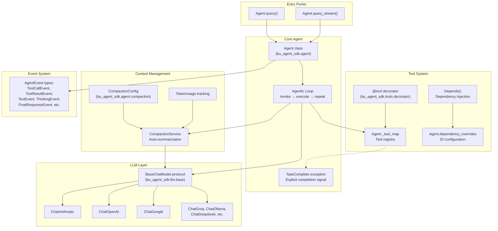

<!-- source: DeepWiki mcp.deepwiki.com · repo browser-use/agent-sdk · page 1 Overview · fetched 2026-10-30 -->

# Overview

<details>
<summary>Relevant source files</summary>

The following files were used as context for generating this wiki page:

- [README.md](README.md)
- [bu_agent_sdk/__init__.py](bu_agent_sdk/__init__.py)

</details>


## Purpose and Scope

This page provides a high-level introduction to **bu_agent_sdk**, a minimalist framework for building AI agents powered by Large Language Models (LLMs). The framework implements the philosophy that "an agent is just a for-loop" — a simple iterative process where the LLM repeatedly calls tools until a task is complete.

This overview covers:
- The core design philosophy and architectural principles
- The major system components and how they interact
- Key features that enable practical agent development
- Entry points to more detailed subsystem documentation

For detailed information about specific subsystems, see:
- Agent execution mechanics: [Agentic Loop Execution](#2.1)
- Tool definition and dependency injection: [Tool System](#6)
- Streaming observability: [Event System](#3)
- Context window management: [Context Management (Compaction)](#4)
- Multi-provider LLM support: [LLM Abstraction Layer](#5)

**Sources:** [README.md:1-256](), [bu_agent_sdk/__init__.py:1-30]()

---

## Design Philosophy

The bu_agent_sdk is built on a principle called "The Bitter Lesson": all the value is in the RL'd model, not in thousands of lines of framework abstractions. The framework deliberately minimizes complexity to avoid being a failure point.

**Core principle:** An agent is just a for-loop of tool calls. The LLM decides which tools to call, the agent executes them, and this continues until an explicit completion signal.

This philosophy manifests in the codebase as:
- **No magic abstractions**: The `Agent.query()` and `Agent.query_stream()` methods contain straightforward iterative logic
- **Explicit completion**: The `TaskComplete` exception forces agents to signal when they're done, preventing premature exits
- **Complete action space**: Give the LLM maximum freedom through tools, then restrict based on evaluations
- **Minimal provider abstractions**: Each LLM provider implementation is ~300 lines with full control

**Sources:** [README.md:48-53](), [README.md:236-248]()

---

## System Architecture

The bu_agent_sdk consists of five major subsystems that work together to enable agent execution:



**Diagram: Core System Components and Their Relationships**

This diagram maps high-level concepts to their concrete implementations in the codebase. Each box represents actual classes, methods, or code entities that can be located in the source files.

**Sources:** [README.md:1-256](), [bu_agent_sdk/__init__.py:1-30]()

---

## Core Components

| Component | Primary Classes/Functions | Purpose | Wiki Reference |
|-----------|---------------------------|---------|----------------|
| **Agent** | `Agent` | Orchestrates the agentic loop, manages conversation state, coordinates subsystems | [Agent System](#2) |
| **Tool System** | `@tool`, `Depends`, `Agent._tool_map` | Defines and executes callable functions, handles dependency injection | [Tool System](#6) |
| **LLM Abstraction** | `BaseChatModel`, `ChatAnthropic`, `ChatOpenAI`, etc. | Provides provider-agnostic interface to 8+ LLM services | [LLM Abstraction Layer](#5) |
| **Event System** | `ToolCallEvent`, `ToolResultEvent`, `TextEvent`, `FinalResponseEvent` | Streams execution events for real-time observability | [Event System](#3) |
| **Compaction** | `CompactionConfig`, `CompactionService`, `TokenUsage` | Manages context window limits via automatic summarization | [Context Management](#4) |
| **Task Completion** | `TaskComplete` exception | Signals explicit agent termination | [TaskComplete Pattern](#2.4) |

**Sources:** [README.md:54-138]()

---

## Execution Flow

The following diagram illustrates how a typical agent query flows through the major code entities:

```mermaid
sequenceDiagram
    participant User
    participant Agent["Agent<br/>(bu_agent_sdk.agent.Agent)"]
    participant query_stream["Agent.query_stream()"]
    participant _run_loop["Agent._run_loop()"]
    participant llm["BaseChatModel.ainvoke()"]
    participant _execute_tool_calls["Agent._execute_tool_calls()"]
    participant tool_func["@tool decorated function"]
    participant CompactionService["CompactionService.check_and_compact()"]
    
    User->>Agent: "agent.query_stream(query)"
    Agent->>query_stream: "entry point"
    query_stream->>_run_loop: "start agentic loop"
    
    loop "Until TaskComplete or no tool calls"
        _run_loop->>CompactionService: "check token threshold"
        CompactionService-->>_run_loop: "compacted if needed"
        
        _run_loop->>llm: "invoke with messages + tools"
        llm-->>_run_loop: "response with tool_calls[]"
        
        _run_loop->>query_stream: "yield ToolCallEvent"
        query_stream-->>User: "stream event"
        
        _run_loop->>_execute_tool_calls: "execute each tool"
        _execute_tool_calls->>tool_func: "call with args + injected deps"
        
        alt "tool raises TaskComplete"
            tool_func-->>_execute_tool_calls: "TaskComplete exception"
            _execute_tool_calls-->>_run_loop: "propagate exception"
            _run_loop->>query_stream: "yield FinalResponseEvent"
            query_stream-->>User: "stream final event"
        else "tool returns normally"
            tool_func-->>_execute_tool_calls: "result"
            _execute_tool_calls->>query_stream: "yield ToolResultEvent"
            query_stream-->>User: "stream event"
            _execute_tool_calls-->>_run_loop: "continue loop"
        end
    end
```

**Diagram: Agent Query Execution Flow with Code Entities**

This sequence diagram uses actual method names and class names from the implementation, showing how a user query propagates through the system's major functions.

**Sources:** [README.md:22-46](), [README.md:127-138]()

---

## Key Features

### 1. Done Tool Pattern

Instead of stopping when the LLM produces no tool calls (which causes premature exits), agents use the **`TaskComplete` exception** to signal explicit completion:

```python
@tool("Signal task completion")
async def done(message: str) -> str:
    raise TaskComplete(message)

agent = Agent(
    llm=llm,
    tools=[..., done],
    require_done_tool=True,  # Autonomous mode
)
```

When `require_done_tool=True`, the agent continues executing until a tool raises `TaskComplete`. See [TaskComplete Pattern](#2.4) for details.

**Sources:** [README.md:56-70]()

---

### 2. Ephemeral Messages

Tools that produce large outputs (e.g., browser DOM, screenshots) can use the `ephemeral` parameter to limit message history retention:

```python
@tool("Get browser state", ephemeral=3)  # Keep last 3 only
async def get_state() -> str:
    return massive_dom_and_screenshot
```

The `Agent._destroy_ephemeral_messages()` method removes old ephemeral messages before each LLM invocation. See [Ephemeral Messages](#10.2) for details.

**Sources:** [README.md:72-80]()

---

### 3. Multi-Provider LLM Support

The `BaseChatModel` protocol defines a common interface implemented by 8+ providers:

```python
from bu_agent_sdk.llm import ChatAnthropic, ChatOpenAI, ChatGoogle

agent = Agent(llm=ChatAnthropic(model="claude-sonnet-4-20250514"), tools=tools)
agent = Agent(llm=ChatOpenAI(model="gpt-4o"), tools=tools)
agent = Agent(llm=ChatGoogle(model="gemini-2.0-flash"), tools=tools)
```

Each provider is implemented in ~300 lines with full control. See [LLM Abstraction Layer](#5) for the complete list.

**Sources:** [README.md:82-93]()

---

### 4. Context Compaction

The `CompactionConfig` system automatically summarizes conversation history when approaching context window limits:

```python
from bu_agent_sdk.agent import CompactionConfig

agent = Agent(
    llm=llm,
    tools=tools,
    compaction=CompactionConfig(threshold_ratio=0.80),  # At 80% usage
)
```

The `CompactionService.check_and_compact()` method monitors `TokenUsage` and invokes the LLM to generate summaries. See [Context Management (Compaction)](#4) for implementation details.

**Sources:** [README.md:95-107]()

---

### 5. Dependency Injection

Tools can declare dependencies using `Annotated[Type, Depends(provider)]`, inspired by FastAPI:

```python
from typing import Annotated
from bu_agent_sdk import Depends

def get_db():
    return Database()

@tool("Query users")
async def get_user(id: int, db: Annotated[Database, Depends(get_db)]) -> str:
    return await db.find(id)
```

The `Agent.dependency_overrides` dictionary allows runtime configuration. See [Dependency Injection](#6.2) for details.

**Sources:** [README.md:109-123]()

---

### 6. Streaming Events

The `Agent.query_stream()` method yields typed events throughout execution:

```python
from bu_agent_sdk.agent import ToolCallEvent, ToolResultEvent, FinalResponseEvent

async for event in agent.query_stream("do something"):
    match event:
        case ToolCallEvent(tool=name, args=args):
            print(f"Calling {name}")
        case ToolResultEvent(tool=name, result=result):
            print(f"{name} -> {result[:50]}")
        case FinalResponseEvent(content=text):
            print(f"Done: {text}")
```

Events include unique IDs for correlation (`message_id`, `tool_call_id`, `step_id`). See [Event System](#3) for all event types.

**Sources:** [README.md:125-138]()

---

## Minimal Example: Claude Code in 100 Lines

The framework enables complete coding assistants with minimal code. This example demonstrates sandboxed filesystem operations using dependency injection:

| Component | Implementation |
|-----------|----------------|
| **Sandbox Context** | `SandboxContext` dataclass with `root_dir` and `working_dir` |
| **Dependency Provider** | `get_sandbox()` function, overridden via `Agent.dependency_overrides` |
| **Tools** | `bash()`, `read()`, `write()`, `glob()`, `done()` — all use `Annotated[SandboxContext, Depends(get_sandbox)]` |
| **Security** | `SandboxContext.resolve_path()` validates paths stay within sandbox |

The full implementation is at [bu_agent_sdk/examples/claude_code.py]().

**Sources:** [README.md:140-228]()

---

## Getting Started

The simplest possible agent with two tools:

```python
import asyncio
from bu_agent_sdk import Agent, tool, TaskComplete
from bu_agent_sdk.llm import ChatAnthropic

@tool("Add two numbers")
async def add(a: int, b: int) -> int:
    return a + b

@tool("Signal task completion")
async def done(message: str) -> str:
    raise TaskComplete(message)

agent = Agent(
    llm=ChatAnthropic(model="claude-sonnet-4-20250514"),
    tools=[add, done],
)

async def main():
    result = await agent.query("What is 2 + 3?")
    print(result)

asyncio.run(main())
```

This demonstrates:
- The `@tool` decorator for defining callable functions
- The `TaskComplete` exception pattern
- The `Agent` class as the main orchestrator
- The `ChatAnthropic` LLM provider
- The `Agent.query()` method for simple request-response

For more examples, see [Examples and Guides](#7).

**Sources:** [README.md:22-46]()

---

## Installation

Install via `uv`:

```bash
uv add bu-agent-sdk
```

Or for development:

```bash
uv sync
```

See [Configuration and Setup](#8) for environment variables and API key configuration.

**Sources:** [README.md:9-19]()

---

## Next Steps

To understand how the agent actually works, start with:
1. [Agent System](#2) — the core `Agent` class and agentic loop
2. [Tool System](#6) — defining and executing tools
3. [Event System](#3) — streaming observability
4. [LLM Abstraction Layer](#5) — provider support

For practical guidance:
- [Getting Started: Simple Calculator](#7.1) — basic agent example
- [Claude Code: Sandboxed Filesystem Tools](#7.3) — complete coding assistant
- [Dependency Injection Example](#7.2) — FastAPI-style DI patterns

**Sources:** [README.md:229-235]()

---

