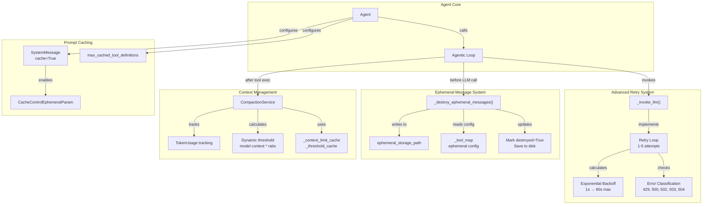
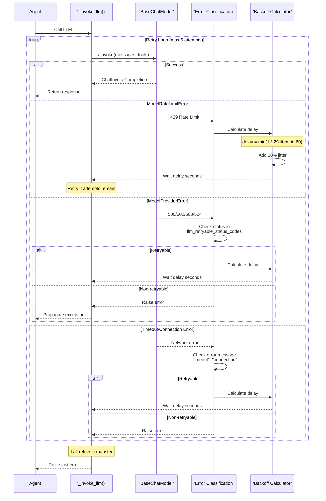
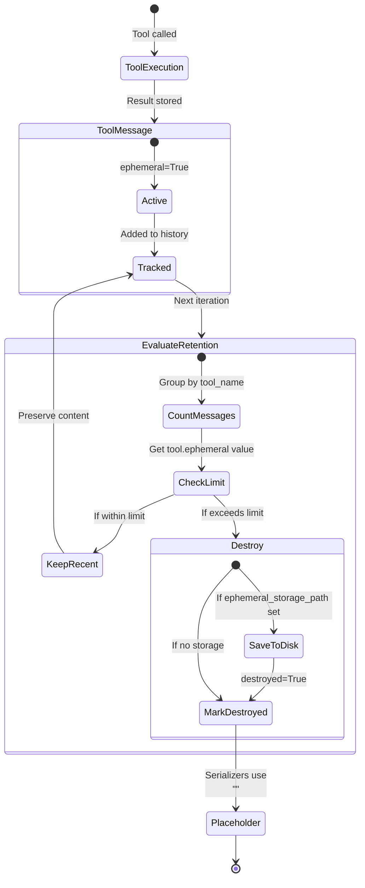
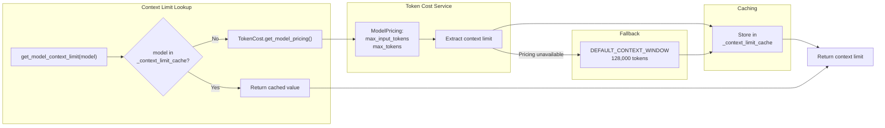
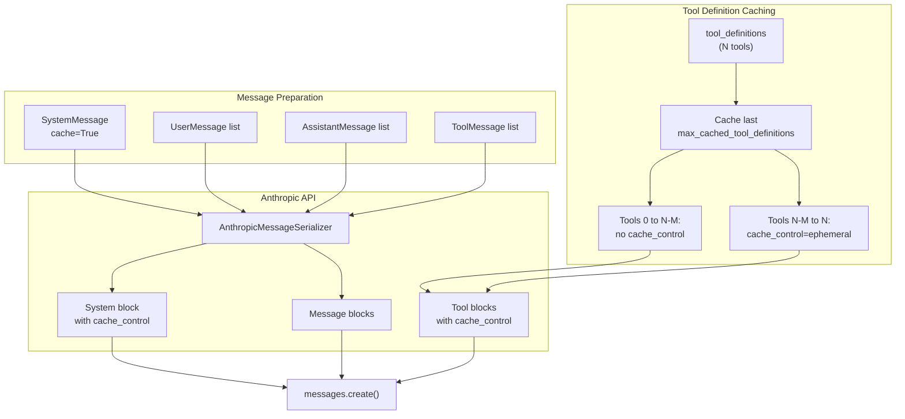
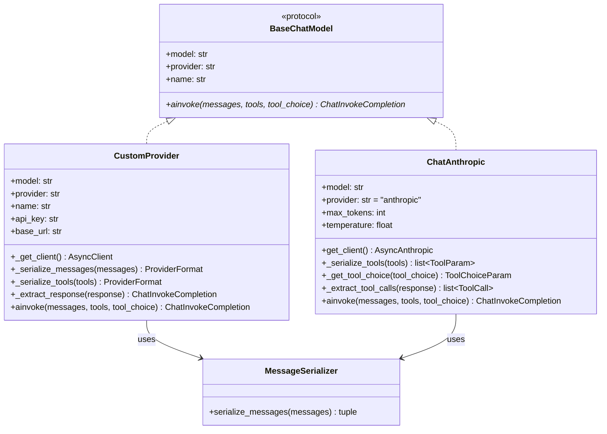

<!-- source: DeepWiki mcp.deepwiki.com · repo browser-use/agent-sdk · page 10 Advanced Topics · fetched 2026-10-30 -->

# Advanced Topics

<details>
<summary>Relevant source files</summary>

The following files were used as context for generating this wiki page:

- [bu_agent_sdk/agent/compaction/service.py](bu_agent_sdk/agent/compaction/service.py)
- [bu_agent_sdk/agent/service.py](bu_agent_sdk/agent/service.py)
- [bu_agent_sdk/llm/anthropic/chat.py](bu_agent_sdk/llm/anthropic/chat.py)

</details>


This page covers advanced patterns, optimization techniques, and extension mechanisms in the bu_agent_sdk. These topics go beyond basic agent setup and explore sophisticated features for production deployments, performance tuning, and custom integrations.

**Scope**: This page introduces advanced capabilities including retry logic, ephemeral message management, custom provider integration, caching strategies, and performance optimization. For foundational concepts, see [Agent System](#2). For observability and debugging basics, see [Observability and Debugging](#9).

**Child pages**: 
- [Retry Logic and Error Recovery](#10.1) - Detailed coverage of LLM invocation retry mechanisms
- [Ephemeral Messages](#10.2) - Managing large tool outputs and context optimization
- [Custom LLM Provider Integration](#10.3) - Implementing custom provider adapters

---

## Overview of Advanced Features

The bu_agent_sdk includes several advanced systems designed for production reliability and extensibility:

| Feature | Purpose | Primary Use Case |
|---------|---------|------------------|
| LLM Retry Logic | Handle transient API failures | Production deployments with API rate limits |
| Ephemeral Messages | Manage large tool outputs | Tools with file contents, screenshots, logs |
| Dynamic Compaction | Context window management | Long-running conversations |
| Prompt Caching | Reduce API costs | Repeated system prompts and tool definitions |
| Custom Providers | Extend LLM support | Proprietary or unofficial model APIs |
| Dependency Overrides | Runtime configuration | Testing, mocking, multi-environment setup |

Sources: [bu_agent_sdk/agent/service.py:98-145]()

---

## Advanced Agent Architecture

The following diagram shows how advanced features integrate with the core agent system:



**Diagram: Advanced Systems Integration** - Shows how retry logic, ephemeral messages, context management, and caching interact with the core agent loop.

Sources: [bu_agent_sdk/agent/service.py:436-533](), [bu_agent_sdk/agent/service.py:229-299](), [bu_agent_sdk/agent/compaction/service.py:38-98]()

---

## LLM Invocation Retry System

The agent implements a comprehensive retry mechanism for LLM invocations, handling transient failures with exponential backoff.

### Retry Flow



**Diagram: LLM Retry Flow** - Sequence showing retry logic with exponential backoff and error classification.

### Configuration Parameters

The retry system is configured via Agent initialization parameters:

| Parameter | Default | Description |
|-----------|---------|-------------|
| `llm_max_retries` | 5 | Maximum retry attempts for LLM errors |
| `llm_retry_base_delay` | 1.0 | Base delay in seconds for exponential backoff |
| `llm_retry_max_delay` | 60.0 | Maximum delay between retry attempts |
| `llm_retryable_status_codes` | {429, 500, 502, 503, 504} | HTTP status codes that trigger retries |

Example configuration:

```python
agent = Agent(
    llm=ChatOpenAI(model="gpt-4"),
    tools=[...],
    llm_max_retries=10,  # More aggressive retries
    llm_retry_base_delay=2.0,  # Start with 2s delay
    llm_retry_max_delay=120.0,  # Allow up to 2min delays
)
```

The backoff calculation follows: `delay = min(base_delay * (2 ** attempt), max_delay) + jitter`

Where jitter is a random value between 0 and 10% of the calculated delay to prevent thundering herd problems.

Sources: [bu_agent_sdk/agent/service.py:136-144](), [bu_agent_sdk/agent/service.py:436-532]()

**Note**: For detailed implementation and error handling patterns, see [Retry Logic and Error Recovery](#10.1).

---

## Ephemeral Message Management

Ephemeral messages are tool outputs that are automatically destroyed after a configurable number of iterations to save context space. This is critical for tools that return large outputs like file contents, screenshots, or log dumps.

### Ephemeral Message Lifecycle



**Diagram: Ephemeral Message State Transitions** - Shows lifecycle from creation to destruction with optional persistence.

### Configuration

Ephemeral behavior is configured at both the tool level and agent level:

**Tool-level configuration:**

```python
@tool("Read large file", _ephemeral=3)  # Keep last 3 outputs
async def read_file(path: str) -> str:
    return Path(path).read_text()

@tool("Take screenshot", _ephemeral=True)  # Keep last 1 (shorthand)
async def screenshot() -> ContentPartImageParam:
    return capture_screenshot()
```

**Agent-level configuration:**

```python
agent = Agent(
    llm=llm,
    tools=[read_file, screenshot],
    ephemeral_storage_path=Path("./ephemeral_backups"),  # Optional persistence
)
```

### Destruction Process

The `_destroy_ephemeral_messages()` method is called before each LLM invocation:

1. **Group messages by tool name**: Collect all `ToolMessage` instances with `ephemeral=True`
2. **Get retention limit**: Check `tool.ephemeral` value (int for count, True for 1)
3. **Identify old messages**: Select messages beyond the retention limit (oldest first)
4. **Optional persistence**: If `ephemeral_storage_path` is set, save content to JSON files named by `tool_call_id`
5. **Mark as destroyed**: Set `message.destroyed = True`
6. **Serialization**: Provider serializers replace destroyed content with placeholder text

Sources: [bu_agent_sdk/agent/service.py:131-132](), [bu_agent_sdk/agent/service.py:229-299]()

**Note**: For detailed implementation and storage strategies, see [Ephemeral Messages](#10.2).

---

## Dynamic Context Management

The compaction service automatically manages context window limits through dynamic threshold calculation and intelligent caching.

### Context Limit Resolution



**Diagram: Context Limit Resolution** - Shows caching strategy for model context limits with fallback to default values.

### Threshold Calculation

The compaction threshold is calculated as: `threshold = context_limit * threshold_ratio`

Default ratio is 0.80 (80% of context window). The service maintains separate caches for context limits and thresholds:

| Cache | Purpose | Key | Value |
|-------|---------|-----|-------|
| `_context_limit_cache` | Model context windows | model name | token limit |
| `_threshold_cache` | Compaction thresholds | model name | threshold tokens |

Example threshold calculations:

| Model | Context Window | Ratio | Threshold |
|-------|---------------|-------|-----------|
| gpt-4o | 128,000 | 0.80 | 102,400 |
| claude-3-5-sonnet | 200,000 | 0.80 | 160,000 |
| gpt-4o-mini | 128,000 | 0.70 | 89,600 |

Sources: [bu_agent_sdk/agent/compaction/service.py:74-113]()

---

## Prompt Caching Strategies

Prompt caching reduces API costs by caching static parts of requests. The SDK supports provider-specific caching mechanisms.

### Anthropic Prompt Caching

Anthropic's prompt caching allows up to 4 cache blocks. The SDK strategically places cache controls:

1. **System prompt caching**: `SystemMessage(content=prompt, cache=True)`
2. **Tool definition caching**: Last N tools get `cache_control=CacheControlEphemeralParam`



**Diagram: Anthropic Prompt Caching** - Shows how system prompts and tool definitions are marked for caching within Anthropic's 4-block limit.

### Cache Configuration

Configure caching behavior via `ChatAnthropic` parameters:

| Parameter | Default | Description |
|-----------|---------|-------------|
| `prompt_cache_beta` | "prompt-caching-2024-07-31" | Beta header for prompt caching |
| `max_cached_tool_definitions` | 3 | Number of tool definitions to cache (last N) |

Example:

```python
llm = ChatAnthropic(
    model="claude-3-5-sonnet-20241022",
    max_cached_tool_definitions=5,  # Cache last 5 tools
)

agent = Agent(
    llm=llm,
    tools=[...],  # If 10 tools, last 5 will be cached
    system_prompt="...",  # Automatically cached
)
```

**Cache hit rates**: System prompts typically achieve >95% cache hits. Tool definitions achieve high hit rates when tools don't change between iterations.

Sources: [bu_agent_sdk/llm/anthropic/chat.py:59-60](), [bu_agent_sdk/llm/anthropic/chat.py:147-180]()

---

## Performance Optimization Patterns

### Token Usage Tracking

The `TokenCost` service tracks cumulative token usage across all LLM calls:

```python
# Access usage statistics
usage = await agent.get_usage()
print(f"Total tokens: {usage.total_tokens:,}")
print(f"Total cost: ${usage.total_cost:.4f}")

# Per-model breakdown
for model_usage in usage.models:
    print(f"{model_usage.model}: {model_usage.total_tokens:,} tokens")
```

### Compaction Tuning

Adjust compaction behavior based on use case:

| Use Case | Recommended Ratio | Reason |
|----------|------------------|--------|
| Short tasks | 0.90 | Minimize compaction overhead |
| Long conversations | 0.70 | More aggressive compaction |
| Cost-sensitive | 0.80 (default) | Balance cost and quality |
| Quality-critical | 0.85 | Preserve more context |

```python
from bu_agent_sdk.agent.compaction import CompactionConfig

# Aggressive compaction for long tasks
agent = Agent(
    llm=llm,
    tools=tools,
    compaction=CompactionConfig(
        enabled=True,
        threshold_ratio=0.70,  # Compact at 70% of context
    )
)

# Disable for short tasks
agent = Agent(
    llm=llm,
    tools=tools,
    compaction=CompactionConfig(enabled=False)
)
```

### Max Iterations with Summary

When `max_iterations` is reached, the agent automatically generates a summary using the LLM:

```python
agent = Agent(
    llm=llm,
    tools=tools,
    max_iterations=50,  # Lower limit for bounded tasks
)
```

The `_generate_max_iterations_summary()` method creates a temporary summary prompt, invokes the LLM without tools, and returns a structured completion message.

Sources: [bu_agent_sdk/agent/service.py:534-567](), [bu_agent_sdk/agent/compaction/service.py:99-113]()

---

## Custom Provider Integration

The SDK supports custom LLM providers through the `BaseChatModel` protocol.

### Provider Implementation Requirements



**Diagram: Custom Provider Class Structure** - Shows protocol implementation requirements and reference implementation structure.

### Minimal Implementation

```python
from bu_agent_sdk.llm.base import BaseChatModel, ToolDefinition, ToolChoice
from bu_agent_sdk.llm.messages import BaseMessage
from bu_agent_sdk.llm.views import ChatInvokeCompletion, ChatInvokeUsage

class CustomProvider(BaseChatModel):
    model: str
    api_key: str
    
    @property
    def provider(self) -> str:
        return "custom"
    
    @property
    def name(self) -> str:
        return self.model
    
    async def ainvoke(
        self,
        messages: list[BaseMessage],
        tools: list[ToolDefinition] | None = None,
        tool_choice: ToolChoice | None = None,
        **kwargs,
    ) -> ChatInvokeCompletion:
        # 1. Serialize messages to provider format
        # 2. Call provider API
        # 3. Parse response
        # 4. Return ChatInvokeCompletion
        ...
```

**Key responsibilities**:
1. Message serialization (BaseMessage → Provider format)
2. Tool serialization (ToolDefinition → Provider format)
3. API communication
4. Response parsing (Provider format → ChatInvokeCompletion)
5. Error handling (Provider errors → ModelError hierarchy)

Sources: [bu_agent_sdk/llm/anthropic/chat.py:37-346]()

**Note**: For complete implementation guide and LangChain integration, see [Custom LLM Provider Integration](#10.3).

---

## Testing and Mocking

### Dependency Overrides for Testing

The dependency injection system supports runtime overrides for testing:

```python
from unittest.mock import AsyncMock

# Mock database dependency
mock_db = AsyncMock()
mock_db.execute.return_value = [{"id": 1, "name": "Test"}]

agent = Agent(
    llm=llm,
    tools=[query_database],
    dependency_overrides={
        "get_database": lambda: mock_db
    }
)

# Tool will receive mocked database
result = await agent.query("Find user by id")
```

### Testing Ephemeral Messages

Test ephemeral message destruction with temporary storage:

```python
import tempfile
from pathlib import Path

with tempfile.TemporaryDirectory() as tmpdir:
    agent = Agent(
        llm=llm,
        tools=[read_large_file],
        ephemeral_storage_path=Path(tmpdir)
    )
    
    # Run agent
    await agent.query("Read file")
    
    # Verify ephemeral content was saved
    saved_files = list(Path(tmpdir).glob("*.json"))
    assert len(saved_files) > 0
```

Sources: [bu_agent_sdk/agent/service.py:130](), [bu_agent_sdk/agent/service.py:276-296]()

---

## Summary

This page introduced advanced bu_agent_sdk features for production deployments:

- **Retry Logic**: Exponential backoff with configurable status codes and delays
- **Ephemeral Messages**: Automatic context management for large tool outputs
- **Dynamic Compaction**: Model-aware context window management with caching
- **Prompt Caching**: Provider-specific optimization for repeated prompts and tools
- **Custom Providers**: Extensible architecture for new LLM integrations
- **Testing Support**: Dependency injection and mocking patterns

For detailed implementation guides, see:
- [Retry Logic and Error Recovery](#10.1)
- [Ephemeral Messages](#10.2)
- [Custom LLM Provider Integration](#10.3)

---

