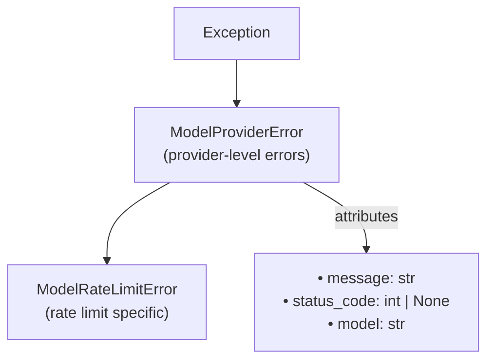
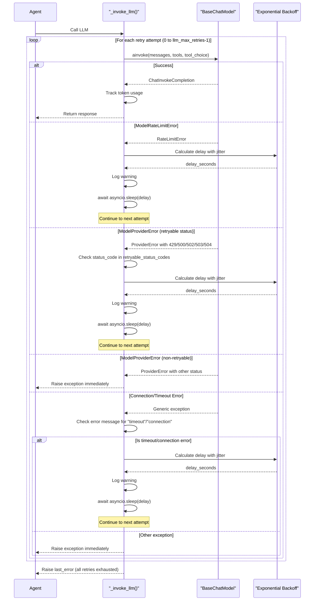
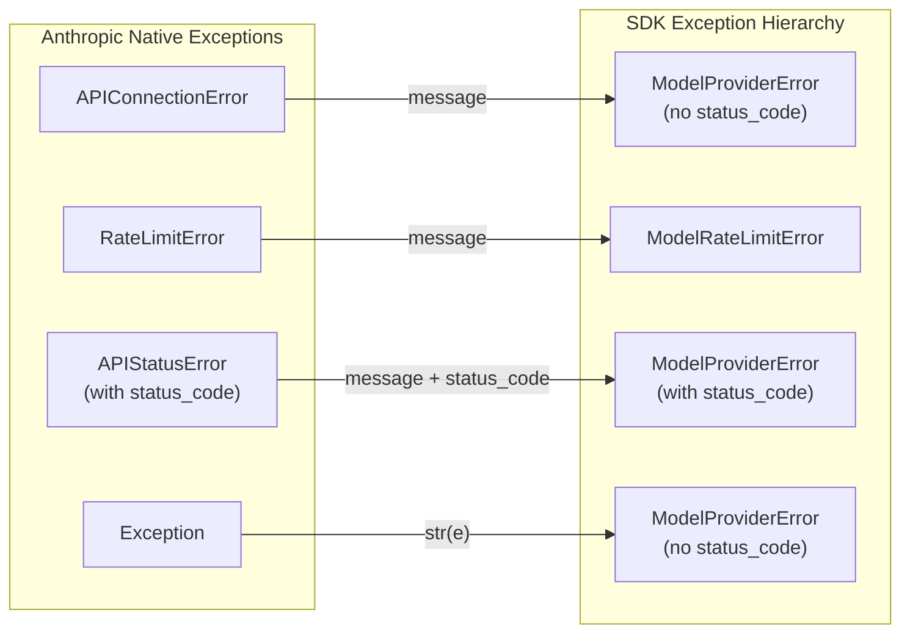
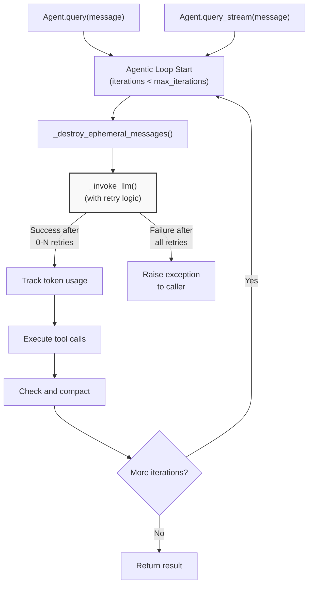

<!-- source: DeepWiki mcp.deepwiki.com · repo browser-use/agent-sdk · page 10.1 Retry Logic and Error Recovery · fetched 2026-10-30 -->

# Retry Logic and Error Recovery

<details>
<summary>Relevant source files</summary>

The following files were used as context for generating this wiki page:

- [bu_agent_sdk/agent/service.py](bu_agent_sdk/agent/service.py)
- [bu_agent_sdk/llm/anthropic/chat.py](bu_agent_sdk/llm/anthropic/chat.py)

</details>


## Purpose and Scope

This page documents the retry logic and error recovery mechanisms built into the bu_agent_sdk Agent system. The SDK implements automatic retry with exponential backoff for transient LLM provider errors, ensuring robust operation in production environments.

The retry logic applies specifically to LLM invocations within the agent loop. For general LLM abstraction layer error handling, see [Error Handling](#5.5). For compaction-specific error handling, see [Compaction Service Logic](#4.2).

## Configuration

The `Agent` class provides configurable retry parameters that control how LLM invocation errors are handled:

| Parameter | Type | Default | Description |
|-----------|------|---------|-------------|
| `llm_max_retries` | `int` | `5` | Maximum number of retry attempts for LLM errors |
| `llm_retry_base_delay` | `float` | `1.0` | Base delay in seconds for exponential backoff |
| `llm_retry_max_delay` | `float` | `60.0` | Maximum delay between retry attempts in seconds |
| `llm_retryable_status_codes` | `set[int]` | `{429, 500, 502, 503, 504}` | HTTP status codes that trigger automatic retries |

These parameters are defined as dataclass fields in the `Agent` class and can be configured during instantiation:

```python
agent = Agent(
    llm=ChatOpenAI(model="gpt-4o"),
    tools=[...],
    llm_max_retries=3,
    llm_retry_base_delay=2.0,
    llm_retry_max_delay=30.0,
)
```

**Sources:** [bu_agent_sdk/agent/service.py:135-144]()

## Error Type Hierarchy

The SDK defines a hierarchy of exception types for LLM errors:



### ModelProviderError

Generic exception for LLM provider errors, including:
- API connection failures
- HTTP status errors (4xx, 5xx)
- Invalid responses
- Authentication failures

Contains optional `status_code` attribute used to determine retry eligibility.

### ModelRateLimitError

Specialized exception for rate limit errors. Always triggers retry logic regardless of `llm_retryable_status_codes` configuration.

**Sources:** [bu_agent_sdk/agent/service.py:81](), [bu_agent_sdk/llm/anthropic/chat.py:336-345]()

## Retry Mechanism

The retry logic is implemented in the `_invoke_llm` method, which wraps all LLM invocations in the agent loop:



The method maintains a `last_error` reference and raises it after all retry attempts are exhausted.

**Sources:** [bu_agent_sdk/agent/service.py:436-532]()

## Exponential Backoff Strategy

The retry delay calculation uses exponential backoff with jitter:

```python
delay = min(
    llm_retry_base_delay * (2 ** attempt),
    llm_retry_max_delay
)
jitter = random.uniform(0, delay * 0.1)  # 10% jitter
total_delay = delay + jitter
```

### Backoff Sequence Example

With default configuration (`base_delay=1.0`, `max_delay=60.0`):

| Attempt | Base Delay | With Max Cap | Jitter Range | Total Range |
|---------|-----------|--------------|--------------|-------------|
| 0 | 1.0s | 1.0s | 0.0-0.1s | 1.0-1.1s |
| 1 | 2.0s | 2.0s | 0.0-0.2s | 2.0-2.2s |
| 2 | 4.0s | 4.0s | 0.0-0.4s | 4.0-4.4s |
| 3 | 8.0s | 8.0s | 0.0-0.8s | 8.0-8.8s |
| 4 | 16.0s | 16.0s | 0.0-1.6s | 16.0-17.6s |
| 5 | 32.0s | 32.0s | 0.0-3.2s | 32.0-35.2s |
| 6 | 64.0s | **60.0s** | 0.0-6.0s | 60.0-66.0s |

The jitter (10% of delay) prevents thundering herd problems when multiple agents retry simultaneously.

**Sources:** [bu_agent_sdk/agent/service.py:461-473](), [bu_agent_sdk/agent/service.py:485-497](), [bu_agent_sdk/agent/service.py:514-526]()

## Retryable Error Conditions

### Always Retryable

**Rate Limit Errors (`ModelRateLimitError`)**
- Caught explicitly and always retried
- Indicates temporary capacity constraint
- Example log: `⚠️ Got rate limit error, retrying in 2.1s... (attempt 2/5)`

**Sources:** [bu_agent_sdk/agent/service.py:457-475]()

### Conditionally Retryable

**Provider Errors with Retryable Status Codes (`ModelProviderError`)**

Default retryable status codes:
- `429` - Too Many Requests (rate limiting at HTTP level)
- `500` - Internal Server Error
- `502` - Bad Gateway
- `503` - Service Unavailable
- `504` - Gateway Timeout

Checked via: `e.status_code in self.llm_retryable_status_codes`

Example log: `⚠️ Got 503 error, retrying in 4.3s... (attempt 3/5)`

**Sources:** [bu_agent_sdk/agent/service.py:477-500]()

**Connection and Timeout Errors (Generic Exceptions)**

Detected by string matching on error message:
```python
error_message = str(e).lower()
is_timeout = "timeout" in error_message or "cancelled" in error_message
is_connection_error = "connection" in error_message or "connect" in error_message
```

Example log: `⚠️ Got timeout, retrying in 8.2s... (attempt 4/5)`

**Sources:** [bu_agent_sdk/agent/service.py:502-528]()

### Never Retryable

- `ModelProviderError` with non-retryable status codes (e.g., 400, 401, 404)
- Generic exceptions that don't match timeout/connection patterns
- Any exception type not explicitly handled

These errors are raised immediately without retry.

## Provider Error Mapping

Each LLM provider implementation maps its native exceptions to the SDK's error hierarchy. This mapping occurs in the provider's `ainvoke` method.

### Anthropic Provider Example



The mapping in `ChatAnthropic.ainvoke`:

```python
try:
    response = await self.get_client().messages.create(...)
    # ... process response
except APIConnectionError as e:
    raise ModelProviderError(message=e.message, model=self.name) from e
except RateLimitError as e:
    raise ModelRateLimitError(message=e.message, model=self.name) from e
except APIStatusError as e:
    raise ModelProviderError(
        message=e.message, status_code=e.status_code, model=self.name
    ) from e
except Exception as e:
    raise ModelProviderError(message=str(e), model=self.name) from e
```

The `status_code` attribute preserved from `APIStatusError` enables the retry logic to determine if the error is retryable.

**Sources:** [bu_agent_sdk/llm/anthropic/chat.py:336-345]()

## Integration with Agent Loop

The retry mechanism integrates transparently into the agent's query execution flow:



### Key Integration Points

1. **Every LLM invocation is protected**: Both `Agent.query()` and `Agent.query_stream()` call `_invoke_llm()`, which wraps `llm.ainvoke()` with retry logic.

2. **Token usage tracking occurs after successful retry**: The token cost tracking happens only after a successful LLM response, ensuring usage statistics reflect actual successful API calls.

3. **Compaction is independent**: The compaction system (which also calls the LLM) may trigger retries, but operates on the same retry configuration.

4. **Transparent to tools**: Tool execution occurs after successful LLM invocation, so tools never see LLM retry failures unless all retries are exhausted.

5. **Event streaming is not interrupted**: For `query_stream()`, events are only emitted after successful LLM invocation, so consumers don't see retry attempts.

**Sources:** [bu_agent_sdk/agent/service.py:644-700](), [bu_agent_sdk/agent/service.py:747-868]()

## Logging and Observability

The retry mechanism logs warnings on each retry attempt:

```
⚠️ Got rate limit error, retrying in 2.1s... (attempt 1/5)
⚠️ Got 503 error, retrying in 4.3s... (attempt 2/5)
⚠️ Got timeout, retrying in 8.7s... (attempt 3/5)
```

These logs:
- Use the `bu_agent_sdk.agent` logger
- Include the error type (rate limit, status code, timeout, connection error)
- Display the calculated delay including jitter
- Show current attempt number and max retries

The logs are emitted at `WARNING` level, making them visible in default logging configurations while not cluttering debug logs.

**Sources:** [bu_agent_sdk/agent/service.py:469-472](), [bu_agent_sdk/agent/service.py:493-496](), [bu_agent_sdk/agent/service.py:521-524]()

---

