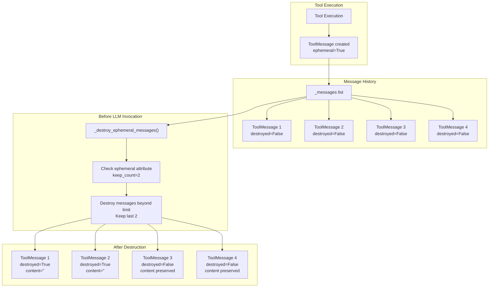
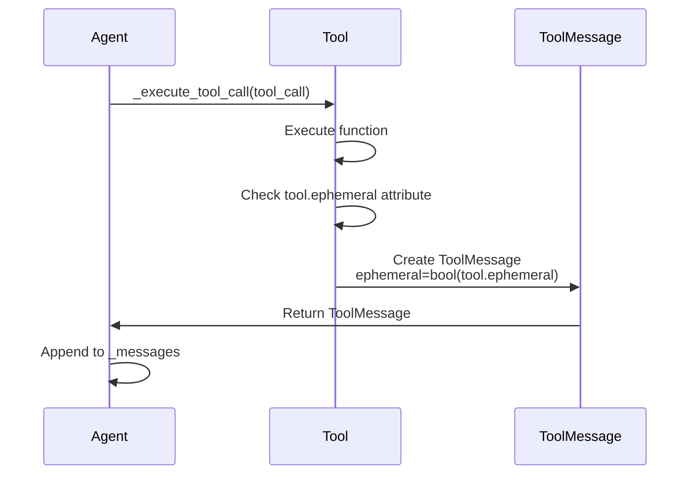
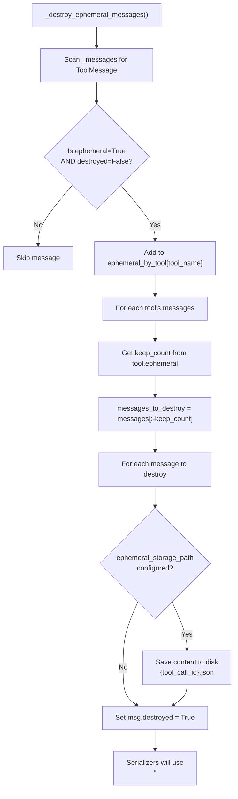
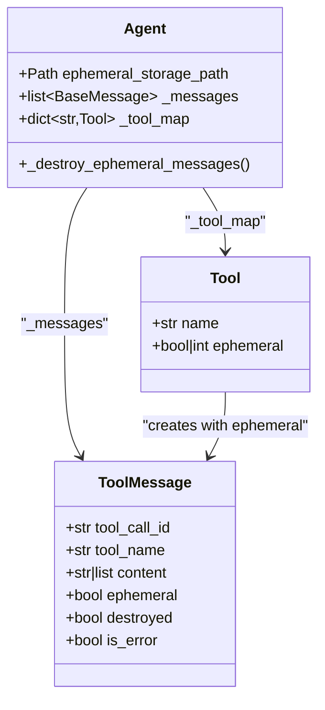
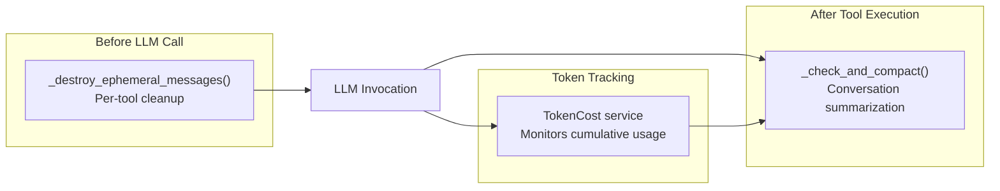

<!-- source: DeepWiki mcp.deepwiki.com · repo browser-use/agent-sdk · page 10.2 Ephemeral Messages · fetched 2026-10-30 -->

# Ephemeral Messages

<details>
<summary>Relevant source files</summary>

The following files were used as context for generating this wiki page:

- [README.md](README.md)
- [bu_agent_sdk/agent/service.py](bu_agent_sdk/agent/service.py)

</details>


## Purpose and Scope

Ephemeral messages provide a mechanism to manage tool outputs that produce large content (e.g., browser DOM snapshots, screenshots, file system listings) that would otherwise consume excessive context window space. This system automatically removes old tool outputs while preserving recent ones, with optional persistence to disk.

This page covers the ephemeral message lifecycle, configuration options, and storage mechanisms. For information about tool definition and execution, see [Tool System](#6). For context management through summarization, see [Context Management (Compaction)](#4).

**Sources:** [README.md:72-79](), [bu_agent_sdk/agent/service.py:131-132]()

## Core Concept

Tools that produce large outputs can be marked as ephemeral, specifying how many recent outputs to retain. When the agent prepares messages for LLM invocation, it automatically destroys older ephemeral messages beyond the retention limit, replacing their content with a placeholder.



**Sources:** [bu_agent_sdk/agent/service.py:229-299]()

## Defining Ephemeral Tools

Tools are marked as ephemeral using the `ephemeral` parameter in the `@tool` decorator. The parameter accepts either a boolean or an integer:

| Parameter Value | Behavior |
|----------------|----------|
| `False` (default) | Tool outputs are never destroyed |
| `True` | Keep last 1 output, destroy older ones |
| `int` (e.g., `3`) | Keep last N outputs, destroy older ones |

```python
@tool("Get browser state", ephemeral=3)  # Keep last 3 outputs
async def get_browser_state() -> str:
    return massive_dom_content

@tool("Take screenshot", ephemeral=True)  # Keep last 1 output  
async def screenshot() -> str:
    return large_image_data
```

The `ephemeral` attribute is stored on the `Tool` instance and accessed during message destruction.

**Sources:** [README.md:72-79](), [bu_agent_sdk/agent/service.py:339-348](), [bu_agent_sdk/agent/service.py:260-265]()

## Message Lifecycle

### Creation Phase

When a tool marked as ephemeral executes, the resulting `ToolMessage` has its `ephemeral` attribute set to `True`:



**Sources:** [bu_agent_sdk/agent/service.py:300-360]()

### Destruction Phase

Before each LLM invocation, `_destroy_ephemeral_messages()` processes the message history:



The destruction process groups messages by tool name, retrieves each tool's retention limit, and marks older messages as destroyed. The `destroyed` flag is checked by message serializers to replace content with a placeholder.

**Sources:** [bu_agent_sdk/agent/service.py:229-299]()

### Key Implementation Points

| Aspect | Implementation Detail | Location |
|--------|----------------------|----------|
| When destroyed | Before every LLM invocation | [service.py:647-648](), [service.py:750-751]() |
| Grouping | By `tool_name` field on ToolMessage | [service.py:243-256]() |
| Keep count | From `Tool.ephemeral` attribute, defaults to 1 if True | [service.py:260-265]() |
| Destruction flag | `ToolMessage.destroyed = True` | [service.py:298]() |
| Content replacement | Handled by provider-specific serializers | Referenced in service.py |

**Sources:** [bu_agent_sdk/agent/service.py:229-299]()

## Storage Options

### In-Memory Only (Default)

When `ephemeral_storage_path` is `None`, destroyed message content is simply marked and replaced with a placeholder during serialization. The original content is not persisted.

```python
agent = Agent(
    llm=llm,
    tools=[get_browser_state, screenshot],
    ephemeral_storage_path=None,  # Default - no persistence
)
```

**Sources:** [bu_agent_sdk/agent/service.py:131-132]()

### Disk Persistence

When `ephemeral_storage_path` is configured, destroyed message content is saved to disk before being marked as destroyed:

```python
from pathlib import Path

agent = Agent(
    llm=llm,
    tools=[get_browser_state, screenshot],
    ephemeral_storage_path=Path("./ephemeral_storage"),
)
```

#### Storage Format

Each destroyed message is saved as a JSON file named `{tool_call_id}.json`:

```json
{
  "tool_call_id": "call_abc123",
  "tool_name": "get_browser_state",
  "content": "...large content...",
  "is_error": false
}
```

For `ToolMessage` instances with list-based content (e.g., mixed text and images), the content is serialized as an array of content part dictionaries.

**Sources:** [bu_agent_sdk/agent/service.py:276-295]()

### Storage Directory Structure

```
ephemeral_storage/
├── call_abc123.json
├── call_def456.json
└── call_ghi789.json
```

The directory is created automatically if it doesn't exist. Files are named by `tool_call_id` for easy correlation with message history.

**Sources:** [bu_agent_sdk/agent/service.py:277-280]()

## Implementation Details

### Data Structures



**Sources:** [bu_agent_sdk/agent/service.py:98-150]()

### Message Grouping Algorithm

The destruction logic groups ephemeral messages by tool name while preserving insertion order:

```python
# Pseudocode representation of service.py:242-256
ephemeral_by_tool = {}

for msg in self._messages:
    if not isinstance(msg, ToolMessage):
        continue
    if not msg.ephemeral or msg.destroyed:
        continue
    
    if msg.tool_name not in ephemeral_by_tool:
        ephemeral_by_tool[msg.tool_name] = []
    ephemeral_by_tool[msg.tool_name].append(msg)
```

This ensures that destruction is per-tool, allowing different tools to have different retention policies.

**Sources:** [bu_agent_sdk/agent/service.py:242-256]()

### Keep Count Resolution

For each tool's message group, the keep count is resolved from the tool's `ephemeral` attribute:

```python
# Pseudocode representation of service.py:260-265
tool = self._tool_map.get(tool_name)
if tool is None:
    keep_count = 1
else:
    keep_count = tool.ephemeral if isinstance(tool.ephemeral, int) else 1
```

If the tool is no longer in the agent's tool map (e.g., after agent reconfiguration), a default of 1 is used.

**Sources:** [bu_agent_sdk/agent/service.py:260-265]()

### Slicing and Destruction

Messages are sliced to identify those beyond the retention limit:

```python
# Pseudocode representation of service.py:267-268
messages_to_destroy = messages[:-keep_count] if keep_count > 0 else messages
```

Each message to destroy is then processed for optional disk persistence and flag marking.

**Sources:** [bu_agent_sdk/agent/service.py:267-298]()

## Use Cases

### Browser Automation

Browser state tools return large DOM snapshots and screenshots that quickly exhaust context:

```python
@tool("Get current page state", ephemeral=2)
async def get_page_state() -> str:
    return {
        "dom": massive_html_tree,
        "screenshot": base64_encoded_image,
        "accessibility_tree": large_a11y_data
    }
```

Keeping only the last 2 states allows the agent to compare before/after while managing context.

**Sources:** [README.md:72-79]()

### File System Operations

Directory listings in large codebases can produce thousands of lines:

```python
@tool("List directory contents recursively", ephemeral=1)
async def ls_recursive(path: str) -> str:
    # Returns potentially massive directory tree
    return recursive_file_listing
```

Only the most recent listing is needed for context.

### Long-Running Tasks

Tasks that repeatedly check status produce redundant outputs:

```python
@tool("Check build status", ephemeral=3)
async def check_build() -> str:
    # Returns build logs, potentially very large
    return full_build_output
```

Keeping the last 3 checks provides trend visibility without context bloat.

## Best Practices

| Practice | Rationale |
|----------|-----------|
| Mark tools with >1KB outputs as ephemeral | Large outputs quickly approach context limits |
| Use higher keep counts (3-5) for state comparison | Enables before/after analysis |
| Use lower keep counts (1-2) for status checks | Recent status is usually sufficient |
| Configure `ephemeral_storage_path` for debugging | Allows post-hoc analysis of destroyed content |
| Review token usage after configuring ephemeral tools | Verify context savings are achieved |

**Sources:** [README.md:72-79](), [bu_agent_sdk/agent/service.py:229-299]()

## Integration with Context Management

Ephemeral messages work complementarily with the compaction system (see [Context Management](#4)):

- **Ephemeral messages**: Remove old tool outputs on a per-tool basis before each LLM call
- **Compaction**: Summarize entire conversation history when approaching context limits

Both systems use the `TokenCost` service to track token usage, but operate independently:



Ephemeral message destruction happens proactively (every iteration), while compaction happens reactively (when threshold exceeded).

**Sources:** [bu_agent_sdk/agent/service.py:647-648](), [bu_agent_sdk/agent/service.py:696-697]()

---

