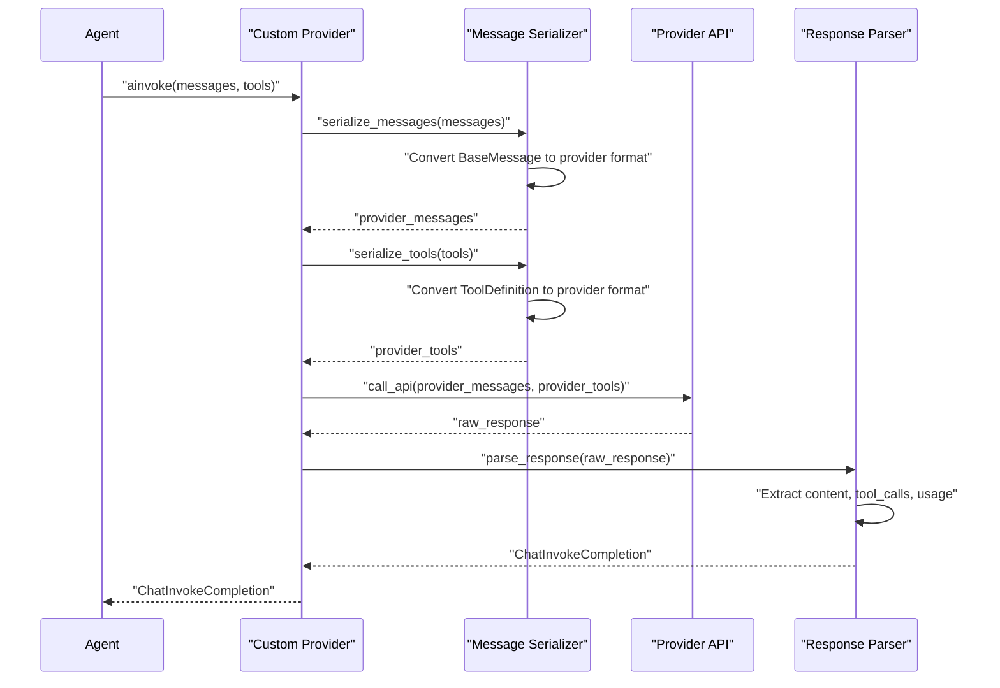
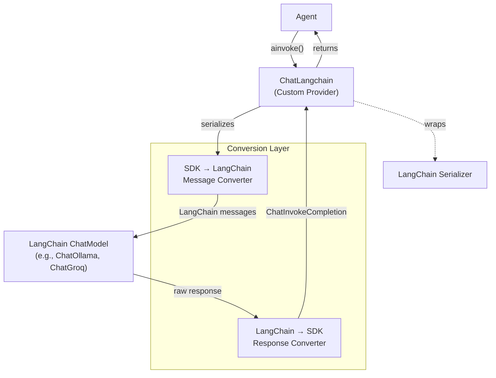
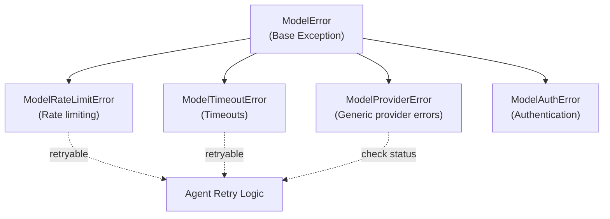

<!-- source: DeepWiki mcp.deepwiki.com · repo browser-use/agent-sdk · page 10.3 Custom LLM Provider Integration · fetched 2026-10-30 -->

# Custom LLM Provider Integration

<details>
<summary>Relevant source files</summary>

The following files were used as context for generating this wiki page:

- [bu_agent_sdk/llm/README.md](bu_agent_sdk/llm/README.md)
- [bu_agent_sdk/llm/__init__.py](bu_agent_sdk/llm/__init__.py)
- [bu_agent_sdk/llm/base.py](bu_agent_sdk/llm/base.py)

</details>


This document explains how to integrate custom LLM providers into the bu_agent_sdk. While the SDK officially supports 8+ providers (OpenAI, Anthropic, Google, Groq, Ollama, DeepSeek, Mistral, Cerebras), developers can add support for additional providers by implementing the `BaseChatModel` protocol. This page covers the protocol requirements, implementation patterns, and uses the LangChain integration as a reference example.

For information about officially supported providers and their configurations, see [Supported Providers](#5.2). For details on the `BaseChatModel` protocol interface, see [BaseChatModel Protocol](#5.1).

## Provider Integration Architecture

Custom providers integrate into the SDK by implementing the `BaseChatModel` protocol, which defines a unified interface that the Agent uses for all LLM interactions. The protocol ensures that custom providers can participate in tool calling, conversation management, and event streaming without requiring changes to the Agent's core logic.

```mermaid
graph TB
    Agent["Agent"]
    BaseChatModel["BaseChatModel Protocol"]
    
    subgraph "Official Providers"
        ChatOpenAI["ChatOpenAI"]
        ChatAnthropic["ChatAnthropic"]
        ChatGoogle["ChatGoogle"]
        Others["8+ other providers"]
    end
    
    subgraph "Custom Provider"
        CustomProvider["Custom LLM<br/>(e.g., ChatLangchain)"]
        ProviderAPI["Provider's Native API<br/>(e.g., LangChain)"]
        MessageAdapter["Message Serializer"]
        ErrorHandler["Error Handler"]
    end
    
    Agent -->|"uses"| BaseChatModel
    BaseChatModel <|..|"implements"| ChatOpenAI
    BaseChatModel <|..|"implements"| ChatAnthropic
    BaseChatModel <|..|"implements"| ChatGoogle
    BaseChatModel <|..|"implements"| Others
    BaseChatModel <|..|"implements"| CustomProvider
    
    CustomProvider -->|"calls"| ProviderAPI
    CustomProvider -->|"uses"| MessageAdapter
    CustomProvider -->|"raises"| ErrorHandler
    
    MessageAdapter -->|"converts"| Messages["BaseMessage types"]
    MessageAdapter -->|"converts"| Tools["ToolDefinition"]
```

**Sources:** [bu_agent_sdk/llm/base.py:54-151](), [bu_agent_sdk/llm/__init__.py:1-194]()

## BaseChatModel Protocol Requirements

The `BaseChatModel` protocol defines the minimum interface that all LLM providers must implement. This is a runtime-checkable protocol using Python's `Protocol` type.

### Required Properties

| Property | Type | Description |
|----------|------|-------------|
| `_verified_api_keys` | `bool` | Internal flag for API key verification status |
| `model` | `str` | Model identifier (e.g., "gpt-4o", "claude-3-5-sonnet") |
| `provider` | `str` | Provider name (e.g., "openai", "anthropic") |
| `name` | `str` | The model name/identifier (same as `model`) |
| `model_name` | `str` | Legacy alias for `model` (deprecated, use `name`) |

### Required Methods

The core method that must be implemented is `ainvoke`:

```python
async def ainvoke(
    self,
    messages: list[BaseMessage],
    tools: list[ToolDefinition] | None = None,
    tool_choice: ToolChoice | None = None,
    **kwargs: Any,
) -> ChatInvokeCompletion
```

This method must:
1. Accept a list of `BaseMessage` objects representing the conversation history
2. Accept an optional list of `ToolDefinition` objects that the model can call
3. Accept an optional `tool_choice` parameter to control tool usage behavior
4. Return a `ChatInvokeCompletion` object containing the model's response

**Sources:** [bu_agent_sdk/llm/base.py:54-151]()

## Implementation Flow



**Sources:** [bu_agent_sdk/llm/base.py:80-135]()

## Implementation Steps

### Step 1: Define Provider Class

Create a class that implements the `BaseChatModel` protocol:

```python
class ChatCustomProvider:
    """Custom LLM provider implementation."""
    
    _verified_api_keys: bool = False
    model: str
    
    def __init__(self, model: str, api_key: str | None = None, **kwargs):
        self.model = model
        self.api_key = api_key or os.getenv("CUSTOM_PROVIDER_API_KEY")
        # Initialize provider client...
    
    @property
    def provider(self) -> str:
        return "custom_provider"
    
    @property
    def name(self) -> str:
        return self.model
```

**Sources:** [bu_agent_sdk/llm/base.py:54-79]()

### Step 2: Implement Message Serialization

Create a serializer to convert SDK message types to your provider's format:

```python
class CustomMessageSerializer:
    """Converts BaseMessage to provider-specific format."""
    
    def serialize_messages(self, messages: list[BaseMessage]) -> list[dict]:
        """Convert SDK messages to provider format."""
        # Handle UserMessage, AssistantMessage, ToolMessage, SystemMessage
        # Map content types: text, images, tool calls, etc.
        pass
    
    def serialize_tools(self, tools: list[ToolDefinition]) -> list[dict]:
        """Convert ToolDefinition to provider's tool format."""
        pass
```

The serializer must handle all message types defined in [bu_agent_sdk/llm/messages.py]():
- `UserMessage`: User input with text or multimodal content
- `AssistantMessage`: Model responses with text, thinking, and tool calls
- `ToolMessage`: Tool execution results
- `SystemMessage`: System-level instructions
- `DeveloperMessage`: Provider-specific developer messages

**Sources:** [bu_agent_sdk/llm/messages.py:1-300](), [bu_agent_sdk/llm/__init__.py:17-41]()

### Step 3: Implement ainvoke Method

Implement the core `ainvoke` method that the Agent calls:

```python
async def ainvoke(
    self,
    messages: list[BaseMessage],
    tools: list[ToolDefinition] | None = None,
    tool_choice: ToolChoice | None = None,
    **kwargs: Any,
) -> ChatInvokeCompletion:
    """Invoke the custom provider."""
    
    # 1. Serialize messages
    serializer = CustomMessageSerializer()
    provider_messages = serializer.serialize_messages(messages)
    
    # 2. Serialize tools if provided
    provider_tools = None
    if tools:
        provider_tools = serializer.serialize_tools(tools)
    
    # 3. Call provider API
    response = await self._call_api(
        messages=provider_messages,
        tools=provider_tools,
        tool_choice=tool_choice,
        **kwargs
    )
    
    # 4. Parse response into ChatInvokeCompletion
    return self._parse_response(response)
```

**Sources:** [bu_agent_sdk/llm/base.py:80-135]()

### Step 4: Parse Response to ChatInvokeCompletion

The `ainvoke` method must return a `ChatInvokeCompletion` object:

```python
def _parse_response(self, raw_response) -> ChatInvokeCompletion:
    """Parse provider response into SDK format."""
    
    # Extract message with content and tool calls
    message = AssistantMessage(
        content=raw_response.text,
        tool_calls=[
            ToolCall(
                id=tc.id,
                function=Function(
                    name=tc.name,
                    arguments=tc.arguments
                )
            )
            for tc in raw_response.tool_calls
        ] if raw_response.tool_calls else None
    )
    
    # Extract usage statistics
    usage = ChatInvokeUsage(
        input_tokens=raw_response.usage.input_tokens,
        output_tokens=raw_response.usage.output_tokens,
        cache_read_input_tokens=raw_response.usage.cache_read_tokens,
        cache_creation_input_tokens=raw_response.usage.cache_write_tokens,
    )
    
    return ChatInvokeCompletion(
        message=message,
        usage=usage,
    )
```

**Sources:** [bu_agent_sdk/llm/views.py:1-100]()

## LangChain Integration Example

The SDK provides unofficial LangChain support as a reference implementation for custom providers. This demonstrates how to wrap an external LLM library.

### Architecture



The LangChain integration wraps any LangChain `ChatModel` instance and adapts it to the `BaseChatModel` protocol. This allows users to leverage LangChain's extensive provider ecosystem without maintaining duplicate implementations.

**Key files:**
- Example usage: [examples/models/langchain/example.py]()
- Implementation reference (if exists): Look for `ChatLangchain` class

**Sources:** [bu_agent_sdk/llm/README.md:21-26]()

### Usage Pattern

```python
from langchain_community.chat_models import ChatOllama
from bu_agent_sdk.llm import ChatLangchain  # Hypothetical wrapper
from bu_agent_sdk import Agent

# Create LangChain model
langchain_llm = ChatOllama(model="llama2")

# Wrap in SDK adapter
sdk_llm = ChatLangchain(llm=langchain_llm)

# Use with Agent
agent = Agent(
    task="Example task",
    llm=sdk_llm,
    tools=[...]
)
```

**Sources:** [bu_agent_sdk/llm/README.md:21-26]()

## Tool Calling Support

Custom providers must support tool calling to work with the Agent's tool execution system. This involves:

### Tool Definition Serialization

Convert `ToolDefinition` objects to the provider's tool schema format:

```python
def serialize_tools(self, tools: list[ToolDefinition]) -> list[dict]:
    """Convert SDK ToolDefinition to provider format."""
    return [
        {
            "type": "function",  # Provider-specific type
            "function": {
                "name": tool.name,
                "description": tool.description,
                "parameters": tool.parameters,
                "strict": tool.strict  # If provider supports strict mode
            }
        }
        for tool in tools
    ]
```

**Sources:** [bu_agent_sdk/llm/base.py:16-41]()

### Tool Choice Mapping

Map the SDK's `ToolChoice` values to provider-specific options:

| SDK Value | Meaning | Provider Mapping Example |
|-----------|---------|------------------------|
| `"auto"` | Model decides | OpenAI: `"auto"`, Anthropic: `{"type": "auto"}` |
| `"required"` | Must call at least one tool | OpenAI: `"required"`, Anthropic: `{"type": "any"}` |
| `"none"` | Cannot call tools | OpenAI: `"none"`, Anthropic: omit `tools` parameter |
| `str` (tool name) | Force specific tool | OpenAI: `{"type": "function", "function": {"name": ...}}` |

**Sources:** [bu_agent_sdk/llm/base.py:43-51]()

### Tool Call Response Parsing

Parse the provider's tool call format into SDK `ToolCall` objects:

```python
def parse_tool_calls(self, raw_tool_calls) -> list[ToolCall]:
    """Parse provider tool calls into SDK format."""
    return [
        ToolCall(
            id=tc.id,  # Provider-specific ID
            function=Function(
                name=tc.function.name,
                arguments=tc.function.arguments  # JSON string or dict
            )
        )
        for tc in raw_tool_calls
    ]
```

The parsed `ToolCall` objects must include:
- `id`: Unique identifier for correlation with `ToolMessage` responses
- `function.name`: Tool name matching a `ToolDefinition.name`
- `function.arguments`: JSON-encoded or dict of tool parameters

**Sources:** [bu_agent_sdk/llm/messages.py:100-150]()

## Error Handling

Custom providers should raise appropriate errors from the SDK's error hierarchy to enable retry logic and proper error handling.

### ModelError Hierarchy



### Error Mapping

Map provider-specific errors to SDK error types:

```python
async def ainvoke(...) -> ChatInvokeCompletion:
    try:
        response = await self.provider_client.invoke(...)
    except ProviderRateLimitError as e:
        raise ModelRateLimitError(
            message=str(e),
            provider=self.provider,
            model=self.model,
        )
    except ProviderTimeoutError as e:
        raise ModelTimeoutError(
            message=str(e),
            provider=self.provider,
            model=self.model,
        )
    except ProviderAPIError as e:
        raise ModelProviderError(
            message=str(e),
            provider=self.provider,
            model=self.model,
            status_code=e.status_code,
        )
```

For details on error types and retry mechanisms, see [Error Handling](#5.5) and [Retry Logic and Error Recovery](#10.1).

**Sources:** [bu_agent_sdk/llm/base.py:1-151]()

## Registration and Usage

Once implemented, custom providers can be used directly with the Agent:

```python
from bu_agent_sdk import Agent
from my_custom_provider import ChatCustomProvider

# Initialize custom provider
llm = ChatCustomProvider(
    model="custom-model-v1",
    api_key="...",
    custom_param="..."
)

# Use with Agent
agent = Agent(
    task="Solve complex problem",
    llm=llm,
    tools=[...]
)

# Execute
result = await agent.query("What is the answer?")
```

### Lazy Loading Integration

For official inclusion in the SDK, providers can be added to the lazy import system:

1. Add the provider class to [bu_agent_sdk/llm/__init__.py:98-117]() `_LAZY_IMPORTS` dictionary
2. Add type hints for IDE support in [bu_agent_sdk/llm/__init__.py:45-61]()
3. Add to `__all__` exports in [bu_agent_sdk/llm/__init__.py:154-193]()

This enables users to import the provider directly from `bu_agent_sdk.llm`:

```python
from bu_agent_sdk.llm import ChatCustomProvider
```

**Sources:** [bu_agent_sdk/llm/__init__.py:95-152]()

## Testing Custom Providers

Custom providers should be tested for:

1. **Message Type Support**: Verify all `BaseMessage` types serialize correctly
2. **Tool Calling**: Test tool definition serialization, tool choice options, and tool call parsing
3. **Error Handling**: Verify proper error type raising for rate limits, timeouts, and API errors
4. **Token Usage Tracking**: Ensure `ChatInvokeUsage` accurately reports token consumption
5. **Streaming Support** (if applicable): Test streaming responses if the provider supports it
6. **Content Types**: Test text, images, thinking, and other content types
7. **Context Window Limits**: Verify behavior near provider's context limits

**Sources:** [bu_agent_sdk/llm/base.py:54-151](), [bu_agent_sdk/llm/messages.py:1-300]()

## Provider-Specific Considerations

### Context Window Limits

Set the appropriate context window limit for the Compaction service:

```python
class ChatCustomProvider:
    @property
    def context_window(self) -> int:
        """Maximum tokens the model can handle."""
        return 128000  # Example: 128K tokens
```

This informs the Compaction service when to trigger automatic summarization. See [Compaction Configuration](#4.1) for details.

### Caching Support

If the provider supports prompt caching (like Anthropic), include cache tokens in usage tracking:

```python
usage = ChatInvokeUsage(
    input_tokens=response.usage.input_tokens,
    output_tokens=response.usage.output_tokens,
    cache_read_input_tokens=response.usage.cache_read_tokens,
    cache_creation_input_tokens=response.usage.cache_write_tokens,
)
```

### Structured Output Support

Some providers support strict schema validation. If supported, respect the `ToolDefinition.strict` flag:

```python
if tool.strict and provider_supports_strict:
    provider_tool["strict"] = True
```

**Sources:** [bu_agent_sdk/llm/base.py:36-40](), [bu_agent_sdk/llm/README.md:14-17]()

## Summary

Custom LLM provider integration requires:

1. Implementing the `BaseChatModel` protocol with `ainvoke` method
2. Creating message serializers for SDK ↔ provider format conversion
3. Supporting tool calling with proper serialization and parsing
4. Raising appropriate error types from the `ModelError` hierarchy
5. Returning `ChatInvokeCompletion` objects with usage statistics
6. Testing all message types, tool calling scenarios, and error conditions

The LangChain integration example at [examples/models/langchain/example.py]() demonstrates a complete implementation pattern. While not officially supported, it serves as a reference for wrapping external LLM libraries.

**Sources:** [bu_agent_sdk/llm/base.py:1-151](), [bu_agent_sdk/llm/__init__.py:1-194](), [bu_agent_sdk/llm/README.md:1-26]()