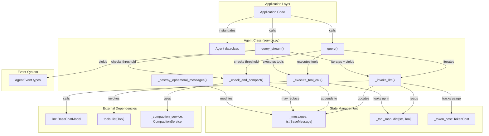
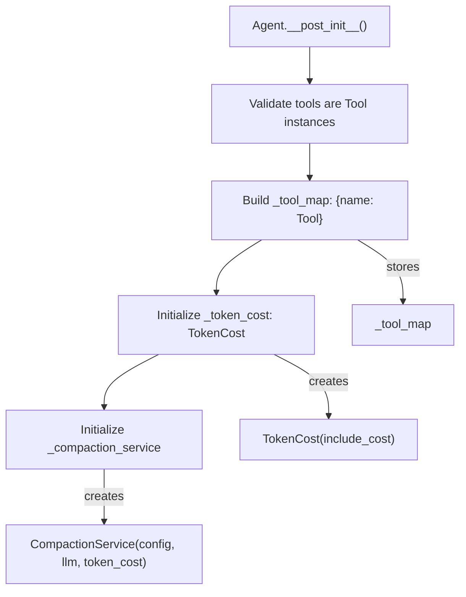
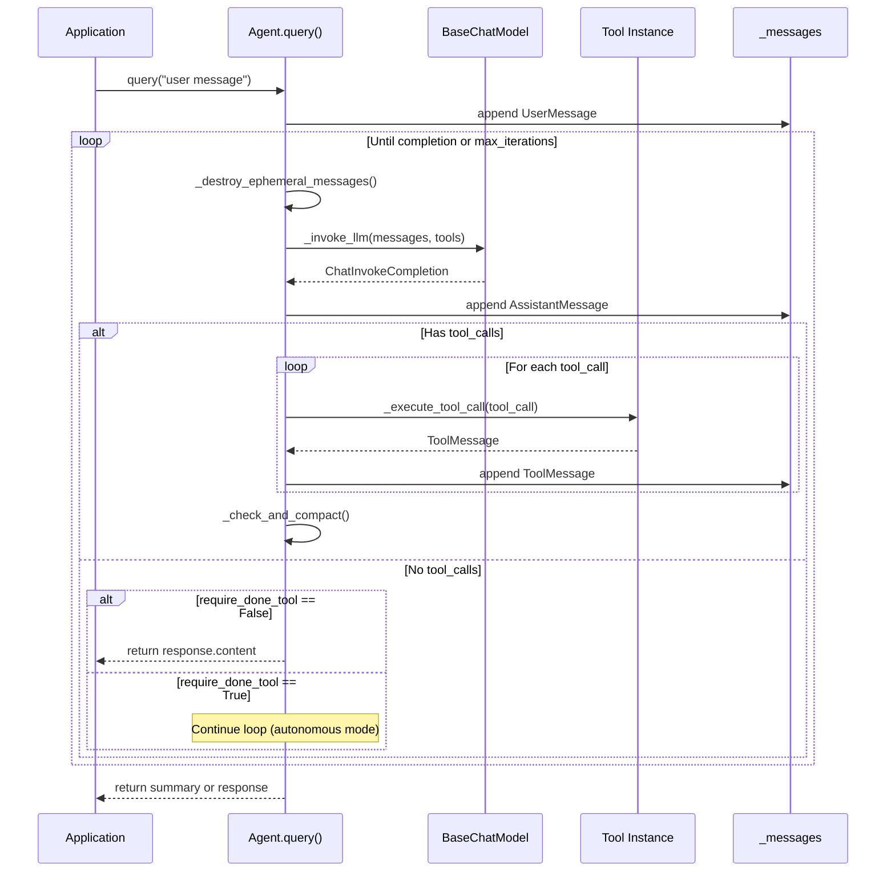
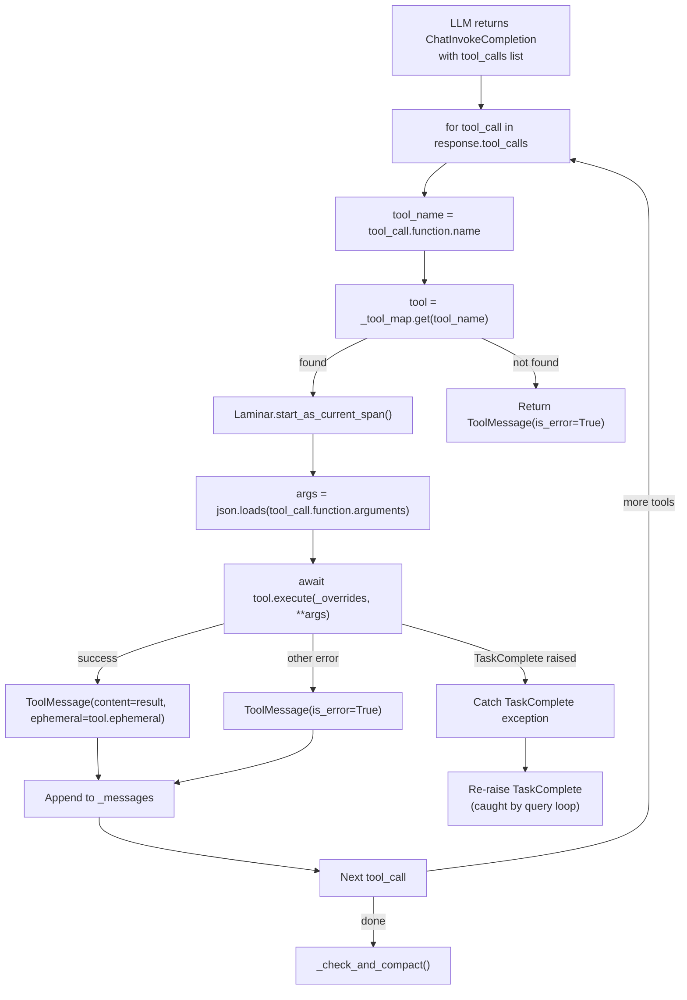

<!-- source: DeepWiki mcp.deepwiki.com · repo browser-use/agent-sdk · page 2 Agent System · fetched 2026-10-30 -->

# Agent System

<details>
<summary>Relevant source files</summary>

The following files were used as context for generating this wiki page:

- [bu_agent_sdk/agent/README.md](bu_agent_sdk/agent/README.md)
- [bu_agent_sdk/agent/__init__.py](bu_agent_sdk/agent/__init__.py)
- [bu_agent_sdk/agent/service.py](bu_agent_sdk/agent/service.py)

</details>


## Purpose and Scope

The Agent System is the core orchestration layer of the bu_agent_sdk. It implements the fundamental "agent is just a for-loop" philosophy by managing iterative interactions between a language model, a set of tools, and conversation history. This page covers the `Agent` class, its architecture, and how it coordinates the agentic loop.

For detailed information about specific subsystems:
- Agentic loop mechanics and termination conditions: See [Agentic Loop Execution](#2.1)
- Tool definition, dependency injection, and execution details: See [Tool Calling and Execution](#2.2)
- Message types, multi-turn conversations, and ephemeral messages: See [Message History and State](#2.3)
- Task completion patterns and autonomous mode: See [TaskComplete Pattern](#2.4)

**Sources:** [bu_agent_sdk/agent/service.py:1-37](), [bu_agent_sdk/agent/README.md:1-23]()

## The Agent Class

The `Agent` class is implemented as a Python dataclass located in [bu_agent_sdk/agent/service.py:98-175](). It serves as the central orchestrator that maintains state, coordinates LLM invocations, executes tools, and manages conversation history.

### Core Attributes

| Attribute | Type | Purpose |
|-----------|------|---------|
| `llm` | `BaseChatModel` | The language model provider (OpenAI, Anthropic, etc.) |
| `tools` | `list[Tool]` | Tools available for the agent to call |
| `system_prompt` | `str \| None` | Optional system-level instructions |
| `max_iterations` | `int` | Maximum LLM invocation cycles (default: 200) |
| `tool_choice` | `ToolChoice` | How LLM should choose tools: `"auto"`, `"required"`, `"none"` |
| `compaction` | `CompactionConfig \| None` | Context window management configuration |
| `dependency_overrides` | `dict \| None` | Runtime dependency injection overrides |
| `require_done_tool` | `bool` | Whether to use autonomous mode with explicit completion |

### Internal State

The Agent maintains several private attributes for state management:

- `_messages`: `list[BaseMessage]` - Complete conversation history
- `_tool_map`: `dict[str, Tool]` - Fast tool name lookup
- `_compaction_service`: `CompactionService` - Manages context window limits
- `_token_cost`: `TokenCost` - Tracks token usage and costs

**Sources:** [bu_agent_sdk/agent/service.py:98-175]()

## Agent Architecture

The following diagram shows how the `Agent` class integrates with other SDK components:



**Sources:** [bu_agent_sdk/agent/service.py:98-873]()

## Initialization and Tool Registration

The `Agent` initialization process, implemented in `__post_init__`, performs several setup tasks:



The tool map (`_tool_map`) enables O(1) lookup during tool execution. Each tool must be created with the `@tool` decorator, which wraps functions into `Tool` instances with metadata for LLM tool calling.

**Sources:** [bu_agent_sdk/agent/service.py:152-175]()

## The Agentic Loop

The core agentic loop is implemented in both `query()` and `query_stream()` methods. At a high level, the loop follows this pattern:



Key aspects:
1. **System Prompt**: Added automatically on first message if `system_prompt` is set
2. **Ephemeral Cleanup**: Old ephemeral tool outputs are removed before each LLM call
3. **Tool Execution**: All tool calls in a response are executed sequentially
4. **Compaction**: Triggered automatically after tool execution if token threshold exceeded
5. **Termination**: Determined by `require_done_tool` flag (CLI vs autonomous mode)

**Sources:** [bu_agent_sdk/agent/service.py:611-700](), [bu_agent_sdk/agent/service.py:702-873]()

## Query Methods

The Agent provides two primary interfaces for interaction:

### query(message: str) → str

Synchronous-style method that returns the final response as a string. Internally uses async/await but presents a simple interface for applications that don't need streaming.

```python
# Example from README
result = await agent.query("What is 2 + 2?")
```

**Key behaviors:**
- Adds `system_prompt` on first call if `_messages` is empty
- Runs agentic loop until completion or `max_iterations`
- Returns final text response or summary
- Handles `TaskComplete` exceptions from tools

**Sources:** [bu_agent_sdk/agent/service.py:611-700](), [bu_agent_sdk/agent/README.md:7-22]()

### query_stream(message: str | list[ContentPartTextParam | ContentPartImageParam]) → AsyncIterator[AgentEvent]

Streaming method that yields events throughout execution, providing real-time visibility into the agent's reasoning and actions.

```python
# Example from README
async for event in agent.query_stream("do something"):
    match event:
        case ToolCallEvent(tool=name, args=args):
            print(f"Calling {name}: {args}")
        case ToolResultEvent(tool=name, result=result):
            print(f"{name} returned: {result}")
        case FinalResponseEvent(content=text):
            print(f"Done: {text}")
```

**Event types yielded:**
- `TextEvent`: LLM text output
- `ThinkingEvent`: Extended thinking content (for models that support it)
- `ToolCallEvent`: Before tool execution
- `ToolResultEvent`: After tool execution
- `StepStartEvent` / `StepCompleteEvent`: Tool execution boundaries
- `FinalResponseEvent`: Always last event

**Sources:** [bu_agent_sdk/agent/service.py:702-873](), [bu_agent_sdk/agent/README.md:24-39]()

## Tool Execution Flow

The following diagram shows the code-level flow for tool execution within the agent loop:



The `_execute_tool_call()` method handles individual tool invocations with proper error handling and observability through Laminar spans.

**Sources:** [bu_agent_sdk/agent/service.py:300-393]()

## Message History Management

The `_messages` list maintains the complete conversation history as a sequence of `BaseMessage` instances. The Agent provides several methods for history management:

| Method | Purpose |
|--------|---------|
| `messages` (property) | Read-only copy of message history |
| `clear_history()` | Reset messages and token usage |
| `load_history(messages)` | Load previously saved conversation state |

### Ephemeral Message Cleanup

Tools marked with `_ephemeral` attribute have their outputs automatically cleaned up to save context window space. The `_destroy_ephemeral_messages()` method:

1. Groups ephemeral messages by tool name
2. Keeps only the last N outputs per tool (configurable via `tool.ephemeral`)
3. Optionally saves discarded content to disk (`ephemeral_storage_path`)
4. Marks messages as `destroyed=True` so serializers use placeholder text

This mechanism is critical for tools with large outputs (e.g., file contents, screenshots).

**Sources:** [bu_agent_sdk/agent/service.py:229-299](), [bu_agent_sdk/agent/README.md:74-82]()

## Configuration Options

The Agent supports extensive runtime configuration:

### Compaction Configuration

```python
from bu_agent_sdk.agent import CompactionConfig

agent = Agent(
    llm=llm,
    tools=tools,
    compaction=CompactionConfig(
        enabled=True,
        threshold_ratio=0.70,  # 70% of context window
    )
)
```

See [Context Management (Compaction)](#4) for details.

### Retry Configuration

The Agent implements exponential backoff retry logic for LLM errors:

| Attribute | Default | Purpose |
|-----------|---------|---------|
| `llm_max_retries` | 5 | Maximum retry attempts |
| `llm_retry_base_delay` | 1.0 | Initial delay in seconds |
| `llm_retry_max_delay` | 60.0 | Maximum delay cap |
| `llm_retryable_status_codes` | {429, 500, 502, 503, 504} | HTTP codes that trigger retries |

The retry logic in `_invoke_llm()` handles rate limits, timeouts, and transient errors automatically.

**Sources:** [bu_agent_sdk/agent/service.py:436-532]()

### Dependency Injection Override

```python
agent = Agent(
    llm=llm,
    tools=[query_db_tool],
    dependency_overrides={
        get_db: lambda: test_database  # Override for testing
    }
)
```

See [Dependency Injection](#6.2) for detailed usage patterns.

**Sources:** [bu_agent_sdk/agent/README.md:58-72]()

## Usage Summary Tracking

The Agent tracks token usage and costs through the `TokenCost` service:

```python
usage = await agent.get_usage()
print(f"Tokens: {usage.total_tokens}")
print(f"Cost: ${usage.total_cost:.4f}")
```

The `_token_cost` instance accumulates usage from all LLM invocations and provides summary statistics. Costs are calculated based on model-specific pricing data when `include_cost=True`.

**Sources:** [bu_agent_sdk/agent/service.py:191-197](), [bu_agent_sdk/agent/README.md:84-89]()

## Key Properties and Methods

### Properties

- `tool_definitions` → `list[ToolDefinition]`: Converts registered tools to LLM tool calling schema
- `messages` → `list[BaseMessage]`: Read-only view of conversation history
- `token_cost` → `TokenCost`: Direct access to usage tracking service

### Private Helper Methods

- `_invoke_llm()`: Wraps LLM calls with retry logic and usage tracking
- `_execute_tool_call()`: Executes a single tool with error handling and Laminar spans
- `_check_and_compact()`: Triggers compaction if token threshold exceeded
- `_destroy_ephemeral_messages()`: Cleans up old ephemeral tool outputs
- `_generate_max_iterations_summary()`: Generates summary when iteration limit reached
- `_get_incomplete_todos_prompt()`: Hook for subclasses to check task completion

**Sources:** [bu_agent_sdk/agent/service.py:176-873]()

---

