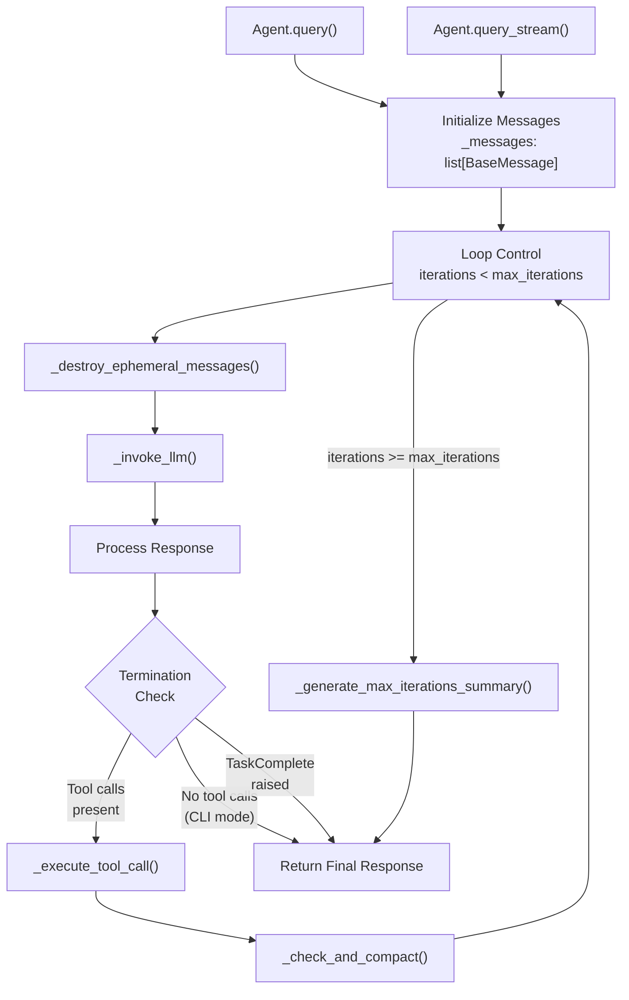
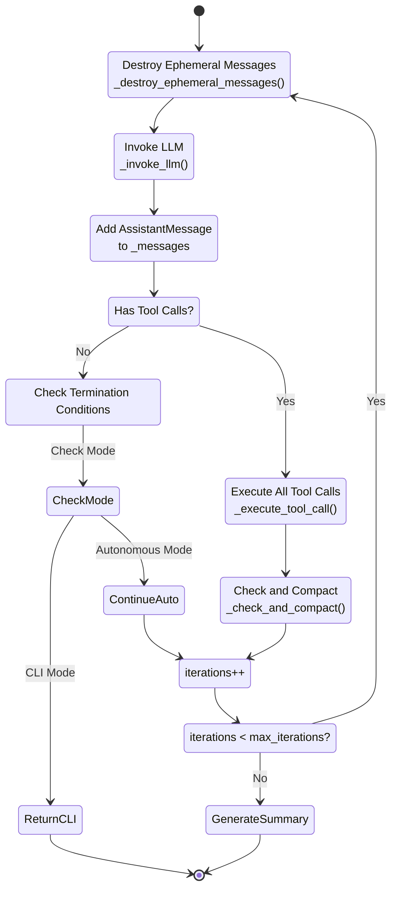
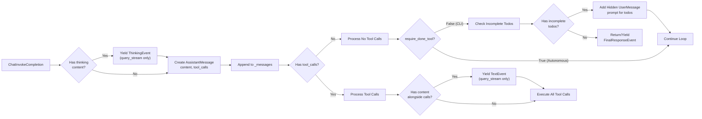
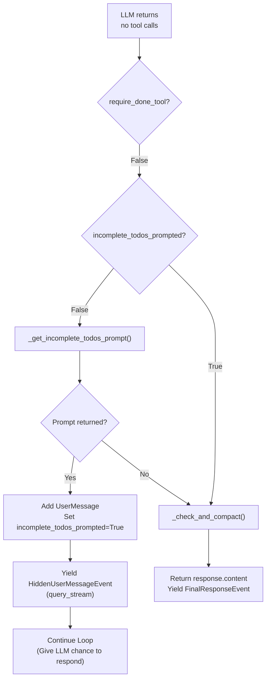
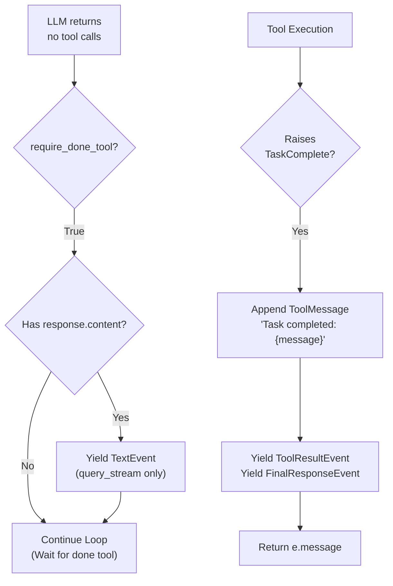
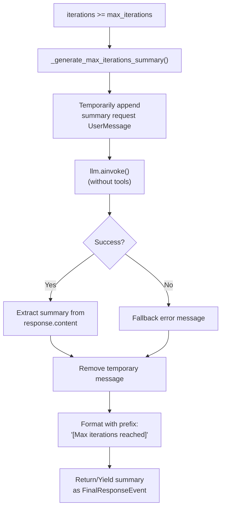

<!-- source: DeepWiki mcp.deepwiki.com · repo browser-use/agent-sdk · page 2.1 Agentic Loop Execution · fetched 2026-10-30 -->

# Agentic Loop Execution

<details>
<summary>Relevant source files</summary>

The following files were used as context for generating this wiki page:

- [README.md](README.md)
- [bu_agent_sdk/agent/service.py](bu_agent_sdk/agent/service.py)

</details>


This document details the core iterative loop that drives agent execution in bu_agent_sdk. It covers the loop's structure, LLM invocation mechanics, response processing, and termination conditions.

**Scope**: This page focuses on the mechanics of the loop itself - how iterations proceed, when the LLM is invoked, and when the loop terminates. For details about tool execution and dependency injection, see [Tool Calling and Execution](#2.2). For message history management, see [Message History and State](#2.3). For the TaskComplete pattern and mode differences, see [TaskComplete Pattern](#2.4).

---

## Overview

The agent implements the philosophy that "an agent is just a for-loop." The `Agent` class provides two primary methods that execute this loop:

| Method | Purpose | Return Type |
|--------|---------|-------------|
| `query()` | Execute agent loop and return final result | `str` |
| `query_stream()` | Execute agent loop and stream events | `AsyncIterator[AgentEvent]` |

Both methods implement the same underlying loop logic but differ in their output mechanism. The loop continues until one of three termination conditions is met:

1. **CLI Mode Termination**: LLM returns no tool calls (when `require_done_tool=False`)
2. **Autonomous Mode Termination**: A tool raises `TaskComplete` exception (when `require_done_tool=True`)
3. **Max Iterations**: The iteration counter reaches `max_iterations` (default: 200)

**Sources**: [bu_agent_sdk/agent/service.py:99-145](), [README.md:3-6]()

---

## Agent Loop Architecture

The following diagram shows the core components involved in loop execution and their relationships:



**Sources**: [bu_agent_sdk/agent/service.py:612-700](), [bu_agent_sdk/agent/service.py:702-872]()

---

## Loop Initialization

Before entering the main loop, the agent performs initialization:

### System Prompt Injection

On the first call to `query()` or `query_stream()`, if a system prompt is configured, it is added to the message history:

```python
# From service.py:631-633 (query) and 735-737 (query_stream)
if not self._messages and self.system_prompt:
    self._messages.append(SystemMessage(content=self.system_prompt, cache=True))
```

The `cache=True` flag enables prompt caching for providers that support it (e.g., Anthropic), reducing token costs for the static system prompt.

### User Message Addition

The incoming user message is appended to the message history:

```python
# service.py:636 (query) and 740 (query_stream)
self._messages.append(UserMessage(content=message))
```

Note that `query_stream()` supports multi-modal input via `list[ContentPartTextParam | ContentPartImageParam]` for text + image messages.

### Iteration Tracking

The loop maintains several counters:

| Variable | Purpose | Initial Value |
|----------|---------|---------------|
| `iterations` | Current iteration count | 0 |
| `incomplete_todos_prompted` | Whether incomplete todos prompt was shown | `False` |

**Sources**: [bu_agent_sdk/agent/service.py:631-642](), [bu_agent_sdk/agent/service.py:735-745]()

---

## Main Loop Structure

The core loop executes while `iterations < max_iterations`:



**Sources**: [bu_agent_sdk/agent/service.py:644-700]()

---

## LLM Invocation

The `_invoke_llm()` method handles LLM invocation with retry logic:

```mermaid
flowchart TD
    start["_invoke_llm()"] --> attempt{"Retry Attempt<br/>(max: llm_max_retries)"}
    
    attempt --> call["llm.ainvoke()<br/>messages, tools, tool_choice"]
    
    call --> success{"Success?"}
    success -->|"Yes"| track["Track Token Usage<br/>_token_cost.add_usage()"]
    track --> return_response["Return ChatInvokeCompletion"]
    
    success -->|"ModelRateLimitError"| check_rate["Check Remaining<br/>Retries"]
    success -->|"ModelProviderError"| check_status{"Status Code<br/>in llm_retryable_status_codes?"}
    success -->|"Timeout/Connection"| check_timeout["Check Error Type"]
    
    check_rate -->|"Has retries"| backoff_rate["Exponential Backoff<br/>base: llm_retry_base_delay<br/>max: llm_retry_max_delay"]
    check_rate -->|"Exhausted"| raise_error["Raise Exception"]
    
    check_status -->|"Yes"| backoff_rate
    check_status -->|"No"| raise_error
    
    check_timeout -->|"Retryable"| backoff_rate
    check_timeout -->|"Not retryable"| raise_error
    
    backoff_rate --> sleep["asyncio.sleep()<br/>delay + 10% jitter"]
    sleep --> attempt
    
    raise_error --> end["Exception Propagates"]
    return_response --> end
```

### Retry Configuration

The retry mechanism uses exponential backoff with configurable parameters:

| Parameter | Default | Description |
|-----------|---------|-------------|
| `llm_max_retries` | 5 | Maximum retry attempts |
| `llm_retry_base_delay` | 1.0 | Base delay in seconds |
| `llm_retry_max_delay` | 60.0 | Maximum delay cap |
| `llm_retryable_status_codes` | {429, 500, 502, 503, 504} | HTTP codes triggering retry |

The backoff formula is: `min(base_delay * 2^attempt, max_delay) + jitter`, where jitter is 10% of the delay.

### Retryable Error Types

1. **Rate Limits** (`ModelRateLimitError`): Always retryable
2. **Provider Errors** (`ModelProviderError`): Retryable if status code matches
3. **Timeouts/Connection Errors**: Detected via string matching in error message

**Sources**: [bu_agent_sdk/agent/service.py:436-532](), [bu_agent_sdk/agent/service.py:135-144]()

---

## Response Processing

After LLM invocation, the response is processed and added to message history:



**Sources**: [bu_agent_sdk/agent/service.py:651-697](), [bu_agent_sdk/agent/service.py:753-868]()

---

## Tool Execution Flow

When tool calls are present, each is executed sequentially:

```mermaid
sequenceDiagram
    participant Loop as "Agent Loop"
    participant Execute as "_execute_tool_call()"
    participant Tool as "Tool Instance"
    participant Laminar as "Laminar (Optional)"
    
    Loop->>Loop: Yield StepStartEvent
    Loop->>Loop: Yield ToolCallEvent
    
    Loop->>Execute: tool_call
    
    Execute->>Laminar: start_as_current_span()
    
    Execute->>Execute: json.loads(arguments)
    Execute->>Tool: execute(**args, _overrides)
    
    alt Success
        Tool-->>Execute: result
        Execute->>Execute: Create ToolMessage(ephemeral)
        Execute->>Laminar: set_span_output(result)
    else TaskComplete
        Tool-->>Execute: raise TaskComplete
        Execute->>Laminar: set_span_output(task_complete)
        Execute-->>Loop: re-raise TaskComplete
    else Error
        Tool-->>Execute: raise Exception
        Execute->>Execute: Create ToolMessage(is_error=True)
        Execute->>Laminar: set_span_output(error)
    end
    
    Execute-->>Loop: ToolMessage
    
    Loop->>Loop: Append ToolMessage to _messages
    Loop->>Loop: Yield ToolResultEvent
    Loop->>Loop: Yield StepCompleteEvent
```

The `ephemeral` flag on `ToolMessage` is set based on the tool's `_ephemeral` attribute, which determines whether the message is subject to automatic cleanup (see [Ephemeral Messages](#10.2) for details).

**Sources**: [bu_agent_sdk/agent/service.py:300-393](), [bu_agent_sdk/agent/service.py:796-865]()

---

## Termination Conditions

The loop terminates under three distinct scenarios:

### 1. CLI Mode Completion

When `require_done_tool=False`, the loop terminates when the LLM returns a response without tool calls:



The incomplete todos check provides a hook for subclasses to ensure tasks are completed before finishing (used in browser-use for todo validation).

**Sources**: [bu_agent_sdk/agent/service.py:661-675](), [bu_agent_sdk/agent/service.py:768-786]()

### 2. Autonomous Mode Completion

When `require_done_tool=True`, the loop only terminates via `TaskComplete` exception:



The `TaskComplete` exception is caught during tool execution and converted into a successful completion. See [TaskComplete Pattern](#2.4) for full details.

**Sources**: [bu_agent_sdk/agent/service.py:685-694](), [bu_agent_sdk/agent/service.py:847-865]()

### 3. Max Iterations Reached

When the iteration counter reaches `max_iterations`, the loop generates a summary:



The summary generation uses the same LLM to produce a concise description of what was accomplished and what remains incomplete.

**Sources**: [bu_agent_sdk/agent/service.py:534-567](), [bu_agent_sdk/agent/service.py:699-700](), [bu_agent_sdk/agent/service.py:870-872]()

---

## Integration with Supporting Systems

### Ephemeral Message Cleanup

At the start of each iteration, `_destroy_ephemeral_messages()` is called to manage context window usage:

```python
# service.py:647-648 (query) and 750-751 (query_stream)
self._destroy_ephemeral_messages()
```

This method processes all `ToolMessage` instances marked as ephemeral, keeping only the most recent N outputs per tool (where N is defined by the tool's `_ephemeral` attribute). Older messages have their content replaced with `<removed to save context>` or saved to disk if `ephemeral_storage_path` is configured.

**Sources**: [bu_agent_sdk/agent/service.py:229-298](), [bu_agent_sdk/agent/service.py:647-648]()

### Compaction Check

After tool execution completes, `_check_and_compact()` evaluates whether token usage exceeds the configured threshold:

```python
# service.py:697 (query) and 868 (query_stream)
await self._check_and_compact(response)
```

If compaction is triggered, the conversation history is summarized and replaced with a condensed version. See [Compaction Service Logic](#4.2) for details on the compaction algorithm.

**Sources**: [bu_agent_sdk/agent/service.py:582-609](), [bu_agent_sdk/agent/service.py:697]()

### Event Streaming

The `query_stream()` method yields `AgentEvent` instances at key points:

| Event Type | When Yielded | Purpose |
|------------|--------------|---------|
| `ThinkingEvent` | LLM returns thinking content | Show model's reasoning |
| `TextEvent` | LLM returns text content | Display intermediate responses |
| `StepStartEvent` | Before tool execution | Mark logical operation start |
| `ToolCallEvent` | Tool is about to execute | Show tool name and arguments |
| `ToolResultEvent` | Tool execution completes | Show tool output or error |
| `StepCompleteEvent` | After tool execution | Mark operation end with duration |
| `HiddenUserMessageEvent` | Internal prompt added | Debug incomplete todos prompt |
| `FinalResponseEvent` | Loop terminates | Signal completion |

See [Event System](#3) for comprehensive event documentation.

**Sources**: [bu_agent_sdk/agent/service.py:702-872](), [bu_agent_sdk/agent/events.py]()

---

## Loop Execution Summary

The following table summarizes the key decision points and their outcomes:

| Condition | Action | Next State |
|-----------|--------|------------|
| First message + system_prompt exists | Add SystemMessage(cache=True) | Continue initialization |
| iterations >= max_iterations | Generate summary via LLM | Terminate with summary |
| response.has_tool_calls | Execute all tools sequentially | Continue loop |
| !response.has_tool_calls + !require_done_tool | Check incomplete todos, then return | Terminate with response |
| !response.has_tool_calls + require_done_tool | Yield text if present | Continue loop |
| TaskComplete raised during execution | Return/yield completion message | Terminate with message |
| Token usage > threshold | Invoke compaction service | Continue with compacted history |

**Sources**: [bu_agent_sdk/agent/service.py:612-872]()

---

