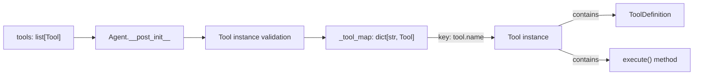
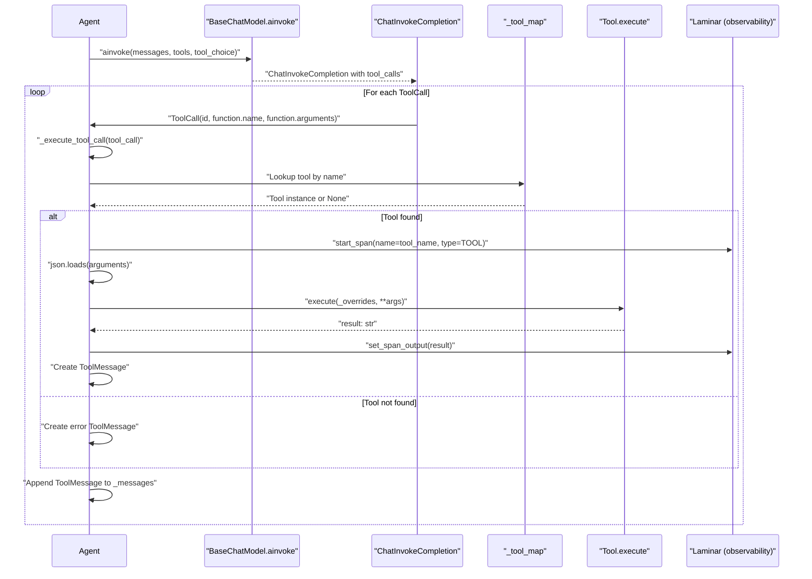
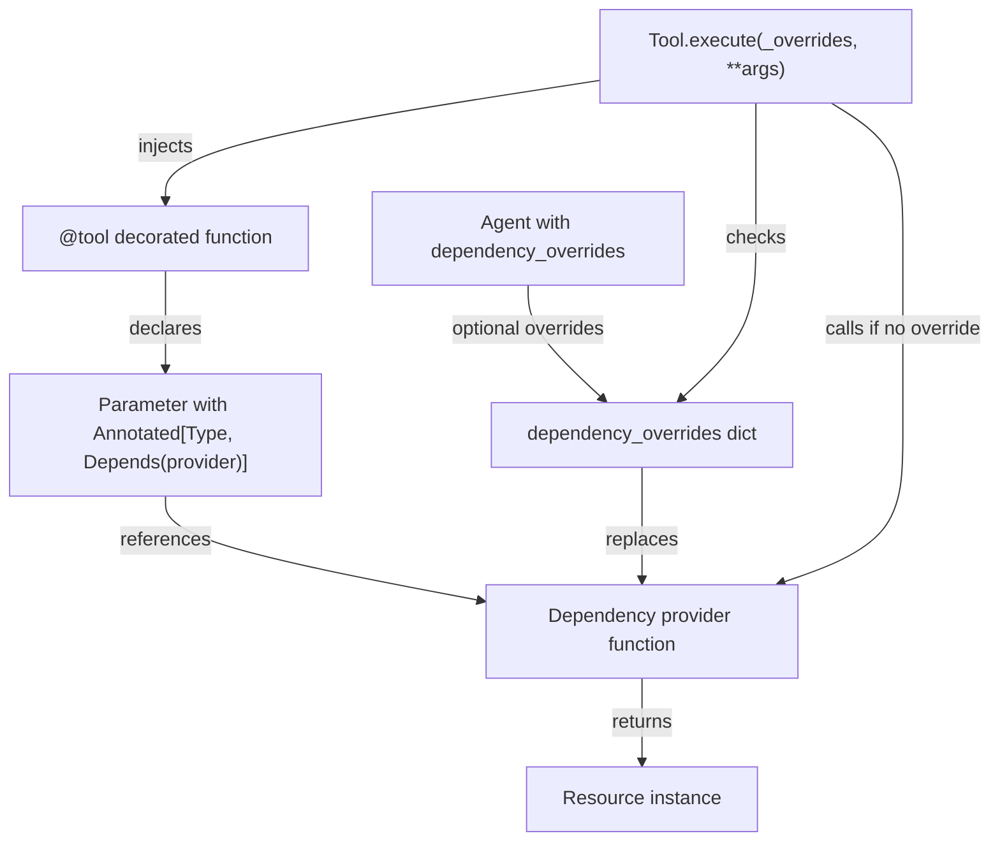
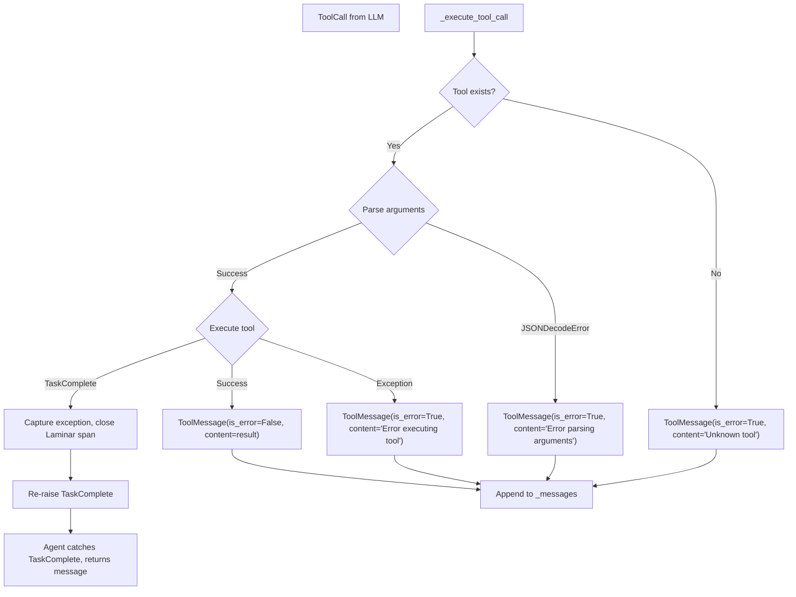
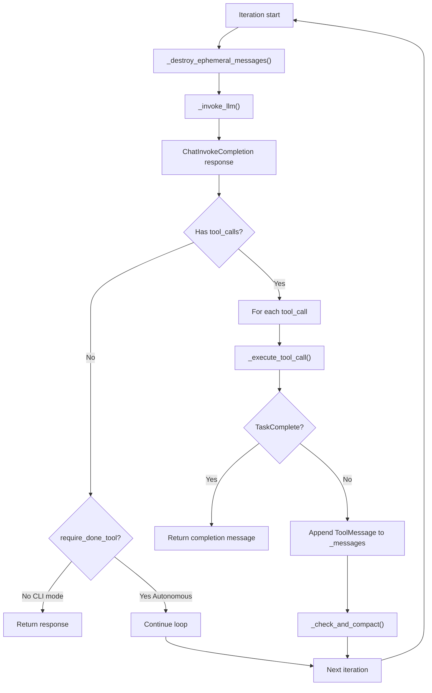

<!-- source: DeepWiki mcp.deepwiki.com · repo browser-use/agent-sdk · page 2.2 Tool Calling and Execution · fetched 2026-10-30 -->

# Tool Calling and Execution

<details>
<summary>Relevant source files</summary>

The following files were used as context for generating this wiki page:

- [bu_agent_sdk/agent/README.md](bu_agent_sdk/agent/README.md)
- [bu_agent_sdk/agent/service.py](bu_agent_sdk/agent/service.py)
- [bu_agent_sdk/examples/dependency_injection.py](bu_agent_sdk/examples/dependency_injection.py)

</details>


This page explains how tools are defined, registered, and executed within the bu_agent_sdk Agent system. It covers the `@tool` decorator, tool parameter handling, the execution flow from LLM response to tool invocation, dependency injection with `Depends`, and error handling mechanisms.

For information about the broader agentic loop that triggers tool execution, see [Agentic Loop Execution](#2.1). For details on the `TaskComplete` pattern that tools can use to signal completion, see [TaskComplete Pattern](#2.4). For a comprehensive guide on defining tools with various parameter types, see [Defining Tools](#6.1).

## Tool Definition with @tool Decorator

Tools are Python functions decorated with `@tool` that the LLM can invoke during agent execution. The decorator transforms a regular function into a `Tool` instance that provides metadata and execution capabilities.

### Basic Tool Structure

```python
from bu_agent_sdk.tools import tool

@tool("Add two numbers")
async def add(a: int, b: int) -> int:
    return a + b
```

The `@tool` decorator:
- Takes a description string as its argument (used by the LLM to understand the tool's purpose)
- Wraps the function into a `Tool` instance
- Extracts parameter information from function signature
- Creates a `ToolDefinition` for LLM tool calling APIs

**Sources:** [bu_agent_sdk/agent/README.md:12-14]()

### Tool Parameters

Tools support multiple parameter types:

| Parameter Type | Description | Example |
|----------------|-------------|---------|
| Simple types | `str`, `int`, `float`, `bool` | `async def search(query: str)` |
| Pydantic models | Groups related parameters | `async def send_email(params: EmailParams)` |
| Annotated dependencies | Injected resources via `Depends` | `async def query(sql: str, db: Annotated[Database, Depends(get_db)])` |

**Sources:** [bu_agent_sdk/agent/README.md:41-56](), [bu_agent_sdk/agent/README.md:58-72]()

### Pydantic Model Parameters

For tools with multiple related parameters, Pydantic models provide structure:

```python
from pydantic import BaseModel, Field

class EmailParams(BaseModel):
    to: str = Field(description="Recipient")
    subject: str
    body: str

@tool("Send an email")
async def send_email(params: EmailParams) -> str:
    return f"Sent to {params.to}"
```

The agent serializes Pydantic models into the tool definition schema and deserializes JSON arguments back into model instances during execution.

**Sources:** [bu_agent_sdk/agent/README.md:45-56]()

## Tool Registration and Lookup

When an `Agent` is instantiated, tools are registered in an internal lookup map for fast execution.



**Tool Registration Process:**

1. **Validation** - Agent validates that all items in `tools` list are `Tool` instances [bu_agent_sdk/agent/service.py:153-157]()
2. **Mapping** - Builds `_tool_map` dictionary keyed by tool name [bu_agent_sdk/agent/service.py:160]()
3. **Definition Extraction** - The `tool_definitions` property provides `ToolDefinition` list for LLM invocation [bu_agent_sdk/agent/service.py:177-179]()

**Sources:** [bu_agent_sdk/agent/service.py:152-160](), [bu_agent_sdk/agent/service.py:177-179]()

## Tool Execution Flow

The complete flow from LLM response to tool execution involves multiple components working together.

### High-Level Execution Sequence



**Sources:** [bu_agent_sdk/agent/service.py:680-695](), [bu_agent_sdk/agent/service.py:300-394]()

### _execute_tool_call Method

The `_execute_tool_call` method at [bu_agent_sdk/agent/service.py:300-394]() handles individual tool invocations:

**Execution Steps:**

1. **Lookup** - Retrieve `Tool` from `_tool_map` by `tool_call.function.name`
2. **Unknown Tool Handling** - Return error `ToolMessage` if tool not found [bu_agent_sdk/agent/service.py:305-311]()
3. **Observability Span** - Create Laminar span for tool execution tracking [bu_agent_sdk/agent/service.py:314-324]()
4. **Argument Parsing** - Deserialize JSON arguments [bu_agent_sdk/agent/service.py:332]()
5. **Tool Execution** - Call `tool.execute(_overrides=dependency_overrides, **args)` [bu_agent_sdk/agent/service.py:335-337]()
6. **Result Packaging** - Create `ToolMessage` with result and metadata [bu_agent_sdk/agent/service.py:342-348]()
7. **Error Handling** - Catch exceptions and return error `ToolMessage` [bu_agent_sdk/agent/service.py:362-386]()

**Sources:** [bu_agent_sdk/agent/service.py:300-394]()

### ToolMessage Construction

Tool execution results are wrapped in `ToolMessage` instances:

```python
ToolMessage(
    tool_call_id=tool_call.id,      # Links to original ToolCall
    tool_name=tool_name,             # Tool identifier
    content=result,                  # String result or error message
    is_error=False,                  # Indicates execution failure
    ephemeral=is_ephemeral,          # Whether content should be destroyed
)
```

These messages are appended to `_messages` history and sent back to the LLM in the next iteration.

**Sources:** [bu_agent_sdk/agent/service.py:342-348](), [bu_agent_sdk/agent/service.py:684]()

## Dependency Injection with Depends

The SDK provides a dependency injection system inspired by FastAPI's `Depends` mechanism, allowing tools to receive shared resources without coupling to specific instances.

### Dependency Definition Pattern



**Example from codebase:**

```python
from typing import Annotated
from bu_agent_sdk.tools import Depends

def get_database() -> Database:
    """Dependency provider - creates/returns Database instance"""
    return Database(users={...})

@tool("Query database")
async def query(sql: str, db: Annotated[Database, Depends(get_database)]) -> str:
    """Tool with injected dependency"""
    return await db.execute(sql)
```

**Sources:** [bu_agent_sdk/examples/dependency_injection.py:36-54](), [bu_agent_sdk/examples/dependency_injection.py:57-64](), [bu_agent_sdk/agent/README.md:62-72]()

### Dependency Resolution Process

1. **Annotation Detection** - Tool decorator extracts `Depends` from `Annotated` type hints
2. **Provider Storage** - Dependency provider functions are stored in the `Tool` instance
3. **Runtime Resolution** - During `tool.execute()`, the SDK:
   - Checks `dependency_overrides` dict first [bu_agent_sdk/agent/service.py:335-337]()
   - If no override, calls the provider function
   - Injects the result as a keyword argument to the tool function
4. **Override Support** - `Agent.dependency_overrides` allows runtime substitution for testing/configuration

**Sources:** [bu_agent_sdk/agent/service.py:335-337](), [bu_agent_sdk/agent/service.py:121](), [bu_agent_sdk/agent/service.py:130]()

### Dependency Overrides for Testing

The `dependency_overrides` parameter on `Agent` enables swapping dependencies without modifying tool definitions:

```python
# Production
agent = Agent(llm=llm, tools=[query_tool])

# Testing with mock DB
mock_db = MockDatabase()
agent = Agent(
    llm=llm, 
    tools=[query_tool],
    dependency_overrides={get_database: lambda: mock_db}
)
```

**Sources:** [bu_agent_sdk/agent/service.py:121](), [bu_agent_sdk/agent/service.py:130]()

## Error Handling

Tool execution includes comprehensive error handling at multiple levels:

### Error Types and Handling

| Error Type | Source | Handling | Result |
|------------|--------|----------|--------|
| Unknown tool | Tool not in `_tool_map` | Return error `ToolMessage` immediately | LLM sees error message [bu_agent_sdk/agent/service.py:305-311]() |
| JSON parse error | Malformed `tool_call.function.arguments` | Catch `json.JSONDecodeError` | Error `ToolMessage` with parse details [bu_agent_sdk/agent/service.py:362-371]() |
| Tool execution error | Exception during `tool.execute()` | Catch `Exception` | Error `ToolMessage` with exception message [bu_agent_sdk/agent/service.py:377-386]() |
| `TaskComplete` | Tool signals task completion | Catch and re-raise after span closes | Agent stops iteration, returns completion message [bu_agent_sdk/agent/service.py:372-390]() |

**Sources:** [bu_agent_sdk/agent/service.py:305-311](), [bu_agent_sdk/agent/service.py:362-386]()

### Error Message Flow



**Sources:** [bu_agent_sdk/agent/service.py:305-311](), [bu_agent_sdk/agent/service.py:362-386](), [bu_agent_sdk/agent/service.py:372-390]()

### Laminar Observability Integration

Each tool execution is wrapped in a Laminar span for tracing:

- **Span Creation** - `Laminar.start_as_current_span(name=tool_name, span_type="TOOL")` [bu_agent_sdk/agent/service.py:315-322]()
- **Input Logging** - Tool name and arguments logged at span start [bu_agent_sdk/agent/service.py:317-320]()
- **Output Logging** - Result or error logged at span completion [bu_agent_sdk/agent/service.py:352-358](), [bu_agent_sdk/agent/service.py:365](), [bu_agent_sdk/agent/service.py:380]()
- **TaskComplete Handling** - Logged as clean completion, not error [bu_agent_sdk/agent/service.py:374-376]()

**Sources:** [bu_agent_sdk/agent/service.py:314-324](), [bu_agent_sdk/agent/service.py:351-358]()

## Ephemeral Tools

Tools can mark their outputs as ephemeral, indicating that the content should be destroyed after a certain number of iterations to save context window space.

### Ephemeral Configuration

Tools specify ephemeral behavior via the `_ephemeral` attribute:
- `_ephemeral = True` - Keep only the last 1 output
- `_ephemeral = 3` - Keep only the last 3 outputs
- `_ephemeral = False` (default) - Keep all outputs

### Destruction Process

The `_destroy_ephemeral_messages` method [bu_agent_sdk/agent/service.py:229-299]() runs before each LLM invocation:

1. **Group by Tool** - Collect all ephemeral `ToolMessage` instances by `tool_name` [bu_agent_sdk/agent/service.py:243-256]()
2. **Determine Keep Count** - Read `tool.ephemeral` value from `_tool_map` [bu_agent_sdk/agent/service.py:260-265]()
3. **Select Messages to Destroy** - Keep last N, destroy older ones [bu_agent_sdk/agent/service.py:268]()
4. **Optional Storage** - If `ephemeral_storage_path` is set, save content to disk [bu_agent_sdk/agent/service.py:277-295]()
5. **Mark Destroyed** - Set `msg.destroyed = True` so serializers use placeholder text [bu_agent_sdk/agent/service.py:298]()

Destroyed messages show `<removed to save context>` to the LLM instead of full content.

**Sources:** [bu_agent_sdk/agent/service.py:229-299](), [bu_agent_sdk/agent/service.py:131-132]()

## Tool Call Iteration Loop

Tools are executed within the agent's main iteration loop. The loop structure at [bu_agent_sdk/agent/service.py:644-698]() operates as follows:



**Key Points:**

- Ephemeral messages destroyed before each LLM invocation [bu_agent_sdk/agent/service.py:648]()
- All tool calls in a response executed sequentially [bu_agent_sdk/agent/service.py:680-694]()
- `TaskComplete` exception breaks the loop immediately [bu_agent_sdk/agent/service.py:685-694]()
- Compaction check runs after all tool executions [bu_agent_sdk/agent/service.py:697]()

**Sources:** [bu_agent_sdk/agent/service.py:644-698](), [bu_agent_sdk/agent/service.py:680-694]()

## Tool Choice Configuration

The `tool_choice` parameter on `Agent` controls how the LLM selects tools:

| Value | Behavior | Use Case |
|-------|----------|----------|
| `"auto"` (default) | LLM decides whether to call tools | General-purpose agents |
| `"required"` | LLM must call at least one tool | Force tool usage |
| `"none"` | LLM cannot call tools | Disable tool calling |

The `tool_choice` is passed to `llm.ainvoke()` at [bu_agent_sdk/agent/service.py:445-449]().

**Sources:** [bu_agent_sdk/agent/service.py:117](), [bu_agent_sdk/agent/service.py:127](), [bu_agent_sdk/agent/service.py:448]()

---

