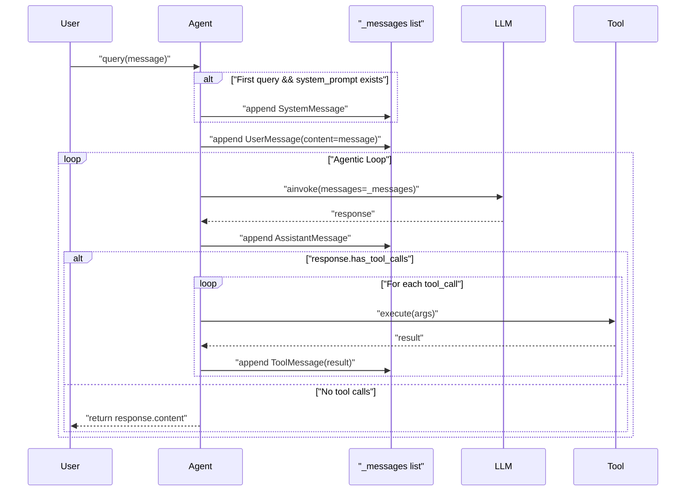
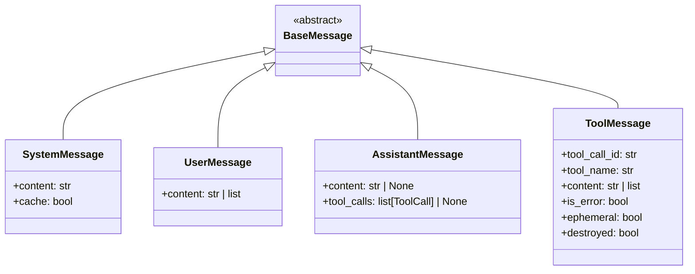
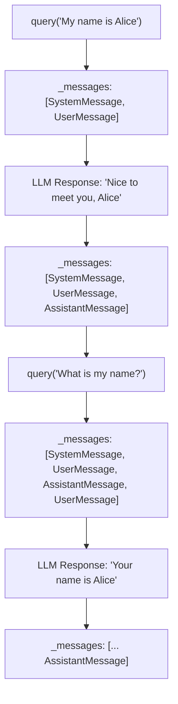
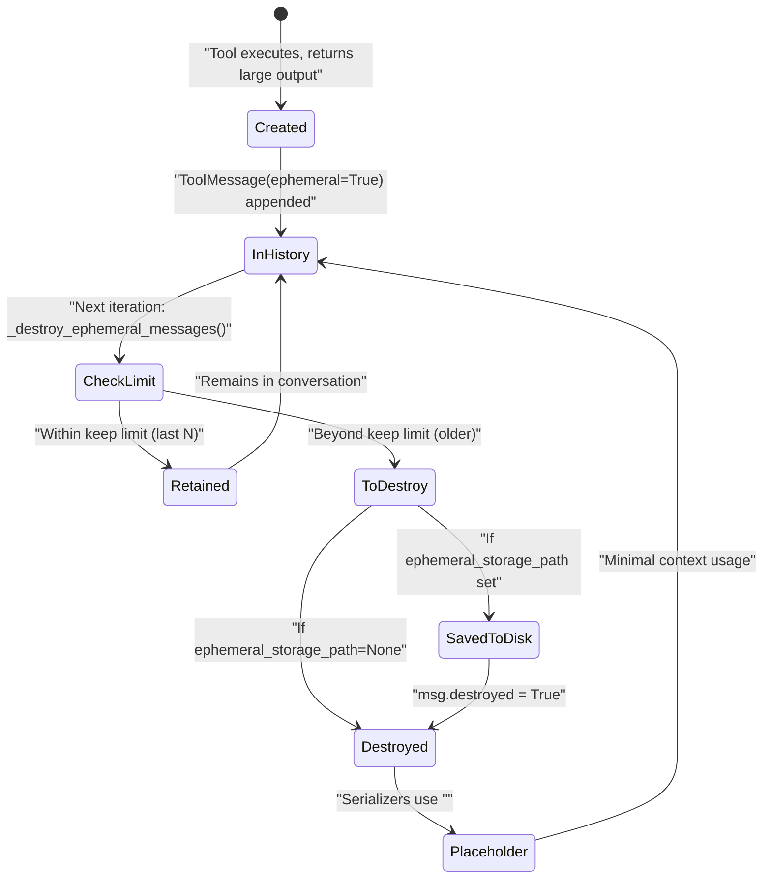
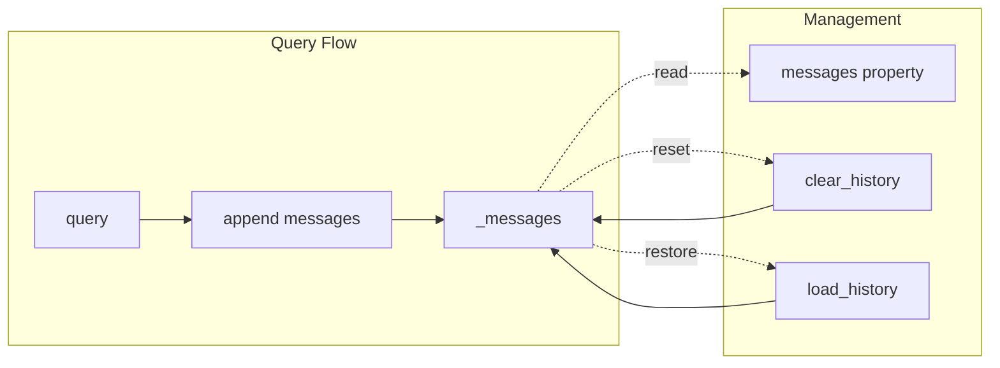

<!-- source: DeepWiki mcp.deepwiki.com · repo browser-use/agent-sdk · page 2.3 Message History and State · fetched 2026-10-30 -->

# Message History and State

<details>
<summary>Relevant source files</summary>

The following files were used as context for generating this wiki page:

- [bu_agent_sdk/agent/README.md](bu_agent_sdk/agent/README.md)
- [bu_agent_sdk/agent/service.py](bu_agent_sdk/agent/service.py)

</details>


## Purpose and Scope

This page describes how the Agent manages conversation history and state across multiple interactions. It covers the internal `_messages` list, different message types, multi-turn conversation support, and ephemeral message management for handling large tool outputs.

For information about how messages are serialized to provider-specific formats, see [Message Serialization](#5.4). For details on the agentic loop that processes messages, see [Agentic Loop Execution](#2.1).

---

## Message History Architecture

The Agent maintains conversation state in an internal `_messages` list that accumulates messages across all interactions. This list serves as the complete conversation history sent to the LLM on each invocation.

### Core Data Structure

The message history is stored in the `_messages` field:

[bu_agent_sdk/agent/service.py:147]()

```python
_messages: list[BaseMessage] = field(default_factory=list, repr=False)
```

This list is append-only during normal operation and contains all messages in chronological order:
- System prompts
- User queries
- Assistant responses
- Tool execution results

### Message Flow Through Agent Loop

The following diagram shows how messages are added to history during agent execution:



**Sources:** [bu_agent_sdk/agent/service.py:612-700]()

---

## Message Types

The SDK defines four primary message types, all inheriting from `BaseMessage`:

| Message Type | Purpose | Added When | Key Fields |
|-------------|---------|------------|------------|
| `SystemMessage` | System-level instructions | First query (if `system_prompt` set) | `content`, `cache` |
| `UserMessage` | User input | Each `query()` or `query_stream()` call | `content` (string or content parts) |
| `AssistantMessage` | LLM response | After each LLM invocation | `content`, `tool_calls` |
| `ToolMessage` | Tool execution result | After each tool execution | `tool_call_id`, `tool_name`, `content`, `is_error`, `ephemeral` |

### Message Type Hierarchy



**Sources:** [bu_agent_sdk/llm/messages.py]()

### SystemMessage

System messages configure the LLM's behavior and are added once at the start of a conversation:

[bu_agent_sdk/agent/service.py:631-633]()

```python
if not self._messages and self.system_prompt:
    self._messages.append(SystemMessage(content=self.system_prompt, cache=True))
```

The `cache=True` parameter enables prompt caching on providers that support it (e.g., Anthropic), reducing token costs for repeated system prompts.

### UserMessage

User messages represent input from the application or end user. They support both simple text and multi-modal content:

[bu_agent_sdk/agent/service.py:636]()

```python
self._messages.append(UserMessage(content=message))
```

In `query_stream()`, the content can be a list of `ContentPartTextParam` or `ContentPartImageParam` for multi-modal inputs.

### AssistantMessage

Assistant messages capture LLM responses, including both text content and tool call requests:

[bu_agent_sdk/agent/service.py:654-658]()

```python
assistant_msg = AssistantMessage(
    content=response.content,
    tool_calls=response.tool_calls if response.tool_calls else None,
)
self._messages.append(assistant_msg)
```

When the LLM requests tool calls, `tool_calls` contains a list of `ToolCall` objects specifying which tools to invoke and with what arguments.

### ToolMessage

Tool messages contain the results of tool executions and are always paired with a corresponding `AssistantMessage` that requested the tool call:

[bu_agent_sdk/agent/service.py:342-348]()

```python
tool_message = ToolMessage(
    tool_call_id=tool_call.id,
    tool_name=tool_name,
    content=result,
    is_error=False,
    ephemeral=is_ephemeral,
)
```

The `tool_call_id` links the result back to the specific tool call request. The `ephemeral` flag indicates whether this message should be automatically cleaned up (see Ephemeral Messages section).

**Sources:** [bu_agent_sdk/agent/service.py:300-393](), [bu_agent_sdk/llm/messages.py]()

---

## Multi-turn Conversations

The Agent preserves conversation history across multiple `query()` calls, enabling context-aware follow-up interactions.

### Conversation Continuity



**Example from documentation:**

[bu_agent_sdk/agent/README.md:74-82]()

```python
await agent.query("My name is Alice")
await agent.query("What's my name?")  # Remembers "Alice"
agent.clear_history()  # Reset
```

The system prompt is only added once, on the first query:

[bu_agent_sdk/agent/service.py:631-633]()

```python
if not self._messages and self.system_prompt:
    self._messages.append(SystemMessage(content=self.system_prompt, cache=True))
```

Subsequent queries simply append new `UserMessage` instances to the existing history.

**Sources:** [bu_agent_sdk/agent/README.md:74-82](), [bu_agent_sdk/agent/service.py:631-637]()

---

## Ephemeral Messages

Ephemeral messages are tool results that can be automatically removed from conversation history to conserve context window space. This is critical for tools that produce large outputs (e.g., file contents, screenshots).

### Ephemeral Message Configuration

Tools declare themselves as ephemeral using the `_ephemeral` attribute:

```python
@tool("Read file contents", _ephemeral=3)
async def read_file(path: str) -> str:
    return file_contents  # May be very large
```

The `_ephemeral` value controls retention:
- `_ephemeral=True`: Keep last 1 result
- `_ephemeral=N` (integer): Keep last N results
- `_ephemeral=False` or unset: Never destroy

### Ephemeral Message Lifecycle



### Destruction Process

The `_destroy_ephemeral_messages()` method is called before each LLM invocation:

[bu_agent_sdk/agent/service.py:647-648]()

```python
# Destroy ephemeral messages from previous iteration before LLM sees them again
self._destroy_ephemeral_messages()
```

The destruction process:

1. **Group by tool name**: [bu_agent_sdk/agent/service.py:243-256]()
   ```python
   for msg in self._messages:
       if isinstance(msg, ToolMessage) and msg.ephemeral and not msg.destroyed:
           ephemeral_by_tool[msg.tool_name].append(msg)
   ```

2. **Determine keep count**: [bu_agent_sdk/agent/service.py:261-265]()
   ```python
   tool = self._tool_map.get(tool_name)
   keep_count = tool.ephemeral if isinstance(tool.ephemeral, int) else 1
   ```

3. **Identify messages to destroy**: [bu_agent_sdk/agent/service.py:267-268]()
   ```python
   messages_to_destroy = messages[:-keep_count] if keep_count > 0 else messages
   ```

4. **Optional disk storage**: [bu_agent_sdk/agent/service.py:276-295]()
   ```python
   if self.ephemeral_storage_path is not None:
       filepath = self.ephemeral_storage_path / f"{msg.tool_call_id}.json"
       filepath.write_text(json.dumps(saved_data, indent=2))
   ```

5. **Mark as destroyed**: [bu_agent_sdk/agent/service.py:298]()
   ```python
   msg.destroyed = True
   ```

When a message is marked `destroyed=True`, message serializers replace its content with a placeholder string to minimize context usage while maintaining the conversation structure.

**Sources:** [bu_agent_sdk/agent/service.py:229-298](), [bu_agent_sdk/agent/service.py:647-648]()

---

## History Management Operations

The Agent provides methods to inspect and manipulate conversation history.

### Reading Message History

The `messages` property provides read-only access to the current history:

[bu_agent_sdk/agent/service.py:182-184]()

```python
@property
def messages(self) -> list[BaseMessage]:
    """Get the current message history (read-only copy)."""
    return list(self._messages)
```

This returns a copy to prevent external modifications that could corrupt internal state.

### Clearing History

The `clear_history()` method resets both message history and token usage tracking:

[bu_agent_sdk/agent/service.py:199-202]()

```python
def clear_history(self):
    """Clear the message history and token usage."""
    self._messages = []
    self._token_cost.clear_history()
```

This is useful for starting fresh conversations or implementing session boundaries.

### Loading Previous Conversations

The `load_history()` method restores a previously saved conversation state:

[bu_agent_sdk/agent/service.py:204-227]()

```python
def load_history(self, messages: list[BaseMessage]) -> None:
    """Load message history to continue a previous conversation.
    
    Note: The system prompt will NOT be re-added on the next query()
    call since _messages will be non-empty.
    """
    self._messages = list(messages)
    self._token_cost.clear_history()
```

**Important:** When loading history, the system prompt is NOT automatically re-added because `_messages` is non-empty. If the loaded history doesn't include the system prompt, you must add it manually:

```python
messages = load_from_database()
agent.load_history(messages)
# If messages[0] is not a SystemMessage, you may need to prepend it
```

### History Management Flow



**Sources:** [bu_agent_sdk/agent/service.py:182-227]()

---

## State Preservation Across Compaction

When the Compaction service triggers (see [Context Management](#4)), the message history is replaced with a summary, but the conversation state is logically preserved:

[bu_agent_sdk/agent/service.py:599-609]()

```python
new_messages, result = await self._compaction_service.check_and_compact(
    self._messages,
    self.llm,
)

if result.compacted:
    self._messages = list(new_messages)
    return True
```

After compaction, `_messages` contains a single summary message that captures the essence of the previous conversation, allowing the agent to continue with reduced token usage while maintaining context.

For details on how compaction works, see [Compaction Service Logic](#4.2).

**Sources:** [bu_agent_sdk/agent/service.py:582-609]()

---

