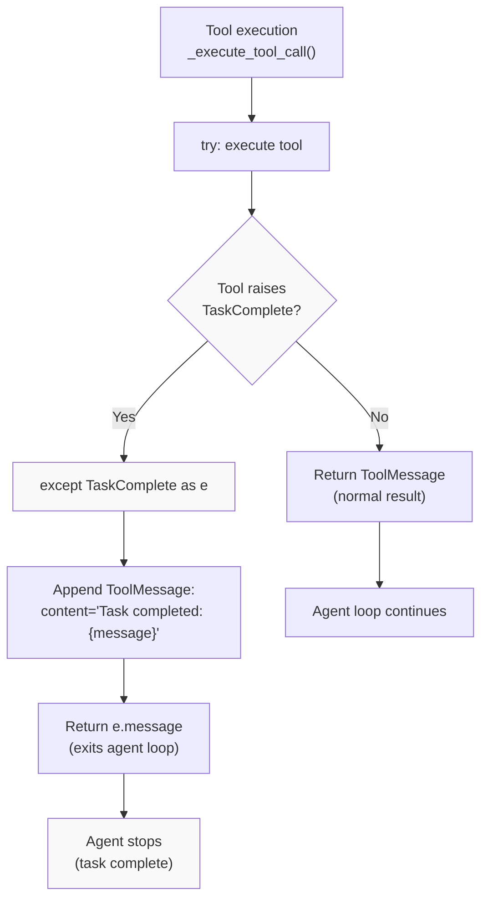
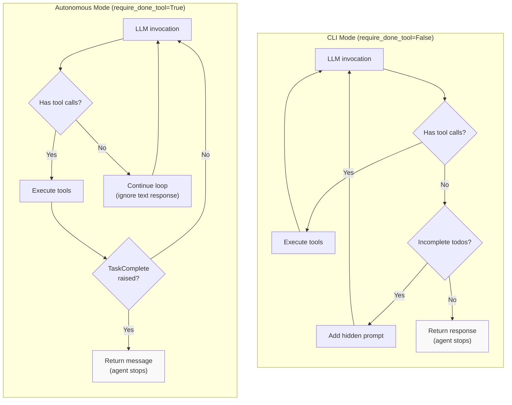
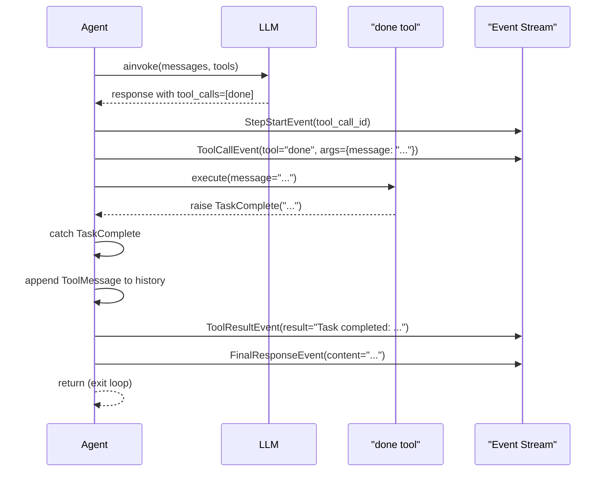

<!-- source: DeepWiki mcp.deepwiki.com · repo browser-use/agent-sdk · page 2.4 TaskComplete Pattern · fetched 2026-10-30 -->

# TaskComplete Pattern

<details>
<summary>Relevant source files</summary>

The following files were used as context for generating this wiki page:

- [README.md](README.md)
- [bu_agent_sdk/agent/service.py](bu_agent_sdk/agent/service.py)

</details>


## Purpose and Scope

This document explains the TaskComplete pattern used in bu_agent_sdk to control when an agent stops executing. It covers the `TaskComplete` exception, the "Done Tool Pattern" for explicit task completion, and the distinction between CLI mode and autonomous mode. For information about the broader agent execution loop, see [Agentic Loop Execution](#2.1). For details on tool definition and execution, see [Tool Calling and Execution](#2.2).

---

## Overview

The TaskComplete pattern addresses a fundamental problem in agentic systems: **determining when a task is truly complete**. The naive approach—stopping when the LLM returns no tool calls—fails because agents frequently finish prematurely before completing their objectives.

The bu_agent_sdk implements two termination strategies:

| Mode | Parameter | Termination Condition |
|------|-----------|----------------------|
| **CLI Mode** | `require_done_tool=False` (default) | LLM stops calling tools |
| **Autonomous Mode** | `require_done_tool=True` | Explicit `done` tool raises `TaskComplete` |

CLI mode is suitable for interactive chat interfaces where the user controls the conversation flow. Autonomous mode is designed for long-running tasks where the agent must explicitly signal completion.

**Sources:** [README.md:56-69](), [bu_agent_sdk/agent/service.py:133-134]()

---

## The TaskComplete Exception

### Exception Definition

The `TaskComplete` exception provides explicit task completion signaling instead of relying on the absence of tool calls.

```python
class TaskComplete(Exception):
    """Exception raised when a task is completed via the done tool.
    
    This provides explicit task completion signaling instead of relying on
    the absence of tool calls. The agent loop catches this exception and
    returns the completion message.
    
    Attributes:
        message: A description of why the task is complete and what was accomplished.
    """
    
    def __init__(self, message: str):
        self.message = message
        super().__init__(message)
```

The exception carries a single attribute:
- **`message`**: A human-readable description of what was accomplished and why the task is complete

**Sources:** [bu_agent_sdk/agent/service.py:40-53]()

### Exception Flow



**Diagram: TaskComplete Exception Propagation**

The agent's `_execute_tool_call` method catches `TaskComplete` exceptions and converts them into completion signals. The exception is caught at [bu_agent_sdk/agent/service.py:685-694]() in the `query` method and [bu_agent_sdk/agent/service.py:847-865]() in the `query_stream` method.

**Sources:** [bu_agent_sdk/agent/service.py:300-393](), [bu_agent_sdk/agent/service.py:682-694](), [bu_agent_sdk/agent/service.py:847-865]()

---

## The Done Tool Pattern

### Implementing a Done Tool

The recommended pattern is to create a dedicated `done` tool that raises `TaskComplete`:

```python
from bu_agent_sdk import tool, TaskComplete

@tool("Signal task completion")
async def done(message: str) -> str:
    raise TaskComplete(message)
```

This tool should be included in the agent's tool list:

```python
agent = Agent(
    llm=ChatAnthropic(model="claude-sonnet-4-20250514"),
    tools=[..., done],
    require_done_tool=True,  # Autonomous mode
)
```

**Sources:** [README.md:32-34](), [README.md:62-63](), [README.md:195-198]()

### Why Explicit Completion Matters

The README emphasizes: *"The naive 'stop when no tool calls' approach fails. Agents finish prematurely."*

Without explicit completion:
1. The LLM may stop calling tools before the task is complete
2. Partial results may be returned as if the task succeeded
3. Multi-step workflows may terminate after the first step
4. The agent has no mechanism to verify task completion

With the Done Tool Pattern:
1. The LLM must explicitly call `done` to finish
2. The completion message describes what was accomplished
3. The agent can verify preconditions before calling `done` (e.g., checking for incomplete subtasks)
4. Task boundaries are clear and auditable

**Sources:** [README.md:56-58]()

---

## CLI Mode vs Autonomous Mode

### Mode Comparison



**Diagram: Termination Logic by Mode**

**Sources:** [bu_agent_sdk/agent/service.py:660-677]()

### CLI Mode (Default)

Enabled with `require_done_tool=False` (the default).

**Termination condition:** The LLM returns no tool calls.

**Behavior:**
1. Agent invokes the LLM with messages and tools
2. If LLM returns tool calls, execute them and repeat
3. If LLM returns no tool calls:
   - Check for incomplete todos via `_get_incomplete_todos_prompt()` hook
   - If incomplete todos exist, add a hidden prompt and continue
   - Otherwise, return the LLM's text response

**Use cases:**
- Interactive chat interfaces
- User-driven conversations
- Exploratory tasks where the user provides guidance

**Implementation:** [bu_agent_sdk/agent/service.py:662-675]()

### Autonomous Mode

Enabled with `require_done_tool=True`.

**Termination condition:** A tool raises `TaskComplete`.

**Behavior:**
1. Agent invokes the LLM with messages and tools
2. If LLM returns tool calls, execute them:
   - If a tool raises `TaskComplete`, catch it and return the message
   - Otherwise, add results and continue
3. If LLM returns no tool calls:
   - **Ignore the response** and continue the loop
   - Force the LLM to call tools (including `done`)

**Use cases:**
- Long-running autonomous tasks
- Multi-step workflows with clear completion criteria
- Tasks that must execute to completion without user intervention

**Implementation:** [bu_agent_sdk/agent/service.py:676-677](), [bu_agent_sdk/agent/service.py:682-694]()

**Sources:** [bu_agent_sdk/agent/service.py:133-134](), [bu_agent_sdk/agent/service.py:660-694]()

---

## Implementation Details

### Agent Loop Integration

The agent's core loop handles `TaskComplete` at two levels:

#### Level 1: Tool Execution

The `_execute_tool_call` method wraps tool execution in a try-except block:

**Key code flow:**
1. Execute the tool with `await tool.execute(_overrides=..., **args)`
2. If the tool raises `TaskComplete`, capture it outside the Laminar span context
3. Re-raise after the observability span closes cleanly
4. The exception propagates to the query/query_stream caller

**Sources:** [bu_agent_sdk/agent/service.py:300-393](), specifically [bu_agent_sdk/agent/service.py:372-390]()

#### Level 2: Query Methods

Both `query` and `query_stream` catch `TaskComplete` during tool execution:

**In `query` (non-streaming):**
```python
for tool_call in response.tool_calls:
    tool_calls_made += 1
    try:
        tool_result = await self._execute_tool_call(tool_call)
        self._messages.append(tool_result)
    except TaskComplete as e:
        self._messages.append(
            ToolMessage(
                tool_call_id=tool_call.id,
                tool_name=tool_call.function.name,
                content=f"Task completed: {e.message}",
                is_error=False,
            )
        )
        return e.message
```

**In `query_stream` (streaming):**
```python
try:
    tool_result = await self._execute_tool_call(tool_call)
    self._messages.append(tool_result)
    # ... yield ToolResultEvent ...
except TaskComplete as e:
    self._messages.append(...)
    yield ToolResultEvent(...)
    yield FinalResponseEvent(content=e.message)
    return
```

**Sources:** [bu_agent_sdk/agent/service.py:682-694](), [bu_agent_sdk/agent/service.py:847-865]()

### Message History Management

When `TaskComplete` is raised:
1. A `ToolMessage` is appended to history with `content="Task completed: {message}"`
2. The message is marked as `is_error=False` (success)
3. The agent loop exits immediately after appending the message
4. The completion message is returned to the caller

This ensures the conversation history accurately reflects task completion, even though the exception short-circuits the loop.

**Sources:** [bu_agent_sdk/agent/service.py:686-693](), [bu_agent_sdk/agent/service.py:850-856]()

### Event Streaming with TaskComplete

In streaming mode, the sequence of events when a `done` tool is called:



**Diagram: TaskComplete Event Sequence**

The key distinction is that `FinalResponseEvent` is **always** the last event yielded, signaling to consumers that the agent has finished.

**Sources:** [bu_agent_sdk/agent/service.py:847-865](), [bu_agent_sdk/agent/events.py]()

---

## Incomplete Todos Hook

The agent provides a hook for checking incomplete work before termination in CLI mode:

```python
async def _get_incomplete_todos_prompt(self) -> str | None:
    """Hook for subclasses to check for incomplete todos before finishing.
    
    This method is called when the LLM is about to stop (no more tool calls in CLI mode,
    or done tool called in autonomous mode).
    
    The prompt should ask the LLM to:
    1. Continue working on incomplete tasks
    2. Mark completed tasks as done
    3. Revise the todo list if tasks are no longer relevant
    """
    return None
```

**When it's called:**
- In CLI mode, when the LLM returns no tool calls
- Before returning the final response
- Only once per query (tracked by `incomplete_todos_prompted` flag)

**Purpose:**
- Prevent premature termination when subtasks remain incomplete
- Give the agent a chance to clean up or complete remaining work
- Support complex workflows with implicit task dependencies

**Usage pattern:**
Subclasses can override this method to check for incomplete todos (e.g., from a todo management tool) and return a prompt asking the LLM to continue.

**Sources:** [bu_agent_sdk/agent/service.py:569-580](), [bu_agent_sdk/agent/service.py:664-671](), [bu_agent_sdk/agent/service.py:772-779]()

---

## Best Practices

### 1. Use Autonomous Mode for Goal-Oriented Tasks

When the agent must accomplish a specific objective:
```python
agent = Agent(
    llm=llm,
    tools=[..., done],
    require_done_tool=True,
)
```

### 2. Provide Descriptive Completion Messages

The `done` tool message should explain what was accomplished:
```python
@tool("Signal task completion")
async def done(message: str) -> str:
    """Call when the task is fully complete.
    
    Args:
        message: Summary of what was accomplished and any important results.
    """
    raise TaskComplete(message)
```

### 3. Validate Preconditions Before Completing

For complex workflows, check that all subtasks are done:
```python
@tool("Mark task as complete")
async def done_with_validation(
    message: str,
    todos: Annotated[TodoManager, Depends(get_todos)]
) -> str:
    incomplete = todos.get_incomplete()
    if incomplete:
        return f"Cannot complete: {len(incomplete)} tasks remain: {incomplete}"
    
    raise TaskComplete(message)
```

### 4. Use CLI Mode for Interactive Sessions

For chat interfaces where the user drives the conversation:
```python
agent = Agent(
    llm=llm,
    tools=[search, calculate, write_file],
    require_done_tool=False,  # Explicit default
)
```

### 5. Handle TaskComplete in Custom Tools Carefully

If you need to raise `TaskComplete` from a tool that performs cleanup:
```python
@tool("Finish and cleanup")
async def done_with_cleanup(
    message: str,
    ctx: Annotated[Context, Depends(get_context)]
) -> str:
    # Perform cleanup BEFORE raising TaskComplete
    await ctx.save_state()
    await ctx.close_connections()
    
    # Now signal completion
    raise TaskComplete(message)
```

**Sources:** [README.md:56-69](), [bu_agent_sdk/agent/service.py:133-134]()

---

## Summary

The TaskComplete pattern provides deterministic task termination through:

| Component | Purpose | Code Entity |
|-----------|---------|-------------|
| **TaskComplete Exception** | Signal task completion explicitly | `TaskComplete` class at [bu_agent_sdk/agent/service.py:40-53]() |
| **Done Tool** | LLM-callable completion trigger | `@tool` decorated function that raises `TaskComplete` |
| **require_done_tool Parameter** | Mode selector (CLI vs Autonomous) | `Agent.require_done_tool` at [bu_agent_sdk/agent/service.py:133-134]() |
| **CLI Mode** | Stops when LLM returns no tool calls | `require_done_tool=False` behavior at [bu_agent_sdk/agent/service.py:662-675]() |
| **Autonomous Mode** | Requires explicit `done` tool call | `require_done_tool=True` behavior at [bu_agent_sdk/agent/service.py:676-677]() |

This design ensures agents can reliably complete tasks without premature termination, while still supporting interactive chat workflows where natural conversation endings are appropriate.

**Sources:** [README.md:56-69](), [bu_agent_sdk/agent/service.py:40-53](), [bu_agent_sdk/agent/service.py:133-134](), [bu_agent_sdk/agent/service.py:660-694]()

---

