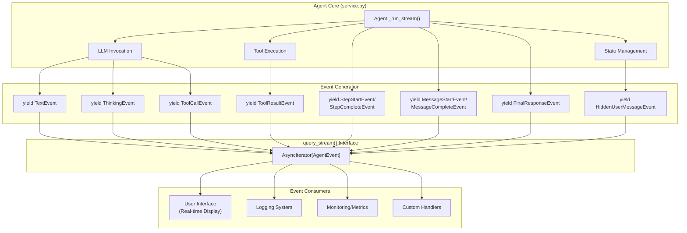
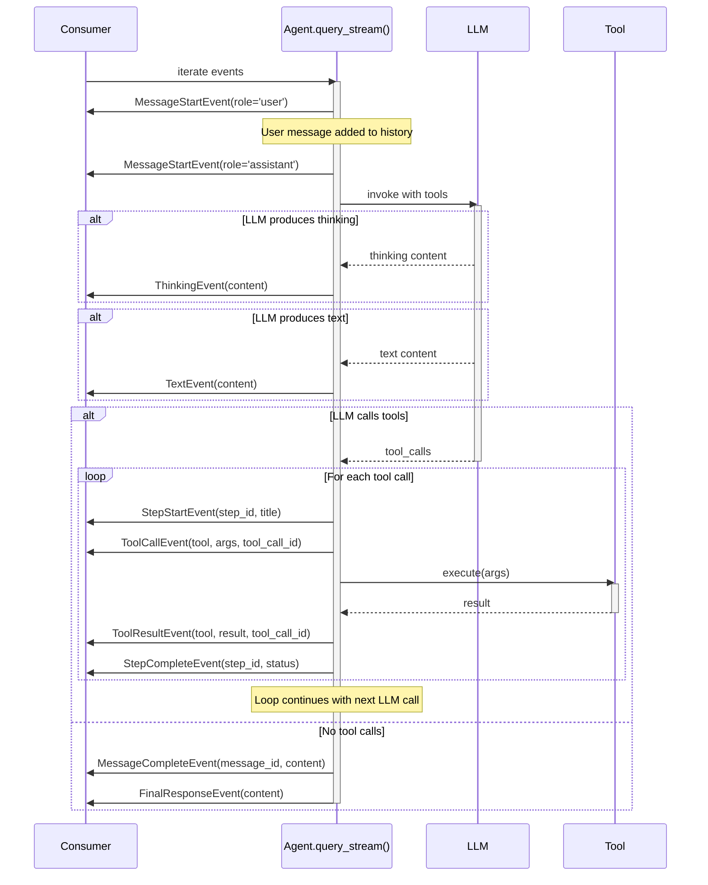
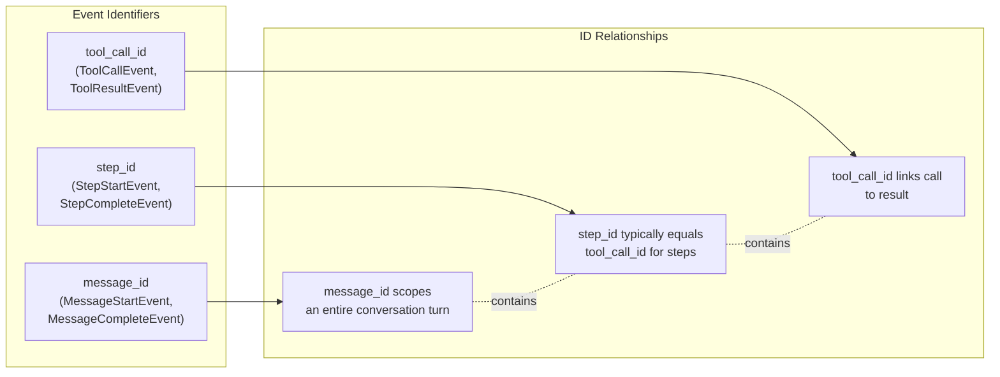
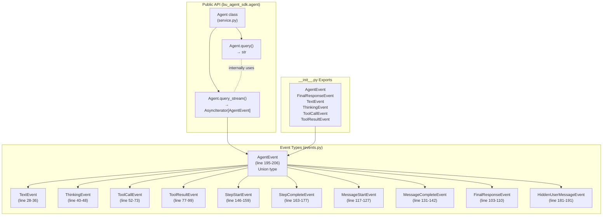

<!-- source: DeepWiki mcp.deepwiki.com · repo browser-use/agent-sdk · page 3 Event System · fetched 2026-10-30 -->

# Event System

<details>
<summary>Relevant source files</summary>

The following files were used as context for generating this wiki page:

- [bu_agent_sdk/agent/README.md](bu_agent_sdk/agent/README.md)
- [bu_agent_sdk/agent/__init__.py](bu_agent_sdk/agent/__init__.py)
- [bu_agent_sdk/agent/events.py](bu_agent_sdk/agent/events.py)

</details>


## Purpose and Scope

The Event System provides streaming observability for agent execution, enabling real-time monitoring and UI construction. This page covers the event streaming architecture, event flow, correlation mechanisms, and integration patterns. For detailed documentation of individual event types, see [Event Types](#3.1). For implementation guidance on consuming the event stream, see [Streaming Interface](#3.2).

## Overview

The Event System implements a streaming architecture that yields typed events throughout agent execution. Rather than waiting for the agent to complete, applications can observe the agent's internal operations in real-time, including LLM interactions, tool calls, and reasoning steps. This enables responsive user interfaces, debugging, logging, and custom monitoring without blocking agent execution.

The system is built on Python's async iterator protocol, exposing events through the `Agent.query_stream()` method. Events are strongly typed dataclasses that represent discrete agent operations, emitted at precise execution points.

**Sources:** [bu_agent_sdk/agent/events.py:1-20]()

## Architecture

### Event Flow

Events flow from the agent's internal execution loop to external consumers through an async generator pattern:



**Sources:** [bu_agent_sdk/agent/events.py:1-206](), [bu_agent_sdk/agent/README.md:24-39]()

### Event Categories

Events are organized into five functional categories:

| Category | Event Types | Purpose |
|----------|-------------|---------|
| **Content Events** | `TextEvent`, `ThinkingEvent` | LLM-generated content (text output and reasoning) |
| **Tool Events** | `ToolCallEvent`, `ToolResultEvent` | Tool invocation and results |
| **Message Lifecycle** | `MessageStartEvent`, `MessageCompleteEvent` | Conversation turn boundaries |
| **Step Events** | `StepStartEvent`, `StepCompleteEvent` | Logical grouping of operations |
| **Special Events** | `FinalResponseEvent`, `HiddenUserMessageEvent` | Completion markers and internal messages |

The union type `AgentEvent` encompasses all event types:

```python
AgentEvent = (
    TextEvent
    | ThinkingEvent
    | ToolCallEvent
    | ToolResultEvent
    | FinalResponseEvent
    | MessageStartEvent
    | MessageCompleteEvent
    | StepStartEvent
    | StepCompleteEvent
    | HiddenUserMessageEvent
)
```

**Sources:** [bu_agent_sdk/agent/events.py:194-206](), [bu_agent_sdk/agent/__init__.py:10-29]()

## Event Lifecycle

The following diagram illustrates the typical sequence of events during a single agent query:



**Sources:** [bu_agent_sdk/agent/events.py:1-206](), [bu_agent_sdk/agent/README.md:24-39]()

## Correlation Mechanisms

Events use unique identifiers to enable correlation across the event stream:

### Identifier Types



### ID Usage Patterns

**Message Correlation:**
- `MessageStartEvent.message_id` marks the beginning of a message
- `MessageCompleteEvent.message_id` marks completion using the same ID
- All events between these boundaries belong to the same message

**Tool Call Correlation:**
- `ToolCallEvent.tool_call_id` uniquely identifies a tool invocation
- `ToolResultEvent.tool_call_id` references the same ID to link the result
- Essential for parallel tool execution and async result handling

**Step Correlation:**
- `StepStartEvent.step_id` groups related operations (often same as `tool_call_id`)
- `StepCompleteEvent.step_id` marks step completion
- `StepStartEvent.step_number` provides sequential ordering within a query

**Sources:** [bu_agent_sdk/agent/events.py:117-178](), [bu_agent_sdk/agent/events.py:52-99]()

## Streaming Interface Overview

The primary interface for consuming events is `Agent.query_stream()`, which returns an `AsyncIterator[AgentEvent]`:

```python
async for event in agent.query_stream("do something"):
    match event:
        case ToolCallEvent(tool=name, args=args):
            print(f"Calling {name}: {args}")
        case ToolResultEvent(tool=name, result=result):
            print(f"{name} returned: {result}")
        case FinalResponseEvent(content=text):
            print(f"Done: {text}")
```

This pattern enables:
- **Non-blocking consumption:** Events are yielded as they occur
- **Type-safe pattern matching:** Structural pattern matching on event types
- **Selective processing:** Consumers can filter for specific event types
- **Stream transformation:** Events can be mapped, filtered, or aggregated

For detailed implementation patterns, see [Streaming Interface](#3.2).

**Sources:** [bu_agent_sdk/agent/README.md:24-39](), [bu_agent_sdk/agent/events.py:7-20]()

## Code Entity Mapping

The following diagram maps high-level system concepts to concrete code entities:



**Sources:** [bu_agent_sdk/agent/events.py:1-206](), [bu_agent_sdk/agent/__init__.py:1-34]()

## Use Cases

### Real-Time User Interfaces

Events enable responsive UIs that display agent progress:

- **Step-by-step visualization:** Show `StepStartEvent` titles as the agent progresses
- **Tool execution feedback:** Display `ToolCallEvent` arguments and `ToolResultEvent` results
- **Thinking transparency:** Render `ThinkingEvent` content to show reasoning
- **Progress indicators:** Use `MessageStartEvent`/`MessageCompleteEvent` for state transitions

### Logging and Debugging

The event stream provides complete execution traces:

- **Structured logging:** Each event is a structured dataclass with typed fields
- **Execution replay:** Event sequences can be recorded and replayed for debugging
- **Error tracking:** `ToolResultEvent.is_error` flag identifies failed operations
- **Performance profiling:** `StepCompleteEvent.duration_ms` tracks step durations

### Monitoring and Observability

Events integrate with observability systems:

- **Metrics collection:** Count tool calls, measure response times, track error rates
- **Custom instrumentation:** Filter and aggregate events for specific monitoring needs
- **Alert triggers:** React to specific event patterns or error conditions
- **Audit trails:** Maintain complete records of agent decisions and actions

### Custom Event Handlers

Applications can implement specialized event processing:

- **State management:** Maintain application state synchronized with agent progress
- **Side effects:** Trigger external actions based on specific events
- **Event transformation:** Convert events to different formats or protocols
- **Conditional logic:** Implement business rules based on event patterns

**Sources:** [bu_agent_sdk/agent/events.py:1-20](), [bu_agent_sdk/agent/README.md:24-39]()

## Event Data Structures

All events are immutable dataclasses with string representations for debugging:

```mermaid
classDiagram
    class TextEvent {
        +str content
        +__str__() str
    }
    
    class ThinkingEvent {
        +str content
        +__str__() str
    }
    
    class ToolCallEvent {
        +str tool
        +dict args
        +str tool_call_id
        +str display_name
        +__str__() str
    }
    
    class ToolResultEvent {
        +str tool
        +str result
        +str tool_call_id
        +bool is_error
        +str|None screenshot_base64
        +__str__() str
    }
    
    class StepStartEvent {
        +str step_id
        +str title
        +int step_number
        +__str__() str
    }
    
    class StepCompleteEvent {
        +str step_id
        +Literal status
        +float duration_ms
        +__str__() str
    }
    
    class MessageStartEvent {
        +str message_id
        +Literal role
        +__str__() str
    }
    
    class MessageCompleteEvent {
        +str message_id
        +str content
        +__str__() str
    }
    
    class FinalResponseEvent {
        +str content
        +__str__() str
    }
    
    class HiddenUserMessageEvent {
        +str content
        +__str__() str
    }
```



Each event implements `__str__()` for human-readable console output with emoji prefixes (e.g., `💬` for text, `🔧` for tools, `✅` for completion).

**Sources:** [bu_agent_sdk/agent/events.py:28-191]()

## Integration with Agent Execution

Events are emitted at specific points in the agent's execution flow:

| Execution Point | Event(s) Emitted | Location in Code |
|----------------|------------------|------------------|
| Query starts | `MessageStartEvent(role='user')` | Agent initialization |
| Assistant turn begins | `MessageStartEvent(role='assistant')` | Before LLM invocation |
| LLM outputs text | `TextEvent` | During response streaming |
| LLM reasoning | `ThinkingEvent` | When thinking content detected |
| Tool call requested | `StepStartEvent`, `ToolCallEvent` | After LLM response parsed |
| Tool execution completes | `ToolResultEvent`, `StepCompleteEvent` | After tool function returns |
| Hidden prompt injected | `HiddenUserMessageEvent` | State management (e.g., incomplete todos) |
| Query completes | `MessageCompleteEvent`, `FinalResponseEvent` | End of agentic loop |

For detailed agent execution flow, see [Agentic Loop Execution](#2.1).

**Sources:** [bu_agent_sdk/agent/events.py:1-206]()

---

