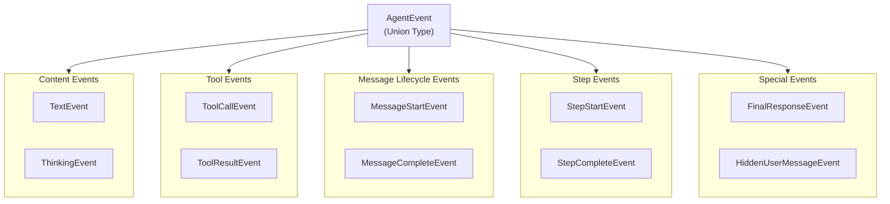
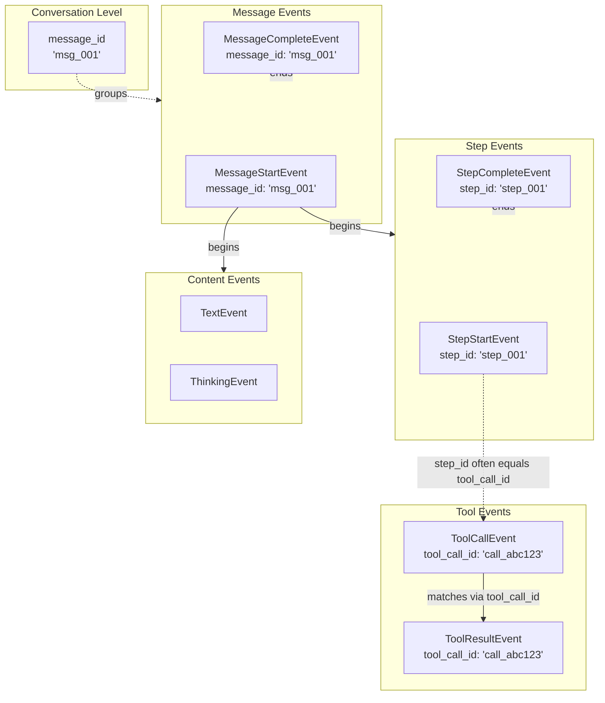
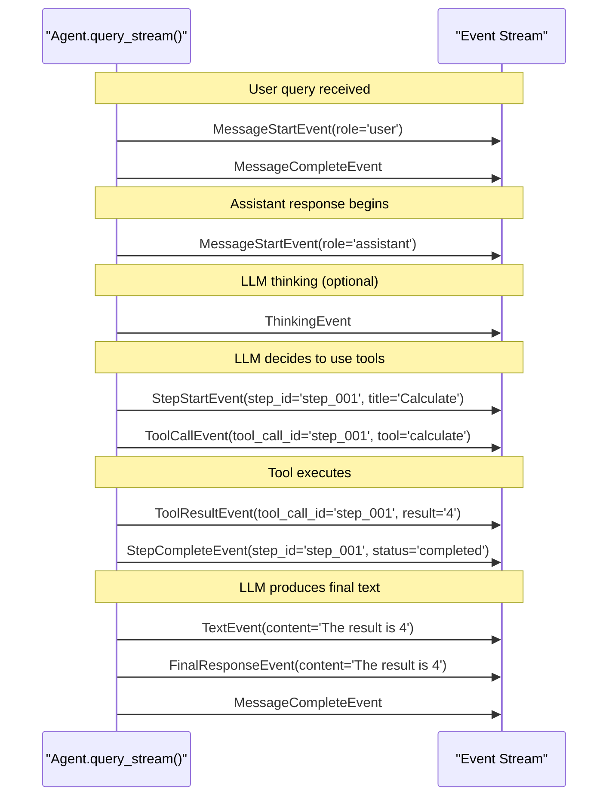

<!-- source: DeepWiki mcp.deepwiki.com · repo browser-use/agent-sdk · page 3.1 Event Types · fetched 2026-10-30 -->

# Event Types

<details>
<summary>Relevant source files</summary>

The following files were used as context for generating this wiki page:

- [bu_agent_sdk/agent/events.py](bu_agent_sdk/agent/events.py)

</details>


## Purpose and Scope

This page documents all event types emitted by the Agent during execution. These events enable real-time observability into the agent's behavior and are yielded through the `query_stream` method. For information about consuming these events and building streaming interfaces, see [Streaming Interface](#3.2). For broader context on the event system architecture, see [Event System](#3).

All event types are defined in [bu_agent_sdk/agent/events.py:1-207]() and are exposed as a union type `AgentEvent` for type-safe consumption.

---

## Event Type Categories

The SDK defines 10 distinct event types, organized into five functional categories:

### Event Type Classification Diagram



**Sources:** [bu_agent_sdk/agent/events.py:27-206]()

---

## Content Events

### TextEvent

Emitted when the LLM produces text content intended for the user. This represents the assistant's visible response text.

**Class Definition:** [bu_agent_sdk/agent/events.py:27-36]()

| Field | Type | Description |
|-------|------|-------------|
| `content` | `str` | The text content from the assistant |

**When Emitted:** During LLM response parsing when the model returns text content blocks.

**String Representation:** `💬 {preview}` (truncated to 100 characters)

**Example:**
```python
TextEvent(content="I'll help you calculate that...")
# String output: 💬 I'll help you calculate that...
```

---

### ThinkingEvent

Emitted when the model produces extended thinking or reasoning content (e.g., Claude's thinking blocks). This represents internal reasoning that may or may not be displayed to users.

**Class Definition:** [bu_agent_sdk/agent/events.py:39-48]()

| Field | Type | Description |
|-------|------|-------------|
| `content` | `str` | The thinking/reasoning content |

**When Emitted:** During LLM response parsing when the model returns thinking content blocks.

**String Representation:** `🧠 {preview}` (truncated to 80 characters)

**Example:**
```python
ThinkingEvent(content="Let me break down this problem step by step...")
# String output: 🧠 Let me break down this problem step by step...
```

**Sources:** [bu_agent_sdk/agent/events.py:27-48]()

---

## Tool Events

### ToolCallEvent

Emitted when the LLM requests a tool execution. This event is emitted before the tool is actually executed.

**Class Definition:** [bu_agent_sdk/agent/events.py:51-73]()

| Field | Type | Description |
|-------|------|-------------|
| `tool` | `str` | The name of the tool being called |
| `args` | `dict[str, Any]` | The arguments passed to the tool |
| `tool_call_id` | `str` | Unique ID for this specific tool call |
| `display_name` | `str` | Human-readable description (default: `''`) |

**When Emitted:** During LLM response parsing when the model requests tool execution, before the tool is actually invoked.

**String Representation:** 
- If `display_name` is set: `🔧 {display_name}`
- Otherwise: `🔧 {tool}({args_json})` (truncated to 80 characters)

**Example:**
```python
ToolCallEvent(
    tool="calculate",
    args={"expression": "2 + 2"},
    tool_call_id="call_abc123",
    display_name="Calculating 2 + 2"
)
# String output: 🔧 Calculating 2 + 2
```

---

### ToolResultEvent

Emitted when a tool execution completes and returns a result (or error).

**Class Definition:** [bu_agent_sdk/agent/events.py:76-99]()

| Field | Type | Description |
|-------|------|-------------|
| `tool` | `str` | The name of the tool that was called |
| `result` | `str` | The result returned by the tool |
| `tool_call_id` | `str` | The unique ID matching the corresponding `ToolCallEvent` |
| `is_error` | `bool` | Whether the tool execution resulted in an error (default: `False`) |
| `screenshot_base64` | `str \| None` | Base64-encoded screenshot for browser tools (default: `None`) |

**When Emitted:** Immediately after tool execution completes, whether successful or failed.

**String Representation:** `{prefix} {tool}: {preview}{screenshot_indicator}` where prefix is `✓` for success or `❌` for errors

**Example:**
```python
ToolResultEvent(
    tool="calculate",
    result="4",
    tool_call_id="call_abc123",
    is_error=False
)
# String output:    ✓ calculate: 4
```

**Sources:** [bu_agent_sdk/agent/events.py:51-99]()

---

## Message Lifecycle Events

### MessageStartEvent

Emitted when a new message begins in the conversation, whether from the user or assistant.

**Class Definition:** [bu_agent_sdk/agent/events.py:116-127]()

| Field | Type | Description |
|-------|------|-------------|
| `message_id` | `str` | Unique ID for this message |
| `role` | `Literal['user', 'assistant']` | The role of the message sender |

**When Emitted:** At the beginning of processing a new user query or when the agent starts generating an assistant response.

**String Representation:** `📨 Message started ({role})`

**Example:**
```python
MessageStartEvent(message_id="msg_001", role="assistant")
# String output: 📨 Message started (assistant)
```

---

### MessageCompleteEvent

Emitted when a message has been fully processed and is ready to be stored in history.

**Class Definition:** [bu_agent_sdk/agent/events.py:130-142]()

| Field | Type | Description |
|-------|------|-------------|
| `message_id` | `str` | The ID of the completed message |
| `content` | `str` | The full message content |

**When Emitted:** After all content for a message has been collected and processed.

**String Representation:** `📩 Message complete: {preview}` (truncated to 80 characters)

**Example:**
```python
MessageCompleteEvent(
    message_id="msg_001",
    content="The result is 4"
)
# String output: 📩 Message complete: The result is 4
```

**Sources:** [bu_agent_sdk/agent/events.py:116-142]()

---

## Step Events

### StepStartEvent

Emitted when the agent begins a logical step, typically corresponding to a tool execution group. Steps represent higher-level operations that may involve multiple tool calls.

**Class Definition:** [bu_agent_sdk/agent/events.py:145-159]()

| Field | Type | Description |
|-------|------|-------------|
| `step_id` | `str` | Unique ID for this step (typically same as `tool_call_id`) |
| `title` | `str` | Human-readable title for the step |
| `step_number` | `int` | Sequential step number within the query (default: `0`) |

**When Emitted:** Before executing a tool or tool group, providing a high-level description of the operation.

**String Representation:** `▶️  Step {step_number}: {title}`

**Example:**
```python
StepStartEvent(
    step_id="step_001",
    title="Navigate to website",
    step_number=1
)
# String output: ▶️  Step 1: Navigate to website
```

---

### StepCompleteEvent

Emitted when a step finishes execution, indicating success or failure.

**Class Definition:** [bu_agent_sdk/agent/events.py:162-177]()

| Field | Type | Description |
|-------|------|-------------|
| `step_id` | `str` | The ID of the completed step |
| `status` | `Literal['completed', 'error']` | The final status of the step |
| `duration_ms` | `float` | Duration of the step in milliseconds (default: `0.0`) |

**When Emitted:** After a step's tool execution(s) complete.

**String Representation:** `{icon} Step complete ({duration_ms}ms)` where icon is `✅` for completed or `❌` for error

**Example:**
```python
StepCompleteEvent(
    step_id="step_001",
    status="completed",
    duration_ms=1234.5
)
# String output: ✅ Step complete (1235ms)
```

**Sources:** [bu_agent_sdk/agent/events.py:145-177]()

---

## Special Events

### FinalResponseEvent

Emitted when the agent produces its final response to the user query, indicating that the agentic loop has completed.

**Class Definition:** [bu_agent_sdk/agent/events.py:102-110]()

| Field | Type | Description |
|-------|------|-------------|
| `content` | `str` | The final response content |

**When Emitted:** When the agent determines the task is complete and provides the final answer.

**String Representation:** `✅ Final: {preview}` (truncated to 100 characters)

**Example:**
```python
FinalResponseEvent(content="The calculation is complete: 2 + 2 = 4")
# String output: ✅ Final: The calculation is complete: 2 + 2 = 4
```

---

### HiddenUserMessageEvent

Emitted when the agent injects a hidden system message into the conversation. These messages are saved to history and sent to the LLM but are not displayed in the UI. This is commonly used for autonomous mode prompts (e.g., incomplete todos reminders).

**Class Definition:** [bu_agent_sdk/agent/events.py:180-191]()

| Field | Type | Description |
|-------|------|-------------|
| `content` | `str` | The content of the hidden user message |

**When Emitted:** When the agent needs to inject guidance to the LLM without exposing it to the user interface.

**String Representation:** `👻 Hidden: {preview}` (truncated to 80 characters)

**Example:**
```python
HiddenUserMessageEvent(
    content="You have incomplete todos. Continue working on them."
)
# String output: 👻 Hidden: You have incomplete todos. Continue working on them.
```

**Sources:** [bu_agent_sdk/agent/events.py:102-191]()

---

## Event Correlation

Events are correlated through unique identifiers, enabling consumers to track relationships between events across the execution lifecycle.

### Event Correlation Diagram



### Correlation Identifiers

| Identifier | Scope | Used By | Purpose |
|------------|-------|---------|---------|
| `message_id` | Message lifecycle | `MessageStartEvent`, `MessageCompleteEvent` | Correlate the start and completion of a single message |
| `tool_call_id` | Tool execution | `ToolCallEvent`, `ToolResultEvent` | Match tool invocations with their results |
| `step_id` | Logical step | `StepStartEvent`, `StepCompleteEvent` | Group related operations; often equals `tool_call_id` |

**Example Correlation:**
```python
# Step starts
StepStartEvent(step_id="step_001", title="Calculate", step_number=1)

# Tool called (step_id typically matches tool_call_id)
ToolCallEvent(tool="calculate", args={...}, tool_call_id="step_001")

# Tool result
ToolResultEvent(tool="calculate", result="4", tool_call_id="step_001")

# Step completes
StepCompleteEvent(step_id="step_001", status="completed", duration_ms=125.0)
```

**Sources:** [bu_agent_sdk/agent/events.py:116-177]()

---

## AgentEvent Union Type

All event types are combined into a union type for type-safe event handling.

**Definition:** [bu_agent_sdk/agent/events.py:194-206]()

```python
AgentEvent = (
    TextEvent
    | ThinkingEvent
    | ToolCallEvent
    | ToolResultEvent
    | FinalResponseEvent
    | MessageStartEvent
    | MessageCompleteEvent
    | StepStartEvent
    | StepCompleteEvent
    | HiddenUserMessageEvent
)
```

This union type is the return type of `agent.query_stream()` and enables pattern matching:

```python
async for event in agent.query_stream("solve this problem"):
    match event:
        case ToolCallEvent(tool=name, args=args):
            print(f"Calling {name} with {args}")
        case ToolResultEvent(tool=name, result=result):
            print(f"{name} returned: {result}")
        case TextEvent(content=text):
            print(f"Assistant: {text}")
        case FinalResponseEvent(content=final):
            print(f"Done: {final}")
```

**Sources:** [bu_agent_sdk/agent/events.py:194-206]()

---

## Event Emission Sequence

The following diagram illustrates the typical sequence of events during a single agent query execution:

### Typical Event Flow Diagram



**Sources:** [bu_agent_sdk/agent/events.py:1-207]()

---

## Event Type Reference Table

| Event Type | Category | Key Fields | Correlation ID | Purpose |
|------------|----------|------------|----------------|---------|
| `TextEvent` | Content | `content` | - | LLM text output |
| `ThinkingEvent` | Content | `content` | - | LLM reasoning content |
| `ToolCallEvent` | Tool | `tool`, `args`, `tool_call_id`, `display_name` | `tool_call_id` | Tool invocation |
| `ToolResultEvent` | Tool | `tool`, `result`, `tool_call_id`, `is_error`, `screenshot_base64` | `tool_call_id` | Tool execution result |
| `FinalResponseEvent` | Special | `content` | - | Task completion |
| `MessageStartEvent` | Message | `message_id`, `role` | `message_id` | Message begins |
| `MessageCompleteEvent` | Message | `message_id`, `content` | `message_id` | Message ends |
| `StepStartEvent` | Step | `step_id`, `title`, `step_number` | `step_id` | Logical operation begins |
| `StepCompleteEvent` | Step | `step_id`, `status`, `duration_ms` | `step_id` | Logical operation ends |
| `HiddenUserMessageEvent` | Special | `content` | - | System-injected message |

**Sources:** [bu_agent_sdk/agent/events.py:27-206]()

---

