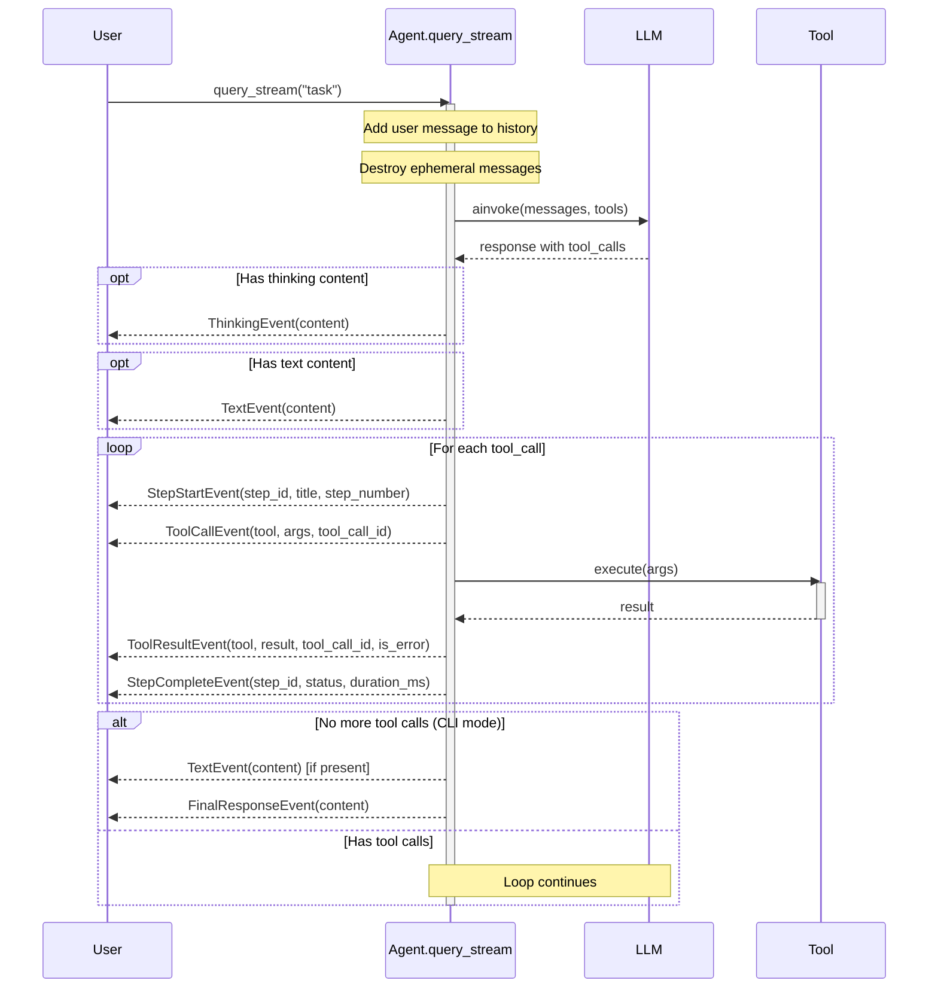
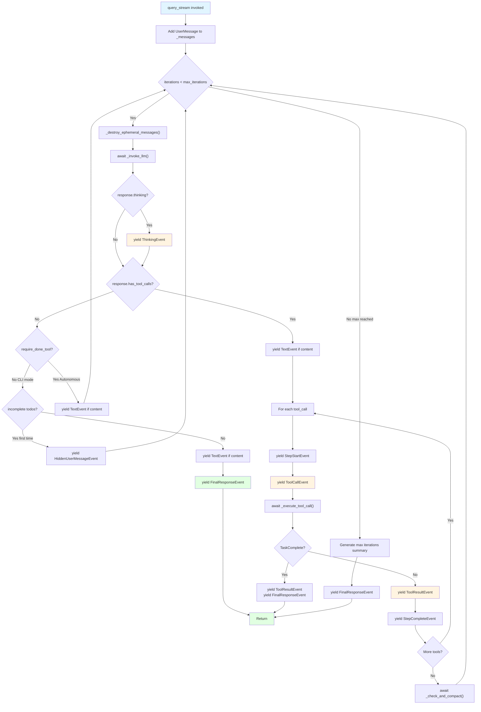
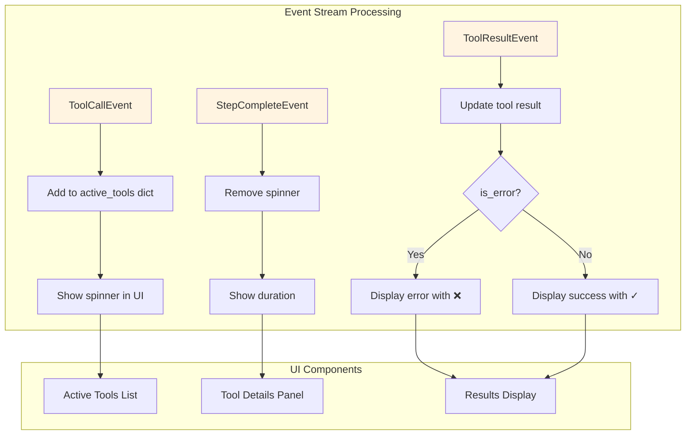
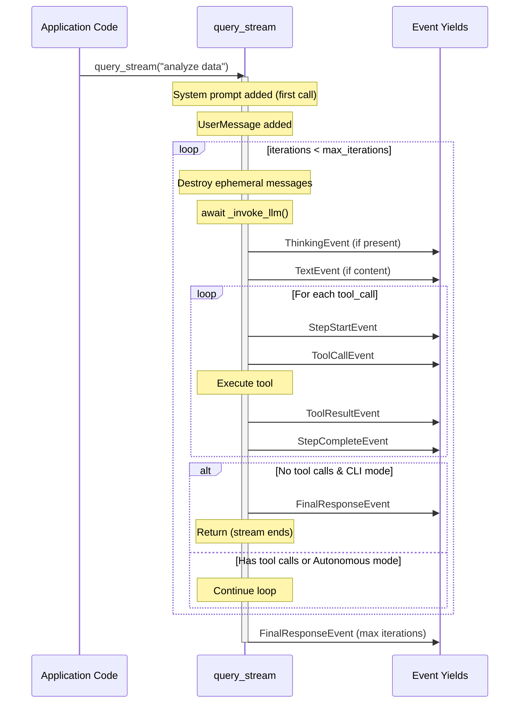

<!-- source: DeepWiki mcp.deepwiki.com · repo browser-use/agent-sdk · page 3.2 Streaming Interface · fetched 2026-10-30 -->

# Streaming Interface

<details>
<summary>Relevant source files</summary>

The following files were used as context for generating this wiki page:

- [bu_agent_sdk/agent/README.md](bu_agent_sdk/agent/README.md)
- [bu_agent_sdk/agent/events.py](bu_agent_sdk/agent/events.py)
- [bu_agent_sdk/agent/service.py](bu_agent_sdk/agent/service.py)

</details>


## Purpose and Scope

This page documents the streaming interface provided by the `query_stream` method, which enables real-time observation of agent execution through typed events. Unlike the blocking `query` method which returns only the final result, `query_stream` yields granular events as the agent processes tasks, executes tools, and generates responses.

For details on individual event types and their properties, see [Event Types](#3.1). For information about the core agent loop execution, see [Agentic Loop Execution](#2.1).

**Sources:** [bu_agent_sdk/agent/service.py:702-873]()

---

## The query_stream Method

### Method Signature

The `query_stream` method is defined in the `Agent` class and returns an async iterator:

```python
async def query_stream(
    self, message: str | list[ContentPartTextParam | ContentPartImageParam]
) -> AsyncIterator[AgentEvent]
```

**Key characteristics:**
- **Input:** Accepts either a string message or a list of content parts for multi-modal input (text + images)
- **Return type:** `AsyncIterator[AgentEvent]` - yields events as they occur
- **Decorated with:** `@observe(name="agent_query_stream")` for Laminar observability integration
- **Non-blocking:** Events are yielded immediately as execution progresses

**Sources:** [bu_agent_sdk/agent/service.py:702-733]()

### Comparison: query vs query_stream

| Aspect | `query(message: str)` | `query_stream(message)` |
|--------|---------------------|------------------------|
| **Return Type** | `str` (final response) | `AsyncIterator[AgentEvent]` |
| **Execution** | Blocking until complete | Yields events as they occur |
| **Visibility** | Only final result | All intermediate steps |
| **Use Case** | Simple CLI tools | Real-time UIs, monitoring |
| **Input Types** | String only | String or multi-modal content |
| **Event Access** | None | Full event stream |

**Sources:** [bu_agent_sdk/agent/service.py:611-700](), [bu_agent_sdk/agent/service.py:702-873]()

---

## Event Consumption Patterns

### Basic Async Iteration

The simplest consumption pattern uses `async for` to iterate over events:

```python
async for event in agent.query_stream("do something"):
    print(event)  # Each event has a __str__ method for basic display
```

**Sources:** [bu_agent_sdk/agent/README.md:28-39]()

### Pattern Matching

Python's `match/case` syntax provides type-safe event handling:

```python
async for event in agent.query_stream("Schedule a meeting"):
    match event:
        case ToolCallEvent(tool=name, args=args):
            print(f"Calling {name}: {args}")
        case ToolResultEvent(tool=name, result=result, is_error=False):
            print(f"{name} returned: {result[:50]}")
        case ToolResultEvent(is_error=True):
            print(f"Tool error: {event.result}")
        case TextEvent(content=text):
            print(f"Assistant: {text}")
        case ThinkingEvent(content=thinking):
            print(f"Thinking: {thinking}")
        case FinalResponseEvent(content=text):
            print(f"Done: {text}")
```

**Sources:** [bu_agent_sdk/agent/README.md:28-39](), [bu_agent_sdk/agent/events.py:1-20]()

### Event Filtering

Filter specific event types for targeted processing:

```python
tool_calls = []
async for event in agent.query_stream("analyze data"):
    if isinstance(event, ToolCallEvent):
        tool_calls.append((event.tool, event.args))
    elif isinstance(event, FinalResponseEvent):
        print(f"Made {len(tool_calls)} tool calls")
        print(f"Result: {event.content}")
```

### Event Collection

Collect all events for post-processing or logging:

```python
events = []
async for event in agent.query_stream("complex task"):
    events.append(event)
    # Process in real-time if needed

# Post-process collected events
tool_errors = [e for e in events if isinstance(e, ToolResultEvent) and e.is_error]
steps_completed = [e for e in events if isinstance(e, StepCompleteEvent)]
```

**Sources:** [bu_agent_sdk/agent/events.py:1-206]()

---

## Event Lifecycle and Ordering



**Event Correlation IDs:**

| ID Type | Purpose | Scope | Example Usage |
|---------|---------|-------|---------------|
| `tool_call_id` | Links ToolCallEvent → ToolResultEvent | Single tool invocation | Match results to calls |
| `step_id` | Links StepStartEvent → StepCompleteEvent | Logical step (usually = tool_call_id) | Track step duration |
| `message_id` | Links MessageStartEvent → MessageCompleteEvent | Message boundaries | UI message grouping |

**Sources:** [bu_agent_sdk/agent/service.py:747-872](), [bu_agent_sdk/agent/events.py:52-99]()

### Event Emission Points in Code



**Sources:** [bu_agent_sdk/agent/service.py:747-872]()

---

## Building Real-time UIs

### Progress Tracking with Steps

`StepStartEvent` and `StepCompleteEvent` provide structured progress information:

```python
active_steps = {}

async for event in agent.query_stream("complex task"):
    match event:
        case StepStartEvent(step_id=sid, title=title, step_number=num):
            active_steps[sid] = {
                'title': title,
                'number': num,
                'start_time': time.time()
            }
            print(f"▶️  Step {num}: {title}")
        
        case StepCompleteEvent(step_id=sid, status=status, duration_ms=duration):
            step = active_steps.pop(sid)
            icon = '✅' if status == 'completed' else '❌'
            print(f"{icon} {step['title']} ({duration:.0f}ms)")
```

**Sources:** [bu_agent_sdk/agent/events.py:146-178]()

### Streaming Text Display

Display assistant text as it becomes available:

```python
current_message = ""

async for event in agent.query_stream("write an essay"):
    match event:
        case TextEvent(content=text):
            current_message += text
            # Update UI with current_message
            print(text, end='', flush=True)
        
        case ThinkingEvent(content=thinking):
            # Display thinking in collapsed/expandable section
            print(f"\n🧠 [Thinking: {thinking[:100]}...]")
        
        case FinalResponseEvent():
            print("\n✅ Complete")
```

**Sources:** [bu_agent_sdk/agent/events.py:28-48]()

### Tool Execution Visualization



Example implementation:

```python
import time

class UIState:
    def __init__(self):
        self.active_tools = {}
        self.completed_steps = []
    
    async def process_stream(self, agent, message):
        async for event in agent.query_stream(message):
            match event:
                case ToolCallEvent(tool=name, args=args, tool_call_id=tid):
                    self.active_tools[tid] = {
                        'name': name,
                        'args': args,
                        'start': time.time()
                    }
                    self.render_tool_started(name, args)
                
                case ToolResultEvent(tool=name, result=result, tool_call_id=tid, 
                                     is_error=error, screenshot_base64=screenshot):
                    tool_info = self.active_tools.get(tid, {})
                    duration = time.time() - tool_info.get('start', 0)
                    
                    self.render_tool_completed(
                        name=name,
                        result=result,
                        is_error=error,
                        duration=duration,
                        screenshot=screenshot
                    )
                
                case TextEvent(content=text):
                    self.render_assistant_text(text)
                
                case FinalResponseEvent(content=final):
                    self.render_completion(final)
    
    def render_tool_started(self, name, args):
        print(f"🔧 {name}({args}) ⏳")
    
    def render_tool_completed(self, name, result, is_error, duration, screenshot):
        icon = '❌' if is_error else '✓'
        print(f"   {icon} {name}: {result[:80]} ({duration:.2f}s)")
        if screenshot:
            print(f"   📸 Screenshot available")
```

**Sources:** [bu_agent_sdk/agent/events.py:52-99]()

### Screenshot Handling

Browser tools may return screenshots as base64-encoded images in `ToolResultEvent`:

```python
async for event in agent.query_stream("browse website"):
    match event:
        case ToolResultEvent(screenshot_base64=screenshot) if screenshot:
            # Decode and display screenshot
            import base64
            image_data = base64.b64decode(screenshot)
            # Display in UI or save to file
            with open("screenshot.png", "wb") as f:
                f.write(image_data)
```

**Screenshot extraction logic:**
The agent extracts screenshots from `ToolMessage.content` when it contains `ContentPartImageParam` with base64 data URLs.

**Sources:** [bu_agent_sdk/agent/service.py:395-434](), [bu_agent_sdk/agent/events.py:76-99]()

---

## Hidden Messages and Special Events

### HiddenUserMessageEvent

Emitted when the agent injects hidden prompts (e.g., incomplete todos check):

```python
async for event in agent.query_stream("work on tasks"):
    match event:
        case HiddenUserMessageEvent(content=prompt):
            # Log for debugging but don't show in UI
            logger.debug(f"Hidden prompt: {prompt}")
        case TextEvent(content=text):
            # Show normal text
            print(text)
```

**When hidden messages occur:**
- In CLI mode (`require_done_tool=False`), when the LLM stops calling tools but `_get_incomplete_todos_prompt()` returns a prompt
- The prompt is added to message history and sent to LLM but not displayed

**Sources:** [bu_agent_sdk/agent/service.py:769-779](), [bu_agent_sdk/agent/events.py:181-192]()

### TaskComplete Exception Handling

When a tool raises `TaskComplete`, the stream immediately yields final events and terminates:

```python
async for event in agent.query_stream("autonomous task"):
    match event:
        case ToolResultEvent(tool="done", result=result):
            # Tool called 'done' and raised TaskComplete
            print(f"Task complete: {result}")
        case FinalResponseEvent(content=message):
            # This is the TaskComplete message
            print(f"Final: {message}")
            # Stream ends here
```

**Sources:** [bu_agent_sdk/agent/service.py:847-865]()

---

## Implementation Details

### Message History Management

The `query_stream` method maintains state in `_messages`:

1. **System prompt added:** Only on first call when `_messages` is empty
2. **User message added:** At the start of each `query_stream` call
3. **Assistant messages added:** After each LLM invocation
4. **Tool messages added:** After each tool execution
5. **Ephemeral cleanup:** `_destroy_ephemeral_messages()` called before each LLM invocation

**Sources:** [bu_agent_sdk/agent/service.py:734-751]()

### Compaction During Streaming

Compaction happens transparently during event streaming:

```python
# After tool execution in the loop
await self._check_and_compact(response)
```

This means the message history may be compacted mid-stream without any event being emitted. The compaction is invisible to event consumers.

**Sources:** [bu_agent_sdk/agent/service.py:867-868](), [bu_agent_sdk/agent/service.py:582-609]()

### Error Propagation

Errors during streaming propagate as exceptions, not events:

```python
try:
    async for event in agent.query_stream("task"):
        # Process events
        pass
except ModelRateLimitError as e:
    print(f"Rate limited: {e}")
except ModelProviderError as e:
    print(f"LLM error: {e}")
except Exception as e:
    print(f"Unexpected error: {e}")
```

**Tool execution errors** are captured and yielded as `ToolResultEvent(is_error=True)` rather than raising exceptions.

**Sources:** [bu_agent_sdk/agent/service.py:822-846]()

### Retry Logic in Streaming

The `_invoke_llm` method includes retry logic with exponential backoff that applies during streaming:

- **Retryable errors:** Rate limits (429), server errors (500, 502, 503, 504), timeouts, connection errors
- **Retry behavior:** Up to `llm_max_retries` attempts (default 5) with exponential backoff
- **No event emitted:** Retries happen internally; consumers don't see retry events

```python
# Retry delays follow this pattern:
# Attempt 1: 1.0s + jitter
# Attempt 2: 2.0s + jitter  
# Attempt 3: 4.0s + jitter
# Attempt 4: 8.0s + jitter
# Attempt 5: 16.0s + jitter (capped at llm_retry_max_delay=60s)
```

**Sources:** [bu_agent_sdk/agent/service.py:436-532]()

---

## Complete Event Flow Example



**Comprehensive example consuming all event types:**

```python
import time
from bu_agent_sdk import Agent
from bu_agent_sdk.llm import ChatOpenAI
from bu_agent_sdk.agent import (
    TextEvent, ThinkingEvent, ToolCallEvent, ToolResultEvent,
    StepStartEvent, StepCompleteEvent, FinalResponseEvent,
    HiddenUserMessageEvent
)

agent = Agent(llm=ChatOpenAI(model="gpt-4o"), tools=[...])

# Track execution metrics
metrics = {
    'total_steps': 0,
    'tool_calls': 0,
    'errors': 0,
    'start_time': time.time()
}

async for event in agent.query_stream("analyze and report"):
    match event:
        case ThinkingEvent(content=thinking):
            print(f"🧠 Thinking: {thinking[:100]}...")
        
        case TextEvent(content=text):
            print(f"💬 {text}")
        
        case StepStartEvent(step_number=num, title=title):
            metrics['total_steps'] += 1
            print(f"\n▶️  Step {num}: {title}")
        
        case ToolCallEvent(tool=name, args=args, tool_call_id=tid):
            metrics['tool_calls'] += 1
            print(f"   🔧 {name}({args})")
        
        case ToolResultEvent(tool=name, result=result, is_error=error, 
                           screenshot_base64=screenshot):
            if error:
                metrics['errors'] += 1
                print(f"   ❌ Error: {result}")
            else:
                preview = result[:80] + '...' if len(result) > 80 else result
                print(f"   ✓ {preview}")
                if screenshot:
                    print(f"   📸 Screenshot captured")
        
        case StepCompleteEvent(status=status, duration_ms=duration):
            print(f"   {'✅' if status == 'completed' else '❌'} ({duration:.0f}ms)")
        
        case HiddenUserMessageEvent(content=prompt):
            print(f"👻 [Hidden prompt injected]")
        
        case FinalResponseEvent(content=final):
            duration = time.time() - metrics['start_time']
            print(f"\n✅ Complete in {duration:.1f}s")
            print(f"   Steps: {metrics['total_steps']}")
            print(f"   Tool calls: {metrics['tool_calls']}")
            print(f"   Errors: {metrics['errors']}")
            print(f"\n{final}")
```

**Sources:** [bu_agent_sdk/agent/service.py:702-873](), [bu_agent_sdk/agent/events.py:1-206]()

---

