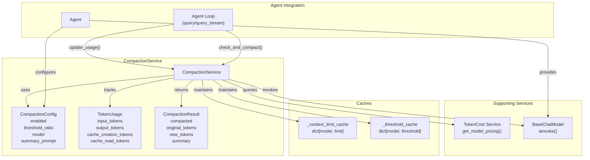
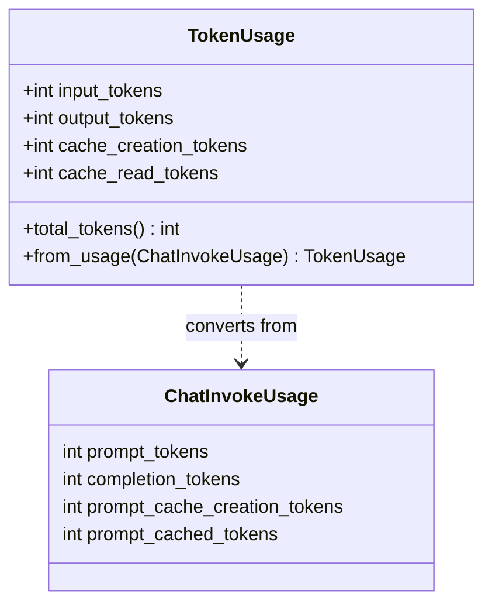
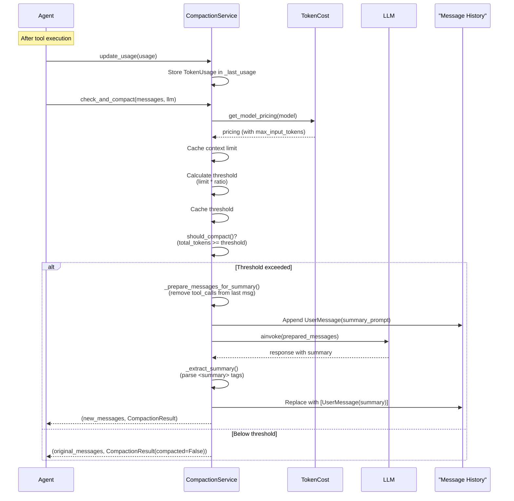
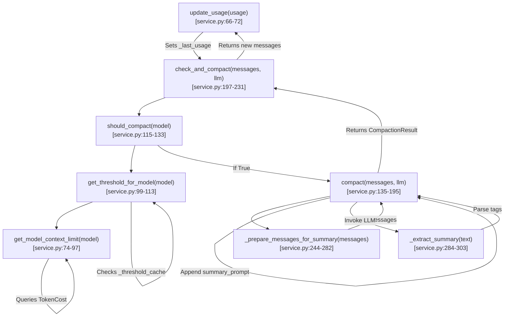
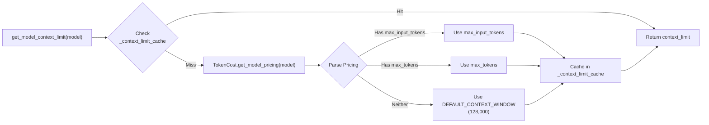
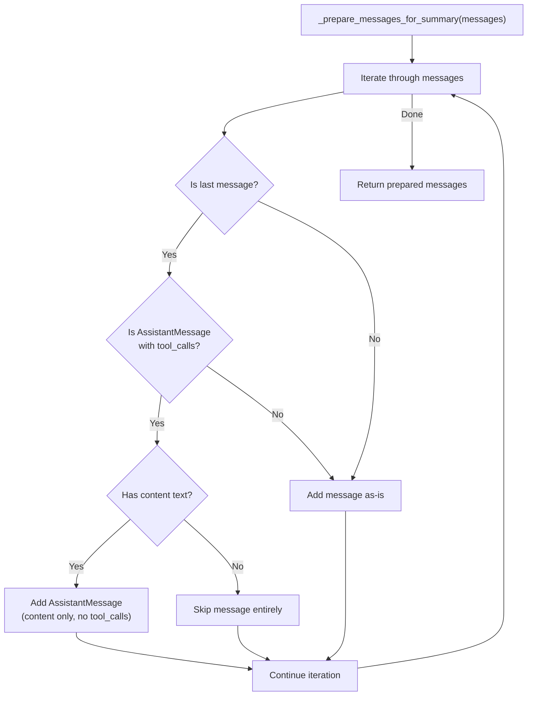
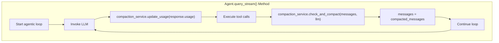
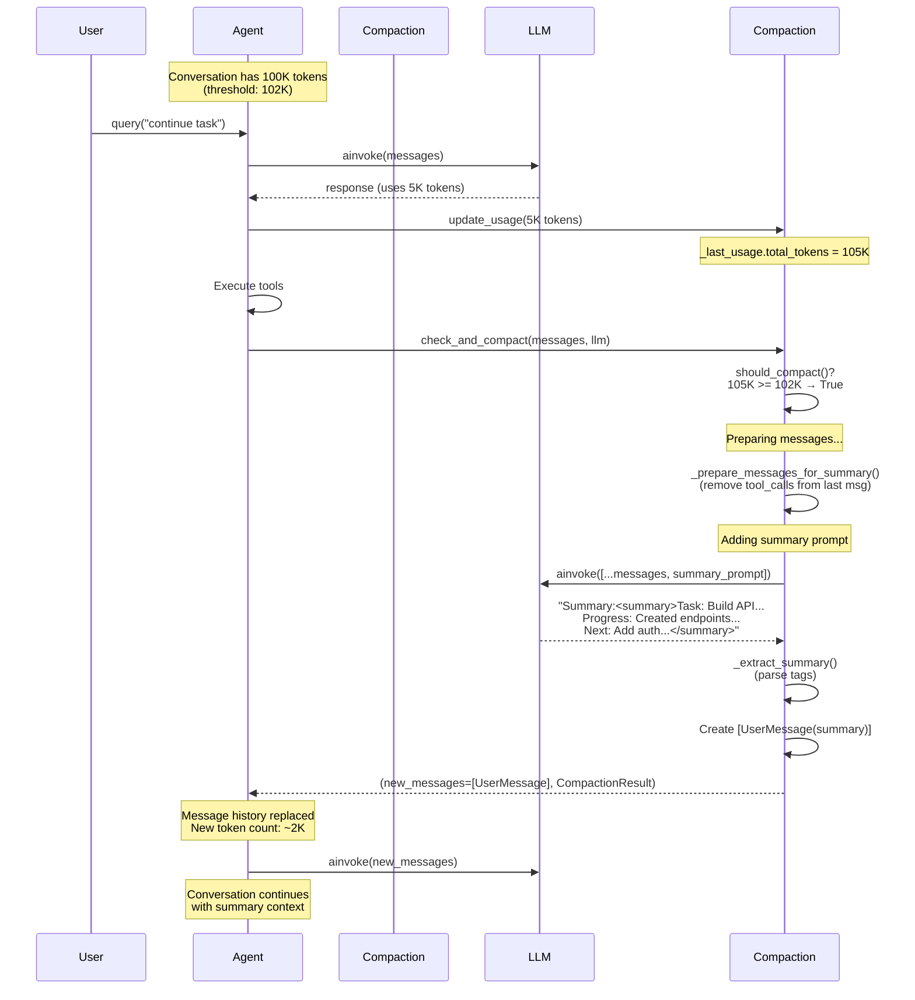

<!-- source: DeepWiki mcp.deepwiki.com · repo browser-use/agent-sdk · page 4 Context Management (Compaction) · fetched 2026-10-30 -->

# Context Management (Compaction)

<details>
<summary>Relevant source files</summary>

The following files were used as context for generating this wiki page:

- [bu_agent_sdk/agent/compaction/__init__.py](bu_agent_sdk/agent/compaction/__init__.py)
- [bu_agent_sdk/agent/compaction/models.py](bu_agent_sdk/agent/compaction/models.py)
- [bu_agent_sdk/agent/compaction/service.py](bu_agent_sdk/agent/compaction/service.py)

</details>


**Purpose**: This document explains the compaction system, which automatically manages conversation context by summarizing message history when token usage approaches a model's context window limit. Compaction prevents context overflow errors in long-running conversations.

For information about message history management in general, see [Message History and State](#2.3). For details about the agentic loop that invokes compaction, see [Agentic Loop Execution](#2.1).

---

## Overview

The compaction system is a subsystem of the agent that monitors cumulative token usage and automatically compresses conversation history when it exceeds a configurable threshold (default: 80% of the model's context window). When triggered, the system uses the LLM itself to generate a structured summary of the conversation, then replaces the entire message history with a single summary message.

This approach enables indefinitely long conversations without manual intervention or context window errors.

**Key characteristics**:
- Automatic threshold detection based on model's context window
- LLM-generated summaries using a structured prompt
- Complete message history replacement (not incremental)
- Caching of model limits to minimize API calls
- Integration with token cost tracking system

Sources: [bu_agent_sdk/agent/compaction/__init__.py:1-6](), [bu_agent_sdk/agent/compaction/service.py:1-6]()

---

## Core Components

The compaction system consists of four primary classes:

| Class | Purpose | Location |
|-------|---------|----------|
| `CompactionService` | Main service that monitors usage and performs compaction | [service.py:38-313]() |
| `CompactionConfig` | Configuration for compaction behavior | [models.py:49-66]() |
| `TokenUsage` | Tracks cumulative token consumption | [models.py:87-127]() |
| `CompactionResult` | Return value containing compaction outcome | [models.py:70-83]() |

### Architecture Diagram



Sources: [bu_agent_sdk/agent/compaction/service.py:38-64](), [bu_agent_sdk/agent/compaction/models.py:49-127]()

---

## Token Usage Tracking

The `TokenUsage` class tracks cumulative token consumption across all LLM invocations. This is the foundation for compaction decisions.

### TokenUsage Structure



**Token calculation**: The `total_tokens` property sums all token types, matching Anthropic SDK's calculation:

```
total_tokens = input_tokens + cache_creation_tokens + cache_read_tokens + output_tokens
```

This total is compared against the model's context window threshold to determine when compaction should trigger.

**Update flow**: After each LLM response, the agent calls `CompactionService.update_usage(usage)`, which converts the response's `ChatInvokeUsage` to a `TokenUsage` instance and stores it in `_last_usage`.

Sources: [bu_agent_sdk/agent/compaction/models.py:87-127](), [bu_agent_sdk/agent/compaction/service.py:66-72]()

---

## Compaction Configuration

The `CompactionConfig` dataclass controls compaction behavior:

| Field | Type | Default | Description |
|-------|------|---------|-------------|
| `enabled` | `bool` | `True` | Whether compaction is active |
| `threshold_ratio` | `float` | `0.80` | Ratio of context window at which to trigger (0.0-1.0) |
| `model` | `str \| None` | `None` | Optional model for summarization (defaults to agent's model) |
| `summary_prompt` | `str` | `DEFAULT_SUMMARY_PROMPT` | Prompt template for summary generation |

### Threshold Calculation

The compaction threshold is calculated dynamically per model:

```
threshold = context_window * threshold_ratio
```

For example, with a model that has a 128K token context window and default `threshold_ratio=0.80`:

```
threshold = 128,000 * 0.80 = 102,400 tokens
```

Compaction triggers when `TokenUsage.total_tokens >= 102,400`.

### Summary Prompt Structure

The `DEFAULT_SUMMARY_PROMPT` (defined at [models.py:16-45]()) instructs the LLM to generate a structured continuation summary with five sections:

1. **Task Overview**: Core request and success criteria
2. **Current State**: What's been completed, files modified
3. **Important Discoveries**: Technical constraints, decisions, errors
4. **Next Steps**: Specific actions needed to complete the task
5. **Context to Preserve**: User preferences, domain details, promises

The summary must be wrapped in `<summary></summary>` tags for extraction.

Sources: [bu_agent_sdk/agent/compaction/models.py:49-66](), [bu_agent_sdk/agent/compaction/service.py:99-113]()

---

## Compaction Process Flow

### High-Level Flow



Sources: [bu_agent_sdk/agent/compaction/service.py:197-231]()

### Detailed Method Flow

The compaction process involves these key methods in `CompactionService`:



Sources: [bu_agent_sdk/agent/compaction/service.py:66-313]()

---

## Context Limit Discovery

The compaction service dynamically discovers each model's context window limit through the `TokenCost` service:

### Context Limit Resolution Flow



**Caching strategy**: Both context limits and computed thresholds are cached in dictionaries keyed by model name:
- `_context_limit_cache: dict[str, int]` - Model name to context window size
- `_threshold_cache: dict[str, int]` - Model name to compaction threshold

This minimizes redundant pricing API calls during a conversation.

Sources: [bu_agent_sdk/agent/compaction/service.py:74-113]()

---

## Message Preparation for Summarization

Before sending messages to the LLM for summarization, the service performs cleanup via `_prepare_messages_for_summary()`:

### Preparation Logic

**Problem**: If the last message in history is an `AssistantMessage` with `tool_calls`, sending it to the LLM would create an API error because the LLM expects corresponding `ToolMessage` results, which won't be present in the summary context.

**Solution**: Remove `tool_calls` from the last assistant message:



This ensures the message history sent for summarization is valid for LLM processing.

Sources: [bu_agent_sdk/agent/compaction/service.py:244-282]()

---

## Summary Extraction

After the LLM generates a summary, the service extracts the content from `<summary></summary>` tags using `_extract_summary()`:

```python
# Regex pattern
pattern = r"<summary>(.*?)</summary>"
```

**Behavior**:
- **If tags found**: Extract and return content between tags (stripped)
- **If no tags**: Return the entire response text (stripped)

This provides flexibility if the LLM doesn't follow the exact tag format, while encouraging structured output.

Sources: [bu_agent_sdk/agent/compaction/service.py:284-303]()

---

## Integration with Agent

The agent integrates compaction at two points in its execution loop:

### Integration Points



### Invocation Pattern

**After LLM response** (every iteration):
```python
# Update token tracking
self.compaction_service.update_usage(response.usage)
```

**After tool execution** (before next LLM call):
```python
# Check and perform compaction if needed
self.messages, compaction_result = await self.compaction_service.check_and_compact(
    messages=self.messages,
    llm=self.llm
)
```

This ensures:
1. Token usage is always current before compaction decisions
2. Compaction happens after tools complete but before the next LLM invocation
3. Message history is updated in place if compaction occurs

Sources: [bu_agent_sdk/agent/compaction/service.py:197-231]()

---

## Compaction Result

The `CompactionResult` dataclass provides information about the compaction operation:

| Field | Type | Description |
|-------|------|-------------|
| `compacted` | `bool` | Whether compaction was actually performed |
| `original_tokens` | `int` | Token count before compaction |
| `new_tokens` | `int` | Estimated token count after (from summary output) |
| `summary` | `str \| None` | The generated summary text (if compacted) |

**Usage example**:
```python
messages, result = await compaction_service.check_and_compact(messages, llm)

if result.compacted:
    logger.info(f"Compacted {result.original_tokens} → {result.new_tokens} tokens")
    logger.info(f"Summary: {result.summary}")
```

Sources: [bu_agent_sdk/agent/compaction/models.py:70-83]()

---

## State Management

The `CompactionService` maintains internal state:

| Field | Type | Purpose |
|-------|------|---------|
| `_last_usage` | `TokenUsage` | Most recent token usage from LLM response |
| `_context_limit_cache` | `dict[str, int]` | Model name → context window size |
| `_threshold_cache` | `dict[str, int]` | Model name → compaction threshold |

### Reset Method

The `reset()` method clears all internal state:

```python
def reset(self) -> None:
    """Reset the service state."""
    self._last_usage = TokenUsage()
    self._context_limit_cache.clear()
    self._threshold_cache.clear()
```

This is useful when starting a new conversation or testing.

Sources: [bu_agent_sdk/agent/compaction/service.py:305-312]()

---

## Complete Example Flow

Here's a concrete example of compaction in action:



Sources: [bu_agent_sdk/agent/compaction/service.py:135-231]()

---

## Configuration Examples

### Disable Compaction

```python
from bu_agent_sdk.agent.compaction import CompactionConfig

config = CompactionConfig(enabled=False)
agent = Agent(
    llm=llm,
    compaction_config=config
)
```

### Adjust Threshold

```python
# Trigger at 90% instead of 80%
config = CompactionConfig(threshold_ratio=0.90)
```

### Custom Summary Prompt

```python
custom_prompt = """Summarize the conversation focusing only on:
1. User's main goal
2. Current progress
3. Next immediate action

Keep it under 500 tokens. Wrap in <summary> tags."""

config = CompactionConfig(summary_prompt=custom_prompt)
```

### Use Different Model for Summarization

```python
from bu_agent_sdk.llm import ChatOpenAI

# Use faster/cheaper model for summaries
summary_llm = ChatOpenAI(model="gpt-4o-mini")

config = CompactionConfig(model="gpt-4o-mini")
agent = Agent(
    llm=main_llm,
    compaction_config=config
)
```

Sources: [bu_agent_sdk/agent/compaction/models.py:49-66]()

---

## Logging and Observability

The compaction service emits log messages at key points:

| Level | Location | Message Pattern |
|-------|----------|-----------------|
| `DEBUG` | Context limit resolution | `"Model {model} context limit: {limit}"` |
| `DEBUG` | Threshold calculation | `"Model {model} compaction threshold: {threshold} ({ratio}% of {limit})"` |
| `INFO` | Threshold exceeded | `"Compaction triggered: {tokens} tokens >= {threshold} threshold"` |
| `INFO` | Compaction start | `"Token usage {original} has exceeded threshold of {threshold}. Performing compaction."` |
| `INFO` | Compaction complete | `"Compaction complete. New token usage: {new_tokens}"` |

These logs help diagnose compaction behavior and token usage patterns.

Sources: [bu_agent_sdk/agent/compaction/service.py:96](), [bu_agent_sdk/agent/compaction/service.py:110-112](), [bu_agent_sdk/agent/compaction/service.py:128-131](), [bu_agent_sdk/agent/compaction/service.py:167-170](), [bu_agent_sdk/agent/compaction/service.py:188]()

---

## Key Design Decisions

### Complete History Replacement

When compaction occurs, the **entire** message history is replaced with a single `UserMessage` containing the summary. This design:

**Advantages**:
- Maximizes token savings
- Simplifies state management
- Matches Anthropic SDK behavior
- Prevents gradual context degradation

**Trade-offs**:
- Loss of message-level granularity
- Cannot selectively preserve specific exchanges

### Threshold as Ratio

Using a `threshold_ratio` instead of absolute token count allows the system to automatically adapt to different models:

- GPT-4 Turbo (128K): threshold = 102,400 tokens
- Claude 3.5 Sonnet (200K): threshold = 160,000 tokens
- GPT-3.5 (16K): threshold = 12,800 tokens

This prevents manual configuration per model.

### LLM-Generated Summaries

Rather than rule-based summarization (e.g., truncating old messages), the system uses the LLM itself to generate intelligent summaries. This:

- Preserves semantic meaning
- Maintains task continuity
- Adapts to conversation context
- Produces natural language output

The trade-off is one additional LLM call per compaction.

Sources: [bu_agent_sdk/agent/compaction/service.py:225-230](), [bu_agent_sdk/agent/compaction/models.py:57-58]()

---

