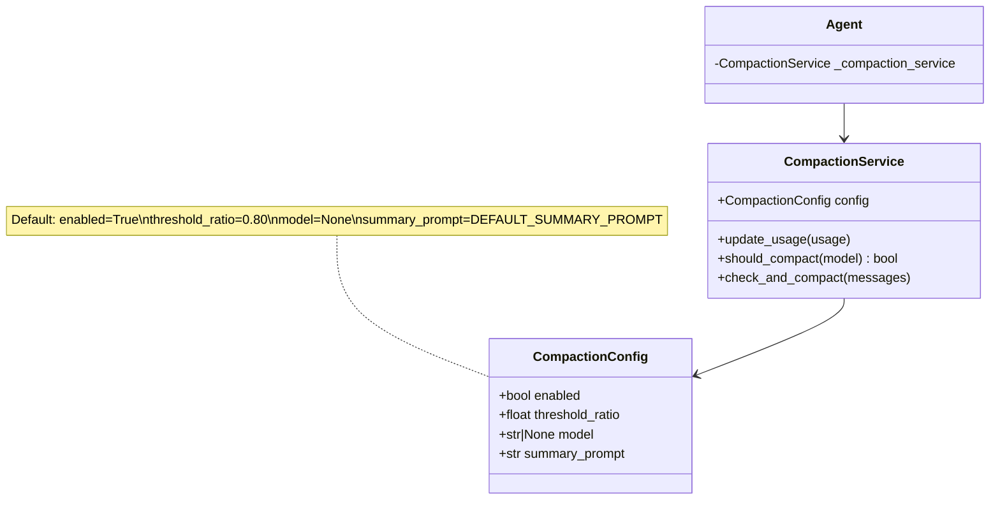
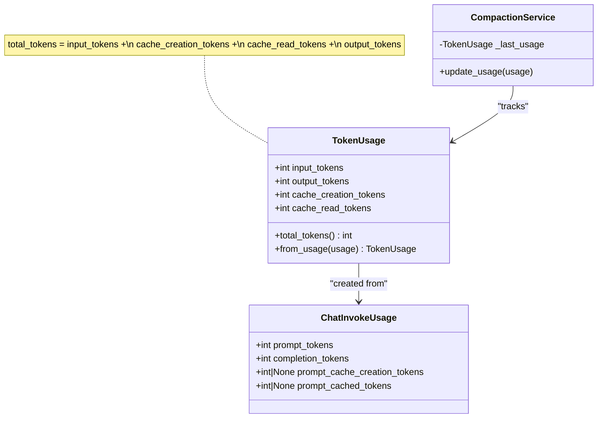
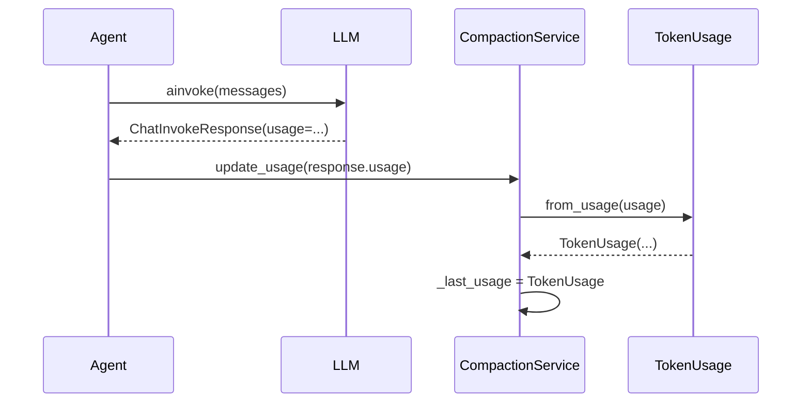
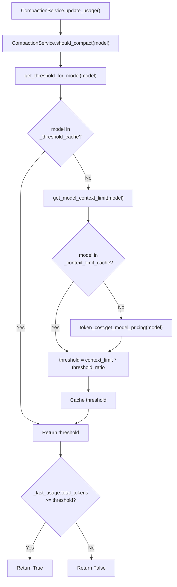
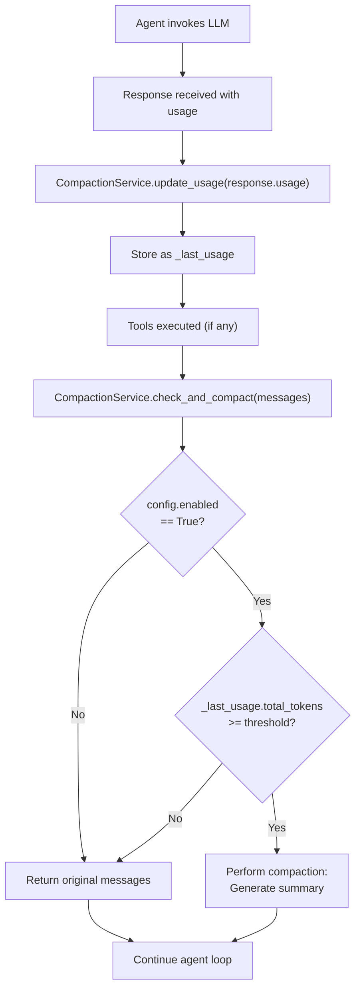
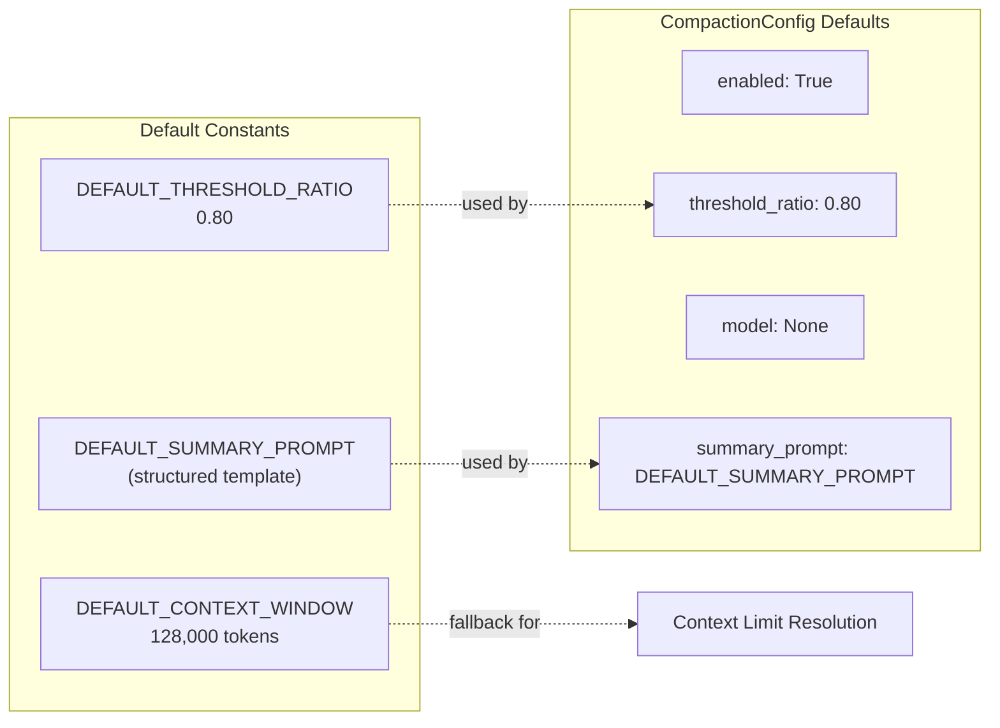

<!-- source: DeepWiki mcp.deepwiki.com · repo browser-use/agent-sdk · page 4.1 Compaction Configuration · fetched 2026-10-30 -->

# Compaction Configuration

<details>
<summary>Relevant source files</summary>

The following files were used as context for generating this wiki page:

- [bu_agent_sdk/agent/compaction/models.py](bu_agent_sdk/agent/compaction/models.py)
- [bu_agent_sdk/agent/compaction/service.py](bu_agent_sdk/agent/compaction/service.py)

</details>


## Purpose and Scope

This document details the configuration options for the compaction system, including the `CompactionConfig` dataclass, token usage tracking via `TokenUsage`, and the threshold logic that determines when compaction triggers. For information about the compaction process itself (summarization, message replacement), see [Compaction Service Logic](#4.2). For the overall context management architecture, see [Context Management (Compaction)](#4).

---

## CompactionConfig Dataclass

The `CompactionConfig` class controls compaction behavior through four configuration attributes:



**Sources:** [bu_agent_sdk/agent/compaction/models.py:48-67]()

### Configuration Attributes

| Attribute | Type | Default | Description |
|-----------|------|---------|-------------|
| `enabled` | `bool` | `True` | Master switch for compaction functionality |
| `threshold_ratio` | `float` | `0.80` | Ratio (0.0-1.0) of context window that triggers compaction |
| `model` | `str \| None` | `None` | Optional model override for summarization (uses agent's model if `None`) |
| `summary_prompt` | `str` | `DEFAULT_SUMMARY_PROMPT` | Prompt template for generating summaries |

**Sources:** [bu_agent_sdk/agent/compaction/models.py:55-66]()

### threshold_ratio Behavior

The `threshold_ratio` determines when compaction activates relative to the model's context window:

- `0.80` (default): Compact when reaching 80% of context limit
- `0.90`: More aggressive, allows closer to limit before compacting
- `0.50`: Conservative, compacts earlier to maintain buffer

**Threshold calculation:**
```
threshold = context_window * threshold_ratio
```

For example, with a 128K token model and `threshold_ratio=0.80`:
- Context window: 128,000 tokens
- Threshold: 102,400 tokens
- Compaction triggers when `total_tokens >= 102,400`

**Sources:** [bu_agent_sdk/agent/compaction/service.py:99-113](), [bu_agent_sdk/agent/compaction/models.py:13-14]()

### DEFAULT_SUMMARY_PROMPT

The `DEFAULT_SUMMARY_PROMPT` provides a structured template that guides the LLM to generate comprehensive continuation summaries. The prompt instructs the model to produce a summary wrapped in `<summary></summary>` tags containing:

1. **Task Overview** - Core request and success criteria
2. **Current State** - Completed work and artifacts
3. **Important Discoveries** - Technical constraints and decisions
4. **Next Steps** - Specific actions needed
5. **Context to Preserve** - User preferences and domain details

**Sources:** [bu_agent_sdk/agent/compaction/models.py:16-45]()

---

## TokenUsage Tracking

The `TokenUsage` dataclass tracks token consumption across LLM interactions to determine when compaction is needed:



**Sources:** [bu_agent_sdk/agent/compaction/models.py:86-128]()

### Token Fields

| Field | Description | Source |
|-------|-------------|--------|
| `input_tokens` | Tokens in prompt/messages | `ChatInvokeUsage.prompt_tokens` |
| `output_tokens` | Tokens generated by model | `ChatInvokeUsage.completion_tokens` |
| `cache_creation_tokens` | Tokens used to create cache (Anthropic) | `ChatInvokeUsage.prompt_cache_creation_tokens` |
| `cache_read_tokens` | Cached tokens read | `ChatInvokeUsage.prompt_cached_tokens` |

**Sources:** [bu_agent_sdk/agent/compaction/models.py:90-100](), [bu_agent_sdk/agent/compaction/models.py:116-127]()

### total_tokens Calculation

The `total_tokens` property computes the cumulative token usage that's compared against the threshold:

```python
@property
def total_tokens(self) -> int:
    return (
        self.input_tokens
        + self.cache_creation_tokens
        + self.cache_read_tokens
        + self.output_tokens
    )
```

This calculation matches the Anthropic SDK's token counting methodology, ensuring accurate threshold comparisons across providers that support prompt caching.

**Sources:** [bu_agent_sdk/agent/compaction/models.py:102-114]()

### from_usage Method

The `from_usage` class method converts `ChatInvokeUsage` (returned from LLM invocations) into `TokenUsage`:



**Sources:** [bu_agent_sdk/agent/compaction/models.py:116-127](), [bu_agent_sdk/agent/compaction/service.py:66-72]()

---

## Threshold Calculation and Caching

The `CompactionService` computes and caches thresholds dynamically based on each model's context window:



**Sources:** [bu_agent_sdk/agent/compaction/service.py:99-133]()

### Context Window Resolution

The `get_model_context_limit` method determines a model's context window through:

1. **Cache lookup**: Check `_context_limit_cache` dictionary
2. **TokenCost service**: Query pricing information via `token_cost.get_model_pricing(model)`
3. **Fallback**: Use `DEFAULT_CONTEXT_WINDOW = 128_000` if unavailable

Priority for context limit selection:
- `pricing.max_input_tokens` (preferred)
- `pricing.max_tokens` (fallback)
- `DEFAULT_CONTEXT_WINDOW` (default fallback)

**Sources:** [bu_agent_sdk/agent/compaction/service.py:74-97](), [bu_agent_sdk/agent/compaction/service.py:33-34]()

### Caching Strategy

Two cache dictionaries optimize repeated threshold lookups:

| Cache | Key | Value | Purpose |
|-------|-----|-------|---------|
| `_context_limit_cache` | `model: str` | `context_window: int` | Avoid redundant pricing API calls |
| `_threshold_cache` | `model: str` | `threshold: int` | Avoid recalculating threshold |

Both caches are cleared by `CompactionService.reset()`.

**Sources:** [bu_agent_sdk/agent/compaction/service.py:63-64](), [bu_agent_sdk/agent/compaction/service.py:305-312]()

---

## When Compaction Triggers

Compaction triggers when all conditions are met:



**Sources:** [bu_agent_sdk/agent/compaction/service.py:115-133](), [bu_agent_sdk/agent/compaction/service.py:197-231]()

### Integration Points

The agent integrates compaction at specific points in the execution flow:

1. **After LLM Response**: `update_usage()` called with `response.usage`
2. **After Tool Execution**: `check_and_compact()` called with current message history
3. **Before Next Iteration**: Messages potentially replaced with summary

**Timing Rationale:** Compaction occurs after tools execute (not immediately after LLM response) because tool results add additional tokens to the context. This ensures the threshold check accounts for the complete state before the next LLM call.

**Sources:** [bu_agent_sdk/agent/compaction/service.py:66-72](), [bu_agent_sdk/agent/compaction/service.py:197-231]()

---

## Configuration Examples

### Example 1: Conservative Compaction (50% Threshold)

```python
from bu_agent_sdk import Agent
from bu_agent_sdk.agent.compaction.models import CompactionConfig

config = CompactionConfig(
    enabled=True,
    threshold_ratio=0.50,  # Compact at 50% of context window
)

agent = Agent(
    model="claude-3-5-sonnet-20241022",
    compaction_config=config,
)
```

With a 200K context model:
- Context window: 200,000 tokens
- Threshold: 100,000 tokens (50%)
- More frequent compactions, smaller context preserved

**Sources:** [bu_agent_sdk/agent/compaction/models.py:48-67]()

### Example 2: Aggressive Compaction (90% Threshold)

```python
config = CompactionConfig(
    enabled=True,
    threshold_ratio=0.90,  # Allow 90% utilization before compacting
)

agent = Agent(
    model="gpt-4-turbo",
    compaction_config=config,
)
```

With a 128K context model:
- Context window: 128,000 tokens
- Threshold: 115,200 tokens (90%)
- Fewer compactions, maximizes context retention

**Sources:** [bu_agent_sdk/agent/compaction/models.py:48-67]()

### Example 3: Custom Summary Prompt

```python
custom_prompt = """Summarize the conversation focusing on:
1. User's goal
2. Actions taken
3. Current status
4. Next steps

Keep it under 500 tokens. Output in <summary></summary> tags."""

config = CompactionConfig(
    enabled=True,
    threshold_ratio=0.80,
    summary_prompt=custom_prompt,
)

agent = Agent(
    model="claude-3-5-sonnet-20241022",
    compaction_config=config,
)
```

**Sources:** [bu_agent_sdk/agent/compaction/models.py:48-67]()

### Example 4: Disabled Compaction

```python
config = CompactionConfig(
    enabled=False,  # Disable automatic compaction
)

agent = Agent(
    model="claude-3-5-sonnet-20241022",
    compaction_config=config,
)
```

Use cases for disabling:
- Short conversations that won't exceed context limits
- Testing/debugging where full history is needed
- Custom context management implementations

**Sources:** [bu_agent_sdk/agent/compaction/models.py:48-67]()

---

## CompactionResult

The `CompactionResult` dataclass captures the outcome of a compaction operation:

| Field | Type | Description |
|-------|------|-------------|
| `compacted` | `bool` | Whether compaction was performed |
| `original_tokens` | `int` | Token count before compaction |
| `new_tokens` | `int` | Token count after compaction (from summary) |
| `summary` | `str \| None` | Generated summary text (if compacted) |

**Usage in Agent:**
```python
new_messages, result = await compaction_service.check_and_compact(messages)

if result.compacted:
    print(f"Compacted: {result.original_tokens} → {result.new_tokens} tokens")
    print(f"Reduction: {result.original_tokens - result.new_tokens} tokens")
```

**Sources:** [bu_agent_sdk/agent/compaction/models.py:69-84](), [bu_agent_sdk/agent/compaction/service.py:197-231]()

---

## Default Values Reference



**Sources:** [bu_agent_sdk/agent/compaction/models.py:13-45](), [bu_agent_sdk/agent/compaction/service.py:33-34]()

---

