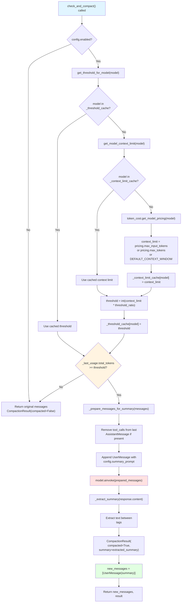
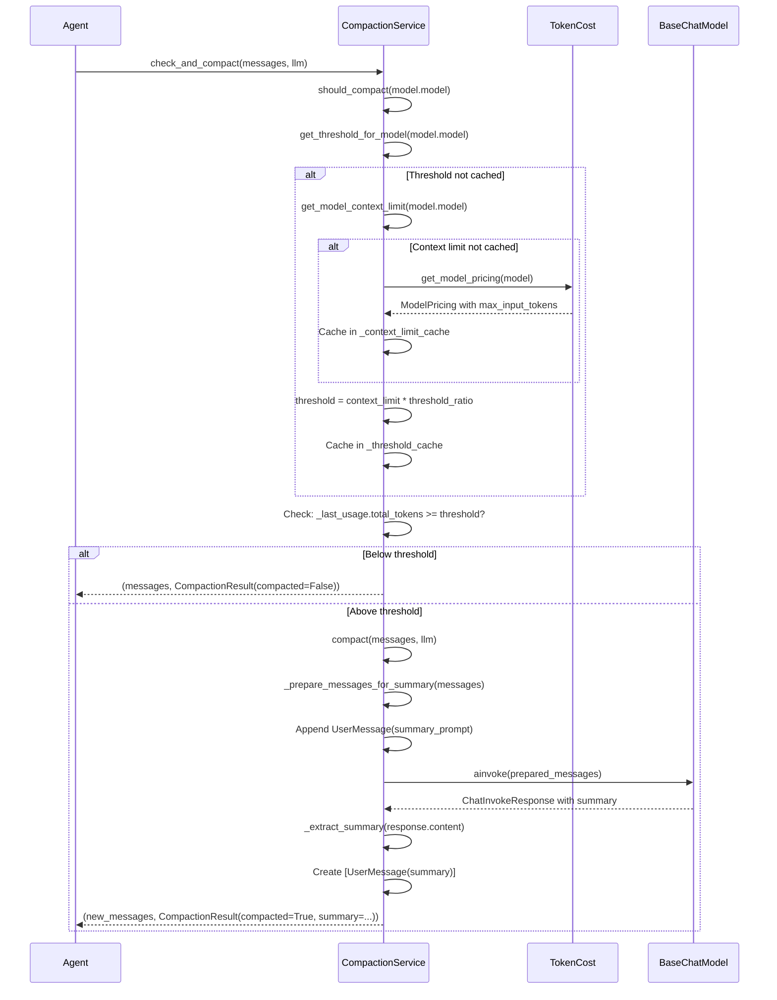
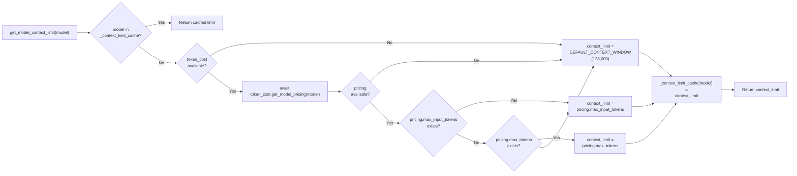
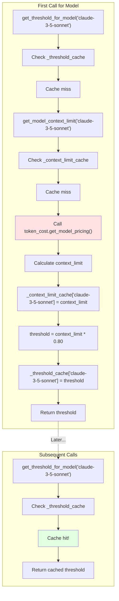
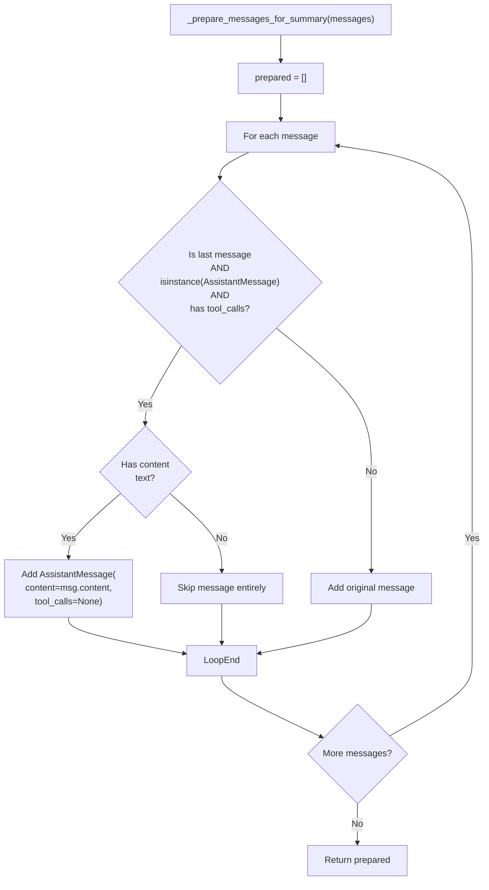

<!-- source: DeepWiki mcp.deepwiki.com · repo browser-use/agent-sdk · page 4.2 Compaction Service Logic · fetched 2026-10-30 -->

# Compaction Service Logic

<details>
<summary>Relevant source files</summary>

The following files were used as context for generating this wiki page:

- [bu_agent_sdk/agent/compaction/models.py](bu_agent_sdk/agent/compaction/models.py)
- [bu_agent_sdk/agent/compaction/service.py](bu_agent_sdk/agent/compaction/service.py)

</details>


This page documents the internal logic of the `CompactionService` class, including the step-by-step compaction process flow, context window calculation with caching, and summary generation mechanics. For configuration options and when compaction triggers, see [Compaction Configuration](#4.1). For how the agent integrates compaction into its execution loop, see [Agent System](#2).

---

## Compaction Process Overview

The `CompactionService` class in [bu_agent_sdk/agent/compaction/service.py]() orchestrates the automatic summarization of conversation history when token usage exceeds configured thresholds. The process involves four key phases: threshold checking, message preparation, LLM invocation for summarization, and history replacement.



**Figure 1: Complete Compaction Flow in `CompactionService`**

Sources: [bu_agent_sdk/agent/compaction/service.py:197-231](), [bu_agent_sdk/agent/compaction/service.py:135-195]()

---

## Entry Point: check_and_compact

The `check_and_compact` method [bu_agent_sdk/agent/compaction/service.py:197-231]() is the primary interface for triggering compaction. It orchestrates the entire process:



**Figure 2: Sequence Diagram of `check_and_compact` Execution**

The method returns a tuple of `(list[BaseMessage], CompactionResult)`. If compaction occurs, the message list contains a single `UserMessage` with the summary. Otherwise, the original messages are returned unchanged.

Sources: [bu_agent_sdk/agent/compaction/service.py:197-231](), [bu_agent_sdk/agent/compaction/service.py:115-133]()

---

## Context Window Calculation

The `CompactionService` determines when to compact based on the model's context window limit. This calculation involves fetching model metadata and applying the configured threshold ratio.

### Model Context Limit Resolution

The `get_model_context_limit` method [bu_agent_sdk/agent/compaction/service.py:74-97]() determines the maximum token capacity for a given model:

| Priority | Source | Field | Fallback |
|----------|--------|-------|----------|
| 1 | Cache | `_context_limit_cache[model]` | - |
| 2 | TokenCost service | `pricing.max_input_tokens` | Next priority |
| 3 | TokenCost service | `pricing.max_tokens` | Next priority |
| 4 | Default constant | `DEFAULT_CONTEXT_WINDOW` | 128,000 tokens |



**Figure 3: Context Limit Resolution Logic in `get_model_context_limit`**

The `DEFAULT_CONTEXT_WINDOW` constant is defined at [bu_agent_sdk/agent/compaction/service.py:34]() as 128,000 tokens.

Sources: [bu_agent_sdk/agent/compaction/service.py:74-97](), [bu_agent_sdk/agent/compaction/service.py:34]()

### Threshold Calculation

The `get_threshold_for_model` method [bu_agent_sdk/agent/compaction/service.py:99-113]() calculates the token threshold at which compaction triggers:

**Formula**: `threshold = int(context_limit × threshold_ratio)`

Where:
- `context_limit` is obtained from `get_model_context_limit(model)`
- `threshold_ratio` defaults to `0.80` (80%) from `DEFAULT_THRESHOLD_RATIO` [bu_agent_sdk/agent/compaction/models.py:14]()

**Example**: For a model with a 128,000 token context window and the default 0.80 ratio:
- Threshold = 128,000 × 0.80 = 102,400 tokens

Sources: [bu_agent_sdk/agent/compaction/service.py:99-113](), [bu_agent_sdk/agent/compaction/models.py:14]()

---

## Caching Strategies

The `CompactionService` implements two levels of caching to avoid redundant API calls and calculations:

### Cache Structure

| Cache Dictionary | Key Type | Value Type | Purpose |
|-----------------|----------|------------|---------|
| `_context_limit_cache` | `str` (model name) | `int` (token limit) | Cache model context window limits |
| `_threshold_cache` | `str` (model name) | `int` (token threshold) | Cache calculated compaction thresholds |

Both caches are defined as instance variables [bu_agent_sdk/agent/compaction/service.py:63-64]():

```python
_context_limit_cache: dict[str, int] = field(default_factory=dict, repr=False)
_threshold_cache: dict[str, int] = field(default_factory=dict, repr=False)
```

### Cache Lifecycle



**Figure 4: Two-Level Caching for Model Thresholds**

### Cache Invalidation

The `reset` method [bu_agent_sdk/agent/compaction/service.py:305-312]() clears all cached data:

```python
def reset(self) -> None:
    """Reset the service state."""
    self._last_usage = TokenUsage()
    self._context_limit_cache.clear()
    self._threshold_cache.clear()
```

This is useful when switching between different agent configurations or model deployments.

Sources: [bu_agent_sdk/agent/compaction/service.py:63-64](), [bu_agent_sdk/agent/compaction/service.py:305-312]()

---

## Summary Generation Process

The `compact` method [bu_agent_sdk/agent/compaction/service.py:135-195]() generates summaries by invoking the LLM with a specialized prompt.

### Message Preparation

Before summarization, messages are cleaned by `_prepare_messages_for_summary` [bu_agent_sdk/agent/compaction/service.py:244-282](). This method handles a critical edge case:

**Problem**: If the last message is an `AssistantMessage` with pending `tool_calls`, the LLM API will error because it expects corresponding `ToolMessage` results.

**Solution**: Remove `tool_calls` from the final `AssistantMessage` while preserving its text content.



**Figure 5: Message Preparation Logic in `_prepare_messages_for_summary`**

Sources: [bu_agent_sdk/agent/compaction/service.py:244-282]()

### Summary Prompt Structure

The `DEFAULT_SUMMARY_PROMPT` [bu_agent_sdk/agent/compaction/models.py:16-45]() instructs the LLM to generate a structured continuation summary with five sections:

1. **Task Overview** - Core request and success criteria
2. **Current State** - Completed work and artifacts
3. **Important Discoveries** - Technical constraints, decisions, errors
4. **Next Steps** - Specific actions needed
5. **Context to Preserve** - User preferences and promises

The prompt requests the summary be wrapped in `<summary></summary>` tags for reliable extraction.

### LLM Invocation

The prepared messages plus the summary prompt are sent to the LLM [bu_agent_sdk/agent/compaction/service.py:179]():

```python
response = await model.ainvoke(messages=prepared_messages)
```

The `model` parameter can be:
- The compaction-specific model from `config.model` [bu_agent_sdk/agent/compaction/models.py:65]()
- The agent's primary model (fallback via `self.llm`)

### Summary Extraction

The `_extract_summary` method [bu_agent_sdk/agent/compaction/service.py:284-303]() extracts the summary from the LLM response:

```python
pattern = r"<summary>(.*?)</summary>"
match = re.search(pattern, text, re.DOTALL)

if match:
    return match.group(1).strip()

return text.strip()  # Fallback if no tags
```

The regex uses `re.DOTALL` to match across newlines, capturing multi-line summaries.

Sources: [bu_agent_sdk/agent/compaction/service.py:135-195](), [bu_agent_sdk/agent/compaction/service.py:284-303](), [bu_agent_sdk/agent/compaction/models.py:16-45]()

---

## History Replacement

After successful summarization, the entire message history is replaced with a single `UserMessage` containing the summary [bu_agent_sdk/agent/compaction/service.py:227-229]():

```python
new_messages: list[BaseMessage] = [
    UserMessage(content=result.summary or ""),
]
```

This replacement strategy:
- **Drastically reduces token count** from potentially 100K+ tokens to the summary size (~1-3K tokens)
- **Preserves conversation context** through the structured summary
- **Enables continued execution** as the agent resumes with fresh token budget
- **Maintains user message format** for compatibility with LLM APIs

The `CompactionResult` [bu_agent_sdk/agent/compaction/models.py:69-83]() returned alongside the new messages contains:

| Field | Type | Description |
|-------|------|-------------|
| `compacted` | `bool` | Whether compaction was performed |
| `original_tokens` | `int` | Token count before compaction |
| `new_tokens` | `int` | Estimated tokens after compaction (from `response.usage.completion_tokens`) |
| `summary` | `str \| None` | The generated summary text |

Sources: [bu_agent_sdk/agent/compaction/service.py:227-229](), [bu_agent_sdk/agent/compaction/models.py:69-83]()

---

## Token Usage Tracking

The `update_usage` method [bu_agent_sdk/agent/compaction/service.py:66-72]() is called by the agent after each LLM response to update the internal `_last_usage` tracker:

```python
def update_usage(self, usage: ChatInvokeUsage | None) -> None:
    """Update the tracked token usage from a response."""
    self._last_usage = TokenUsage.from_usage(usage)
```

The `TokenUsage` class [bu_agent_sdk/agent/compaction/models.py:86-127]() tracks four token categories:

- `input_tokens` - Regular input tokens
- `output_tokens` - Generated output tokens
- `cache_creation_tokens` - Tokens used to create prompt cache (Anthropic)
- `cache_read_tokens` - Cached tokens read from storage

The `total_tokens` property [bu_agent_sdk/agent/compaction/models.py:102-114]() sums all categories for threshold comparison:

```python
@property
def total_tokens(self) -> int:
    return (
        self.input_tokens
        + self.cache_creation_tokens
        + self.cache_read_tokens
        + self.output_tokens
    )
```

This comprehensive tracking ensures accurate threshold detection even with provider-specific caching features.

Sources: [bu_agent_sdk/agent/compaction/service.py:66-72](), [bu_agent_sdk/agent/compaction/models.py:86-127](), [bu_agent_sdk/agent/compaction/models.py:102-114]()

---

## Error Handling

The compaction process includes error handling at multiple levels:

### Missing LLM Configuration

If no LLM is provided to `compact()`, a `ValueError` is raised [bu_agent_sdk/agent/compaction/service.py:159-162]():

```python
model = llm or self.llm
if model is None:
    raise ValueError(
        "No LLM available for compaction. Provide an LLM or set self.llm."
    )
```

### Model Pricing Failures

When fetching model pricing fails, the service logs a debug message and falls back to `DEFAULT_CONTEXT_WINDOW` [bu_agent_sdk/agent/compaction/service.py:91-92]():

```python
except Exception as e:
    log.debug(f"Failed to fetch model pricing for {model}: {e}")
```

### Summary Extraction Fallback

If the LLM response doesn't include `<summary>` tags, `_extract_summary` returns the raw response text [bu_agent_sdk/agent/compaction/service.py:302-303]():

```python
# No tags found, return original text
return text.strip()
```

This ensures compaction completes even with non-compliant LLM outputs.

Sources: [bu_agent_sdk/agent/compaction/service.py:159-162](), [bu_agent_sdk/agent/compaction/service.py:91-92](), [bu_agent_sdk/agent/compaction/service.py:302-303]()

---

