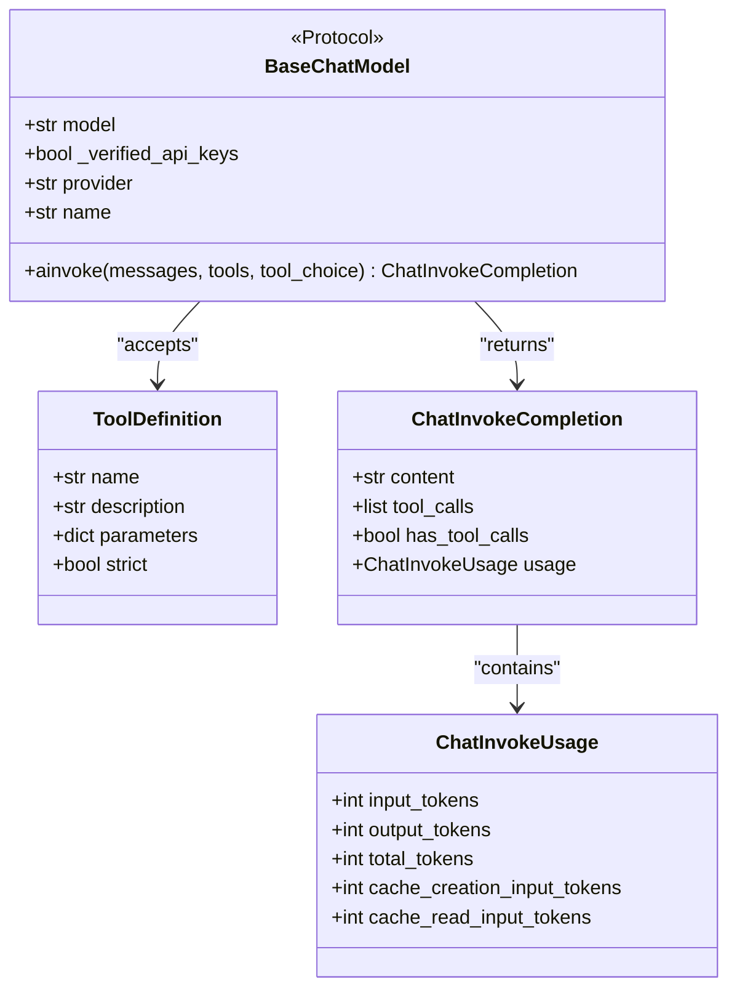
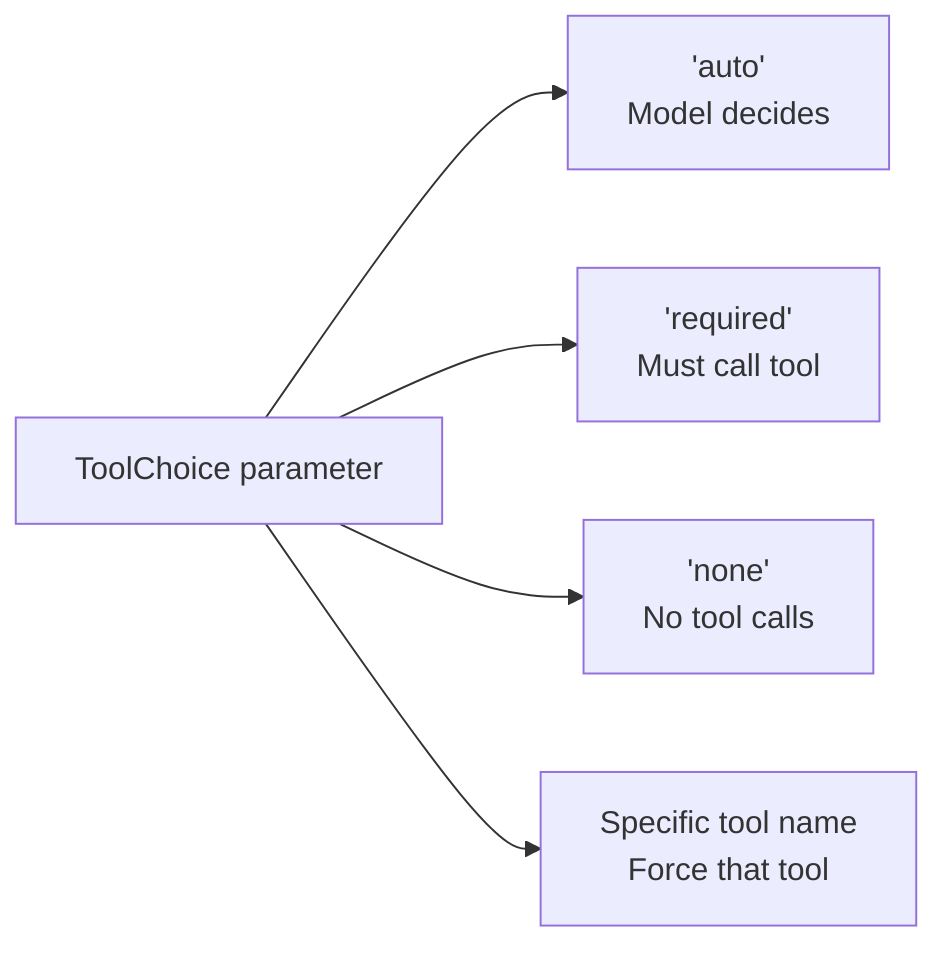
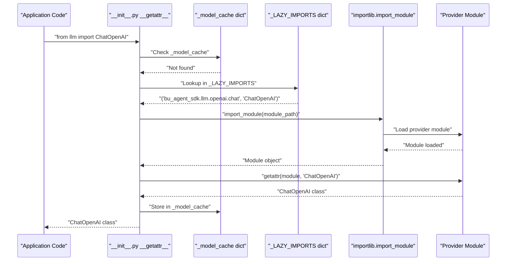
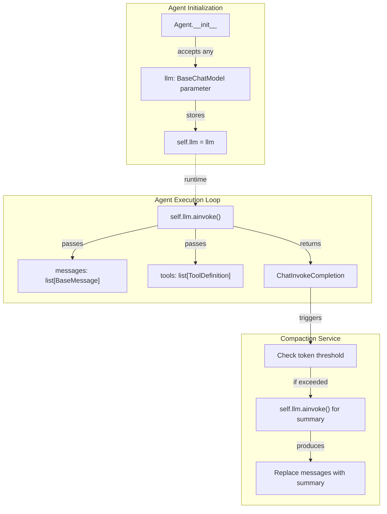
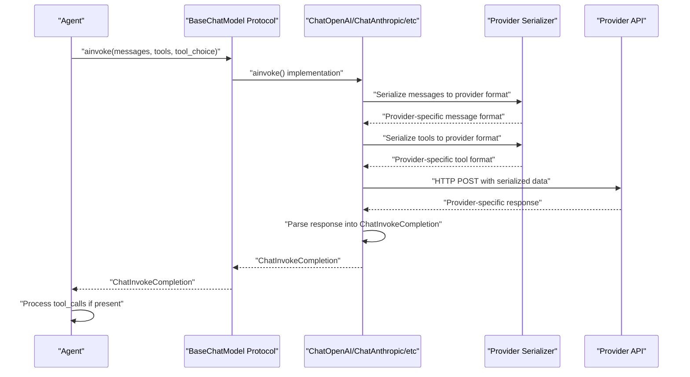

<!-- source: DeepWiki mcp.deepwiki.com · repo browser-use/agent-sdk · page 5 LLM Abstraction Layer · fetched 2026-10-30 -->

# LLM Abstraction Layer

<details>
<summary>Relevant source files</summary>

The following files were used as context for generating this wiki page:

- [bu_agent_sdk/llm/README.md](bu_agent_sdk/llm/README.md)
- [bu_agent_sdk/llm/__init__.py](bu_agent_sdk/llm/__init__.py)
- [bu_agent_sdk/llm/base.py](bu_agent_sdk/llm/base.py)

</details>


## Purpose and Scope

The LLM Abstraction Layer provides a unified, provider-agnostic interface for interacting with multiple Language Model providers. This layer enables the Agent system to work seamlessly with OpenAI, Anthropic, Google, and other LLM providers without requiring provider-specific code at the application level. The abstraction handles message serialization, tool calling protocols, and error handling across different provider APIs.

For detailed information about specific components:
- Protocol specification: see [BaseChatModel Protocol](#5.1)
- Provider configurations: see [Supported Providers](#5.2)
- Serialization details: see [Message Serialization](#5.4)
- Error handling: see [Error Handling](#5.5)

## Architecture Overview

The LLM abstraction layer follows a protocol-based design where all provider implementations conform to the `BaseChatModel` protocol. This ensures consistent behavior across providers while allowing provider-specific optimizations.

```mermaid
graph TB
    subgraph "Application Layer"
        Agent["Agent class"]
        CompactionService["CompactionService"]
    end
    
    subgraph "Abstraction Layer - bu_agent_sdk/llm/"
        BaseChatModel["BaseChatModel Protocol<br/>(base.py)"]
        ToolDefinition["ToolDefinition<br/>(base.py:16-41)"]
        MessageTypes["Message Types<br/>BaseMessage, UserMessage, etc.<br/>(messages.py)"]
    end
    
    subgraph "Provider Implementations"
        ChatOpenAI["ChatOpenAI<br/>(openai/chat.py)"]
        ChatAnthropic["ChatAnthropic<br/>(anthropic/chat.py)"]
        ChatGoogle["ChatGoogle<br/>(google/chat.py)"]
        ChatGroq["ChatGroq<br/>(groq/chat.py)"]
        ChatOllama["ChatOllama<br/>(ollama/chat.py)"]
        ChatDeepSeek["ChatDeepSeek<br/>(deepseek/chat.py)"]
        ChatMistral["ChatMistral<br/>(mistral/chat.py)"]
        ChatCerebras["ChatCerebras<br/>(cerebras/chat.py)"]
        Others["ChatAzureOpenAI<br/>ChatAWSBedrock<br/>ChatVercel<br/>etc."]
    end
    
    subgraph "Provider APIs"
        OpenAIAPI["OpenAI API"]
        AnthropicAPI["Anthropic API"]
        GoogleAPI["Google API"]
        OtherAPIs["Other Provider APIs"]
    end
    
    Agent -->|"configures with"| BaseChatModel
    CompactionService -->|"uses for summarization"| BaseChatModel
    
    BaseChatModel <|.."implements"| ChatOpenAI
    BaseChatModel <|.."implements"| ChatAnthropic
    BaseChatModel <|.."implements"| ChatGoogle
    BaseChatModel <|.."implements"| ChatGroq
    BaseChatModel <|.."implements"| ChatOllama
    BaseChatModel <|.."implements"| ChatDeepSeek
    BaseChatModel <|.."implements"| ChatMistral
    BaseChatModel <|.."implements"| ChatCerebras
    BaseChatModel <|.."implements"| Others
    
    BaseChatModel -->|"uses"| MessageTypes
    BaseChatModel -->|"uses"| ToolDefinition
    
    ChatOpenAI -->|"HTTP requests"| OpenAIAPI
    ChatAnthropic -->|"HTTP requests"| AnthropicAPI
    ChatGoogle -->|"HTTP requests"| GoogleAPI
    Others -->|"HTTP requests"| OtherAPIs
```

**Architecture Diagram: LLM Abstraction Layer Components**

The diagram shows how application code interacts with a unified protocol while provider implementations handle the specifics of each LLM service.

Sources: [bu_agent_sdk/llm/__init__.py:1-194](), [bu_agent_sdk/llm/base.py:1-151]()

## Core Components

### BaseChatModel Protocol

The `BaseChatModel` protocol defines the contract that all provider implementations must satisfy. The key method is `ainvoke`, which accepts messages and tools, returning a standardized response.



**Protocol and Data Types**

The protocol ensures all providers expose the same interface. The `ainvoke` method signature is identical across all implementations, accepting `list[BaseMessage]`, optional `list[ToolDefinition]`, and a `ToolChoice` parameter.

Sources: [bu_agent_sdk/llm/base.py:54-151]()

### Message Types

The abstraction layer defines unified message types that are serialized differently for each provider:

| Message Type | Purpose | Key Fields |
|-------------|---------|------------|
| `UserMessage` | User input to the LLM | `content` (text or multipart) |
| `AssistantMessage` | LLM response | `content`, `tool_calls`, `thinking` |
| `ToolMessage` | Tool execution result | `tool_call_id`, `tool_name`, `content` |
| `SystemMessage` | System-level instructions | `content` |
| `DeveloperMessage` | Developer instructions (Claude-specific) | `content` |

These types are defined in [bu_agent_sdk/llm/messages.py]() and exported via [bu_agent_sdk/llm/__init__.py:15-41]().

Sources: [bu_agent_sdk/llm/__init__.py:15-41](), [bu_agent_sdk/llm/messages.py]()

### Tool Calling Support

The `ToolDefinition` class provides a provider-agnostic representation of callable tools:

```python
class ToolDefinition(BaseModel):
    name: str                    # Unique tool identifier
    description: str             # What the tool does (for LLM decision-making)
    parameters: dict[str, Any]   # JSON Schema for parameters
    strict: bool = True          # Enforce strict schema (OpenAI-specific)
```

The `tool_choice` parameter controls tool invocation behavior:



**Tool Choice Options**

Each option controls whether and how the LLM can invoke tools during a response.

Sources: [bu_agent_sdk/llm/base.py:16-51]()

## Lazy Import Mechanism

To minimize startup time and memory usage, provider implementations are imported on-demand via a custom `__getattr__` mechanism:



**Lazy Import Flow**

The `_LAZY_IMPORTS` dictionary maps class names to their module paths. When a class is first accessed, it's imported and cached for subsequent use.

Sources: [bu_agent_sdk/llm/__init__.py:98-151]()

The lazy import mapping:

```python
_LAZY_IMPORTS = {
    "ChatAnthropic": ("bu_agent_sdk.llm.anthropic.chat", "ChatAnthropic"),
    "ChatOpenAI": ("bu_agent_sdk.llm.openai.chat", "ChatOpenAI"),
    "ChatGoogle": ("bu_agent_sdk.llm.google.chat", "ChatGoogle"),
    # ... 13 total providers
}
```

This design means importing `bu_agent_sdk.llm` only loads core types (`BaseMessage`, `ToolDefinition`, etc.) without loading heavy provider SDKs until needed.

Sources: [bu_agent_sdk/llm/__init__.py:98-117]()

## Provider Implementations

The SDK officially supports 8+ providers. Each implements `BaseChatModel` protocol:

| Provider | Class Name | Module Path | Environment Variable |
|----------|-----------|-------------|---------------------|
| OpenAI | `ChatOpenAI` | `bu_agent_sdk.llm.openai.chat` | `OPENAI_API_KEY` |
| Anthropic | `ChatAnthropic` | `bu_agent_sdk.llm.anthropic.chat` | `ANTHROPIC_API_KEY` |
| Google | `ChatGoogle` | `bu_agent_sdk.llm.google.chat` | `GOOGLE_API_KEY` |
| Groq | `ChatGroq` | `bu_agent_sdk.llm.groq.chat` | `GROQ_API_KEY` |
| Ollama | `ChatOllama` | `bu_agent_sdk.llm.ollama.chat` | `OLLAMA_BASE_URL` |
| DeepSeek | `ChatDeepSeek` | `bu_agent_sdk.llm.deepseek.chat` | `DEEPSEEK_API_KEY` |
| Mistral | `ChatMistral` | `bu_agent_sdk.llm.mistral.chat` | `MISTRAL_API_KEY` |
| Cerebras | `ChatCerebras` | `bu_agent_sdk.llm.cerebras.chat` | `CEREBRAS_API_KEY` |

Additional providers include `ChatAzureOpenAI`, `ChatAWSBedrock`, `ChatAnthropicBedrock`, `ChatVercel`, `ChatOpenRouter`, and others.

For provider-specific configurations and model names, see [Supported Providers](#5.2).

Sources: [bu_agent_sdk/llm/README.md:1-26](), [bu_agent_sdk/llm/__init__.py:98-117]()

### Provider-Specific Adaptations

While all providers implement the same protocol, each handles provider-specific requirements:

- **Mistral**: Automatically strips unsupported JSON schema keywords (`minLength`, `maxLength`, `pattern`, `format`) from structured outputs ([bu_agent_sdk/llm/README.md:14-16]())
- **Anthropic**: Uses `DeveloperMessage` for system-like instructions with extended thinking ([bu_agent_sdk/llm/messages.py]())
- **OpenAI**: Supports `strict` parameter for schema enforcement ([bu_agent_sdk/llm/base.py:36-40]())

## Integration with Agent System

The Agent system depends on the LLM abstraction layer through the `BaseChatModel` protocol:



**Agent and Compaction Integration with LLM Layer**

The Agent accepts any `BaseChatModel` implementation, allowing users to swap providers without changing Agent code. The Compaction Service also uses the same LLM instance for summarization.

Sources: [bu_agent_sdk/llm/base.py:54-135]()

## Pre-configured Model Instances

The SDK provides pre-configured model instances for convenience:

```python
from bu_agent_sdk.llm import openai_gpt_4o, azure_gpt_4o_mini, google_gemini_2_0_flash

# Use pre-configured instances directly
agent = Agent(llm=openai_gpt_4o, tools=[...])
```

Available instances include:
- **OpenAI**: `openai_gpt_4o`, `openai_gpt_4o_mini`, `openai_o1`, `openai_o1_mini`, etc.
- **Azure**: `azure_gpt_4o`, `azure_gpt_4o_mini`, `azure_o1`, etc.
- **Google**: `google_gemini_2_0_flash`, `google_gemini_2_0_pro`, etc.

These instances are created on-demand via the lazy import mechanism ([bu_agent_sdk/llm/__init__.py:136-149]()) and cached in `_model_cache` for reuse.

Sources: [bu_agent_sdk/llm/__init__.py:63-93](), [bu_agent_sdk/llm/__init__.py:136-149]()

## Message and Response Flow

The complete flow from application code through the abstraction layer to the provider:



**Message Flow Through Abstraction Layer**

Each provider implementation handles serialization of the unified message types to its specific API format, then deserializes the response back to `ChatInvokeCompletion`.

Sources: [bu_agent_sdk/llm/base.py:80-135]()

## Environment Configuration

The LLM module automatically loads environment variables from `.env` files via `dotenv`:

```python
# bu_agent_sdk/llm/__init__.py:10-13
from dotenv import load_dotenv
load_dotenv()
```

This ensures API keys are available when provider classes are instantiated. Each provider looks for specific environment variables (e.g., `OPENAI_API_KEY`, `ANTHROPIC_API_KEY`).

Sources: [bu_agent_sdk/llm/__init__.py:10-13]()

## Usage Example

Typical usage pattern showing provider-agnostic code:

```python
from bu_agent_sdk.llm import ChatOpenAI, ChatAnthropic, ToolDefinition
from bu_agent_sdk.llm.messages import UserMessage

# Define a tool once
tool = ToolDefinition(
    name="get_weather",
    description="Get weather for a location",
    parameters={"type": "object", "properties": {"location": {"type": "string"}}}
)

# Use with any provider - same interface
async def query_weather(llm, city):
    response = await llm.ainvoke(
        messages=[UserMessage(content=f"What's the weather in {city}?")],
        tools=[tool]
    )
    return response

# Works with OpenAI
result1 = await query_weather(ChatOpenAI(model="gpt-4o"), "Tokyo")

# Works with Anthropic
result2 = await query_weather(ChatAnthropic(model="claude-3-5-sonnet-20241022"), "Tokyo")
```

The abstraction ensures the same code works across providers without modification.

Sources: [bu_agent_sdk/llm/base.py:104-133]()

## Summary

The LLM Abstraction Layer provides:

1. **Unified Interface**: `BaseChatModel` protocol for consistent interaction across providers
2. **Lazy Loading**: On-demand imports minimize startup overhead
3. **Tool Calling Support**: Provider-agnostic tool definitions and invocation
4. **Message Standardization**: Unified message types with provider-specific serialization
5. **Pre-configured Instances**: Ready-to-use model instances for common providers
6. **Environment Integration**: Automatic `.env` loading for API keys

This design allows the Agent system and other components to work with any LLM provider without provider-specific code, while each provider implementation handles the nuances of its API.

For detailed implementation information, see the child pages:
- [BaseChatModel Protocol](#5.1) - Protocol specification and contract
- [Supported Providers](#5.2) - Provider list and configurations
- [Provider Implementation: Anthropic](#5.3) - Reference implementation
- [Message Serialization](#5.4) - Serialization mechanics
- [Error Handling](#5.5) - Error types and retry logic

Sources: [bu_agent_sdk/llm/__init__.py:1-194](), [bu_agent_sdk/llm/base.py:1-151](), [bu_agent_sdk/llm/README.md:1-26]()

---

