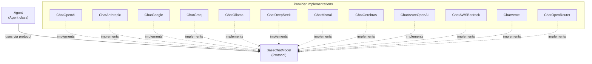
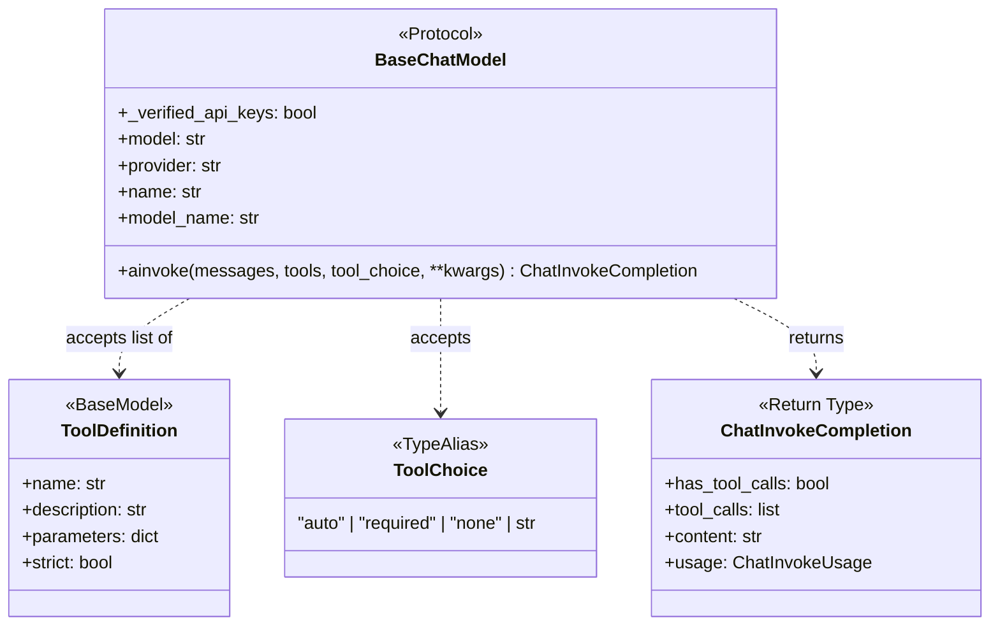
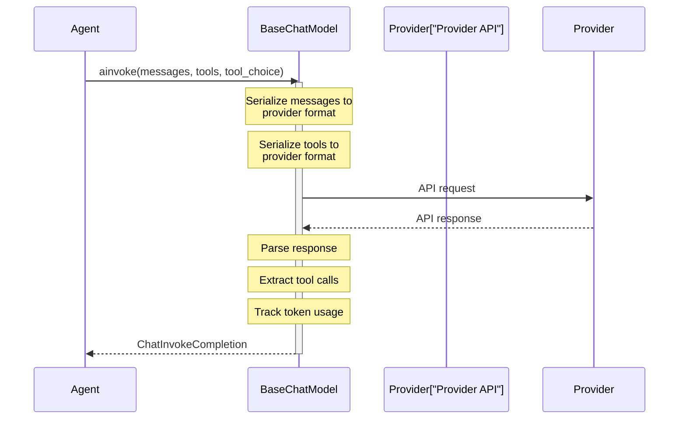
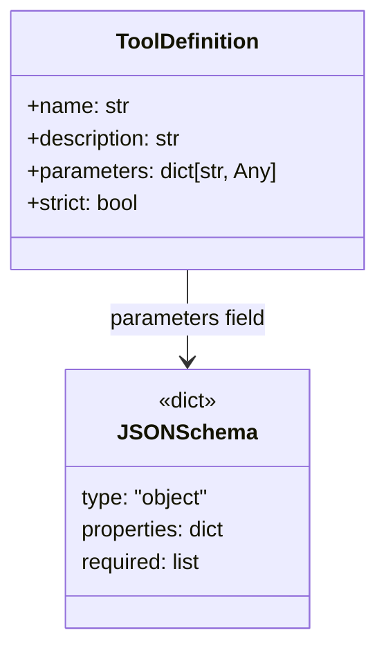
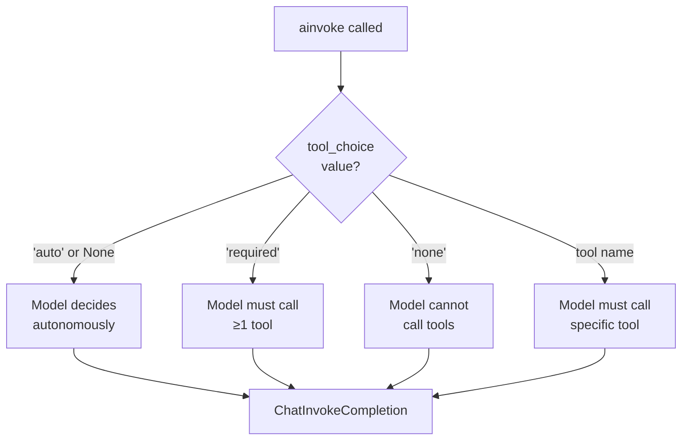
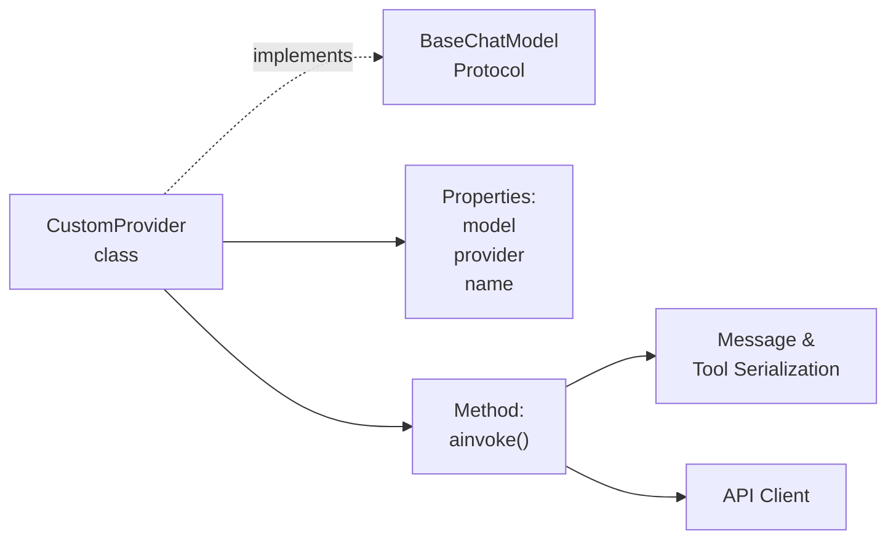
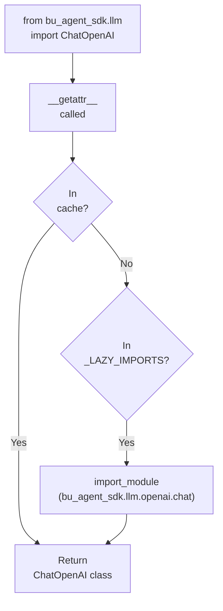

<!-- source: DeepWiki mcp.deepwiki.com · repo browser-use/agent-sdk · page 5.1 BaseChatModel Protocol · fetched 2026-10-30 -->

# BaseChatModel Protocol

<details>
<summary>Relevant source files</summary>

The following files were used as context for generating this wiki page:

- [bu_agent_sdk/llm/__init__.py](bu_agent_sdk/llm/__init__.py)
- [bu_agent_sdk/llm/base.py](bu_agent_sdk/llm/base.py)

</details>


## Purpose and Scope

The `BaseChatModel` protocol defines the standard interface that all LLM provider implementations must implement in the bu_agent_sdk. This protocol enables provider-agnostic agent development by ensuring that `ChatOpenAI`, `ChatAnthropic`, `ChatGoogle`, and all other providers expose a consistent API for message passing and tool calling.

This document covers the protocol definition, required methods and properties, and the supporting types (`ToolDefinition` and `ToolChoice`). For details on specific provider implementations, see [Supported Providers](#5.2). For message serialization specifics, see [Message Serialization](#5.4).

**Sources:** [bu_agent_sdk/llm/base.py:1-151]()

## Protocol Architecture

The `BaseChatModel` protocol sits at the heart of the LLM abstraction layer, enabling the Agent to interact with any LLM provider through a unified interface:



**Figure 1:** Protocol-based architecture enables Agent to work with any provider implementation

**Sources:** [bu_agent_sdk/llm/base.py:54-151](), [bu_agent_sdk/llm/__init__.py:98-117]()

## Protocol Definition

The `BaseChatModel` protocol is defined using Python's `Protocol` with `@runtime_checkable` decorator, enabling both static type checking and runtime validation:



**Figure 2:** BaseChatModel protocol structure and associated types

**Sources:** [bu_agent_sdk/llm/base.py:54-151]()

## Required Properties

All implementations of `BaseChatModel` must provide the following properties:

| Property | Type | Description |
|----------|------|-------------|
| `_verified_api_keys` | `bool` | Internal flag indicating whether API keys have been validated (default: `False`) |
| `model` | `str` | The model identifier string (e.g., `"gpt-4o"`, `"claude-3-5-sonnet-20241022"`) |
| `provider` | `str` | The provider name (e.g., `"openai"`, `"anthropic"`, `"google"`) |
| `name` | `str` | The model name/identifier (typically same as `model`) |
| `model_name` | `str` | Legacy alias for `model` property (use `name` instead) |

### Property Implementation Example

```python
class ChatOpenAI(BaseChatModel):
    model: str = "gpt-4o"
    
    @property
    def provider(self) -> str:
        return "openai"
    
    @property
    def name(self) -> str:
        return self.model
```

**Sources:** [bu_agent_sdk/llm/base.py:61-78]()

## The ainvoke Method

The `ainvoke` method is the core interface for interacting with LLM providers. It accepts conversation messages, optional tool definitions, and returns a completion response:



**Figure 3:** ainvoke method execution flow

### Method Signature

```python
async def ainvoke(
    self,
    messages: list[BaseMessage],
    tools: list[ToolDefinition] | None = None,
    tool_choice: ToolChoice | None = None,
    **kwargs: Any,
) -> ChatInvokeCompletion:
```

### Parameters

| Parameter | Type | Description |
|-----------|------|-------------|
| `messages` | `list[BaseMessage]` | Conversation history including `UserMessage`, `AssistantMessage`, `ToolMessage`, `SystemMessage`, and `DeveloperMessage` |
| `tools` | `list[ToolDefinition] \| None` | Optional list of tools the model can call. If `None`, model operates without tool calling |
| `tool_choice` | `ToolChoice \| None` | Controls tool calling behavior (see Tool Choice section below) |
| `**kwargs` | `Any` | Provider-specific parameters (e.g., `temperature`, `max_tokens`, `top_p`) |

### Return Value

Returns a `ChatInvokeCompletion` object containing:
- `has_tool_calls`: Boolean indicating if the model wants to call tools
- `tool_calls`: List of `ToolCall` objects if any tools were requested
- `content`: Text content of the response
- `usage`: `ChatInvokeUsage` object with token counts and cost information
- Additional provider-specific metadata

**Sources:** [bu_agent_sdk/llm/base.py:80-135]()

## ToolDefinition Type

The `ToolDefinition` class provides a provider-agnostic representation of callable tools that gets serialized to each provider's specific format:



**Figure 4:** ToolDefinition structure with JSON Schema parameters

### Fields

| Field | Type | Required | Description |
|-------|------|----------|-------------|
| `name` | `str` | Yes | Unique tool name (used by model to invoke the tool) |
| `description` | `str` | Yes | Description of tool functionality (model uses this to decide when to call) |
| `parameters` | `dict[str, Any]` | Yes | JSON Schema object describing tool parameters |
| `strict` | `bool` | No (default: `True`) | Whether to enforce strict schema validation (OpenAI-specific feature) |

### Example Usage

```python
from bu_agent_sdk.llm.base import ToolDefinition

weather_tool = ToolDefinition(
    name="get_weather",
    description="Get the current weather for a location",
    parameters={
        "type": "object",
        "properties": {
            "location": {
                "type": "string",
                "description": "City name"
            }
        },
        "required": ["location"]
    },
    strict=True
)
```

**Note:** The Agent system automatically generates `ToolDefinition` objects from functions decorated with `@tool`. Manual creation is typically only needed for custom integrations.

**Sources:** [bu_agent_sdk/llm/base.py:16-41]()

## ToolChoice Type

`ToolChoice` is a type alias that controls how the model uses available tools:

```python
ToolChoice = Literal["auto", "required", "none"] | str
```

### Values and Behavior

| Value | Behavior | Use Case |
|-------|----------|----------|
| `"auto"` | Model decides whether to call tools | Default - lets model choose based on context |
| `"required"` | Model must call at least one tool | Force tool usage (useful for autonomous agents) |
| `"none"` | Model cannot call any tools | Prevent tool calling (useful for final responses) |
| `str` (tool name) | Force specific tool by name | Guarantee a specific tool is called (e.g., `"done"`) |

### Control Flow Example



**Figure 5:** ToolChoice control flow in ainvoke

### Usage Example

```python
# Let model decide
response = await llm.ainvoke(messages, tools=tools, tool_choice="auto")

# Force tool usage
response = await llm.ainvoke(messages, tools=tools, tool_choice="required")

# Prevent tool usage
response = await llm.ainvoke(messages, tools=tools, tool_choice="none")

# Force specific tool
response = await llm.ainvoke(messages, tools=tools, tool_choice="done")
```

**Sources:** [bu_agent_sdk/llm/base.py:43-51]()

## Pydantic Integration

The `BaseChatModel` protocol includes special support for Pydantic validation, allowing it to be used as a type in Pydantic models:

```python
@classmethod
def __get_pydantic_core_schema__(
    cls,
    source_type: type,
    handler: Any,
) -> Any:
    """Allow this Protocol to be used in Pydantic models."""
    from pydantic_core import core_schema
    return core_schema.any_schema()
```

This enables type-safe agent configuration:

```python
from pydantic import BaseModel
from bu_agent_sdk.llm import BaseChatModel

class AgentConfig(BaseModel):
    llm: BaseChatModel  # Accepts any BaseChatModel implementation
    max_iterations: int = 10
```

**Sources:** [bu_agent_sdk/llm/base.py:137-151]()

## Implementation Requirements

To implement a custom LLM provider, a class must:

1. **Define required properties:**
   - `model: str` - Model identifier
   - `provider: str` - Provider name
   - `name: str` - Model name
   - `_verified_api_keys: bool` - API key validation status

2. **Implement the `ainvoke` method:**
   - Accept `messages`, `tools`, and `tool_choice` parameters
   - Serialize messages to provider-specific format (see [Message Serialization](#5.4))
   - Serialize tools to provider-specific format
   - Make API call to provider
   - Parse response and extract tool calls
   - Track token usage
   - Return `ChatInvokeCompletion` object

3. **Handle errors appropriately:**
   - Raise `ModelProviderError` for provider-specific errors
   - Raise `ModelRateLimitError` for rate limit errors
   - See [Error Handling](#5.5) for details

### Minimal Implementation Example



**Figure 6:** Required components for BaseChatModel implementation

**Sources:** [bu_agent_sdk/llm/base.py:54-151]()

## Integration with Agent System

The Agent class uses `BaseChatModel` as a protocol-typed dependency, enabling provider-agnostic operation:

```mermaid
sequenceDiagram
    participant Agent
    participant llm["llm: BaseChatModel"]
    participant Tools["Tool Registry"]
    
    Note over Agent: Agent initialized with<br/>any BaseChatModel impl
    
    loop Agentic Loop
        Agent->>llm: ainvoke(messages, tools, tool_choice)
        llm-->>Agent: ChatInvokeCompletion
        
        alt has_tool_calls
            Agent->>Tools: Execute tool calls
            Tools-->>Agent: ToolMessage results
            Note over Agent: Add results to messages
        else no tool calls
            Note over Agent: Task complete
        end
    end
```

**Figure 7:** Agent-LLM interaction through BaseChatModel protocol

The protocol abstraction allows agents to be configured with any provider without code changes:

```python
from bu_agent_sdk import Agent
from bu_agent_sdk.llm import ChatOpenAI, ChatAnthropic, ChatGoogle

# All of these work identically
agent1 = Agent(llm=ChatOpenAI(model="gpt-4o"))
agent2 = Agent(llm=ChatAnthropic(model="claude-3-5-sonnet-20241022"))
agent3 = Agent(llm=ChatGoogle(model="gemini-2.0-flash-exp"))
```

**Sources:** [bu_agent_sdk/llm/base.py:54-151](), [bu_agent_sdk/llm/__init__.py:1-193]()

## Runtime Type Checking

The `@runtime_checkable` decorator enables runtime validation that an object implements the protocol:

```python
from bu_agent_sdk.llm import BaseChatModel

def validate_llm(llm: object) -> bool:
    return isinstance(llm, BaseChatModel)

# Works at runtime
assert validate_llm(ChatOpenAI(model="gpt-4o"))
assert validate_llm(ChatAnthropic(model="claude-3-5-sonnet-20241022"))
```

This is particularly useful for:
- Dynamic provider loading
- Configuration validation
- Testing and debugging

**Sources:** [bu_agent_sdk/llm/base.py:54-59]()

## Lazy Import Mechanism

The SDK uses a lazy import mechanism to avoid loading heavy provider dependencies until they're actually used:



**Figure 8:** Lazy import flow for BaseChatModel implementations

This approach ensures:
- Fast initial import times
- Reduced memory footprint
- Only required dependencies are loaded

**Sources:** [bu_agent_sdk/llm/__init__.py:98-151]()

---

