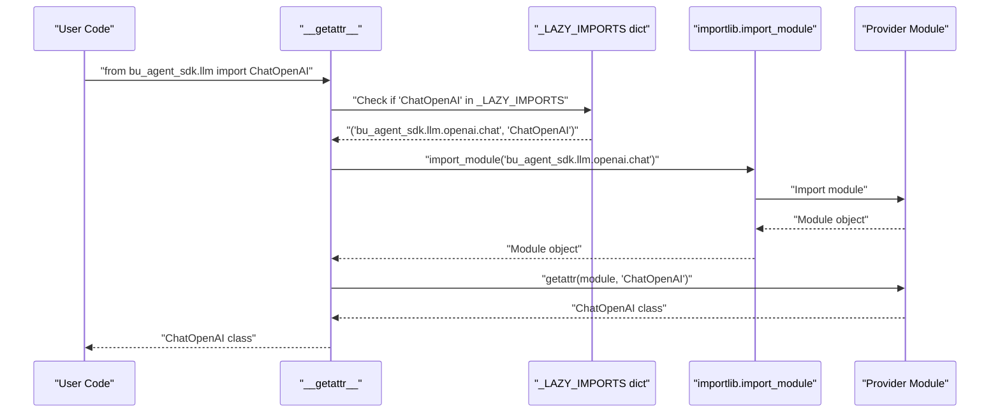
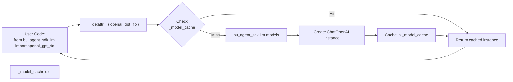
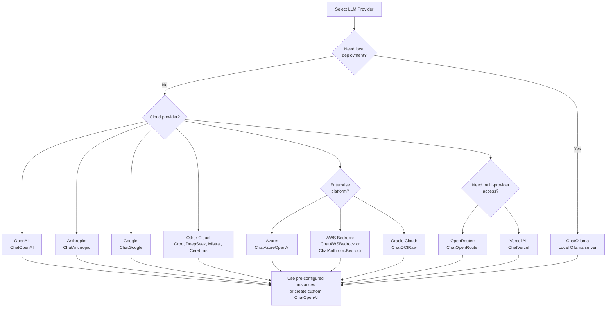

<!-- source: DeepWiki mcp.deepwiki.com · repo browser-use/agent-sdk · page 5.2 Supported Providers · fetched 2026-10-30 -->

# Supported Providers

<details>
<summary>Relevant source files</summary>

The following files were used as context for generating this wiki page:

- [bu_agent_sdk/llm/README.md](bu_agent_sdk/llm/README.md)
- [bu_agent_sdk/llm/__init__.py](bu_agent_sdk/llm/__init__.py)

</details>


This page documents all LLM providers supported by bu_agent_sdk, including officially supported providers, pre-configured model instances, and unofficial integrations. For details on the common interface all providers implement, see [BaseChatModel Protocol](#5.1). For an in-depth look at a specific provider implementation, see [Provider Implementation: Anthropic](#5.3).

## Official Provider Support

The bu_agent_sdk officially supports eight LLM providers out of the box, with lazy-loading to minimize import overhead. Each provider implements the `BaseChatModel` protocol [bu_agent_sdk/llm/base.py]() and provides a unified interface for tool calling.

**Sources:** [bu_agent_sdk/llm/README.md:1-26](), [bu_agent_sdk/llm/__init__.py:98-117]()

### Provider Class Mapping

```mermaid
graph TB
    subgraph "Provider Classes"
        ChatOpenAI["ChatOpenAI<br/>bu_agent_sdk.llm.openai.chat"]
        ChatAnthropic["ChatAnthropic<br/>bu_agent_sdk.llm.anthropic.chat"]
        ChatGoogle["ChatGoogle<br/>bu_agent_sdk.llm.google.chat"]
        ChatGroq["ChatGroq<br/>bu_agent_sdk.llm.groq.chat"]
        ChatOllama["ChatOllama<br/>bu_agent_sdk.llm.ollama.chat"]
        ChatDeepSeek["ChatDeepSeek<br/>bu_agent_sdk.llm.deepseek.chat"]
        ChatMistral["ChatMistral<br/>bu_agent_sdk.llm.mistral.chat"]
        ChatCerebras["ChatCerebras<br/>bu_agent_sdk.llm.cerebras.chat"]
    end
    
    subgraph "Extended Provider Classes"
        ChatAzureOpenAI["ChatAzureOpenAI<br/>bu_agent_sdk.llm.azure.chat"]
        ChatAWSBedrock["ChatAWSBedrock<br/>bu_agent_sdk.llm.aws.chat_bedrock"]
        ChatAnthropicBedrock["ChatAnthropicBedrock<br/>bu_agent_sdk.llm.aws.chat_anthropic"]
        ChatOpenRouter["ChatOpenRouter<br/>bu_agent_sdk.llm.openrouter.chat"]
        ChatVercel["ChatVercel<br/>bu_agent_sdk.llm.vercel.chat"]
        ChatOCIRaw["ChatOCIRaw<br/>bu_agent_sdk.llm.oci_raw.chat"]
        ChatBrowserUse["ChatBrowserUse<br/>bu_agent_sdk.llm.bu_agent_sdk.chat"]
    end
    
    BaseChatModel["BaseChatModel Protocol<br/>bu_agent_sdk.llm.base"]
    
    BaseChatModel -.->|implements| ChatOpenAI
    BaseChatModel -.->|implements| ChatAnthropic
    BaseChatModel -.->|implements| ChatGoogle
    BaseChatModel -.->|implements| ChatGroq
    BaseChatModel -.->|implements| ChatOllama
    BaseChatModel -.->|implements| ChatDeepSeek
    BaseChatModel -.->|implements| ChatMistral
    BaseChatModel -.->|implements| ChatCerebras
    
    BaseChatModel -.->|implements| ChatAzureOpenAI
    BaseChatModel -.->|implements| ChatAWSBedrock
    BaseChatModel -.->|implements| ChatAnthropicBedrock
    BaseChatModel -.->|implements| ChatOpenRouter
    BaseChatModel -.->|implements| ChatVercel
    BaseChatModel -.->|implements| ChatOCIRaw
    BaseChatModel -.->|implements| ChatBrowserUse
```



**Sources:** [bu_agent_sdk/llm/__init__.py:98-117]()

## Core Providers

The following table lists all officially supported providers with their configuration requirements and key characteristics:

| Provider | Class Name | API Key Env Variable | Base URL Env Variable | Notes |
|----------|-----------|---------------------|----------------------|-------|
| OpenAI | `ChatOpenAI` | `OPENAI_API_KEY` | `OPENAI_BASE_URL` (optional) | Default provider, full feature support |
| Anthropic | `ChatAnthropic` | `ANTHROPIC_API_KEY` | `ANTHROPIC_BASE_URL` (optional) | Extended thinking, prompt caching |
| Google | `ChatGoogle` | `GOOGLE_API_KEY` | `GOOGLE_BASE_URL` (optional) | Gemini models |
| Groq | `ChatGroq` | `GROQ_API_KEY` | `GROQ_BASE_URL` (optional) | Fast inference |
| Ollama | `ChatOllama` | N/A | `OLLAMA_BASE_URL` (default: `http://localhost:11434`) | Local models |
| DeepSeek | `ChatDeepSeek` | `DEEPSEEK_API_KEY` | `DEEPSEEK_BASE_URL` (optional) | DeepSeek models |
| Mistral | `ChatMistral` | `MISTRAL_API_KEY` | `MISTRAL_BASE_URL` (optional) | See Mistral-specific notes below |
| Cerebras | `ChatCerebras` | `CEREBRAS_API_KEY` | `CEREBRAS_BASE_URL` (optional) | Ultra-fast inference |

**Sources:** [bu_agent_sdk/llm/__init__.py:98-117](), [bu_agent_sdk/llm/README.md:3-18]()

### Import Pattern

All providers use lazy-loading via `__getattr__` to minimize import overhead. Providers are imported on first access:

```python
from bu_agent_sdk.llm import ChatOpenAI, ChatAnthropic, ChatGoogle

# Provider classes are imported on-demand when accessed
model = ChatOpenAI(model="gpt-4o")
```

The lazy import mechanism is implemented in [bu_agent_sdk/llm/__init__.py:123-151]():



**Sources:** [bu_agent_sdk/llm/__init__.py:123-151]()

## Extended Providers

In addition to the core providers, bu_agent_sdk includes extended provider support for specific platforms and services:

### Azure OpenAI

`ChatAzureOpenAI` provides integration with Azure OpenAI Service deployments.

**Class:** `ChatAzureOpenAI` [bu_agent_sdk/llm/azure/chat.py]()  
**Import:** `from bu_agent_sdk.llm import ChatAzureOpenAI`

### AWS Bedrock

Two AWS Bedrock integrations are available:

1. **ChatAWSBedrock** - Generic AWS Bedrock provider [bu_agent_sdk/llm/aws/chat_bedrock.py]()
2. **ChatAnthropicBedrock** - Anthropic models via AWS Bedrock [bu_agent_sdk/llm/aws/chat_anthropic.py]()

### Other Extended Providers

| Provider | Class Name | Purpose |
|----------|-----------|---------|
| OpenRouter | `ChatOpenRouter` | Access to multiple models via OpenRouter API |
| Vercel AI | `ChatVercel` | Vercel AI SDK integration |
| Oracle Cloud | `ChatOCIRaw` | Oracle Cloud Infrastructure models |
| Browser Use | `ChatBrowserUse` | Internal bu_agent_sdk hosted models |

**Sources:** [bu_agent_sdk/llm/__init__.py:100-116]()

## Pre-configured Model Instances

The SDK provides pre-configured model instances for common models, accessible directly from the `bu_agent_sdk.llm` module. These instances are created on-demand and cached:

### OpenAI Models

```python
from bu_agent_sdk.llm import (
    openai_gpt_4o,
    openai_gpt_4o_mini,
    openai_gpt_4_1_mini,
    openai_o1,
    openai_o1_mini,
    openai_o1_pro,
    openai_o3,
    openai_o3_mini,
    openai_o3_pro,
    openai_o4_mini,
    openai_gpt_5,
    openai_gpt_5_mini,
    openai_gpt_5_nano,
)
```

### Azure OpenAI Models

```python
from bu_agent_sdk.llm import (
    azure_gpt_4o,
    azure_gpt_4o_mini,
    azure_gpt_4_1_mini,
    azure_o1,
    azure_o1_mini,
    azure_o1_pro,
    azure_o3,
    azure_o3_mini,
    azure_o3_pro,
    azure_gpt_5,
    azure_gpt_5_mini,
)
```

### Google Gemini Models

```python
from bu_agent_sdk.llm import (
    google_gemini_2_0_flash,
    google_gemini_2_0_pro,
    google_gemini_2_5_pro,
    google_gemini_2_5_flash,
    google_gemini_2_5_flash_lite,
)
```

**Sources:** [bu_agent_sdk/llm/__init__.py:63-93]()

### Model Instance Caching

Pre-configured instances are cached in `_model_cache` [bu_agent_sdk/llm/__init__.py:120]() and retrieved via the `__getattr__` mechanism:



**Sources:** [bu_agent_sdk/llm/__init__.py:136-151]()

## Provider-Specific Configuration

### Mistral Specifics

The `ChatMistral` provider has special handling for structured outputs:

- **Structured Output Compatibility:** Automatically strips unsupported JSON schema keywords (`minLength`, `maxLength`, `pattern`, `format`) when using structured outputs
- **Generation Parameters:** Uses `max_tokens` parameter and supports optional `safe_prompt` flag
- **Environment Variables:** `MISTRAL_API_KEY` (required), `MISTRAL_BASE_URL` (optional)

**Sources:** [bu_agent_sdk/llm/README.md:14-16]()

### Ollama Local Models

`ChatOllama` is designed for local model deployment:

- **No API Key Required:** Connects to local Ollama server
- **Default Base URL:** `http://localhost:11434`
- **Custom URL:** Set via `OLLAMA_BASE_URL` environment variable

**Sources:** [bu_agent_sdk/llm/__init__.py:112]()

## Unofficial Provider Support

### LangChain Integration

The SDK provides a `ChatLangchain` class (not officially supported) that wraps LangChain models:

```python
# Example location (not officially supported)
# examples/models/langchain/example.py
```

This allows use of any LangChain-compatible model, but it is not officially maintained by the bu_agent_sdk team. Users should reference the example code and adapt it as needed.

**Sources:** [bu_agent_sdk/llm/README.md:21-25]()

## Environment Configuration

All providers automatically load environment variables from `.env` files via `load_dotenv()` [bu_agent_sdk/llm/__init__.py:10-13](). This allows convenient API key management:

```bash
# .env file example
OPENAI_API_KEY=sk-...
ANTHROPIC_API_KEY=sk-ant-...
GOOGLE_API_KEY=...
GROQ_API_KEY=gsk_...
DEEPSEEK_API_KEY=...
MISTRAL_API_KEY=...
CEREBRAS_API_KEY=...
```

For details on general configuration and setup, see [Configuration and Setup](#8).

**Sources:** [bu_agent_sdk/llm/__init__.py:10-13]()

## Provider Selection Diagram



**Sources:** [bu_agent_sdk/llm/__init__.py:98-117](), [bu_agent_sdk/llm/README.md:3-18]()

---

